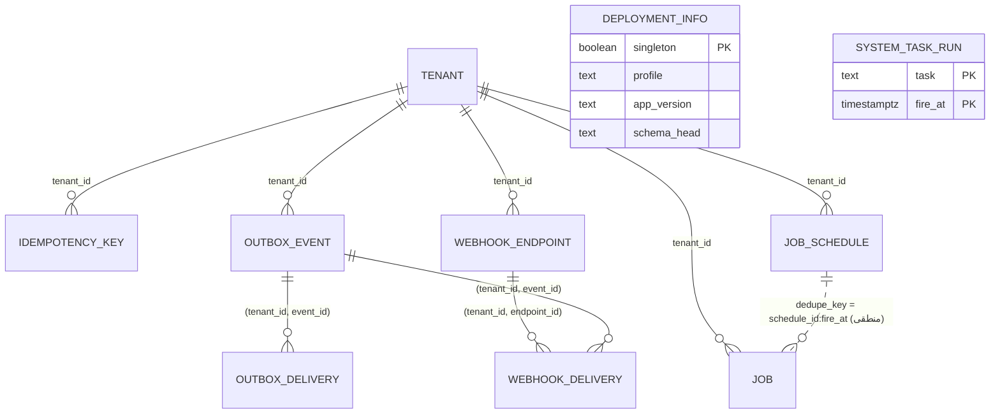
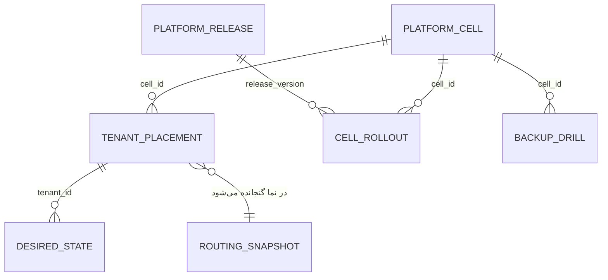
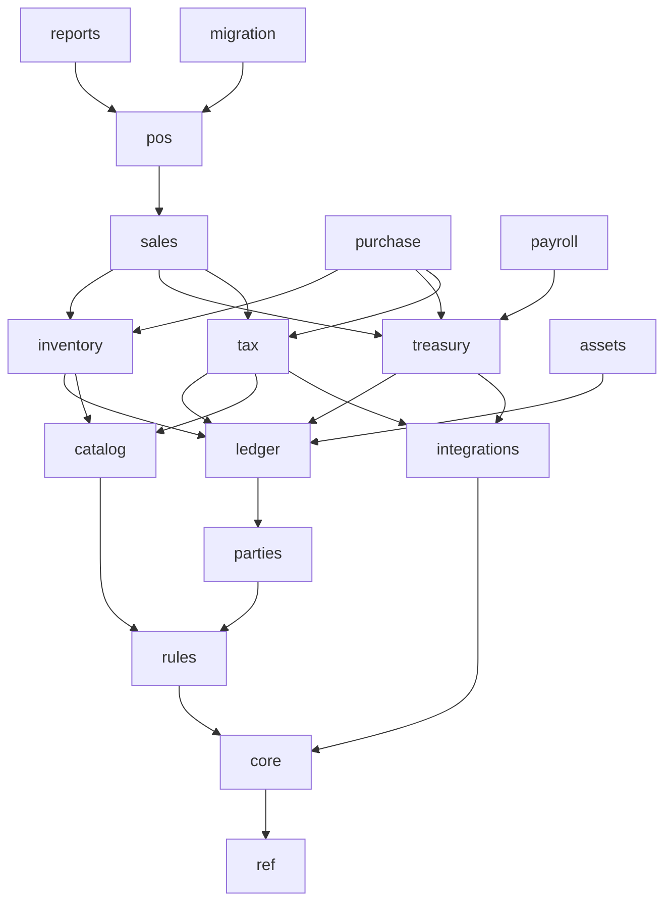
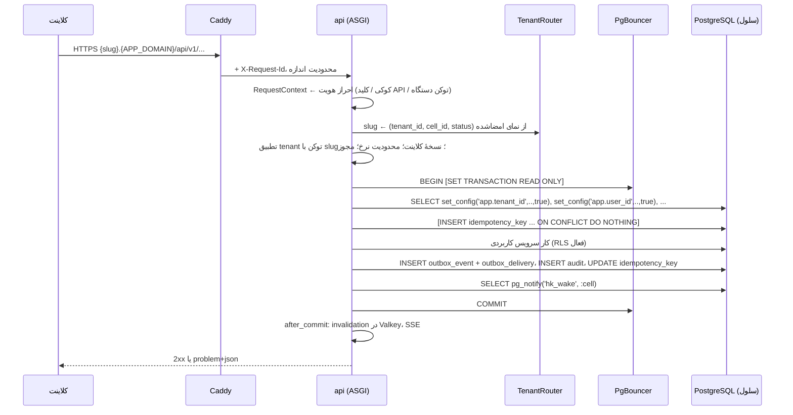
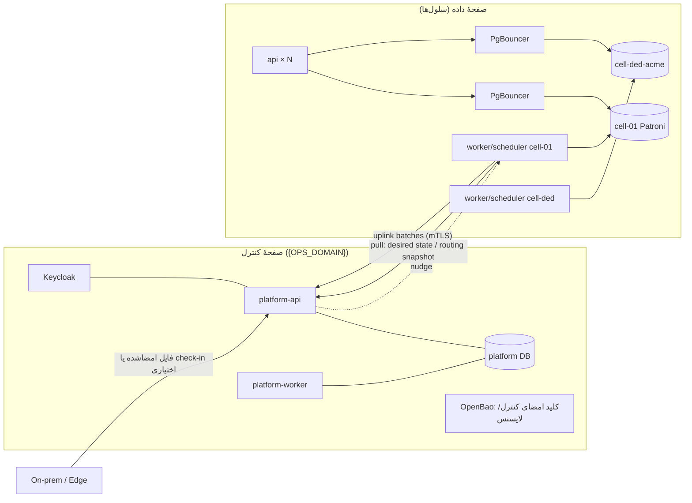
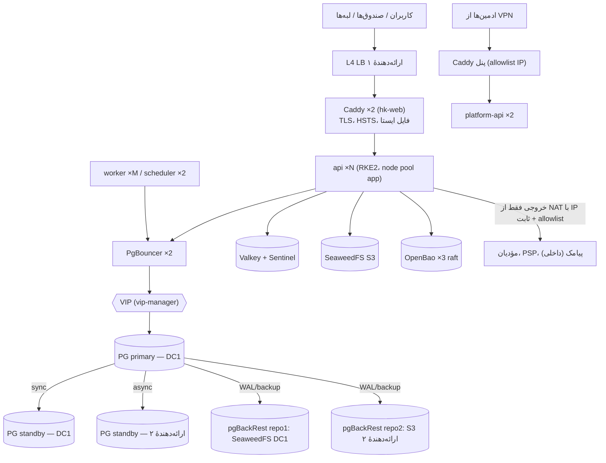

# 01 — معماری کلان، پشتهٔ فنی، ساختار مخزن، استقرار، API و کلاینت‌ها

> **وضعیت:** طراحی مرحلهٔ ۱ (پایه‌ها) · **تاریخ:** ۲۶ آبان ۱۴۰۵ (2026-11-17)
> **ورودی‌ها:** [`docs/00-decisions.md`](../00-decisions.md)، [`docs/research/README.md`](../research/README.md)، [`docs/design/sql/00_foundation.sql`](sql/00_foundation.sql)، کد بازسازی‌شدهٔ ONE CAFE در `/home/user/one-cafe/app/src`.
> **فایل SQL:** این بخش فایل SQL ندارد. جدول‌های زیرساختی که این‌جا فقط «قرارداد»شان تعریف شده (بخش ۴) در فایل SQL بخش هسته (`core`) ساخته می‌شوند. متن DDL قراردادها روی PostgreSQL 18 و پس از `00_foundation.sql` در یک پایگاه دادهٔ موقت اجرا و رفتارشان با ۲۱ آزمون بررسی شد (بخش ۴-۷).
> **قرارداد نام‌ها:** «صفحهٔ کنترل» = پایگاه داده و سرویس‌های پنل مالک (`platform`). «صفحهٔ داده» = پایگاه داده‌هایی که دادهٔ مستأجر دارند. «سلول» (cell) = یک خوشهٔ PostgreSQL صفحهٔ داده با همهٔ مستأجرانی که روی آن جای گرفته‌اند. `{APP_DOMAIN}` و `{OPS_DOMAIN}` جای دامنه‌های واقعی‌اند که هنوز انتخاب نشده‌اند.

---

## ۱. خلاصه

1. **مونولیت ماژولار** با Python 3.13 و FastAPI. یک ایمیج OCI برای backend است و «نقش» فرایند با `HK_ROLE` تعیین می‌شود: `api`، `worker`، `scheduler`، `edge`، `migrate`، `platform-api` و `platform-worker`. ماژول‌ها یک DAG لایه‌ای دارند (بخش ۵-۲). این DAG با `import-linter` در CI و با ردیابی نوشتن SQL در آزمون‌ها اجرا می‌شود.
2. **دو صفحه:** صفحهٔ کنترل (پایگاه دادهٔ جدای `platform`، پنل مالک، هرگز On-prem نیست) و صفحهٔ داده. صفحهٔ داده چهار شکل دارد که اسکیمایشان یکی است: سلول مشترک، سلول اختصاصی یک مستأجر، پایگاه دادهٔ تک‌مستأجری On-prem، و پایگاه دادهٔ جزئی سرور لبه. صفحهٔ کنترل **هرگز** مستقیم به پایگاه دادهٔ صفحهٔ داده وصل نمی‌شود. ارتباط فقط از دو راه است: «کانال کنترل» (حالت مطلوب امضاشده، کشیدنی) و «کانال گزارش» (uplink از راه outbox).
3. **هر درخواست یک تراکنش است.** شناسهٔ مستأجر و کاربر با `set_config(…, true)` در همان تراکنش تنظیم می‌شوند. RLS لایهٔ دوم دفاع است و نبودِ context به «صفر ردیف» و «رد درج» می‌انجامد. مستأجرِ فقط‌خواندنی با `SET TRANSACTION READ ONLY` در خود پایگاه داده مهار می‌شود، نه فقط در کد. کلید idempotency، رویدادهای outbox و ممیزی در **همان تراکنش** کار تجاری نوشته می‌شوند.
4. **کار پس‌زمینه، زمان‌بندی و outbox** روی PostgreSQL و با `FOR UPDATE SKIP LOCKED` ساخته می‌شوند. نقش جدای `hk_dispatcher` صف همهٔ مستأجران را می‌بیند ولی هیچ جدول تجاری را نمی‌بیند. اجرای هر کار با `hk_app` و در context مستأجر انجام می‌شود. تکمیل کار در همان تراکنشِ اثرهایش commit می‌شود.
5. **استقرار:**
   - SaaS روی IaaS دو ارائه‌دهندهٔ ایرانی اجرا می‌شود. لایه‌های بی‌حالت روی RKE2 (Kubernetes) هستند و PostgreSQL روی VM با Patroni.
   - On-prem لینوکس یک بستهٔ آفلاین Docker Compose است با ابزار نصب `hkctl` که به Rust نوشته شده.
   - On-prem ویندوز، اگر پرسش Q-B «بله» شود، نصب بومی است و Docker ندارد.
   - سرور لبهٔ فروشگاه (v2) همان کد با نقش `edge` است.
6. **زنجیرهٔ تأمین کاملاً آفلاین است:**
   - یک «ایستگاه واردات» بسته‌ها را دریافت و راستی‌آزمایی می‌کند و در میرورهای داخلی می‌گذارد: Harbor، devpi، Verdaccio، panamax، Reposilite، aptly و یک «خزانهٔ ابزار».
   - runnerهای CI اینترنت ندارند.
   - همهٔ وابستگی‌ها در lockfile با hash پین شده‌اند.
   - برای هر artifact یک SBOM از نوع CycloneDX ساخته می‌شود.
   - دروازهٔ مجوز، هر GPL، AGPL، SSPL، BUSL یا FSL را در محصول تحویلی رد می‌کند.
7. **ارتقا:**
   - نسخه‌گذاری CalVer است و یک زنجیرهٔ خطی Alembic داریم.
   - الگوی expand/contract و یک چارچوب backfill دسته‌ای به کار می‌رود.
   - بسته‌های به‌روزرسانی امضاشده‌اند و زنجیرهٔ کلید با ریشهٔ آفلاین دارند.
   - در On-prem پیش از migration پشتیبان خودکار گرفته می‌شود. «مقادیر کنترلی» (تراز آزمایشی، ارزش موجودی، سر زنجیرهٔ ممیزی) پیش و پس از ارتقا مقایسه می‌شوند و در صورت اختلاف ارتقا خودکار برمی‌گردد.
8. **API:**
   - REST زیر `/api/v1`، با خطاهای RFC 9457 و کاتالوگ کد پایدار.
   - کلید idempotency در همان تراکنش ثبت می‌شود و در آزمون، اجرای «دقیقاً یک بار» زیر هم‌روندی اثبات شد.
   - صفحه‌بندی cursor با HMAC، دستور فیلتر allowlist، bulk اتمیک یا مستقل، کارهای ناهمگام با `202`.
   - Webhook امضاشده طبق Standard Webhooks.
   - محدودیت نرخ GCRA روی Valkey، با fallback وقتی Valkey در دسترس نیست.
   - OpenAPI 3.1 به کلاینت TypeScript تبدیل می‌شود (`openapi-typescript` و `openapi-fetch`).
9. **فرانت‌اند:**
   - pnpm monorepo با برنامه‌های `web` (مستأجر)، `pos` (صندوق آفلاین)، `admin` (پنل مالک روی دامنهٔ جدا) و `partner` (پرتال نماینده، بسته به Q-E).
   - بستهٔ UI از زبان طراحی ONE CAFE گرفته شده، با اصلاح‌هایی که لازم بود: کنتراست زیر حد WCAG، تم روشن، مبلغ دهدهی به‌جای float، i18n.
   - لایهٔ ذخیره‌سازی آفلاین انتزاعی است: IndexedDB در مرورگر و SQLite در پوسته‌ها.
10. **پوسته‌های بومی:**
    - ویندوز: Tauri 2 با پل سخت‌افزار Rust (ESC/POS رستری، کشو، سریال، ترازو، PC-POS) و sidecar برای SDKهای DLL.
    - اندروید: Capacitor 8 با پلاگین‌های Kotlin برای SDK کارتخوان PSP و چاپگر داخلی. flavorها: `direct` با به‌روزرسانی امضاشده، `bazaar`، `myket` و `psp-<vendor>`.
11. **ریسک‌های فنی اصلی:**
    - WebView قدیمی کارتخوان‌های اندرویدی در برابر کمینهٔ مرورگر Tailwind 4 (Chrome 111+). پاسخ: یک build سازگار و کمینهٔ Chromium 88، که با بررسی دستگاه‌ها (Q-G) نهایی می‌شود.
    - احتمالاً نتوان گواهی امضای کد Authenticode را با تحریم‌ها تهیه کرد.
    - تمدید گواهی TLS در قطعی اینترنت بین‌الملل.
    - نسخه‌های پین‌شدهٔ پیش از ۲۰۲۶-۰۶-۰۱ (۱۱ خرداد ۱۴۰۵) که بعداً CVE گرفته‌اند (PgBouncer 1.25.2). سیاست وصلهٔ امنیتی اجباری در بخش ۱۳ آمده است.
12. این سند **۳۳ تصمیم** (D-01 تا D-33) و **۵۶ ناوردا** (INV-ARCH، INV-API، INV-OPS، INV-SEC، INV-FE، INV-DEV، INV-EDGE) دارد. هر ناوردا محل اجرا و آزمون نام‌دار دارد.

---

## ۲. دامنه

### ۲-۱. در دامنهٔ این بخش

| موضوع | زیربخش |
|---|---|
| نقشهٔ ماژول‌ها، مسئولیت‌ها و DAG وابستگی؛ ساختار داخلی ماژول؛ قرارداد رویداد دامنه | ۵-۱ تا ۵-۴ |
| چرخهٔ عمر درخواست (احراز هویت ← مستأجر ← تراکنش ← outbox)، UnitOfWork، نگاشت خطای پایگاه داده | ۵-۵ |
| نوع فرایندها، صف کار، زمان‌بند، رله‌گر outbox، Webhook | ۵-۵-ب تا ۵-۱۰ |
| صفحهٔ کنترل و صفحهٔ داده، کانال کنترل و uplink، مسیریابی مستأجر | ۵-۱۱ |
| پروفایل‌های استقرار (SaaS مشترک و اختصاصی، On-prem لینوکس، On-prem ویندوز در صورت Q-B، سرور لبه) | ۵-۱۲ و ۵-۱۳ |
| ارتقا و migration اسکیما برای هزاران مستأجر و نصب On-prem | ۵-۱۴ |
| بیلد آفلاین، زنجیرهٔ تأمین، SBOM، اسکن مجوز، امضا و خط لولهٔ CI | ۵-۱۵ و ۵-۱۶ |
| مشاهده‌پذیری، پشتیبان و بازیابی، TLS بدون Let's Encrypt، پیکربندی، رازها و کلیدها | ۵-۱۷ تا ۵-۲۱ |
| قواعد API (نسخه، خطا، idempotency، صفحه‌بندی، فیلتر، bulk، ناهمگام، Webhook، نرخ، OpenAPI → TS) | ۵-۷ تا ۵-۱۰، ۵-۲۲ و ۶ |
| معماری فرانت‌اند، بستهٔ UI برگرفته از ONE CAFE، i18n، RTL، جلالی، قالب مبلغ، دسترس‌پذیری، بودجهٔ کارایی | ۵-۲۳ |
| پوسته‌های بومی ویندوز و اندروید، پل سخت‌افزار، به‌روزرسانی و امضای کلاینت‌ها | ۵-۲۴ |
| درخت کامل monorepo | ۵-۲۵ |
| نسخه‌های پین‌شدهٔ همهٔ وابستگی‌های اصلی | ۳-ب |

### ۲-۲. بیرون از دامنه (و مالک آن)

| موضوع | مالک |
|---|---|
| جدول‌ها و SQL هویت، کاربر، نقش و مجوز، نشست، ممیزی با زنجیرهٔ hash، شماره‌گذاری بی‌فاصله، تنظیمات، پیاده‌سازی SQL جدول‌های outbox، job، idempotency و webhook (با رعایت قرارداد بخش ۴) | بخش هسته (`core`، مرحلهٔ ۱) |
| دفتر کل، PostingRequest، کدینگ و ابعاد، سال و دورهٔ مالی، مقادیر کنترلی تراز آزمایشی | بخش دفتر کل (`ledger`، مرحلهٔ ۱) |
| اشخاص، کالا، انبار، فروش و خرید | بخش بازرگانی و انبار (مرحلهٔ ۲) |
| معنای فرمان‌های همگام‌سازی صندوق، جدول‌های دستگاه و شیفت، خزانه و چک | بخش خزانه و صندوق (مرحلهٔ ۲). این بخش فقط **انتقال** (transport)، قواعد تکرار و پوستهٔ دستگاه را تعریف می‌کند |
| مؤدیان، موتور قواعد و بسته‌های `.hkrules`، حقوق، دارایی ثابت | بخش انطباق (مرحلهٔ ۲). این بخش فقط درگاه کلید (`KeyManager`) و «امضاکنندهٔ راه دور» را می‌دهد |
| منطق مهاجرت، قالب میانی، منطق عامل ویندوزی | بخش مهاجرت (مرحلهٔ ۲). این بخش فقط جای عامل در مخزن و خط بیلد و امضای آن را تعریف می‌کند |
| اسکیمای `platform` (رجیستری مستأجر، پلن، اشتراک، صورتحساب، لایسنس، نماینده، انتشار قواعد)، محتوای بستهٔ صادراتی `.hkx` و محتوای فایل لایسنس | بخش پلتفرم مالک (مرحلهٔ ۲). این بخش قرارداد ستون‌های لازم برای مسیریابی، استقرار و ارتقا را تعیین می‌کند (بخش ۴-۸) |

---

## ۳. تصمیم‌های طراحی

### D-01 — مونولیت ماژولار با DAG وابستگی اجباری
- **تصمیم:** یک بستهٔ Python به نام `hesabketab` داریم. هر ماژول تجاری یک زیربسته است و دقیقاً یک اسکیمای PostgreSQL دارد. دیگر ماژول‌ها فقط می‌توانند `hesabketab.<module>.api` را import کنند، که شامل سرویس‌های کاربردی، سرویس‌های پرس‌وجو و DTOهاست. اسکیمای رویدادها در بستهٔ برگ `hesabketab.contracts` است. لایه‌ها و وابستگی‌های مجاز در ۵-۲ آمده‌اند. چارچوب مشترک (`hesabketab.kernel`) به هیچ ماژولی وابسته نیست.
- **دلیل:** یک واحد استقرار برای SaaS و On-prem لازم است. تراکنش ACID بین ماژول‌ها در ثبت سند (مثلاً فاکتور، انبار، دفتر کل و مؤدیان) فقط در یک فرایند و یک پایگاه داده ساده است. مرز ماژول‌ها هم با ابزار اجرا می‌شود، نه با قرارداد شفاهی.
- **ردشده:** میکروسرویس (تراکنش توزیع‌شده و چند استقرار برای On-prem)؛ مونولیت بدون مرز (به گره کور می‌رسد)؛ یک اسکیما برای همه (با قرارداد مشترک «یک اسکیما برای هر ماژول» نمی‌خواند).
- **مرجع:** [۰۷ §۳-۱](../research/07-saas-onprem-platform.md#۳-۱-نمای-کلی-معماری)، [۰۶ §۷-۱](../research/06-feature-benchmark.md#۷-۱-اصل-معماری-هستهٔ-عمومی-بهاضافهٔ-بستههای-صنفی)

### D-02 — صفحهٔ کنترل جدا، صفحهٔ داده سلولی، ناوگان API بی‌حالت با TenantRouter
- **تصمیم:**
  - صفحهٔ کنترل (`platform`) پایگاه داده، فرایندها (`platform-api` و `platform-worker`) و دامنهٔ خودش را دارد.
  - صفحهٔ داده از N سلول تشکیل می‌شود. v1 فقط یک سلول دارد.
  - ناوگان `api` بی‌حالت است. `TenantRouter` با یک «نمای مسیریابی» امضاشده تصمیم می‌گیرد هر مستأجر در کدام سلول است. این نما از صفحهٔ کنترل می‌آید و در حافظه و Valkey نگه داشته می‌شود.
  - فرایندهای `worker` و `scheduler` به هر سلول وصل می‌شوند و فقط صف همان سلول را برمی‌دارند.
  - مستأجر بزرگ در سلول اختصاصی با **همان اسکیما** قرار می‌گیرد.
- **دلیل:** این همان مدل ترکیبی Microsoft و پیشنهاد پژوهش ۰۷ است. وقتی صفحهٔ کنترل از دسترس خارج شود، API با آخرین نمای مسیریابی به کار ادامه می‌دهد.
- **ردشده:** اسکیما برای هر مستأجر (هزاران migration)؛ پایگاه داده برای هر مستأجر کوچک (هزینه)؛ خواندن نگاشت مستأجر به سلول از پایگاه دادهٔ کنترل در هر درخواست (وابستگی زمان اجرا)؛ ناوگان API جدا برای هر سلول در v1 (عملیات بیشتر بدون سود در یک سلول).
- **مرجع:** [۰۷ §۲-۱-۲](../research/07-saas-onprem-platform.md#۲-۱-۲-ارزیابی-سه-مدل-برای-دادهٔ-حسابداری-حسابکتاب)، [۰۷ §۳-۳](../research/07-saas-onprem-platform.md#۳-۳-کاتالوگ-و-جایگذاری-مستأجر)

### D-03 — مسیریابی با زیردامنه؛ پنل مالک روی دامنهٔ ثبت‌شدهٔ جدا
- **تصمیم:**
  - برنامهٔ مستأجر روی `https://{slug}.{APP_DOMAIN}/` است و API آن روی `/api/v1` از همان origin، پس CORS لازم نیست.
  - صندوق PWA روی `/pos/` از همان origin است.
  - پنل مالک روی `https://admin.{OPS_DOMAIN}` است. `{OPS_DOMAIN}` یک دامنهٔ ثبت‌شدهٔ **جدا** است و فقط با VPN یا فهرست مجاز IP باز می‌شود.
  - پرتال نماینده روی `https://partner.{APP_DOMAIN}` است.
  - کوکی‌ها `__Host-` هستند و به میزبان محدودند، پس هر مستأجر کوکی جدا دارد.
- **دلیل:** کوکی‌ها بین مستأجرها جدا می‌مانند و مسیریابی با سرآیند Host ساده است. دامنهٔ جدا برای پنل مالک خطر CSRF و فیشینگ را کم می‌کند و جدایی کامل احراز هویت را ممکن می‌کند.
- **ردشده:** یک دامنه با مستأجر در مسیر URL (جدایی کوکی از بین می‌رود)؛ پنل مالک زیر همان دامنهٔ اپ.
- **مرجع:** [۰۷ §۱](../research/07-saas-onprem-platform.md#۱-خلاصهٔ-مدیریتی) بند ۷

### D-04 — هویت کاربر مستأجر در صفحهٔ داده؛ فقط «فهرست ورود» در صفحهٔ کنترل
- **تصمیم:**
  - حساب کاربر، نقش و نشست در اسکیمای `core` همان مستأجرند و RLS دارند. جزئیات با بخش هسته است.
  - صفحهٔ کنترل فقط یک «فهرست ورود» دارد: HMAC شمارهٔ موبایل ← فهرست slugها. این فهرست برای صفحهٔ «فضای کاری من کجاست؟» است و از راه uplink پر می‌شود.
  - کارکنان پلتفرم با Keycloak (OIDC و WebAuthn) وارد می‌شوند. Keycloak هرگز برای کاربر مستأجر و هرگز در بستهٔ On-prem نیست.
- **دلیل:** On-prem باید بدون صفحهٔ کنترل کار کند، و بستهٔ صادراتی مستأجر باید کاربرانش را هم با خود ببرد.
- **ردشده:** هویت سراسری در صفحهٔ کنترل (On-prem را وابسته می‌کند)؛ Keycloak برای همه (یک سرویس سنگین Java در هر نصب On-prem).
- **مرجع:** [۰۷ §۳-۲](../research/07-saas-onprem-platform.md#۳-۲-لایهٔ-داده-و-rls-قابل-اجرا-از-روز-اول)، [۰۷ §۲-۱۰](../research/07-saas-onprem-platform.md#۲-۱۰-امنیت-و-انطباق)

### D-05 — هر درخواست یک تراکنش؛ context محلی؛ «فقط‌خواندنی» در خود پایگاه داده
- **تصمیم:**
  - `UnitOfWork` اولین دستور تراکنش را می‌فرستد. اگر مسیر خواندنی باشد یا وضعیت مستأجر یکی از `read_only`، `suspended`، `exporting` یا `archived` باشد، این دستور `SET TRANSACTION READ ONLY` است.
  - سپس `set_config` را برای `app.tenant_id`، `app.user_id`، `app.request_id`، `statement_timeout` و `lock_timeout` با `is_local=true` اجرا می‌کند.
  - شنوندهٔ `after_begin` در SQLAlchemy هر تراکنشی را که بدون context شروع شود رد می‌کند (fail-closed).
  - هرگز `SET` سطح نشست به کار نمی‌رود.
- **دلیل:** این روش با PgBouncer در حالت transaction سازگار است. در آزمون این بخش، درج بدون context با خطای RLS رد شد و نوشتن در تراکنش READ ONLY با `25006` شکست خورد.
- **ردشده:** `SET` سطح نشست؛ thread-local (نشت درخواست به درخواست مثل Nile)؛ بررسی فقط‌خواندنی فقط در کد.
- **مرجع:** [۰۷ §۲-۱-۳](../research/07-saas-onprem-platform.md#۲-۱-۳-قواعد-دقیق-rls-که-روی-طراحی-اثر-دارند)، [۰۷ §۲-۵-۳](../research/07-saas-onprem-platform.md#۲-۵-۳-طرح-پیشنهادی-لایسنس-حسابکتاب)

### D-06 — نقش‌های پایگاه داده؛ نبودِ BYPASSRLS در زمان اجرا
- **تصمیم:**

  | نقش | کاربرد |
  |---|---|
  | `hk_migrator` | مالک همهٔ اشیاء، `BYPASSRLS`؛ فقط در `migrate`، `hkctl` و نگهداری |
  | `hk_app` | زمان اجرا؛ نه مالک، نه `BYPASSRLS` |
  | `hk_dispatcher` | `NOBYPASSRLS`، با policy مختص خودش فقط روی جدول‌های صف |
  | `hk_reports` | replica، `NOBYPASSRLS`، `statement_timeout` بلند |
  | `hk_readonly` | از قبل در foundation هست |

  صفحهٔ کنترل نقش و اتصالی به پایگاه دادهٔ صفحهٔ داده **ندارد**. پیشنهاد `hk_platform BYPASSRLS` در پژوهش ۰۷ رد شد.
- **دلیل:**
  - کوچک‌ترین سطح دسترسی ممکن.
  - `hk_dispatcher` نیاز به `SECURITY DEFINER` برای برداشتن کار از همهٔ مستأجرها را حذف می‌کند. در آزمون، این نقش کارهای همهٔ مستأجرها را دید ولی `core.company` را نتوانست بخواند.
  - تحلیل درآمد و مصرف از راه uplink می‌آید، نه با خواندن مستقیم.
- **ردشده:** تابع `SECURITY DEFINER` برای claim؛ policy با متغیر `app.role` (هر کد آلوده‌ای می‌تواند آن را عوض کند)؛ جدول صف بدون RLS (lint را می‌شکند).
- **مرجع:** [۰۷ §۳-۲](../research/07-saas-onprem-platform.md#۳-۲-لایهٔ-داده-و-rls-قابل-اجرا-از-روز-اول)

### D-07 — صف کار، زمان‌بند و outbox روی PostgreSQL
- **تصمیم:**
  - جدول‌های `core.job`، `core.job_schedule`، `core.outbox_event` و `core.outbox_delivery` (قرارداد در بخش ۴).
  - برداشتن کار با `FOR UPDATE SKIP LOCKED` توسط `hk_dispatcher` انجام می‌شود. اجرا با `hk_app` و در context مستأجر است. **وضعیت «انجام‌شده» در همان تراکنشِ اثرهای handler commit می‌شود.**
  - `concurrency_key` با ایندکس یکتای جزئی اجرای هم‌زمان را سخت مهار می‌کند (مثلاً ارسال مؤدیان برای یک شناسهٔ حافظه).
  - زمان‌بند نیازی به رهبر ندارد: جلوی اجرای دوباره را `SKIP LOCKED` و پیش‌بردن `next_fire_at` در همان تراکنش می‌گیرند.
  - Valkey هرگز صف یا منبع حقیقت نیست.
- **دلیل:** نصب On-prem فقط PostgreSQL لازم دارد. اتمی بودن «اثر + تکمیل کار» تکرار را بی‌خطر می‌کند.
- **ردشده:** Celery و Dramatiq روی Valkey (وابستگی اضافه، اتمی نبودن با پایگاه داده)؛ قفل advisory سطح نشست (PgBouncer آن را پشتیبانی نمی‌کند)؛ انتخاب رهبر برای scheduler.
- **مرجع:** [۰۷ §۲-۴](../research/07-saas-onprem-platform.md#۲-۴-همسایهٔ-پرسروصدا-noisy-neighbour)، [۰۳ §۳-۱](../research/03-iran-tax-and-legal.md#۳-۱-معماری-ماژول-مالیات-tax--compliance)

### D-08 — یک ایمیج، چند نقش فرایند
- **تصمیم:** ایمیج `hk-backend:<ver>` همهٔ نقش‌ها را دارد و `hk serve --role=<role>` نقش را انتخاب می‌کند. هر نقش فقط ماژول‌های مجاز خودش را بار می‌کند (`ModuleSpec.enabled_in_roles`). مثلاً نقش `edge` ثبت دفتر کل را ندارد. ایمیج `hk-web:<ver>` شامل Caddy و فایل‌های ایستای `web` و `pos` است. ایمیج `hk-admin-web:<ver>` جداست.
- **دلیل:** نسخهٔ یکسان در همهٔ نقش‌ها، کمترین سطح حمله و یک SBOM.
- **ردشده:** ایمیج جدا برای هر نقش (ناهماهنگی نسخه)؛ اجرای Node در production (لازم نیست).

### D-09 — کانال کنترل «حالت مطلوب» و کانال گزارش (uplink)
- **تصمیم:**
  - صفحهٔ کنترل برای هر مستأجر یک `TenantDesiredState` امضاشده (Ed25519) منتشر می‌کند. این سند شامل وضعیت، حق‌ها و سقف‌ها، ماژول‌ها، feature flagها، بسته‌های قواعد و مجوزهای دسترسی پشتیبانی است.
  - کار `platform-sync` هر سلول این حالت را **می‌کشد** (pull با cursor، هر ۳۰ ثانیه، همراه با «تلنگر» push) و از راه سرویس کاربردی `core` اعمال می‌کند.
  - در On-prem همین سند داخل فایل لایسنس یا فایل امضاشدهٔ به‌روزرسانی حالت می‌آید.
  - uplink مسیر برعکس است: مشترک `uplink` در outbox، رویدادهای مصرف (برای قیمت‌گذاری Q-H)، سلامت، آمار مؤدیان و فهرست ورود را دسته‌ای و idempotent به صفحهٔ کنترل می‌فرستد.
- **دلیل:** SaaS و On-prem یک سازوکار دارند. قطع صفحهٔ کنترل کار مستأجر را نمی‌خواباند. صفحهٔ کنترل هم دسترسی پایگاه داده‌ای به دادهٔ مالی ندارد.
- **ردشده:** نوشتن مستقیم صفحهٔ کنترل در `core.tenant`؛ push بدون pull (سلول پشت NAT یا قطع)؛ نقش BYPASSRLS برای پنل.
- **مرجع:** [۰۷ §۲-۷-۲](../research/07-saas-onprem-platform.md#۲-۷-۲-فهرست-کامل-ماژولهای-پنل-مالک-پیشنهادی-با-اولویت)، [۰۷ §۲-۵-۳](../research/07-saas-onprem-platform.md#۲-۵-۳-طرح-پیشنهادی-لایسنس-حسابکتاب)

### D-10 — چهار پروفایل استقرار با یک کد
- **تصمیم:** `HK_DEPLOYMENT ∈ {saas, onprem, edge, dev, test}`. جزئیات در ۵-۱۲ و ۵-۱۳ آمده است.

  | پروفایل | زیرساخت |
  |---|---|
  | SaaS | RKE2 برای لایه‌های بی‌حالت؛ PostgreSQL با Patroni روی VM؛ دو ارائه‌دهنده و دو شهر |
  | On-prem لینوکس | بستهٔ `.hkpkg` با Docker Compose و `hkctl`؛ بدون PgBouncer؛ Valkey اختیاری؛ ذخیره‌ساز فایل محلی؛ کلید محلی |
  | On-prem ویندوز (فقط اگر Q-B «بله») | نصب بومی با PostgreSQL ویندوزی، Python جاسازی‌شده، سرویس ویندوز، بدون Docker و بدون Valkey |
  | Edge | Compose روی مینی‌PC |

- **دلیل:** RKE2 نصب air-gap رسمی و rolling update دارد. پایگاه داده روی VM کنترل کامل pgBackRest و نقش‌ها را می‌دهد. On-prem باید ساده و تک‌سروری باشد.
- **ردشده:**
  - Compose در SaaS تولیدی (self-healing و rolling چندمیزبانی ندارد).
  - Docker Swarm (راکد) و Nomad (BUSL).
  - DBaaS مدیریت‌شده (کنترل BYPASSRLS و pgBackRest را نمی‌دهد).
  - WSL2 برای ویندوز سرور (سرویس‌نبودن، شبکهٔ NAT، مجازی‌سازی تودرتو).
  - ingress-nginx (پروژهٔ بالادستی بازنشسته شده است). به جایش Caddy به‌صورت Deployment معمولی پشت L4 قرار می‌گیرد.
- **مرجع:** [۰۷ §۳-۴](../research/07-saas-onprem-platform.md#۳-۴-سه-پروفایل-استقرار)، [۰۷ §۲-۸-۳](../research/07-saas-onprem-platform.md#۲-۸-۳-ابرهای-ایرانی)

### D-11 — سرور لبهٔ فروشگاه = همان کد با نقش `edge` و پایگاه دادهٔ جزئی
- **تصمیم:**
  - سرور لبه در شبکهٔ محلی فروشگاه قرار می‌گیرد: یک مینی‌PC، یا سرور ویندوزی اگر Q-B «بله» شود.
  - همان اسکیما را دارد، ولی فقط این داده‌ها را نگه می‌دارد: کاتالوگ و قیمت (کپی خواندنی)، اشخاص لازم، میز و سفارش باز، شیفت، دستگاه‌ها و صف فرمان‌ها.
  - برای پایانه‌های فروشگاه مرجع عملیاتی است: میزهای مشترک، چاپ ایستگاه و KDS.
  - فرمان‌های پایانه‌ها را **با امضا و `device_seq` اصلی خودشان** به ابر رله می‌کند. پس دریافت در ابر برای «پایانهٔ مستقیم» و «پایانه از راه لبه» یکسان است.
  - لبه هرگز سند حسابداری نمی‌سازد.
- **دلیل:** قطع شبکهٔ ملی رخ داده است. در چنین وضعی کافهٔ دوصندوقی باید میزهای مشترک داشته باشد.
- **ردشده:** SQLite روی لبه (اسکیما و کد دوم)؛ CRDT (قیدهای حسابداری را نمی‌پوشاند)؛ ساخت سند دفتر کل روی لبه (دو مرجع حقیقت).
- **مرجع:** [۰۷ §۲-۶-۲](../research/07-saas-onprem-platform.md#۲-۶-۲-طرح-پیشنهادی-همگامسازی-حسابکتاب)، [۰۷ §۲-۸-۲](../research/07-saas-onprem-platform.md#۲-۸-۲-قطعیهای-اینترنت-خلاصهٔ-زمانی)

### D-12 — بیلد کاملاً آفلاین با ایستگاه واردات و میرورهای گزینش‌شده
- **تصمیم:**
  - هیچ runner در CI به اینترنت راه ندارد.
  - هر ورودی بالادستی فقط از «ایستگاه واردات» وارد می‌شود. ایستگاه آن را با hash موجود در lockfile و امضای بالادستی راستی‌آزمایی می‌کند، اسکن مجوز و آسیب‌پذیری را اجرا می‌کند، و در میرور داخلی می‌گذارد.
  - میرورها: Harbor (OCI و Helm)، devpi (PyPI)، Verdaccio (npm)، panamax (crates و rustup)، Reposilite (Maven، Google Maven و Gradle) و aptly (Debian و Ubuntu)، به‌اضافهٔ «خزانهٔ ابزار» روی ذخیره‌ساز شیء.
  - میرورهای ایرانی (مثل لیارا) فقط منبع بالادستیِ ایستگاه‌اند. چون hashها از lockfile می‌آیند، اعتماد به خود میرور لازم نیست.
- **دلیل:** Docker Hub ساکنان ایران را منع می‌کند. GitLab.com ایران را تحریم کرده و GitHub در فهرست سفید نیست. Google Maven و Android SDK از ایران قابل‌اتکا نیستند.
- **ردشده:** proxy-cache زنده در CI (بیلد غیرتکرارپذیر، وابستگی زمان بیلد)؛ اتکای مستقیم به میرور شخص ثالث.
- **مرجع:** [۰۷ §۲-۸-۱](../research/07-saas-onprem-platform.md#۲-۸-۱-تحریمها-و-دسترسی-به-سرویسهای-خارجی)، [۰۷ §۲-۹](../research/07-saas-onprem-platform.md#۲-۹-پشتهٔ-کاملاً-خودمیزبان-پیشنهادی)

### D-13 — CalVer، کانال‌ها و «بستهٔ امضاشدهٔ HK» با زنجیرهٔ کلید ریشهٔ آفلاین
- **تصمیم:**
  - نسخه‌ها `YYYY.M.P` هستند (مثلاً `2027.3.0`). کانال‌ها: `stable`، `lts` (هر ۶ ماه، ۲۴ ماه وصلهٔ امنیتی و قانونی) و `beta`.
  - همهٔ فایل‌های قابل‌نصب یک «بستهٔ امضاشدهٔ HK» (HKSB v1) هستند: zip با `manifest.json`، `manifest.sig`، `keyring.json` و `payload/…`. انواع: `install` (`.hkpkg`)، `update` (`.hku`)، `rules` (`.hkrules`)، `export` (`.hkx`)، `license` (`.lic`) و `state`.
  - امضای `manifest.sig` با کلید برخط هدف است. کلید برخط در `keyring.json` آمده و آن فایل را دست‌کم ۲ از ۳ کلید ریشهٔ Ed25519 امضا کرده‌اند. کلیدهای ریشه آفلاین‌اند و با Shamir ۳ از ۵ نگه داشته می‌شوند. فقط کلیدهای عمومی ریشه در کد ثابت‌اند.
  - نسخهٔ keyring یکنواخت بالا می‌رود (حفاظت از برگشت).
- **دلیل:** تاریخ انتشار در خود نسخه است، پس با `updates_until` لایسنس مقایسه‌پذیر است. یک قالب و یک کد راستی‌آزمایی برای پنج نوع فایل داریم. چرخش کلید بدون انتشار نسخهٔ جدید ممکن است.
- **ردشده:** SemVer (تاریخ انتشار را نمی‌گوید)؛ قالب جدا برای هر نوع فایل؛ کلید امضای یگانه در کد.
- **مرجع:** [۰۷ §۲-۵-۳](../research/07-saas-onprem-platform.md#۲-۵-۳-طرح-پیشنهادی-لایسنس-حسابکتاب)، [۰۷ §۲-۳](../research/07-saas-onprem-platform.md#۲-۳-پشتیبانگیری-بازیابی-هر-مستأجر-و-جابهجایی-saas-و-on-prem)

### D-14 — migration: یک زنجیرهٔ Alembic، expand/contract، فقط رو به جلو
- **تصمیم:**
  - یک تاریخچهٔ خطی Alembic برای صفحهٔ داده داریم و یکی جدا برای صفحهٔ کنترل.
  - هر migration برچسب `phase ∈ {expand, data, contract}` و `online_safe` دارد.
  - هر انتشار فقط expand و data دارد. contract دست‌کم دو انتشار بعد و پس از برقراری پیش‌شرط‌ها اجرا می‌شود: backfill کامل در همهٔ سلول‌ها، و پایین‌ترین نسخهٔ On-prem پشتیبانی‌شده دیگر به ستون قدیم نیاز نداشته باشد.
  - downgrade وجود ندارد. راه برگشت، بازیابی پشتیبانی است که درست پیش از ارتقا گرفته شده.
  - در SaaS، «هماهنگ‌کنندهٔ انتشار» در صفحهٔ کنترل سلول‌ها را حلقه‌به‌حلقه جلو می‌برد.
  - در On-prem، `hkctl` پشتیبان می‌گیرد، migration را اجرا و مقادیر کنترلی را مقایسه می‌کند. هر خطا یعنی برگشت خودکار.
- **دلیل:** مدل Pool یک migration برای همهٔ مستأجرها دارد. مشتری On-prem ممکن است چند نسخه عقب باشد. migration پایگاه داده همیشه برگشت‌پذیر نیست.
- **ردشده:** downgrade Alembic (برای دادهٔ حسابداری خطرناک است)؛ migration جدا برای هر مستأجر.
- **مرجع:** [۰۷ §۲-۲](../research/07-saas-onprem-platform.md#۲-۲-migration-و-نسخهها)

### D-15 — مشاهده‌پذیری خودمیزبان، بدون برچسب مستأجر در متریک
- **تصمیم:**
  - متریک: Prometheus 3، Alertmanager و exporterها.
  - لاگ: لاگ JSON با structlog ← Grafana Alloy ← Loki.
  - رد (trace): OpenTelemetry ← Collector ← Tempo.
  - خطا: GlitchTip با SDK سنتری.
  - داشبورد Grafana فقط داخلی SaaS است.
  - شناسهٔ مستأجر در لاگ و trace می‌آید، **نه** در برچسب متریک. مصرف هر مستأجر از شمارنده‌های برنامه و uplink گرفته می‌شود.
  - On-prem صفحهٔ «وضعیت سامانه» درون اپ و `/metrics` اختیاری دارد، ولی Grafana و Loki ندارد چون AGPL هستند.
- **ردشده:** Sentry SaaS، Grafana Cloud و هر سرویس خارجی؛ برچسب `tenant_id` در Prometheus (انفجار cardinality).
- **مرجع:** [۰۷ §۲-۹](../research/07-saas-onprem-platform.md#۲-۹-پشتهٔ-کاملاً-خودمیزبان-پیشنهادی)، [۰۷ §۲-۴](../research/07-saas-onprem-platform.md#۲-۴-همسایهٔ-پرسروصدا-noisy-neighbour)

### D-16 — پشتیبان با pgBackRest در دو مخزن، تمرین بازیابی خودکار، مقادیر کنترلی
- **تصمیم:**
  - SaaS دو مخزن دارد: repo1 محلی روی S3 در SeaweedFS (نگهداری کوتاه) و repo2 در ارائه‌دهنده و شهر دوم (نگهداری بلند). هر دو رمزنگاری `aes-256-cbc` دارند.
  - `archive_timeout=60s`.
  - تمرین بازیابی هفتگی خودکار، به‌تناوب از repo1 و repo2، با `hk verify integrity`.
  - On-prem لینوکس: pgBackRest روی دیسک دوم، به‌اضافهٔ کپی دوردست اختیاری (SFTP، NAS یا USB).
  - On-prem ویندوز: `hk-backup` با `pg_basebackup`، بایگانی WAL و `pg_dump`، چون pgBackRest روی ویندوز اجرا نمی‌شود.
  - بازیابی یک مستأجر از راه بستهٔ `.hkx` انجام می‌شود که از نمونهٔ PITR موقت صادر شده است.
- **مرجع:** [۰۷ §۲-۳](../research/07-saas-onprem-platform.md#۲-۳-پشتیبانگیری-بازیابی-هر-مستأجر-و-جابهجایی-saas-و-on-prem)، [۰۷ §۲-۱۰](../research/07-saas-onprem-platform.md#۲-۱۰-امنیت-و-انطباق)

### D-17 — TLS بدون Let's Encrypt
- **تصمیم:**
  - **دامنهٔ عمومی SaaS:** گواهی wildcard از دست‌کم دو CA تجاری که از ایران قابل‌خرید باشند. هرجا CA از ACME (با EAB و DNS-01 از راه API DNS ایرانی) پشتیبانی کند، صدور خودکار است. Caddy چند صادرکننده را به‌ترتیب fallback امتحان می‌کند. تمدید از ۵۰٪ عمر گواهی شروع می‌شود و ورود دستی هم ممکن است.
  - **داخلی:** PKI در OpenBao با cert-manager، گواهی ۳۰ روزه و mTLS تا PostgreSQL با `sslmode=verify-full`.
  - **On-prem در LAN:** CA داخلی Caddy با ریشهٔ ده‌ساله و برگ کوتاه‌عمر خودکار. ریشه هنگام جفت‌شدن به کلاینت‌ها داده می‌شود.
  - **اختیاری:** «حالت نام عمومی LAN» (`*.{install_id}.lan.{APP_DOMAIN}`) برای نصب‌هایی که گاه به اینترنت دسترسی دارند.
- **دلیل:**
  - Let's Encrypt از فهرست سفید حذف شد.
  - سقف اعتبار گواهی کم می‌شود: ۲۰۰ روز از ۱۵ مارس ۲۰۲۶، ۱۰۰ روز از ۱۵ مارس ۲۰۲۷ و ۴۷ روز از ۱۵ مارس ۲۰۲۹. پس تمدید باید خودکار باشد و حاشیهٔ قطعی داشته باشد.
- **مرجع:** [۰۷ §۲-۸-۱](../research/07-saas-onprem-platform.md#۲-۸-۱-تحریمها-و-دسترسی-به-سرویسهای-خارجی)، [۰۷ §۲-۱۰](../research/07-saas-onprem-platform.md#۲-۱۰-امنیت-و-انطباق)

### D-18 — پیکربندی لایه‌ای با pydantic-settings و ارجاع به راز
- **تصمیم:**
  - ترتیب اولویت: پیش‌فرض کد ← فایل TOML محلی (`/etc/hesabketab/hesabketab.toml` یا `%ProgramData%\Hesabketab\hesabketab.toml`) ← متغیرهای `HK_*`.
  - فیلدهای راز از نوع `SecretRef` هستند، مثل `openbao://…`، `file://…` یا `dpapi://…`، و در شروع برنامه resolve می‌شوند.
  - پیکربندی نامعتبر یعنی برنامه شروع نمی‌شود.
  - تنظیمات سطح مستأجر دادهٔ پایگاه داده‌اند (مالکش بخش هسته)، نه env.
- **ردشده:** `.env` با راز در production؛ پیکربندی پراکنده.

### D-19 — رازها و کلیدها: OpenBao در SaaS، Keyring محلی در On-prem، با یک درگاه
- **تصمیم:**
  - درگاه `KeyManager` با دو پیاده‌سازی:
    - `OpenBaoKeyManager`: موتور Transit، با کلید جدا برای هر مستأجر تا crypto-shredding ممکن باشد.
    - `LocalKeyManager`: کلید اصلی ۲۵۶بیتی در فایل `0600`، که روی ویندوز با DPAPI ماشین محافظت می‌شود. «کیت بازیابی» هنگام نصب صادر می‌شود.
  - رمزنگاری پاکتی AES-256-GCM است. AAD شامل `tenant_id`، جدول، شناسهٔ ردیف و ستون است تا ciphertext بین ردیف‌ها یا مستأجرها جابه‌جا نشود.
  - کلیدهای امضا (لایسنس، انتشار، قواعد، صادرات و کنترل) زیر زنجیرهٔ D-13 هستند.
- **دلیل:** اجرای OpenBao با Shamir-unseal در یک مغازه یعنی هر بار که سرور بالا می‌آید کسی باید unseal کند. این عملی نیست.
- **ردشده:** OpenBao اجباری در On-prem؛ کلید در متغیر env.
- **مرجع:** [۰۷ §۲-۱۰](../research/07-saas-onprem-platform.md#۲-۱۰-امنیت-و-انطباق)، [۰۳ §۳-۱](../research/03-iran-tax-and-legal.md#۳-۱-معماری-ماژول-مالیات-tax--compliance)

### D-20 — سبک API: REST نسخه‌دار، RFC 9457، idempotency درون‌تراکنشی
- **تصمیم:** جزئیات در ۵-۷ تا ۵-۱۰ و ۵-۲۲ است. خلاصه:
  - `/api/v1`، JSON و snake_case.
  - خطا به‌صورت problem+json، با `type` که به `/api/v1/meta/errors/<code>` اشاره می‌کند. این نشانی روی هر نصب، حتی آفلاین، قابل‌دریافت است.
  - کاتالوگ خطای YAML در هر ماژول، فقط‌افزودنی.
  - `Idempotency-Key` در همان تراکنش.
  - cursor امضاشده.
  - فیلتر allowlist، با رد پارامتر ناشناخته.
  - `/bulk` تا ۵۰۰ قلم.
  - `202` همراه منبع `job`.
  - Webhook طبق Standard Webhooks.
  - سرآیندهای `RateLimit` و `RateLimit-Policy`.
  - `Deprecation` و `Sunset`.
  - مبلغ همیشه رشتهٔ دهدهی است.
- **ردشده:** GraphQL (کش، مجوز ریزدانه و هزینهٔ پرس‌وجو سخت می‌شود)؛ RPC به سبک Frappe که ONE CAFE داشت (`/api/method/...`)؛ ذخیرهٔ idempotency در Valkey (با commit تجاری اتمی نیست).
- **مرجع:** [۰۶ §۷-۱۰](../research/06-feature-benchmark.md#۷-۱۰-api-و-یکپارچگی)

### D-21 — سازوکارهای احراز هویت
- **تصمیم:**
  - **مرورگر:** کوکی نشست `__Host-hk_session` (opaque، ۲۵۶ بیت، hash آن در پایگاه داده و کش در Valkey) و CSRF با double-submit (`__Host-hk_csrf` همراه سرآیند `X-HK-CSRF`).
  - **API شخص ثالث:** کلید `hk_<env>_<base32>` که hash می‌شود، با scope از رشته‌های مجوز.
  - **دستگاه صندوق:** جفت‌شدن با کد ۶ رقمی یا QR. جفت‌کلید روی دستگاه ساخته می‌شود و امضا `ecdsa-p256` (WebCrypto non-extractable یا Android Keystore) یا `ed25519` (Rust و keyring سیستم‌عامل) است. توکن یک‌ساعته با امضای challenge گرفته می‌شود.
  - **کاربر روی صندوق:** PIN برای همان دستگاه. در حالت آفلاین با hash نوع argon2id از کش رمزشده بررسی می‌شود.
  - **کارکنان پلتفرم:** OIDC با Keycloak و WebAuthn اجباری.
  - جدول‌ها و endpointهای کاربر و نشست مال بخش هسته‌اند.
- **دلیل:** Ed25519 در Android Keystore فقط در نسخه‌های جدید اندروید (KeyMint، حدود API 33) هست و در WebCrypto WebViewهای قدیمی هم نیست. ECDSA P-256 هم در Keystore از API 23 و هم در WebCrypto همه‌جا وجود دارد. سرور هر دو را می‌پذیرد.
- **ردشده:** JWT خودامضا برای نشست وب (ابطالش سخت است)؛ ذخیرهٔ کلید دستگاه به‌شکل extractable در IndexedDB.

### D-22 — monorepo فرانت با pnpm، چند برنامه و بسته‌های مشترک
- **تصمیم:**
  - برنامه‌ها: `apps/web`، `apps/pos`، `apps/admin` و `apps/partner`.
  - بسته‌ها: `ui`، `api-client`، `api-client-platform`، `i18n`، `money`، `jalali`، `text`، `offline`، `sync`، `devices`، `auth`، `print` و `test-utils`.
  - دادهٔ سرور با TanStack Query مدیریت می‌شود و Pinia فقط برای وضعیت سمت کلاینت است.
  - جدول‌ها با TanStack Table و Virtual ساخته می‌شوند.
- **ردشده:** یک برنامهٔ واحد برای مستأجر و مالک (نشت سطح حمله و کوکی)؛ AG Grid (حجم زیاد، RTL ضعیف‌تر)؛ نگه داشتن دادهٔ سرور در Pinia (کش و invalidation دستی).

### D-23 — بستهٔ UI از زبان طراحی ONE CAFE، با اصلاحات لازم
- **تصمیم:**
  - **از ONE CAFE نگه می‌داریم:** توکن‌ها (طیف ink، bone، نارنجی برند، mint، rose، amber، `--radius-card`، `--ease-spring`، انیمیشن‌های rise/pop/float/drift)، utilityها (`btn-primary`، `btn-ghost`، `card`، `field`، `label-caps`، `stagger`، `num`)، و الگوی کامپوننت‌ها (AppShell با سایدبار راست، Modal، Panel، StatCard، Segmented، EmptyState، Toast، RollingNumber، ReceiptPaper و تم ECharts).
  - **اصلاح‌ها:**
    1. کنتراست `text-ink-400` روی `ink-850` برابر ۳٫۶۳:۱ است و حد AA را نمی‌گذراند. مقدار جدید `#85858e` است (۵٫۲۴:۱).
    2. متن سفید روی `one-500` برابر ۳٫۲۹:۱ است. پس‌زمینهٔ دکمهٔ اصلی `#d63a0c` می‌شود (۴٫۷:۱).
    3. ONE CAFE فقط تم تیره دارد. تم روشن اضافه می‌شود.
    4. `formatMoney` با `Math.round` روی float کار می‌کند. به‌جای آن `packages/money` روی رشتهٔ دهدهی ساخته می‌شود.
    5. متن‌های فارسی در کد سخت‌کد شده‌اند. همه به کلید i18n منتقل می‌شوند.
    6. WebGL، صدا و اثرهای اشاره‌گر به‌طور پیش‌فرض در POS و دستگاه ضعیف خاموش‌اند (`liteMode`).
- **دلیل:** قرارداد مشترک استفاده از این زبان طراحی را الزامی کرده است. اعداد بالا را این بخش با فرمول WCAG حساب کرده است.
- **ردشده:** کپی بی‌تغییر کد ONE CAFE؛ کتابخانهٔ UI خارجی (هویت بصری از دست می‌رود و RTL ضعیف است).

### D-24 — ذخیره‌سازی آفلاین انتزاعی
- **تصمیم:** درگاه TypeScript به نام `LocalStore` با سه پیاده‌سازی:
  - `IdbLocalStore` روی Dexie و IndexedDB، با `navigator.storage.persist()`.
  - `TauriSqliteStore` با فرمان‌های محدود Rust روی rusqlite. فرمان SQL خام به JS داده نمی‌شود.
  - `CapacitorSqliteStore` روی `@capacitor-community/sqlite`، با SQLCipher.

  صف فرمان، کلید دستگاه و کاتالوگ همه روی این درگاه‌اند.
- **دلیل:** IndexedDB ممکن است توسط مرورگر پاک شود. Safari دادهٔ اسکریپت را پس از ۷ روز بی‌استفادگی پاک می‌کند. SQLite در پوسته‌ها پایدار است.
- **ردشده:** `tauri-plugin-sql` با SQL خام از JS (سطح حملهٔ گسترده)؛ localStorage.

### D-25 — پوستهٔ ویندوز: Tauri 2 به‌اضافهٔ پل سخت‌افزار Rust
- **تصمیم:**
  - Tauri 2.11 با WebView2 Evergreen. نصب‌کننده standalone آفلاینِ WebView2 را همراه دارد.
  - نصب‌کنندهٔ NSIS (و MSI با WiX v3 برای سازمان‌ها).
  - crate به نام `hk-bridge-core` این کارها را می‌کند: ESC/POS رستری، کشو، USB با spooler RAW، سریال، TCP 9100، ترازو و PC-POS پروتکلی.
  - SDKهای PSP که فقط DLL دارند به‌صورت sidecar `hk-psp-<vendor>.exe` اجرا می‌شوند (.NET Framework 4.8، JSON-RPC روی stdio).
  - به‌روزرسانی با `tauri-plugin-updater`، امضای minisign و endpoint خودمان (ابر یا سرور On-prem).
- **دلیل:**
  - همان کد Vue اجرا می‌شود. حجم کم است، چون Chromium جدا همراهش نیست.
  - Rust برای سریال، USB و حافظه امن است و همان زبان `hkctl` است.
  - سیستم capability در Tauri فرمان‌های در دسترس JS را محدود می‌کند.
- **ردشده:**
  - Electron (هر نسخه Chromium خودش را دارد و وصلهٔ امنیتی Chromium به عهدهٔ ماست؛ ماژول بومی با هر نسخه دوباره کامپایل می‌شود؛ حجم بیش از ۱۵۰ MB).
  - WPF یا WinUI بومی (کد UI دوم).
  - فقط PWA در Edge با سرویس پل. این راه به‌عنوان حالت پشتیبان می‌ماند، ولی خطر پاک شدن IndexedDB و نبودِ auto-start دارد.
- **مرجع:** [۰۷ §۲-۶-۲](../research/07-saas-onprem-platform.md#۲-۶-۲-طرح-پیشنهادی-همگامسازی-حسابکتاب) بند ۶، [۰۶ §۷-۴](../research/06-feature-benchmark.md#۷-۴-pos-آفلاینمحور)

### D-26 — پوستهٔ اندروید: Capacitor 8 با پلاگین‌های Kotlin و چند flavor
- **تصمیم:**
  - Capacitor 8.3 با `minSdk 24`، `targetSdk 36` و `android.minWebViewVersion` برابر کمینهٔ ردهٔ B (۵-۲۳-۷).
  - پلاگین‌های Kotlin: `hk-psp-<vendor>` (AAR یا Intent برنامه به برنامهٔ PSP)، `hk-printer-<vendor>` (سرویس چاپگر داخلی)، `hk-bt-escpos` (چاپگر بلوتوث)، `hk-keystore` (ECDSA P-256 در Android Keystore) و `hk-updater`.
  - flavorها:
    - `direct`: APK روی سرور خودمان با به‌روزرسانی امضاشده و مجوز `REQUEST_INSTALL_PACKAGES`.
    - `bazaar` و `myket`: به‌روزرسانی با خود فروشگاه.
    - `psp-<vendor>`: با SDK همان PSP، امضا و توزیع از کانال PSP.
- **دلیل:**
  - SDK کارتخوان‌ها Java یا Kotlin است و پلاگین Capacitor مستقیم‌ترین مسیر است.
  - Google Play در دسترس نیست.
  - کارتخوان‌های PSP معمولاً برنامه را فقط با امضا یا فروشگاه خود PSP نصب می‌کنند. این باید با Q-G تأیید شود.
- **ردشده:** Tauri mobile (اکوسیستم پلاگین کم‌عمق‌تر و toolchain NDK)؛ برنامهٔ بومی Kotlin (کد UI دوم)؛ TWA (به Chrome نیاز دارد و SDK بومی ندارد)؛ Flutter و React Native (Vue نیستند).
- **مرجع:** [۰۵ §۲-۵-۱](../research/05-iran-banking-cheques-payments.md#۲-۵-۱-واقعیتها)، [۰۶ §۷-۱۱](../research/06-feature-benchmark.md#۷-۱۱-موبایل)

### D-27 — دو ردهٔ مرورگر؛ build سازگار برای صندوق
- **تصمیم:**
  - **ردهٔ A** (وب و پنل): Chrome و Edge ≥ ۱۱۱، Firefox ≥ ۱۲۸، Safari ≥ ۱۶٫۴. این کمینهٔ Tailwind 4 است.
  - **ردهٔ B** (فقط `apps/pos`): Chromium یا WebView ≥ ۸۸. این build هدف `chrome88` دارد و از `@vitejs/plugin-legacy` استفاده می‌کند. CSS آن یک گام پس‌پردازش دارد: صاف کردن `@layer` با `@csstools/postcss-cascade-layers`، و تبدیل `color-mix` و `oklch` به رنگ ثابت با Lightning CSS.
  - دستگاه زیر کمینه پشتیبانی نمی‌شود و «حالت همراه» دارد: برنامهٔ صندوق روی دستگاه دیگر اجرا می‌شود و کارتخوان مستقل است.
  - کمینهٔ نهایی پس از بررسی دستگاه‌های پایلوت (Q-G) ثبت می‌شود.
- **دلیل:** کارتخوان‌های اندرویدی بدون Google Play معمولاً WebView قدیمی دارند. Capacitor خودش کمینهٔ ۶۰ دارد، ولی خروجی Tailwind 4 در WebView قدیمی خراب می‌شود.
- **ردشده:** پایین آوردن کمینهٔ کل محصول (طراحی را فدا می‌کند)؛ GeckoView در اپ (حجم و پیچیدگی؛ برای «بعداً» ثبت شد).

### D-28 — چاپ حرارتی به‌صورت رستر
- **تصمیم:**
  - رسید و فیش آشپزخانه از HTML یا canvas با فونت Vazirmatn، در عرض نقطه‌ای چاپگر رستر می‌شود: ۵۷۶ نقطه برای ۸۰ میلی‌متر در ۲۰۳dpi و ۳۸۴ نقطه برای ۵۸ میلی‌متر.
  - تصویر یک‌بیتی است و `GS v 0` با تکه‌های حداکثر ۲۵۵ سطری فرستاده می‌شود.
  - کشو با `ESC p` از راه چاپگر باز می‌شود.
  - فاکتور A4 و A5 در سرور با WeasyPrint یا با چاپ مرورگر ساخته می‌شود.
- **دلیل:** بیشتر چاپگرهای حرارتی code page فارسی ندارند یا شکل‌دهی حروف را درست انجام نمی‌دهند. رستر روی هر چاپگر ESC/POS یکسان است.
- **ردشده:** متن ESC/POS با code page ایران‌سیستم (وابسته به مدل چاپگر و بدون شکل‌دهی درست).

### D-29 — پول در کل پشته
- **تصمیم:**
  - Python: `Decimal` با دامنهٔ `core.amount`.
  - JSON: رشته با الگوی `^-?\d{1,20}(\.\d{1,4})?$`.
  - TypeScript: نوع برنددار `Amount` روی `decimal.js`. قاعدهٔ lint عملگر حسابی روی `Amount` را ممنوع می‌کند.
  - هر ورودی مبلغ واحد صریح دارد (`IRR`، `IRT` یا `IRR_NEW`).
  - محاسبهٔ صندوق آفلاین و سرور با «بردارهای طلایی» مشترک (`testdata/`) در هر دو زبان آزموده می‌شود.
- **ردشده:** `number` در JS (ONE CAFE: `Math.round(rial / 10)`)؛ مبلغ عددی در JSON (در JS از ۲^۵۳ به بعد دقت از دست می‌رود).
- **مرجع:** [۰۲ §۴.۷](../research/02-migration-enterprise-and-generic.md#۴۷-کاراکتر-رقم-تاریخ-و-واحد-پول)

### D-30 — i18n، RTL، تقویم جلالی و ارقام
- **تصمیم:**
  - i18n با vue-i18n 11 (Composition API، پیام‌های ICU) و کلیدهایی به شکل `<module>.<screen>.<element>`.
  - lint متن خام را رد می‌کند.
  - فقط utilityهای منطقی (`ms-*`، `ps-*`، `start-*` و مانند آن) مجازند.
  - نمایش جلالی با dayjs و jalaliday؛ ذخیره ISO میلادی.
  - ارقام فارسی برای نمایش (قابل‌تنظیم برای هر کاربر). ورودی هر سه نوع رقم را می‌پذیرد.
  - شناسه‌ها، IBAN و شماره‌ها در جزیرهٔ `dir="ltr"` قرار می‌گیرند.
  - هم‌خوانی `jdatetime` و `jalaliday` برای تک‌تک روزهای ۱۳۰۰ تا ۱۴۹۹ آزموده می‌شود.
- **مرجع:** [۰۲ §۴.۷](../research/02-migration-enterprise-and-generic.md#۴۷-کاراکتر-رقم-تاریخ-و-واحد-پول)

### D-31 — Rust تنها زبان بومی
- **تصمیم:** پوستهٔ ویندوز، `hk-bridge` (کتابخانه و سرویس مستقل)، `hkctl` (باینری ایستای musl روی لینوکس و exe روی ویندوز) و `hk-backup` ویندوزی همه به Rust نوشته می‌شوند. استثناها: پلاگین‌های اندروید به Kotlin، sidecarهای DLL به .NET، و عامل مهاجرت به Python با PyInstaller، چون منطقش با استخراج سمت سرور مشترک است.
- **ردشده:** Go برای `hkctl` (زبان چهارم)؛ اسکریپت bash برای نصب (شکننده، و ویندوز ندارد).

### D-32 — SECURITY DEFINER فقط با فهرست مجاز بازبینی‌شده؛ هیچ materialized view روی دادهٔ مستأجر
- **تصمیم:** lint این‌ها را رد می‌کند: هر ویو بدون `security_invoker=true`، هر materialized view در اسکیماهای مستأجری، و هر تابع `SECURITY DEFINER` که در `deploy/ci/secdef-allowlist.toml` نیست. ورود به این فهرست بازبینی امنیتی دونفره لازم دارد و تابع باید این شرایط را داشته باشد:
  1. مالکش یک نقش اختصاصی `NOLOGIN NOBYPASSRLS` باشد.
  2. `SET search_path = pg_catalog, pg_temp` داشته باشد.
  3. SQL پویا از ورودی نسازد.
  4. `tenant_id` را خودش با `core.current_tenant_id()` مقایسه کند.
  5. آزمون منفی بین‌مستأجری داشته باشد.

  نمونهٔ مجاز احتمالی: نوشتن زنجیرهٔ ممیزی در بخش هسته. گزارش سنگین روی replica اجرا می‌شود یا در جدول تجمیعی RLS‌دار که ماژول گزارش با job پر می‌کند.
- **مرجع:** [۰۷ §۲-۱-۳](../research/07-saas-onprem-platform.md#۲-۱-۳-قواعد-دقیق-rls-که-روی-طراحی-اثر-دارند)

### D-33 — رویداد بی‌درنگ با SSE
- **تصمیم:**
  - `GET /api/v1/events/stream` (Server-Sent Events) فقط «اعلان invalidation» می‌فرستد: پیشرفت job، تغییر میز، اعلان‌ها.
  - fan-out در SaaS با Valkey pub/sub و در On-prem درون‌فرایندی است.
  - `Last-Event-ID` تا ۵ دقیقه پشتیبانی می‌شود.
  - تحویل پایدار همیشه از راه outbox است.
- **ردشده:** WebSocket (پیچیدگی پروکسی و CSRF؛ مسیر نوشتن REST است)؛ push موبایل با FCM (در ایران قابل‌اتکا نیست).

---

### ۳-ب. پشتهٔ فنی و نسخه‌های پین‌شده

**قاعدهٔ انتخاب:**
- آخرین نسخهٔ پایدار که پیش از ۲۰۲۶-۰۶-۰۱ منتشر شده است.
- تاریخ‌ها از PyPI، npm، crates.io، proxy.golang.org، Docker Hub، ftp.postgresql.org، pgbouncer.org، pgbackrest.org، nodejs.org، static.rust-lang.org و codeberg.org در ۲۰۲۶-۱۱-۱۷ خوانده شده‌اند.
- استثناهای آگاهانه (نسخهٔ قدیمی‌تر برای پایداری) علامت ◆ دارند.
- منبع اجرایی این جدول فایل‌های `backend/uv.lock`، `frontend/pnpm-lock.yaml`، `Cargo.lock`، `gradle/verification-metadata.xml` و `deploy/versions.lock.toml` است.
- **نسخهٔ جدیدترِ وصلهٔ امنیتی همیشه مجاز و اجباری است** (بخش ۱۳، بند C-06).

#### Backend (Python)

| جزء | نسخه | انتشار | مجوز | یادداشت |
|---|---|---|---|---|
| Python (CPython) | 3.13.13 | 2026-04-07 | PSF-2.0 | ایمیج پایه `python:3.13.13-slim-trixie` با digest پین‌شده |
| FastAPI | 0.136.3 | 2026-05-23 | MIT | Starlette از lock |
| Pydantic / pydantic-settings | 2.13.4 / 2.14.1 | 2026-05 | MIT | |
| SQLAlchemy (async) | 2.0.50 | 2026-05-24 | MIT | |
| psycopg[binary,pool] / psycopg-pool | 3.3.4 / 3.3.1 | 2026-05-01 | LGPL-3.0-only | استثنای مجوز ثبت‌شده (۵-۱۵-۳) |
| Alembic | 1.18.4 | 2026-02-10 | MIT | |
| Uvicorn (+uvloop 0.22.1، httptools 0.8.0 روی لینوکس) | 0.48.0 | 2026-05-24 | BSD-3 | |
| valkey (valkey-py) | 6.1.1 | 2025-08-11 | MIT | |
| aiobotocore | 3.7.0 | 2026-05-09 | Apache-2.0 | `request_checksum_calculation=when_required` برای سازگاری با SeaweedFS |
| hvac (API سازگار با OpenBao) | 2.4.0 | 2025-10-30 | Apache-2.0 | |
| cryptography | 48.0.0 | 2026-05-04 | Apache-2.0/BSD-3 | |
| argon2-cffi / webauthn / pyotp / joserfc | 25.1.0 / 2.7.1 / 2.9.0 / 1.6.8 | | MIT/BSD-3/MIT/BSD-3 | |
| structlog | 25.5.0 | 2025-10-27 | MIT/Apache-2.0 | |
| opentelemetry-sdk (+instrumentation دقیقاً 0.63b1) | 1.42.1 | 2026-05-21 | Apache-2.0 | instrumentationها بتا هستند و دقیق پین می‌شوند |
| prometheus-client | 0.25.0 | 2026-04-09 | Apache-2.0 | |
| sentry-sdk (به سمت GlitchTip) | 2.61.0 | 2026-05-28 | MIT | |
| jdatetime / openpyxl / Jinja2 / WeasyPrint | 5.3.0 / 3.1.5 / 3.1.6 / 68.1 | | PSF/MIT/BSD/BSD | |
| typer (CLI `hk`) | 0.26.4 | 2026-05-30 | MIT | |
| pytest / pytest-asyncio / pytest-xdist | 9.0.3 / 1.4.0 / 3.8.0 | | MIT/Apache/MIT | |
| hypothesis | 6.155.1 | 2026-05-29 | MPL-2.0 | فقط آزمون |
| testcontainers / schemathesis / respx / freezegun / polyfactory / coverage / locust | 4.14.2 / 4.21.0 / 0.23.1 / 1.5.5 / 3.3.0 / 7.14.1 / 2.44.0 | | Apache/MIT/BSD/Apache/MIT/Apache/MIT | |
| ruff / mypy / import-linter / uv | 0.15.15 / 2.1.0 / 2.11 / 0.11.17 | | MIT/MIT/BSD-2/MIT | |
| Cython (کامپایل ماژول‌های لایسنس و یکپارچگی) | 3.2.5 | 2026-05-23 | Apache-2.0 | Nuitka 4.x رد شد: AGPL-3.0 |
| PyInstaller (فقط عامل مهاجرت) | 6.20.0 | 2026-04-22 | GPL-2.0+ با bootloader exception | فقط ابزار بیلد؛ استثنای ثبت‌شده |
| cyclonedx-bom / pip-licenses / scancode-toolkit | 7.3.0 / 5.5.5 / 32.5.0 | | Apache/MIT/Apache | |

#### Frontend

| جزء | نسخه | انتشار | مجوز | یادداشت |
|---|---|---|---|---|
| Node.js (فقط بیلد) | 24.16.0 LTS | 2026-05-21 | MIT | |
| pnpm | 10.34.1 ◆ | 2026-05-27 | MIT | pnpm 11.0 در 2026-04-28 آمد و هنوز جا نیفتاده است |
| Vue | 3.5.35 | 2026-05-27 | MIT | |
| vue-router | 4.6.4 ◆ | 2025-12-11 | MIT | 5.x از 2026-01 آمده؛ هم‌خوان با کد ONE CAFE |
| Pinia | 3.0.4 | 2025-11-05 | MIT | 4.0 پس از مهلت منتشر شد |
| Vite / @vitejs/plugin-vue / @vitejs/plugin-legacy | 8.0.14 / 6.0.7 / 8.0.2 | 2026-05 | MIT | Vite 8 با Rolldown، هم‌خوان با `rolldownOptions` در ONE CAFE |
| Tailwind CSS / @tailwindcss/vite | 4.3.0 | 2026-05-08 | MIT | |
| lightningcss / @csstools/postcss-cascade-layers | 1.32.0 / 6.0.0 | | MPL-2.0 / MIT-0 | فقط بیلد ردهٔ B |
| TypeScript | 5.9.3 ◆ | 2025-09-30 | Apache-2.0 | 6.0 نسخهٔ گذار است؛ ارتقا در v2 |
| vue-tsc | 3.3.3 | 2026-05-30 | MIT | |
| vue-i18n | 11.4.4 | 2026-05-18 | MIT | |
| dayjs / jalaliday | 1.11.21 / 3.1.1 | | MIT | |
| decimal.js | 10.6.0 | 2025-07-06 | MIT | |
| @tanstack/vue-query / vue-table / vue-virtual | 5.100.14 / 8.21.3 / 3.13.26 | | MIT | |
| @vueuse/core | 14.3.0 | 2026-05-01 | MIT | |
| echarts / vue-echarts | 6.1.0 / 8.0.1 | | Apache-2.0 / MIT | |
| @lucide/vue | 1.17.0 | 2026-05-28 | ISC | `lucide-vue-next` منسوخ شده است |
| dexie | 4.4.3 | 2026-05-27 | Apache-2.0 | |
| vite-plugin-pwa / workbox-window | 1.3.0 / 7.4.1 | | MIT | |
| openapi-typescript / openapi-fetch | 7.13.0 / 0.17.0 | 2026-02-11 | MIT | |
| @noble/curves | 2.2.0 | 2026-04-12 | MIT | راستی‌آزمایی امضا در کلاینت |
| @sentry/vue (به سمت GlitchTip) | 10.55.0 | 2026-05-28 | MIT | |
| Vazirmatn (فایل‌های woff2 پروژهٔ ONE CAFE) | 33.0.3 | 2022-06-22 | OFL-1.1 | فقط ۴ وزن: 400، 500، 700 و 800 |
| vitest / @vitest/coverage-v8 / @vue/test-utils / happy-dom / fast-check | 4.1.7 / 4.1.7 / 2.4.10 / 20.9.0 / 4.8.0 | | MIT | |
| @playwright/test / @axe-core/playwright | 1.60.0 / 4.11.3 | | Apache-2.0 / MPL-2.0 | مرورگرهای Playwright از خزانهٔ ابزار (`PLAYWRIGHT_DOWNLOAD_HOST`) |
| eslint / eslint-plugin-vue / typescript-eslint / @intlify/eslint-plugin-vue-i18n / prettier | 10.4.1 / 10.9.1 / 8.60.0 / 4.5.0 / 3.8.3 | | MIT | |
| size-limit / @lhci/cli / @cyclonedx/cyclonedx-npm / license-checker-rseidelsohn | 12.1.0 / 0.15.1 / 4.2.1 / 5.0.1 | | MIT/Apache/Apache/BSD-3 | |

#### Native

| جزء | نسخه | انتشار | مجوز | یادداشت |
|---|---|---|---|---|
| Rust toolchain | 1.96.0 | 2026-05-28 | MIT/Apache-2.0 | از panamax |
| tauri / tauri-build / @tauri-apps/cli / @tauri-apps/api | 2.11.2 / 2.6.2 / 2.11.2 / 2.11.0 | 2026-04..05 | Apache-2.0/MIT | |
| tauri-plugin-updater / tauri-plugin-single-instance | 2.10.1 / 2.4.2 | | Apache-2.0/MIT | |
| rusqlite (bundled) / serialport / keyring / tokio / windows / image / ed25519-dalek / minisign-verify | 0.40.0 / 4.9.0 / 4.0.1 / 1.52.3 / 0.62.2 / 0.25.10 / 2.2.0 / 0.2.5 | | MIT / MPL-2.0 / MIT-Apache / MIT / MIT-Apache / MIT-Apache / BSD-3 / MIT | |
| cargo-deny / cargo-cyclonedx / panamax | 0.19.8 / 0.5.9 / 1.0.14 | | MIT-Apache / Apache / MIT-Apache | |
| Microsoft Edge WebView2 Runtime | Evergreen، کمینه 120 | — | اختصاصی Microsoft (توزیع رایگان) | نصب‌کنندهٔ standalone آفلاین در خزانهٔ ابزار |
| Capacitor core/cli/android / @capacitor/app | 8.3.4 / 8.1.0 | 2026-05-12 | MIT | |
| @capacitor-community/sqlite | 8.1.0 | 2026-03-30 | MIT | |
| Android: compileSdk / targetSdk / minSdk | 36 / 36 / 24 | — | — | از قالب Capacitor 8.3.4 |
| AGP / Gradle / Kotlin / JDK | 8.13.0 / 8.14.3 / 2.2.0 / Temurin 21 | | Apache-2.0 / GPL+CE (JDK) | JDK ابزار بیلد است و توزیع نمی‌شود |

#### زیرساخت و عملیات

| جزء | نسخه | انتشار | مجوز | محل |
|---|---|---|---|---|
| PostgreSQL | 18.4 | 2026-05-14 | PostgreSQL | همه |
| PgBouncer | 1.25.2 | 2026-05-08 | ISC | SaaS (هشدار CVE در بخش ۱۳، بند C-06) |
| pgBackRest | 2.58.0 | 2026-01-19 | MIT | SaaS و On-prem لینوکس |
| Patroni / etcd | 4.1.3 / 3.6.11 | 2026-05 | MIT / Apache-2.0 | SaaS |
| Valkey | 8.1.7 | 2026-05-06 | BSD-3 | SaaS (On-prem اختیاری) |
| SeaweedFS | 4.30 | 2026-05-30 | Apache-2.0 | SaaS؛ RustFS هنوز beta است و رد شد |
| OpenBao | 2.5.4 | 2026-05-20 | MPL-2.0 | SaaS و صفحهٔ کنترل |
| Caddy | 2.11.3 | 2026-05-11 | Apache-2.0 | همه |
| RKE2 / Helm | v1.35.5+rke2r2 / 3.21.0 | 2026-05 | Apache-2.0 | SaaS |
| Docker Engine / Compose (میزبان On-prem و Edge) | 28.5.2 / 2.40.3 | 2025-10..11 | Apache-2.0 | بستهٔ deb همراه نصب‌کننده |
| سیستم‌عامل | Debian 13 (ایمیج‌ها)، Ubuntu 24.04 LTS و Debian 13 (میزبان) | — | — | |
| Keycloak | 26.6.2 | 2026-05-27 | Apache-2.0 | فقط صفحهٔ کنترل |
| Prometheus / Alertmanager / node_exporter / postgres_exporter / pgbouncer_exporter / pgbackrest_exporter | 3.12.0 / 0.32.1 / 1.11.1 / 0.19.1 / 0.12.0 / 0.23.0 | 2026 | Apache-2.0 / MIT | SaaS |
| Grafana / Loki / Tempo | 13.0.1 / 3.7.2 / 2.10.5 | 2026-04..05 | AGPL-3.0 | فقط داخلی SaaS، بدون تغییر، هرگز در بستهٔ تحویلی |
| Grafana Alloy / OpenTelemetry Collector contrib | 1.16.1 / 0.153.0 | 2026-05 | Apache-2.0 | SaaS |
| GlitchTip / Uptime Kuma | 6.1.6 / 2.4.0 | 2026-04..05 | MIT | SaaS؛ Uptime Kuma روی ارائه‌دهندهٔ دوم |
| Forgejo (LTS) | 15.0.2 | 2026-05-12 | GPL-3.0+ | فقط داخلی؛ ابزار، نه محصول |
| Harbor / Verdaccio / devpi-server | 2.15.1 / 6.7.2 / 6.20.1 | 2026-05 | Apache-2.0 / MIT / MIT | |
| Trivy / Syft / cosign / osv-scanner / oasdiff / gitleaks / squawk-cli | 0.70.0 / 1.44.0 / 2.6.3 / 2.3.8 / 1.18.1 / 8.30.1 / 2.55.0 | 2026 | Apache-2.0 / Apache-2.0 / Apache-2.0 / Apache-2.0 / Apache-2.0 / MIT / Apache-2.0-or-MIT | |
| Inno Setup (فقط اگر Q-B «بله») | 6.x | — | مجوز Inno (آزاد برای تجاری) | WiX v6 به‌خاطر «Open Source Maintenance Fee» رد شد |

---

## ۴. مدل داده

این بخش **جدول تجاری ندارد** و فایل SQL هم ندارد. ولی سازوکارهایی که این‌جا تعریف می‌شوند (idempotency، outbox، صف کار، زمان‌بند، Webhook و اطلاعات استقرار) جدول لازم دارند. پس **قرارداد** آن جدول‌ها این‌جا تعیین می‌شود و بخش هسته آن‌ها را در فایل SQL خودش می‌سازد (مثلاً `02_core.sql`). اگر بخش هسته نامی را عوض کند، باید معنای همهٔ ستون‌ها، قیدها، policyها و grantهای زیر حفظ شود. متن DDL زیر پس از `00_foundation.sql` اجرا و آزموده شد (۴-۷).

### ۴-۱. `core.idempotency_key` — کلید idempotency در همان تراکنش کار

```sql
CREATE TABLE core.idempotency_key (
  tenant_id        uuid NOT NULL REFERENCES core.tenant(id),
  id               uuid NOT NULL DEFAULT uuidv7(),
  principal_id     uuid NOT NULL,                       -- کاربر، کلید API یا دستگاه
  idem_key         text NOT NULL CHECK (idem_key ~ '^[A-Za-z0-9._:-]{16,255}$'),
  method           text NOT NULL CHECK (method IN ('POST','PUT','PATCH','DELETE')),
  route            text NOT NULL,                       -- الگوی مسیر، مثل /api/v1/sales/invoices/{id}/post
  request_hash     bytea NOT NULL CHECK (octet_length(request_hash) = 32),  -- SHA-256 (۵-۸)
  response_status  smallint CHECK (response_status BETWEEN 200 AND 599),    -- NULL فقط درون تراکنش
  response_body    jsonb,
  response_headers jsonb NOT NULL DEFAULT '{}'::jsonb,
  resource_type    text,
  resource_id      uuid,
  created_at       timestamptz NOT NULL DEFAULT now(),
  expires_at       timestamptz NOT NULL,
  PRIMARY KEY (id),
  UNIQUE (tenant_id, id),
  UNIQUE (tenant_id, principal_id, idem_key),
  CHECK (expires_at > created_at)
);
SELECT core.enable_tenant_rls('core.idempotency_key');
-- پس از تکمیل، ردیف تغییرناپذیر است؛ ستون‌های هویتی هرگز عوض نمی‌شوند
CREATE TRIGGER trg_idem_guard_update BEFORE UPDATE ON core.idempotency_key
  FOR EACH ROW EXECUTE FUNCTION core.idem_guard_update();
-- هنگام COMMIT: کلیدی که پاسخ ذخیره‌شده ندارد commit نمی‌شود (HK_IDEMPOTENCY_INCOMPLETE)
CREATE CONSTRAINT TRIGGER trg_idem_completed AFTER INSERT ON core.idempotency_key
  DEFERRABLE INITIALLY DEFERRED FOR EACH ROW EXECUTE FUNCTION core.idem_assert_completed();
-- hk_app: SELECT, INSERT, UPDATE.  hk_dispatcher: SELECT و DELETE (پاک‌سازی ردیف‌های منقضی) با policy مختص خودش.
```

- `core.idem_guard_update()` دو حالت را با `HK_IMMUTABLE` رد می‌کند: `UPDATE` پس از پر شدن `response_status`، و تغییر `tenant_id`، `principal_id`، `idem_key` یا `request_hash`.
- `core.idem_assert_completed()` اگر هنگام COMMIT `response_status` هنوز NULL باشد، خطای `HK_IDEMPOTENCY_INCOMPLETE` می‌دهد.
- **چرا در همان تراکنش؟** درج کلید اولین نوشتن تراکنش است. ایندکس یکتا درخواست تکراری هم‌زمان را تا پایان تراکنش اول **منتظر** نگه می‌دارد:
  - اگر اولی commit شود، دومی `ON CONFLICT DO NOTHING` می‌گیرد و پاسخ ذخیره‌شده را بازپخش می‌کند.
  - اگر اولی rollback شود، دومی از نو اجرا می‌شود.
  - هیچ حالت «در حال اجرا»ی ماندگاری لازم نیست و crash هرگز کلید نیمه‌کاره باقی نمی‌گذارد.
- **نگهداری:** `expires_at` برای کلاینت وب ۲۴ ساعت و برای کلید API، دستگاه و bulk ۷ روز است (پیکربندی). کار سیستمی `maintenance.purge_idempotency` هر ساعت ردیف‌های منقضی را پاک می‌کند.

### ۴-۲. `core.outbox_event` و `core.outbox_delivery` — رویداد دامنه با تحویل جدا برای هر مشترک

```sql
CREATE TABLE core.outbox_event (
  tenant_id      uuid NOT NULL REFERENCES core.tenant(id),
  id             uuid NOT NULL DEFAULT uuidv7(),          -- همان webhook-id
  seq            bigint GENERATED ALWAYS AS IDENTITY,     -- ترتیب تخصیص، نه ترتیب commit
  event_type     text NOT NULL CHECK (event_type ~ '^[a-z][a-z0-9_]*\.[a-z][a-z0-9_]*\.[a-z][a-z0-9_]*$'),
  event_version  smallint NOT NULL DEFAULT 1 CHECK (event_version >= 1),
  aggregate_type text NOT NULL,
  aggregate_id   uuid NOT NULL,
  company_id     uuid,
  payload        jsonb NOT NULL,
  occurred_at    timestamptz NOT NULL DEFAULT now(),
  tx_id          xid8 NOT NULL DEFAULT pg_current_xact_id(),
  actor_user_id  uuid,
  request_id     text,
  PRIMARY KEY (id), UNIQUE (tenant_id, id), UNIQUE (seq)
);
SELECT core.enable_tenant_rls('core.outbox_event');
CREATE TRIGGER trg_outbox_event_no_update   BEFORE UPDATE ON core.outbox_event FOR EACH ROW EXECUTE FUNCTION core.forbid_mutation();
CREATE TRIGGER trg_outbox_event_guard_delete BEFORE DELETE ON core.outbox_event FOR EACH ROW EXECUTE FUNCTION core.outbox_event_guard_delete();

CREATE TABLE core.outbox_delivery (
  tenant_id        uuid NOT NULL,
  event_id         uuid NOT NULL,
  subscriber       text NOT NULL CHECK (subscriber ~ '^[a-z][a-z0-9_.:-]{2,120}$'),  -- مثل tax.moadian، uplink، core.webhooks
  event_seq        bigint NOT NULL,
  aggregate_id     uuid NOT NULL,
  status           text NOT NULL DEFAULT 'pending' CHECK (status IN ('pending','running','done','dead')),
  attempts         integer NOT NULL DEFAULT 0 CHECK (attempts >= 0),
  next_attempt_at  timestamptz NOT NULL DEFAULT now(),
  lease_owner      text,
  lease_expires_at timestamptz,
  last_error       jsonb,
  done_at          timestamptz,
  PRIMARY KEY (tenant_id, event_id, subscriber),
  FOREIGN KEY (tenant_id, event_id) REFERENCES core.outbox_event(tenant_id, id),
  CHECK ((status = 'running') = (lease_owner IS NOT NULL AND lease_expires_at IS NOT NULL)),
  CHECK ((status = 'done') = (done_at IS NOT NULL))
);
SELECT core.enable_tenant_rls('core.outbox_delivery');
CREATE INDEX outbox_delivery_claim ON core.outbox_delivery (subscriber, next_attempt_at, event_seq) WHERE status = 'pending';
CREATE INDEX outbox_delivery_order ON core.outbox_delivery (subscriber, tenant_id, aggregate_id, event_seq) WHERE status <> 'done';
```

- `core.outbox_event_guard_delete()` حذف را فقط وقتی اجازه می‌دهد که `current_user = 'hk_dispatcher'` باشد **و** همهٔ تحویل‌های رویداد `done` باشند. در غیر این صورت `HK_IMMUTABLE` می‌دهد. رویدادها ۹۰ روز پس از تحویل کامل پاک می‌شوند (پیکربندی).
- `OutboxWriter` در `UnitOfWork` هم رویداد و هم یک ردیف تحویل برای هر مشترک ثبت‌شدهٔ آن نوع رویداد را **در همان تراکنش** می‌نویسد. پس «رویداد بدون مشترک» یا «تحویل بدون رویداد» ممکن نیست.
- **محتوای payload:** رویدادها شناسه‌محورند. payload هرگز راز، کد ملی کامل، شماره کارت یا متن آزاد حساس ندارد. دلیل: `hk_dispatcher` برای پاک‌سازی به این جدول دسترسی خواندن دارد و webhook و uplink از همین payloadها ساخته می‌شوند. `hk lint events` روی اسکیماهای `contracts.events` نام فیلدهای ممنوع را بررسی می‌کند.
- چرا جدول تحویل جدا داریم و cursor نه؟ ترتیب `seq` با ترتیب commit یکی نیست. cursor ممکن است رویدادی را رد کند که دیرتر commit شده. تحویل جدا با `SKIP LOCKED` این مشکل را ندارد.

### ۴-۳. `core.job` و `core.job_schedule` — صف کار و زمان‌بندی مستأجری

```sql
CREATE TABLE core.job (
  tenant_id        uuid NOT NULL REFERENCES core.tenant(id),
  id               uuid NOT NULL DEFAULT uuidv7(),
  queue            text NOT NULL CHECK (queue IN ('default','heavy','report','moadian','notify','sync','migration','webhook','maintenance')),
  kind             text NOT NULL CHECK (kind ~ '^[a-z][a-z0-9_]*\.[a-z0-9_.]+$'),   -- مثل tax.moadian.submit_batch
  payload          jsonb NOT NULL DEFAULT '{}'::jsonb,
  status           text NOT NULL DEFAULT 'queued' CHECK (status IN ('queued','running','succeeded','failed','dead','cancelled')),
  priority         smallint NOT NULL DEFAULT 100 CHECK (priority BETWEEN 0 AND 1000),   -- کوچک‌تر = زودتر
  run_after        timestamptz NOT NULL DEFAULT now(),
  attempts         integer NOT NULL DEFAULT 0 CHECK (attempts >= 0),
  max_attempts     integer NOT NULL DEFAULT 10 CHECK (max_attempts BETWEEN 1 AND 100),
  lease_owner      text,
  lease_expires_at timestamptz,
  dedupe_key       text,
  concurrency_key  text,                                  -- مثل moadian:<memory_id>
  last_error       jsonb,
  result           jsonb,
  created_at       timestamptz NOT NULL DEFAULT now(),
  started_at       timestamptz,
  finished_at      timestamptz,
  created_by       uuid,
  request_id       text,
  row_version      integer NOT NULL DEFAULT 1,
  updated_at       timestamptz NOT NULL DEFAULT now(),
  PRIMARY KEY (id), UNIQUE (tenant_id, id),
  CHECK ((status = 'running') = (lease_owner IS NOT NULL AND lease_expires_at IS NOT NULL)),
  CHECK (attempts <= max_attempts)
);
SELECT core.enable_tenant_rls('core.job');
CREATE UNIQUE INDEX job_dedupe_active       ON core.job (tenant_id, kind, dedupe_key) WHERE dedupe_key IS NOT NULL AND status IN ('queued','running');
CREATE UNIQUE INDEX job_concurrency_running ON core.job (tenant_id, concurrency_key) WHERE concurrency_key IS NOT NULL AND status = 'running';
CREATE INDEX job_claim ON core.job (queue, priority, run_after, id) WHERE status = 'queued';
CREATE TRIGGER trg_touch BEFORE UPDATE ON core.job FOR EACH ROW EXECUTE FUNCTION core.touch_row();

CREATE TABLE core.job_schedule (
  tenant_id    uuid NOT NULL REFERENCES core.tenant(id),
  id           uuid NOT NULL DEFAULT uuidv7(),
  kind         text NOT NULL,
  queue        text NOT NULL DEFAULT 'default',
  cron         text NOT NULL,                     -- ۵ فیلدی، در منطقهٔ زمانی timezone
  timezone     text NOT NULL DEFAULT 'Asia/Tehran',
  payload      jsonb NOT NULL DEFAULT '{}'::jsonb,
  next_fire_at timestamptz NOT NULL,
  is_enabled   boolean NOT NULL DEFAULT true,
  created_at   timestamptz NOT NULL DEFAULT now(),
  updated_at   timestamptz NOT NULL DEFAULT now(),
  row_version  integer NOT NULL DEFAULT 1,
  PRIMARY KEY (id), UNIQUE (tenant_id, id)
);
SELECT core.enable_tenant_rls('core.job_schedule');

-- نقش dispatcher: دید سراسری فقط روی جدول‌های صف
CREATE POLICY dispatcher_all  ON core.job             AS PERMISSIVE FOR ALL    TO hk_dispatcher USING (true) WITH CHECK (true);
CREATE POLICY dispatcher_all  ON core.job_schedule    AS PERMISSIVE FOR ALL    TO hk_dispatcher USING (true) WITH CHECK (true);
CREATE POLICY dispatcher_all  ON core.outbox_delivery AS PERMISSIVE FOR ALL    TO hk_dispatcher USING (true) WITH CHECK (true);
CREATE POLICY dispatcher_purge ON core.outbox_event   AS PERMISSIVE FOR ALL    TO hk_dispatcher USING (true) WITH CHECK (false);
CREATE POLICY dispatcher_purge ON core.idempotency_key AS PERMISSIVE FOR ALL   TO hk_dispatcher USING (true) WITH CHECK (false);
CREATE POLICY dispatcher_read ON core.tenant          AS PERMISSIVE FOR SELECT TO hk_dispatcher USING (true);
GRANT SELECT, INSERT, UPDATE ON core.job TO hk_dispatcher;      -- INSERT: کار حاصل از زمان‌بند
GRANT SELECT, UPDATE ON core.job_schedule, core.outbox_delivery TO hk_dispatcher;
GRANT SELECT, DELETE ON core.outbox_event, core.idempotency_key TO hk_dispatcher;
GRANT DELETE ON core.outbox_delivery TO hk_dispatcher;
GRANT SELECT (id, slug, status) ON core.tenant TO hk_dispatcher;
GRANT SELECT, INSERT, UPDATE ON core.job, core.job_schedule, core.outbox_delivery TO hk_app;
GRANT SELECT, INSERT ON core.outbox_event TO hk_app;
```

- **وضعیت‌ها و گذارها** در ۵-۶ آمده‌اند.
- `job_concurrency_running` محافظ سخت است. در آزمون، کوشش برای دو اجرای هم‌زمان با یک `concurrency_key` خطای `23505` داد. پرس‌وجوی claim هم با `row_number()` برای هر `(tenant_id, concurrency_key)` فقط یک نامزد برمی‌دارد.
- **نگهداری:** کار `succeeded` تا ۳۰ روز و کار `failed`، `dead` یا `cancelled` تا ۱۸۰ روز نگه داشته می‌شود.

### ۴-۴. `core.webhook_endpoint` و `core.webhook_delivery`

```sql
CREATE TABLE core.webhook_endpoint (
  tenant_id              uuid NOT NULL REFERENCES core.tenant(id),
  id                     uuid NOT NULL DEFAULT uuidv7(),
  url                    text NOT NULL CHECK (url ~ '^https?://' AND length(url) <= 2048),
  description            text,
  event_types            text[] NOT NULL CHECK (cardinality(event_types) BETWEEN 1 AND 100),
  api_version            text NOT NULL CHECK (api_version ~ '^[0-9]{4}-[0-9]{2}$'),   -- نسخهٔ شکل payload
  status                 text NOT NULL DEFAULT 'active' CHECK (status IN ('active','paused','disabled')),
  disabled_reason        text,
  secret_sealed          bytea NOT NULL,          -- SealedBlob از KeyManager؛ هرگز متن ساده
  secret_prev_sealed     bytea,                   -- فقط در ۲۴ ساعت پس از چرخش
  secret_prev_expires_at timestamptz,
  failure_streak         integer NOT NULL DEFAULT 0 CHECK (failure_streak >= 0),
  first_failure_at       timestamptz,
  allow_private_network  boolean NOT NULL DEFAULT false,   -- فقط وقتی deployment = onprem اثر دارد
  created_by             uuid NOT NULL,
  created_at             timestamptz NOT NULL DEFAULT now(),
  updated_at             timestamptz NOT NULL DEFAULT now(),
  row_version            integer NOT NULL DEFAULT 1,
  PRIMARY KEY (id), UNIQUE (tenant_id, id),
  CHECK ((status = 'disabled') = (disabled_reason IS NOT NULL)),
  CHECK ((secret_prev_sealed IS NULL) = (secret_prev_expires_at IS NULL))
);
SELECT core.enable_tenant_rls('core.webhook_endpoint');

CREATE TABLE core.webhook_delivery (
  tenant_id            uuid NOT NULL,
  id                   uuid NOT NULL DEFAULT uuidv7(),
  endpoint_id          uuid NOT NULL,
  event_id             uuid NOT NULL,
  status               text NOT NULL DEFAULT 'pending' CHECK (status IN ('pending','running','succeeded','dead')),
  attempts             integer NOT NULL DEFAULT 0 CHECK (attempts >= 0),
  next_attempt_at      timestamptz NOT NULL DEFAULT now(),
  lease_owner          text,
  lease_expires_at     timestamptz,
  last_response_status smallint,
  last_response_ms     integer,
  last_error           text,
  created_at           timestamptz NOT NULL DEFAULT now(),
  succeeded_at         timestamptz,
  PRIMARY KEY (id), UNIQUE (tenant_id, id),
  UNIQUE (tenant_id, endpoint_id, event_id),       -- هر رویداد یک بار برای هر endpoint
  FOREIGN KEY (tenant_id, endpoint_id) REFERENCES core.webhook_endpoint(tenant_id, id),
  FOREIGN KEY (tenant_id, event_id)    REFERENCES core.outbox_event(tenant_id, id),
  CHECK ((status = 'running') = (lease_owner IS NOT NULL AND lease_expires_at IS NOT NULL)),
  CHECK ((status = 'succeeded') = (succeeded_at IS NOT NULL))
);
SELECT core.enable_tenant_rls('core.webhook_delivery');
CREATE INDEX webhook_delivery_claim ON core.webhook_delivery (next_attempt_at) WHERE status = 'pending';
```

- `hk_dispatcher` به `core.webhook_endpoint` **دسترسی ندارد**، چون این جدول راز رمزشده دارد. ارسال در کار صف `webhook` و با `hk_app` در context مستأجر انجام می‌شود.

### ۴-۵. جدول‌های سراسری صفحهٔ داده (بدون `tenant_id`)

```sql
-- اجرای «کار سیستمی» سطح سلول، دقیقاً یک بار برای هر (task, fire_at)
CREATE TABLE core.system_task_run (
  task        text NOT NULL CHECK (task ~ '^[a-z][a-z0-9_.]+$'),
  fire_at     timestamptz NOT NULL,
  claimed_by  text NOT NULL,
  claimed_at  timestamptz NOT NULL DEFAULT now(),
  finished_at timestamptz,
  outcome     text CHECK (outcome IN ('succeeded','failed')),
  detail      jsonb,
  PRIMARY KEY (task, fire_at),
  CHECK ((finished_at IS NULL) = (outcome IS NULL))
);   -- hk_dispatcher: SELECT, INSERT, UPDATE.  hk_app: هیچ.

-- اطلاعات این نصب (یک ردیف)
CREATE TABLE core.deployment_info (
  singleton       boolean PRIMARY KEY DEFAULT true CHECK (singleton),
  install_id      uuid NOT NULL DEFAULT uuidv7(),
  profile         text NOT NULL CHECK (profile IN ('saas','onprem','edge','dev','test')),
  cell_id         text,
  app_version     text NOT NULL CHECK (app_version ~ '^[0-9]{4}\.[0-9]{1,2}\.[0-9]+$'),
  schema_head     text NOT NULL,
  last_upgrade_at timestamptz,
  max_seen_at     timestamptz NOT NULL DEFAULT now(),     -- تشخیص عقب کشیدن ساعت در On-prem و لبه
  created_at      timestamptz NOT NULL DEFAULT now(),
  CHECK ((profile = 'saas') = (cell_id IS NOT NULL))
);   -- hk_app: SELECT و UPDATE فقط روی max_seen_at.  بقیه را hk_migrator و hkctl می‌نویسند.

-- جدول نسخهٔ Alembic در اسکیمای core قرار می‌گیرد (version_table_schema='core').
```

- `core.tenant.deployment` در foundation ویژگی **مستأجر** است: SaaS مشترک، SaaS اختصاصی یا On-prem.
- `core.deployment_info.profile` ویژگی **این نصب** است. یک مستأجر SaaS می‌تواند یک یا چند سرور لبه داشته باشد که `profile = 'edge'` دارند.

### ۴-۶. ذخیره‌ساز محلی کلاینت (لایهٔ عمومی `packages/offline` و `packages/sync`)

ذخیره‌ساز محلی روی IndexedDB یا SQLite است. جدول‌های عمومی آن (جدول‌های کاتالوگ و سفارش مال بخش صندوق‌اند):

| جدول | کلید | ستون‌ها | قاعده |
|---|---|---|---|
| `meta` | `key` | `value` | `schema_version`، `device_id`، `tenant_id`، `server_base_url`، `clock_offset_ms`، `device_key_ref` |
| `cmd_outbox` | `device_seq` (پیوسته از ۱) | `cmd_id` (UUIDv7 یکتا)، `type`، `occurred_at`، `payload`، `prev_hash`، `hash`، `sig`، `sig_alg`، `status` (`pending`، `sent`، `acked` یا `review`)، `batch_id`، `attempts`، `last_error` | فقط‌افزودنی. فقط `status`، `batch_id`، `attempts` و `last_error` تغییر می‌کنند. حذف فقط پس از `acked` و گذشت ۳۰ روز |
| `stream_cursor` | `stream` | `cursor`، `snapshot_version`، `updated_at` | برای هر جریان خواندنی (کاتالوگ، قیمت، اشخاص، …) |

### ۴-۷. راستی‌آزمایی قراردادها

- **روش:** `00_foundation.sql` و سپس DDL بالا روی PostgreSQL 18 (پایگاه دادهٔ موقت، با نقش آزمایشی به‌جای `hk_dispatcher`) اجرا شد. سپس دو اسکریپت psycopg 3.3.4 با نقش‌های `hk_app` و dispatcher اجرا شدند.
- **نتیجه: هر ۲۱ آزمون موفق بود:**
  - خواندن بدون context صفر ردیف برگرداند و درج بدون context رد شد.
  - درخواست تکراری هم‌زمان منتظر ماند و پاسخ `201` ذخیره‌شده را بازپخش کرد، و اثر فقط یک بار اجرا شد.
  - تکراری در حال اجرا با `lock_timeout` خطای `55P03` داد.
  - commit کلید بدون پاسخ رد شد و ردیف تکمیل‌شده تغییرناپذیر ماند.
  - تراکنش READ ONLY نوشتن را با `25006` رد کرد.
  - dispatcher صف همهٔ مستأجرها را دید ولی جدول تجاری و `webhook_endpoint` را نتوانست بخواند.
  - `concurrency_key` در هر مستأجر یک اجرا را مجاز کرد و ایندکس یکتا محافظ سخت بود.
  - `hk_app` فقط کارهای مستأجر خودش را دید.
  - رویداد outbox تغییرناپذیر ماند.
  - مشترک مرتب فقط سرِ صف هر aggregate را برداشت و رویداد بعدی تا `done` شدن قبلی مسدود ماند.
  - حذف رویداد تحویل‌نشده رد شد و `hk_app` نتوانست حذف کند.
  - lint مربوط به RLS، FK ترکیبی و مالکیت نقش زمان اجرا هیچ ردیفی برنگرداند.
- **یک خطای طراحی که آزمون پیدا کرد و اصلاح شد:** نسخهٔ اول claim، در یک دستور دو کار با یک `concurrency_key` برمی‌داشت و به `23505` می‌خورد. نسخهٔ نهایی (۵-۶) پیش از قفل، نامزدها را با `row_number()` یکتا می‌کند.

### ۴-۸. قرارداد صفحهٔ کنترل (مالک: بخش پلتفرم مالک)

ستون‌هایی که مسیریابی، هماهنگ‌کنندهٔ انتشار و کانال کنترل به آن‌ها نیاز دارند:

| جدول | ستون‌های لازم | کاربرد در این بخش |
|---|---|---|
| `platform.cell` | `id` (مثل `cell-01`)، `kind` (`pooled` یا `dedicated`)، `provider`، `region`، `status` (`active`، `draining`، `readonly` یا `retired`)، `dsn_ref` و `replica_dsn_ref` (مسیر OpenBao)، `app_version`، `schema_head`، `capacity_hint` | TenantRouter، هماهنگ‌کنندهٔ انتشار |
| `platform.tenant_placement` | `tenant_id` (PK)، `slug` (یکتا)، `cell_id`، `mode` (`pooled`، `dedicated` یا `onprem`)، `state` (`active`، `moving`، `frozen` یا `retired`)، `since`، `row_version` | ساخت نمای مسیریابی |
| `platform.routing_snapshot` | `version` (یکنواخت)، `generated_at`، `sha256`، `signature`، `document` | نمای امضاشده‌ای که API می‌خواند |
| `platform.desired_state` | `(tenant_id, version)` PK، `document`، `signature`، `effective_at` | کانال کنترل (D-09) |
| `platform.release` | `version` (CalVer، PK)، `channel`، `released_at`، `min_from_version`، `schema_heads`، `has_contract_migrations`، `manifest_sha256`، `signature`، `status` | ارتقا (۵-۱۴) |
| `platform.cell_rollout` | `(release_version, cell_id)` PK، `ring`، `state` (ماشین حالت ۵-۱۴-۲)، `started_at`، `finished_at`، `last_error` | ارتقای SaaS |
| `platform.client_release` | `app`، `platform`، `flavor`، `channel`، `version`، `min_supported_version`، `released_at`، `artifact_ref`، `sha256`، `signature`، `rollout_percent`، `status` | به‌روزرسانی کلاینت‌ها (۵-۲۴-۴) |
| `platform.backup_drill` | `cell_id`، `repo`، `backup_label`، `started_at`، `finished_at`، `outcome`، `restored_lsn`، `control_totals_match`، `report` | گزارش تمرین بازیابی |
| `platform.uplink_batch` | `batch_id` (PK)، `source` (سلول یا install)، `kind`، `item_count`، `received_at` | حذف تکرار uplink |

### ۴-۹. نمای ER





---

## ۵. منطق دامنه و سرویس‌ها

### ۵-۱. نقشهٔ ماژول‌ها

«وابستگی مجاز» یعنی import از `hesabketab.<m>.api` (سرویس کاربردی، سرویس پرس‌وجو و DTO)، یا خواندن ویوی منتشرشدهٔ آن ماژول با `security_invoker`. همهٔ ماژول‌ها می‌توانند `kernel` و `contracts` را import کنند. اشتراک رویداد وابستگی کد نیست، چون اسکیمای رویداد در `contracts` است.

| ماژول | لایه | مسئولیت (خلاصه) | وابستگی مجاز | اسکیما |
|---|---|---|---|---|
| `kernel` | — | چارچوب: تنظیمات، اتصال و `UnitOfWork`، context مستأجر، خطا و problem، صفحه‌بندی، فیلتر، idempotency، محدودیت نرخ، `OutboxWriter`، صف و زمان‌بند، احراز هویت و بررسی مجوز، `KeyManager`، مشاهده‌پذیری، نرمال‌سازی متن فارسی، `Amount`، تاریخ و جلالی، ذخیره‌ساز شیء، کلاینت خروجی، HKSB | هیچ ماژولی | — |
| `contracts` | — | اسکیمای رویدادها، DTOهای کانال کنترل و uplink، پیام‌های همگام‌سازی (برگ؛ فقط Pydantic) | — | — |
| `ref` | L0 | پرس‌وجوی دادهٔ مرجع: ارز، واحد سنجش مؤدیان، بانک، استان، تقویم، snapshot کاتالوگ `sstid` | — | `ref` |
| `core` | L0 | مستأجر، شرکت، شعبه، کاربر، نقش، مجوز، نشست، ممیزی، شماره‌گذاری، تنظیمات، فایل، job، outbox، webhook، snapshot حق‌ها، اعلان و پیامک، ثبت دستگاه | `ref` | `core` |
| `integrations` | L1 | درگاه و آداپتر **بی‌حالت**: `SmsSender`، `PaymentGateway`، `MoadianTransport`، `BankStatementFormat`، `RemoteSigner`. پیکربندی و لاگ هر کدام در ماژول صدازننده است | `core`، `ref` | — |
| `rules` | L1 | بسته‌های قواعد و پارامترهای تاریخ‌دار، snapshot نسخه | `core`، `ref` | `rules` |
| `parties` | L2 | اشخاص و شناسه‌های قانونی | `core`، `ref`، `rules` | `parties` |
| `catalog` | L2 | کالا و خدمت، variant، واحد، بارکد | `core`، `ref`، `rules` | `catalog` |
| `ledger` | L3 | دفتر کل، `PostingRequest`، کدینگ و ابعاد، سال و دوره، مقادیر کنترلی | `core`، `ref`، `rules`، `parties` | `ledger` |
| `inventory` | L4 | انبار، دفتر موجودی، ارزیابی | `core`، `ref`، `rules`، `parties`، `catalog`، `ledger` | `inventory` |
| `treasury` | L4 | صندوق، بانک، چک، کارتخوان، تنخواه، مغایرت | `core`، `ref`، `rules`، `parties`، `ledger`، `integrations` | `treasury` |
| `tax` | L4 | ارزش افزوده، مؤدیان، گزارش‌های قانونی | `core`، `ref`، `rules`، `parties`، `catalog`، `ledger`، `integrations` | `tax` |
| `assets` | L4 | دارایی ثابت | `core`، `ref`، `rules`، `parties`، `ledger` | `assets` |
| `sales` | L5 | پیش‌فاکتور، فاکتور، برگشت، قیمت | L0 تا L4 به‌جز `assets` | `sales` |
| `purchase` | L5 | خرید | L0 تا L4 به‌جز `assets` | `purchase` |
| `payroll` | L5 | حقوق و بیمه | `core`، `ref`، `rules`، `parties`، `ledger`، `treasury`، `integrations` | `payroll` |
| `pos` | L6 | صندوق، شیفت، دستگاه، دریافت فرمان همگام‌سازی | `core`، `ref`، `rules`، `parties`، `catalog`، `inventory`، `treasury`، `tax`، `sales`، `integrations` | `pos` |
| `reports` | L7 | گزارش (فقط خواندن) | سرویس‌های پرس‌وجو و ویوهای L0 تا L6 | `reports` |
| `migration` | L7 | ورود داده از نرم‌افزار قبلی | سرویس‌های import در L0 تا L6 | `migration` |
| `platform` | جدا | صفحهٔ کنترل (پایگاه دادهٔ جدا) | فقط `kernel` و `contracts` | `platform` |
| `edge` | سیم‌کشی نقش | کلاینت همگام‌سازی بالادستی، رلهٔ فرمان، پیکربندی پل | `core`، `catalog`، `pos` | — |

**قاعدهٔ ماژول‌های آینده (Q-A):** ماژول جدید (مثلاً `manufacturing` در L5، `distribution` در L6 و `contracting` در L5) با یک ADR و یک اسکیمای جدید اضافه می‌شود و جای خود را در همین DAG می‌گیرد. «بستهٔ صنفی» (Industry Pack) ماژول نیست. Pack فقط داده و پیکربندی است.

### ۵-۲. DAG و اجرای آن



(یال‌های گذرا رسم نشده‌اند. فهرست کامل در جدول ۵-۱ است.)

اجرای DAG در سه لایه انجام می‌شود:

1. **ایستا:** فایل `backend/.importlinter` با `tools/arch/gen_importlinter.py` از `ModuleSpec`ها ساخته می‌شود و این قراردادها را دارد:
   - `layers`، که خواهرهای هم‌لایه با `|` مستقل‌اند: `sales | purchase | payroll`.
   - `forbidden` برای هر وابستگی پایین‌دستی که در `depends_on` نیامده است.
   - `forbidden` برای `hesabketab.<m>.domain|infra|http` از بیرون ماژول `m`.
   - `independence` بین `platform` و صفحهٔ داده.
2. **زمان اجرا در آزمون:** شنوندهٔ `before_cursor_execute` در SQLAlchemy برای هر `INSERT`، `UPDATE`، `DELETE` یا `COPY` اسکیمای هدف را با «ماژول جاری» مقایسه می‌کند. ماژول جاری یک contextvar است که دکوراتور سرویس کاربردی تنظیمش می‌کند. نوشتن در اسکیمای ماژول دیگر شکست آزمون است (INV-ARCH-08).
3. **پایگاه داده:** هر FK بین اسکیماها باید هم‌جهت DAG باشد، یعنی از بالادست به پایین‌دست (INV-ARCH-09 و قاعدهٔ بخش ۱۲).

### ۵-۳. ساختار داخلی ماژول و `ModuleSpec`

```
backend/src/hesabketab/<module>/
├── __init__.py          # SPEC: ModuleSpec
├── api/                 # تنها سطح عمومی
│   ├── services.py      # سرویس‌های کاربردی (نوشتن)
│   ├── queries.py       # سرویس‌های پرس‌وجو (خواندن)
│   ├── dto.py           # مدل‌های Pydantic ورودی و خروجی
│   └── errors.yaml      # کاتالوگ خطای ماژول (۵-۲۲-۲)
├── domain/              # موجودیت، قاعده، ماشین حالت (خصوصی)
├── infra/               # مدل SQLAlchemy، مخزن، SQL (خصوصی)
├── http/                # روترهای FastAPI (خصوصی)
├── jobs.py              # handlerهای job و subscriberها
└── permissions.py       # تعریف رشته‌های مجوز
```

```python
from dataclasses import dataclass
from enum import StrEnum

class Role(StrEnum):
    API = "api"; WORKER = "worker"; SCHEDULER = "scheduler"; EDGE = "edge"; MIGRATE = "migrate"
    PLATFORM_API = "platform-api"; PLATFORM_WORKER = "platform-worker"

@dataclass(frozen=True, slots=True)
class PermissionSpec:
    code: str                 # '^[a-z]+(\.[a-z_]+){2}$'  مثل ledger.journal.post
    title_key: str            # کلید i18n
    sensitive: bool = False   # در پشتیبانی/ورود به‌جای کاربر به‌طور پیش‌فرض داده نمی‌شود

@dataclass(frozen=True, slots=True)
class SubscriptionSpec:
    subscriber: str           # مثل tax.moadian
    event_types: frozenset[str]
    ordered: bool             # True: ترتیب برای هر aggregate حفظ شود
    handler: str              # مسیر نقطه‌ای handler

@dataclass(frozen=True, slots=True)
class ModuleSpec:
    name: str
    schema: str | None
    layer: int
    depends_on: frozenset[str]
    permissions: tuple[PermissionSpec, ...]
    publishes: frozenset[str]               # نوع رویدادهای منتشرشده
    subscriptions: tuple[SubscriptionSpec, ...]
    job_kinds: frozenset[str]
    routers: tuple[str, ...]                 # مسیر نقطه‌ای APIRouterها
    enabled_in_roles: frozenset[Role]
    control_totals: str | None = None        # مسیر ControlTotalsProvider (۵-۱۴-۴)
```

`hk lint modules` در CI این موارد را بررسی می‌کند:
- یکتایی رشته‌های مجوز و رویدادها.
- این‌که هر رویداد منتشرشده در `contracts.events` اسکیما دارد.
- این‌که `depends_on` با لایه می‌خواند.
- این‌که هر `job_kind` handler دارد.

### ۵-۴. رویداد دامنه

- **نام:** `<module>.<aggregate>.<verb_past>`، مثل `sales.invoice.posted`، `treasury.cheque.bounced` و `core.webhook_endpoint.disabled`.
- **پاکت:**

```python
class EventEnvelope(BaseModel, frozen=True):
    id: UUID                       # uuidv7 = core.outbox_event.id = webhook-id
    type: str
    version: int                   # نسخهٔ اسکیمای payload
    tenant_id: UUID
    company_id: UUID | None
    aggregate_type: str
    aggregate_id: UUID
    occurred_at: datetime          # UTC، زمان تراکنش
    actor_user_id: UUID | None
    request_id: str | None
    payload: dict[str, JsonValue]

class DomainEvent(BaseModel, frozen=True):          # پایهٔ همهٔ payloadها در contracts.events.<module>
    EVENT_TYPE: ClassVar[str]
    VERSION: ClassVar[int] = 1
```

- **تکامل:** درون یک `VERSION` فقط فیلد اختیاری اضافه می‌شود. تغییر ناسازگار یعنی `VERSION + 1` و یک «upcaster» در `contracts` تا مشترکِ نسخهٔ قدیم هم کار کند.
- **معنای تحویل:**
  - حداقل یک بار (at-least-once).
  - برای مشترک `ordered=True`، به ترتیب `seq` در هر `(tenant, aggregate)`.
  - handler باید با `event.id` idempotent باشد، ولی چون تکمیل تحویل در همان تراکنش اثر است، تکرار فقط وقتی رخ می‌دهد که اثر commit نشده باشد.
- **رویدادهای این بخش:** `core.webhook_endpoint.disabled`، `core.job.dead_lettered`، `core.deployment.upgraded` (فقط On-prem و لبه، که مستأجر دارند) و `core.backup.verified` (فقط On-prem). در SaaS رویدادهای سطح سلول رویداد دامنه نیستند و مستقیم به صفحهٔ کنترل گزارش می‌شوند.

### ۵-۵. چرخهٔ عمر درخواست



**ترتیب middleware** (بیرونی‌ترین اول):

| # | لایه | کار | خطا |
|---|---|---|---|
| 1 | `RequestContextMiddleware` | `request_id` (پذیرش `X-Request-Id` معتبر یا ساخت UUIDv7)، شروع trace، bind کردن contextvarهای structlog، **reset در `finally`** | — |
| 2 | `BodyLimitMiddleware` | JSON حداکثر ۲ MiB؛ قطعهٔ upload حداکثر ۸ MiB | `413 core.request.too_large` |
| 3 | `PreAuthRateLimit` | برای `/api/v1/auth/*` بر اساس IP و شماره | `429 core.rate_limit.exceeded` |
| 4 | `Authentication` | ساخت `Principal` (کاربر، کلید API، دستگاه یا ناشناس) | `401 core.auth.unauthenticated` |
| 5 | `TenantResolution` | از Host به slug و از slug به `TenantRoute`. اگر `principal.tenant_id ≠ route.tenant_id`، خطا **۴۰۴** است تا شمارش مستأجرها ممکن نباشد | `404 core.tenant.not_found`، `503 core.tenant.provisioning`، `410 core.tenant.archived` |
| 6 | `ClientCompatibility` | خواندن `X-HK-Client: pos/2027.3.1 (android; psp-sep)` و مقایسه با `min_client_versions` | `426 core.client.upgrade_required` |
| 7 | `TenantRateLimit` | کلاس نرخ مسیر، برای هر (مستأجر، principal) | `429` |
| 8 | dependency مسیر | `require(permission)` ← `unit_of_work(mode)` ← `idempotency` ← handler | `403 core.auth.forbidden` |

**`UnitOfWork`:**

```python
READ_ONLY_TENANT_STATUSES = frozenset({"read_only", "suspended", "exporting", "archived"})

@asynccontextmanager
async def unit_of_work(ctx: RequestContext, mode: TxMode, *,
                       isolation: Isolation = Isolation.READ_COMMITTED,
                       statement_timeout: timedelta | None = None,
                       allow_write_in_read_only_tenant: bool = False) -> AsyncIterator[UnitOfWork]:
    engine = db_router.engine(ctx.tenant.cell_id, replica=(mode is TxMode.REPORT))
    read_only = mode is not TxMode.WRITE or (
        ctx.tenant.status in READ_ONLY_TENANT_STATUSES and not allow_write_in_read_only_tenant)
    async with AsyncSession(engine, expire_on_commit=False) as session:
        session.info["hk_ctx"] = ctx                        # شنوندهٔ after_begin بدون این خطا می‌دهد
        async with session.begin():
            # باید اولین دستور تراکنش باشد
            await session.execute(text(f"SET TRANSACTION ISOLATION LEVEL {isolation.sql}"
                                       + (" READ ONLY" if read_only else "")))
            await session.execute(SET_CONTEXT_SQL, {
                "tenant_id": str(ctx.tenant.tenant_id),
                "user_id": str(ctx.principal.user_id or ""),
                "request_id": ctx.request_id,
                "statement_timeout": f"{int((statement_timeout or ROUTE_DEFAULT).total_seconds()*1000)}ms",
                "lock_timeout": "5000ms"})
            uow = UnitOfWorkImpl(session, ctx)
            yield uow
            written = await uow.events.flush()                 # outbox_event + outbox_delivery؛ تعداد رویداد
            await uow.audit.flush()                            # بخش هسته
            if written:                                        # NOTIFY تراکنشی است و فقط پس از COMMIT تحویل می‌شود
                await session.execute(text("SELECT pg_notify('hk_wake', :c)"), {"c": ctx.tenant.cell_id})
        # COMMIT اینجاست؛ هر استثنا یعنی ROLLBACK
    await uow.run_after_commit()                               # invalidation در Valkey، SSE (بهترین تلاش)

SET_CONTEXT_SQL = text("""
  SELECT set_config('app.tenant_id', :tenant_id, true),
         set_config('app.user_id', :user_id, true),
         set_config('app.request_id', :request_id, true),
         set_config('statement_timeout', :statement_timeout, true),
         set_config('lock_timeout', :lock_timeout, true)""")
```

- **تکرار خودکار:** `40001` و `40P01` تا ۳ بار با jitter بین ۲۰ و ۲۰۰ میلی‌ثانیه، فقط برای مسیرهایی که `retry_safe=True` دارند. همهٔ مسیرهای API چنین‌اند، چون اثر بیرونی ندارند و هر اثر بیرونی از outbox می‌رود.
- **سطح جداسازی:** پیش‌فرض `READ COMMITTED`. ماژولی که `SERIALIZABLE` می‌خواهد آن را در `hk_route(isolation=...)` اعلام می‌کند.
- **درخواست گزارش** (`TxMode.REPORT`) به replica و نقش `hk_reports` می‌رود. پاسخ سرآیند `X-HK-Data-As-Of` دارد که از `pg_last_xact_replay_timestamp()` گرفته می‌شود.
- **دکوراتور مسیر** که همهٔ این‌ها را سیم‌کشی می‌کند و افزونه‌های OpenAPI را می‌سازد:

```python
def hk_route(*, permission: str, tx: TxMode, idempotency: Idem = Idem.OPTIONAL,
             money_moving: bool = False, rate_class: RateClass = RateClass.WRITE,
             isolation: Isolation = Isolation.READ_COMMITTED,
             allow_in_read_only_tenant: bool = False) -> Callable[[F], F]:
    """money_moving=True ⇒ idempotency=REQUIRED (INV-API-01)."""
```

**نگاشت خطای پایگاه داده به problem** (`kernel.http.db_errors`):

| SQLSTATE / الگو | کد خطا | HTTP | یادداشت |
|---|---|---|---|
| `23505` با نام قید در رجیستری | کد ثبت‌شدهٔ ماژول (مثل `parties.party.duplicate_national_id`) | 409 | پیام هرگز مقدار ستون را نشان نمی‌دهد |
| `23505` با قید ثبت‌نشده | `core.conflict.duplicate` | 409 | هشدار lint: قید بدون نگاشت |
| `23503` | `core.reference.not_found` | 422 | |
| `23514` | `core.validation.constraint` | 422 | نام قید در `params.constraint` |
| `P0001` با پیشوند `HK_<X>` | کد ثبت‌شده در `errors.yaml` (`db.message_prefix`) | طبق کاتالوگ | مثل `HK_IMMUTABLE` → `core.record.immutable` (409) |
| `40001` و `40P01` (پس از تکرار) | `core.concurrency.conflict` | 409 | `retryable=true` |
| `55P03` | `core.concurrency.locked` (و در idempotency: `core.idempotency.in_progress`) | 409 | `Retry-After: 2` |
| `25006` | `core.tenant.read_only` | 423 | |
| `57014` | `core.request.timeout` | 503 | `retryable=true` |
| `42501` یا «violates row-level security» | `internal.tenant_isolation` | 500 | هشدار Sev-1 و افزایش `hk_tenant_isolation_violations_total`. در کد درست هرگز نباید رخ دهد |
| هر استثنای دیگر | `internal.unexpected` | 500 | بدون stack؛ همراه `trace_id` |

### ۵-۵-ب. نوع فرایندها

| نقش | فرمان | اتصال‌ها | مقیاس‌پذیری | پروفایل |
|---|---|---|---|---|
| `api` | `hk serve --role=api` (uvicorn؛ در k8s یک یا دو worker برای هر pod؛ در On-prem `--workers` برابر هسته‌ها تا حداکثر ۸) | `hk_app` از PgBouncer (SaaS) یا مستقیم؛ `hk_reports` روی replica؛ Valkey؛ ذخیره‌ساز شیء؛ KeyManager | افقی؛ HPA بر اساس CPU و صدک ۹۵ تأخیر | همه |
| `worker` | `hk worker --queues=<…>` | `hk_dispatcher` برای claim، heartbeat و reaper؛ `hk_app` برای اجرا؛ یک اتصال **مستقیم** برای `LISTEN hk_wake` | Deployment جدا برای هر گروه صف: `worker-default`، `worker-heavy`، `worker-moadian`، `worker-webhook` و `worker-sync`. در On-prem یک فرایند برای همهٔ صف‌ها | همه |
| `scheduler` | `hk scheduler` | `hk_dispatcher` | ۲ نسخه (بی‌نیاز از رهبر). در On-prem داخل همان فرایند worker (`--with-scheduler`) | همه |
| `edge` | `hk serve --role=edge` و `hk worker --role=edge` | PostgreSQL محلی؛ کلاینت HTTPS به ابر با توکن لبه | یک نمونه برای هر شعبه | edge |
| `migrate` | `hk migrate [--phase …]` (Job در k8s، یا `hkctl`) | `hk_migrator` با اتصال **مستقیم** (نه PgBouncer)، چون `CONCURRENTLY` و قفل‌ها به نشست نیاز دارند | یک‌باره | همه |
| `platform-api` و `platform-worker` | `hk serve --plane control --role=platform-api` | فقط پایگاه دادهٔ `platform`؛ OpenBao صفحهٔ کنترل؛ Keycloak | افقی | فقط SaaS (صفحهٔ کنترل) |
| `hk-bridge` (Rust) | سرویس ویندوز یا systemd | USB، سریال، TCP 9100، BT | یک نمونه برای هر رایانه یا لبه | On-prem، لبه، رایانهٔ صندوق |
| `hkctl` (Rust) | CLI میزبان | Docker یا سرویس‌های ویندوز؛ اتصال مستقیم PostgreSQL با `hk_migrator` | — | On-prem، لبه |

### ۵-۶. صف کار

**ماشین حالت `core.job`:**

| از | به | رویداد | اثر جانبی |
|---|---|---|---|
| — | `queued` | `JobQueue.enqueue` در UoW | با `dedupe_key`، تکراری فعال نادیده گرفته می‌شود (`ON CONFLICT DO NOTHING`) |
| `queued` | `running` | claim توسط `hk_dispatcher` | `attempts+1`، lease ۶۰ ثانیه، `started_at` |
| `running` | `succeeded` | handler موفق؛ **در همان تراکنش اثرها** | `result`، `finished_at`؛ پاک شدن lease |
| `running` | `queued` | خطای قابل‌تکرار و `attempts < max_attempts` | `run_after = now() + backoff`، `last_error` |
| `running` | `failed` | handler `JobFailed` می‌دهد (شکست تجاری، بی‌تکرار) | `last_error` و اعلان به سازندهٔ کار |
| `running` | `dead` | `attempts = max_attempts`، یا lease منقضی پس از آخرین تلاش | رویداد `core.job.dead_lettered` و هشدار عملیاتی |
| `running` | `queued` | «درو» (reaper): `lease_expires_at < now()` | فقط اگر `attempts < max_attempts` |
| `queued` | `cancelled` | `POST /jobs/{id}/cancel` | — |

- **backoff:** `delay = min(cap, base × 2^(attempts−1)) × U(0.8, 1.2)`. پیش‌فرض `base` ۱۵ ثانیه و `cap` ۶ ساعت است. هر handler می‌تواند مقدار خودش را داشته باشد.
- **claim** (روی اتصال `hk_dispatcher`؛ آزموده‌شده در ۴-۷):

```sql
WITH cand AS (
  SELECT x.id, x.priority, x.run_after FROM (
    SELECT j.id, j.priority, j.run_after,
           row_number() OVER (PARTITION BY j.tenant_id, COALESCE(j.concurrency_key, j.id::text)
                              ORDER BY j.priority, j.run_after, j.id) AS rn_key,
           row_number() OVER (PARTITION BY j.tenant_id ORDER BY j.priority, j.run_after, j.id) AS rn_tenant
    FROM core.job j
    WHERE j.queue = ANY(:queues) AND j.status = 'queued' AND j.run_after <= now()
      AND (j.concurrency_key IS NULL OR NOT EXISTS (
            SELECT 1 FROM core.job r WHERE r.tenant_id = j.tenant_id
              AND r.concurrency_key = j.concurrency_key AND r.status = 'running'))
  ) x
  WHERE x.rn_key = 1 AND x.rn_tenant <= :per_tenant_batch          -- انصاف بین مستأجرها
  ORDER BY x.priority, x.run_after, x.id
  LIMIT :n * 4
), locked AS (
  SELECT j.id FROM core.job j JOIN cand ON cand.id = j.id
  WHERE j.status = 'queued'
  ORDER BY j.priority, j.run_after, j.id
  FOR UPDATE OF j SKIP LOCKED
  LIMIT :n
)
UPDATE core.job j
   SET status = 'running', lease_owner = :worker, lease_expires_at = now() + :lease,
       attempts = j.attempts + 1, started_at = now()
  FROM locked WHERE j.id = locked.id
RETURNING j.tenant_id, j.id, j.kind, j.queue;
```

claim هم‌زمان در دو worker ممکن است به ایندکس `job_concurrency_running` بخورد و `23505` بگیرد. dispatcher این خطا را می‌گیرد و claim را با `n=1` تکرار می‌کند.

- **اجرا:**

```
execute(row):
  route ← TenantRouter.by_id(row.tenant_id)
  spec ← JOB_REGISTRY[row.kind]
  async with unit_of_work(system_ctx(route, job=row), TxMode.WRITE,
                          allow_write_in_read_only_tenant=spec.runs_in_read_only_tenant) as uow:
      job ← SELECT … FROM core.job WHERE id=row.id AND status='running' AND lease_owner=:me FOR UPDATE
      if job is None: return                          # lease گرفته و به دیگری داده شده
      result ← await spec.handler(uow, spec.payload_model.model_validate(job.payload))
      UPDATE core.job SET status='succeeded', result=…, finished_at=now(), lease_owner=NULL, lease_expires_at=NULL
  except Retryable/Exception as e:
      در تراکنش جدا: status ← queued یا dead (طبق attempts)، last_error ← problem(e)
heartbeat: هر lease/3 ثانیه lease کارهای در حال اجرای همین worker تمدید می‌شود (hk_dispatcher)
reaper (کار سیستمی هر ۳۰ ثانیه): کار running با lease منقضی ← queued یا dead
```

- `runs_in_read_only_tenant=True` فهرست مجاز و بازبینی‌شده دارد. در v1 فقط این‌هاست: `tax.moadian.*`، چون مهلت قانونی ارسال صورتحساب‌های قبلاً صادرشده با تعلیق مستأجر از بین نمی‌رود؛ و `core.export.*` و `core.diagnostics.*`.
- **صف‌ها و سقف هم‌روندی پیش‌فرض** (پیکربندی؛ برای هر مستأجر یا worker):

  | صف | سقف |
  |---|---|
  | `default` | ۴ برای هر مستأجر |
  | `heavy` | ۱ برای هر مستأجر، ۴ برای هر worker |
  | `report` | ۲ |
  | `moadian` | ۱ برای هر `concurrency_key` |
  | `notify` | ۸ |
  | `sync` | ۲ |
  | `migration` | ۱ |
  | `webhook` | ۸ |
  | `maintenance` | ۱ |

**زمان‌بند** (`scheduler`؛ چند نسخه بی‌خطرند):

```
هر ۵ ثانیه + jitter، روی اتصال hk_dispatcher:
  BEGIN
  s ← SELECT * FROM core.job_schedule WHERE is_enabled AND next_fire_at <= now()
       ORDER BY next_fire_at FOR UPDATE SKIP LOCKED LIMIT 100
  برای هر s:
     INSERT INTO core.job(tenant_id, queue, kind, payload, run_after, dedupe_key)
       VALUES (s.tenant_id, s.queue, s.kind, s.payload, s.next_fire_at, s.id || ':' || s.next_fire_at)
       ON CONFLICT DO NOTHING
     UPDATE core.job_schedule SET next_fire_at = cron_next(s.cron, s.timezone, after = greatest(now(), s.next_fire_at))
  COMMIT
کارهای سیستمی سلول (از کد): INSERT INTO core.system_task_run(task, fire_at, claimed_by) ON CONFLICT DO NOTHING
  ← اگر ردیفی درج شد، همین نسخه آن را اجرا می‌کند؛ وگرنه نسخهٔ دیگری اجرا کرده است.
```

- **سیاست misfire:** پنجره‌های جاافتاده (مثلاً در قطعی) یک بار اجرا می‌شوند و انباشته نمی‌شوند.
- **cron:** ۵ فیلدی با `zoneinfo` (پایگاه tz؛ `Asia/Tehran` از ۱۴۰۲ ساعت تابستانی ندارد ولی **هرگز** offset ثابت در کد نمی‌آید). برای ارزیابی از کتابخانهٔ `cronsim` (BSD-3) استفاده می‌شود و نسخه در lock است.
- **کارهای سیستمی v1:**

  | کار | تناوب |
  |---|---|
  | `maintenance.purge_idempotency` | ساعتی |
  | `maintenance.purge_jobs` | روزانه |
  | `maintenance.purge_outbox` | روزانه |
  | `ops.reap_leases` | هر ۳۰ ثانیه |
  | `ops.backup_freshness` | هر ۵ دقیقه |
  | `ops.cert_expiry` | روزانه |
  | `platform_sync.pull_desired_state` | هر ۳۰ ثانیه |
  | `ops.outbox_lag_check` | هر ۶۰ ثانیه |
  | `ops.clock_guard` | فقط On-prem و لبه، هر ۱۰ دقیقه |

### ۵-۷. رله‌گر outbox

**ماشین حالت `core.outbox_delivery`:**

| از | به | شرط | اثر |
|---|---|---|---|
| — | `pending` | درج هم‌زمان با رویداد | — |
| `pending` | `running` | claim. اگر مشترک `ordered` باشد، هیچ تحویل نا-`done` با `event_seq` کوچک‌تر در همان (مشترک، مستأجر، aggregate) نباید باشد | lease |
| `running` | `done` | handler مشترک موفق، در **همان** تراکنش | `done_at` |
| `running` | `pending` | خطای قابل‌تکرار | `next_attempt_at` با backoff |
| `running` | `dead` | ۲۵ تلاش یا خطای غیرقابل‌تکرار | هشدار. در مشترک `ordered`، رویدادهای بعدی همان aggregate **عمداً** تا حل دستی منتظر می‌مانند |

پرس‌وجوی claim همان الگوی ۵-۶ است و شرط `NOT EXISTS` ترتیب را تضمین می‌کند (آزموده‌شده در ۴-۷).

**مشترکان سامانه‌ای:**
- `core.webhooks`: برای هر endpoint فعالِ منطبق یک `webhook_delivery` می‌سازد.
- `uplink`: دسته‌های رویداد برای صفحهٔ کنترل.
- `pos.sync_streams`: نسخهٔ جریان‌های همگام‌سازی را بالا می‌برد.

**بیدار شدن:** `pg_notify('hk_wake', cell)` در تراکنش، به‌اضافهٔ poll پشتیبان هر ۲ ثانیه.
- LISTEN روی اتصال **مستقیم** به PostgreSQL است، نه PgBouncer.
- در On-prem و لبه همان اتصال معمولی کافی است.

### ۵-۸. الگوریتم idempotency

```python
async def run_idempotent(uow: UnitOfWork, req: IdempotentRequest,
                         handler: Callable[[], Awaitable[ApiResponse]]) -> ApiResponse:
    key = req.headers.get("Idempotency-Key")
    if key is None:
        if req.policy is Idem.REQUIRED:
            raise Problem("core.idempotency.key_required", status=428)
        return await handler()
    if not IDEM_KEY_RE.fullmatch(key):
        raise Problem("core.idempotency.key_invalid", status=400)
    h = sha256(b"\n".join([req.method.encode(), req.route_template.encode(),
                           jcs(req.path_params), jcs(sorted(req.query.multi_items())), jcs(req.json_body)]))
    await uow.session.execute(text("SELECT set_config('lock_timeout', :t, true)"), {"t": "10000ms"})
    try:
        row_id = await uow.session.scalar(INSERT_KEY_ON_CONFLICT_DO_NOTHING_RETURNING_ID, {...})
    except LockNotAvailable:          # 55P03: درخواست اول هنوز در حال اجراست
        raise Problem("core.idempotency.in_progress", status=409, retryable=True, retry_after=2)
    await uow.session.execute(text("SELECT set_config('lock_timeout', '5000ms', true)"))
    if row_id is None:
        prev = await uow.session.execute(SELECT_KEY, {...})
        if prev.request_hash != h or prev.route != req.route_template:
            raise Problem("core.idempotency.key_reused", status=422)
        return replay(prev, extra_headers={"Idempotent-Replayed": "true"})
    resp = await handler()
    await uow.session.execute(COMPLETE_KEY, {"id": row_id, "status": resp.status, "body": resp.body_json,
                                             "headers": resp.replay_headers, ...})
    return resp
```

- `jcs` یعنی JSON کانونی طبق RFC 8785. بدنه **پیش از** اعتبارسنجی Pydantic hash می‌شود تا مقدارهای پیش‌فرض اثری نداشته باشند.
- **دامنهٔ کلید:** `(tenant_id, principal_id, idem_key)`. کلید یکسان از دو کاربر مختلف تداخل ندارد.
- **پاسخ خطا** (4xx یا 5xx پیش از commit) ذخیره نمی‌شود، چون کل تراکنش برمی‌گردد. تکرار با همان کلید دوباره اجرا می‌شود و چون اثری ثبت نشده، بی‌خطر است.
- **کجا اجباری است:** هر مسیر `money_moving`، همهٔ `/bulk`ها، `POST /pos/sync/push`، `POST /uploads/{id}/complete`، ایجاد webhook، چرخش راز، `redeliver` و همهٔ `system/updates` و `system/backups`.
- **کجا اختیاری است:** بقیهٔ `POST`، `PUT`، `PATCH` و `DELETE`. اگر کلید آمده باشد رعایت می‌شود.
- `packages/api-client` برای عملیاتی که `x-hk-idempotency: required` دارند خودکار UUIDv7 می‌سازد و در تکرار شبکه‌ای **همان** کلید را می‌فرستد.

### ۵-۹. صفحه‌بندی، فیلتر، bulk و کار ناهمگام

**صفحه‌بندی cursor (keyset):**
- درخواست: `?limit=50&cursor=<opaque>&sort=-posting_date,number`. پیش‌فرض ۵۰ و بیشینه ۲۰۰ است.
- cursor: `base64url(json{"v":1,"s":<hash مرتب‌سازی و فیلتر>,"k":[مقادیر کلید مرتب‌سازی آخرین ردیف],"id":"<uuid>"}) + "." + base64url(HMAC-SHA256(cell_cursor_key)[:16])`.
- پرس‌وجو: `WHERE (sort_col, id) > (:k, :id) ORDER BY sort_col, id LIMIT :limit + 1`. `id` همیشه آخرین کلید است تا ترتیب کامل باشد. ستون‌های مرتب‌سازی NOT NULL هستند یا `COALESCE` می‌شوند.
- cursor با `s` متفاوت (یعنی فیلتر یا مرتب‌سازی عوض شده) خطای `400 core.pagination.cursor_mismatch` می‌دهد. امضای نامعتبر `400 core.pagination.cursor_invalid` می‌دهد.
- پاسخ: `{"data": [...], "page": {"next_cursor": "…|null", "has_more": true, "limit": 50}}`.
- شمارش فقط با `include_total=true` و با سقف ۱۰٬۰۰۰ برمی‌گردد: `"total": {"value": 10000, "relation": "gte"}`.
- `prev_cursor` در v1 نیست. جدول‌های UI با «بارگذاری بیشتر» و مجازی‌سازی کار می‌کنند.

**فیلتر (allowlist، بدون رد شدن بی‌صدا):**
- قالب: `<field>=<v>` برابر با `eq` است، یا `<field>__<op>=<v>`.
- عملگرها: `eq`، `ne`، `in` و `nin` (با جداکنندهٔ کاما)، `gt`، `gte`، `lt`، `lte`، `between` (`a,b`)، `contains` و `startswith` (روی ستون نرمال‌شدهٔ فارسی)، `isnull` (`true` یا `false`).
- هر مسیر فهرستی یک `FilterSpec` (Pydantic) دارد که فیلد، عملگر و نوع مجاز را تعیین می‌کند. این spec در OpenAPI منعکس می‌شود و در کلاینت TS تایپ دارد.
- پارامتر ناشناخته یا عملگر غیرمجاز: `400 core.filter.unsupported`.
- `q=` جست‌وجوی سریع ماژول است.
- تاریخ ISO میلادی است (تبدیل جلالی در کلاینت). مبلغ رشتهٔ دهدهی است.

**bulk:**
- `POST /api/v1/<module>/<resource>/bulk` با بدنهٔ `{"atomic": true, "items": [{"ref": "r1", "op": "create|update|upsert|delete", "id": "…", "row_version": 3, "data": {…}}]}`.
- حداکثر ۵۰۰ قلم یا ۵ MiB. `Idempotency-Key` اجباری است.
- حالت `atomic=true`: یک تراکنش. اولین خطا همه را برمی‌گرداند و پاسخ `422` با `errors[].pointer = "/items/7/data/unit_price"` است.
- حالت `atomic=false`: برای هر قلم یک SAVEPOINT. پاسخ `200` با `{"results": [{"ref": "r1", "status": 201, "id": "…"}, {"ref": "r2", "status": 422, "problem": {…}}]}`.
- مسیرهای ثبت سند مالی (`/post`) bulk ندارند. ثبت گروهی سند یک job است.

**کار ناهمگام:** هر عملیاتی که ممکن است بیش از ۵ ثانیه طول بکشد این‌گونه است: پاسخ `202 Accepted`، سرآیند `Location: /api/v1/jobs/{id}` و بدنهٔ منبع `job`:

```json
{"id": "…", "kind": "reports.trial_balance.export", "status": "running",
 "progress": {"done": 120, "total": 400}, "result": null, "problem": null,
 "created_at": "…", "finished_at": null}
```

پیشرفت از SSE (موضوع `jobs`) هم می‌آید. نتیجهٔ فایلی با `file_id` قابل‌دریافت است.

### ۵-۱۰. Webhook، محدودیت نرخ و SSE

**Webhook (طبق Standard Webhooks):**
- **سرآیندها:**
  - `webhook-id: <event uuid>`
  - `webhook-timestamp: <unix seconds>`
  - `webhook-signature: v1,<base64(HMAC-SHA256(secret, id + "." + timestamp + "." + body))>`
  - در ۲۴ ساعت پس از چرخش راز، دو امضا با فاصله جدا می‌شوند.
- **راز:** ۳۲ بایت تصادفی که یک بار به شکل `whsec_<base64>` نمایش داده می‌شود و رمزشده (`SealedBlob`) ذخیره می‌شود.
- **بدنه** «رویداد نازک» است: `{"id","type","api_version","created_at","tenant_id","company_id","data":{شناسه‌ها و چند فیلد کلیدی}}`. مصرف‌کننده جزئیات را از API می‌خواند، پس دادهٔ حساس با webhook پخش نمی‌شود.
- **جدول تکرار:**
  - فوری، ۱ دقیقه، ۵ دقیقه، ۳۰ دقیقه، ۲ ساعت، ۶ ساعت، ۱۲ ساعت، ۲۴ ساعت.
  - سپس هر ۲۴ ساعت تا **۷ روز**، چون قطعی‌های ایران طولانی است.
  - endpoint پس از ۷ روز شکست پیوسته غیرفعال می‌شود (`disabled_reason='failing_7d'`)، رویداد `core.webhook_endpoint.disabled` منتشر و به مدیر مستأجر اعلان می‌شود.
- **پیشگیری از SSRF:**
  - فقط `https` در SaaS.
  - نام DNS resolve می‌شود و IP خصوصی، loopback، link-local، CGNAT (`100.64/10`)، multicast، IPv6 ULA و metadata رد می‌شوند. در On-prem فقط وقتی `allow_private_network=true` باشد استثناست.
  - اتصال به **همان IP** resolve‌شده انجام می‌شود (مقابله با DNS rebinding).
  - بدون redirect، timeout ده ثانیه، حداکثر ۶۴ KiB خواندن پاسخ.
  - موفقیت فقط کدهای `2xx` است.

**محدودیت نرخ:**
- الگوریتم GCRA با یک اسکریپت Lua اتمی در Valkey. کلید `rl:{tenant}:{principal}:{class}` است.
- پیش‌فرض‌ها پیکربندی‌اند و به‌عنوان حق در پلن قابل override هستند:

  | کلاس | محدوده | سقف |
  |---|---|---|
  | `auth.otp_send` | هر شماره | ۱ در دقیقه و ۵ در ساعت |
  | `auth.login` | هر IP | ۱۰ در دقیقه |
  | `read` | هر کاربر | ۶۰۰ در دقیقه |
  | `write` | هر کاربر | ۱۲۰ در دقیقه |
  | `bulk` | هر مستأجر | ۱۰ در دقیقه |
  | `report` | هر مستأجر | ۳۰ در دقیقه |
  | `sync` | هر دستگاه | ۶۰ دسته در دقیقه |
  | `public_api` | هر کلید | طبق پلن |

- سرآیندها طبق پیش‌نویس IETF httpapi-ratelimit-headers: `RateLimit-Policy: "write";q=120;w=60` و `RateLimit: "write";r=37;t=21`. پاسخ `429` سرآیند `Retry-After` هم دارد.
- **وقتی Valkey در دسترس نیست:**
  - کلاس‌های `auth.*` به جدول throttle در PostgreSQL (مال بخش هسته) می‌روند و fail-closed هستند.
  - بقیه به token bucket درون‌فرایندی هر worker می‌روند (تقریبی) و fail-open هستند، همراه با متریک.
  - On-prem بدون Valkey همیشه همین حالت را دارد.

**SSE:**
- مسیر: `GET /api/v1/events/stream?topics=jobs,notifications,pos.tables`.
- موضوع‌ها با مجوز فیلتر می‌شوند. heartbeat هر ۲۵ ثانیه است و `Last-Event-ID` با بافر ۵ دقیقه (Valkey Stream با `MAXLEN`) پشتیبانی می‌شود.
- هر پیام فقط `{"topic","key","version"}` است و کلاینت داده را از API می‌خواند.
- Caddy با `flush_interval -1`. حداکثر ۳ اتصال برای هر کاربر.

### ۵-۱۱. صفحهٔ کنترل، صفحهٔ داده و مسیریابی



- **نمای مسیریابی:**
  - سند `RoutingSnapshot {version, generated_at, entries: {slug: {tenant_id, cell_id, status}}}` با امضای Ed25519 کلید «control».
  - `platform-worker` با هر تغییر جای‌گذاری یا وضعیت نسخهٔ جدید می‌سازد.
  - فرایند `api` آن را هر ۳۰ ثانیه از Valkey (کلید `routing:snapshot`) یا endpoint داخلی صفحهٔ کنترل می‌خواند، امضا را بررسی می‌کند، و آخرین نسخهٔ سالم را در حافظه و روی دیسک نگه می‌دارد.
  - نمای قدیمی‌تر از ۱۰ دقیقه هشدار می‌دهد ولی سرویس ادامه دارد.
  - slug ناشناخته یک پرس‌وجوی تکی به صفحهٔ کنترل می‌فرستد، با کش منفی ۳۰ ثانیه.
- **حالت مطلوب:** `TenantDesiredState` با `version` یکنواخت. اگر نسخهٔ رسیده ≤ نسخهٔ اعمال‌شده باشد، نادیده گرفته می‌شود. اعمال از راه `core.api.services.apply_desired_state(state)` در UoW سیستمی انجام می‌شود و در ممیزی مستأجر ثبت می‌شود.
- **uplink:**
  - دسته‌ها `{batch_id, source, tenant_id, items[]}` هستند. هر دسته فقط مال **یک** مستأجر است: handler مشترک `uplink` در context همان مستأجر و با `hk_app` تا ۵۰۰ تحویل معوق را جمع می‌کند، با timeout پنج‌ثانیه POST می‌کند و در همان تراکنش `done` می‌کند. `batch_id` یک UUIDv5 از شناسهٔ اولین رویداد است، پس اگر POST موفق شود و commit نه، ارسال دوباره همان `batch_id` را دارد و `platform.uplink_batch` آن را حذف تکرار می‌کند.
  - محتوا: رویدادهای مصرف (صدور فاکتور، ارسال مؤدیان، پیامک، GB ذخیره، کاربر فعال، صندوق فعال)، به‌روزرسانی فهرست ورود (HMAC شماره)، خلاصهٔ سلامت و آمار مؤدیان.
  - **هیچ دادهٔ مالی ریز** در uplink نیست.
- **On-prem:**
  - حالت مطلوب در `.lic` می‌آید.
  - uplink طبق `online_checkin` در لایسنس است: `optional`، `required_30d` یا `never`. در حالت آفلاین «فایل مصرف ماهانه» به شکل HKSB با نوع `state` صادر می‌شود.

### ۵-۱۲. پروفایل‌های استقرار

#### ۵-۱۲-۱. SaaS (سلول مشترک و اختصاصی)



- **RKE2:**
  - ۳ نود control-plane.
  - node poolها: `web` (Caddy و hk-web)، `app` (api، worker و scheduler)، `platform` (platform-api، platform-worker و Keycloak؛ namespace جدا)، `ops` (مشاهده‌پذیری).
  - NetworkPolicy پیش‌فرض: منع همه.
  - خروجی اینترنت فقط از NAT با IP ثابت (برای whitelist نزد PSP و پیامک) و فقط به میزبان‌های `HK_EGRESS__ALLOWLIST`. همین فهرست در `OutboundHttpClient` کد هم اجرا می‌شود (INV-ARCH-10).
- **PostgreSQL روی VM:**
  - Patroni با etcd سه‌نودی؛ primary و standby همگام در DC1؛ standby ناهمگام در ارائه‌دهندهٔ دوم.
  - vip-manager برای VIP.
  - PgBouncer در k8s با `pool_mode=transaction` و `max_prepared_statements=200`. psycopg با `prepare_threshold` پیش‌فرض کار می‌کند. اگر آزمون `test_pgbouncer_prepared_statements` شکست بخورد، `HK_DB__PREPARE_THRESHOLD=none` گزینهٔ پشتیبان است.
  - **LISTEN** فقط روی اتصال مستقیم worker به primary است.
- **SeaweedFS:** ۳ master، دست‌کم ۳ volume با تکثیر `010`، filer و درگاه S3. **OpenBao:** ۳ نود raft. auto-unseal با یک OpenBao تک‌نودی در ارائه‌دهندهٔ دوم (transit seal) و کلیدهای بازیابی Shamir ۳ از ۵.
- **اندازهٔ اولیهٔ cell-01** (فرض؛ باید با آزمون بار تأیید شود):
  - هر نود PG: ۱۶ vCPU، ۶۴ GB رم، ۲ TB NVMe.
  - api: ۴ pod، هر کدام ۲ vCPU و ۲ GB، با ۲ worker uvicorn.
  - worker: ۴ pod؛ scheduler: ۲ pod.
  - سقف سلول: ۵٬۰۰۰ مستأجر کوچک، یا CPU صدک ۹۵ پایگاه داده کمتر از ۶۰٪. سلول دوم پس از رسیدن به یکی از این دو.
- **سلول اختصاصی:** همین توپولوژی با یک مستأجر و ماشین‌های کوچک‌تر. جابه‌جایی مستأجر بین سلول‌ها در ۵-۱۸-۴ آمده است.
- **SLO نسخهٔ ۱:**
  - دسترس‌پذیری ماهانهٔ API: ۹۹٫۵٪.
  - صدک ۹۵ تأخیر سمت سرور: خواندن ≤ ۲۵۰ ms، ثبت سند ≤ ۶۰۰ ms، فهرست ۵۰ ردیفی ≤ ۳۰۰ ms.
  - تأخیر outbox در صدک ۹۹: ≤ ۳۰ ثانیه.
  - دریافت همگام‌سازی صندوق در صدک ۹۵: ≤ ۵ ثانیه.
  - RPO ≤ ۵ دقیقه و RTO ≤ ۴ ساعت.

#### ۵-۱۲-۲. On-prem لینوکس (Docker Compose)

- **میزبان:**

  | | کمینه (تا ۲۵ کاربر) | پیشنهادی |
  |---|---|---|
  | سیستم‌عامل | Ubuntu Server 24.04 LTS یا Debian 13 (x86_64) | همان |
  | CPU و رم | ۴ vCPU، ۸ GB | ۸ vCPU، ۱۶ GB |
  | دیسک | ۲۰۰ GB SSD | ۵۰۰ GB، به‌اضافهٔ **دیسک دوم برای پشتیبان** |

- **سرویس‌های Compose:**

  | سرویس | ایمیج | پیش‌فرض |
  |---|---|---|
  | `caddy` | `hk-web` | روشن (CA داخلی) |
  | `api`، `worker`، `scheduler` | `hk-backend` | روشن، با `HK_DEPLOYMENT=onprem` |
  | `postgres` | `hk-postgres:18.4-<ver>` (PostgreSQL به‌اضافهٔ pgBackRest 2.58.0) | روشن، اتصال مستقیم بدون PgBouncer |
  | `valkey` | `valkey:8.1.7` | پروفایل `cache`، اختیاری |
  | `bridge` | `hk-bridge` | پروفایل `devices`، برای چاپگر شبکه و ترازو |

  ذخیره‌ساز شیء `fs` روی `/var/lib/hesabketab/files` است. `KeyManager` محلی است. SeaweedFS و OpenBao ندارد.
- **چیدمان فایل‌ها:**
  - `/opt/hesabketab/<version>/`: compose و `hkctl`، به‌اضافهٔ symlink `current`.
  - `/etc/hesabketab/hesabketab.toml` و `/etc/hesabketab/secrets/` با دسترسی `0600`.
  - `/var/lib/hesabketab/{pg,files,caddy}`.
  - `/srv/hesabketab-backup/` روی دیسک دوم.
- **نصب** (`hkctl install <bundle>.hkpkg`):
  1. راستی‌آزمایی HKSB.
  2. بررسی پیش‌نیاز (CPU، رم، دیسک، پورت ۸۰ و ۴۴۳، ساعت).
  3. اگر Docker نصب نیست، نصب بسته‌های deb همراه.
  4. `docker load` برای ایمیج‌ها.
  5. ساخت رازها: رمز نقش‌ها، کلید نشست و cursor، کلید اصلی. «کیت بازیابی» به‌صورت فایل و QR صادر می‌شود و نصب‌کننده باید تحویلش را تأیید کند.
  6. CA داخلی و نام میزبان.
  7. `hk migrate` با `hk_migrator`.
  8. ساخت مستأجر از روی لایسنس و پر کردن `deployment_info`.
  9. راه‌اندازی سرویس‌ها.
  10. ساخت مدیر نخست با کد یک‌بارمصرفی که روی کنسول چاپ می‌شود، چون ممکن است پیامک هنوز پیکربندی نشده باشد.
  11. فعال کردن systemd timer پشتیبان.
  12. نمایش نشانی دریافت ریشهٔ CA و اثر انگشت آن.
- **فرمان‌های `hkctl`:** `install`، `status`، `update verify|plan|apply`، `backup run|list|verify|drill`، `restore --to <time|label>`، `ca export-root`، `license request|install`، `diag` (بستهٔ تشخیصی با پوشاندن اطلاعات حساس)، `tenant export`، `secrets rotate` و `uninstall --keep-data`.

#### ۵-۱۲-۳. On-prem ویندوز (فقط اگر Q-B «بله»)

| جزء | لینوکس | ویندوز |
|---|---|---|
| بسته‌بندی | `.hkpkg` با Compose | نصب‌کنندهٔ Inno Setup (`HesabketabServer-<ver>-x64.exe`) که داخل خود HKSB است |
| PostgreSQL | کانتینر 18.4 | باینری zip ویندوزی 18.4، `initdb --data-checksums`، سرویس `pg_ctl register` |
| Python | ایمیج | Python 3.13.13 embeddable با site-packages از wheelhouse `win_amd64`، بدون uvloop |
| فرایندها | کانتینر | سرویس ویندوز با WinSW (MIT): `HesabketabApi`، `HesabketabWorker`، `HesabketabScheduler` و `HesabketabCaddy` |
| کش و نرخ | Valkey اختیاری | بدون Valkey: درون‌فرایندی، و `auth.*` در PostgreSQL |
| فایل | `fs` | `fs` روی `%ProgramData%\Hesabketab\files` |
| کلید | فایل `0600` | کلید اصلی محافظت‌شده با DPAPI در سطح ماشین (`dpapi://machine/hk-master`) |
| پشتیبان | pgBackRest | `hk-backup.exe` (Rust): `pg_basebackup` هفتگی، `archive_command` به پوشهٔ پشتیبان، `pg_dump -Fc` شبانه، کپی اختیاری به مسیر UNC |
| PDF | WeasyPrint با Pango سیستم | WeasyPrint با DLLهای Pango همراه (LGPL، بارگذاری پویا)؛ در غیر این صورت چاپ مرورگر |
| ارتقا | `hkctl update apply` | `hkctl.exe update apply` با همان `.hku` که payload ویندوزی هم دارد |
| پشتیبانی | Ubuntu 24.04 و Debian 13 | Windows Server 2019، 2022 و 2025، و Windows 10/11 Pro برای فروشگاه یک‌رایانه‌ای |

- **هزینهٔ «بله»:**
  - یک runner ویندوزی در CI که مجموعهٔ `db-py` را شبانه و پیش از هر انتشار روی PostgreSQL ویندوزی اجرا کند.
  - ماتریس آزمون نصب و ارتقا.
  - همهٔ وابستگی‌های Python باید wheel ویندوزی داشته باشند. CI این را با `uv pip compile --python-platform windows` بررسی می‌کند.
- **اگر «نه»:** مشتری ویندوزی دو راه دارد: SaaS، یا «جعبهٔ حساب‌کتاب» (مینی‌PC لینوکسی با بستهٔ از پیش نصب‌شده).

### ۵-۱۳. سرور لبهٔ فروشگاه (v2؛ پروتکل از v1 سازگار است)

- **سخت‌افزار:** مینی‌PC x86_64 با ۴ هسته، ۸ GB رم، ۲۵۶ GB SSD و دیسک یا USB پشتیبان، روی Ubuntu 24.04. اگر Q-B «بله» باشد، روی همان ویندوز فروشگاه.
- **اجزا:** Compose با `caddy`، `api --role=edge`، `worker --role=edge` (صف‌های `sync` و `notify`)، `postgres` و `bridge`.
- **ماژول‌های فعال:** `core` (کش احراز هویت، دستگاه)، `ref`، `rules` (فقط خواندن)، `catalog` (کپی خواندنی)، `parties` (زیرمجموعه)، `pos` و `edge`.
- **ماژول‌های غیرفعال در نقش `edge`:** `ledger` (ثبت سند)، `sales` (فاکتور قطعی؛ فاکتور در ابر از روی فرمان ساخته می‌شود)، `tax` (ارسال)، `payroll` و `reports`. این ماژول‌ها در این نقش روتر، job و subscriber ندارند. سرویس‌های نوشتنی‌شان یک «نگهبان نقش» دارند که خطای `core.role.operation_not_available` می‌دهد. import این ماژول‌ها به‌خاطر وابستگی DAG مانعی ندارد (INV-EDGE-01).
- **جریان‌ها:**
  - **پایین‌دست (ابر ← لبه):** همان پروتکل pull جریان‌ها که دستگاه‌ها دارند (`/api/v1/pos/sync/pull`). لبه به‌عنوان «دستگاه گروهی» شعبه همهٔ جریان‌های همان شعبه را می‌گیرد.
  - **بالادست (پایانه ← لبه ← ابر):** فرمان پایانه **بدون تغییر** (`cmd_id`، `device_seq`، `prev_hash`، `sig` اصلی) در پاکت دستهٔ لبه می‌رود. لبه پاکت را با کلید خودش امضا می‌کند. ابر هر دو امضا را بررسی می‌کند (INV-EDGE-02). فرمان‌هایی که خود لبه می‌سازد (میز، ارسال به آشپزخانه) با `device_id` خود لبه و سری خودش هستند.
  - **تأیید دومرحله‌ای:** پایانه فرمان را فقط پس از `acked_by_cloud` پاک می‌کند. لبه ack ابر را به پایانه برمی‌گرداند. پس خرابی لبه دادهٔ تأییدنشده را از بین نمی‌برد (INV-EDGE-03).
- **پایانهٔ جفت‌شده با لبه:**
  - میزهای باز فقط از راه لبه مدیریت می‌شوند.
  - اگر لبه در دسترس نباشد، پایانه به «حالت مستقل» می‌رود: فروش سریع بدون میز ممکن است و فرمان‌ها برای لبه یا ابر صف می‌شوند. عملیات میزی که در این حالت انجام شود `table_detached` علامت می‌خورد تا کارکنان تطبیقش دهند.
  - کشف لبه با QR جفت‌شدن یا mDNS (`_hesabketab._tcp.local`) انجام می‌شود.
- **شمارهٔ مالیاتی آفلاین:** طبق سری هر دستگاه است و با بخش انطباق و صندوق تعیین می‌شود. اگر پاسخ Q-C «کلید روی دستگاه مشتری» باشد، لبه می‌تواند نقش `RemoteSigner` را داشته باشد (۵-۲۱).

### ۵-۱۴. ارتقا و migration اسکیما

#### ۵-۱۴-۱. قواعد migration (اجراشده با `hk migrations lint`)

- **یک head:** نام فایل `YYYYMMDDHHMM_<module>_<slug>.py` است و سرآیند فرادادهٔ اجباری دارد:

```python
hk_meta = MigrationMeta(module="sales", phase="expand", online_safe=True,
                        transactional=True, requires_backfill=(), contract_floor=None)
```

- **مجاز در `expand`:**
  - ساخت جدول و ویو (با `security_invoker`).
  - `ADD COLUMN` بدون پیش‌فرض یا با پیش‌فرض ثابت.
  - `CREATE INDEX CONCURRENTLY` با `transactional=False`، `IF NOT EXISTS` و پاک‌سازی ایندکس INVALID.
  - `ADD CONSTRAINT … NOT VALID`، و سپس `VALIDATE` در یک migration از نوع `data`.
  - `ALTER TYPE … ADD VALUE`.
  - `CREATE OR REPLACE FUNCTION`.
  - grant و policy.
- **ممنوع در `expand`:** `DROP`، `RENAME`، `ALTER COLUMN TYPE` (بازنویسی جدول)، `SET NOT NULL` بدون CHECK از پیش تأییدشده، پیش‌فرض volatile، و تغییر PK.
- **`contract`:** فقط با `contract_floor="YYYY.M.P"`. CI بررسی می‌کند که `contract_floor` ≤ قدیمی‌ترین نسخهٔ پشتیبانی‌شدهٔ On-prem در `deploy/support-matrix.toml` باشد و همهٔ backfillهای `requires_backfill` در همهٔ سلول‌ها `done` باشند. این وضعیت از `platform.cell_rollout` و گزارش backfill می‌آید.
- **هر دستور:** `lock_timeout=3s` با ۵ بار تکرار و backoff. migration از نوع `data` تا ۱۵ دقیقه `statement_timeout` دارد. خروجی `alembic upgrade --sql` با squawk lint می‌شود.
- **backfill سنگین:** در Alembic نیست. در چارچوب `hk backfill <name>` است:
  - keyset روی `(tenant_id, id)`، دسته‌های ۱٬۰۰۰ تایی، ۵۰ میلی‌ثانیه مکث بین دسته‌ها.
  - هر دسته در context مستأجر خودش اجرا می‌شود.
  - پیشرفت در جدول سراسری `core.backfill_progress(name, last_tenant_id, last_id, done, updated_at)` ذخیره می‌شود. این جدول را بخش هسته می‌سازد و فقط `hk_migrator` به آن دسترسی دارد.
  - از هر نقطه قابل ادامه است.
- **سازگاری برنامه و اسکیما:** برنامهٔ نسخهٔ N باید روی اسکیمای «N+1 پس از expand» درست کار کند. آزمون `test_previous_release_suite_on_new_schema` زیرمجموعهٔ آزمون‌های انتشار قبلی را روی head جدید اجرا می‌کند.

#### ۵-۱۴-۲. هماهنگ‌کنندهٔ انتشار SaaS (`platform-worker`)

| وضعیت `cell_rollout` | گذار بعدی | شرط و اثر |
|---|---|---|
| `pending` | `expanding` | حلقهٔ قبلی `done` است. Job k8s اجرای `hk migrate --phase expand,data` با `hk_migrator` را شروع می‌کند |
| `expanding` | `expanded` / `failed` | پایان migrationها و بررسی lintهای پایگاه داده (RLS، `security_invoker`، grantها، نبودِ `SECURITY DEFINER`) |
| `expanded` | `rolling` | به‌روزرسانی rolling برای api، worker و scheduler (`maxUnavailable=0`) |
| `rolling` | `rolled` / `failed` | همهٔ podها سالم‌اند |
| `rolled` | `verifying` | ۳۰ دقیقه پایش: نرخ خطا و صدک ۹۵ بیش از ۲۰٪ بدتر نشده باشند؛ `hk verify integrity --sample` |
| `verifying` | `done` / `paused` | در حلقهٔ ۲ تأیید دستی هم لازم است |
| هر وضعیت | `paused` | دستور اپراتور |
| `failed` | — | برگشت **ایمیج‌ها** به نسخهٔ قبل (اسکیما expandشده و سازگار است). اسکیما هرگز در SaaS برنمی‌گردد؛ اصلاح رو به جلو است |

حلقه‌ها: `ring0` = `cell-staging` و مستأجران داخلی؛ `ring1` = سلول پایلوت و فهرست مستأجران داوطلب؛ `ring2` = بقیه. contract در انتشار `≥ N+2` و جدا اجرا می‌شود.

**نکتهٔ ناوگان مشترک:** ناوگان `api` بین سلول‌ها مشترک است. پس گام‌های `expanding` و `expanded` در **همهٔ** سلول‌ها پیش از rolling هر pod از `api` انجام می‌شوند. این بی‌خطر است، چون برنامهٔ N روی اسکیمای expand‌شدهٔ N+1 کار می‌کند (INV-OPS-12). canary با Deployment جدای `api-canary` انجام می‌شود. Caddy درخواست slugهای حلقهٔ ۱ را به آن می‌فرستد. فرایندهای `worker` و `scheduler` هر سلول همراه حلقهٔ همان سلول rolling می‌شوند.

#### ۵-۱۴-۳. ارتقای On-prem (`hkctl update apply`)

| وضعیت | گذار | اثر جانبی |
|---|---|---|
| `uploaded` | `verified` / `verify_failed` | امضای HKSB، زنجیرهٔ keyring، `kind=update` و `manifest.platform` بررسی می‌شوند |
| `verified` | `planned` / `rejected` | `release_date ≤ license.updates_until`، `installed ≥ min_from_version`، و نسخه جدیدتر از نصب فعلی است (downgrade ممنوع) |
| `planned` | `preflight_ok` / `preflight_failed` | فضای دیسک ≥ ۲ برابر حجم پایگاه داده، سلامت PostgreSQL، در دسترس بودن مخزن پشتیبان، نبودِ job در `migration`، ساعت معقول |
| `preflight_ok` | `backup_done` | پشتیبان کامل یا تفاضلی pgBackRest با برچسب `pre-upgrade-<ver>` (در ویندوز: `pg_basebackup`) و ذخیرهٔ **snapshot مقادیر کنترلی** هر مستأجر |
| `backup_done` | `maintenance_on` | توقف api و worker. صفحهٔ «در حال به‌روزرسانی» نمایش داده می‌شود. **صندوق‌ها آفلاین به فروش ادامه می‌دهند** |
| `maintenance_on` | `migrating` → `migrated` / `migration_failed` | `docker load`، و سپس `hk migrate` با ایمیج جدید |
| `migrated` | `app_started` / `start_failed` | راه‌اندازی ایمیج‌های جدید |
| `app_started` | `postflight_ok` / `postflight_failed` | lintهای پایگاه داده و **مقایسهٔ مقادیر کنترلی پیش و پس، که باید برابر باشند** (INV-OPS-04) |
| `postflight_ok` | `completed` | پایان حالت نگهداری؛ رویداد `core.deployment.upgraded` |
| `*_failed` (پس از `backup_done`) | `rolling_back` → `rolled_back` / `rollback_failed` | توقف، بازیابی به برچسب `pre-upgrade` (delta restore)، شروع ایمیج‌های قبلی، و مقایسهٔ دوبارهٔ مقادیر کنترلی |
| `rollback_failed` | — | Sev-1. سامانه در حالت نگهداری و **فقط‌خواندنی** می‌ماند. راهنمای دستی و تماس پشتیبانی نمایش داده می‌شود |

- **پنجرهٔ پشتیبانی:** از هر نسخهٔ پشتیبانی‌شده، یعنی ۴ نسخهٔ stable اخیر و LTSهای ۲۴ ماه اخیر، می‌توان با **یک** بسته به آخرین نسخه رسید، چون بسته همهٔ migrationها را دارد. نسخهٔ قدیمی‌تر باید اول به یک LTS «پله» برسد.

#### ۵-۱۴-۴. مقادیر کنترلی

```python
class ControlTotalsProvider(Protocol):
    module: str
    async def collect(self, uow: UnitOfWork) -> Mapping[str, str]:
        """کلیدهای پایدار ← رشتهٔ دهدهی یا hash. در تراکنش READ ONLY و context هر مستأجر اجرا می‌شود."""

async def snapshot_control_totals(cell: CellRef) -> ControlTotalsSnapshot   # برای همهٔ مستأجرها و همهٔ providerها
def diff(a: ControlTotalsSnapshot, b: ControlTotalsSnapshot) -> list[ControlTotalsDiff]   # خالی = برابر
```

providerهای مورد انتظار را بخش‌های دیگر پیاده می‌کنند:

| ماژول | مقادیر کنترلی |
|---|---|
| `ledger` | برای هر (شرکت، سال مالی): تعداد سطر و جمع بدهکار و بستانکار به ارز پایه، و hash تراز آزمایشی در سطح معین |
| `inventory` | برای هر (شرکت، انبار): جمع مقدار و ارزش، و hash لایه‌ها |
| `treasury` | تعداد چک در هر وضعیت؛ ماندهٔ هر صندوق و بانک |
| `tax` | بیشینهٔ سریال هر شناسهٔ حافظه؛ تعداد هر وضعیت ارسال |
| `core` | سر زنجیرهٔ hash ممیزی؛ شمارنده‌های شماره‌گذاری |

### ۵-۱۵. زنجیرهٔ تأمین آفلاین

#### ۵-۱۵-۱. ایستگاه واردات و میرورها

| اکوسیستم | میرور داخلی | منبع بالادستی ایستگاه | راستی‌آزمایی |
|---|---|---|---|
| ایمیج OCI و Helm | Harbor (پروژهٔ `upstream` فقط‌خواندنی؛ `hk` برای ساخته‌های خودمان) | Docker Hub یا میرور لیارا یا quay | پین با digest؛ `cosign verify` هرجا بالادست امضا دارد؛ Trivy |
| PyPI | devpi (ایندکس گزینش‌شدهٔ `hk/prod`) | PyPI یا میرور لیارا | hashهای `uv.lock` (`--require-hashes`) |
| npm | Verdaccio (بدون uplink در CI) | registry.npmjs.org یا میرور | `integrity` در `pnpm-lock.yaml` |
| crates و rustup | panamax | crates.io یا static.rust-lang.org | checksum در `Cargo.lock`؛ امضای toolchain |
| Maven و Google Maven و Gradle | Reposilite | Maven Central و dl.google.com | `gradle/verification-metadata.xml` (sha256) |
| Debian و Ubuntu | aptly (snapshot تاریخ‌دار) | deb.debian.org یا میرورهای ایرانی | امضای GPG مخزن |
| ابزار و toolchain | «خزانهٔ ابزار» (bucket فقط‌خواندنی) | سایت سازنده | sha256 ثبت‌شده در `deploy/versions.lock.toml` |
| پایگاه دادهٔ آسیب‌پذیری | bucket روزانهٔ OSV و trivy-db | osv.dev و ghcr | checksum، تاریخ تازگی |

- **محتوای خزانهٔ ابزار:**
  - python-build-standalone 3.13.13، Node 24.16.0، Rust 1.96.0، JDK 21، Android SDK و NDK و cmdline-tools، Gradle 8.14.3.
  - WebView2 standalone، Inno Setup، PostgreSQL 18.4 Windows zip، مرورگرهای Playwright 1.60.0.
- **ایستگاه:** یک VM سخت‌شده در شبکهٔ جدا که فقط خروجی دارد. اسکریپت‌ها در `deploy/mirrors/import/` هستند و با `lockfile` و `versions.lock.toml` کار می‌کنند.
  - هر واردات گزارش امضاشده دارد: چه چیزی، از کجا، با چه hash، و نتیجهٔ مجوز و آسیب‌پذیری.
  - در قطعی اینترنت بین‌الملل، ایستگاه از میرورهای داخلی تغذیه می‌شود. چون hash از lockfile می‌آید، اعتماد به خود میرور لازم نیست.
- **CI:** NetworkPolicy خروجی را فقط به میرورها باز می‌گذارد. ابزارهایی که دانلود می‌کنند به میرور اشاره داده می‌شوند (`PLAYWRIGHT_DOWNLOAD_HOST`، `UV_INDEX_URL`، `npm_config_registry`، `CARGO_HOME/config.toml`، `gradle init script`).
- **نگهداری:** خزانهٔ انتشار برای **هر** نسخه همهٔ ورودی‌ها را ۱۰ سال نگه می‌دارد: wheelhouse، store مربوط به pnpm، `cargo vendor`، کش Gradle، ایمیج‌های پایه، SBOM و گزارش‌ها. این برای بیلد دوباره و مستندات قانونی لازم است.

#### ۵-۱۵-۲. سیاست مجوز (`deploy/ci/license-policy.toml`)

```toml
[scopes]                       # «shipped» = هرچه به دست مشتری یا مرورگر می‌رسد
shipped      = ["backend-image", "web-assets", "onprem-bundle", "desktop", "android", "edge", "agent"]
build_only   = ["ci-tools", "test"]
internal_ops = ["grafana", "loki", "tempo", "forgejo"]

[allow]
licenses = ["MIT", "MIT-0", "BSD-2-Clause", "BSD-3-Clause", "Apache-2.0", "ISC", "0BSD", "Zlib",
            "PSF-2.0", "Python-2.0", "Unicode-3.0", "Unicode-DFS-2016", "CC0-1.0", "BlueOak-1.0.0",
            "MPL-2.0", "OFL-1.1", "BSL-1.0"]          # BSL-1.0 = Boost، نه BUSL

[review]                        # فقط با ورودی exceptions
licenses = ["LGPL-2.1-only", "LGPL-2.1-or-later", "LGPL-3.0-only", "LGPL-3.0-or-later", "EPL-2.0"]

[deny]
licenses = ["GPL-*", "AGPL-*", "SSPL-*", "BUSL-*", "FSL-*", "Elastic-2.0", "Commons-Clause",
            "CC-BY-NC-*", "RSAL-*", "JSON"]
unknown  = "deny"               # مجوز ناشناخته یعنی رد

[[exceptions]]
package = "psycopg";       license = "LGPL-3.0-only"; scopes = ["backend-image", "onprem-bundle", "edge"]
reason  = "کتابخانهٔ Python با import پویا، بدون تغییر و قابل جایگزینی توسط کاربر"
[[exceptions]]
package = "psycopg-pool";  license = "LGPL-3.0-only"; scopes = ["backend-image", "onprem-bundle", "edge"]
reason  = "همان"
[[exceptions]]
package = "pyinstaller";   license = "GPL-2.0-or-later WITH Bootloader-exception"; scopes = ["agent"]
reason  = "ابزار بیلد؛ bootloader exception توزیع برنامهٔ منجمد را با هر مجوزی اجازه می‌دهد"

[internal_ops_allow]            # AGPL و GPL فقط برای ابزار داخلی بدون تغییر، و هرگز در scope shipped
licenses = ["AGPL-3.0-only", "AGPL-3.0-or-later", "GPL-3.0-or-later"]
```

- **ابزارها:**
  - Python: `pip-licenses` روی محیط resolve‌شده.
  - npm: `license-checker-rseidelsohn`.
  - Rust: `cargo deny check licenses bans advisories` با advisory-db آفلاین.
  - Android: گزارش مجوز Gradle.
  - ایمیج: Syft.
  - **کد خودمان:** ScanCode روی کل مخزن. متن یا سرآیند مجوز GPL خارج از `third_party/` شکست است.
- **قاعدهٔ انسانی:**
  - قالب PR تیک «هیچ کدی از ERPNext، حسابیکس، SDKهای GPL مؤدیان یا پروژهٔ GPL دیگر کپی نشده» دارد.
  - هر وابستگی جدید باید از «بررسی وابستگی» در PR بگذرد: مجوز، نگهداری، اندازه و جایگزین.

#### ۵-۱۵-۳. SBOM، آسیب‌پذیری و امضا

- **SBOM (CycloneDX 1.6 JSON) برای هر artifact:**
  - ایمیج backend: `cyclonedx-py` از `uv.lock`، به‌اضافهٔ Syft برای بسته‌های سیستم‌عامل.
  - web: `cyclonedx-npm`.
  - desktop: `cargo-cyclonedx` و npm.
  - android: افزونهٔ CycloneDX در Gradle.
  - `.hkpkg`: SBOM تجمیعی.

  SBOMها امضا و داخل بسته‌ها (`sbom/`) و خزانهٔ انتشار گذاشته می‌شوند.
- **آسیب‌پذیری:** `osv-scanner` و Trivy با DB آفلاین. Critical یا High که اصلاح دارد CI را می‌شکند، مگر waiver در `deploy/ci/vuln-waivers.toml` با تاریخ انقضای حداکثر ۳۰ روز و دلیل.
- **امضا:**

  | artifact | روش امضا |
  |---|---|
  | ایمیج‌ها | cosign با کلید در OpenBao Transit (اگر سازگاری KMS URI در spike تأیید نشد، کلید فایل‌دار در راز CI)؛ Harbor فقط ایمیج امضاشده را deploy می‌کند |
  | HKSB | Ed25519 طبق D-13 |
  | به‌روزرسانی Tauri | minisign |
  | APK | `apksigner` v2+v3 با کلیدهای آفلاین و lineage v3 برای چرخش |
  | exe و msi ویندوز | Authenticode، **اگر گواهی قابل تهیه باشد** (ریسک R-03، بخش ۱۱) |

### ۵-۱۶. خط لولهٔ CI (Forgejo Actions؛ runnerهای خودمیزبان بدون اینترنت)

| مرحله | job | فرمان یا ابزار | دروازه |
|---|---|---|---|
| prepare | `lock-check` | `uv lock --check`، `pnpm install --frozen-lockfile --offline`، `cargo metadata --locked`، `versions.lock` در برابر Dockerfileها | lock ناهماهنگ |
| lint | `lint-py` | `ruff check` و `ruff format --check` | هر خطا |
| | `arch-py` | `lint-imports` و `hk lint modules` و `hk lint errors` (کاتالوگ: یکتا، فقط‌افزودنی نسبت به انتشار قبل، fa و en) | هر نقض |
| | `migrations-lint` | `hk migrations lint` و squawk روی SQL آفلاین | هر نقض |
| | `openapi` | `hk openapi export` در برابر فایل commitشده؛ `oasdiff breaking` در برابر تگ انتشار قبلی | تفاوت یا تغییر ناسازگار |
| | `lint-fe` | `eslint` (vue، i18n `no-raw-text`، ممنوعیت utility فیزیکی چپ و راست، ممنوعیت حساب روی `Amount`)، `prettier --check` | هر خطا |
| | `lint-rust` | `cargo fmt --check` و `cargo clippy -D warnings` | |
| | `secrets` | `gitleaks detect` | هر یافته |
| typecheck | `type-py` | `mypy --strict` | |
| | `type-fe` | `vue-tsc --noEmit` | |
| unit | `unit-py` | `pytest -m "not db and not e2e" -n auto` با پروفایل Hypothesis به نام `ci` | پوشش ≥ ۸۵٪ در `kernel` |
| | `unit-fe` | `vitest run --coverage` (fast-check) | پوشش ≥ ۸۰٪ در `packages/*` |
| | `golden` | اجرای `testdata/**` در pytest و vitest | هر اختلاف |
| | `rust-test` | `cargo test` | |
| db | `db-py[direct]` و `db-py[pgbouncer]` | سرویس‌های `postgres:18.4` و `pgbouncer:1.25.2` از Harbor. foundation و `hk migrate`، سپس `pytest -m db -n 4` با نقش `hk_app` (شامل `tests/security`) | هر شکست |
| | `migration-upgrade` | بازیابی snapshot انتشار قبلی (اسکیما و داده)، ارتقا به head، مقادیر کنترلی، برابری اسکیمای «نصب تازه» و «ارتقایافته»، آزمون‌های انتشار قبل روی اسکیمای جدید | هر شکست |
| contract | `api-contract` | Compose برای `ci.yml` و سپس `schemathesis run` (problem+json، idempotency، صفحه‌بندی) | هر شکست |
| build | `build-fe` | `pnpm -r build`؛ `size-limit`؛ اسکن URL خارجی در `dist/` | بودجه یا URL خارجی |
| | `images` | BuildKit با میرورها و Syft؛ `trivy image` آفلاین | آسیب‌پذیری بی‌waiver |
| | `android` | `./gradlew lint test assembleDirectRelease` (در PR بدون امضا) | |
| | `desktop-win` (runner ویندوز) | `pnpm tauri build` | |
| e2e | `e2e-web` و `e2e-pos` | Playwright روی Compose: Chromium با locale `fa-IR`، RTL، `context.setOffline(true)` برای صندوق، axe، snapshot بصری | هر شکست؛ axe جدی یا بحرانی |
| | `lighthouse` | `lhci autorun` روی `web` و `pos` | بودجهٔ ۵-۲۳-۹ |
| compliance | `license-scan` | ابزارهای ۵-۱۵-۲ و ارزیابی policy | هر deny |
| | `sbom` | تولید و ادغام CycloneDX | |
| | `vuln-scan` | osv-scanner و Trivy | |
| release (فقط روی tag) | `sign-publish` | امضای ایمیج‌ها؛ ساخت `.hkpkg` و `.hku` (لینوکس و ویندوز در صورت Q-B)؛ نصب‌کنندهٔ دسکتاپ؛ APK برای flavorها؛ SBOM؛ manifest انتشار؛ انتشار در Harbor و خزانه؛ ثبت `platform.release` | دو نفر تأیید کنند |
| nightly | `nightly` | پروفایل Hypothesis به نام `nightly` (۱۰ برابر مثال)؛ ویژگی‌های بلند (دفتر کل، ارزیابی)؛ تمرین بازیابی روی staging؛ مجموعهٔ ویندوزی (Q-B)؛ Locust در برابر SLO؛ migration روی دادهٔ بزرگ بی‌نام؛ گزارش CVE وابستگی‌ها | گزارش و هشدار |

- **زمان هدف:** خط لولهٔ PR حداکثر ۲۰ دقیقه، با موازی‌سازی و کش محلی.
- **اجرای محلی:** هر job با `tools/ci/run-local.sh <job>` به‌صورت آفلاین قابل اجراست.
- **شاخه‌ها:** شاخهٔ `main` محافظت‌شده است و merge فقط با PR، سبز بودن همهٔ مراحل و یک بازبین انجام می‌شود. تغییر `kernel`، `deploy/`، `license-policy.toml` یا migration دو بازبین لازم دارد.

### ۵-۱۷. مشاهده‌پذیری

| لایه | SaaS | On-prem / لبه |
|---|---|---|
| متریک | `prometheus-client` روی پورت داخلی `9464` (نه پورت عمومی)؛ Prometheus 3.12؛ exporterهای node، postgres، pgbouncer و pgbackrest | `/metrics` اختیاری روی localhost؛ صفحهٔ «وضعیت سامانه» در اپ |
| لاگ | structlog به JSON در stdout، سپس Alloy و Loki. نگهداری ۳۰ روز داغ و ۱ سال آرشیو فشرده در ذخیره‌ساز شیء | فایل JSON چرخشی ۱۴ روزه؛ `hkctl diag` |
| رد | OTel SDK، سپس Collector و Tempo. نمونه‌برداری ۵٪، و همیشه برای خطا و درخواست کندتر از ۲ ثانیه | خاموش |
| خطا | `sentry-sdk` و `@sentry/vue` به GlitchTip، با پاک‌سازی PII | GlitchTip ندارد؛ خطا در لاگ و بستهٔ diag |
| هشدار | Alertmanager، سپس پیامک از درگاه SMS خودمان و پیام‌رسان داخلی (webhook) | اعلان در اپ؛ پیامک اگر پیکربندی شده باشد |
| صفحهٔ وضعیت | Uptime Kuma روی ارائه‌دهندهٔ دوم | — |

- **متریک‌های کلیدی** (پیشوند `hk_`؛ برچسب `tenant_id` **ممنوع**):
  - HTTP: `hk_http_requests_total{route,method,status_class}`، `hk_http_request_duration_seconds` (histogram).
  - پایگاه داده: `hk_db_tx_duration_seconds{mode}`، `hk_db_pool_in_use{cell,role}`.
  - صف: `hk_job_queue_depth{queue}`، `hk_job_oldest_age_seconds{queue}`، `hk_job_dead_total{kind}`.
  - outbox: `hk_outbox_lag_seconds{subscriber}`، `hk_outbox_dead_total{subscriber}`.
  - همگام‌سازی و webhook: `hk_sync_ingest_lag_seconds`، `hk_webhook_deliveries_total{status}`.
  - API: `hk_idempotency_replays_total`، `hk_rate_limited_total{class}`.
  - امنیت: **`hk_tenant_isolation_violations_total`** (هر مقدار بیش از صفر Sev-1 است).
  - گواهی و پشتیبان: `hk_cert_expiry_seconds{name}`، `hk_backup_last_success_timestamp{repo}`، `hk_wal_archive_age_seconds`، `hk_restore_drill_last_success_timestamp`.
  - وابستگی بیرونی: `hk_external_dependency_up{name}` (مؤدیان، هر PSP، هر سرویس‌دهندهٔ پیامک).
- **مصرف هر مستأجر:**
  - هر درخواست زمان پایگاه داده و CPU خودش را در شمارندهٔ درون‌حافظه‌ای جمع می‌کند. هر دقیقه دسته‌ای به uplink می‌رود و صفحهٔ کنترل داشبورد «۱۰ مستأجر پرمصرف» را از آن می‌سازد.
  - `pg_stat_statements` کوئری را بی‌توجه به توضیح (comment) گروه‌بندی می‌کند، پس برای نسبت دادن مصرف به مستأجر کافی نیست. فقط `log_min_duration_statement=500ms` با توضیح `/* tenant=…, route=… */` به‌سبک sqlcommenter برای کوئری‌های کند استفاده می‌شود.
- **قاعدهٔ لاگ:**
  - هرگز این‌ها لاگ نمی‌شوند: بدنهٔ درخواست، رمز، توکن، کلید، کد ملی، شماره کارت کامل، یا شمارهٔ موبایل کامل (فقط ۴ رقم آخر).
  - `RedactingProcessor` در structlog کلیدهای حساس و الگوهای رقمی شبیه کارت، شبا و کد ملی را می‌پوشاند (INV-SEC-02).
- **هشدارهای Sev-1:**
  - `hk_tenant_isolation_violations_total > 0`
  - بیش از ۵ دقیقه بدون پشتیبان WAL
  - رد شدن تمرین بازیابی
  - گواهی با کمتر از ۱۴ روز اعتبار
  - هر `dead` در `tax.moadian.*`
  - نرخ خطای 5xx بیش از ۲٪ به مدت ۵ دقیقه

### ۵-۱۸. پشتیبان، بازیابی و DR

#### ۵-۱۸-۱. SaaS

```ini
# deploy/postgres/pgbackrest.conf (الگو؛ رازها از OpenBao)
[global]
repo1-type=s3
repo1-s3-endpoint=seaweedfs-s3.hk-data.svc
repo1-s3-bucket=pgbackrest-cell-01
repo1-retention-full=2
repo1-cipher-type=aes-256-cbc
repo2-type=s3
repo2-s3-endpoint=<ارائه‌دهندهٔ ۲>
repo2-retention-full=8
repo2-retention-archive-type=full
repo2-cipher-type=aes-256-cbc
compress-type=zst
process-max=4
archive-async=y
spool-path=/var/spool/pgbackrest
start-fast=y
[cell-01]
pg1-path=/var/lib/postgresql/18/main
```

- **پیکربندی PostgreSQL:** `archive_mode=on`، `archive_command='pgbackrest --stanza=cell-01 archive-push %p'`، `archive_timeout=60s`، `wal_level=replica`، `data_checksums=on`.
- **زمان‌بندی** (به وقت `Asia/Tehran`، با توجه به تعطیلی جمعه):

  | پشتیبان | زمان |
  |---|---|
  | full | جمعه ۰۳:۳۰، هر دو repo |
  | diff | دیگر روزها ۰۳:۳۰ |
  | incr | هر ۶ ساعت |
  | `verify` | روزانه |
  | `expire` | پس از هر پشتیبان |

  پشتیبان از standby گرفته می‌شود (`backup-standby=y`).
- **ماهانه:** یک full دیگر با برچسب `monthly` در repo2، با نگهداری ۱۲ ماه.
- **تمرین بازیابی خودکار** (شنبه‌ها ۰۵:۰۰، به‌تناوب از repo1 و repo2):
  1. یک Job روی نود `ops` یک VM یا pod موقت با PostgreSQL 18.4 و pgBackRest می‌سازد.
  2. `restore --type=time --target=<now-15m>`.
  3. شروع PostgreSQL و رسیدن به هدف.
  4. اجرای `hk verify integrity --all-tenants`: lintهای RLS و grant؛ snapshot مقادیر کنترلی و مقایسه با snapshot همان لحظه که هنگام پشتیبان در annotation ذخیره شده؛ راستی‌آزمایی زنجیرهٔ ممیزی برای ۵۰ مستأجر تصادفی؛ شمار ردیف‌ها.
  5. ثبت نتیجه در `platform.backup_drill` و حذف نمونه.

  رد شدن تمرین Sev-1 است.
- **DR (از دست رفتن DC1 یا ارائه‌دهندهٔ ۱):**
  1. ارتقای standby در ارائه‌دهندهٔ ۲ (Patroni، دستی و با تأیید دونفره).
  2. تغییر DNS و رکوردهای L4.
  3. اگر standby در دسترس نباشد، بازیابی از repo2.

  هدف: RPO ≤ ۵ دقیقه و RTO ≤ ۴ ساعت. هر فصل یک بار مانور DR انجام و مستند می‌شود.

#### ۵-۱۸-۲. On-prem لینوکس

- pgBackRest داخل کانتینر `postgres` است:
  - repo1 روی `/srv/hesabketab-backup` (دیسک دوم)، با `retention-full=4`.
  - full هفتگی و diff روزانه، با بایگانی پیوستهٔ WAL.
- **کپی دوردست اختیاری** با `hkctl backup offsite`: SFTP یا NAS یا USB چرخشی، رمزشده با `repo-cipher-pass` که در کیت بازیابی است.
- **سرویس اختیاری «گاوصندوق ابری»** (v2): repo2 روی S3 خودمان. با کلید مشتری رمز می‌شود و ما نمی‌توانیم آن را بخوانیم.
- **تمرین ماهانه:** `hkctl backup drill` بازیابی را در یک کانتینر موقت روی پورت محلی اجرا و مقادیر کنترلی را مقایسه می‌کند. اگر ۳۵ روز تمرین موفق نباشد، بنر هشدار در اپ نمایش داده می‌شود.
- **فایل‌های پیوست** (`/var/lib/hesabketab/files`) با کپی افزایشی `hkctl backup files` روی همان دیسک پشتیبان نگه داشته می‌شوند. این کپی content-addressed است (نام = sha256) و مانیفست تاریخ‌دار دارد. ابزار بیرونی مثل restic یا rsync به بسته اضافه نمی‌شود.

#### ۵-۱۸-۳. On-prem ویندوز (اگر Q-B)

`hk-backup.exe`:
- `pg_basebackup -Ft -z` هفتگی.
- `archive_command` به `hk-backup.exe archive-wal %p %f`، که کپی اتمی با fsync و sha256 انجام می‌دهد.
- `pg_dump -Fc` شبانه به‌عنوان لایهٔ دوم منطقی.
- نگهداری ۴ هفته.
- همان تمرین ماهانه با `pg_ctl` روی پورت موقت.

#### ۵-۱۸-۴. بازیابی یک مستأجر و جابه‌جایی (سازوکار؛ محتوای `.hkx` مال بخش پلتفرم مالک است)

- **صدور:**
  - کار `core.export.tenant` در صف `heavy` با `hk_app` و context همان مستأجر اجرا می‌شود.
  - برای هر جدول به ترتیب FK یک `COPY (SELECT …) TO STDOUT` در تراکنش READ ONLY و `REPEATABLE READ` اجرا می‌شود، پس RLS خودش فقط همان مستأجر را بیرون می‌دهد.
  - مقادیر کنترلی ضمیمه می‌شوند و نتیجه HKSB از نوع `export` است.
- **وارد کردن** (بازیابی، جابه‌جایی SaaS↔On-prem یا مشترک↔اختصاصی):
  - `hk tenant import` با نقش `hk_migrator` و **context همان مستأجر** اجرا می‌شود، پس BYPASSRLS به کار نمی‌رود.
  - تریگرها **روشن** می‌مانند. تریگرهای تغییرناپذیری فقط UPDATE و DELETE را منع می‌کنند و تریگر تراز تأخیری هر سند را بررسی می‌کند.
  - پس از وارد کردن، مقادیر کنترلی دوباره محاسبه و با manifest مقایسه می‌شوند. اختلاف یعنی rollback کل وارد کردن.
- **بازیابی تکی از PITR:**
  1. خوشه در یک نمونهٔ موقت تا زمان T بازیابی می‌شود.
  2. از آن نمونه `.hkx` صادر می‌شود.
  3. در تولید، مستأجر `frozen` می‌شود و سپس جایگزینی کامل یا ادغام انتخابی انجام می‌شود. این تصمیم با پنل مالک و رضایت مستأجر است.
- **جابه‌جایی مشترک به اختصاصی:**
  1. `tenant_placement.state=moving` و وضعیت مستأجر `read_only`، که به READ ONLY در پایگاه داده می‌انجامد.
  2. صدور، وارد کردن در سلول مقصد، برابری مقادیر کنترلی.
  3. نمای مسیریابی جدید منتشر و مستأجر `active` می‌شود.
  4. نسخهٔ مبدأ ۳۰ روز `retired` و فقط‌خواندنی می‌ماند و سپس پاک می‌شود.

### ۵-۱۹. TLS و PKI بدون Let's Encrypt

| مورد | راه‌حل | چرخش و پایش |
|---|---|---|
| دامنه‌های عمومی SaaS (`*.{APP_DOMAIN}`، `{OPS_DOMAIN}`) | گواهی DV یا OV از دست‌کم **دو CA تجاری** که از ایران قابل‌خرید باشند (از راه نمایندهٔ داخلی). اگر CA از ACME با EAB پشتیبانی کند، Caddy با چند `issuer` به‌ترتیب fallback و DNS-01 روی API ارائه‌دهندهٔ DNS ایرانی کار می‌کند. وگرنه ورود دستی با `kubectl create secret tls` از روی runbook | تمدید از ۵۰٪ عمر شروع می‌شود (با گواهی ۲۰۰ روزه، ۱۰۰ روز حاشیه برای قطعی). هشدار در ۴۵ و ۱۴ روز مانده. همیشه یک گواهی پشتیبان معتبر از CA دوم نگه داشته می‌شود |
| ارتباط داخلی (api تا PgBouncer و PostgreSQL، Valkey، SeaweedFS، OpenBao، uplink) | ریشهٔ آفلاین ← intermediate در OpenBao PKI ← cert-manager با issuer از نوع Vault؛ گواهی برگ ۳۰ روزه | خودکار؛ `sslmode=verify-full` |
| uplink و کانال کنترل | mTLS. گواهی کلاینت هر سلول از PKI داخلی، و برای On-prem از فایل لایسنس | ۹۰ روز |
| On-prem و لبه در LAN | CA داخلی Caddy: ریشهٔ ECDSA P-256 ده‌ساله و برگ کوتاه‌عمر خودکار. ریشه در صفحهٔ HTTP ساده‌ای (`http://<host>/ca`) با اثر انگشت و QR عرضه می‌شود. نصب‌کنندهٔ ویندوز آن را در Machine Root می‌گذارد. اپ اندروید در جفت‌شدن fingerprint ریشه را pin می‌کند (TrustManager سفارشی، فقط برای همان میزبان) | خودکار |
| حالت «نام عمومی LAN» (اختیاری) | `*.{install_id}.lan.{APP_DOMAIN}` که به IP محلی resolve می‌شود. گواهی عمومی را ابر ما با DNS-01 می‌گیرد و `hkctl` می‌کشد | هر بار اینترنت برقرار شود؛ fallback به CA داخلی. روترهای دارای «DNS rebind protection» ممکن است جلویش را بگیرند |

- **سیاست TLS:** فقط TLS 1.2 و 1.3. HSTS با `max-age=31536000` و `includeSubDomains` روی `{APP_DOMAIN}`. OCSP stapling هرجا CA پشتیبانی کند. بدون اتکا به CDN خارجی.

### ۵-۲۰. پیکربندی و محیط‌ها

```python
class DbSettings(BaseModel):
    url_primary: SecretRef            # مثل openbao://kv/cells/cell-01/db/hk_app#dsn
    url_replica: SecretRef | None = None
    url_direct: SecretRef | None = None          # برای LISTEN (بدون PgBouncer)
    pool_size: int = 10
    via_pgbouncer: bool = False
    prepare_threshold: int | None = 5            # None = غیرفعال

class Settings(BaseSettings):
    model_config = SettingsConfigDict(env_prefix="HK_", env_nested_delimiter="__",
                                      toml_file=["/etc/hesabketab/hesabketab.toml"])
    deployment: Literal["saas", "onprem", "edge", "dev", "test"]
    role: Role
    cell_id: str | None = None
    db: DbSettings
    valkey_url: SecretRef | None = None          # None = حالت بدون Valkey
    object_store: ObjectStoreSettings            # kind: s3|fs
    kms: KmsSettings                             # kind: openbao|local
    public: PublicSettings                       # app_domain، ops_domain، hostnames
    egress_allowlist: frozenset[str] = frozenset()
    control_plane_url: AnyHttpUrl | None = None
    otel_endpoint: AnyHttpUrl | None = None
    glitchtip_dsn: SecretRef | None = None
    log_level: Literal["DEBUG", "INFO", "WARNING", "ERROR"] = "INFO"
    timezone: str = "Asia/Tehran"

    @model_validator(mode="after")
    def _consistency(self) -> "Settings":
        """saas ⇒ cell_id، valkey، kms=openbao، object_store=s3.
        onprem/edge ⇒ via_pgbouncer=False.
        هیچ SecretRef از نوع env:// در saas یا onprem پذیرفته نمی‌شود."""
```

- `SecretRef` این طرح‌ها را می‌پذیرد: `openbao://<mount>/<path>#<field>`، `file:///run/secrets/<name>`، `dpapi://machine/<name>` (فقط ویندوز) و `env://<VAR>` (فقط dev و test).
- **محیط‌ها:**

  | محیط | زیرساخت | داده |
  |---|---|---|
  | `dev` | Compose کامل | داده‌ساز |
  | `ci` | Compose یا service containers | بدون دادهٔ واقعی |
  | `staging` | سلول SaaS مشابه تولید (`cell-staging`، ring0) | داده‌ساز به‌اضافهٔ دادهٔ **بی‌نام‌شده** با ابزار مهاجرت |
  | `prod-cell-*` | سلول‌های تولید | واقعی |
  | `drill` | گذرا | بازیابی پشتیبان |
  | On-prem هر مشتری | سرور مشتری | واقعی |

- **پیکربندی به‌شکل کد:**
  - `deploy/helm/values/<env>.yaml` فقط ارجاع راز دارد، نه خود راز.
  - تغییر از راه PR انجام می‌شود.
  - `hk config check --env <env>` مقادیر را render و اعتبارسنجی می‌کند و در CI اجرا می‌شود.
- **Feature flag:** از حق‌های مستأجر در `TenantDesiredState.features` می‌آید، همراه با حلقهٔ rollout بر اساس سلول و فهرست مستأجر، و kill switch. سرویس flag خارجی نداریم.

### ۵-۲۱. رازها و کلیدها

```python
class KeyPurpose(StrEnum):
    MOADIAN_PRIVATE_KEY = "moadian_pk"; GATEWAY_CREDENTIAL = "gateway_cred"; SMS_CREDENTIAL = "sms_cred"
    WEBHOOK_SECRET = "webhook_secret"; BANK_TOKEN = "bank_token"; GENERIC = "generic"

@dataclass(frozen=True, slots=True)
class SealedBlob:
    kms: Literal["openbao", "local", "dpapi"]
    key_id: str                    # مثل hk-tenant-<uuid>
    key_version: int
    alg: Literal["AES-256-GCM"]
    nonce: bytes                   # ۱۲ بایت
    wrapped_dek: bytes             # DEK رمزشده با KEK
    ciphertext: bytes

class KeyManager(Protocol):
    async def seal(self, tenant_id: UUID | None, purpose: KeyPurpose, plaintext: bytes, aad: SealAad) -> SealedBlob: ...
    async def unseal(self, tenant_id: UUID | None, purpose: KeyPurpose, blob: SealedBlob, aad: SealAad) -> bytes: ...
    async def rotate_tenant_kek(self, tenant_id: UUID) -> int: ...
    async def destroy_tenant_kek(self, tenant_id: UUID) -> None: ...   # فقط پس از مدت نگهداری قانونی

@dataclass(frozen=True, slots=True)
class SealAad:                      # جلوگیری از جابه‌جایی ciphertext بین ردیف‌ها و مستأجرها
    tenant_id: UUID | None
    table: str
    row_id: UUID
    column: str

class Signer(Protocol):             # امضای JWS مؤدیان و مانند آن
    async def sign(self, key_ref: str, message: bytes, alg: Literal["RS256", "PS256", "EdDSA"]) -> bytes: ...
```

- **فهرست رازها:**

  | راز | محل |
  |---|---|
  | رمز نقش‌های پایگاه داده | OpenBao در حالت static role با چرخش ۳۰ روزه؛ PgBouncer با `auth_query` |
  | رمز Valkey، کلید S3 | OpenBao |
  | کلید HMAC نشست، CSRF و cursor | OpenBao KV با چرخش و دورهٔ هم‌پوشانی |
  | KEK هر مستأجر | Transit با نام `hk-tenant-<id>` |
  | کلیدهای امضا | فقط در صفحهٔ کنترل و خط انتشار |
  | گواهی‌های TLS | PKI |

- **On-prem:** `LocalKeyManager` یک کلید اصلی ۳۲ بایتی در `/etc/hesabketab/secrets/master.key` با دسترسی `0600` دارد، یا DPAPI در ویندوز. KEK هر مستأجر با HKDF از کلید اصلی و `tenant_id` و نسخه مشتق می‌شود. کیت بازیابی شامل کلید اصلی، `repo-cipher-pass` و رمز `hk_migrator` است. اگر کیت گم شود، کلیدهای مؤدیان و توکن‌ها **بازیابی‌ناپذیرند** و نصب‌کننده باید تحویل کیت را صریحاً تأیید کند.
- **Q-C (امانت کلید خصوصی مؤدیان)** دو آداپتر برای `Signer` دارد:
  - `KmsSigner`: کلید رمزشده در سرور است. در SaaS، OpenBao Transit با کلید RSA وارداتی، یا unseal و امضا در حافظه، هر کدام که با الگوریتم سامانه بخواند.
  - `RemoteDeviceSigner`: کلید روی دستگاه مشتری است. نگهداری در Windows Certificate Store یا PKCS#11 از راه `hk-bridge`، یا در Android Keystore. درخواست امضا یک کار `tax.moadian.sign` است که از کانال SSE و long-poll به «امضاکنندهٔ ثبت‌شده» می‌رسد. پاسخ امضاشده با شناسهٔ درخواست برمی‌گردد. اگر امضاکننده آفلاین باشد، ارسال صبر می‌کند و هشدار مهلت ۷ روزه به کار می‌افتد (بخش انطباق).

  انتخاب آداپتر برای هر شناسهٔ حافظه است. سیاست پیش‌فرض بعد از پاسخ Q-C در پنل مالک تنظیم می‌شود.
- **زنجیرهٔ کلید امضا:** ریشه‌های R1، R2 و R3 (Ed25519) آفلاین‌اند و با Shamir ۳ از ۵ نگه داشته می‌شوند. آن‌ها `keyring.json` را امضا می‌کنند:

```json
{"version": 7, "issued_at": "2027-01-10T00:00:00Z",
 "keys": [{"kid": "release-2027a", "purpose": "release", "alg": "Ed25519", "pub": "…",
           "not_before": "2027-01-10", "not_after": "2028-01-10"},
          {"kid": "license-2027a", "purpose": "license", "alg": "Ed25519", "pub": "…", "...": "..."}],
 "revoked": ["release-2026b"]}
```

`keyring.sig` دست‌کم ۲ امضا از ۳ ریشه دارد. راستی‌آزما `version` بیشینهٔ دیده‌شده را ذخیره و نسخهٔ کمتر را رد می‌کند.

### ۵-۲۲. جزئیات قواعد API

#### ۵-۲۲-۱. نسخه‌گذاری و سازگاری
- `/api/v1` تا وقتی هست، فقط تغییر افزایشی می‌پذیرد: endpoint جدید، فیلد ورودی اختیاری، فیلد خروجی جدید، و مقدار جدید enum فقط برای enumهایی که `x-hk-extensible-enum: true` دارند.
- تغییر ناسازگار یعنی `/api/v2`. همزیستی در SaaS دست‌کم ۱۲ ماه است و بستهٔ On-prem هر دو را دارد.
- منسوخ‌شدن با `Deprecation` (RFC 9745)، `Sunset` (RFC 8594) و `Link: <…>; rel="deprecation"` اعلام می‌شود.
- شکل payload هر webhook با `api_version` به‌شکل `YYYY-MM` روی همان endpoint پین می‌شود.
- **operationId پایدار:** `<module>_<resource>_<action>` با `generate_unique_id_function`. tag هر عملیات نام ماژول است.

#### ۵-۲۲-۲. کاتالوگ خطا

```yaml
# backend/src/hesabketab/ledger/api/errors.yaml
module: ledger
errors:
  - code: ledger.journal.unbalanced          # ^[a-z]+(\.[a-z0-9_]+){2}$ — یکتا و فقط‌افزودنی
    status: 422
    category: validation                      # validation|conflict|not_found|auth|forbidden|rule|integration|rate_limit|unavailable|internal
    retryable: false
    title:  {fa: "سند تراز نیست", en: "Journal entry is not balanced"}
    detail: {fa: "جمع بدهکار {debit} با جمع بستانکار {credit} برابر نیست.", en: "Debits {debit} ≠ credits {credit}."}
    params: {debit: amount, credit: amount}
    since: "2027.3.0"
    db: {sqlstate: "P0001", message_prefix: "HK_UNBALANCED"}   # اختیاری
```

- **تولید خودکار از کاتالوگ:**
  - Python: `ErrorCode` (StrEnum) و `Problem(code, **params)` که params را با نوع اعلام‌شده اعتبارسنجی می‌کند.
  - TypeScript: `type ErrorCode = …` و `errorMessages` در i18n.
  - صفحهٔ `GET /api/v1/meta/errors/{code}` و فهرست `GET /api/v1/meta/errors`.
- **بدنهٔ پاسخ:**

```json
{
  "type": "/api/v1/meta/errors/ledger.journal.unbalanced",
  "title": "سند تراز نیست",
  "status": 422,
  "detail": "جمع بدهکار ۱۲٬۰۰۰ با جمع بستانکار ۱۱٬۰۰۰ برابر نیست.",
  "instance": "urn:hk:request:01934b1e-5f7a-7c2e-9b1d-2a6f0c3d4e5f",
  "code": "ledger.journal.unbalanced",
  "params": {"debit": "12000.0000", "credit": "11000.0000"},
  "errors": [{"pointer": "/lines/2/credit", "code": "ledger.journal_line.amount_invalid", "detail": "…"}],
  "retryable": false,
  "trace_id": "4bf92f3577b34da6a3ce929d0e0e4736"
}
```

- `title` و `detail` به زبان `Accept-Language` هستند (پیش‌فرض `fa`). کلاینت می‌تواند از `code` و `params` متن را خودش بسازد.
- `Content-Type: application/problem+json`.

#### ۵-۲۲-۳. سرآیندهای مشترک

| سرآیند | جهت | معنا |
|---|---|---|
| `Idempotency-Key` | درخواست | ۵-۸ |
| `Idempotent-Replayed: true` | پاسخ | پاسخ بازپخش‌شده |
| `If-Match: "<row_version>"` و `ETag` | هر دو | هم‌روندی خوش‌بینانه. عدم تطابق: `412 core.concurrency.stale`. نبودِ If-Match در PATCH منابع نسخه‌دار: `428 core.concurrency.precondition_required` |
| `X-Request-Id` | هر دو | شناسهٔ درخواست |
| `X-HK-Client` | درخواست | `<app>/<version> (<platform>; <flavor>)` |
| `X-HK-CSRF` | درخواست | فقط مرورگر، در متدهای ناامن |
| `X-HK-Company` | درخواست | شرکت فعال در UI. **فقط ترجیح نمایش است.** هر منبع شرکت خودش را دارد و بررسی دامنهٔ رکورد در سرویس انجام می‌شود |
| `RateLimit`، `RateLimit-Policy`، `Retry-After` | پاسخ | ۵-۱۰ |
| `X-HK-Data-As-Of` | پاسخ | گزارش از replica |
| `Deprecation`، `Sunset` | پاسخ | ۵-۲۲-۱ |

#### ۵-۲۲-۴. OpenAPI به کلاینت TypeScript
1. `hk openapi export --plane data > openapi/data-plane.v1.json` و `--plane control > openapi/control-plane.v1.json`. این فایل‌ها commit می‌شوند و CI تفاوت را بررسی می‌کند.
2. **نوع‌ها:**
   - `Amount`: `type: string, format: decimal, pattern: ^-?\d{1,20}(\.\d{1,4})?$, x-hk-type: amount`.
   - `Qty`: ۶ رقم اعشار. `Rate`: ۱۲ رقم اعشار.
   - تاریخ: `format: date`.
   - شناسه: `format: uuid`.
3. `openapi-typescript` با گزینهٔ `transform` نوع‌های برنددار `Amount`، `IsoDate` و `Uuid` را تولید می‌کند و خروجی در `packages/api-client/src/schema.d.ts` قرار می‌گیرد.
4. **`createHkClient()` روی `openapi-fetch`، با middlewareهای زیر:**
   - `credentials: "include"` و CSRF.
   - `Idempotency-Key` خودکار طبق نگاشت تولیدشدهٔ `operationId` به سیاست idempotency.
   - تبدیل problem+json به `HkApiError` با `code` تایپ‌شده.
   - تکرار برای 429 و 503 طبق `Retry-After`، فقط وقتی متد idempotent است یا کلید دارد.
   - `X-HK-Client` و `X-Request-Id`.
5. TanStack Query روی همین کلاینت است. کلید کش `[tenant, company, operationId, params]` است. هر mutation با «tag» منبع invalidation می‌کند و پیام SSE هم tag می‌دهد.

### ۵-۲۳. معماری فرانت‌اند

#### ۵-۲۳-۱. برنامه‌ها

| برنامه | نشانی | احراز هویت | آفلاین | ردهٔ مرورگر | یادداشت |
|---|---|---|---|---|---|
| `apps/web` (برنامهٔ مستأجر: حسابداری و ERP) | `https://{slug}.{APP_DOMAIN}/` یا میزبان On-prem | کوکی نشست | پوستهٔ برنامه، کش خواندنی و پیش‌نویس محلی فرم‌ها. ثبت سند برخط است | A | PWA قابل‌نصب. داشبورد مالک و تأییدها روی موبایل |
| `apps/pos` (صندوق) | `/pos/` از همان origin (scope جدای service worker)، و داخل پوسته‌های Tauri و Capacitor | توکن دستگاه و PIN | **کامل** (۷۲ ساعت پیش‌فرض؛ سیاست مال بخش صندوق است) | B | build جدا با هدف `chrome88` |
| `apps/admin` (پنل مالک) | `https://admin.{OPS_DOMAIN}` | OIDC با Keycloak و WebAuthn | ندارد | A | **هرگز** کد یا کوکی مشترک با برنامهٔ مستأجر ندارد. CSP سخت‌تر. فقط از VPN یا IP مجاز |
| `apps/partner` (پرتال نماینده؛ v1 یا v2 بسته به Q-E) | `https://partner.{APP_DOMAIN}` | حساب نماینده در صفحهٔ کنترل (OIDC) | ندارد | A | از `api-client-platform` با scope نماینده استفاده می‌کند |

#### ۵-۲۳-۲. بسته‌های مشترک (`frontend/packages/*`)

| بسته | محتوا |
|---|---|
| `ui` | توکن‌ها (`tokens.css`، `@theme` در Tailwind 4، تم تیره و روشن و پرکنتراست)، کامپوننت‌های `Hk*` (۵-۲۳-۱۱)، `HkDataGrid` (TanStack Table و Virtual، ناوبری صفحه‌کلید، RTL، ذخیرهٔ چیدمان ستون)، `HkChart` (ECharts tree-shaken با تم ONE CAFE) و آیکون‌ها از `@lucide/vue` |
| `api-client` و `api-client-platform` | تولیدشده از OpenAPI؛ `createHkClient`؛ `HkApiError` |
| `i18n` | راه‌اندازی vue-i18n، بارگذاری تنبل پیام‌ها، `useHkI18n`، پیام‌های کاتالوگ خطا |
| `money` | `Amount` (decimal.js)، `parseAmount`، `formatAmount`، `convertUnit(IRR↔IRT↔IRR_NEW)`، `amountToWordsFa`، `roundPerCurrency(minor_unit)`، `truncate` |
| `jalali` | dayjs و jalaliday، `toJalali`، `fromJalali`، `formatJalali`، `parseJalaliInput` (هر سه نوع رقم و جداکنندهٔ `/`، `-` و `.`)، `fiscalPeriodOf` |
| `text` | `normalizeFa(s, mode)` هم‌ارز نسخهٔ Python؛ تبدیل رقم؛ ZWNJ حفظ می‌شود؛ بردارهای طلایی مشترک |
| `offline` | `LocalStore` و سه آداپتر آن (۵-۲۳-۵) |
| `sync` | صف فرمان، زنجیرهٔ hash، امضا، push و pull، backoff، کلاینت لبه (معنای فرمان‌ها مال بخش صندوق است) |
| `devices` | `DeviceHub` و آداپترهای `tauri`، `capacitor`، `bridge-http` و `web` (۵-۲۴-۵)؛ `useBarcodeScanner` |
| `auth` | نشست، `can(permission)`، جفت‌شدن دستگاه، PIN |
| `print` | رندر قالب رسید به canvas و رستر یک‌بیتی (۵-۲۴-۶)؛ CSS چاپ A4 و A5 |
| `test-utils` | داده‌ساز، mock کلاینت API (MSW، MIT)، کمک‌کارهای fast-check |
| `config-eslint` و `config-ts` | پیکربندی مشترک |

#### ۵-۲۳-۳. مدیریت وضعیت

- **دادهٔ سرور** فقط در TanStack Query است و Pinia آن را نگه نمی‌دارد.
  - `staleTime` پیش‌فرض ۳۰ ثانیه است و برای دادهٔ مرجع (کدینگ، کالا) ۵ دقیقه.
  - SSE کلیدهای مرتبط را invalidate می‌کند.
- **Pinia** (setup store) فقط وضعیت کلاینت را نگه می‌دارد:
  - `useSessionStore`: کاربر و مجوزها.
  - `useTenantContextStore`: شرکت، شعبه و سال مالی فعال.
  - `usePrefsStore`: تم، نوع رقم، واحد نمایش مبلغ (ریال یا تومان) و چیدمان جدول.
  - در صندوق: `useCartStore` و `useShiftStore`، که با `LocalStore` پشتیبانی می‌شوند.
- **فرم‌ها:** خطای سرور (`errors[].pointer`) خودکار به فیلد نگاشت می‌شود. اعتبارسنجی سمت کلاینت فقط برای تجربهٔ کاربری است و مرجع نیست.
- **مسیریابی:** هر ماژول یک فایل route تنبل دارد. `meta.permission` در guard با `can()` بررسی می‌شود و نبودِ مجوز به صفحهٔ ۴۰۳ می‌رود. منو از همان meta ساخته می‌شود.

#### ۵-۲۳-۴. امنیت فرانت

- **CSP:**

  | برنامه | سیاست |
  |---|---|
  | `web` و `pos` | `default-src 'self'; script-src 'self'; style-src 'self'; img-src 'self' data: blob:; font-src 'self'; connect-src 'self'; worker-src 'self'; frame-ancestors 'none'; base-uri 'none'; form-action 'self'` |
  | `admin` | همان، به‌اضافهٔ `require-trusted-types-for 'script'` |

- **صفر اسکریپت، فونت یا CDN خارجی.** وزیرمتن داخل بسته است. CI در `dist/` دنبال URL خارجی می‌گردد (INV-ARCH-10).
- هیچ راز یا کلید API در bundle نیست. DSN مربوط به GlitchTip از `/api/v1/meta/client-config` می‌آید.

#### ۵-۲۳-۵. ذخیره‌سازی آفلاین

```ts
// packages/offline/src/types.ts
export type StoreKind = 'indexeddb' | 'sqlite-tauri' | 'sqlite-capacitor';
export interface LocalMigration { version: number; up(tx: LocalTx): Promise<void>; }
export interface LocalQuery { index?: string; eq?: unknown; range?: [unknown, unknown]; limit?: number; reverse?: boolean; }
export interface LocalTx {
  get<T>(table: string, key: string | number): Promise<T | undefined>;
  put<T>(table: string, value: T): Promise<void>;
  query<T>(table: string, q: LocalQuery): Promise<T[]>;
  delete(table: string, key: string | number): Promise<void>;
}
export interface LocalStore {
  readonly kind: StoreKind;
  open(namespace: string, migrations: readonly LocalMigration[]): Promise<void>;   // namespace = `${tenantId}:${deviceId}`
  tx<R>(tables: readonly string[], mode: 'r' | 'rw', fn: (t: LocalTx) => Promise<R>): Promise<R>;
  estimate(): Promise<{ usedBytes: number; quotaBytes?: number; persistent: boolean }>;
  close(): Promise<void>;
}
// packages/sync/src/queue.ts
export interface NewCommand { type: string; occurredAt: string; payload: unknown; }
export interface QueuedCommand extends NewCommand {
  deviceSeq: number; cmdId: string; prevHash: string; hash: string; sig: string;
  sigAlg: 'ecdsa-p256' | 'ed25519'; status: 'pending' | 'sent' | 'acked' | 'review';
}
export interface CommandQueue {
  append(cmd: NewCommand): Promise<QueuedCommand>;          // اتمی: device_seq + زنجیرهٔ hash + امضا + درج
  nextBatch(maxCommands: number, maxBytes: number): Promise<QueuedCommand[]>;
  markSent(batchId: string, seqs: readonly number[]): Promise<void>;
  applyAck(ack: SyncPushAck): Promise<void>;                // acked، review، gap
  oldestPendingAt(): Promise<string | null>;                 // برای سقف آفلاین
}
export interface DeviceKeyStore {
  readonly alg: 'ecdsa-p256' | 'ed25519';
  publicKeyJwk(): Promise<JsonWebKey>;
  sign(data: Uint8Array): Promise<Uint8Array>;               // کلید غیرقابل‌استخراج
}
```

- **مرورگر:** `IdbLocalStore` روی Dexie. کلید دستگاه یک `CryptoKey` از نوع ECDSA P-256 با `extractable=false` است که در IndexedDB ذخیره می‌شود. `navigator.storage.persist()` درخواست می‌شود و اگر رد شود، هشدار «دادهٔ آفلاین ممکن است پاک شود» نمایش داده می‌شود.
- **Tauri:** `TauriSqliteStore` با فرمان‌های Rust (`local_store_tx`) روی rusqlite (bundled). کلید دستگاه Ed25519 است و در `keyring` سیستم‌عامل نگه داشته می‌شود (Credential Manager یا DPAPI).
- **Capacitor:** `CapacitorSqliteStore` روی `@capacitor-community/sqlite` با رمزنگاری SQLCipher. کلید پایگاه داده با Android Keystore بسته‌بندی می‌شود. کلید دستگاه ECDSA P-256 در Android Keystore است و اگر سخت‌افزاری باشد، از سخت‌افزار استفاده می‌شود.
- **قاعدهٔ پیاده‌سازی:** همهٔ کد صندوق فقط با این درگاه‌ها کار می‌کند. آزمون‌های واحد روی آداپتر حافظه‌ای (`MemoryLocalStore`) و آزمون‌های E2E روی هر سه آداپتر اجرا می‌شوند.

#### ۵-۲۳-۶. i18n، RTL، تقویم جلالی و متن فارسی

- `<html lang="fa" dir="rtl">` از locale فعال می‌آید. `en` برای توسعه و آینده است.
- **کلید پیام:** `<module>.<screen>.<element>[.<state>]`. پیام‌ها ICU هستند. lint دو چیز را رد می‌کند: متن خام در template، و کلیدی که در `fa` نیست.
- **RTL:** فقط utilityهای منطقی Tailwind (`ms-*`، `me-*`، `ps-*`، `pe-*`، `start-*`، `end-*`، `text-start`، `text-end`). قاعدهٔ eslint `hk/no-physical-direction` نسخهٔ فیزیکی را رد می‌کند. آیکون‌های جهت‌دار با `rtl:-scale-x-100` آینه می‌شوند.
- **جزیرهٔ LTR:** شبا، کارت، شمارهٔ چک، کد اقتصادی، شمارهٔ موبایل، کد و مبلغ منفی در `<bdi dir="ltr">` یا `unicode-bidi: isolate` قرار می‌گیرند.
- **تاریخ:**
  - API فقط `YYYY-MM-DD` میلادی رد و بدل می‌کند و برچسب زمان UTC است.
  - نمایش و ورود جلالی است، هفته از شنبه شروع می‌شود و منطقهٔ زمانی از پایگاه tz است (`Asia/Tehran`).
  - `HkJalaliDateInput` تایپ آزاد (`۱۴۰۵/۸/۲۶`، `1405-08-26` و مانند آن) و تقویم را می‌پذیرد. مرز سال و دورهٔ مالی از سرور می‌آید.
- **ارقام:** پیش‌فرض نمایش فارسی است و برای هر کاربر قابل تغییر است. ورودی هر سه نوع رقم را می‌پذیرد و `normalizeFa` آن را به ASCII برمی‌گرداند.
- **متن:** `normalizeFa` در TypeScript دقیقاً هم‌ارز تابع سرور است و با بردارهای `testdata/text-normalization/*.json` آزموده می‌شود. معنای دقیق نرمال‌سازی را بخش هسته تعیین می‌کند.

#### ۵-۲۳-۷. ردهٔ مرورگر و build سازگار صندوق

| رده | هدف | زنجیرهٔ build | آزمون |
|---|---|---|---|
| A | Chrome و Edge ≥ ۱۱۱، Firefox ≥ ۱۲۸، Safari ≥ ۱۶٫۴ | Vite 8 پیش‌فرض و Tailwind 4 | Playwright روی Chromium، Firefox و WebKit |
| B (فقط `apps/pos`) | Chromium یا WebView ≥ ۸۸ (اعداد نهایی پس از بررسی دستگاه‌ها، Q-G) | `build.target: ['chrome88']`، `@vitejs/plugin-legacy` (`modernPolyfills` گزینشی)، PostCSS: `@csstools/postcss-cascade-layers`، و Lightning CSS با `targets: chrome 88` برای پایین آوردن `color-mix`، `oklch`، nesting و `@property` | E2E صندوق روی AVD با WebView پین‌شدهٔ ۸۸ و ۱۰۰، و روی Chromium 88 (Playwright `executablePath` از خزانهٔ ابزار) |

- `capacitor.config.ts` مقدار `android.minWebViewVersion: 88` و `server.errorPath: 'webview-too-old.html'` را دارد. این صفحهٔ HTML ساده به فارسی راه «حالت همراه» را توضیح می‌دهد.

#### ۵-۲۳-۸. قالب عدد و مبلغ

- **نوع:** `Amount` = `string & {__brand: 'Amount'}`. حساب فقط با `money.add`، `sub`، `mul(rate)` و `allocate` انجام می‌شود. خروجی همیشه رشته است و گردکردن طبق `minor_unit` ارز است. truncate فقط وقتی است که قاعدهٔ ماژول صریحاً بخواهد، مثل مالیات.
- **نمایش:**
  - `formatAmount(a, {currency, displayUnit: 'IRR' | 'IRT', digits: 'fa' | 'latin', negative: 'minus' | 'parens'})`.
  - جداکنندهٔ هزارگان `٬` (U+066C) و اعشار `٫` (U+066B) با رقم فارسی. با رقم لاتین `,` و `.`.
  - گزارش‌های حسابداری منفی را با پرانتز نشان می‌دهند. عدد در ستون جدول با `font-variant-numeric: tabular-nums` (کلاس `num` در ONE CAFE) نمایش داده می‌شود. پشتیبانی Vazirmatn از `tnum` باید بررسی شود. اگر نداشت، ستون عددی تراز چپ (در RTL، `text-end`) با پهنای ثابت می‌شود.
  - **تومان دقیق است:** `IRT = IRR / 10`، و اگر بخش اعشاری داشته باشد با یک رقم اعشار نشان داده می‌شود (مثل `۱۲٬۳۴۵٫۶ تومان`). بی‌صدا گرد نمی‌شود، برخلاف `formatMoney` در ONE CAFE که `Math.round` دارد.
  - برچسب واحد (ریال، تومان، ریال جدید) از داده می‌آید، نه از کد. پس روز حذف صفرها فقط داده عوض می‌شود.
- **ورودی:** `HkAmountInput v-model="amountString" :unit="'IRR'|'IRT'"` واحد را جلوی کاربر نمایش می‌دهد، هر سه نوع رقم را می‌پذیرد، و هنگام تایپ جداکننده می‌گذارد. خروجی **همیشه** رشتهٔ دهدهی به واحد پایه است. تبدیل IRT به IRR ضرب دقیق ×۱۰ است. اگر ورودی دقت بیشتر از `minor_unit` داشته باشد، رد می‌شود و گرد نمی‌شود.
- **حروف:** `amountToWordsFa('12500000', 'IRR')` خروجی «دوازده میلیون و پانصد هزار ریال» می‌دهد. بردارهای طلایی در `testdata/money/words-fa.json` هستند.

#### ۵-۲۳-۹. بودجهٔ کارایی (اجراشده با `size-limit` و Lighthouse CI)

| مورد | بودجه |
|---|---|
| `web`: JS ورودی (چارچوب، پوسته و مسیر اول)، gzip | ≤ ۲۰۰ KB |
| هر chunk مسیر تنبل، gzip | ≤ ۱۲۰ KB |
| CSS کل، gzip | ≤ ۴۰ KB |
| chunk نمودار (ECharts، فقط داشبوردها)، gzip | ≤ ۳۵۰ KB |
| فونت (۴ وزن woff2 با زیرمجموعهٔ عربی، فارسی و لاتین پایه) | ≤ ۱۶۰ KB کل؛ دو وزن preload |
| `pos`: JS کل (رده B، با polyfillها)، gzip | ≤ ۴۵۰ KB |
| LCP روی «دستگاه مرجع وب» (اندروید میان‌رده، ۴ GB رم، 4G شبیه‌سازی‌شده ۹ Mbps و ۸۰ ms) | سرد ≤ ۲٫۵ ثانیه؛ گرم (کش SW) ≤ ۱٫۲ ثانیه |
| INP و CLS | ≤ ۲۰۰ ms و ≤ ۰٫۰۵ |
| صندوق روی «دستگاه مرجع ضعیف» (اندروید ۷٫۱، ۲ GB رم، WebView 88؛ یا ویندوز ۴ GB رم و Celeron): شروع سرد آفلاین تا صفحهٔ فروش | ≤ ۴ ثانیه |
| افزودن قلم به سبد، صدک ۹۵ | ≤ ۵۰ ms |
| ثبت محلی فروش (درج، hash، امضا و dispatch چاپ؛ بدون زمان چاپگر)، صدک ۹۵ | ≤ ۳۰۰ ms |
| جست‌وجوی محلی در ۲۰٬۰۰۰ کالا، صدک ۹۵ | ≤ ۱۰۰ ms |
| حجم محلی برای ۷۲ ساعت آفلاین | ≤ ۲۰۰ MB |
| جدول ۱۰٬۰۰۰ سطری مجازی | پیمایش ۶۰ فریم بر ثانیه روی دسکتاپ مرجع |

#### ۵-۲۳-۱۰. دسترس‌پذیری (هدف WCAG 2.2 AA)

- **کنتراست:** متن معمولی ≥ ۴٫۵:۱ و متن بزرگ ≥ ۳:۱. توکن‌ها در CI با اسکریپت WCAG بررسی می‌شوند.
- **صفحه‌کلید:**
  - کار حسابدار تمام‌صفحه‌کلیدی است: Enter به فیلد بعد می‌رود، Tab و Shift+Tab ترتیب RTL دارند، و جدول ناوبری سلولی دارد.
  - میان‌برها قابل‌پیکربندی‌اند: `F2` ویرایش، `F9` ثبت، `Ctrl+S` ذخیرهٔ پیش‌نویس، `Ctrl+K` جست‌وجو.
  - `focus-visible` همیشه حلقهٔ قابل‌دید دارد. `outline-none` بدون جایگزین ممنوع است.
- **Modal:**
  - `role="dialog"`، `aria-modal="true"`، `aria-labelledby`.
  - تلهٔ فوکوس، و برگرداندن فوکوس پس از بسته شدن.
  - `Esc` آن را می‌بندد. Modal ONE CAFE این‌ها را ندارد و اضافه می‌شوند.
- **اعلان‌ها:** toast در `aria-live="polite"` و خطا در `assertive`. هر دکمهٔ فقط‌آیکونی `aria-label` از i18n دارد. هدف لمسی در صندوق حداقل ۴۴×۴۴ پیکسل است (`h-12`). دکمه‌های ONE CAFE `h-10` (۴۰ پیکسل) هستند و برای وب کافی‌اند.
- **حرکت:** `prefers-reduced-motion` و `liteMode` همهٔ انیمیشن‌های تزئینی را خاموش می‌کنند.
- **E2E:** هر صفحهٔ اصلی با `@axe-core/playwright` بررسی می‌شود و تخلف جدی یا بحرانی نباید داشته باشد.

#### ۵-۲۳-۱۱. بستهٔ UI و ONE CAFE: چه چیزی بازاستفاده می‌شود

بررسی `/home/user/one-cafe/app/src` (Vue 3.5، Tailwind 4، Vazirmatn، ECharts 6؛ حدود ۱۰ هزار خط JS):

| منبع ONE CAFE | تصمیم | تغییر |
|---|---|---|
| `styles/main.css` → `@theme` (طیف `ink-950..100`، `bone`، `one-300/400/500`، `mint-400`، `rose-400`، `amber-300`، `--radius-card: 1.25rem`، `--ease-spring`، keyframeهای `rise`، `pop`، `float` و `drift`) | **بازاستفاده** در `packages/ui/tokens.css` | نام‌گذاری معنایی: `--color-surface-*`، `--color-text-*`، `--color-brand-*`، `--color-success` و `--color-danger`. **`text-muted` به `#85858e` می‌رود** (۵٫۲۴:۱ روی `#0f0f11`؛ مقدار اصلی ۳٫۶۳:۱ بود). **`brand-600: #d63a0c`** برای پس‌زمینهٔ دکمهٔ اصلی با متن سفید (۴٫۷:۱؛ اصلی ۳٫۲۹:۱). تم روشن با پس‌زمینهٔ `bone` و متن `ink-900` اضافه می‌شود، همراه با تم پرکنتراست |
| utilityهای `btn-primary`، `btn-ghost`، `card`، `field`، `label-caps`، `stagger`، `num` | **بازاستفاده** | `btn-danger` و `field-invalid` اضافه می‌شوند. حلقهٔ `focus-visible` اضافه می‌شود. sheen و spotlight فقط وقتی `liteMode` خاموش است |
| `components/AppShell.vue` (سایدبار راست ثابت، هدر چسبان با blur، بخش‌بندی منو، نشانگر فعال فنری، کشوی موبایل) | **بازاستفاده** به نام `HkAppShell` | منو از route meta و مجوز ساخته می‌شود. انتخابگر شرکت، شعبه و سال مالی اضافه می‌شود. منطق ساعت باز و بستهٔ کافه و AgentDock و صدا حذف می‌شوند (AgentDock فقط اگر Q-F). `aria-current` حفظ می‌شود |
| `Modal.vue` (Teleport، bottom-sheet روی موبایل، اسلات footer) | **بازاستفاده** به نام `HkModal` | ARIA و تلهٔ فوکوس (۵-۲۳-۱۰) |
| `Panel.vue`، `StatCard.vue` (با `RollingNumber` و نشان تغییر)، `Segmented.vue`، `EmptyState.vue`، `ToastHost.vue` و `lib/toast.js` | **بازاستفاده** | `StatCard` به‌جای `formatMoney` از `formatAmount` استفاده می‌کند. toast به i18n و `aria-live` وصل می‌شود |
| `RollingNumber.vue` و `AnimatedNumber.vue` | **بازاستفاده** فقط برای داشبورد | مقدار ورودی `Amount` (رشته) است و فقط برای نمایش به عدد تبدیل می‌شود |
| `ReceiptPaper.vue` و کلاس‌های `.paper-slip`، `.receipt-row` و `@media print` | **بازاستفاده** به نام `HkReceiptPreview` | پیش‌نمایش همان رستری که چاپ می‌شود (۵-۲۴-۶) |
| `lib/charts.js` (`CHART_THEME`، `TOOLTIP_STYLE` با `direction:rtl`، ثبت tree-shaken) | **بازاستفاده** در `HkChart` | پالت برای تم روشن هم ساخته می‌شود. فرمت محور از `formatAmount` می‌آید |
| `lib/format.js` | **فقط الگو** | `Intl.NumberFormat('fa-IR')` و `parseJalaliInput` الگو هستند. `toToman` و `formatMoney` با `Math.round` روی `number` **رد می‌شوند** و `packages/money` جایشان را می‌گیرد |
| `lib/dayjs.js` (jalaliday) | **بازاستفاده** در `packages/jalali` | |
| `lib/motion.js` → `liteMode` (reduced-motion، CPU ضعیف، saveData، پوستهٔ بومی) | **بازاستفاده** | در `pos` و ردهٔ B همیشه `true` است |
| `lib/viewTransitions.js` | **بازاستفاده** در `web` | فقط وقتی `liteMode` خاموش است |
| `lib/sound.js` | **اختیاری** | خاموش به‌طور پیش‌فرض. در صندوق فقط بوق اسکن و خطا |
| `LiquidBackdrop`، `SteamBackground`، `IntroSplash`، `OneLogo`، `AgentDock`، `AgentOrb`، `AgentBlocks`، `mock/*`، صفحه‌ها | **کنار گذاشته** | برند ONE، WebGL، دمو و دستیار. دستیار فقط اگر Q-F «v1» باشد |
| `lib/api.js` (RPC به سبک Frappe، `/api/method/...`) | **کنار گذاشته** | جایش `api-client` تولیدشده از OpenAPI است |
| `public/sw.js` (فقط صفحهٔ offline) | **جایگزین** | Workbox با `vite-plugin-pwa`: precache نسخه‌دار و سیاست به‌روزرسانی (۵-۲۳-۱۲) |
| فونت‌های Vazirmatn (۹ وزن) | **بازاستفاده** | به ۴ وزن و زیرمجموعه کم می‌شوند |

- برنامه‌ها TypeScript هستند، در حالی که ONE CAFE JS است. پیشوند کامپوننت‌ها `Hk` است. آیکون‌ها از `@lucide/vue` می‌آیند، که جانشین `lucide-vue-next` در ONE CAFE است.

#### ۵-۲۳-۱۲. به‌روزرسانی PWA

- service worker نسخه‌دار است و precache از manifest ساخته می‌شود. `index.html` با `no-cache` و دارایی‌های hash‌دار با `immutable` سرو می‌شوند.
- **`web`:** با نسخهٔ جدید، بنر «به‌روزرسانی آماده است» نمایش داده می‌شود. بارگذاری دوباره با کلیک کاربر یا خودکار در ناوبری بعدی انجام می‌شود، مگر فرم ذخیره‌نشده باز باشد.
- **`pos`:** **هرگز** وسط شیفت باز یا سبد غیرخالی بارگذاری دوباره نمی‌شود. اعمال در «بستن شیفت» یا پس از ۱۰ دقیقه بی‌کاری با سبد خالی انجام می‌شود. اگر نسخه زیر `min_supported` باشد، فروش جدید پس از بستن شیفت مسدود می‌شود و صف فرمان همچنان ارسال می‌شود.
- **سازگاری داده:** مهاجرت `LocalStore` رو به جلو و اتمی است. نسخهٔ جدید صف فرمان قدیم را می‌خواند، چون قالب فرمان نسخه دارد.

### ۵-۲۴. پوسته‌های بومی و سخت‌افزار

#### ۵-۲۴-۱. ردهٔ دستگاه‌های صندوق

| رده | سخت‌افزار | پوسته | چاپ و کشو | کارتخوان | ترازو و بارکد |
|---|---|---|---|---|---|
| W | رایانهٔ ویندوزی (۱۰ نسخهٔ 1809 به بعد، یا ۱۱؛ Server 2019 به بعد) | Tauri | USB (spooler RAW)، شبکه (۹۱۰۰)، سریال؛ کشو از RJ11 چاپگر | PC-POS از سریال، LAN یا USB-CDC با پروتکل PSP، یا sidecar مربوط به DLL؛ v1 یک PSP | HID wedge؛ ترازوی سریال (v2) |
| P | کارتخوان اندرویدی همه‌کارهٔ PSP | Capacitor flavor `psp-<vendor>` | چاپگر داخلی با SDK سازنده | SDK داخلی (AAR) یا Intent برنامه‌به‌برنامه | دوربین (ZXing) یا اسکنر داخلی |
| A | تبلت یا گوشی اندرویدی | Capacitor `direct`، `bazaar` یا `myket` | ESC/POS از بلوتوث یا شبکه | کارتخوان مستقل با ورود دستی RRN؛ Intent اگر PSP اپ داشته باشد | دوربین یا HID بلوتوث |
| B | هر مرورگر (PWA) | ندارد | چاپگر شبکه از راه `hk-bridge` در LAN (لبه یا On-prem)، یا `window.print()` | دستی | HID wedge |

#### ۵-۲۴-۲. ویندوز: Tauri 2

- **ساختار:** WebView2 برنامهٔ `pos` را بار می‌کند (فایل‌های محلی بسته‌بندی‌شده، نه URL راه دور). فرمان‌های Rust از سیستم capability Tauri در اختیار JS قرار می‌گیرند و فقط این‌ها هستند:

  | گروه | فرمان‌ها |
  |---|---|
  | ذخیره‌ساز محلی | `local_store_open`، `local_store_tx` |
  | کلید دستگاه | `keystore_public_key`، `keystore_sign` |
  | دستگاه‌ها | `device_list`، `device_print_raster`، `device_print_raw`، `device_open_drawer`، `device_scale_read`، `psp_pay`، `psp_last_txn`، `psp_settle_report` |
  | سیستم | `app_update_check`، `app_update_install`، `system_info` |

- **ممنوع:** `shell.open` آزاد، fs عمومی، و SQL خام.
- **اتصال به سرور:** `server_base_url` (ابر، On-prem یا لبه) هنگام جفت‌شدن ذخیره می‌شود. CA محلی On-prem پس از تأیید fingerprint به trust store همین برنامه افزوده می‌شود.
- **نصب:**
  - NSIS برای هر ماشین، به‌اضافهٔ MSI با WiX v3 برای استقرار گروهی.
  - WebView2 در حالت `offlineInstaller` همراه نصب‌کننده است.
  - گزینه‌ها: اجرای خودکار با ورود، حالت تمام‌صفحه و kiosk، و `single-instance`.
- **sidecar مربوط به PSP:** `hk-psp-<vendor>.exe` با .NET Framework 4.8 که روی ویندوز ۱۰ و ۱۱ موجود است. پروتکل JSON-RPC روی stdio است و هر درخواست timeout و `request_id` دارد. فقط در نصب‌کنندهٔ flavor همان PSP همراه می‌شود.
- **کمینه:** Windows 10 1809. ویندوز ۷ و ۸ پشتیبانی نمی‌شوند، چون WebView2 روی آن‌ها نیست. این باید در فروش اعلام شود.

#### ۵-۲۴-۳. اندروید: Capacitor 8

| flavor | توزیع | به‌روزرسانی | مجوزهای ویژه | امضا |
|---|---|---|---|---|
| `direct` | APK روی سرور ما (ابر یا On-prem) | `hk-updater`: دانلود، بررسی امضای Ed25519 روی sha256 در manifest، بررسی گواهی امضای APK برابر گواهی pin‌شده، و نصب با PackageInstaller | `REQUEST_INSTALL_PACKAGES` | کلید ما |
| `bazaar` و `myket` | کافه‌بازار و مایکت | از فروشگاه؛ updater غیرفعال | — | کلید ما (یا کلید جدا برای هر فروشگاه، طبق سیاست فروشگاه) |
| `psp-<vendor>` | فروشگاه یا MDM خود PSP | از کانال PSP | طبق SDK | **کلید یا فرایند امضای PSP، اگر الزامی باشد** (بسته به Q-G) |

- **پلاگین‌های Kotlin:**

  | پلاگین | کار |
  |---|---|
  | `hk-keystore` | ECDSA P-256 در Android Keystore |
  | `hk-sqlite-key` | بسته‌بندی کلید SQLCipher |
  | `hk-printer-<vendor>` | سرویس چاپگر داخلی؛ ورودی رستر |
  | `hk-bt-escpos` | چاپگر بلوتوث SPP |
  | `hk-psp-<vendor>` | `pay`، `lastTransaction` و `settlementReport`؛ AAR درون‌فرایندی یا Intent برنامه‌به‌برنامه |
  | `hk-updater` | به‌روزرسانی امضاشده در flavor `direct` |
  | `hk-scanner` | دوربین با ZXing (Apache-2.0)، یا رویداد اسکنر داخلی |

- **سطوح:** `minSdk 24`، `targetSdk 36` و `compileSdk 36`. اگر فروشگاه‌های ایرانی یا PSPها targetSdk پایین‌تری الزام کنند، برای همان flavor جداگانه تنظیم می‌شود.
- **بدون Google Play Services:** push و موقعیت مکانی Google به کار نمی‌روند. اعلان با SSE یا poll ارسال می‌شود.

#### ۵-۲۴-۴. به‌روزرسانی کلاینت‌ها

- **manifest:** پاسخ `GET /api/v1/client-releases/latest?app=pos&platform=android&flavor=direct&channel=stable` این است:

```json
{"version": "2027.3.1", "min_supported_version": "2027.1.0", "released_at": "2027-03-20",
 "artifact_url": "/api/v1/files/…", "sha256": "…", "size": 41234567,
 "signature": "<Ed25519 روی manifest کانونی>", "kid": "release-2027a", "rollout_percent": 25,
 "notes_key": "release_notes.2027_3_1"}
```

  در SaaS این manifest از `platform.client_release` می‌آید. در On-prem و لبه از manifest داخل `.hku` می‌آید و APK و نصب‌کننده هم داخل همان بسته‌اند. پس دستگاه‌های On-prem بدون اینترنت به‌روز می‌شوند.
- **سیاست سازگاری:** سرور هر نسخهٔ کلاینت را که در ۱۸۰ روز اخیر منتشر شده یا ≥ `min_supported_version` است می‌پذیرد. پایین‌تر از آن `426` می‌گیرد، ولی **`POST /pos/sync/push` همیشه پذیرفته می‌شود** تا فروش ثبت‌شده از دست نرود (INV-DEV-03).
- **rollout تدریجی:** `rollout_percent` با hash شناسهٔ دستگاه اعمال می‌شود. توقف rollout با `status=paused` است.

#### ۵-۲۴-۵. پل سخت‌افزار

```ts
// packages/devices/src/types.ts
export interface PrinterInfo { id: string; name: string; transport: 'usb' | 'tcp' | 'serial' | 'bt' | 'builtin';
  dotsPerLine: 384 | 576 | number; cutter: boolean; drawer: boolean; }
export type PrintJob =
  | { printerId: string; kind: 'raster'; widthDots: number; rows: Uint8Array; cut: boolean; openDrawer: boolean; copies: number }
  | { printerId: string; kind: 'escpos-raw'; bytes: Uint8Array };
export interface CardPayRequest { amountIrr: string; /* ریال صحیح، رشته */ saleRef: string; timeoutSec: number; }
export interface CardPayResult { status: 'approved' | 'declined' | 'cancelled' | 'unknown';
  terminalId?: string; rrn?: string; stan?: string; maskedPan?: string; approvedAmountIrr?: string; raw?: unknown; }
export interface CardTerminalPort {
  pay(req: CardPayRequest): Promise<CardPayResult>;
  lastTransaction(): Promise<CardPayResult | null>;          // برای حل وضعیت unknown
}
export interface ScalePort { read(): Promise<{ grams: string; stable: boolean }>; }
export interface DeviceHub {
  readonly kind: 'tauri' | 'capacitor' | 'bridge-http' | 'web';
  printers(): Promise<PrinterInfo[]>;
  print(job: PrintJob): Promise<{ ok: boolean; error?: string }>;
  openDrawer(printerId: string): Promise<void>;
  cardTerminal(): CardTerminalPort | null;
  scale(): ScalePort | null;
}
```

- **crate‌های Rust** در `frontend/native/bridge`:
  - `hk-bridge-core`: کتابخانه شامل رمزگذار ESC/POS، رستر `GS v 0`، باز کردن کشو با `ESC p 0 25 250`، transportهای USB (spooler RAW با `WritePrinter` روی ویندوز و libusb روی لینوکس)، TCP و سریال، پروفایل‌های پروتکل ترازو، و trait `PspAdapter`.
  - `hk-bridge-service`: سرویس مستقل ویندوز یا لینوکس با HTTPS روی `127.0.0.1:47800`، یا LAN روی لبه و On-prem. احراز هویتش توکن جفت‌شدنی است که از سرور صادر می‌شود، و فقط originهای مجاز را می‌پذیرد.
  - Tauri همین crate را درون‌فرایندی صدا می‌زند.
- **بارکد:** اسکنر HID با `useBarcodeScanner` گرفته می‌شود: فاصلهٔ بین کلیدها کمتر از ۳۰ میلی‌ثانیه، حداقل ۶ نویسه، پایان با Enter. ورودی از `normalizeFa` می‌گذرد تا ارقام فارسی صفحه‌کلید را پوشش دهد. فقط وقتی فیلد متنی فوکوس ندارد یا فیلد «اسکن‌پذیر» است فعال می‌شود.

#### ۵-۲۴-۶. خط چاپ حرارتی

1. قالب رسید که مالکش بخش صندوق یا طراح چاپ است، با داده رندر می‌شود. خروجی HTML محدود است، یا مستقیم canvas از روی «مدل رسید» ساخته می‌شود.
2. رندر روی `OffscreenCanvas` (یا canvas معمولی در ردهٔ B) با عرض `dotsPerLine` و فونت Vazirmatn. متن و خط با آستانهٔ ۵۰٪ و لوگو با dither از نوع Floyd–Steinberg یک‌بیتی می‌شوند.
3. سطرها به تکه‌های حداکثر ۲۵۵ سطری `GS v 0` تقسیم می‌شوند و بعد feed و cut و در صورت لزوم کشو اضافه می‌شود.
4. `DeviceHub.print`. پیش‌نمایش `HkReceiptPreview` همان بیت‌مپ را نشان می‌دهد.
5. QR صورتحساب الکترونیکی هم داخل همان canvas کشیده می‌شود.

#### ۵-۲۴-۷. قاعدهٔ ایمنی پرداخت کارتی

- نتیجهٔ `unknown` (timeout یا قطع ارتباط) **هرگز** به ارسال دوبارهٔ خودکار درخواست پرداخت نمی‌انجامد. صندوق اول `lastTransaction()` را صدا می‌زند و سپس به اپراتور گزینهٔ «تطبیق با رسید دستگاه» می‌دهد (INV-DEV-01).
- مبلغ به PSP همیشه ریال صحیح و به‌صورت رشته است. تبدیل از ارز پایهٔ شرکت در `packages/money` انجام می‌شود و اگر بخش اعشاری بماند، خطا می‌دهد.
- RRN و STAN رشته‌اند.

### ۵-۲۵. درخت monorepo

```
hesabketab/
├── README.md
├── .forgejo/workflows/          # ci.yml، nightly.yml، release.yml (۵-۱۶)
├── .editorconfig  .gitattributes  .gitleaks.toml
├── docs/
│   ├── 00-decisions.md
│   ├── research/                # ۷ گزارش و README
│   ├── design/                  # NN-*.md و sql/ (00_foundation.sql، …، 99_cross_fk.sql)
│   ├── adr/                     # NNNN-<slug>.md: هر تغییر DAG، قرارداد یا پشته
│   └── runbooks/                # DR، چرخش گواهی، تمرین بازیابی، ارتقای On-prem، حادثهٔ نشت
├── backend/
│   ├── pyproject.toml  uv.lock  .importlinter  alembic.ini  mypy.ini  ruff.toml
│   ├── Dockerfile               # چندمرحله‌ای؛ پایه با digest پین‌شده
│   ├── src/hesabketab/
│   │   ├── __init__.py  app.py  # create_app(plane, role)
│   │   ├── cli.py               # «hk»: serve، worker، scheduler، migrate، backfill، openapi، lint، verify، tenant، config
│   │   ├── kernel/              # settings، db/{engine,router,uow,listeners}، http/{problem,errors,pagination,filters,
│   │   │                        #   idempotency,ratelimit,middleware,routes}، events/{outbox,registry}، jobs/{queue,
│   │   │                        #   dispatcher,scheduler,cron}، security/{authn,permissions,keys,signing,hksb}،
│   │   │                        #   observability/{logging,metrics,tracing}، text/، money/، time/، storage/، outbound/، sse/
│   │   ├── contracts/           # events/<module>.py، control/v1.py، uplink/v1.py، sync/v1.py
│   │   ├── ref/  core/  integrations/  rules/  parties/  catalog/  ledger/  inventory/  treasury/  tax/
│   │   ├── assets/  sales/  purchase/  payroll/  pos/  reports/  migration/
│   │   │   └── (هر ماژول: __init__.py (SPEC)، api/، domain/، infra/، http/، jobs.py، permissions.py)
│   │   ├── edge/                # سیم‌کشی نقش لبه
│   │   └── platform/            # صفحهٔ کنترل (همان ساختار ماژول؛ پایگاه دادهٔ جدا)
│   ├── migrations/              # env.py، versions/<YYYY>/… (صفحهٔ داده؛ version_table_schema=core)
│   ├── platform_migrations/     # Alembic صفحهٔ کنترل
│   └── tests/
│       ├── conftest.py          # PostgreSQL 18.4 واقعی (testcontainers)، نقش hk_app، fixtureهای مستأجر
│       ├── unit/  property/  db/  security/  integration/  contract/  migration/  perf/
│       └── golden -> ../../testdata
├── frontend/
│   ├── package.json  pnpm-workspace.yaml  pnpm-lock.yaml  tsconfig.base.json  eslint.config.ts  .size-limit.json
│   ├── apps/
│   │   ├── web/                 # vite.config.ts، src/{main.ts,router/,modules/<module>/,layouts/}، public/
│   │   ├── pos/                 # vite.config.ts (+ compat)، capacitor.config.ts، src/…
│   │   ├── admin/
│   │   └── partner/
│   ├── packages/
│   │   ├── ui/  api-client/  api-client-platform/  i18n/  money/  jalali/  text/  offline/  sync/
│   │   ├── devices/  auth/  print/  test-utils/  config-eslint/  config-ts/
│   ├── native/
│   │   ├── desktop/             # پروژهٔ Tauri: src-tauri/{Cargo.toml,Cargo.lock,tauri.conf.json,capabilities/,src/}
│   │   ├── android/             # پروژهٔ Capacitor: app/ (flavorها)، plugins/hk-*/، gradle/verification-metadata.xml
│   │   ├── bridge/              # Cargo workspace: hk-bridge-core، hk-bridge-service، psp-sidecars/<vendor>/ (.NET 4.8)
│   │   └── hkctl/               # Rust: hkctl و hk-backup (ویندوز)
│   └── e2e/                     # Playwright: playwright.config.ts، specs/{web,pos,admin}/، fixtures/
├── agent/                       # عامل ویندوزی مهاجرت (منطق: بخش مهاجرت)
│   ├── pyproject.toml  uv.lock  src/hk_agent/  tests/  build/hk_agent.spec (PyInstaller)
├── deploy/
│   ├── versions.lock.toml       # همهٔ نسخه‌ها، digest ایمیج‌ها و sha256 ابزارها
│   ├── support-matrix.toml      # نسخه‌های On-prem پشتیبانی‌شده، LTSها، contract_floor
│   ├── docker/                  # Dockerfileهای hk-web، hk-admin-web، hk-postgres (+pgBackRest)، hk-bridge
│   ├── compose/                 # dev.yml، ci.yml، onprem.yml، edge.yml
│   ├── helm/hesabketab/         # chart: api، worker، scheduler، web، platform-*؛ values/<env>.yaml
│   ├── k8s/                     # RKE2 (registries.yaml به Harbor)، NetworkPolicyها، cert-manager
│   ├── postgres/                # postgresql.conf (پروفایل‌ها)، pgbouncer.ini، patroni.yml، pgbackrest.conf
│   ├── observability/           # قواعد Prometheus، Alertmanager، داشبوردهای Grafana، Alloy، OTel Collector
│   ├── onprem/                  # سازندهٔ .hkpkg و .hku، واحدهای systemd، قالب کیت بازیابی
│   ├── windows/                 # (Q-B) اسکریپت‌های Inno Setup، پیکربندی WinSW
│   ├── mirrors/                 # پیکربندی Harbor، devpi، Verdaccio، panamax، Reposilite و aptly؛ import/ (ایستگاه)
│   └── ci/                      # license-policy.toml، vuln-waivers.toml، اسکریپت SBOM و امضا
├── tools/
│   ├── arch/                    # gen_importlinter.py، module_graph.py
│   ├── codegen/                 # errors.yaml → py/ts/i18n؛ openapi export؛ نگاشت idempotency
│   ├── ci/run-local.sh
│   └── deps/propose_updates.py  # پیشنهاد ماهانهٔ به‌روزرسانی وابستگی (مجوز، CVE، changelog)
└── testdata/                    # بردارهای طلایی بین‌زبانی: money/، text-normalization/، jalali/، pricing/، tax/
```

---

## ۶. API

این جدول فقط endpointهای **این بخش** را دارد. endpointهای کاربر، نشست، نقش و جفت‌شدن دستگاه مال بخش هسته‌اند، و endpointهای همگام‌سازی صندوق (`/api/v1/pos/sync/*`) مال بخش صندوق. قواعد انتقال، idempotency، نرخ و نسخه‌گذاری این بخش بر همه حاکم است.
- «اجباری» یعنی نبودِ `Idempotency-Key` به `428` می‌انجامد.
- «اختیاری» یعنی اگر کلید آمده باشد رعایت می‌شود.
- مسیرهای `system/*` در SaaS پاسخ `404 core.deployment.not_applicable` می‌دهند.

| روش | مسیر | هدف | مجوز | Idempotency |
|---|---|---|---|---|
| GET | `/api/v1/system/health/live` | زنده بودن فرایند | بدون احراز هویت؛ فقط شبکهٔ داخلی (Caddy از بیرون می‌بندد) | — |
| GET | `/api/v1/system/health/ready` | آمادگی: پایگاه داده از راه router، head اسکیما برابر انتظار، Valkey (اگر پیکربندی شده)، تازگی نمای مسیریابی | مثل بالا | — |
| GET | `/api/v1/system/version` | `app_version`، `schema_head`، `api_versions`، `deployment`، `min_client_versions`، `build_sha` | احراز هویت‌شده | — |
| GET | `/api/v1/meta/errors` | کاتالوگ کد خطا (فیلتر با `module`) | عمومی | — |
| GET | `/api/v1/meta/errors/{code}` | سند یک کد خطا (همان `type` در problem) | عمومی | — |
| GET | `/api/v1/meta/client-compat` | کمینهٔ نسخهٔ هر کلاینت و flavor | عمومی | — |
| GET | `/api/v1/meta/client-config` | پیکربندی عمومی کلاینت (DSN GlitchTip، ویژگی‌های فعال، واحد نمایش پیش‌فرض) | احراز هویت‌شده | — |
| GET | `/api/v1/meta/openapi.json` | قرارداد OpenAPI صفحهٔ داده | عمومی | — |
| GET | `/api/v1/jobs` | فهرست کارها (cursor؛ فیلتر `kind`، `status`، `created_by=me`) | `core.job.read` (فقط کارهای خود) یا `core.job.read_all` | — |
| GET | `/api/v1/jobs/{job_id}` | وضعیت، پیشرفت، نتیجه و problem | مثل بالا | — |
| POST | `/api/v1/jobs/{job_id}/cancel` | لغو کار `queued` | `core.job.cancel` | اختیاری |
| GET | `/api/v1/events/stream` | SSE (`topics`، `Last-Event-ID`) | احراز هویت‌شده؛ موضوع با مجوز فیلتر می‌شود | — |
| POST | `/api/v1/uploads` | شروع upload چندقطعه‌ای (`filename`، `size`، `content_type`، `sha256`، `purpose`) | `core.file.upload` | اختیاری |
| PUT | `/api/v1/uploads/{upload_id}/parts/{part_no}` | قطعهٔ حداکثر ۸ MiB با سرآیند `Content-SHA256` | `core.file.upload` | ذاتاً idempotent برای (upload، part، hash) |
| POST | `/api/v1/uploads/{upload_id}/complete` | بررسی sha256 کل و ساخت `file_id` | `core.file.upload` | **اجباری** |
| GET | `/api/v1/files/{file_id}` | دانلود (مجوز منبع مالک فایل؛ `Content-Disposition`) | مجوز منبع مالک | — |
| GET | `/api/v1/webhooks/event-types` | انواع رویداد قابل‌اشتراک و نسخهٔ payload | `core.webhook.read` | — |
| GET | `/api/v1/webhooks/endpoints` | فهرست endpointها | `core.webhook.read` | — |
| POST | `/api/v1/webhooks/endpoints` | ساخت. راز **یک بار** در پاسخ برمی‌گردد | `core.webhook.manage` | **اجباری** |
| GET | `/api/v1/webhooks/endpoints/{endpoint_id}` | جزئیات (بدون راز) | `core.webhook.read` | — |
| PATCH | `/api/v1/webhooks/endpoints/{endpoint_id}` | تغییر URL، رویدادها یا وضعیت (`If-Match` اجباری) | `core.webhook.manage` | اختیاری |
| DELETE | `/api/v1/webhooks/endpoints/{endpoint_id}` | غیرفعال کردن دائمی (تاریخچه می‌ماند) | `core.webhook.manage` | اختیاری |
| POST | `/api/v1/webhooks/endpoints/{endpoint_id}/rotate-secret` | چرخش راز با ۲۴ ساعت هم‌پوشانی | `core.webhook.manage` | **اجباری** |
| POST | `/api/v1/webhooks/endpoints/{endpoint_id}/test` | ارسال `core.webhook.ping` | `core.webhook.manage` | اختیاری |
| GET | `/api/v1/webhooks/deliveries` | فهرست تحویل‌ها (فیلتر `endpoint_id`، `status`، `event_type`) | `core.webhook.read` | — |
| POST | `/api/v1/webhooks/deliveries/{delivery_id}/redeliver` | ارسال دوباره (همان `webhook-id`) | `core.webhook.manage` | **اجباری** |
| GET | `/api/v1/client-releases/latest` | manifest به‌روزرسانی کلاینت (`app`، `platform`، `flavor`، `channel`) | دستگاه یا کاربر احراز هویت‌شده | — |
| GET | `/api/v1/system/updates` | On-prem و لبه: بسته‌های بارگذاری‌شده و تاریخچهٔ ارتقا | `core.update.read` | — |
| POST | `/api/v1/system/updates` | On-prem: ثبت `.hku` بارگذاری‌شده (`file_id`) و راستی‌آزمایی؛ پاسخ شامل plan است | `core.update.manage` | **اجباری** |
| POST | `/api/v1/system/updates/{update_id}/apply` | زمان‌بندی اجرای ارتقا (فوری یا زمان مشخص). در حالت «تأیید دونفره»، تأییدکنندهٔ دوم لازم است | `core.update.apply` | **اجباری** |
| GET | `/api/v1/system/backups` | On-prem: وضعیت پشتیبان‌ها، تمرین بازیابی و کپی دوردست | `core.backup.read` | — |
| POST | `/api/v1/system/backups` | On-prem: پشتیبان فوری (`full` یا `diff`)، به‌صورت job | `core.backup.run` | **اجباری** |
| POST | `/api/v1/system/backups/drill` | On-prem: تمرین بازیابی، به‌صورت job | `core.backup.run` | **اجباری** |
| POST | `/api/v1/system/diagnostics` | ساخت بستهٔ تشخیصی با پوشاندن اطلاعات حساس (job، سپس `file_id`) | `core.diagnostics.create` | اختیاری |
| POST | `/api/v1/edge/nodes` | ثبت سرور لبه با کد جفت‌شدن و کلید عمومی لبه | `pos.edge.manage` | **اجباری** |
| GET | `/api/v1/edge/nodes` | فهرست سرورهای لبه و وضعیت همگام‌سازی | `pos.edge.read` | — |
| DELETE | `/api/v1/edge/nodes/{edge_id}` | ابطال اعتبار لبه | `pos.edge.manage` | اختیاری |
| GET | `/api/v1/edge/nodes/{edge_id}/config` | پیکربندی و جریان‌های لبه (با اعتبار خود لبه) | توکن لبه | — |

**API داخلی (شنوندهٔ جدا روی شبکهٔ خوشه، mTLS؛ عمومی نیست):** `GET /internal/v1/metrics` روی پورت `9464`. کانال کنترل و uplink روی **صفحهٔ کنترل** هستند: `GET /internal/v1/control/desired-state?cursor=`، `GET /internal/v1/control/routing-snapshot` و `POST /internal/v1/uplink/batches`. قرارداد DTOها در `contracts.control.v1` و `contracts.uplink.v1` است و جدول‌هایشان مال بخش پلتفرم مالک است.

---

## ۷. ناوردایی‌ها

| شناسه | گزاره | محل اجرا | آزمون |
|---|---|---|---|
| **INV-ARCH-01** | `hk_app`، `hk_dispatcher` و `hk_reports` superuser یا `BYPASSRLS` نیستند و مالک هیچ جدول، اسکیما یا تابعی نیستند | پیش‌بررسی `hk verify roles` در هر استقرار و ارتقا؛ DDL نقش‌ها | `backend/tests/security/test_roles.py::test_runtime_roles_have_no_bypass_and_own_nothing` |
| **INV-ARCH-02** | هر جدولی که ستون `tenant_id` دارد `relrowsecurity` و `relforcerowsecurity` روشن و دست‌کم یک policy دارد | `core.enable_tenant_rls`؛ lint پس از migration | `tests/security/test_rls_lint.py::test_every_tenant_table_has_forced_rls` |
| **INV-ARCH-03** | همهٔ ویوها `security_invoker=true` دارند و در اسکیماهای مستأجری هیچ materialized view نیست | lint پس از migration | `tests/security/test_views.py::test_views_are_security_invoker`، `::test_no_materialized_views_on_tenant_schemas` |
| **INV-ARCH-04** | هر تابع `SECURITY DEFINER` در اسکیماهای برنامه در `secdef-allowlist.toml` است و پنج شرط D-32 را دارد: مالک `NOLOGIN NOBYPASSRLS`، `search_path` ثابت، … | lint روی `pg_proc.prosecdef` و `proconfig` و مالک | `tests/security/test_functions.py::test_security_definer_only_allowlisted_and_hardened`، به‌اضافهٔ آزمون منفی بین‌مستأجری هر تابع مجاز |
| **INV-ARCH-05** | تراکنش بدون context مستأجر هیچ ردیفی نمی‌بیند و نمی‌تواند بنویسد، و برنامه پیش از اولین پرس‌وجو خطا می‌دهد | policy با `NULLIF(…)`؛ شنوندهٔ `after_begin` | `tests/security/test_context.py::test_no_context_read_returns_nothing`، `::test_no_context_insert_rejected`، `tests/unit/kernel/test_uow.py::test_session_without_ctx_raises` |
| **INV-ARCH-06** | context مستأجر هرگز بین تراکنش‌ها، درخواست‌ها یا اتصال‌های pool نشت نمی‌کند (مستقیم و PgBouncer) | فقط `set_config(…, true)`؛ reset contextvar در `finally` | `tests/security/test_context.py::test_property_no_context_leak_under_interleaving` (Hypothesis؛ `db-py[pgbouncer]`) |
| **INV-ARCH-07** | گراف import ماژول‌ها DAG است و با `ModuleSpec.depends_on` برابر است. فقط `<m>.api` عمومی است. `platform` و صفحهٔ داده import متقابل ندارند | import-linter (تولیدشده) | job `arch-py`؛ `tests/unit/arch/test_modulespec.py::test_specs_match_layers_and_importlinter` |
| **INV-ARCH-08** | هیچ ماژولی در اسکیمای ماژول دیگر نمی‌نویسد | شنوندهٔ `before_cursor_execute` در آزمون؛ مدل‌های ORM هر اسکیما فقط در بستهٔ خودش | `tests/integration/test_arch_writes.py::test_no_cross_module_writes` (روی کل مجموعهٔ integration) |
| **INV-ARCH-09** | هر FK بین جدول‌های مستأجری ترکیبی و شامل `tenant_id` است. هر FK بین اسکیماها هم‌جهت DAG است | lint روی `pg_constraint` | `tests/security/test_fk_lint.py::test_all_tenant_fks_are_composite`، `::test_cross_schema_fks_follow_dag` |
| **INV-ARCH-10** | در زمان اجرا هیچ فراخوانی به میزبان خارج از allowlist نیست، و فایل‌های وب هیچ URL خارجی ندارند | `OutboundHttpClient`؛ NetworkPolicy؛ CSP؛ اسکن `dist/` | `tests/unit/kernel/test_outbound.py::test_rejects_unlisted_host`، `frontend/e2e/specs/web/no-external.spec.ts`، job `build-fe` |
| **INV-ARCH-11** | صفحهٔ کنترل هیچ DSN یا اعتبار صفحهٔ داده ندارد | اعتبارسنج `Settings` در `platform`؛ import-linter | `tests/unit/platform/test_settings.py::test_platform_has_no_dataplane_credentials` |
| **INV-ARCH-12** | اسکیمای «نصب تازه» دقیقاً با اسکیمای «ارتقایافته از انتشار قبل» برابر است. head در SaaS، On-prem و لبه یکی است | `hk migrate`؛ مقایسه با `pg_dump --schema-only` کانونی | `tests/migration/test_schema_parity.py::test_fresh_vs_upgraded_schema_identical` |
| **INV-API-01** | هر مسیر `money_moving` بدون `Idempotency-Key` پاسخ `428` می‌دهد | `hk_route`؛ `x-hk-idempotency` | `tests/contract/test_routes.py::test_money_moving_routes_require_idempotency` (بررسی همهٔ مسیرها) |
| **INV-API-02** | درخواست تکراری با (principal، key، hash) یکسان اثرش دقیقاً یک بار اعمال می‌شود و پاسخش یکسان بازپخش می‌شود. hash متفاوت پاسخ `422` می‌گیرد | ایندکس یکتا و درج در همان تراکنش | `tests/db/test_idempotency.py::test_replay_identical`، `::test_property_concurrent_duplicates_apply_once`، `::test_key_reuse_with_different_body_rejected` |
| **INV-API-03** | کلید idempotency commit می‌شود اگر و فقط اگر اثر تجاری commit شود | همان تراکنش؛ `trg_idem_completed` | `tests/db/test_idempotency.py::test_rollback_leaves_no_key`، `::test_commit_without_response_rejected` |
| **INV-API-04** | هر پاسخ خطا problem+json با `code` موجود در کاتالوگ است و stack trace ندارد | handlerهای استثنا؛ نگاشت ۵-۵ | `tests/contract/test_schemathesis.py` (check سفارشی)، `tests/unit/kernel/test_problem.py::test_all_raised_codes_exist_in_catalog` |
| **INV-API-05** | کاتالوگ خطا فقط‌افزودنی است و هر کد عنوان `fa` و `en` دارد | `hk lint errors` | `tests/unit/kernel/test_error_catalog.py::test_append_only_vs_previous_release` |
| **INV-API-06** | مبلغ در JSON رشتهٔ دهدهی با الگوی `^-?\d{1,20}(\.\d{1,4})?$` است، هرگز عدد | نوع `Amount`؛ اسکیمای OpenAPI | `tests/contract/test_openapi.py::test_amount_fields_are_strings`، `tests/property/test_amount_json.py::test_property_roundtrip` |
| **INV-API-07** | پیمایش cursor برای ردیف‌هایی که در شروع پیمایش وجود داشته‌اند، با وجود درج هم‌زمان، نه تکرار دارد و نه جاافتادگی | keyset با `id` به‌عنوان آخرین کلید | `tests/db/test_pagination.py::test_property_no_dup_no_skip_under_inserts` |
| **INV-API-08** | پارامتر فیلتر یا مرتب‌سازی ناشناخته پاسخ `400` می‌گیرد و بی‌صدا نادیده گرفته نمی‌شود | `FilterSpec` | `tests/unit/kernel/test_filters.py::test_unknown_filter_rejected` |
| **INV-API-09** | درون `/api/v1` تغییر ناسازگار رخ نمی‌دهد | oasdiff در CI | job `openapi` |
| **INV-API-10** | هر تحویل webhook طبق Standard Webhooks امضا می‌شود، در هر تکرار همان `webhook-id` را دارد، و هر (endpoint، رویداد) فقط یک ردیف تحویل دارد | `UNIQUE (tenant_id, endpoint_id, event_id)`؛ امضاکننده | `tests/unit/kernel/test_webhook_sign.py::test_standard_webhooks_vectors`، `tests/db/test_webhooks.py::test_retry_keeps_same_id` |
| **INV-API-11** | نوشتن برای مستأجر `read_only`، `suspended`، `exporting` یا `archived` در **پایگاه داده** شکست می‌خورد (`25006`). استثنا فقط کارهای allowlist است | `SET TRANSACTION READ ONLY` در UoW | `tests/db/test_read_only_tenant.py::test_writes_rejected_at_db`، `::test_only_allowlisted_jobs_write` |
| **INV-API-12** | دسترسی بین‌مستأجری `404` برمی‌گرداند و پیام خطای یکتایی هرگز مقدار ستون را نشان نمی‌دهد | `TenantResolution`؛ نگاشت خطای پایگاه داده | `tests/integration/test_isolation_api.py::test_cross_tenant_is_404`، `tests/unit/kernel/test_db_errors.py::test_unique_violation_has_no_values` |
| **INV-OPS-01** | رویداد outbox ذخیره می‌شود اگر و فقط اگر تراکنش مبدأ commit شود، و هر مشترک در همان تراکنش ردیف تحویل می‌گیرد | `OutboxWriter.flush` در UoW | `tests/db/test_outbox.py::test_event_and_deliveries_atomic` |
| **INV-OPS-02** | مشترک `ordered` رویدادهای هر (مستأجر، aggregate) را به ترتیب `seq` پردازش می‌کند، و `dead` جلوی بعدی‌ها را می‌گیرد | شرط `NOT EXISTS` در claim | `tests/db/test_outbox.py::test_ordered_blocks_until_head_done`، `tests/property/test_outbox_order.py::test_property_order_per_aggregate` |
| **INV-OPS-03** | تکمیل کار هم‌تراکنش با اثر handler است. lease منقضی کار را به صف برمی‌گرداند. برای هر (مستأجر، `concurrency_key`) حداکثر یک اجرا هست | `job_concurrency_running`؛ UoW | `tests/db/test_jobs.py::test_success_atomic_with_effects`، `::test_lease_expiry_requeues`، `::test_concurrency_key_hard_guard` |
| **INV-OPS-04** | ارتقا مقادیر کنترلی را حفظ می‌کند (پیش = پس). در غیر این صورت برگشت خودکار رخ می‌دهد | ماشین حالت `hkctl` (۵-۱۴-۳) | `tests/migration/test_upgrade.py::test_upgrade_preserves_control_totals`، `frontend/native/hkctl/tests/upgrade_rollback.rs::failed_postflight_triggers_rollback` |
| **INV-OPS-05** | زمان‌بند با N نسخه هر (schedule، fire_time) را حداکثر یک بار اجرا می‌کند | `SKIP LOCKED`؛ پیش‌بردن در همان تراکنش؛ `dedupe_key` | `tests/property/test_scheduler.py::test_property_at_most_once_with_replicas` |
| **INV-OPS-06** | یک head وجود دارد. انتشار فقط `expand` و `data` دارد، مگر `contract` با `contract_floor` برآورده | `hk migrations lint` | `tests/unit/migrations/test_lint.py::test_phases_and_single_head` |
| **INV-OPS-07** | هر artifact قابل‌نصب پیش از نصب امضایش بررسی می‌شود. keyring به ۲ از ۳ ریشه نیاز دارد و نسخه‌اش کم نمی‌شود | `kernel.security.hksb` و `hkctl` | `tests/unit/kernel/test_hksb.py::test_rejects_unsigned_or_tampered`، `::test_keyring_requires_two_roots`، `::test_keyring_rollback_rejected` |
| **INV-OPS-08** | downgrade و نصب بسته‌ای با `release_date > updates_until` رد می‌شود | `hkctl update plan` | `frontend/native/hkctl/tests/plan.rs::refuses_downgrade`، `::respects_updates_until` |
| **INV-OPS-09** | سن بایگانی WAL کمتر از ۵ دقیقه است و تمرین بازیابی هفتگی با برابری مقادیر کنترلی موفق است | هشدار Prometheus؛ job تمرین | job `nightly` (تمرین روی staging)، `deploy/observability/tests/test_alert_rules.py` (promtool) |
| **INV-OPS-10** | هیچ مجوز ممنوعی در scopeهای shipped نیست | دروازهٔ `license-scan` | job `license-scan` |
| **INV-OPS-11** | بیلدها بدون اینترنت تکرارپذیرند و lockfileها hash دارند | NetworkPolicy runnerها؛ `lock-check` | jobهای `lock-check` و `images` (بدون egress) |
| **INV-OPS-12** | برنامهٔ انتشار قبلی روی اسکیمای expand‌شدهٔ جدید درست کار می‌کند | expand/contract | `tests/migration/test_compat.py::test_previous_release_suite_on_new_schema` |
| **INV-SEC-01** | در پروفایل SaaS هیچ اتصال پایگاه داده‌ای بدون `sslmode=verify-full` پذیرفته نمی‌شود. در On-prem و لبهٔ تک‌میزبانه، اتصال فقط روی سوکت محلی یا شبکهٔ داخلی Docker است | اعتبارسنج `Settings` | `tests/unit/kernel/test_settings.py::test_reject_insecure_db_tls_in_saas` |
| **INV-SEC-02** | راز، توکن، شماره کارت، شبا و کد ملی کامل هرگز لاگ نمی‌شوند | `RedactingProcessor` | `tests/property/test_log_redaction.py::test_property_sensitive_patterns_redacted` |
| **INV-SEC-03** | `SealedBlob` به (مستأجر، جدول، ردیف، ستون) گره خورده است و باز کردنش با AAD دیگر شکست می‌خورد | AES-GCM AAD در `KeyManager` | `tests/unit/kernel/test_keys.py::test_aad_mismatch_fails`، `::test_cross_tenant_unseal_fails` |
| **INV-SEC-04** | webhook و کلاینت خروجی در SaaS به شبکهٔ خصوصی نمی‌رسند و IP resolve‌شده pin می‌شود | `OutboundHttpClient` | `tests/unit/kernel/test_ssrf.py::test_blocks_private_ranges`، `::test_dns_rebinding_uses_pinned_ip` |
| **INV-SEC-05** | کوکی‌ها `__Host-`، `Secure`، `HttpOnly` و `SameSite=Lax` هستند و متدهای ناامن مرورگر بدون CSRF رد می‌شوند | middleware نشست | `tests/integration/test_session.py::test_cookie_flags`، `::test_csrf_required_on_unsafe_methods` |
| **INV-SEC-06** | API پنل مالک نشست مستأجر را نمی‌پذیرد و bundle مستأجر کلاینت API پلتفرم ندارد | جدایی دامنه و احراز هویت؛ import-linter فرانت | `tests/integration/platform/test_auth.py::test_admin_api_rejects_tenant_session`، `frontend/e2e/specs/admin/bundle-isolation.spec.ts` |
| **INV-FE-01** | هیچ متن کاربری خامی در کد نیست و همهٔ کلیدها در `fa` وجود دارند | eslint `@intlify/vue-i18n/no-raw-text` و `no-missing-keys` | job `lint-fe` |
| **INV-FE-02** | `parse(format(x)) == x` برای هر مبلغ دامنه. هیچ حساب `number` روی `Amount` نیست | `packages/money`؛ قاعدهٔ `hk/no-amount-arithmetic` | `frontend/packages/money/test/money.property.spec.ts` (fast-check) |
| **INV-FE-03** | `normalizeFa` در TS و Python روی بردارهای طلایی و ورودی‌های تصادفی یک خروجی می‌دهند | `testdata/text-normalization` | `frontend/packages/text/test/vectors.spec.ts`، `backend/tests/golden/test_text_vectors.py` |
| **INV-FE-04** | تبدیل جلالی در TS (jalaliday) و Python (jdatetime) برای هر روز از ۱۳۰۰/۰۱/۰۱ تا ۱۴۹۹/۱۲/پایان برابر است | `testdata/jalali` | `frontend/packages/jalali/test/exhaustive.spec.ts`، `backend/tests/golden/test_jalali_exhaustive.py` |
| **INV-FE-05** | جمع‌های محاسبه‌شده در صندوق آفلاین با محاسبهٔ سرور روی بردارهای مشترک برابرند (سازوکار این‌جا؛ بردارها مال فروش و صندوق) | `testdata/pricing` | `frontend/packages/money/test/pricing.vectors.spec.ts`، `backend/tests/golden/test_pricing_vectors.py` |
| **INV-FE-06** | بودجه‌های کارایی ۵-۲۳-۹ رعایت می‌شوند | size-limit و Lighthouse CI | jobهای `build-fe` و `lighthouse` |
| **INV-FE-07** | صفحه‌های اصلی تخلف axe جدی یا بحرانی ندارند و کنتراست توکن‌های متنی ≥ ۴٫۵:۱ است | axe؛ اسکریپت کنتراست | `frontend/e2e/specs/web/a11y.spec.ts`، `frontend/packages/ui/test/tokens-contrast.spec.ts` |
| **INV-DEV-01** | پرداخت کارتی `unknown` هرگز خودکار تکرار نمی‌شود و اول `lastTransaction()` صدا زده می‌شود | `packages/devices` و جریان پرداخت صندوق | `frontend/packages/devices/test/card-unknown-no-retry.spec.ts` |
| **INV-DEV-02** | مبلغ ارسالی به PSP ریال صحیح و رشته است. ورودی اعشاری خطا می‌دهد | `packages/money.toPspAmount` | `frontend/packages/money/test/psp-amount.spec.ts` |
| **INV-DEV-03** | `POST /pos/sync/push` به‌خاطر نسخهٔ کلاینت رد نمی‌شود (`426` ندارد) | استثنا در `ClientCompatibility` | `tests/integration/test_client_compat.py::test_sync_push_not_blocked_by_version` |
| **INV-DEV-04** | صف فرمان محلی `device_seq` پیوسته و زنجیرهٔ hash معتبر دارد و فرمان فقط پس از ack ابر پاک می‌شود | `packages/sync` | `frontend/packages/sync/test/queue.property.spec.ts` (fast-check با دنبالهٔ تصادفی append، ack و crash) |
| **INV-EDGE-01** | در نقش `edge` هیچ سند دفتر کل یا فاکتور قطعی ساخته نمی‌شود. هر فراخوانی سرویس نوشتنی `ledger`، `sales`، `tax` یا `payroll` خطای `core.role.operation_not_available` می‌دهد | `ModuleSpec.enabled_in_roles`؛ نگهبان نقش در سرویس‌های نوشتنی | `tests/integration/edge/test_role.py::test_edge_cannot_post_ledger_or_sales` |
| **INV-EDGE-02** | لبه فرمان پایانه را بی‌تغییر رله می‌کند و امضای پایانه در ابر معتبر است | `edge.relay` | `tests/integration/edge/test_relay.py::test_relay_preserves_terminal_signature` |
| **INV-EDGE-03** | پایانه فرمان را فقط پس از ack ابر (که لبه منتقل می‌کند) پاک می‌کند | `packages/sync` | `frontend/packages/sync/test/edge-ack.spec.ts` |

---

## ۸. سناریوهای مرزی و خطا

| # | سناریو | رفتار طراحی‌شده |
|---|---|---|
| 1 | PgBouncer یا اتصال وسط تراکنش قطع می‌شود | تراکنش در PostgreSQL برمی‌گردد. پاسخ `503 core.db.unavailable` با `retryable=true` است. کلاینت با **همان** `Idempotency-Key` تکرار می‌کند، که بی‌خطر است چون هیچ چیز commit نشده. lease کار worker منقضی و کار دوباره صف می‌شود |
| 2 | failover در Patroni | نوشتن‌های در جریان شکست می‌خورند و مثل بند ۱ رفتار می‌شود. استخر اتصال اتصال‌های شکسته را با `pool_pre_ping` دور می‌اندازد. LISTEN دوباره وصل می‌شود و تا آن موقع poll کار می‌کند |
| 3 | Valkey از دسترس خارج است | کش مستقیم از پایگاه داده خوانده می‌شود. محدودیت نرخ fallback دارد (۵-۱۰). SSE درون‌فرایندی می‌شود و کلاینت‌هایی که به پاد دیگری وصل‌اند هر ۳۰ ثانیه poll می‌کنند. نمای مسیریابی از دیسک محلی خوانده می‌شود. **هیچ دادهٔ پایدار از دست نمی‌رود** |
| 4 | صفحهٔ کنترل از دسترس خارج است | API با آخرین نمای مسیریابی و حالت مطلوب کار می‌کند. ثبت مستأجر جدید ممکن نیست. تحویل‌های `uplink` در outbox صف می‌شوند و طول صف پایش می‌شود (هشدار در ۱ ساعت). تغییر حالت مطلوب با تأخیر اعمال می‌شود |
| 5 | نمای مسیریابی با امضای نامعتبر یا نسخهٔ کمتر می‌رسد | رد می‌شود و آخرین نمای سالم می‌ماند. هشدار Sev-2 |
| 6 | درخواستی در حین جابه‌جایی مستأجر می‌رسد | وضعیت `read_only` است و نوشتن `423` می‌گیرد. پس از جابه‌جایی، نمای جدید درخواست را به سلول مقصد می‌برد. نشست‌ها در `core` هستند و همراه بسته منتقل می‌شوند |
| 7 | ساعت سرور On-prem یا لبه عقب کشیده می‌شود | `ops.clock_guard` زمان را با `deployment_info.max_seen_at` مقایسه می‌کند. عقب‌گرد بیش از ۴۸ ساعت یعنی بنر هشدار، و ماژول‌ها می‌توانند ثبت سند با تاریخ مشکوک را مسدود کنند. به‌روزرسانی `max_seen_at` فقط رو به جلوست |
| 8 | دیسک On-prem پر می‌شود | `hkctl status` و صفحهٔ وضعیت در ۸۰٪ هشدار و در ۹۰٪ بنر قرمز نشان می‌دهند. مخزن پشتیبان روی دیسک دیگر است. PostgreSQL پیش از پر شدن کامل نوشتن را متوقف می‌کند، و `hkctl` برای جلوگیری از این، در ۹۵٪ برنامه را فقط‌خواندنی می‌کند |
| 9 | migration به `lock_timeout` می‌خورد | ۵ بار تکرار با backoff. سپس شکست اتمی (`transactional=True`) رخ می‌دهد: در On-prem به `migration_failed` و بازیابی، در SaaS به `failed` و توقف حلقه |
| 10 | `CREATE INDEX CONCURRENTLY` نیمه‌کاره می‌ماند | migration خودش ایندکس `INVALID` را پیدا می‌کند، `DROP INDEX CONCURRENTLY` می‌کند و دوباره می‌سازد، پس idempotent است |
| 11 | بستهٔ `.hku` قدیمی‌تر از نصب است، یا پس از `updates_until` منتشر شده | رد در `planned` (INV-OPS-08) با پیام فارسی |
| 12 | پس از بازیابی، نسخهٔ برنامه با اسکیما نمی‌خواند | `hk serve` در شروع `alembic_version` را با فهرست revisionهای شناخته‌شدهٔ خودش مقایسه می‌کند. head ناشناخته (جدیدتر) یعنی خروج با کد ۷۸ و پیام روشن. `hkctl` همیشه ایمیج و پایگاه داده را جفت بازیابی می‌کند |
| 13 | کلاینت صندوق از `min_supported` قدیمی‌تر است | API معمولی `426` می‌دهد، ولی `sync/push` پذیرفته می‌شود (INV-DEV-03). پس از بستن شیفت، فروش جدید تا به‌روزرسانی مسدود است |
| 14 | پس از قطعی سراسری هجوم همگام‌سازی می‌آید | کلاس نرخ `sync` برای هر دستگاه و سقف `sync` برای هر مستأجر اعمال می‌شود. پاسخ `429` یا `503` با `Retry-After` است. backoff کلاینت `min(10min, 2^n s) × U(0.5, 1.5)` است. توصیه به بخش صندوق: push فرمان‌ها را دوام‌پذیر در صندوق ورودی ثبت کند و `202` بدهد، و پردازش در صف `sync` باشد |
| 15 | `Idempotency-Key` روی مسیر دیگری دوباره به کار می‌رود | `422 core.idempotency.key_reused`، چون `route` در مقایسه است |
| 16 | درخواست اول بیش از ۱۰ ثانیه طول می‌کشد و تکراری می‌رسد | `409 core.idempotency.in_progress` با `Retry-After: 2`، و بعد بازپخش |
| 17 | پاسخ idempotent بزرگ‌تر از ۲۵۶ KiB است | فقط `resource_type` و `resource_id` ذخیره می‌شود. بازپخش نمای **جاری** منبع را با سرآیند `Idempotent-Replayed: true; rendered=current` برمی‌گرداند |
| 18 | مقصد webhook کند است یا پاسخ نمی‌دهد | timeout ده ثانیه و شکست. پس از ۷ روز endpoint غیرفعال و مدیر مستأجر مطلع می‌شود |
| 19 | DNS rebinding یا redirect به IP داخلی | اتصال به IP pin‌شده است و redirect دنبال نمی‌شود (INV-SEC-04) |
| 20 | گواهی TLS در قطعی اینترنت بین‌الملل منقضی می‌شود | تمدید از نیمهٔ عمر شروع می‌شود. گواهی پشتیبان از CA دوم آماده است. ورود دستی گواهی از هر کانالی ممکن است. **ریسک باقی‌مانده:** قطعی‌ای طولانی‌تر از حاشیه (۱۰۰ روز امروز، ۵۰ روز از ۲۰۲۷-۰۳-۱۵ و ۲۳ روز از ۲۰۲۹-۰۳-۱۵) بدون هیچ راه دسترسی به CA. ثبت‌شده به‌عنوان R-04 |
| 21 | تغییر منطقهٔ زمانی یا ساعت تابستانی | `Asia/Tehran` از پایگاه tz خوانده می‌شود: tzdata ایمیج، `tzdata` PyPI روی ویندوز، و Intl در مرورگر. offset ثابت در کد ممنوع است |
| 22 | سال کبیسهٔ جلالی (مثلاً ۳۰ اسفند ۱۴۰۳) | آزمون کامل همهٔ روزهای ۱۳۰۰ تا ۱۴۹۹ (INV-FE-04). اختلاف دو کتابخانه CI را می‌شکند |
| 23 | روز اجرای حذف چهار صفر | فقط داده عوض می‌شود: برچسب واحد و ارز یا واحد پایه طبق تصمیم بخش دفتر کل. هیچ مبلغی بی‌صدا ضرب نمی‌شود. `HkAmountInput` واحد ورودی را صریح نشان می‌دهد |
| 24 | WebView دستگاه زیر کمینه است | صفحهٔ `errorPath` در Capacitor «حالت همراه» را پیشنهاد می‌دهد. هیچ اجرای نیمه‌کاره‌ای نیست |
| 25 | مرورگر IndexedDB صندوق PWA را پاک می‌کند | درخواست `persist()` و بنر هشدار داده می‌شود و پوستهٔ بومی برای صندوق توصیه می‌شود. سرور کسری `device_seq` را می‌بیند و بازهٔ گم‌شده در صف بررسی ثبت می‌شود |
| 26 | ساعت دستگاه صندوق غلط است | کلاینت `clock_offset_ms` را از سرآیند `Date` می‌سازد. فرمان زمان دستگاه و offset را دارد. اگر قدر مطلق offset بیش از ۲ دقیقه باشد، به صندوق‌دار هشدار داده می‌شود و فرمان برای بررسی علامت می‌خورد. قواعد زمانی مؤدیان مال بخش انطباق است |
| 27 | کیت بازیابی On-prem گم می‌شود | کلیدهای رمزشده (مؤدیان، توکن‌ها) بازیابی‌پذیر نیستند. کلید مؤدیان باید دوباره ساخته و در کارپوشه ثبت شود. هشدار نصب‌کننده و قرارداد این را از پیش روشن کرده‌اند |
| 28 | آنتی‌ویروس `hkctl`، عامل یا اپ دسکتاپ را قرنطینه می‌کند | امضای Authenticode (اگر فراهم باشد)، انتشار hash روی سایت، ارسال نمونه به سازندگان آنتی‌ویروس داخلی، و راهنمای استثنا در نصب |
| 29 | رایانهٔ صندوق ویندوز ۷ است | پشتیبانی نمی‌شود، چون WebView2 و مرورگرهای جدید روی آن نیستند. راه‌ها: ارتقای سیستم‌عامل یا دستگاه ردهٔ A یا P |
| 30 | تأخیر replica زیاد است | گزارش با `X-HK-Data-As-Of` و بنر «داده تا ساعت …» نمایش داده می‌شود. اگر تأخیر بیش از ۱۵ دقیقه باشد، گزارش‌های سبک به primary با `statement_timeout=30s` می‌روند |
| 31 | استخر اتصال تمام می‌شود | حداکثر ۲ ثانیه انتظار، سپس `503 core.db.busy` با `retryable` و ثبت متریک |
| 32 | دو scheduler با ساعت متفاوت | زمان از `now()` پایگاه داده گرفته می‌شود، نه ساعت برنامه |
| 33 | مستأجر `exporting` کار مؤدیان در صف دارد | فقط کارهای allowlist (`tax.moadian.*`) با تراکنش نوشتنی اجرا می‌شوند. بقیه READ ONLY هستند (INV-API-11) |
| 34 | کارتخوان پس از پرداخت موفق قطع می‌شود و نتیجه `unknown` است | ارسال دوبارهٔ خودکار ممنوع است. `lastTransaction()` و تطبیق دستی انجام می‌شود (INV-DEV-01) |
| 35 | سرور لبه وسط شیفت از کار می‌افتد | پایانه‌ها به حالت مستقل می‌روند. فرمان‌های تأییدنشده توسط ابر روی پایانه می‌مانند (INV-EDGE-03). میزهای باز روی لبه تا بازیابی لبه از پشتیبان محلی در دسترس نیستند، و کارکنان سفارش‌های باز را از چاپ آشپزخانه بازسازی می‌کنند |

---

## ۹. برنامهٔ آزمون

همهٔ آزمون‌های پایگاه داده روی **PostgreSQL 18.4 واقعی** اجرا می‌شوند: testcontainers با ایمیج Harbor در CI، یا خوشهٔ محلی. نقش اتصال `hk_app` یا `hk_dispatcher` است، نه superuser. SQLite هرگز استفاده نمی‌شود. آزمون‌هایی که در جدول ۷ نام برده شده‌اند جزو این برنامه‌اند و این‌جا تکرار نمی‌شوند.

### ۹-۱. واحد (`backend/tests/unit`، `frontend/packages/*/test`)

| آزمون | چه چیزی |
|---|---|
| `unit/kernel/test_problem.py::test_problem_shape_rfc9457` | فیلدها، `Content-Type`، زبان `title` |
| `unit/kernel/test_db_errors.py::test_sqlstate_mapping_table` | هر سطر جدول ۵-۵ |
| `unit/kernel/test_pagination.py::test_cursor_hmac_and_mismatch` | امضا، دستکاری و تغییر فیلتر |
| `unit/kernel/test_filters.py::test_filterspec_ops_types` | عملگر و نوع؛ رد ناشناخته |
| `unit/kernel/test_idempotency_hash.py::test_jcs_canonical_hash_stable` | ترتیب کلید، فضای خالی و query |
| `unit/kernel/test_ratelimit.py::test_gcra_math`، `::test_fallback_modes` | GCRA؛ رفتار بدون Valkey |
| `unit/kernel/test_cron.py::test_next_fire_tehran_tz` | cron با `Asia/Tehran` |
| `unit/kernel/test_settings.py::test_profile_consistency_matrix` | قیدهای هر پروفایل |
| `unit/kernel/test_hksb.py::*` | قالب، امضا، keyring و rollback |
| `unit/kernel/test_keys.py::*` | `LocalKeyManager`، AAD و HKDF |
| `unit/kernel/test_webhook_sign.py::test_standard_webhooks_vectors` | بردارهای مرجع مشخصهٔ Standard Webhooks |
| `unit/arch/test_modulespec.py::*` | یکتایی مجوز و رویداد، سازگاری لایه |
| `packages/money/test/format.spec.ts` | `٬` و `٫`، پرانتز منفی، تومان دقیق |
| `packages/money/test/words-fa.spec.ts` | مبلغ به حروف (بردارهای `testdata/money/words-fa.json`) |
| `packages/jalali/test/parse.spec.ts` | ورودی با ارقام فارسی، عربی و لاتین و سه جداکننده |
| `packages/devices/test/escpos-raster.spec.ts` | تکه‌بندی `GS v 0`، بایت‌های cut و کشو |
| `packages/sync/test/hash-chain.spec.ts` | `prev_hash`، `hash` و امضای P-256 |
| `native/bridge/hk-bridge-core/tests/escpos_golden.rs` | بایت‌های طلایی برای رستر نمونه |

### ۹-۲. ویژگی‌محور (Hypothesis و fast-check)

| آزمون | استراتژی |
|---|---|
| `property/test_context_leak.py::test_property_no_context_leak_under_interleaving` | `st.lists(st.tuples(st.sampled_from(["A","B"]), st.sampled_from(["begin","read","write","commit","rollback"])), max_size=40)` روی ۲ اتصال (مستقیم و PgBouncer). پس از هر گام، هیچ ردیف مستأجر دیگر دیده نشود |
| `property/test_idempotency_machine.py::IdempotencyMachine` | `RuleBasedStateMachine`: قاعده‌های `send(key, body)`، `send_concurrent(key, body, n)` و `rollback_in_handler()`. مدل Python: «اثر اعمال‌شده = مجموعهٔ کلیدهای commitشده» |
| `property/test_jobs_machine.py::JobQueueMachine` | قاعده‌های enqueue، claim، succeed، fail، expire lease و cancel. ناوردا: در هر لحظه حداکثر یک `running` برای هر `concurrency_key`؛ `attempts ≤ max` |
| `property/test_outbox_order.py::test_property_order_per_aggregate` | `st.lists(st.tuples(aggregate_id ∈ 3 مقدار، fail ∈ bool))`. ترتیب پردازش برای هر aggregate صعودی است |
| `property/test_scheduler.py::test_property_at_most_once_with_replicas` | `st.integers(1, 5)` نسخه × `st.lists(cron)` × پیشروی ساعت؛ شمار اجرا برای هر (schedule، fire) ≤ ۱ |
| `property/test_pagination.py::test_property_no_dup_no_skip_under_inserts` | `st.lists(st.one_of(insert(sort_key), fetch_page(limit ∈ [1,7])))` |
| `property/test_amount_json.py::test_property_roundtrip` | `st.decimals(min_value=Decimal("-99999999999999999999.9999"), max_value=Decimal("99999999999999999999.9999"), places=4, allow_nan=False, allow_infinity=False)` |
| `property/test_log_redaction.py::test_property_sensitive_patterns_redacted` | متن تصادفی همراه کارت معتبر Luhn، شبای معتبر mod-97، کد ملی معتبر و توکن |
| `golden/test_text_vectors.py` و `property/test_text_norm.py` | `st.text(alphabet=FA ∪ {ي,ك,ى,ة} ∪ ۰-۹ ∪ ٠-٩ ∪ 0-9 ∪ {ZWNJ, تطویل, فاصله})`؛ idempotent بودن `normalizeFa(normalizeFa(x)) == normalizeFa(x)` |
| `packages/money/test/money.property.spec.ts` | `fc.bigInt` با مقیاس ۰ تا ۴ به رشتهٔ دهدهی؛ `parse(format(x)) == x`؛ `add` جابه‌جایی‌پذیر؛ `allocate` جمع را حفظ می‌کند |
| `packages/sync/test/queue.property.spec.ts` | `fc.commands([Append, SendBatch, AckSome, Crash, Reopen])` در برابر مدل؛ `device_seq` پیوسته و زنجیره معتبر |

پروفایل‌های Hypothesis:

| پروفایل | `max_examples` | `deadline` | کاربرد |
|---|---|---|---|
| `ci` | ۲۰۰ | — | PR |
| `nightly` | ۲٬۰۰۰ | `None` | شبانه |
| `dev` | ۵۰ | — | توسعه |

`derandomize=True` در CI است. نمونه‌های شکست در `tests/hypothesis-db` (آرشیو artifact) نگه داشته می‌شوند.

### ۹-۳. سطح پایگاه داده (`backend/tests/db`، `backend/tests/security`)

- `security/*`: INV-ARCH-01 تا 06 و 09.
- `db/test_contracts_ddl.py`: همان ۲۱ بررسی ۴-۷، که حالا با نقش واقعی `hk_dispatcher` اجرا می‌شوند.
- `db/test_idempotency.py`، `db/test_outbox.py`، `db/test_jobs.py`، `db/test_webhooks.py`، `db/test_read_only_tenant.py` و `db/test_pagination.py`.
- `db/test_pgbouncer.py::test_set_config_local_with_transaction_pooling`، `::test_prepared_statements_psycopg_threshold` و `::test_listen_requires_direct_connection`. این‌ها پاسخ پرسش باز ۱۸ پژوهش ۰۷ هستند.
- `db/test_timeouts.py::test_statement_timeout_per_tx`.

### ۹-۴. یکپارچگی (`backend/tests/integration`؛ ASGI و پایگاه دادهٔ واقعی، و Valkey واقعی یا غایب)

| آزمون | سناریو |
|---|---|
| `test_lifecycle.py::test_middleware_order_and_context_reset` | ترتیب ۵-۵؛ پاک شدن contextvar پس از استثنا |
| `test_isolation_api.py::test_every_route_cross_tenant_matrix` | **برای هر مسیر** از OpenAPI، درخواست با نشست مستأجر A روی منبع B: خواندن، فهرست، جست‌وجو، خروجی، به‌روزرسانی و حذف. همه `404` یا خالی |
| `test_rate_limit.py::test_with_valkey`، `::test_without_valkey_auth_fail_closed` | |
| `test_sse.py::test_last_event_id_resume`، `::test_topic_permission_filter` | |
| `test_uploads.py::test_resumable_upload_sha256` | |
| `test_webhooks_e2e.py::test_delivery_to_local_sink_signed_and_retried` | sink HTTP محلی با پاسخ 500، سپس 200 |
| `test_control_channel.py::test_apply_signed_desired_state`، `::test_reject_older_version`، `::test_reject_bad_signature` | |
| `test_uplink.py::test_batches_idempotent_on_control_plane` | |
| `test_client_compat.py::*` | `426`؛ استثنای sync |
| `edge/test_relay.py`، `edge/test_role.py` | دو نمونه برنامه (ابر و لبه) با دو پایگاه داده |
| `test_arch_writes.py::test_no_cross_module_writes` | کل مجموعه با شنوندهٔ نوشتن |

### ۹-۵. قرارداد و migration
- `contract/test_schemathesis.py`: همهٔ عملیات، با بررسی‌های سفارشی problem+json، رشته بودن `Amount`، سرآیندهای `RateLimit` و `Idempotency-Key` در `money_moving`.
- `migration/test_schema_parity.py`، `migration/test_upgrade.py` (snapshot انتشار قبل همراه دادهٔ نمونه ← head ← مقادیر کنترلی)، `migration/test_compat.py` و `unit/migrations/test_lint.py`.

### ۹-۶. E2E (`frontend/e2e/specs`؛ Playwright 1.60، locale `fa-IR`، `timezoneId: Asia/Tehran`)

| spec | سناریو |
|---|---|
| `web/login-company-switch.spec.ts` | ورود، تغییر شرکت، کوکی `__Host-` |
| `web/rtl-layout.spec.ts` | snapshot بصری RTL در تم روشن و تیره؛ نبودِ سرریز افقی در ۳۶۰px |
| `web/jalali-amount-inputs.spec.ts` | ورود تاریخ با ارقام فارسی؛ مبلغ تومانی به ریال دقیق |
| `web/a11y.spec.ts` | axe روی ۱۰ صفحهٔ اصلی |
| `web/no-external.spec.ts` | `page.route('**')` هر درخواست غیر same-origin را شکست می‌دهد |
| `pos/offline-sale-and-sync.spec.ts` | `setOffline(true)`، ۲۰ فروش، رسید رستری (DeviceHub ساختگی)، برخط شدن، ack و پاک شدن صف |
| `pos/update-not-during-shift.spec.ts` | نسخهٔ جدید SW وسط شیفت اعمال نمی‌شود |
| `pos/compat-chromium88.spec.ts` | build ردهٔ B روی Chromium 88 از خزانهٔ ابزار: چیدمان و جریان فروش |
| `pos/card-unknown.spec.ts` | `DeviceHub` ساختگی `unknown` برمی‌گرداند؛ تکرار خودکار رخ نمی‌دهد |
| `admin/bundle-isolation.spec.ts` | bundle ادمین و مستأجر هیچ chunk مشترکی جز بسته‌های `ui` ندارند؛ کوکی متقابل پذیرفته نمی‌شود |
| `onprem/install-upgrade-rollback` (شبانه، روی VM) | `hkctl install` ← داده ← `update apply` ← تزریق خطا در postflight ← برگشت خودکار ← برابری مقادیر کنترلی |

### ۹-۷. کارایی، آشوب و DR
- **Locust:** `perf/locustfile.py` با سناریوهای «۵۰۰ مستأجر هم‌زمان، ترکیب ۷۰٪ خواندن» و «هجوم همگام‌سازی ۲٬۰۰۰ دستگاه». معیار، SLOهای ۵-۱۲-۱ است.
- **size-limit و Lighthouse:** INV-FE-06.
- **آشوب (staging، ماهانه):**
  - کشتن PgBouncer زیر بار.
  - `patronictl switchover`.
  - خاموش کردن Valkey.
  - قطع صفحهٔ کنترل به مدت ۳۰ دقیقه.
  - قطع اینترنت سلول (فقط شبکهٔ داخلی).

  معیار: نبودِ از دست رفتن داده و رعایت SLO پس از بازگشت.
- **DR:** تمرین بازیابی هفتگی (خودکار) و مانور DR فصلی (دستی، با گزارش).

### ۹-۸. بومی
- Rust: `cargo test` برای `hk-bridge-core` (بایت طلایی، transport ساختگی) و برای `hkctl` (ماشین حالت ارتقا با Docker ساختگی).
- اندروید: آزمون instrumentation پلاگین‌ها روی AVD، با SDK ساختگی PSP و یک نمونهٔ واقعی روی دستگاه پایلوت در چک‌لیست انتشار.
- دسکتاپ: E2E روی runner ویندوز با `tauri-driver` (WebDriver) برای جفت‌شدن، فروش آفلاین و چاپ به چاپگر TCP ساختگی.

---

## ۱۰. فازبندی

| قابلیت | v1 | v2 | بعداً |
|---|---|---|---|
| مونولیت ماژولار، DAG، import-linter، شنوندهٔ نوشتن | ● | | |
| صفحهٔ کنترل حداقلی، نمای مسیریابی، حالت مطلوب، uplink | ● | | |
| SaaS با یک سلول (RKE2، Patroni، دو ارائه‌دهنده) | ● | | |
| سلول دوم، سلول اختصاصی، ابزار جابه‌جایی مستأجر | | ● | |
| Citus | | | ارزیابی |
| صف کار، زمان‌بند، outbox و تحویل مرتب روی PostgreSQL | ● | | |
| idempotency، problem+json و کاتالوگ، cursor، فیلتر، bulk، job ناهمگام، upload چندقطعه‌ای، SSE | ● | | |
| Webhook (HMAC، Standard Webhooks) | ● | | |
| امضای نامتقارن webhook (Ed25519) | | ● | |
| sparse fieldset و `expand` | | ● | |
| محدودیت نرخ GCRA و fallback | ● | | |
| OpenAPI به TS (`openapi-typescript` و `openapi-fetch`) | ● | | |
| On-prem لینوکس: `.hkpkg`، `hkctl` (نصب، ارتقا، پشتیبان، تمرین، diag) و CA داخلی | ● | | |
| On-prem ویندوز | | ● اگر Q-B «بله» | |
| HKSB و زنجیرهٔ کلید ریشهٔ آفلاین | ● | | |
| pgBackRest با دو مخزن، تمرین خودکار، مقادیر کنترلی | ● | | |
| گاوصندوق ابری پشتیبان On-prem | | ● | |
| مشاهده‌پذیری (Prometheus، Loki، Tempo، GlitchTip، Uptime Kuma) | ● | | |
| TLS: CA تجاری و ACME چندصادرکننده، PKI داخلی، CA داخلی On-prem | ● | | |
| حالت «نام عمومی LAN» | | ● | |
| OpenBao (SaaS) و LocalKeyManager | ● | | |
| OpenBao اختیاری در On-prem | | ● | |
| HSM برای کلیدهای امضا | | | ● |
| بیلد آفلاین، میرورها، SBOM، دروازهٔ مجوز، اسکن آسیب‌پذیری، امضای ایمیج | ● | | |
| خط لولهٔ CI کامل (۵-۱۶) | ● | | |
| `apps/web`، `apps/pos` (PWA)، `apps/admin` | ● | | |
| `apps/partner` | Q-E | Q-E | |
| بستهٔ UI (ONE CAFE با اصلاحات)، i18n، RTL، جلالی، دسترس‌پذیری، بودجه | ● | | |
| صندوق ویندوز (Tauri) با پل: ESC/POS رستری، کشو، HID و یک PSP از نوع PC-POS | ● | | |
| PSPهای بیشتر، ترازو، نمایشگر مشتری | | ● | |
| صندوق اندروید (Capacitor) با flavorهای `direct`، `bazaar`، `myket` و یک `psp-*` | ● (یک PSP، بسته به Q-G) | سایر PSPها | |
| GeckoView برای دستگاه‌های خیلی قدیمی | | | ● |
| سرور لبهٔ فروشگاه | پروتکل سازگار | ● | |
| SQLCipher برای پایگاه دادهٔ محلی دسکتاپ | | ● | |
| SSO سازمانی (OIDC و LDAP) برای On-prem | | ● | |
| دستیار هوش مصنوعی خودمیزبان | Q-F | Q-F | Q-F |
| ارتقای TypeScript 6 و vue-router 5 | | ● | |

---

## ۱۱. وابستگی‌ها و تصمیم‌های باز

| پرسش | اثر بر این بخش | اگر «بله» یا گزینهٔ اول | اگر «نه» یا گزینهٔ دوم |
|---|---|---|---|
| **Q-A** دامنهٔ صنفی v1 | فقط شمار ماژول‌ها در DAG | ماژول جدید با ADR در لایهٔ مناسب (۵-۱): `manufacturing` در L5، `distribution` در L6 (با همان پروتکل همگام‌سازی برای ویزیتور آفلاین)، `contracting` در L5. اسکیمای جدید به قرارداد مشترک افزوده می‌شود | معماری بدون تغییر؛ صنف‌ها فقط Pack داده‌ای‌اند |
| **Q-B** On-prem ویندوز | پروفایل ۵-۱۲-۳، `hk-backup`، runner ویندوزی، wheelهای ویندوزی | v2: نصب بومی با PostgreSQL ویندوزی، Python embeddable، WinSW، بدون Valkey و Docker. کد از روز اول بدون Valkey و PgBouncer کار می‌کند و wheel ویندوزی در CI بررسی می‌شود، پس «بله» در v2 بازطراحی لازم ندارد | فقط لینوکس، به‌اضافهٔ «جعبهٔ حساب‌کتاب» لینوکسی برای مشتری ویندوزی |
| **Q-C** امانت کلید مؤدیان در SaaS | `Signer` (۵-۲۱) | `KmsSigner` با OpenBao Transit یا unseal در حافظه، کلید جدا برای هر مستأجر، crypto-shredding | `RemoteDeviceSigner` از راه `hk-bridge` (ویندوز) یا Android Keystore یا لبه. «انتخاب مشتری» یعنی هر دو، با تنظیم برای هر شناسهٔ حافظه. هر سه حالت در v1 پشتیبانی‌پذیرند و پیش‌فرض در پنل مالک تعیین می‌شود |
| **Q-D** دامنهٔ حقوق | ندارد (فقط صف `heavy` و فایل‌های خروجی) | — | — |
| **Q-E** پرتال نماینده | `apps/partner` و scope نماینده در API پلتفرم | v1: برنامه در فاز ۱ ساخته می‌شود | v2: جای خالی در monorepo و DAG فرانت. API پلتفرم از روز اول scope نماینده دارد، پس هزینهٔ تأخیر کم است |
| **Q-F** دستیار هوش مصنوعی | نقش فرایند اختیاری `ai`، و AgentDock از ONE CAFE | سرویس مدل خودمیزبان روی نود GPU در SaaS (vLLM، Apache-2.0، یا llama.cpp، MIT) پشت `integrations.ai`. ابزارهای دستیار همان API با همان مجوزهای کاربرند. همیشه خاموش به‌طور پیش‌فرض و هرگز در مسیر حیاتی | چیزی ساخته نمی‌شود و AgentDock کنار گذاشته می‌شود |
| **Q-G** نرم‌افزار، سخت‌افزار و پشتیبان مشتریان پایلوت | کمینهٔ WebView ردهٔ B، فهرست PSP و flavorها، چاپگرها، اولویت عامل ویندوزی | ۸۸ موقت است و با بررسی دستگاه‌ها نهایی می‌شود. اولین `psp-<vendor>` همانی است که پایلوت دارد. نمونهٔ پشتیبان با رضایت کتبی به محیط `staging` و پس از بی‌نام‌سازی می‌رود | اگر داده نباشد: صندوق ردهٔ W و A اول. ردهٔ P با SDK ساختگی و بدون تأیید میدانی (ریسک R-01 و R-02) |
| **Q-H** مبنای قیمت | uplink مصرف، `EntitlementGuard` | data plane فقط **سقف‌های عمومی** را اجرا می‌کند: `users`، `companies`، `branches`، `pos_devices`، `warehouses`، `modules[]`، `invoices_per_month`، `storage_gb`. این‌ها از حالت مطلوب می‌آیند | قیمت‌گذاری فقط در صفحهٔ کنترل است، پس هر مبنایی بدون تغییر صفحهٔ داده ممکن است |

**ریسک‌ها و وابستگی‌های فنی دیگر:**

| شناسه | موضوع | اقدام |
|---|---|---|
| R-01 | WebView قدیمی کارتخوان‌های اندرویدی | spike در فاز ۰: build ردهٔ B از Tailwind 4 روی Chromium 88، و بررسی دستگاه‌های پایلوت |
| R-02 | الزام امضا یا توزیع از کانال PSP | پرسش از هر PSP. flavor جدا. زمان‌بندی انتشار مستقل |
| R-03 | گواهی Authenticode زیر تحریم | بررسی حقوقی و تجاری. در نبودِ آن: hash عمومی، ارسال به آنتی‌ویروس‌های داخلی، استقرار سازمانی با گواهی داخلی سازمان |
| R-04 | دسترسی به CA عمومی و کوتاه شدن عمر گواهی | دو CA، تمدید از نیمهٔ عمر، runbook ورود دستی، پایش |
| R-05 | نسخه‌های پین‌شده با CVE بعدی (PgBouncer 1.25.2 → 1.26.1؛ PostgreSQL 18.4 → 18.7) | سیاست C-06 |
| R-06 | انتخاب ارائه‌دهندهٔ ابری ایرانی (پرسش ۱۱ پژوهش) | معماری IaaS-agnostic: VM، S3 و L4 |
| R-07 | psycopg، prepared statement و PgBouncer | `db/test_pgbouncer.py` در فاز ۰. پشتیبان: `prepare_threshold=None` |
| R-08 | سازگاری cosign (KMS URI) و cert-manager (issuer از نوع Vault) با OpenBao | spike در فاز ۰. پشتیبان cosign: کلید فایل‌دار در راز CI. پشتیبان cert-manager: issuer از نوع CA با intermediate صادرشده از OpenBao |
| R-09 | پشتیبانی Vazirmatn از `tnum` | بررسی فونت. پشتیبان در ۵-۲۳-۸ |
| R-10 | ingress-nginx بازنشسته است | Caddy به‌عنوان Deployment پشت L4. Gateway API در آینده |

---

## ۱۲. کلیدهای خارجی بین‌ماژولی

این بخش جدولی نمی‌سازد، پس **هیچ FK بین‌ماژولی برای `99_cross_fk.sql` ندارد.** جدول‌های قرارداد بخش ۴ همه در اسکیمای `core` هستند و FKهایشان (به `core.tenant` و `core.outbox_event`) درون‌ماژولی است.

قاعده‌ای که این بخش برای یکپارچه‌کننده تعیین می‌کند (INV-ARCH-09):

1. FK فقط از ماژول بالادست به پایین‌دست در DAG ۵-۱ مجاز است، مثلاً `sales.invoice_line → catalog.item`. FK خلاف جهت، مثل `catalog → sales`، رد می‌شود و باید با رویداد یا ارجاع نرم (ستون uuid بدون FK، همراه با تطبیق شبانه) جایگزین شود.
2. هر FK بین جدول‌های مستأجری ترکیبی است: `FOREIGN KEY (tenant_id, x_id) REFERENCES <schema>.<t>(tenant_id, id)`.
3. FK به `ref.*` تک‌ستونی است، چون `ref` مستأجر ندارد.
4. نام قید `fk_<from_table>__<to_schema>_<to_table>` است تا نگاشت خطای ۵-۵ پایدار بماند.
5. lint آزمون `test_cross_schema_fks_follow_dag` روی خروجی نهایی `99_cross_fk.sql` اجرا می‌شود.

---

## ۱۳. تعارض‌ها و درخواست تغییر

| # | مورد | درخواست |
|---|---|---|
| C-01 | `00_foundation.sql` نقش‌های `hk_app` و `hk_readonly` را با `LOGIN` و رمز ثابت (`'hk_app'`) می‌سازد | در SQL نقش‌ها `NOLOGIN` ساخته شوند و `hk migrate` یا `hkctl` هنگام استقرار `ALTER ROLE … LOGIN PASSWORD` را از `SecretStore` اجرا کند. در محیط آزمون می‌توان همان رمز ساده را گذاشت. رمز ثابت هرگز نباید به تولید برسد |
| C-02 | نقش‌های لازم در foundation نیستند | افزودن: `hk_migrator` (مالک همهٔ اشیاء؛ `BYPASSRLS`؛ فقط استقرار و نگهداری)، `hk_dispatcher` (`NOBYPASSRLS`؛ policyهای اختصاصی بخش ۴)، `hk_reports` (`NOBYPASSRLS`؛ replica). همچنین `ALTER ROLE hk_app SET statement_timeout='30s'` و `idle_in_transaction_session_timeout='15s'`، و برای `hk_reports`: `statement_timeout='300s'` |
| C-03 | policy مربوط به `core.tenant` فقط `id = current_tenant_id()` است | افزودن `CREATE POLICY dispatcher_read ON core.tenant FOR SELECT TO hk_dispatcher USING (true)` و grant ستونی `(id, slug, status)` |
| C-04 | `GRANT SELECT ON ALL TABLES IN SCHEMA ref` فقط جدول‌های موجود در آن لحظه را می‌گیرد | افزودن `ALTER DEFAULT PRIVILEGES FOR ROLE hk_migrator IN SCHEMA ref GRANT SELECT ON TABLES TO hk_app, hk_readonly`. برای اسکیماهای تجاری فقط `SELECT` به‌عنوان پیش‌فرض، و هر فایل grant نوشتن را صریح بدهد |
| C-05 | «ref برای برنامه فقط‌خواندنی است»، ولی snapshot کاتالوگ `sstid` و فهرست بانک‌ها در زمان اجرا به‌روز می‌شوند | به‌روزرسانی `ref` فقط از راه migration داده یا بستهٔ امضاشدهٔ `.hkrules` یا `ref` باشد. اعمال با فرایند `migrate` (`hk_migrator`) انجام شود، نه با `hk_app`. برای On-prem، `hkctl rules apply` |
| C-06 | قاعدهٔ «فقط نسخه‌های پیش از ۲۰۲۶-۰۶» با وصلهٔ امنیتی تعارض دارد. PgBouncer 1.25.2 در برابر CVEهایی که 1.26.1 (۲۰۲۶-۱۰) رفع کرده آسیب‌پذیر است. PostgreSQL 18.4 به 18.7 رسیده است | جدول ۳-ب «کف» است. **نسخهٔ patch یا minor امنیتی بعدی همیشه مجاز و اجباری است** و از راه پیشنهاد ماهانهٔ وابستگی و دروازهٔ آسیب‌پذیری اعمال می‌شود. major و minor غیرامنیتی جدید فقط با ADR |
| C-07 | چند قالب فایل امضاشده در پژوهش‌ها و بخش‌های دیگر هست (`.hkx`، `.hku`، `.hkrules`، `.lic`) | همه HKSB v1 باشند (D-13): یک قالب، یک راستی‌آزما و زنجیرهٔ کلید با ریشهٔ آفلاین. بخش‌های پلتفرم مالک، انطباق و مهاجرت فقط `payload` و نوع خود را تعریف کنند |
| C-08 | قرارداد «ماژول‌ها سند دفتر کل را فقط با PostingRequest می‌سازند» | **استثنای صریح** لازم است برای «وارد کردن بستهٔ صادراتی راستی‌آزمایی‌شدهٔ همان مستأجر» (بازیابی و جابه‌جایی، ۵-۱۸-۴). این وارد کردن سند جدید نمی‌سازد و دادهٔ موجود را با تریگرهای روشن و برابری مقادیر کنترلی بازمی‌گرداند. مهاجرت از نرم‌افزار قبلی همچنان باید از PostingRequest برود |
| C-09 | پیشنهاد پژوهش ۰۷ برای نقش `hk_platform BYPASSRLS` که پنل مالک با آن پایگاه دادهٔ مستأجر را بخواند | رد شد (D-06، D-09). بخش پلتفرم مالک نباید دسترسی مستقیم به پایگاه دادهٔ صفحهٔ داده فرض کند. تحلیل درآمد و مصرف از uplink و پشتیبانی از «ورود به‌جای کاربر با رضایت» در API معمولی می‌آید |
| C-10 | ماژول `integrations` در فهرست اسکیماها نیست | تأیید: `integrations` **بی‌حالت** است و اسکیما ندارد. پیکربندی و لاگ هر درگاه در ماژول صدازننده است: پیکربندی درگاه پرداخت در `treasury`، شناسهٔ حافظه و تنظیم ارسال در `tax`، و پیکربندی و لاگ پیامک در `core`. اگر بخشی جدول برای `integrations` لازم داشت، باید درخواست اسکیمای جدید بدهد |
| C-11 | «زبان طراحی ONE CAFE» در قرارداد | کد ONE CAFE بی‌تغییر قابل استفاده نیست: کنتراست زیر AA (۳٫۶۳:۱ و ۳٫۲۹:۱)، فقط تم تیره، `formatMoney` با `Math.round` روی float، RPC به سبک Frappe، متن سخت‌کد و Modal بدون ARIA. زبان بصری حفظ می‌شود و اصلاحات ۵-۲۳-۱۱ الزامی‌اند |
| C-12 | «یک کد Vue برای همهٔ کلاینت‌ها» در برابر کمینهٔ مرورگر Tailwind 4 (Chrome 111+) | یک کد می‌ماند، ولی `apps/pos` یک **build دوم** ردهٔ B دارد. دستگاه زیر کمینه پشتیبانی نمی‌شود و حالت همراه دارد |
| C-13 | «Valkey فقط برای کش، محدودیت نرخ و قفل گذرا» | تفسیر این بخش: pub/sub و Stream کوتاه‌عمر Valkey برای fan-out اعلان SSE «گذرا» حساب می‌شود، چون هیچ تحویل پایداری به آن وابسته نیست. اگر قرارداد سخت‌گیرانه‌تر است، SSE در SaaS هم درون‌فرایندی می‌شود و کلاینت‌های پاد دیگر poll می‌کنند |
| C-14 | جای جدول نسخهٔ Alembic | `core.alembic_version` (با `version_table_schema='core'`)، بدون `tenant_id` و RLS. lint RLS آن را نادیده می‌گیرد، چون ستون `tenant_id` ندارد |
| C-15 | `core.tenant.deployment` مقدار `edge` ندارد | تغییر لازم نیست. «لبه» ویژگی نصب است، نه مستأجر، و در `core.deployment_info.profile` ثبت می‌شود (۴-۵). بخش هسته این جدول را بسازد |
| C-16 | جدول‌های قرارداد بخش ۴ (`idempotency_key`، `outbox_*`، `job*`، `webhook_*`، `system_task_run`، `deployment_info`، `backfill_progress`) | درخواست از بخش هسته: این‌ها را با همین ستون‌ها، قیدها، تریگرها، policyها و grantها در فایل SQL خود بسازد، و آزمون‌های `db/test_contracts_ddl.py` را بپذیرد |
| C-17 | پیشنهاد کتابخانه در پژوهش‌ها: asyncpg، و Valkey برای صف کار | قرارداد مشترک (psycopg 3، صف روی PostgreSQL) معتبر است. پرسش باز ۱۸ پژوهش ۰۷ دربارهٔ PgBouncer با آزمون‌های `db/test_pgbouncer.py` برای **psycopg** پاسخ داده می‌شود |
| C-18 | در خوشهٔ مشترک آزمون نقش‌های `hk_core_definer` و `hk_audit_writer` دیده شد. احتمالاً بخش هسته از `SECURITY DEFINER` برای زنجیرهٔ ممیزی استفاده می‌کند | مجاز است، به شرط ورود به `secdef-allowlist.toml` و رعایت پنج شرط D-32 و INV-ARCH-04. این بخش «ممنوعیت کامل» پژوهش ۰۷ را به «فهرست مجاز بازبینی‌شده» تبدیل کرده است |
