# 02 — هستهٔ سکو: هویت، دسترسی، ممیزی، شماره‌گذاری، تنظیمات، outbox و jobها

> **وضعیت:** مرحلهٔ ۱ (پایه‌ها). **SQL:** [`sql/10_core.sql`](sql/10_core.sql) (پس از `00_foundation.sql`). **آزمون پایگاه داده:** [`sql/tests/10_core_test.sql`](sql/tests/10_core_test.sql) و بردارهای مشترک نرمال‌سازی [`sql/tests/fa_text_norm_v1.json`](sql/tests/fa_text_norm_v1.json).
> **وابستگی SQL:** فقط `00_foundation.sql`. ارجاع به جدول ماژول‌های دیگر فقط به‌صورت ستون `uuid` است و FK آن‌ها در §۱۲ آمده است.

## ۱. خلاصه

این بخش «هستهٔ سکو» را طراحی می‌کند: همهٔ ساز‌وکارهایی که هر ماژول دیگر (دفتر کل، خزانه، فروش، صندوق، مالیات، حقوق، مهاجرت و پنل مالک) روی آن‌ها بنا می‌شود. خروجی‌های اصلی:

1. **هویت در «قلمرو» (realm = یک پایگاه دادهٔ داده):** کاربر یک‌بار تعریف می‌شود و با «عضویت» به چند مستأجر وصل می‌شود (حسابدارِ چند مشتری). جدول‌های سطح کاربر `tenant_id` ندارند و RLS آن‌ها بر پایهٔ `app.user_id` است. ورود با رمز Argon2id، TOTP، OTP پیامکی، نشست با توکن کدر (کوکی `__Host-hk_session` + CSRF، یا Bearer؛ طبق بخش ۰۱ D-21)، توکن یک‌ساعتهٔ دستگاه، ورود PIN فقط روی دستگاه ثبت‌شده، کلید API و حساب سرویس.
2. **دسترسی:** کاتالوگ مجوز (رشته‌هایی مثل `ledger.journal.post`)، نقش و انتساب با **دامنهٔ رکورد** (شرکت، شعبه، انبار، صندوق، پایانهٔ POS، مرکز هزینه) و **محافظ فیلد**؛ تفکیک وظایف؛ موتور عمومی **گردش تأیید** که ماشین حالت، حد نصاب، «ثبت‌کننده ≠ تأییدکننده» و صلاحیت تأییدکننده را **در خود پایگاه داده** اجبار می‌کند.
3. **ورود به‌جای کاربر:** فقط با رضایت زمان‌دار مستأجر، دلیل اجباری، سقف زمانی، حالت فقط‌خواندنی که با `SET TRANSACTION READ ONLY` در خود PostgreSQL اجبار می‌شود، و ممیزی قابل‌دید برای مستأجر.
4. **ممیزی فقط‌افزودنی با زنجیرهٔ hash برای هر مستأجر:** مُهر شدن هم‌زمان با درج (seq بی‌فاصله، قفل کوتاه روی سر زنجیره)، قالب متعارف بدون ابهام (`hkaudit1`)، تابع راستی‌آزمایی SQL و همتای مستقل پایتون، checkpoint شبانه و لنگر (anchor) در پایگاه دادهٔ کنترل.
5. **شماره‌گذاری بی‌فاصله** با ردیف شمارنده و **ثبت هر شمارهٔ صادرشده** (`number_issued`) تا بی‌فاصله بودن با پرس‌وجو قابل اثبات باشد؛ سری دستگاه آفلاین و بازهٔ رزروی با `EXCLUDE`.
6. **تنظیمات** نوع‌دار و سطح‌دار (مستأجر/شرکت/شعبه/کاربر) با تاریخچه؛ **فیلد سفارشی** JSONB با اعتبارسنجی تریگری و جدول نمایه؛ **پیوست** با فضای نام مستأجر و ماشین حالت ضدویروس.
7. **outbox + تحویل + صف job + زمان‌بند** کاملاً روی PostgreSQL، با پیاده‌سازی قرارداد آزموده‌شدهٔ بخش ۰۱ (§۴): هر رویداد در همان تراکنش برای هر مشترک یک ردیف `outbox_delivery` می‌گیرد (fan-out با تریگر از کاتالوگ اشتراک‌ها)؛ رله‌گر و dispatcher با نقش جدای `hk_dispatcher` و `FOR UPDATE SKIP LOCKED` برمی‌دارند؛ انصاف و سقف هر مستأجر، `concurrency_key`، ترتیب سخت برای مشترک `ordered`، lease با توکن fencing، backoff، صف مرده؛ زمان‌بند cron با فیلتر روز جلالی.
8. **اعلان** درون‌برنامه، پیامک و ایمیل (از راه آداپترهای integrations)؛ **نرمال‌سازی فارسی** `fa-norm-v1` در SQL و همتای پایتون با فایل بردار مشترک و آزمون تفاضلی؛ قالب **بستهٔ صادراتی `.hkx`** و قلاب‌های ماژول؛ **نگهداری/حذف** با توقیف قانونی؛ جدول و معنای **Idempotency-Key**.
9. **الگوی لایهٔ برنامه** که همهٔ ماژول‌ها رعایت می‌کنند: `RequestContext`، `UnitOfWork` (یک تراکنش برای هر درخواست، تنظیم زمینه با `set_config(...,true)`، outbox و ممیزی در پایان)، `CommandHandler` با مجوز و دامنه، و `dispatch` با تلاش دوباره برای `40001/40P01`.

اعتبارسنجی: فایل SQL روی پایگاه دادهٔ تازهٔ (UTF8) PostgreSQL 18.7 بدون خطا اعمال می‌شود؛ `core.security_lint()` خالی است؛ ۲۰ گروه آزمون پایگاه داده‌ای (۲۱۹ ادعا) با نقش‌های `hk_app`، `hk_dispatcher` و `hk_readonly` سبزند؛ آزمون جهش، آزمون هم‌روندی (۸ نویسندهٔ هم‌زمان ممیزی، ۸ گیرندهٔ هم‌زمان شماره با rollback تصادفی، ۶ dispatcher کار، ۶ رله‌گر مرتب)، آزمون تفاضلی نرمال‌سازی (۶۰۰۰ رشتهٔ تصادفی) و راستی‌آزمای مستقل پایتون برای زنجیرهٔ ممیزی هم اجرا شده‌اند (§۹). ۷۰ جدول، ۶۶ تابع، ۸۱ ناوردایی (§۷). نسخهٔ اول این بخش برای outbox/job/idempotency/نشست طرح خودش را داشت؛ پس از انتشار هم‌زمان بخش ۰۱ با آن هم‌راستا شد (§۱۳).

## ۲. دامنه

**در دامنه (مالک: این بخش، اسکیمای `core`):**

| حوزه | جدول‌ها/توابع اصلی |
|---|---|
| هویت و احراز هویت | `app_user`، `user_login_identifier`، `user_credential`، `user_recovery_code`، `user_session`، `otp_challenge`، `auth_event`، `rate_limit_counter`، `auth_resolve_login()`، `auth_resolve_token()` |
| مستأجر و عضویت | `tenant_membership`، `membership_invitation`، `device`، `device_token`، `member_pin`، `api_key`، `auth_resolve_api_key()`؛ و مدیریت جدول‌های پایهٔ `core.company` و `core.branch` |
| دسترسی | `permission`، `role_template`، `role_template_permission`، `role`، `role_permission`، `role_assignment`، `role_assignment_scope`، `field_guard` |
| کنترل داخلی | `sod_rule`، `approval_policy`، `approval_policy_step`، `approval_request`، `approval_decision` |
| پشتیبانی | `support_access_grant`، `impersonation_session`، `impersonation_check()` |
| ممیزی | `audit_chain_head`، `audit_log`، `audit_checkpoint`، `audit_anchor`، `audit_seal()`، `audit_verify()` |
| شماره‌گذاری | `number_series`، `number_counter`، `number_reservation`، `number_issued`، `number_next()` و توابع هم‌خانواده |
| تنظیمات و فیلد سفارشی | `setting_def`، `setting_value`، `setting_history`، `custom_field_entity`، `custom_field_def`، `custom_field_index`، `attach_custom_fields()` |
| پیوست | `attachment`، `attachment_link` |
| رویداد و کار پس‌زمینه (پیاده‌سازی قرارداد بخش ۰۱ §۴) | `event_subscriber`، `event_subscription`، `outbox_event`، `outbox_delivery`، `webhook_endpoint`، `webhook_delivery`، `job_queue`، `job`، `job_tenant_state`، `job_schedule`، `system_task_run`، `deployment_info`، `job_claim()`، `outbox_claim()`، `schedule_fire()`، نقش `hk_dispatcher` |
| اعلان | `notification_category`، `notification_template_def`، `notification_template`، `notification`، `notification_preference` |
| داده و حریم | `export_table_registry`، `tenant_export`، `tenant_import`، `retention_class`، `retention_override`، `legal_hold`، `data_subject_request` |
| زیرساخت درخواست | `idempotency_key`، نرمال‌سازی فارسی، `security_lint()`، الگوی UoW و command handler |

**بیرون از دامنه و مالک آن:**

| موضوع | مالک |
|---|---|
| رجیستری اصلی مستأجر، جای‌گذاری، پلن، اشتراک، صورتحساب، لایسنس، کارکنان پلتفرم، نمایندگان، انتشار قواعد | بخش پنل مالک (پایگاه دادهٔ کنترل، اسکیمای `platform`) |
| آداپترهای پیامک، ایمیل، درگاه، انتقال مؤدیان، بانک | بخش integrations (این بخش فقط رابط `SmsGateway`/`EmailGateway` را مصرف می‌کند) |
| سال مالی، دوره، سند، `PostingRequest` | بخش دفتر کل (`ledger`). این بخش فقط کلید دوره `fy:<uuid>` را می‌پذیرد |
| پارامترهای قانونی تاریخ‌دار (از جمله مدت قانونی نگهداری دفاتر) | بخش موتور قواعد (`rules`) |
| پیکربندی پایانهٔ صندوق، پروتکل فرمان آفلاین (`cmd_id`، `device_seq`) | بخش صندوق (`pos`). این بخش هویت دستگاه، ورود PIN و سری شمارهٔ دستگاه را می‌دهد |
| staging مهاجرت و رضایت‌نامهٔ مالک داده | بخش مهاجرت |
| پوستهٔ ویندوز/اندروید، ذخیرهٔ امن توکن روی دستگاه | بخش ۰۱ (معماری کلاینت) |
| بستهٔ استقرار، PgBouncer، OpenBao، ClamAV، گواهی TLS | بخش استقرار |

## ۳. تصمیم‌های طراحی

**D-01 — هویت در سطح «قلمرو»، عضویت در سطح مستأجر.**
تصمیم: `core.app_user` و جدول‌های اعتبارنامه بدون `tenant_id` در همان پایگاه دادهٔ داده‌اند؛ RLS آن‌ها `id/user_id = core.current_user_id()` است (به‌اضافهٔ دیدن اعضای مستأجر جاری). پیوند کاربر به مستأجر `core.tenant_membership` است (مستأجری، با RLS). سیاست افزودهٔ `member_self_select` به کاربر اجازه می‌دهد عضویت‌های خودش را در همهٔ مستأجرها ببیند تا انتخابگر مستأجر کار کند.
دلیل: On-prem پایگاه دادهٔ کنترل ندارد، پس هویت نمی‌تواند در `platform` باشد؛ حسابدار چند مشتری باید یک هویت داشته باشد؛ جابه‌جایی مستأجر با `.hkx` هویت اعضا را هم می‌برد (§۵.۱۴).
رد شده: (الف) هویت در پایگاه دادهٔ کنترل: وابستگی زمان اجرا و ناممکن در On-prem. (ب) کاربر جدا برای هر مستأجر: تجربهٔ بد حسابدار و رمزهای تکراری. (ج) Keycloak برای کاربران مستأجر: پشتهٔ دوم، و پژوهش آن را فقط برای کارکنان پیشنهاد کرده است.
مرجع: [۰۷ §۳-۲](../research/07-saas-onprem-platform.md#۳-۲-لایهٔ-داده-و-rls-قابل-اجرا-از-روز-اول)، [۰۷ §۲-۷-۲ ردیف ۲۰](../research/07-saas-onprem-platform.md#۲-۷-۲-فهرست-کامل-ماژولهای-پنل-مالک-پیشنهادی-با-اولویت).

**D-02 — هیچ نقش زمان اجرا BYPASSRLS ندارد؛ دید بین‌مستأجری فقط برای `hk_dispatcher` (جدول‌های صف) و سه تابع definer حل هویت.**
تصمیم: (۱) طبق قرارداد بخش ۰۱ (§۴-۳)، نقش ورود‌دار `hk_dispatcher` (`NOBYPASSRLS`) با سیاست‌های صریح `TO hk_dispatcher` فقط جدول‌های صف (`job`، `job_schedule`، `outbox_delivery`، `job_tenant_state`) را کامل و `outbox_event`، `idempotency_key`، `webhook_delivery` و ردیف‌های گذرای امنیتی را فقط برای پاک‌سازی می‌بیند؛ هیچ جدول تجاری و `webhook_endpoint` را نمی‌بیند. توابع صف (`job_claim`، `outbox_claim`، `job_reap_expired`، `schedule_due`، `schedule_fire`، `purge_ephemeral`) `SECURITY INVOKER` هستند و EXECUTE آن‌ها فقط برای `hk_dispatcher` است؛ پس فرایند وب (`hk_app`) نمی‌تواند payload مستأجر دیگر را از صف بردارد. (۲) حل هویت پیش از دانستن مستأجر/کاربر با سه تابع `SECURITY DEFINER` با مالک بدون ورود `hk_core_definer` انجام می‌شود که فقط شناسه برمی‌گردانند: `auth_resolve_login`، `auth_resolve_api_key`، `auth_resolve_token`. (۳) `audit_seal` با مالک `hk_audit_writer` (بین‌مستأجری نیست). هر تابع definer باید `search_path` ثابت و برچسب `HK_DEFINER_REVIEWED:` داشته باشد و مالکش ممتاز نباشد؛ `core.security_lint()` این‌ها را در CI بررسی می‌کند.
دلیل: پژوهش هشدار می‌دهد definer و BYPASSRLS، RLS را دور می‌زنند؛ جدا کردن اعتبارنامهٔ dispatcher از اعتبارنامهٔ وب سطح تماس را کوچک می‌کند.
رد شده: نقش کارگر با BYPASSRLS (یک باگ = نشت همه)؛ توابع صف definer قابل‌اجرا برای `hk_app` (نسخهٔ اول این طراحی؛ با قرارداد ۰۱ کنار گذاشته شد، چون درخواست وب نباید صف همهٔ مستأجرها را ببیند).
مرجع: [۰۷ §۲-۱-۳](../research/07-saas-onprem-platform.md#۲-۱-۳-قواعد-دقیق-rls-که-روی-طراحی-اثر-دارند)؛ بخش ۰۱ D-07 و §۴-۳.

**D-03 — توکن کدر برای همهٔ نشست‌ها (طبق بخش ۰۱ D-21)؛ بدون JWT خودامضا.**
تصمیم: نشست کاربر یک توکن کدر ۲۵۶ بیتی است که فقط `sha256` آن در `core.user_session.token_hash` ذخیره و در Valkey (یا LRU درون‌فرایند در On-prem) حداکثر ۳۰ ثانیه کش می‌شود. مرورگر: کوکی `__Host-hk_session` (HttpOnly، Secure، SameSite=Lax، محدود به میزبان مستأجر) و CSRF با double-submit (`__Host-hk_csrf` + سرآیند `X-HK-CSRF`). اپ ویندوز/اندروید: همان توکن در ذخیرهٔ امن سیستم‌عامل با `Authorization: Bearer`. چرخش توکن (به‌روزرسانی `token_hash`) در ورود، پس از MFA، تغییر مستأجر و افزایش سطح امتیاز (ضد session fixation). دستگاه صندوق: توکن یک‌ساعتهٔ دستگاه (`core.device_token`) با امضای challenge. کارمند پشتیبانی: توکن کدر نشست ورود به‌جای کاربر (`impersonation_session.token_hash`). کلید API: `hk_<env>_<base32>`. هر سه نوع توکن با `core.auth_resolve_token(kind, sha256)` به شناسه تبدیل می‌شوند و سپس ردیف با RLS عادی خوانده می‌شود. ابطال: `revoked_at` یا `security_epoch` کاربر (خروج از همه‌جا) با اثر حداکثر ۳۰ ثانیه‌ای کش.
دلیل: ابطال فوری و ساده، سازگاری با PgBouncer، و نبود مسئلهٔ ابطال JWT.
رد شده: JWT خودامضا برای نشست وب (ابطالش سخت است؛ بخش ۰۱ هم رد کرده است)؛ توکن تازه‌سازی چرخشی جدا (نسخهٔ اول این طراحی؛ با توکن کدر و کش کوتاه لازم نیست).
مرجع: [۰۷ §۲-۱۰](../research/07-saas-onprem-platform.md#۲-۱۰-امنیت-و-انطباق) (ASVS 5.0.0، ابطال همهٔ نشست‌ها)؛ بخش ۰۱ D-03 و D-21.

**D-04 — Argon2id بدون pepper، TOTP، OTP پیامکی، WebAuthn در v2.**
تصمیم: رمز و PIN فقط با Argon2id در قالب PHC (`CHECK ... LIKE '$argon2id$%'`)، پارامترها در تنظیمات سکو نسخه‌دار (پیش‌فرض m=64MiB، t=3، p=1) و بازhash خودکار هنگام ورود موفق. pepper نداریم تا hashها در جابه‌جایی `.hkx` بین قلمروها معتبر بمانند. TOTP طبق RFC 6238 (SHA-1، ۶ رقم، ۳۰ ثانیه، پنجرهٔ ±۱) با راز رمزشدهٔ پاکتی و ضد تکرار (`totp_last_step`). OTP پیامکی ۶ رقمی، ۱۲۰ ثانیه، حداکثر ۵ تلاش، با `HMAC-SHA256(server_key, challenge_id‖code)`؛ فقط با «الگوی تأییدشده» سرویس‌دهنده. کد بازیابی: ۱۰ کد ۸۰ بیتی با SHA-256. سیاست رمز طبق ASVS: حداقل طول قابل‌تنظیم (≥۸، پیش‌فرض ۱۰)، بدون قاعدهٔ ترکیب، بررسی در برابر فهرست محلی رمزهای رایج (بدون سرویس خارجی).
رد شده: bcrypt/PBKDF2 (ضعیف‌تر در برابر GPU)؛ pepper (قابل‌حمل نیست)؛ SMS به‌عنوان تنها عامل دوم برای مدیران (۲FA مدیر باید TOTP باشد).
مرجع: [۰۷ §۲-۱۰](../research/07-saas-onprem-platform.md#۲-۱۰-امنیت-و-انطباق)، [۰۵ §۲-۷](../research/05-iran-banking-cheques-payments.md#۲-۷-سامانههای-پیامک-اعلان-و-otp).

**D-05 — ورود PIN فقط روی دستگاه ثبت‌شده و فعال.**
تصمیم: PIN برای هر عضویت (`member_pin`) است، نه برای هر دستگاه؛ نشست PIN باید `client_kind='pos'` و `device_id` دستگاهی از **همان مستأجر** داشته باشد (CHECK + FK ترکیبی `(active_tenant_id, device_id)`). دستگاه با کد ثبت یک‌بارمصرف (یا QR) و جفت‌کلید Ed25519 یا ECDSA P-256 (بخش ۰۱ D-21؛ P-256 برای Android Keystore قدیمی و WebCrypto) فعال می‌شود؛ کلید عمومی تغییرناپذیر است؛ دستگاه با امضای challenge توکن یک‌ساعته (`core.device_token`) می‌گیرد. ورود PIN آفلاین با تأییدکنندهٔ محلی‌ای انجام می‌شود که فقط پس از یک ورود آنلاین موفق روی همان دستگاه ساخته می‌شود (Argon2id با کلید محلی دستگاه) و تا سقف آفلاین (پیش‌فرض ۷۲ ساعت) معتبر است.
دلیل: PIN کوتاه است و فقط در کنار «چیزی که دستگاه دارد» امن است.
رد شده: PIN یکتا در شعبه بدون انتخاب کاربر (نشت اطلاعات و برخورد)؛ ارسال hash PIN همهٔ کاربران به دستگاه (حملهٔ brute-force آفلاین روی ۱۰^۶ حالت).
مرجع: [۰۷ §۲-۶-۲](../research/07-saas-onprem-platform.md#۲-۶-۲-طرح-پیشنهادی-همگامسازی-حسابکتاب)، [۰۶ §۸-۱ V1-11](../research/06-feature-benchmark.md#۸-۱-نسخهٔ-۱-ضروری-برای-عرضه-به-کافه-کفشفروشی-لوازم-برقی-و-sme-عمومی).

**D-06 — RBAC با کاتالوگ مجوز کدمحور، دامنهٔ رکورد نوع‌دار و محافظ فیلد.**
تصمیم: مجوز رشتهٔ ۳ یا ۴ بخشی `module.resource[.sub].action` است و ماژول‌ها آن را در migration خود در `core.permission` ثبت می‌کنند. نقش‌ها و انتساب‌ها داده‌اند. هر انتساب (نقش برای یک عضویت) می‌تواند ردیف‌های **دامنه** داشته باشد؛ برای هر بُعد: نبود ردیف یعنی «همه»، وجود ردیف یعنی «فقط این‌ها». هر ردیف دامنه ستون جدا برای هر بُعد دارد (نه `ref_id` چندریختی) تا FK ترکیبی ممکن باشد. محافظ فیلد (`core.field_guard`) فیلد حساس یک منبع را به مجوز خواندن/نوشتن جدا گره می‌زند؛ پس «پوشاندن بهای خرید برای صندوق‌دار» یعنی ندادن مجوز `catalog.item.cost.read`.
رد شده: موتور ABAC عمومی (OPA): پشتهٔ دوم و آزمون دشوار؛ قاعدهٔ رکوردی با عبارت دلخواه به سبک Odoo: آزمون‌ناپذیر و کند.
مرجع: [۰۶ §۷-۸](../research/06-feature-benchmark.md#۷-۸-دسترسی-کنترل-داخلی-و-ممیزی)، [۰۶ §۴-ی](../research/06-feature-benchmark.md#۴-ی-سفارشیسازی-دسترسی-ممیزی-یکپارچگی-موبایل).

**D-07 — RLS فقط مرز مستأجر است؛ دامنهٔ رکورد در لایهٔ برنامه.**
تصمیم: محدودیت شعبه/انبار/صندوق در `AuthzService` و `ScopedQuery` (سازندهٔ پرس‌وجوی همهٔ query serviceها) اعمال می‌شود، نه در RLS. اگر منبعی مقدارِ بُعدِ محدودشده را نداشته باشد، تصمیم «منع» است (fail-closed).
دلیل: RLS چندبعدی پرس‌وجوها را کند و اشکال‌زدایی را سخت می‌کند؛ مرز امنیتی جدی (نشت بین مستأجر) با RLS بسته است و مرز داخلی مستأجر با آزمون خاصیت‌محور پوشش داده می‌شود (§۹).
رد شده: سیاست RLS برای هر بُعد (هزینهٔ اجرای هر پرس‌وجو و ناسازگاری با گزارش‌های تجمیعی).
مرجع: [۰۷ §۲-۱۰](../research/07-saas-onprem-platform.md#۲-۱۰-امنیت-و-انطباق) («RLS به‌عنوان لایهٔ دوم، نه تنها لایه»).

**D-08 — تفکیک وظایف دو نوع دارد و نوع پویا در گردش تأیید در پایگاه داده اجبار می‌شود.**
تصمیم: `sod_rule.kind='static_conflict'` (یک عضو نباید هر دو مجوز را داشته باشد؛ هنگام انتساب، `block` یا `warn`) و `'distinct_actor'` (روی یک سند، انجام‌دهندهٔ کنش A نباید کنش B را انجام دهد؛ مثل `create`/`post`). در گردش تأیید، `enforce_sod` در لحظهٔ ایجاد درخواست snapshot می‌شود و تریگر `approval_decision_guard` تصمیم درخواست‌دهنده یا سازندهٔ سند را رد می‌کند. `exempt_owner` برای کسب‌وکار یک‌نفره قابل تنظیم است و پیش‌فرض آن `false` است.
مرجع: [۰۶ §۷-۸](../research/06-feature-benchmark.md#۷-۸-دسترسی-کنترل-داخلی-و-ممیزی)، [۰۷ §۲-۱۰](../research/07-saas-onprem-platform.md#۲-۱۰-امنیت-و-انطباق).

**D-09 — گردش تأیید عمومی با snapshot سیاست و اجبار پایگاه داده‌ای.**
تصمیم: سیاست (`approval_policy` + گام‌ها) با نوع موضوع (`ledger.journal`، `treasury.payment`، `sales.special_discount`، ...)، شرکت و بازهٔ مبلغ به ارز پایه انتخاب می‌شود؛ گام‌ها با حد نصاب (`min_approvals`). در لحظهٔ درخواست، گام‌ها در `steps_snapshot` ذخیره می‌شوند تا تغییر بعدی سیاست، درخواست باز را عوض نکند. تریگرها: آغاز `pending` در گام ۱، فقط پیشروی یک‌گامی پس از حد نصاب، `approved` فقط اگر همهٔ گام‌ها به حد نصاب رسیده و ردی نباشد، تغییرناپذیری پس از بسته شدن، یک درخواست باز برای هر موضوع، صلاحیت تأییدکننده برای نوع `user` و `role`.
رد شده: موتور BPMN (بیش از نیاز v1 و آزمون‌ناپذیر)؛ نگه‌داشتن وضعیت تأیید در جدول هر ماژول (تکرار منطق).
مرجع: [۰۶ §۷-۷](../research/06-feature-benchmark.md#۷-۷-سفارشیسازی).

**D-10 — ورود به‌جای کاربر: رضایت مستأجر + ادعای امضاشدهٔ پنل مالک + اجبار در پایگاه داده.**
تصمیم: مدیر مستأجر «رضایت پشتیبانی» می‌دهد (`support_access_grant`: حالت `read_only`/`read_write`، سقف نشست ۵ تا ۴۸۰ دقیقه، پنجرهٔ حداکثر ۷ روز، قابل لغو و کوتاه‌کردن، نه تمدید). کارمند پلتفرم در پنل مالک (با ۲FA) نشست می‌خواهد؛ پنل مالک ادعای JWS امضاشده (`jti` یکتا، عمر ≤۶۰ ثانیه) می‌سازد؛ API داخلی پایگاه دادهٔ داده آن را بررسی و `impersonation_session` را درج می‌کند. تریگر: پوشش رضایت فعال، سقف مدت، بدون پس‌تاریخ، نوشتن فقط با رضایت نوشتن **و** تأییدکنندهٔ دوم متفاوت **و** کاربر هدف مشخص، دلیل ≥۱۰ نویسه، ارجاع تیکت. لغو رضایت نشست‌های باز را فوراً می‌بندد. حالت فقط‌خواندنی: `UnitOfWork` تراکنش را `READ ONLY` باز می‌کند. هر درخواست در ممیزی مستأجر با `act_staff_id` ثبت و به مالکان مستأجر اعلان اجباری می‌رود. `grantee_kind` (`platform_support`|`reseller`) همین ساز‌وکار را برای پرتال نماینده آماده نگه می‌دارد.
مرجع: [۰۷ §۲-۷-۱](../research/07-saas-onprem-platform.md#۲-۷-۱-الگوها-از-محصولات-بالغ) (الگوی WorkOS: پیش‌فرض خاموش، دلیل اجباری، ۶۰ دقیقه، claim `act`)، [۰۷ §۲-۷-۲ ردیف ۸](../research/07-saas-onprem-platform.md#۲-۷-۲-فهرست-کامل-ماژولهای-پنل-مالک-پیشنهادی-با-اولویت)، [۰۷ §۲-۷-۳](../research/07-saas-onprem-platform.md#۲-۷-۳-مدیریت-نمایندگان-فروش-نمایندگی).

**D-11 — زنجیرهٔ ممیزی: مُهر هم‌زمان با درج، یک نویسنده در هر لحظه برای هر مستأجر، راستی‌آزمایی ناهم‌زمان.**
تصمیم: تریگر `BEFORE INSERT` (`audit_seal`، definer با مالک `hk_audit_writer`) ردیف سر زنجیرهٔ همان مستأجر را `FOR UPDATE` قفل می‌کند، `seq = last_seq+1`، `prev_hash = last_hash`، `row_hash = sha256(prev_hash ‖ utf8(canonical))` را می‌نویسد و سر زنجیره را جلو می‌برد. هر مقداری که برنامه برای این ستون‌ها بفرستد بازنویسی می‌شود. `UnitOfWork` همهٔ رخدادهای ممیزی تراکنش را بافر می‌کند و در **یک INSERT چندردیفه به‌عنوان آخرین دستور پیش از COMMIT** می‌نویسد؛ پس قفل سر زنجیره فقط در فاصلهٔ آن دستور تا commit (معمولاً زیر ۵ میلی‌ثانیه با fsync) نگه داشته می‌شود. قفل فقط بین تراکنش‌های **یک مستأجر** است.
چرا هم‌روند سازگار می‌ماند: دو تراکنش هم‌زمان یک مستأجر روی ردیف سر زنجیره سریالی می‌شوند؛ دومی پس از commit اولی (READ COMMITTED) آخرین `last_seq/last_hash` را می‌بیند. اگر تراکنشی پس از مُهر شدن rollback شود، به‌روزرسانی سر زنجیره هم برمی‌گردد، پس seq بی‌فاصله می‌ماند. در REPEATABLE READ خطای `40001` می‌گیرد که dispatch آن را تکرار می‌کند. بن‌بست ممکن نیست، چون قفل سر زنجیره آخرین قفلی است که هر تراکنش می‌گیرد (قاعدهٔ «ممیزی آخر» و منع `SET CONSTRAINTS ALL IMMEDIATE` در کد برنامه). اندازه‌گیری: ۸ نویسندهٔ هم‌زمان با تراکنش‌های ۱ تا ۳ ردیفی، seq بی‌فاصله و راستی‌آزمایی تمیز (§۹).
ظرفیت: با زمان نگهداری قفل حدود ۱ تا ۵ میلی‌ثانیه، سقف نظری ۲۰۰ تا ۱۰۰۰ تراکنش ممیزی‌شده در ثانیه برای **هر مستأجر**؛ زنجیرهٔ ۲۰ صندوقی با یک فروش در ۱۰ ثانیه حدود ۲ تراکنش در ثانیه است. برای مستأجر بسیار بزرگ، `chain_no` (۰ تا ۶۳، مثلاً بر پایهٔ شرکت) زنجیره را بدون تغییر قالب تکه می‌کند (v2).
قالب متعارف `hkaudit1`: هر فیلد با پیشوند طول نویسه‌ای (`<len>:<value>;`، NULL=`~;`)، زمان به میکروثانیه از epoch، IP با `host()`، و `details` به‌صورت **متن JSON متعارف** ذخیره می‌شود (نه jsonb) تا hash روی همان بایت‌ها باشد و به فرمت خروجی jsonb نسخه‌های PostgreSQL وابسته نباشد. hash جزئیات (`details_sha256`) در رشتهٔ متعارف می‌آید. راستی‌آزمایی: `core.audit_verify()` (SQL) و راستی‌آزمای مستقل پایتون (§۵.۷)؛ job شبانه checkpoint می‌سازد و لنگر آن به پایگاه دادهٔ کنترل (SaaS) یا گزارش ماهانهٔ لایسنس/اعلان مدیر (On-prem) می‌رود تا بازنویسی کامل زنجیره هم آشکار شود.
رد شده: (الف) زنجیره‌سازی ناهم‌زمان با یک job: پنجرهٔ «مهرنشده» که در آن DBA می‌تواند ردیف را بی‌صدا حذف کند، و صف و پیچیدگی اضافه. (ب) زنجیرهٔ سراسری: رقابت بین مستأجرها و نشت ترتیب. (ج) تریگر deferred در زمان commit: جدول پیوند جدا لازم دارد، چون ردیف فقط‌افزودنی را نمی‌توان پس از درج تغییر داد. (د) درخت Merkle: برای v1 لازم نیست.
مرجع: [۰۷ §۲-۱۰](../research/07-saas-onprem-platform.md#۲-۱۰-امنیت-و-انطباق)، [۰۶ §۷-۸](../research/06-feature-benchmark.md#۷-۸-دسترسی-کنترل-داخلی-و-ممیزی).

**D-12 — شماره‌گذاری بی‌فاصله با ردیف شمارنده + دفتر شماره‌های صادرشده.**
تصمیم: `number_counter` (یک ردیف برای هر سری و دوره) در همان تراکنش ثبت سند با `UPDATE ... SET next_value = next_value + 1 RETURNING` قفل و جلو برده می‌شود؛ هر شماره در `number_issued` (فقط‌افزودنی) با `doc_type/doc_id` ثبت می‌شود. پس «بی‌فاصله» یک گزارهٔ قابل‌پرس‌وجو است: `core.number_gaps()` برای سری سرور همیشه خالی است. کلید دوره (`all`، `fy:<uuid>`، `jy:1405`، `jm:1405-08`) و همهٔ توکن‌های قالب جز `{seq}` (مثل `{jy}`) در پایتون محاسبه می‌شوند، چون تبدیل جلالی در SQL تکرار نمی‌شود؛ SQL فقط `{seq}` را با padding بدون برش می‌گذارد. صندوق آفلاین: «سری دستگاه» (`allocation='device'`) که شمارنده‌اش علامت بالاترین شمارهٔ دریافتی است، یا «بازهٔ رزروی» (`reserved_ranges`) با `EXCLUDE USING gist` روی بازه؛ بستن رزرو همهٔ شماره‌های مصرف‌نشده را با دلیل ابطال می‌کند تا هر عددِ تخصیص‌یافته یا مصرف یا ابطال شده باشد.
رد شده: `SEQUENCE` (با rollback فاصله می‌سازد)؛ `max()+1` (رقابت و فاصله پس از حذف)؛ شمارهٔ سراسری بدون دفتر (غیرقابل اثبات).
مرجع: [۰۷ §۲-۶-۲](../research/07-saas-onprem-platform.md#۲-۶-۲-طرح-پیشنهادی-همگامسازی-حسابکتاب)، [۰۷ §۲-۳](../research/07-saas-onprem-platform.md#۲-۳-پشتیبانگیری-بازیابی-هر-مستأجر-و-جابهجایی-saas-و-on-prem).

**D-13 — تنظیمات نوع‌دار و سطح‌دار؛ پارامتر قانونی هرگز در تنظیمات نیست.**
تصمیم: تعریف در کاتالوگ (`setting_def`: نوع، بازه، enum، سطوح مجاز، پیش‌فرض، مجوز خواندن/نوشتن)؛ مقدار در `setting_value` با ستون‌های دامنهٔ سازگار با سطح؛ تریگر نوع و بازه را بررسی و هر تغییر را در `setting_history` با نسخه ثبت می‌کند. اعشار به‌صورت رشتهٔ JSON (نه عدد شناور). ترتیب حل: کاربر > شعبه > شرکت > مستأجر > پیش‌فرض. هر مقدار قانونی (نرخ، سقف، مدت نگهداری دفاتر) فقط در موتور قواعد است.
مرجع: [۰۴ §۴.۱](../research/04-iran-payroll-and-insurance.md#۴۱-اصل-اول-هیچ-رقم-یا-نرخ-قانونی-در-کد-نیست).

**D-14 — فیلد سفارشی: ستون JSONB در جدول مالک + اعتبارسنجی تریگری + جدول نمایه.**
تصمیم: هر جدول پشتیبان ستون `custom jsonb NOT NULL DEFAULT '{}'` دارد و با `core.attach_custom_fields(table, entity_type)` دو تریگر عمومی و یک نمایهٔ GIN (`jsonb_path_ops`) می‌گیرد. تریگر BEFORE فقط کلیدهای تعریف‌شده و نوع درست را می‌پذیرد، `null` را حذف و پیش‌فرضِ فیلد اجباری را می‌گذارد. تریگر AFTER فیلدهای `is_indexed` را در `core.custom_field_index` (متن به کلید جست‌وجوی نرمال، عدد، تاریخ، بولی) نگه می‌دارد تا فیلتر بازه‌ای و مرتب‌سازی بدون DDL زمان اجرا ممکن باشد. نوع و کد فیلد تغییرناپذیرند؛ گزینهٔ enum حذف نمی‌شود، فقط غیرفعال.
رد شده: EAV خالص (کند، بی‌نوع)؛ ستون واقعی برای هر فیلد (DDL در زمان اجرا با نقش غیرمالک ناممکن است و در اسکیمای مشترک برای هر مستأجر معنا ندارد)؛ نمایهٔ عبارتی برای هر مستأجر (هزاران نمایه روی جدول مشترک).
مرجع: [۰۶ §۷-۷](../research/06-feature-benchmark.md#۷-۷-سفارشیسازی).

**D-15 — پیوست: فقط فراداده در پایگاه داده، فضای نام مستأجر با CHECK، اسکن ضدویروس پیش از دانلود.**
تصمیم: کلید شیء دقیقاً `t/<tenant_id>/<yyyy>/<mm>/<attachment_id>` است (CHECK)؛ بارگذاری در v1 از مسیر API (جریانی) انجام می‌شود تا sha256، اندازه، نوع واقعی (sniff) و رمزنگاری با DEK مستأجر در همان مسیر محاسبه شوند. ماشین حالت `pending_upload → uploaded → scanning → clean|infected|scan_failed → deleted`؛ اسکن با ClamAV خودمیزبان (امضاها از آینهٔ داخلی). دانلود فقط در `clean` (یا `scan_failed` اگر تنظیم `core.attachment.allow_unscanned` روشن باشد)، همیشه با `Content-Disposition: attachment`. پیوند پیوست به سند قطعی‌شده قفل می‌شود و قفل یک‌طرفه است.
مرجع: [۰۷ §۲-۱۰](../research/07-saas-onprem-platform.md#۲-۱۰-امنیت-و-انطباق) (DEK جدا برای هر مستأجر، crypto-shredding).

**D-16 — outbox: رویداد + یک ردیف تحویل برای هر مشترک، در همان تراکنش؛ fan-out در خود پایگاه داده.**
تصمیم: طبق قرارداد بخش ۰۱ (§۴-۲): `core.outbox_event` (تغییرناپذیر، `seq` هویتی، `tx_id`) و `core.outbox_delivery` (یک ردیف برای هر (رویداد، مشترک) با lease و backoff). افزودهٔ این بخش: ردیف‌های تحویل را تریگر `AFTER INSERT` از کاتالوگ `core.event_subscriber`/`core.event_subscription` (همگام‌شده با رجیستری پایتون در migration) می‌سازد، نه کد پایتون؛ پس «رویداد بدون تحویل» حتی با باگ برنامه ممکن نیست. اشتراک می‌تواند دقیق (`a.b.c`)، پیشوندی (`a.b.*`/`a.*`) یا سراسری (`*`) باشد. مشترک `ordered` ترتیب سخت برای هر (مستأجر، aggregate) دارد. مشترک سامانه‌ای `core.webhooks` فقط وقتی تحویل می‌گیرد که مستأجر webhook فعال منطبق داشته باشد (`requires_webhook_endpoint`) و سپس `core.webhook_delivery` می‌سازد. رله‌گر (`hk_dispatcher`) با `core.outbox_claim` (انصاف بین مستأجرها با `row_number` و شرط ترتیب) برمی‌دارد و handler مشترک با `hk_app` در زمینهٔ مستأجر اجرا می‌شود؛ `done` در **همان تراکنش** اثرها. حذف رویداد فقط توسط `hk_dispatcher` و پس از `done` شدن همهٔ تحویل‌ها.
رد شده: cursor روی `seq` (ترتیب `seq` با ترتیب commit یکی نیست)؛ تحویل به‌صورت job عمومی (نسخهٔ اول این طراحی؛ با قرارداد ۰۱ کنار گذاشته شد)؛ broker خارجی (On-prem را سنگین می‌کند).
مرجع: [۰۷ §۲-۴](../research/07-saas-onprem-platform.md#۲-۴-همسایهٔ-پرسروصدا-noisy-neighbour)؛ بخش ۰۱ D-07، §۴-۲ و §۵-۷.

**D-17 — صف job روی PostgreSQL (قرارداد بخش ۰۱ §۴-۳) با سقف و نوبت‌گردشی هر مستأجر و توکن fencing.**
تصمیم: جدول `core.job` طبق قرارداد ۰۱ (صف‌های ثابت، وضعیت‌های `queued/running/succeeded/failed/dead/cancelled`، `run_after`، lease، `dedupe_key` یکتا در کارهای فعال، `concurrency_key` با نمایهٔ یکتای «یک اجرا در هر کلید»). افزوده‌های این بخش: (۱) `core.job_queue` (سقف پیش‌فرض هر صف برای هر مستأجر، از جدول ۰۱ §۵-۶) و `core.job_tenant_state` (سقف اختصاصی که پنل مالک بر پایهٔ پلن تنظیم می‌کند، و `last_claimed_at`)؛ `core.job_claim` مستأجرها را به ترتیب `last_claimed_at` (نوبت‌گردشی) سرویس می‌دهد و ردیف وضعیت هر (مستأجر، صف) را `FOR UPDATE SKIP LOCKED` قفل می‌کند تا سقف دقیق بماند. (۲) `lock_token` تازه در هر claim: خروج از `running` فقط با `app.job_lock_token` برابر یا پس از انقضای lease (تریگر `job_guard`)؛ این fencing حتی وقتی همان کارگر پس از انقضا همان کار را دوباره بردارد درست است. (۳) پارامترهای backoff برای هر کار (`backoff_base_s=15`، `backoff_cap_s=21600` طبق ۰۱). پایان کار در **تراکنش خود handler**، پس اثر پایگاه داده‌ای دقیقاً یک‌بار است. lease منقضی با `job_reap_expired` برمی‌گردد؛ شکست تجاری `failed`، پایان تلاش‌ها `dead` (صف مرده) و رویداد `core.job.dead_lettered`.
رد شده: Celery/Dramatiq روی Valkey (اتمی نبودن با پایگاه داده)؛ قفل advisory سطح نشست (با PgBouncer ناسازگار).
مرجع: [۰۷ §۲-۴](../research/07-saas-onprem-platform.md#۲-۴-همسایهٔ-پرسروصدا-noisy-neighbour) («سقف هم‌روندی برای هر مستأجر»)؛ بخش ۰۱ D-07 و §۵-۶.

**D-18 — زمان‌بند: `core.job_schedule` (قرارداد ۰۱) با فیلتر روز جلالی؛ کارهای سیستمی سلول در `core.system_task_run`.**
تصمیم: هر ردیف `job_schedule` یک cron پنج‌فیلدی در منطقهٔ زمانی خودش (پیش‌فرض `Asia/Tehran`) دارد. افزوده: `jalali_filter` (`month_start`، `month_end`، `year_start`، `year_end`) تا گزارش «پایان ماه جلالی» با cron روزانه + فیلتر بیان شود (cron مرز ماه جلالی را نمی‌شناسد)؛ و `code`، `max_attempts`، `last_fired_at`، `is_system`. زمان‌بند (چند نسخه بی‌خطر) در یک تراکنش `schedule_due()` را با SKIP LOCKED می‌گیرد، نوبت بعد را در پایتون (`cronsim`، `zoneinfo`، تقویم جلالی داخلی) حساب و `schedule_fire()` را صدا می‌زند: job با `dedupe_key = '<schedule_id>:<fire_at>'` (اگر فیلتر جلالی نخواند فقط پیشبرد). نوبت‌های جاافتاده یک بار اجرا می‌شوند. کارهای سیستمی سطح سلول (پاک‌سازی، reaper، ...) با `INSERT ... ON CONFLICT DO NOTHING` در `core.system_task_run` دقیقاً یک بار برای هر `(task, fire_at)` اجرا می‌شوند.
مرجع: بخش ۰۱ §۴-۳، §۴-۵ و §۵-۶.

**D-19 — اعلان: جدول درون‌برنامه + job ارسال؛ OTP فقط با الگو.**
تصمیم: درج `notification` با کانال `sms/email` در همان تراکنش job ارسال می‌سازد (تریگر). دستهٔ اجباری (`core.security`، `core.support`) خاموش‌شدنی نیست. قالب‌ها `{var}` ساده‌اند (بدون منطق) و متغیرها فهرست سفید دارند. قالب الگومحور (OTP) قابل بازنویسی توسط مستأجر نیست. ارسال پیامک از آداپتر integrations با failover بین سرویس‌دهندگان ایرانی.
مرجع: [۰۵ §۲-۷](../research/05-iran-banking-cheques-payments.md#۲-۷-سامانههای-پیامک-اعلان-و-otp).

**D-20 — نرمال‌سازی فارسی `fa-norm-v1` در SQL با همتای پایتون و فایل بردار مشترک.**
تصمیم: سه تابع `IMMUTABLE`: `fa_normalize_text` (متن آزاد؛ ZWNJ حفظ)، `fa_normalize_ident` (شناسه؛ ارقام ASCII، بدون ZWNJ)، `fa_search_key` (جست‌وجو؛ بدون اعراب، یکسان‌سازی الف/همزه/ة، حروف کوچک ASCII). فقط از `normalize(NFKC)`، `translate`، `replace` و regex با الگوهای لفظی استفاده می‌شود (نه کلاس‌های `\s` یا `lower()` وابسته به locale)، تا همتای پایتون **دقیقاً** همان خروجی را بدهد. ستون‌های «نرمال» با `CHECK (x = core.fa_normalize_text(x))` اجبار می‌شوند و ستون جست‌وجو `GENERATED ALWAYS AS (core.fa_search_key(x)) STORED` است. فایل `fa_text_norm_v1.json` را آزمون SQL (با فرمان psql `\set` و `cat`)، pytest و vitest (همتای TypeScript در فرانت‌اند) می‌خوانند.
مرجع: [۰۲ §۶.۶](../research/02-migration-enterprise-and-generic.md#۶۶-نرمالسازی-مقادیر)، [۰۲ §۴.۷](../research/02-migration-enterprise-and-generic.md#۴۷-کاراکتر-رقم-تاریخ-و-واحد-پول).

**D-21 — بستهٔ صادراتی `.hkx` با رجیستری جدول و قلاب ماژول؛ صدور با خود RLS.**
تصمیم: هر ماژول جدول‌های مستأجری خود را در `core.export_table_registry` با `mode` (`rows`، `hook`، `skip`+دلیل) و ترتیب ثبت می‌کند؛ `security_lint` هر جدول مستأجریِ ثبت‌نشده را خطا می‌گیرد. صدور در یک تراکنش `SERIALIZABLE READ ONLY DEFERRABLE` با `app.tenant_id` انجام می‌شود (RLS ضامن «فقط همین مستأجر» است). مانیفست شمار ردیف، sha256 هر فایل، مانده‌های کنترلی هر ماژول، سر زنجیره‌های ممیزی و سر شمارنده‌ها را دارد و با Ed25519 کلید قلمرو امضا می‌شود (§۵.۱۴).
مرجع: [۰۷ §۲-۳](../research/07-saas-onprem-platform.md#۲-۳-پشتیبانگیری-بازیابی-هر-مستأجر-و-جابهجایی-saas-و-on-prem)، [۰۷ §۲-۲](../research/07-saas-onprem-platform.md#۲-۲-migration-و-نسخهها).

**D-22 — نگهداری و حذف: کلاس نگهداری، توقیف قانونی، درخواست دادهٔ شخصی با تفکیک وظیفه.**
تصمیم: `retention_class` (کاتالوگ) دورهٔ پیش‌فرض یا کلید پارامتر قانونی (`retention.accounting_records.years` در موتور قواعد، چون مدت قانونی تأیید نشده است ⚠) دارد. مستأجر فقط می‌تواند دورهٔ غیرقانونی را **بلندتر** از حداقل کند. `legal_hold` هر پاک‌سازی/حذف را متوقف می‌کند. `data_subject_request` باید توسط شخصی غیر از درخواست‌دهنده تأیید شود. هر ماژول قلاب `RetentionHook` و `ErasureHook` پیاده می‌کند. دادهٔ حسابداری حذف نمی‌شود، فقط پس از مدت قانونی و با «آرشیو سپس حذف».
مرجع: [۰۷ §۲-۱۰](../research/07-saas-onprem-platform.md#۲-۱۰-امنیت-و-انطباق) (نگهداری داده: «هنوز تأیید نشده»)، [۰۱ §۶](../research/01-migration-popular-apps.md#۶-قیود-حقوقی-و-اخلاقی).

**D-23 — Idempotency-Key: درج کلید اولین نوشتن تراکنش، پاسخ پیش از COMMIT (قرارداد بخش ۰۱ §۴-۱ و §۵-۸).**
تصمیم: کلید برای (مستأجر، اصل، کلید) یکتاست (`principal_id` = کاربر، کلید API یا دستگاه). اولین نوشتن تراکنش `INSERT ... ON CONFLICT DO NOTHING` است؛ درخواست تکراری هم‌زمان روی نمایهٔ یکتا **منتظر** می‌ماند (`lock_timeout` پیکربندی‌شده؛ عبور از آن ← `409 core.idempotency.in_progress`): اگر اولی commit شود، دومی ردیف را می‌خواند؛ hash یکسان ← بازپخش، hash دیگر ← `409 core.idempotency.key_reused`؛ اگر اولی rollback شود دومی از نو اجرا می‌شود. پاسخ پیش از COMMIT با `UPDATE` در همان ردیف نوشته می‌شود؛ تریگر deferred `trg_idem_completed` کلید بدون پاسخ را در COMMIT رد می‌کند (`HK_IDEMPOTENCY_INCOMPLETE`) و تریگر `trg_idem_guard_update` ردیف تکمیل‌شده یا ستون‌های هویتی را تغییرناپذیر می‌کند. نگهداری: ۲۴ ساعت برای وب، ۷ روز برای کلید API/دستگاه/bulk (پیکربندی).
رد شده: نسخهٔ اول این طراحی (قفل advisory تراکنشی + درج در پایان) کار می‌کرد، ولی قرارداد ۰۱ آزموده‌شده و ساده‌تر است و حالت میانی پایدار ندارد؛ ذخیره در Valkey (با commit اتمی نیست).
مرجع: بخش ۰۱ D-20، §۴-۱ و §۵-۸.

**D-24 — یک تراکنش برای هر درخواست؛ زمینه فقط با `set_config(..., true)`؛ ممیزی آخرین دستور.**
تصمیم: §۵.۱. `contextvars` (نه thread-local)، پاک‌سازی در پایان درخواست، fail-closed اگر زمینه نباشد.
مرجع: [۰۷ §۳-۲](../research/07-saas-onprem-platform.md#۳-۲-لایهٔ-داده-و-rls-قابل-اجرا-از-روز-اول) (درس Nile).

**D-25 — بازرسی ساختاری در CI: `core.security_lint()`.**
تصمیم: یک تابع SQL که باید صفر ردیف برگرداند: RLS روشن/اجباری/دارای سیاست، `UNIQUE(tenant_id,id)`، FK بین جدول‌های مستأجری شامل `tenant_id`، ویوی بدون `security_invoker`، ویوی مادی در اسکیمای برنامه، definer بدون برچسب بازبینی یا `search_path` یا با مالک ممتاز، نقش ممتاز یا مالک، grant `UPDATE/DELETE` روی جدول فقط‌افزودنی، جدول مستأجری بیرون از رجیستری صدور. همهٔ بخش‌ها با همین تابع سنجیده می‌شوند.
مرجع: [۰۷ §۳-۲](../research/07-saas-onprem-platform.md#۳-۲-لایهٔ-داده-و-rls-قابل-اجرا-از-روز-اول) (آزمون‌های اجباری CI).

**D-26 — کد خطای پایدار: `HK_*` در پایگاه داده، کد نقطه‌دار در API (قرارداد بخش ۰۱ D-20).**
تصمیم: هر تریگر با `core.raise_hk(code, message)` خطای `P0001` با پیام `HK_CODE: ...` می‌دهد. نگاشت ثابت در پایتون از پیشوند پیام به کد API به سبک ۰۱ (`core.sod.violation`، `core.approval.quorum_not_met`، ...) و وضعیت HTTP (§۶)؛ کاتالوگ خطای YAML ماژول `core` فقط‌افزودنی است و `type` پاسخ به `/api/v1/meta/errors/<code>` اشاره می‌کند. خطای قیدهای یکتا/FK به کد عمومی ترجمه می‌شوند و نام قید یا مقدار را بیرون نمی‌دهند تا «کانال پنهان» بین مستأجرها نسازند.
مرجع: [۰۷ §۳-۲](../research/07-saas-onprem-platform.md#۳-۲-لایهٔ-داده-و-rls-قابل-اجرا-از-روز-اول) («پیام خطای قیدها ترجمه شود»)؛ بخش ۰۱ D-20.

## ۴. مدل داده

همهٔ DDL در [`sql/10_core.sql`](sql/10_core.sql) است. قواعد مشترک: کلید `id uuid DEFAULT uuidv7()`؛ جدول مستأجری `tenant_id NOT NULL` + `UNIQUE(tenant_id,id)` + `core.enable_tenant_rls`؛ ارجاع بین جدول‌های مستأجری FK ترکیبی؛ ستون‌های «چه کسی» (`*_by`، `recipient_user_id`، `user_id` در جدول مستأجری) به `core.tenant_membership(tenant_id, user_id)` ارجاع دارند تا کنشگر حتماً عضو همان مستأجر باشد؛ جدول تغییرپذیر `updated_at` + `row_version` + تریگر `core.touch_row`؛ جدول فقط‌افزودنی تریگر `core.forbid_mutation` و grant فقط `SELECT, INSERT`.

سه گونه جدول در `core` داریم:

| گونه | `tenant_id` | RLS | دسترسی `hk_app` | نمونه |
|---|---|---|---|---|
| مستأجری | دارد | `tenant_isolation` (+ سیاست‌های افزوده) | حداقل لازم | `role`، `audit_log`، `job` |
| سطح کاربر (قلمرو) | ندارد | بر پایهٔ `core.current_user_id()` | حداقل لازم | `app_user`، `user_session` |
| کاتالوگ (کدمحور، با migration) | ندارد | ندارد | فقط `SELECT` | `permission`، `setting_def`، `event_subscription` |

### ۴.۱ نمای ER

```mermaid
erDiagram
  core_tenant ||--o{ core_tenant_membership : "has members"
  core_app_user ||--o{ core_tenant_membership : "joins"
  core_app_user ||--o{ core_user_login_identifier : "logs in with"
  core_app_user ||--o| core_user_credential : "secret"
  core_app_user ||--o{ core_user_session : "sessions (opaque token)"
  core_device ||--o{ core_user_session : "binds PIN sessions"
  core_device ||--o{ core_device_token : "1h tokens"
  core_tenant_membership ||--o| core_member_pin : "POS PIN"
  core_tenant_membership ||--o{ core_role_assignment : "assigned"
  core_role ||--o{ core_role_assignment : "granted by"
  core_role ||--o{ core_role_permission : "contains"
  core_permission ||--o{ core_role_permission : "catalog"
  core_role_assignment ||--o{ core_role_assignment_scope : "limited to"
  core_approval_policy ||--o{ core_approval_policy_step : "steps"
  core_approval_policy ||--o{ core_approval_request : "instantiates"
  core_approval_request ||--o{ core_approval_decision : "decisions"
  core_support_access_grant ||--o{ core_impersonation_session : "covers"
  core_audit_chain_head ||--o{ core_audit_log : "seals"
  core_audit_log ||--o{ core_audit_checkpoint : "checkpointed at"
  core_audit_checkpoint ||--o{ core_audit_anchor : "anchored"
  core_number_series ||--o{ core_number_counter : "per period"
  core_number_counter ||--o{ core_number_reservation : "ranges"
  core_number_counter ||--o{ core_number_issued : "every value"
  core_setting_def ||--o{ core_setting_value : "typed by"
  core_custom_field_entity ||--o{ core_custom_field_def : "defines"
  core_custom_field_def ||--o{ core_custom_field_index : "indexed values"
  core_attachment ||--o{ core_attachment_link : "linked to docs"
  core_outbox_event ||--o{ core_outbox_delivery : "fan-out (trigger)"
  core_event_subscriber ||--o{ core_outbox_delivery : "per subscriber"
  core_event_subscriber ||--o{ core_event_subscription : "listens to"
  core_webhook_endpoint ||--o{ core_webhook_delivery : "deliveries"
  core_outbox_event ||--o{ core_webhook_delivery : "event"
  core_job_queue ||--o{ core_job : "queue"
  core_job_queue ||--o{ core_job_tenant_state : "per-tenant cap"
  core_job_schedule ||--o{ core_job : "fires"
  core_notification ||--o| core_job : "send"
```



### ۴.۲ هویت (سطح قلمرو)

| جدول | توضیح |
|---|---|
| `core.app_user` | هویت یک شخص یا حساب سرویس در قلمرو. `kind`: `human`/`service`؛ حساب سرویس `home_tenant_id` دارد (CHECK). `display_name` باید نرمال باشد (CHECK) و `display_name_search` ستون تولیدی `fa_search_key`. `security_epoch` با «خروج از همهٔ دستگاه‌ها» یا تغییر رمز یک واحد بالا می‌رود و توکن‌های دسترسی قدیمی را باطل می‌کند. `status`: `active`/`disabled`/`anonymized` (کاربر حذف نمی‌شود؛ بی‌نام می‌شود). RLS: خود کاربر، حساب‌های سرویس مستأجر جاری، و اعضای مستأجر جاری (برای فهرست اعضا). درج: خودثبت‌نامی (`id = app.user_id`) یا در زمینهٔ مستأجر (دعوت). |
| `core.user_login_identifier` | شناسه‌های ورود: `phone` (`^09[0-9]{9}$`)، `email` (حروف کوچک)، `username`. `UNIQUE(kind,value)` در کل قلمرو. اعضای مستأجر جاری قابل‌دیدند (با محافظ فیلد `core.member.contact.read` در API). |
| `core.user_credential` | hash رمز (فقط Argon2id PHC)، شمارش شکست و `locked_until` (قفل موقت تصاعدی)، راز TOTP رمزشده + `totp_key_ref` + `totp_last_step` (ضد تکرار). فقط خود کاربر. |
| `core.user_recovery_code` | کدهای بازیابی (SHA-256 کد ۸۰ بیتی)، با `generation` برای ابطال دستهٔ قبلی. |
| `core.user_session` | نشست: `token_hash` (sha256 توکن کدر ۲۵۶ بیتی؛ یکتا) و `token_rotated_at`، مستأجر فعال، کلاینت، `amr`، زمان احراز، `mfa_at`، مهلت بیکاری و مطلق، ابطال. FK ترکیبی `(active_tenant_id, device_id) → core.device` و CHECK «PIN فقط با دستگاه و `client_kind='pos'`». جست‌وجو با توکن فقط از راه `core.auth_resolve_token('session', hash)`. |
| `core.otp_challenge` | چالش OTP: هدف، کانال، مقصد، `code_hash = HMAC`، تلاش‌ها (≤۱۰)، عمر ≤۱۵ دقیقه (CHECK). |
| `core.auth_event` | لاگ امنیتی فقط‌افزودنی (بدون UPDATE)، شامل ورودهای ناموفق بدون کاربر (`login_hint_hash = HMAC(login)`). کاربر رخدادهای خودش را می‌بیند. پاک‌سازی پس از کلاس `technical_log` با تابع definer. |
| `core.rate_limit_counter` | `UNLOGGED`؛ پشتوانهٔ PostgreSQL محدودیت نرخ وقتی Valkey نیست (On-prem). کلیدها `scope:sha256hex` و بدون دادهٔ مستأجر. |

### ۴.۳ مستأجر، عضویت، دستگاه، کلید API

| جدول | توضیح |
|---|---|
| `core.tenant_membership` | عضویت کاربر در مستأجر. `status`: `invited → active ↔ suspended → removed → invited` (تریگر `membership_transition_guard`). `is_owner` فقط برای `active` (CHECK). تریگر deferred `trg_owner_guard`: هر مستأجر دارای عضو باید ≥۱ مالک فعال داشته باشد؛ ردیف `core.tenant` با `FOR NO KEY UPDATE` قفل می‌شود تا دو تنزل هم‌زمان مالک (write skew) هر دو موفق نشوند. `UNIQUE(tenant_id,user_id)` هدف FK همهٔ ستون‌های «چه کسی» است. سیاست افزوده: `member_self_select`. |
| `core.membership_invitation` | دعوت (پیامک/ایمیل/پیوند) با `token_hash`، نقش‌های پیشنهادی، انقضا ≤۳۰ روز. |
| `core.device` | دستگاه ثبت‌شده (`pos`، `windows`، `android`، `browser`). `pending → active → revoked\|lost`. کد ثبت یک‌بارمصرف و دارای انقضا (پس از فعال‌سازی پاک می‌شود)؛ کلید عمومی `ed25519` (۳۲ بایت) یا `ecdsa_p256` (۶۵ بایت SEC1)، یکتا و تغییرناپذیر. صندوق باید شعبه داشته باشد. `pos.terminal` به این جدول ارجاع می‌دهد. |
| `core.member_pin` | PIN عضو (Argon2id)، شمارش شکست و قفل. |
| `core.device_token` | توکن کدر یک‌سـاعتهٔ دستگاه (CHECK عمر ≤ ۱ ساعت) که با امضای challenge کلید دستگاه صادر می‌شود؛ فقط ابطال‌شدنی (تریگر). |
| `core.api_key` | کلید API برای حساب سرویس یا کاربر (توکن شخصی). `prefix` عمومی `hk_<env>_` + ۱۶ نویسهٔ base32 (یکتا؛ قالب بخش ۰۱ D-21)، `secret_hash` (SHA-256 راز ۲۵۶ بیتی)، `permissions` زیرمجموعهٔ اختیاری (اعضا باید در کاتالوگ باشند؛ تریگر)، `allowed_cidrs`، عمر ≤۴۰۰ روز، راز و پیشوند تغییرناپذیر، ابطال قطعی. |

سیاست افزوده روی جدول پایهٔ `core.tenant`: `tenant_member_read` (کاربر مستأجرهایی را که در آن عضو `active/invited` است می‌بیند). قید افزوده روی `core.branch`: `UNIQUE (tenant_id, company_id, id)` تا FK سه‌ستونی «شعبهٔ همان شرکت» ممکن شود.

### ۴.۴ دسترسی

| جدول | توضیح |
|---|---|
| `core.permission` (کاتالوگ) | کد (`^[a-z][a-z0-9_]*(\.[a-z][a-z0-9_]*){2,3}$`، بخش اول = `module`)، ابعاد دامنهٔ مجاز، `risk` (`critical` = نیاز به MFA تازه)، مجاز برای حساب سرویس، مجاز در ورود به‌جای کاربرِ نوشتنی. |
| `core.role_template`، `core.role_template_permission` (کاتالوگ) | نقش‌های پیش‌ساخته (`owner` با `grants_all`، `admin`، `accountant`، `cashier`، `sales_clerk`، `purchaser`، `warehouse_keeper`، `payroll_officer`، `auditor`، `member`، `support_readonly`، `integration`). هر ماژول مجوزهای خود را به این قالب‌ها اضافه می‌کند. |
| `core.role` | نقش مستأجر. نقش سیستمی (`is_system`) از قالب ساخته و با همگام‌سازی ارتقا به‌روز می‌شود؛ مجوزهایش فقط با `app.system_role_sync='on'` تغییر می‌کند (تریگر). `grants_all` فقط برای نقش سیستمی. |
| `core.role_permission` | مجوزهای نقش (FK به کاتالوگ). |
| `core.role_assignment` | انتساب نقش به عضویت با `valid_from/valid_to` و ابطال. |
| `core.role_assignment_scope` | دامنهٔ رکورد انتساب: `dimension` + دقیقاً یک ستون مقدار هم‌نام (CHECKهای جفتی). شرکت/شعبه FK داخلی؛ انبار/صندوق/پایانه/مرکز هزینه FK بین‌ماژولی (§۱۲). |
| `core.field_guard` (کاتالوگ) | محافظ فیلد: `(resource, field) → read_permission, write_permission, mask_style, is_secret`. |

### ۴.۵ تفکیک وظایف و گردش تأیید

| جدول | توضیح |
|---|---|
| `core.sod_rule` | قاعدهٔ `static_conflict` (دو مجوز) یا `distinct_actor` (نوع موضوع + دو کنش)؛ `block`/`warn`؛ `exempt_owner`؛ دامنهٔ شرکت اختیاری. شکل قاعده با CHECK اجبار می‌شود. |
| `core.approval_policy`، `core.approval_policy_step` | سیاست: نوع موضوع، شرکت، اولویت، بازهٔ مبلغ (`core.amount` به ارز پایه)، `condition` (v2)، `enforce_sod`، `distinct_approvers`، مهلت. گام: شماره ۱ تا ۱۰، نوع تأییدکننده (`role`/`user`/`permission`) با ستون هم‌نام، حد نصاب. |
| `core.approval_request` | درخواست: موضوع، مبلغ و ارز، درخواست‌دهنده، سازندهٔ موضوع، snapshot گام‌ها و پرچم‌ها، وضعیت، گام جاری. تریگر `approval_request_guard` و نمایهٔ یکتای جزئی «یک درخواست باز برای هر موضوع». |
| `core.approval_decision` | تصمیم (فقط‌افزودنی): گام، تصمیم‌گیرنده، `approve/reject` (رد با توضیح). تریگر `approval_decision_guard`. |

### ۴.۶ پشتیبانی و ورود به‌جای کاربر

| جدول | توضیح |
|---|---|
| `core.support_access_grant` | رضایت مستأجر: دهنده، `grantee_kind`، حالت، دلیل/تیکت اختیاری، سقف نشست ۵ تا ۴۸۰ دقیقه، پنجره ≤۷ روز (سقف عملیاتی با تنظیم `core.security.support_grant_max_h` پیش‌فرض ۲۴ ساعت). فقط کوتاه‌شدنی و لغوشدنی (تریگر)؛ لغو/کوتاه‌کردن روی نشست‌های باز اثر فوری دارد (`support_grant_cascade`). |
| `core.impersonation_session` | نشست: کارمند یا نماینده (`grantee_kind`؛ شناسهٔ پایگاه دادهٔ کنترل)، `assertion_jti` یکتا، `token_hash` توکن کدر نشست، دلیل ≥۱۰ نویسه، تیکت، حالت، تأییدکنندهٔ دوم برای نوشتن، کاربر هدف (NULL = هویت پشتیبان با نقش `support_readonly`)، شروع/انقضا/پایان. تریگر `impersonation_guard`. |

### ۴.۷ ممیزی

| جدول | توضیح |
|---|---|
| `core.audit_chain_head` | یک ردیف برای هر `(tenant_id, chain_no)`: `last_seq`، `last_hash`. فقط `hk_audit_writer` تغییرش می‌دهد؛ هر به‌روزرسانی باید دقیقاً +۱ باشد (تریگر)؛ حذف ممنوع. |
| `core.audit_log` | فقط‌افزودنی: `seq`، زمان رخداد و ثبت، کنشگر (`actor_kind`، `actor_user_id`، `act_staff_id` + `impersonation_session_id` با هم، `session_id`، `api_key_id`، `device_id`)، `request_id`، IP، user-agent، `action` (رشتهٔ نقطه‌دار)، منبع، شرکت/شعبه، `outcome` (`success/denied/failed`)، `reason`، `details` (متن JSON شیء، CHECK `IS JSON OBJECT`)، `details_sha256`، `prev_hash`، `row_hash`. FK `(tenant_id, chain_no) → audit_chain_head`. نمایه‌ها برای منبع، کنشگر و زمان (گزارش فعالیت خارج از ساعت کاری با تنظیم `core.audit.business_hours`). |
| `core.audit_checkpoint` | نتیجهٔ راستی‌آزمایی دوره‌ای (فقط‌افزودنی): تا کدام seq، hash، از کجا، `ok/broken` و مشکلات. |
| `core.audit_anchor` | انتشار checkpoint در جای جدا: `control_plane`، `license_report`، `tenant_admin_notice`، `printed_report`. |

### ۴.۸ شماره‌گذاری

| جدول | توضیح |
|---|---|
| `core.number_series` | سری: شرکت، کد، `doc_type`، دامنه (`company`/`branch`/`device`)، تخصیص (`server`/`device`/`reserved_ranges`)، الگو (دقیقاً یک `{seq}` یا `{seq:N}`؛ توکن‌های مجاز `{prefix}{company}{branch}{device}{fy}{jy}{jy2}{jm}{gy}`)، سیاست بازنشانی (`never`/`fiscal_year`/`jalali_year`/`jalali_month`)، مقدار شروع، پیش‌فرض بودن (حداکثر یک پیش‌فرض فعال برای هر شرکت/نوع/شعبه/دستگاه، `NULLS NOT DISTINCT`). ستون‌های ساختاری پس از اولین استفاده تغییرناپذیرند (تریگر). |
| `core.number_counter` | ردیف شمارنده برای `(series, period_key)`: `next_value`. فقط جلو می‌رود و حذف نمی‌شود؛ کلید دوره باید با سیاست بازنشانی سری بخواند (تریگر). |
| `core.number_reservation` | بازهٔ رزرو برای دستگاه: `[range_start, range_end]` (≤۱۰۰٬۰۰۰)، `EXCLUDE` روی هم‌پوشانی در همان سری/دوره، `active/closed`. |
| `core.number_issued` | دفتر فقط‌افزودنی هر شمارهٔ صادرشده یا ابطال‌شده: مقدار، رشتهٔ قالب‌خورده (یکتا در سری/دوره)، `used` با `doc_type/doc_id` یا `voided` با دلیل، رزرو و دستگاه. تریگر: مقدار باید در بازهٔ تخصیص‌یافته (`start_value ≤ value < next_value`) باشد. یک شمارهٔ `used` برای هر سند در هر سری. سند ماژول‌ها باید `(tenant_id, number_issued_id)` را FK بگیرند. |

### ۴.۹ تنظیمات و فیلد سفارشی

| جدول | توضیح |
|---|---|
| `core.setting_def` (کاتالوگ) | کلید (بخش اول = ماژول)، نوع (`bool`، `int`، `decimal` به‌صورت رشته، `text`، `enum`، `date`، `duration_s`، `json`، `secret_ref` = `secret://...`)، بازه/طول/enum، سطوح مجاز، پیش‌فرض، مجوز خواندن/نوشتن، منسوخ‌شدن. |
| `core.setting_value` | مقدار در یک سطح با ستون‌های دامنهٔ سازگار (CHECK)؛ یکتا برای هر دامنه؛ تریگر نوع/بازه/سطح؛ تریگر تاریخچه. حذف ردیف = بازگشت به مقدار ارثی. |
| `core.setting_history` | فقط‌افزودنی: عمل، مقدار قبل و بعد، نسخه، تغییردهنده. |
| `core.custom_field_entity` (کاتالوگ) | موجودیت‌های پشتیبان فیلد سفارشی (مثلاً `catalog.item`، `parties.party`، `sales.invoice`) با نام جدول و ستون JSONB و سقف تعداد. |
| `core.custom_field_def` | تعریف مستأجر: کد، برچسب فارسی (نرمال) و انگلیسی، نوع (`text`، `long_text`، `int`، `decimal`، `bool`، `date`، `enum`، `multi_enum`، `ref`)، گزینه‌ها، اجباری (فقط با پیش‌فرض)، محدوده، نمایه‌شدن، مجوز خواندن/نوشتن، ترتیب، `active/deprecated`. |
| `core.custom_field_index` | تصویر نمایه‌ای فیلدهای `is_indexed` (یک ستون مقدار در هر ردیف). مشتق است و صادر نمی‌شود؛ پس از درون‌ریزی با تریگرها بازسازی می‌شود. |

### ۴.۱۰ پیوست

| جدول | توضیح |
|---|---|
| `core.attachment` | فرادادهٔ شیء: پشتوانه (`s3`/`fs`)، bucket، کلید (CHECK فضای نام مستأجر)، نام فایل نرمال و بدون `/` و `\`، نوع اعلامی و واقعی، اندازه (≤۱ GiB سقف سخت؛ سقف عملیاتی تنظیم)، sha256، `encryption_key_ref` (DEK مستأجر)، وضعیت و نتیجهٔ ضدویروس، کلاس نگهداری. |
| `core.attachment_link` | پیوند چندریختی به سند (`owner_module`، `owner_type`، `owner_id`، `role`) با `is_locked` یک‌طرفه. |

### ۴.۱۱ رویداد، تحویل، webhook، job، زمان‌بند (قرارداد بخش ۰۱ §۴-۱ تا ۴-۵ + افزوده‌ها)

| جدول | توضیح |
|---|---|
| `core.event_subscriber` (کاتالوگ، افزوده) | مشترک (`tax.moadian`، `uplink`، `core.webhooks`، ...): `ordered`، `max_attempts` (پیش‌فرض ۲۵)، `requires_webhook_endpoint`، فعال بودن. |
| `core.event_subscription` (کاتالوگ، افزوده) | (الگوی نوع رویداد، مشترک): دقیق `a.b.c`، پیشوندی `a.b.*`/`a.*` یا `*`. |
| `core.outbox_event` | رویداد (قرارداد ۰۱): `seq` هویتی (ترتیب تخصیص)، `tx_id`، نوع سه‌بخشی، نسخه، aggregate، شرکت، `payload` (شیء، بدون راز و شناسهٔ حساس)، `headers` (افزوده: `correlation_id`، `causation_id`)، کنشگر، `request_id`. بدون UPDATE (`forbid_mutation`)؛ حذف فقط با `hk_dispatcher` و پس از `done` همهٔ تحویل‌ها (`outbox_event_guard_delete`). تریگر `outbox_fanout`. |
| `core.outbox_delivery` | یک ردیف برای هر (رویداد، مشترک) با کلید `(tenant_id, event_id, subscriber)` (+ `id` افزوده برای قرارداد کلید)، `event_seq`، `aggregate_id`، وضعیت `pending → running → done\|pending\|dead`، تلاش‌ها، `next_attempt_at`، lease، خطا. نمایه‌های claim و ترتیب طبق ۰۱. تریگر `outbox_delivery_guard`. |
| `core.webhook_endpoint` | webhook مستأجر (قرارداد ۰۱): URL، توضیح، رویدادها، `api_version`، وضعیت و دلیل غیرفعال‌سازی، راز مهروموم‌شده و راز قبلی در ۲۴ ساعت چرخش، شمار شکست، `allow_private_network`. افزوده: `http://` فقط با `allow_private_network` (On-prem)، FK سازنده به عضویت. `hk_dispatcher` به آن دسترسی ندارد. |
| `core.webhook_delivery` | تحویل هر رویداد به هر endpoint (یکتا)، با lease، آخرین وضعیت و زمان پاسخ. ارسال با job صف `webhook` و نقش `hk_app`. |
| `core.job_queue` (کاتالوگ، افزوده) | صف‌های ثابت ۰۱ (`default`، `heavy`، `report`، `moadian`، `notify`، `sync`، `migration`، `webhook`، `maintenance`) و سقف پیش‌فرض اجرای هم‌زمان هر مستأجر. |
| `core.job` | کار (قرارداد ۰۱): صف، نوع، payload، وضعیت، اولویت، `run_after`، تلاش‌ها، lease، `dedupe_key` (یکتا در کارهای فعال)، `concurrency_key` (یک اجرا در هر کلید؛ نمایهٔ یکتای جزئی)، خطا، نتیجه، سازنده، `request_id`. افزوده: `lock_token` (fencing)، پارامترهای backoff، `schedule_id`، `correlation_id`. تریگر `job_guard`. |
| `core.job_tenant_state` (افزوده) | برای هر (مستأجر، صف): `max_running` (NULL = پیش‌فرض صف؛ پنل مالک بر پایهٔ پلن تنظیم می‌کند) و `last_claimed_at` برای نوبت‌گردشی. |
| `core.job_schedule` | زمان‌بندی (قرارداد ۰۱): نوع، صف، cron پنج‌فیلدی (CHECK)، منطقهٔ زمانی، payload، `next_fire_at`، فعال بودن. افزوده: `code` یکتا، `jalali_filter`، `max_attempts`، `last_fired_at`، `is_system`، سازنده. |
| `core.system_task_run` (سراسری) | اجرای «دقیقاً یک بار» کار سیستمی سلول برای هر `(task, fire_at)`؛ فقط `hk_dispatcher`. |
| `core.deployment_info` (سراسری، تک‌ردیف) | شناسهٔ نصب، پروفایل (`saas/onprem/edge/dev/test`)، سلول، نسخهٔ برنامه و اسکیما، `max_seen_at` (تشخیص عقب‌کشیدن ساعت)؛ `hk_app` فقط `max_seen_at` را به‌روز می‌کند. |

### ۴.۱۲ اعلان

| جدول | توضیح |
|---|---|
| `core.notification_category` (کاتالوگ) | دسته، اجباری بودن، کانال‌های پیش‌فرض. |
| `core.notification_template_def` (کاتالوگ) | قالب سیستمی برای (کد، کانال، زبان)، متغیرهای مجاز، کد الگوی پیامک، قابل بازنویسی بودن (الگومحور هرگز). |
| `core.notification_template` | بازنویسی مستأجر (فقط اگر تعریف اجازه دهد؛ تریگر). |
| `core.notification` | اعلان: دسته، قالب، کانال، گیرنده (عضو یا نشانی)، پارامترها، متن رندرشده، وضعیت (`pending → sending → sent → delivered\|failed`، درون‌برنامه `sent → read`)، `dedupe_key`، ارائه‌دهنده و شناسهٔ پیام. |
| `core.notification_preference` | ترجیح کاربر برای (دسته، کانال)؛ دستهٔ اجباری خاموش‌شدنی نیست. |

### ۴.۱۳ صدور، نگهداری، حریم، idempotency

| جدول | توضیح |
|---|---|
| `core.export_table_registry` (کاتالوگ) | هر جدول مستأجری: ماژول، `rows/hook/skip` (+ دلیل اجباری برای skip)، ترتیب، ستون‌های دادهٔ شخصی و راز. |
| `core.tenant_export` | درخواست/نتیجهٔ صدور: هدف، وضعیت، درخواست‌دهنده (عضو یا کارمند)، رازها و اثرانگشت کلید گیرنده، نسخه‌ها، کلید شیء (`t/<tenant>/exports/...`)، sha256، مانیفست، امضا. `completed` بدون امضا ممنوع (CHECK). |
| `core.tenant_import` | گزارش درون‌ریزی در مقصد (فقط‌افزودنی): منبع، حالت، مانیفست و hash آن، امضای تأییدشده، نتیجهٔ مقایسه‌ها. |
| `core.retention_class` (کاتالوگ) | کلاس نگهداری: مبنا، دورهٔ پیش‌فرض یا کلید پارامتر قانونی، حداقل، کنش. |
| `core.retention_override` | دورهٔ مستأجر (فقط کلاس غیرقانونی و ≥ حداقل؛ تریگر). |
| `core.legal_hold` | توقیف قانونی در سطح مستأجر/شرکت/منبع/شخص؛ آزادسازی با ثبت. |
| `core.data_subject_request` | درخواست دسترسی/صدور/حذف/اصلاح دادهٔ شخصی با برنامهٔ اجرای هر ماژول و نتیجه؛ تأییدکننده ≠ درخواست‌دهنده (CHECK). |
| `core.idempotency_key` | قرارداد ۰۱ §۴-۱: کلید یکتا برای (مستأجر، اصل، کلید) با قالب `[A-Za-z0-9._:-]{16,255}`، hash درخواست، پاسخ (وضعیت ۲۰۰ تا ۵۹۹، بدنه، سرآیندها) که فقط درون تراکنش NULL است. `trg_idem_guard_update` (تکمیل‌شده و ستون‌های هویتی تغییرناپذیر) و `trg_idem_completed` (deferred: بدون پاسخ commit نمی‌شود). حذف فقط توسط `hk_dispatcher` پس از انقضا. |

### ۴.۱۴ توابع پایگاه داده (رابط پایدار برای بخش‌های دیگر)

| تابع | امضا | کاربرد |
|---|---|---|
| `core.fa_normalize_text/ident`، `core.fa_search_key` | `(text) → text`، IMMUTABLE | ستون نرمال و ستون جست‌وجوی تولیدی در همهٔ ماژول‌ها |
| `core.number_next` | `(series_id, period_key, template, doc_type, doc_id) → (number_id, value, formatted)` | شمارهٔ بی‌فاصله در تراکنش ثبت |
| `core.number_reserve_range` | `(series_id, period_key, device_id, size) → number_reservation` | رزرو برای صندوق آفلاین |
| `core.number_record_external` | `(series_id, period_key, value, formatted, doc_type, doc_id, device_id, reservation_id?) → uuid` | ثبت شمارهٔ صادرشده روی دستگاه |
| `core.number_void`، `core.number_close_reservation`، `core.number_gaps` | | ابطال، بستن رزرو، کشف کسری |
| `core.number_render` | `(template, value) → text` | جای‌گذاری `{seq}` (همتای پایتون دارد) |
| `core.setting_effective` | `(key, company?, branch?, user?) → jsonb` | مقدار مؤثر |
| `core.attach_custom_fields` | `(regclass, entity_type, column='custom')` | فقط در migration (نقش migrator) |
| `core.audit_verify` | `(chain_no=0, from_seq=1, to_seq=NULL) → (seq, problem)` | راستی‌آزمایی |
| `core.impersonation_check` | `(session_id) → mode` | آغاز هر تراکنش تحت ورود به‌جای کاربر |
| `core.job_claim(queues[], worker, max, lease_s=60, per_tenant=1)`، `core.outbox_claim(subscribers[], worker, n, lease_s=60, per_tenant=10)`، `core.job_reap_expired(limit)`، `core.schedule_due(limit)`، `core.schedule_fire(id, fire_at, next_fire_at, fire=true)`، `core.purge_ephemeral(limit)` | invoker؛ EXECUTE فقط `hk_dispatcher` | dispatcher، رله‌گر، زمان‌بند، نگهداری |
| `core.auth_resolve_login(kind, value)`، `core.auth_resolve_api_key(prefix)`، `core.auth_resolve_token(kind, sha256)` | definer (مالک `hk_core_definer`)؛ فقط شناسه برمی‌گردانند | ورود، کلید API، کوکی نشست، توکن دستگاه، توکن پشتیبان |
| `core.security_lint` | `() → (object, problem)` | CI همهٔ بخش‌ها |

## ۵. منطق دامنه و سرویس‌ها

چیدمان بستهٔ پایتون: `backend/hesabketab/core/` با زیربسته‌های `context`، `uow`، `commands`، `errors`، `authn`، `authz`، `sod`، `approvals`، `support`، `audit`، `numbering`، `settings`، `custom_fields`، `attachments`، `events` (outbox، jobs، scheduler)، `notifications`، `text`، `hkx`، `retention`، `idempotency`، `registry`. همهٔ ماژول‌ها فقط از رابط‌های عمومی همین بسته (فایل `hesabketab/core/api.py`) استفاده می‌کنند.

### ۵.۱ الگوی لایهٔ برنامه (اجباری برای همهٔ ماژول‌ها)

```python
# hesabketab/core/context.py
from __future__ import annotations
import contextvars
from dataclasses import dataclass, field
from datetime import datetime
from typing import Literal
from uuid import UUID

PrincipalKind = Literal["user", "service", "device", "system"]

@dataclass(frozen=True, slots=True)
class Principal:
    kind: PrincipalKind
    user_id: UUID | None            # برای user/service؛ None برای system
    api_key_id: UUID | None = None
    device_id: UUID | None = None

@dataclass(frozen=True, slots=True)
class Impersonation:
    session_id: UUID
    staff_id: UUID
    grantee_kind: Literal["platform_support", "reseller"]
    mode: Literal["read_only", "read_write"]

@dataclass(frozen=True, slots=True)
class RequestContext:
    request_id: str
    tenant_id: UUID | None
    principal: Principal
    session_id: UUID | None
    impersonation: Impersonation | None
    ip: str | None
    user_agent: str | None
    locale: Literal["fa-IR", "en-US"] = "fa-IR"
    mfa_at: datetime | None = None
    api_key_permissions: frozenset[str] | None = None   # محدودیت کلید API

current_ctx: contextvars.ContextVar[RequestContext | None] = contextvars.ContextVar("hk_ctx", default=None)
```

```python
# hesabketab/core/uow.py
class UnitOfWork:
    """یک تراکنش پایگاه داده = یک درخواست/فرمان/job. تنها راه نوشتن در پایگاه داده."""
    session: AsyncSession

    def __init__(self, sessionmaker: async_sessionmaker[AsyncSession], ctx: RequestContext,
                 *, read_only: bool = False, isolation: Literal["READ COMMITTED", "REPEATABLE READ"] = "READ COMMITTED") -> None: ...
    async def __aenter__(self) -> "UnitOfWork": ...
    async def __aexit__(self, exc_type, exc, tb) -> None: ...      # rollback در خطا؛ همیشه reset زمینه
    def record_event(self, event: DomainEvent) -> None: ...         # بافر outbox
    def record_audit(self, entry: AuditEntry) -> None: ...          # بافر ممیزی
    def set_idempotent_response(self, resp: StoredResponse) -> None: ...
    async def commit(self) -> None: ...
```

ترتیب دقیق کار `UnitOfWork`:

```
__aenter__ (هماهنگ با چرخهٔ عمر درخواست بخش ۰۱ §۵-۵):
  BEGIN [SET TRANSACTION READ ONLY اگر مسیر خواندنی، وضعیت مستأجر read_only/suspended/exporting/archived،
         یا impersonation.mode = read_only]
  SELECT set_config('app.tenant_id', :tenant or '', true), set_config('app.user_id', :user or '', true),
         set_config('app.request_id', :request_id, true), set_config('statement_timeout', :st, true),
         set_config('lock_timeout', :lt, true)
  اگر impersonation: SELECT core.impersonation_check(:session_id)   -- HK_IMP_NOT_ACTIVE ← 401
  اگر Idempotency-Key: INSERT INTO core.idempotency_key (...) ON CONFLICT DO NOTHING   -- اولین نوشتن (§۵.۱۷)
commit:
  1. flush ORM
  2. INSERT INTO core.outbox_event ... (همهٔ رویدادهای بافرشده، یک دستور)   -- تریگر، outbox_delivery را می‌سازد
  3. UPDATE core.idempotency_key SET response_status, response_body, ... (اگر کلید دارد)
  4. INSERT INTO core.audit_log ... (همهٔ ممیزی‌ها، یک دستور چندردیفه، آخرین دستور قفل‌گیر)
  5. SELECT pg_notify('hk_wake', :cell) (اگر رویداد/کار تازه دارد)
  6. COMMIT
__aexit__ (همیشه): current_ctx.reset(token)؛ در خطا ROLLBACK
```

قواعد سخت: (۱) هیچ کد برنامه‌ای `SET`/`SET SESSION`، `SET CONSTRAINTS ALL IMMEDIATE`، `LISTEN` یا قفل advisory سطح نشست روی اتصال PgBouncer اجرا نمی‌کند؛ فقط `set_config(...,true)`، `SET LOCAL`، `pg_advisory_xact_lock` و `pg_notify` مجازند (`LISTEN` فقط در dispatcher و روی اتصال مستقیم). (۲) هیچ ماژولی مستقیم در جدول ماژول دیگر نمی‌نویسد؛ فقط سرویس آن ماژول را در همان UoW صدا می‌زند. (۳) `set_config` با `is_local=true`. (۴) اگر `tenant_id` لازم است و نیست، `TenantContextMissing` (fail-closed). (۵) رویداد خارجی (پیامک، webhook، مؤدیان) هرگز داخل تراکنش فرستاده نمی‌شود؛ فقط job ساخته می‌شود.

```python
# hesabketab/core/commands.py
class Command(BaseModel):
    model_config = ConfigDict(frozen=True, extra="forbid")

C = TypeVar("C", bound=Command)
R = TypeVar("R")

@dataclass(frozen=True, slots=True)
class ScopeRef:
    company_id: UUID | None = None
    branch_id: UUID | None = None
    warehouse_id: UUID | None = None
    cash_box_id: UUID | None = None
    pos_terminal_id: UUID | None = None
    cost_center_id: UUID | None = None

class CommandHandler(Protocol[C, R]):
    permission: ClassVar[str]            # مثل "ledger.journal.post"
    audit_action: ClassVar[str]          # معمولاً همان مجوز
    resource_type: ClassVar[str]         # مثل "ledger.journal"
    async def scope_of(self, cmd: C, uow: UnitOfWork) -> ScopeRef: ...
    async def handle(self, cmd: C, ctx: RequestContext, uow: UnitOfWork) -> R: ...
    def audit_details(self, cmd: C, result: R) -> AuditDetails: ...   # بدون راز؛ فیلدهای is_secret پوشانده

RETRYABLE_SQLSTATES = frozenset({"40001", "40P01"})

async def dispatch(handler: CommandHandler[C, R], cmd: C, ctx: RequestContext, *,
                   idem: IdempotencyRequest | None = None, max_attempts: int = 3) -> R:
    for attempt in range(1, max_attempts + 1):
        try:
            async with UnitOfWork(sessionmaker, ctx) as uow:
                if idem and (stored := await idempotency.begin(uow, ctx, idem)):   # INSERT ... ON CONFLICT DO NOTHING
                    return stored.replay()                      # یا IdempotencyKeyReused / InProgress (409)
                scope = await handler.scope_of(cmd, uow)
                await authz.require(uow, ctx, handler.permission, scope)   # PermissionDenied ← 403 (+ ممیزی denied در تراکنش جدا)
                result = await handler.handle(cmd, ctx, uow)
                uow.record_audit(AuditEntry.for_command(ctx, handler, cmd, result, scope))
                if idem:
                    uow.set_idempotent_response(serialize_response(result))   # UPDATE همان ردیف پیش از COMMIT
                await uow.commit()
                return result
        except DBError as e:
            if e.sqlstate in RETRYABLE_SQLSTATES and attempt < max_attempts:
                await asyncio.sleep(0.01 * 2 ** attempt * random.uniform(0.5, 1.5)); continue
            raise map_db_error(e)                               # HK_* ← problem+json (§۶)
```

`ScopedQuery`: همهٔ query serviceهای فهرست‌کننده باید از `ScopedQuery(model, permission).apply(ctx_perms)` بسازند که شرط دامنه را اضافه می‌کند؛ آزمون `test_every_list_endpoint_uses_scoped_query` (بازرسی رجیستری مسیرها) و آزمون خاصیت‌محور §۹ این را تضمین می‌کنند.

خطاها (`hesabketab/core/errors.py`): `HkError(code: str, status: int, title_key: str, detail: str | None, extra: dict)`؛ زیرکلاس‌ها: `PermissionDenied`، `MfaStepUpRequired`، `TenantContextMissing`، `ConcurrencyConflict` (row_version)، `IdempotencyKeyReused`، `IdempotencyInProgress`، `ValidationFailed`، `NotFound`، `RateLimited`، `SodViolation`، `ApprovalRequired`. هر پاسخ خطا: `application/problem+json` با `type = https://<host>/problems/<code>`، `code`، `title` (کلید i18n)، `status`، `request_id`.

### ۵.۲ هویت و احراز هویت

```python
class AuthService:
    async def login_password(self, req: PasswordLogin, client: ClientInfo) -> LoginResult: ...
    async def request_otp(self, req: OtpRequest, client: ClientInfo) -> OtpChallengeRef: ...     # همیشه 202 (بدون افشای وجود)
    async def verify_otp(self, req: OtpVerify, client: ClientInfo) -> LoginResult: ...
    async def verify_mfa(self, req: MfaVerify, client: ClientInfo) -> SessionIssued: ...        # TOTP یا کد بازیابی
    async def authenticate(self, cred: PresentedCredential) -> Principal: ...                   # کوکی/Bearer/کلید API/توکن دستگاه
    async def logout(self, ctx: RequestContext) -> None: ...
    async def logout_all(self, ctx: RequestContext) -> None: ...                                # security_epoch += 1
    async def switch_tenant(self, ctx: RequestContext, tenant_id: UUID) -> SessionIssued: ...   # توکن چرخانده می‌شود
    async def device_token(self, req: DeviceChallengeResponse) -> DeviceTokenIssued: ...         # امضای challenge ← توکن ۱ ساعته
    async def pin_login(self, req: PinLogin, device_token: str) -> SessionIssued: ...
    async def enroll_totp(self, ctx) -> TotpEnrollment: ...; async def confirm_totp(self, ctx, code: str) -> RecoveryCodes: ...
    async def change_password(self, ctx, old: SecretStr, new: SecretStr) -> None: ...

class LoginResult(BaseModel):
    status: Literal["ok", "mfa_required", "password_change_required"]
    session: SessionIssued | None      # توکن کدر؛ وب: Set-Cookie __Host-hk_session + __Host-hk_csrf
    mfa_token: str | None              # توکن کدر یک‌بارمصرف ۵ دقیقه‌ای (hash در Valkey/rate_limit) فقط برای /auth/mfa/verify
    mfa_methods: list[Literal["totp", "recovery", "otp_sms"]] = []
```

الگوریتم ورود با رمز:

```
1. login ← نرمال‌سازی (موبایل: ارقام ASCII و +98/0098 → 0؛ ایمیل: lower)؛ kind از شکل آن
2. محدودیت نرخ: ip (۲۰ در ۵ دقیقه)، login_hash (۱۰ در ۱۵ دقیقه) → 429 rate_limited؛ پس از ۳ شکست از یک IP، چالش اثبات کار خودمیزبان (ALTCHA، MIT)
3. uid ← core.auth_resolve_login(kind, value)
4. اگر None: argon2.verify(DUMMY_HASH, password)  ← زمان یکسان؛ auth_event(login_failed, login_hint_hash); 401 invalid_credentials
5. تراکنش با app.user_id = uid؛ SELECT credential FOR UPDATE
6. اگر locked_until > now: auth_event(account_locked)؛ همان 401 (پیام یکسان)
7. اگر verify شکست: failed_count += 1؛ اگر failed_count >= 5: locked_until = now + min(2^(failed_count-5), 60) دقیقه
8. موفق: failed_count = 0؛ اگر argon2.check_needs_rehash: hash تازه
9. MFA لازم است اگر: app_user.mfa_required یا عضویت/تنظیم مستأجر core.security.mfa_required یا کاربر نقشی با مجوز critical دارد
   → LoginResult(mfa_required, mfa_token)
10. وگرنه: token = 32 بایت تصادفی؛ user_session(token_hash = sha256(token))؛ Set-Cookie / Bearer؛ auth_event(login_succeeded)؛ اعلان «ورود جدید» اگر دستگاه/مرورگر تازه باشد
```

چرخش توکن نشست: پس از MFA، تغییر مستأجر و هر افزایش امتیاز، `UPDATE user_session SET token_hash = sha256(new), token_rotated_at = now()`؛ توکن قبلی فوراً مرده است (`auth_resolve_token` آن را نمی‌یابد). نشست‌های بلند (اپ بومی) هر ۲۴ ساعت هم چرخانده می‌شوند؛ کلاینت پاسخ چرخش را در `Set-Cookie`/سرآیند `HK-Session-Rotated` می‌گیرد. CSRF: هر درخواست غیر GET باید سرآیند `X-HK-CSRF` برابر کوکی `__Host-hk_csrf` داشته باشد (double-submit).

اعتبارسنجی هر درخواست: `sha256(token)` ← کش `sess:<hash>` (Valkey یا LRU درون‌فرایند در On-prem، TTL ۳۰ ثانیه) یا `core.auth_resolve_token('session', hash)` ← `(session_id, user_id, tenant, expires)`؛ سپس `app.user_id` و خواندن ردیف نشست با RLS برای `revoked_at`، `idle`، `security_epoch` و مستأجر؛ اگر مستأجر مسیر (Host) با مستأجر نشست نخواند ← ۴۰۴ (بخش ۰۱ §۵-۵)؛ `last_seen_at` حداکثر هر ۶۰ ثانیه به‌روز می‌شود. مجوز `critical` به `mfa_at` تازه‌تر از ۱۵ دقیقه نیاز دارد، وگرنه `401 mfa_step_up_required`.

ورود PIN:

```
1. دستگاه با امضای challenge سرور (Ed25519 یا ECDSA P-256) توکن یک‌ساعتهٔ دستگاه (core.device_token) دارد؛ درخواست PIN با همین توکن می‌آید
2. auth_resolve_token('device', hash) ← (device_id, tenant)؛ core.device: status = active
3. authz: عضو باید مجوز "pos.session.open" با دامنهٔ pos_terminal همین دستگاه داشته باشد (کاتالوگ pos)
4. member_pin: locked_until؛ argon2.verify؛ شکست → failed_count (سقف core.security.pin_max_failures) سپس قفل ۵ دقیقه و پس از دو بار، نیاز به رمز کامل
5. user_session(client_kind='pos', amr={device_key,pin}, device_id, absolute_expires = حداکثر یک شیفت (۱۲ ساعت))
6. پاسخ شامل «تأییدکنندهٔ آفلاین»: دستگاه Argon2id(pin, salt=device_local_salt‖membership_id) را با کلید محلی ذخیره می‌کند؛ اعتبار = سقف آفلاین (پیش‌فرض ۷۲ ساعت، از قواعد صندوق)
```

### ۵.۳ مجوزدهی

```python
@dataclass(frozen=True, slots=True)
class Grant:                      # یک انتساب نقش، صاف‌شده
    assignment_id: UUID
    permissions: frozenset[str] | Literal["*"]
    scopes: Mapping[str, frozenset[UUID]]       # بُعد → مقادیر مجاز؛ بُعد غایب = همه

@dataclass(frozen=True, slots=True)
class EffectivePermissions:
    tenant_id: UUID
    user_id: UUID
    grants: tuple[Grant, ...]
    version: int                                # نسخهٔ کش authz مستأجر

    def allows(self, permission: str, scope: ScopeRef, catalog: PermissionCatalog) -> bool: ...
    def scope_filter(self, permission: str, catalog: PermissionCatalog) -> ScopeFilter: ...

class AuthzService:
    async def effective(self, uow: UnitOfWork, ctx: RequestContext) -> EffectivePermissions: ...
    async def require(self, uow: UnitOfWork, ctx: RequestContext, permission: str, scope: ScopeRef) -> None: ...
    def mask(self, perms: EffectivePermissions, ctx: RequestContext, resource: str, data: dict[str, Any]) -> dict[str, Any]: ...
```

الگوریتم `allows(p, s)` (مرجع آزمون خاصیت‌محور):

```
اگر p در کاتالوگ نیست → False
اگر ctx.api_key_permissions و p ∉ آن → False
اگر principal.kind == service و not catalog[p].allow_service_account → False
اگر impersonation.mode == read_only و p به .read/.view/.list/.export ختم نشود → False
اگر impersonation.mode == read_write و not catalog[p].allow_impersonation_write → False
برای هر grant g:
   اگر g.permissions != "*" و p ∉ g.permissions → ادامه
   ok = True
   برای هر بُعد d در catalog[p].scope_dimensions:
       اگر d در g.scopes:
           v = getattr(s, d + "_id")
           اگر v is None یا v ∉ g.scopes[d] → ok = False   (fail-closed)
   اگر ok → True
False
```

`effective()` از `role_assignment` فعال (`revoked_at IS NULL`، بازهٔ اعتبار)، `role_permission` و `role_assignment_scope` عضو فعال ساخته می‌شود؛ کش با کلید `(tenant, user, authz_version)`؛ `authz_version` با رویداد `core.authz.changed` (هر تغییر نقش/مجوز/انتساب/عضویت) زیاد می‌شود؛ TTL ایمنی ۶۰ ثانیه. ورود به‌جای کاربر با `target_user_id = NULL` مجوزهای قالب `support_readonly` را می‌گیرد. `mask()`: برای هر `field_guard` منبع، اگر مجوز خواندن نیست، با `mask_style` پوشانده می‌شود؛ در ورود به‌جای کاربر، فیلدهای `is_secret` همیشه `omit`. نوشتن فیلد محافظت‌شده بدون مجوز نوشتن → `403 field_write_denied`.

تفکیک وظایف ایستا: هنگام انتساب نقش، مجموعهٔ مجوز مؤثر جدید با `sod_rule(kind='static_conflict', is_active)` مقایسه می‌شود؛ `block` → `409 sod_conflict`، `warn` → انتساب انجام و در پاسخ و ممیزی هشدار. پویا: `SodService.assert_distinct(uow, subject_type, action, actor_user_id, prior: Mapping[str, UUID | None])` پیش از کنش B؛ مثلاً ثبت سند: `prior={"create": doc.created_by}`. اگر عضو مالک باشد و `exempt_owner=true` → مجاز با ممیزی.

### ۵.۴ گردش تأیید

```python
class ApprovalSubject(BaseModel):
    subject_type: str                 # "treasury.payment"
    subject_id: UUID
    subject_ref: str                  # برای نمایش: «پرداخت ۱۴۰۵-۰۰۱۲»
    company_id: UUID
    amount_base: Decimal | None       # به ارز پایهٔ شرکت
    currency: str | None
    created_by: UUID | None
    attributes: dict[str, Any] = {}   # برای condition در v2

class ApprovalService:
    async def requirement(self, uow, subject: ApprovalSubject) -> ApprovalPolicyRef | None: ...   # سیاست منطبق یا None
    async def request(self, uow, ctx, subject: ApprovalSubject) -> UUID: ...                      # درخواست + رویداد requested + اعلان
    async def decide(self, uow, ctx, request_id: UUID, decision: Literal["approve", "reject"], comment: str | None) -> ApprovalState: ...
    async def cancel(self, uow, ctx, request_id: UUID, reason: str) -> None: ...
    async def require_approved(self, uow, subject_type: str, subject_id: UUID) -> None: ...         # ApprovalRequired (409) اگر نه
```

انتخاب سیاست: سیاست‌های فعال با `subject_type` برابر و (`company_id` برابر یا NULL) و `min_amount ≤ amount < max_amount` (NULL = بی‌کران)؛ بالاترین `priority`، سپس شرکت‌خاص بر سراسری، سپس جدیدتر. ماژول پیش از قطعی‌کردن: `if await approvals.requirement(...)` ← سند `submitted` می‌ماند و درخواست ساخته می‌شود؛ پس از `core.approval.approved`، handler ماژول (اشتراک رویداد) قطعی‌کردن را با کنشگر اصلی و `causation_id` انجام می‌دهد.

ماشین حالت درخواست:

| از | به | شرط | اثر جانبی |
|---|---|---|---|
| — | `pending` (گام ۱) | snapshot معتبر | رویداد `core.approval.requested`؛ اعلان به تأییدکنندگان گام ۱ |
| `pending` | `pending` (گام k+1) | حد نصاب گام k | اعلان به گام بعد |
| `pending` | `approved` | همهٔ گام‌ها به حد نصاب، بدون رد | `core.approval.approved` |
| `pending` | `rejected` | وجود تصمیم رد (با توضیح) | `core.approval.rejected`؛ اعلان به درخواست‌دهنده |
| `pending` | `cancelled` | درخواست‌دهنده یا تغییر سند (با دلیل) | `core.approval.cancelled` |
| `pending` | `expired` | `expires_at` گذشته (job زمان‌بند) | `core.approval.expired` |
| بسته | هر | — | ممنوع (`HK_APPROVAL_CLOSED`) |

`decide()` در یک UoW: درج تصمیم (تریگر همهٔ قیدها را بررسی می‌کند) ← اگر رد: `status='rejected'`؛ وگرنه اگر حد نصاب گام جاری کامل و گام آخر: `approved`؛ اگر کامل و گام میانی: `current_step+1`. Idempotency-Key برای این endpoint اجباری است.

### ۵.۵ رضایت پشتیبانی و ورود به‌جای کاربر

ادعای پنل مالک (JWS، EdDSA، کلید عمومی پنل در «بستهٔ اعتماد» قلمرو):

```json
{"iss": "hk-platform", "aud": "<realm_id>", "jti": "<uuid>", "iat": 1763370000, "exp": 1763370060,
 "tenant_id": "<uuid>", "grant_id": "<uuid>", "grantee_kind": "platform_support",
 "staff_id": "<uuid>", "staff_name": "...", "staff_mfa_at": 1763369900,
 "reason": "...", "ticket_ref": "T-1234", "mode": "read_only",
 "target_user_id": null, "write_approver_staff_id": null, "max_minutes": 60}
```

```python
class SupportAccessService:
    async def grant(self, uow, ctx, req: GrantRequest) -> UUID: ...                 # core.support_access.grant (critical → MFA تازه)
    async def revoke(self, uow, ctx, grant_id: UUID) -> None: ...
    async def start_session(self, uow, assertion: str) -> ImpersonationTokens: ...  # API داخلی، mTLS
    async def end_session(self, uow, session_id: UUID, reason: str) -> None: ...
```

ماشین حالت رضایت: `active → revoked` (یا انقضای زمانی)؛ ماشین حالت نشست: `active → ended(staff_ended | expired | grant_revoked | tenant_ended)`. اثرها: آغاز نشست ← رویداد `core.impersonation.started` ← اعلان اجباری (`core.support`، درون‌برنامه + پیامک) به مالکان مستأجر و ردیف ممیزی؛ هر درخواست ← یک ردیف ممیزی `core.impersonation.request` (روش، مسیر، وضعیت) در تراکنش جدا (چون تراکنش اصلی ممکن است READ ONLY باشد)؛ نوشتن‌ها ممیزی عادی با `act_staff_id` دارند. رابط کاربری نوار متمایز «در حال مشاهده توسط پشتیبانی» نشان می‌دهد. در On-prem v1 ورود به‌جای کاربر نداریم؛ پشتیبان با دعوت عادی و انتساب نقش زمان‌دار (`valid_to`) کار می‌کند.

### ۵.۶ ممیزی: نوشتن

```python
@dataclass(frozen=True, slots=True)
class AuditEntry:
    action: str                                   # "ledger.journal.post"
    outcome: Literal["success", "denied", "failed"] = "success"
    resource_type: str | None = None
    resource_id: UUID | None = None
    company_id: UUID | None = None
    branch_id: UUID | None = None
    reason: str | None = None
    details: Mapping[str, Any] = field(default_factory=dict)   # {"changes": {"field": [old, new]}, ...}
    occurred_at: datetime | None = None           # پیش‌فرض: زمان تراکنش

def canonical_json(obj: Any) -> str:
    return json.dumps(obj, ensure_ascii=False, sort_keys=True, separators=(",", ":"), default=_enc)
# _enc: Decimal → str، UUID → str، datetime → ISO-8601 UTC با Z، date → YYYY-MM-DD، Enum → value
```

قواعد محتوا: (۱) ممیزی هر فرمان موفق، هر رد مجوز `sensitive/critical` (در تراکنش جدا)، هر ورود به مستأجر (`core.session.tenant_selected`)، هر صدور/دانلود، هر تغییر تنظیم/نقش/انتساب، هر درخواست تحت ورود به‌جای کاربر. (۲) راز هرگز در `details` نمی‌آید (فیلد `is_secret` ← `"***"`). (۳) دادهٔ شخصی کمینه: شناسه به‌جای نام و شماره. (۴) `details` ≤ ۶۴ KiB؛ diff فقط فیلدهای تغییرکرده.

### ۵.۷ ممیزی: قالب متعارف و راستی‌آزمایی

رشتهٔ متعارف `hkaudit1` (هر فیلد `enc(v) = "~;"` برای NULL، وگرنه `"<char_length>:<v>;"`؛ طول بر حسب نویسه/نقطهٔ کد):

```
"hkaudit1;" + enc(tenant_id) + enc(chain_no) + enc(seq) + enc(id) + enc(occurred_at_epoch_microseconds)
 + enc(actor_kind) + enc(actor_user_id) + enc(act_staff_id) + enc(impersonation_session_id) + enc(session_id)
 + enc(api_key_id) + enc(device_id) + enc(request_id) + enc(host(ip)) + enc(user_agent) + enc(action)
 + enc(resource_type) + enc(resource_id) + enc(company_id) + enc(branch_id) + enc(outcome) + enc(reason)
 + enc(hex(details_sha256))
details_sha256 = sha256(utf8(details))
row_hash       = sha256(prev_hash ‖ utf8(canonical))
genesis        = sha256(utf8("hk-audit-genesis:" + tenant_id + ":" + chain_no))
```

راستی‌آزمای مستقل پایتون (روی همان متن‌هایی که صدور `.hkx` بیرون می‌دهد؛ با ۶۶۲ ردیف تولیدشدهٔ SQL آزموده شد و دست‌کاری را کشف کرد):

```python
CANON_FIELDS = ("tenant_id", "chain_no", "seq", "id", "occurred_at_us", "actor_kind", "actor_user_id",
                "act_staff_id", "impersonation_session_id", "session_id", "api_key_id", "device_id",
                "request_id", "ip", "user_agent", "action", "resource_type", "resource_id", "company_id",
                "branch_id", "outcome", "reason", "details_sha256_hex")

def audit_field(v: str | None) -> str:
    return "~;" if v is None else f"{len(v)}:{v};"

def canonical(fields: Mapping[str, str | None]) -> str:
    return "hkaudit1;" + "".join(audit_field(fields[k]) for k in CANON_FIELDS)

def verify(rows: Iterable[AuditRow], tenant_id: str, chain_no: int = 0) -> list[tuple[int, str]]:
    problems: list[tuple[int, str]] = []
    prev = hashlib.sha256(f"hk-audit-genesis:{tenant_id}:{chain_no}".encode()).digest()
    expected = 1
    for r in rows:                                   # مرتب بر seq
        if r.seq != expected: problems.append((expected, "gap"))
        if r.prev_hash != prev: problems.append((r.seq, "prev_hash_mismatch"))
        if hashlib.sha256(r.details.encode()).hexdigest() != r.fields["details_sha256_hex"]:
            problems.append((r.seq, "details_hash_mismatch"))
        if hashlib.sha256(r.prev_hash + canonical(r.fields).encode()).digest() != r.row_hash:
            problems.append((r.seq, "row_hash_mismatch"))
        prev, expected = r.row_hash, r.seq + 1
    return problems
```

job `core.audit.verify` (زمان‌بندی سیستمی هر مستأجر، روزانه ۰۲:۴۰ به وقت تهران): از `seq` آخرین checkpoint موفق + ۱ تا سر زنجیره `core.audit_verify(chain, from)` اجرا و `audit_checkpoint` (ok/broken) درج می‌شود؛ رویداد `core.audit.checkpoint_created` ← handler `platform_link.audit_anchor.publish` لنگر را به پایگاه دادهٔ کنترل می‌فرستد و `audit_anchor` می‌نویسد. On-prem: لنگر آخر در «گزارش مصرف ماهانه»ی امضاشدهٔ لایسنس و در اعلان ماهانه به مالک مستأجر می‌آید. `broken` ← رویداد `core.audit.chain_broken`، هشدار بحرانی به پلتفرم و اعلان اجباری به مالکان. چیزی که کشف می‌شود: تغییر هر فیلد هر ردیف (row hash)، حذف میانی (gap و prev_hash)، حذف انتهایی (head_mismatch، یا اگر سر زنجیره هم دست‌کاری شده باشد، با لنگر بیرونی)، بازنویسی کامل زنجیره پس از آخرین لنگر.

### ۵.۸ شماره‌گذاری

```python
@dataclass(frozen=True, slots=True)
class AllocatedNumber:
    number_id: UUID
    series_id: UUID
    period_key: str
    value: int
    formatted: str

class NumberingService:
    async def allocate(self, uow, *, company_id: UUID, doc_type: str, doc_id: UUID, doc_date: date,
                       branch_id: UUID | None = None, device_id: UUID | None = None,
                       series_id: UUID | None = None) -> AllocatedNumber: ...
    async def reserve_range(self, uow, *, series_id: UUID, device_id: UUID, period_key: str, size: int) -> Reservation: ...
    async def record_device_number(self, uow, *, series_id: UUID, period_key: str, value: int, formatted: str,
                                   doc_type: str, doc_id: UUID, device_id: UUID,
                                   reservation_id: UUID | None) -> UUID: ...
    async def close_reservation(self, uow, reservation_id: UUID, reason: str) -> int: ...
    async def void(self, uow, *, series_id: UUID, period_key: str, value: int, reason: str) -> UUID: ...
    async def gaps(self, uow, series_id: UUID, period_key: str) -> list[int]: ...
    async def preview(self, uow, series_id: UUID, doc_date: date) -> str: ...      # بدون تخصیص

def period_key(series: SeriesRow, doc_date: date, fiscal_year: FiscalYearRef | None) -> str: ...
def render_template(pattern: str, *, prefix: str, company_code: str, branch_code: str | None,
                    device_code: str | None, doc_date: date, fiscal_year_label: str | None) -> str: ...
```

الگوریتم `allocate` (درست پیش از flush نهایی، تا قفل شمارنده کوتاه باشد):

```
series ← series_id یا مشخص‌ترین سری پیش‌فرض فعال برای (company, doc_type): device > branch > company
اگر series.allocation != 'server' → خطا (سند صندوق از مسیر record_device_number می‌آید)
fy ← اگر reset = fiscal_year: FiscalYearQuery.for_date(company, doc_date) (سرویس پرس‌وجوی ledger) ← key "fy:<id>"
     jalali_year: "jy:" + jalali(doc_date).year ؛ jalali_month: "jm:YYYY-MM" ؛ never: "all"
template ← render_template(pattern, ...)   # همهٔ توکن‌ها جز {seq}؛ {fy} = برچسب سال مالی، {jy} = سال جلالی تاریخ سند
row ← SELECT * FROM core.number_next(series.id, key, template, doc_type, doc_id)
```

تبدیل جلالی فقط در پایتون (پیاده‌سازی داخلی الگوریتم حسابی هم‌ارز jalaali-js که jalaliday در فرانت‌اند به کار می‌برد) با فایل بردار مشترک `jalali_v1.json` برای پایتون و vitest. همتای `core.number_render` در پایتون فقط برای پیش‌نمایش است و با بردار آزموده می‌شود. شمارهٔ پیش‌نویس هرگز از این سرویس نمی‌آید (پیش‌نویس شناسهٔ موقت دارد). سند ابطال‌شده (با سند معکوس) شماره‌اش را نگه می‌دارد و سند معکوس شمارهٔ تازه می‌گیرد.

صندوق آفلاین: (۱) سری دستگاه: هنگام راه‌اندازی پایانه، بخش POS برای هر نوع سند صندوق یک `number_series(scope='device', allocation='device')` می‌سازد؛ دستگاه شماره را محلی تولید و قالب را محلی رندر می‌کند؛ سرور در اعمال فرمان `record_device_number` را صدا می‌زند؛ کسری با `gaps()` در بستن شیفت آشکار و پس از بررسی با `void` بسته می‌شود. (۲) بازهٔ رزروی (وقتی کسب‌وکار یک سری پیوسته برای شعبه می‌خواهد): `reserve_range` بازه‌ای به دستگاه می‌دهد (اندازه از تنظیم POS)؛ بستن شیفت یا خارج کردن دستگاه ← `close_reservation`.

### ۵.۹ تنظیمات

```python
class SettingsRegistry:                                   # از ModuleSpec ها ساخته می‌شود و با core.setting_def مقایسه
    def define(self, key: str, *, type_: SettingType, levels: set[Level], default: Any, write_permission: str,
               read_permission: str | None = None, min_value: Decimal | None = None, max_value: Decimal | None = None,
               enum: tuple[str, ...] | None = None, json_schema: dict | None = None) -> SettingKey[Any]: ...

class SettingsService:
    async def get(self, uow, key: SettingKey[T], *, company_id: UUID | None = None, branch_id: UUID | None = None,
                  user_id: UUID | None = None) -> T: ...                                  # مقدار مؤثر، کش per-request
    async def set(self, uow, ctx, key: SettingKey[T], value: T, *, level: Level, company_id=None, branch_id=None,
                  user_id=None, expected_version: int | None = None) -> int: ...          # 409 اگر row_version نخواند
    async def reset(self, uow, ctx, key: SettingKey[Any], *, level: Level, **scope) -> None: ...
```

اعتبارسنجی دولایه: پایتون (پیام خطای کاربرپسند، JSON Schema برای نوع `json`) و تریگر SQL (منبع حقیقت). نوشتن سطح `user` فقط برای خود کاربر با مجوز `core.setting.self`. تنظیم امنیتی با مجوز `core.security.manage` (critical).

### ۵.۱۰ فیلد سفارشی

```python
class CustomFieldService:
    async def define(self, uow, ctx, d: CustomFieldDefIn) -> UUID: ...           # سقف max_fields موجودیت
    async def update(self, uow, ctx, field_id: UUID, patch: CustomFieldDefPatch, expected_version: int) -> None: ...
    async def schema(self, uow, ctx, entity_type: str) -> JsonSchema: ...         # برای فرم پویا و OpenAPI «custom»
    def validate(self, defs: Sequence[CustomFieldDef], values: Mapping[str, Any]) -> dict[str, Any]: ...  # همتای تریگر
    def filter_clause(self, entity_type: str, f: CustomFieldFilter) -> ColumnElement[bool]: ...          # روی custom_field_index یا @>
```

در API، `custom` یک شیء است؛ مقدار اعشاری رشته است؛ فیلد بدون مجوز خواندن از پاسخ حذف می‌شود و نوشتن آن `403`. ماژول مالک برای ثبت موجودیت: ردیف کاتالوگ `custom_field_entity` + `SELECT core.attach_custom_fields('catalog.item', 'catalog.item')` در migration. موجودیت‌های v1: کالا، شخص، سند فروش (ثبت توسط بخش‌های مربوط).

### ۵.۱۱ پیوست

```python
class AttachmentService:
    async def upload(self, uow, ctx, *, stream: AsyncIterator[bytes], file_name: str, declared_type: str | None,
                     company_id: UUID | None) -> AttachmentRef: ...   # جریانی: sha256، اندازه، sniff، رمزنگاری، put
    async def link(self, uow, ctx, attachment_id: UUID, owner: OwnerRef, role: str = "attachment") -> UUID: ...
    async def lock_links(self, uow, owner: OwnerRef) -> int: ...       # ماژول هنگام قطعی‌کردن سند صدا می‌زند
    async def open(self, uow, ctx, attachment_id: UUID) -> DownloadTicket: ...   # فقط clean (یا scan_failed با تنظیم)
    async def delete(self, uow, ctx, attachment_id: UUID) -> None: ...
```

جریان: ردیف `pending_upload` ← جریان به ذخیره‌ساز (`ObjectStore` با پیاده‌سازی S3 برای SeaweedFS/RustFS و `fs` برای On-prem) با AES-256-GCM و DEK مستأجر ← `uploaded` ← job `core.attachment.scan` (صف `default`) با clamd ← `clean/infected/scan_failed` ← رویداد `core.attachment.scanned`. نوع مجاز با فهرست سفید (PDF، تصویر، اکسل، CSV، zip فقط برای مهاجرت). دانلود از API با `Content-Disposition: attachment` و `X-Content-Type-Options: nosniff`.

### ۵.۱۲ outbox، رله‌گر، job و زمان‌بند

این زیربخش قرارداد بخش ۰۱ (§۴-۲ تا ۴-۵، §۵-۵-ب تا ۵-۷) را پیاده می‌کند؛ افزوده‌ها مشخص شده‌اند.

```python
@dataclass(frozen=True, slots=True)
class DomainEvent:
    event_type: str                     # "ledger.journal.posted" (دقیقاً سه بخش)
    aggregate_type: str
    aggregate_id: UUID
    payload: Mapping[str, Any]          # JSON-safe؛ مبالغ رشتهٔ دهدهی؛ بدون راز، کد ملی کامل یا متن آزاد حساس
    version: int = 1
    company_id: UUID | None = None
    causation_id: str | None = None     # → headers (افزوده)

class EventSubscriber(Protocol):        # نام = core.event_subscriber.subscriber
    name: ClassVar[str]
    ordered: ClassVar[bool]
    async def handle(self, uow: UnitOfWork, event: OutboxEventRow) -> None: ...

class JobContext(NamedTuple):
    job_id: UUID; tenant_id: UUID; attempt: int; max_attempts: int; dedupe_key: str | None; scheduled_for: datetime | None

@dataclass(frozen=True)
class JobSpec(Generic[P]):
    kind: str                           # "tax.moadian.submit_batch"
    queue: Literal["default","heavy","report","moadian","notify","sync","migration","webhook","maintenance"]
    payload_model: type[P]
    handler: Callable[[UnitOfWork, P, JobContext], Awaitable[Mapping[str, Any] | None]]   # خروجی → job.result
    max_attempts: int = 10
    backoff_base_s: int = 15
    backoff_cap_s: int = 21600
    runs_in_read_only_tenant: bool = False       # فهرست مجاز بخش ۰۱: tax.moadian.*، core.export.*، core.diagnostics.*

class JobQueue:
    def enqueue(self, uow: UnitOfWork, spec: JobSpec[P], payload: P, *, run_after: datetime | None = None,
                dedupe_key: str | None = None, concurrency_key: str | None = None, priority: int = 100) -> None: ...
        # درج در همان UoW با ON CONFLICT DO NOTHING (تکراری فعال نادیده گرفته می‌شود)

class Retryable(HkError): ...
class JobFailed(HkError): ...           # شکست تجاری بی‌تکرار ← failed
```

**انتشار رویداد:** ماژول فقط `uow.record_event(DomainEvent(...))` می‌زند؛ `UnitOfWork` در commit رویدادها را در `core.outbox_event` درج می‌کند و تریگر `outbox_fanout` برای هر مشترک فعال منطبق (کاتالوگ `event_subscriber`/`event_subscription`) ردیف `outbox_delivery` می‌سازد (افزوده: در پایگاه داده، نه در پایتون).

**رله‌گر (`hk_dispatcher`):**

```
بیدارباش: LISTEN hk_wake روی اتصال مستقیم PostgreSQL (نه PgBouncer) + poll پشتیبان هر ۲ ثانیه
BEGIN; rows = SELECT * FROM core.outbox_claim(:subscribers_of_this_process, :worker, :n, lease=60, per_tenant=10); COMMIT
برای هر (tenant_id, event_id, subscriber):
  UoW(ctx = system برای tenant_id، نقش hk_app):
     d = SELECT ... FROM core.outbox_delivery WHERE (tenant_id, event_id, subscriber) = ... AND status='running'
         AND lease_owner = :worker FOR UPDATE                  -- None ← lease از دست رفته؛ کاری نکن
     await subscribers[d.subscriber].handle(uow, event)        -- اثرهای پایگاه داده‌ای
     UPDATE core.outbox_delivery SET status='done', done_at=now(), lease_owner=NULL, lease_expires_at=NULL
     commit                                                    -- «done» هم‌تراکنش با اثرها
  خطا ← تراکنش جدا: status = attempts >= max_attempts ? 'dead' : 'pending',
        next_attempt_at = now() + backoff(attempts), last_error = problem(e)
```

مشترک `ordered` (مثلاً `pos.sync_streams`): `outbox_claim` فقط تحویلی را برمی‌دارد که هیچ تحویل نا-`done` با `event_seq` کوچک‌تر در همان (مشترک، مستأجر، aggregate) نداشته باشد؛ تحویل `dead` رویدادهای بعدی همان aggregate را **عمداً** تا حل دستی نگه می‌دارد. مشترکان سامانه‌ای: `core.webhooks` (برای هر endpoint فعال منطبق `webhook_delivery` و یک job صف `webhook` می‌سازد)، `uplink` (دسته‌های رویداد برای صفحهٔ کنترل)، `platform_link.audit_anchor`، `core.authz.cache_invalidate`.

**dispatcher کار:**

```
BEGIN; jobs = SELECT * FROM core.job_claim(:queues, :worker, :free_slots, lease=60, per_tenant=1); COMMIT
   -- اگر 23505 (رقابت روی concurrency_key): دوباره با max=1
heartbeat (hk_dispatcher، هر lease/3): UPDATE core.job SET lease_expires_at = now()+lease WHERE id = ANY(:mine) AND lock_token = token
execute(job):
  spec = JOB_REGISTRY[job.kind]
  UoW(system ctx برای job.tenant_id، hk_app، allow_write_in_read_only_tenant = spec.runs_in_read_only_tenant):
     set_config('app.job_lock_token', job.lock_token, true)
     j = SELECT ... FROM core.job WHERE id=:id AND status='running' AND lock_token=:token FOR UPDATE   -- None ← رها کن
     result = await spec.handler(uow, spec.payload_model.model_validate(j.payload), jctx)
     UPDATE core.job SET status='succeeded', result=:result, finished_at=now(), lock_token=NULL, lease_owner=NULL, lease_expires_at=NULL
     commit
  JobFailed ← تراکنش جدا: status='failed' + اعلان به سازنده
  Retryable/Exception ← تراکنش جدا: status = attempts >= max_attempts ? 'dead' : 'queued',
        run_after = now() + backoff(attempts), last_error = problem(e)؛ dead ← رویداد core.job.dead_lettered + هشدار
backoff(a) = min(cap, base · 2^(a-1)) · U(0.8, 1.2)        -- پیش‌فرض base=15s، cap=6h
reaper (کار سیستمی ops.reap_leases هر ۳۰ ثانیه): SELECT core.job_reap_expired(500)   -- job و outbox_delivery
```

قرارداد handler: (۱) اثر پایگاه داده‌ای در همان UoW که کار/تحویل را `succeeded/done` می‌کند، پس دقیقاً یک‌بار است. (۲) اثر بیرونی (پیامک، webhook، مؤدیان) با کلید idempotency سرویس بیرونی (`job.id`/`dedupe_key`) یا «اول استعلام، بعد ارسال دوباره». (۳) کار بلندتر از lease فقط با heartbeat. (۴) برای کارهای ترتیبی یک منبع بیرونی (مثل ارسال مؤدیان برای یک شناسهٔ حافظه)، `concurrency_key` (مثل `moadian:<memory_id>`) اجرای هم‌زمان را سخت مهار می‌کند و ترتیب انتخاب `priority, run_after, id` است.

سقف‌ها: `core.job_queue.per_tenant_cap` (default ۴، heavy ۱، report ۲، moadian ۱، notify ۸، sync ۲، migration ۱، webhook ۸، maintenance ۱)؛ پنل مالک می‌تواند با `core.job_tenant_state.max_running` برای هر مستأجر/صف بر پایهٔ پلن تغییر دهد (از کانال «حالت مطلوب» بخش ۰۱ D-09). webhook طبق Standard Webhooks: سرآیندهای `webhook-id` (= `outbox_event.id`)، `webhook-timestamp`، `webhook-signature: v1,<base64 HMAC-SHA256(secret, id.timestamp.body)>`؛ مهلت ۱۰ ثانیه؛ ۲xx موفق؛ جلوگیری از SSRF (حل DNS هنگام ارسال و رد loopback، خصوصی و link-local مگر `allow_private_network` در On-prem)؛ دنبال‌نکردن redirect؛ پس از شکست‌های پیاپی `disabled` با دلیل و اعلان.

**زمان‌بند** (`hk_dispatcher`، هر ۵ ثانیه + jitter، چند نسخه بی‌خطر):

```
BEGIN
rows = SELECT * FROM core.schedule_due(100)                         -- FOR UPDATE SKIP LOCKED
برای هر s:
   fire_at = s.next_fire_at
   next   = cron_next(s.cron, s.timezone, after = max(now(), fire_at))   -- cronsim + zoneinfo؛ نوبت‌های جاافتاده یک بار
   fire   = s.jalali_filter is None or jalali_matches(fire_at at s.timezone, s.jalali_filter)
   SELECT core.schedule_fire(s.id, fire_at, next, fire)               -- job با dedupe_key '<id>:<fire_at>'
COMMIT
کارهای سیستمی سلول: INSERT INTO core.system_task_run(task, fire_at, claimed_by) ON CONFLICT DO NOTHING
   ← اگر درج شد، همین نسخه اجرا می‌کند و finished_at/outcome را می‌نویسد
```

زمان‌بندی‌های سیستمی هر مستأجر (`is_system`، هنگام ایجاد مستأجر و در هر ارتقا همگام می‌شوند): `core.audit.verify` (روزانه ۰۲:۴۰ تهران)، `core.approval.expire` (هر ۱۰ دقیقه)، `core.notification.cleanup` (روزانه). کارهای سیستمی سلول (کد، `system_task_run`): `maintenance.purge_ephemeral` (ساعتی؛ `core.purge_ephemeral`: idempotency منقضی، job موفق >۳۰ روز و ناموفق/مرده/لغو >۱۸۰ روز، تحویل‌های `done` >۹۰ روز و سپس رویدادهای بی‌تحویل، OTP، توکن دستگاه، رخداد امنیتی >۳۶۵ روز، شمارندهٔ نرخ)، `ops.reap_leases` (۳۰ ثانیه)، و بقیهٔ کارهای فهرست بخش ۰۱.

### ۵.۱۳ اعلان

```python
class NotificationService:
    async def notify(self, uow, *, category: str, template_code: str, params: Mapping[str, Any],
                     recipients: Sequence[Recipient], resource: ResourceRef | None = None,
                     dedupe_key: str | None = None, channels: set[Channel] | None = None) -> list[UUID]: ...
    async def inbox(self, uow, ctx, cursor: str | None, limit: int = 50) -> Page[NotificationOut]: ...
    async def mark_read(self, uow, ctx, ids: Sequence[UUID] | Literal["all"]) -> int: ...

class SmsGateway(Protocol):            # پیاده‌سازی در integrations؛ failover بین سرویس‌دهندگان
    async def send_pattern(self, to: str, pattern_code: str, params: Mapping[str, str], idem_key: str) -> SmsResult: ...
    async def send_text(self, to: str, text: str, idem_key: str) -> SmsResult: ...
```

کانال‌ها: دستهٔ اجباری همیشه ارسال؛ بقیه طبق `notification_preference` و سپس `default_channels`. رندر: فقط `{var}` با متغیرهای مجاز تعریف؛ ارقام به فارسی در `fa-IR`؛ مبالغ با واحد نمایش تنظیم (`core.amount_display_unit`). پیامک غیرالگو فقط اگر `core.notification.sms_enabled`؛ هزینهٔ پیامک SaaS رویداد مصرف `usage.sms_sent` برای پنل مالک می‌سازد. درون‌برنامه: `GET /notifications` و جریان SSE اختیاری.

### ۵.۱۴ نرمال‌سازی فارسی (fa-norm-v1)

مراحل (SQL و پایتون یکسان؛ هر تغییر = `fa-norm-v2` + بازتولید ستون‌های تولیدی):

| تابع | مراحل |
|---|---|
| `text` | T1 `NFKC`؛ T2 `CRLF→LF`؛ T3 نگاشت نویسه: ي ى→ی، ك→ک، ہ→ه؛ ارقام عربی-هندی→فارسی؛ TAB/VT/FF/NBSP/U+1680/U+2000..200A/U+202F/U+205F/U+3000→فاصله؛ CR/NEL/LS/PS→LF؛ حذف کشیده (U+0640)، ALM، ZWSP، LRM/RLM، U+202A..202E، U+2066..2069، BOM، soft hyphen؛ T4 ZWNJ تکراری→یکی؛ T5 حذف ZWNJ کنار فاصله/LF؛ T6 فاصلهٔ تکراری→یکی؛ T7 حذف فاصلهٔ کنار LF؛ T8 سه LF یا بیشتر→دو؛ T9 حذف فاصله/LF/ZWNJ ابتدا و انتها |
| `ident` | `text` سپس: ارقام فارسی→ASCII، LF→فاصله، حذف ZWNJ، فاصلهٔ تکراری→یکی، trim |
| `search` | `ident` سپس: حذف اعراب (U+064B..065F، U+0670، U+06D6..06DC، U+06DF..06E8، U+06EA..06ED)، آ أ إ ٱ→ا، ؤ→و، ئ→ی، ۀ ة→ه، A..Z→a..z (فقط ASCII)، فاصلهٔ تکراری→یکی، trim |

همتای پایتون (`hesabketab/core/text/normalize.py`؛ دقیقاً این کد با آزمون تفاضلی ۶۰۰۰ نمونه‌ای در برابر PostgreSQL 18.7 سنجیده شد):

```python
import re, unicodedata

NORMALIZER_VERSION = "fa-norm-v1"
ZWNJ = "\N{ZERO WIDTH NON-JOINER}"

def _cs(*cps: int) -> str: return "".join(map(chr, cps))
def _rng(a: int, b: int) -> str: return _cs(*range(a, b + 1))

_TEXT_FROM = (_cs(0x064A, 0x0649, 0x0643, 0x06C1) + _rng(0x0660, 0x0669)
              + _cs(0x09, 0x0B, 0x0C, 0xA0, 0x1680) + _rng(0x2000, 0x200A) + _cs(0x202F, 0x205F, 0x3000)
              + _cs(0x0D, 0x85, 0x2028, 0x2029))
_TEXT_TO = _cs(0x06CC, 0x06CC, 0x06A9, 0x0647) + _rng(0x06F0, 0x06F9) + " " * 19 + "\n" * 4
_TEXT_DEL = (_cs(0x0640, 0x061C, 0x200B, 0x200E, 0x200F) + _rng(0x202A, 0x202E) + _rng(0x2066, 0x2069)
             + _cs(0xFEFF, 0xAD))
_TEXT_TABLE = str.maketrans(_TEXT_FROM, _TEXT_TO, _TEXT_DEL)
_IDENT_TABLE = str.maketrans(_rng(0x06F0, 0x06F9) + "\n", "0123456789 ", ZWNJ)
_DIACRITICS = _rng(0x064B, 0x065F) + chr(0x0670) + _rng(0x06D6, 0x06DC) + _rng(0x06DF, 0x06E8) + _rng(0x06EA, 0x06ED)
_SEARCH_TABLE = str.maketrans(
    _cs(0x0622, 0x0623, 0x0625, 0x0671, 0x0624, 0x0626, 0x06C0, 0x0629) + _rng(0x41, 0x5A),
    _cs(0x0627, 0x0627, 0x0627, 0x0627, 0x0648, 0x06CC, 0x0647, 0x0647) + _rng(0x61, 0x7A),
    _DIACRITICS)
_ZWNJ_RUN = re.compile(ZWNJ + "{2,}")
_ZWNJ_EDGE = re.compile(ZWNJ + "*([ \n])" + ZWNJ + "*")
_SPACES, _SP_LF, _LF3 = re.compile(" {2,}"), re.compile(" ?\n ?"), re.compile("\n{3,}")

def fa_normalize_text(s: str | None) -> str | None:
    if s is None: return None
    s = unicodedata.normalize("NFKC", s).replace("\r\n", "\n").translate(_TEXT_TABLE)
    s = _ZWNJ_RUN.sub(ZWNJ, s); s = _ZWNJ_EDGE.sub(r"\1", s)
    s = _SPACES.sub(" ", s); s = _SP_LF.sub("\n", s); s = _LF3.sub("\n\n", s)
    return s.strip(" \n" + ZWNJ)

def fa_normalize_ident(s: str | None) -> str | None:
    if s is None: return None
    return _SPACES.sub(" ", fa_normalize_text(s).translate(_IDENT_TABLE)).strip(" ")

def fa_search_key(s: str | None) -> str | None:
    if s is None: return None
    return _SPACES.sub(" ", fa_normalize_ident(s).translate(_SEARCH_TABLE)).strip(" ")
```

فایل بردار مشترک: `docs/design/sql/tests/fa_text_norm_v1.json` (در مخزن کد: `backend/tests/vectors/fa_text_norm_v1.json` و پیوند نمادین در `frontend/packages/text/test/`)، قالب `{"format":"hk-test-vectors/1","normalizer":"fa-norm-v1","vectors":[{"id","input","text","ident","search","note?"}]}`؛ نویسه‌های نامرئی با escape نوشته می‌شوند. سه مصرف‌کننده: آزمون SQL (T17)، pytest (`test_fa_norm_vectors`)، vitest (همتای TypeScript برای جست‌وجوی سمت کلاینت و صندوق آفلاین). نکتهٔ نسخهٔ یونیکد: PostgreSQL 18 و پایتون 3.13 جدول‌های یونیکد متفاوتی دارند؛ قاعدهٔ پایداری نرمال‌سازی یونیکد تضمین می‌کند نویسه‌های مشترک یکسان نرمال شوند؛ آزمون تفاضلی فقط نویسه‌های تخصیص‌یافته در هر دو را تولید می‌کند. ارتقای نسخهٔ عمدهٔ PostgreSQL یا پایتون باید آزمون تفاضلی را دوباره سبز کند.

### ۵.۱۵ بستهٔ صادراتی `.hkx`

ساختار (zip بدون فشرده‌سازی؛ فایل‌های داده خودشان zstd):

```
tenant-<tenant_id>-<yyyymmddThhmmssZ>.hkx
├── manifest.json
├── manifest.sig                 # Ed25519 روی بایت‌های دقیق manifest.json
├── data/<schema>.<table>.jsonl.zst   # هر خط = to_jsonb(row)؛ مرتب بر id
├── hooks/<hook>.jsonl.zst            # خروجی قلاب‌ها (مثلاً core.identity)
├── files/index.jsonl                 # {attachment_id, path, sha256, size}
├── files/<attachment_id>             # بایت‌های رمزگشایی‌شده؛ دوباره با DEK مقصد رمز می‌شوند
└── secrets.enc                       # اختیاری: X25519 + HKDF-SHA256 + AES-256-GCM برای کلید عمومی مقصد
```

```json
{
  "format": "hkx/1",
  "generator": {"app": "hesabketab", "app_version": "1.0.0", "schema_version": "alembic:<rev>",
                "normalizer": "fa-norm-v1", "audit_format": "hkaudit1"},
  "export_id": "<uuid>", "purpose": "move_to_onprem", "exported_at": "2026-11-17T10:00:00Z",
  "source": {"deployment": "saas_shared", "realm_id": "<uuid>", "placement": "pg-cluster-1"},
  "tenant": {"id": "<uuid>", "slug": "cafe-x", "display_name": "...", "locale": "fa-IR", "timezone": "Asia/Tehran"},
  "snapshot": {"isolation": "serializable_read_only_deferrable", "pg_version": "18.x", "txid_snapshot": "..."},
  "tables": [{"schema": "core", "table": "company", "module": "core", "order": 100,
              "file": "data/core.company.jsonl.zst", "rows": 2, "sha256": "<hex>",
              "columns": [{"name": "tenant_id", "type": "uuid"}, {"name": "id", "type": "uuid"}]}],
  "hooks": [{"name": "core.identity", "file": "hooks/core.identity.jsonl.zst", "rows": 7, "sha256": "<hex>"},
            {"name": "core.attachment", "files": 120, "bytes": 53422100, "index_sha256": "<hex>"}],
  "control_totals": {
    "core.audit_heads": [{"chain_no": 0, "last_seq": 5012, "last_hash": "<hex>"}],
    "core.number_heads": [{"series_id": "<uuid>", "period_key": "jy:1405", "next_value": 321}],
    "ledger.trial_balance": [{"company_id": "<uuid>", "fiscal_year_id": "<uuid>", "debit_base": "123.0000",
                              "credit_base": "123.0000", "lines": 1234, "digest": "<hex>"}],
    "inventory.stock_value": [{"company_id": "<uuid>", "warehouse_id": "<uuid>", "qty_lines": 88, "value_base": "..."}]
  },
  "secrets": {"present": true, "file": "secrets.enc", "alg": "X25519-HKDF-SHA256-AES256GCM", "recipient_fingerprint": "sha256:<hex>"},
  "signature": {"alg": "Ed25519", "key_id": "realm-<id>-2026-1", "file": "manifest.sig"}
}
```

```python
class ExportHook(Protocol):
    name: str                                    # "core.identity"، "core.attachment"، "tax.moadian_keys"
    async def export(self, conn: AsyncConnection, ctx: ExportContext) -> HookOutput: ...
    async def import_(self, conn: AsyncConnection, ctx: ImportContext, data: HookInput) -> ImportReport: ...

class ControlTotals(Protocol):
    key: str                                     # "ledger.trial_balance"
    async def compute(self, conn: AsyncConnection, tenant_id: UUID) -> list[dict[str, Any]]: ...
```

صدور (job `core.export.build`، صف `heavy`): اگر هدف جابه‌جایی است، پنل مالک پیش از آن مستأجر را `read_only` می‌کند. `BEGIN ISOLATION LEVEL SERIALIZABLE READ ONLY DEFERRABLE` با `app.tenant_id`؛ هر ردیف رجیستری `rows` به ترتیب `export_order` با `SELECT to_jsonb(t) FROM s.t t ORDER BY id`؛ قلاب‌ها؛ مانده‌های کنترلی همهٔ ماژول‌ها؛ `COMMIT`؛ امضای مانیفست با کلید قلمرو (OpenBao یا فایل کلید On-prem)؛ بارگذاری در `t/<tenant>/exports/<export_id>.hkx`؛ `tenant_export = completed`.

قلاب `core.identity`: برای هر عضو: `app_user`، شناسه‌های ورود **تأییدشده**، `user_credential.password_hash` (رازهای TOTP در `secrets.enc` با کلید مقصد)، هرگز نشست/توکن/OTP. درون‌ریزی هویت: (۱) `app_user.id` در مقصد هست ← هویت مقصد می‌ماند، فقط عضویت‌ها افزوده می‌شوند. (۲) نیست ولی یکی از شناسه‌های ورود متعلق به کاربر دیگری در مقصد است ← کاربر بی‌آن شناسه ساخته و عضویتش `invited` می‌شود و در گزارش درون‌ریزی «تعارض هویت» می‌آید (هرگز ادغام خودکار، تا داده به شخص اشتباه نرسد). (۳) وگرنه درج کامل.

درون‌ریزی (ابزار `hesabketab hkx import`، نقش migrator، پنجرهٔ نگهداری): بررسی امنیت zip (مسیر نسبی، نسبت فشرده‌سازی، سقف اندازه)، امضا در برابر بستهٔ اعتماد (کلیدهای قلمرو SaaS در بستهٔ لایسنس؛ کلید نصب On-prem هنگام ثبت در پنل مالک)، sha256 هر فایل، `format` پشتیبانی‌شده، `schema_version` مبدأ ≤ مقصد (برای هر revision که شکل جدول را عوض کرده، ماژول تبدیل ردیف `upgrade_rows(table, from_rev, rows)` می‌دهد؛ expand/contract بیشترشان را بی‌اثر می‌کند). سپس یک تراکنش با `session_replication_role = replica` (تا تریگرهای مُهر ممیزی و قیدهای فقط‌افزودنی ردیف‌های اصلی را دست نزنند): درج به ترتیب با `jsonb_populate_recordset`؛ بازسازی `custom_field_index`؛ سپس **راستی‌آزمایی پیش از COMMIT**: هر FK بین جدول‌های واردشده با پرس‌وجوی anti-join، `core.audit_verify` هر زنجیره و برابری با `core.audit_heads`، `core.number_gaps` سری‌های سرور خالی و برابری با `core.number_heads`، محاسبهٔ دوبارهٔ همهٔ `control_totals` و برابری دقیق، `core.security_lint()` خالی. هر ناهمخوانی ← `ROLLBACK`. موفق ← `tenant_import` و وضعیت مستأجر. outbox، job، idempotency، `job_tenant_state`، دعوت‌ها صادر نمی‌شوند؛ زمان‌بندی‌های سیستمی دوباره ساخته می‌شوند.

### ۵.۱۶ نگهداری و حذف

```python
class RetentionHook(Protocol):
    module: str
    def classes(self) -> Mapping[str, str]                       # "schema.table" → retention_class.code
    async def purge_expired(self, uow, *, cls: str, cutoff: datetime, limit: int) -> int: ...

class ErasureHook(Protocol):
    module: str
    async def locate(self, uow, subject: DataSubject) -> list[DataLocation]: ...   # جدول، ردیف‌ها، فیلدها، مبنای نگهداری
    async def apply(self, uow, subject: DataSubject, plan: ErasurePlan) -> ErasureResult: ...   # بی‌نام‌سازی مجاز؛ موارد مسدود با دلیل
```

قواعد: (۱) دورهٔ قانونی از `rules` (پارامتر تاریخ‌دار با سطح اطمینان؛ تا تأیید مشاور، پیش‌فرض محافظه‌کارانهٔ ۱۰ سال پس از پایان سال مالی ⚠). (۲) `legal_hold` فعال روی مستأجر/شرکت/منبع/شخص هر purge و erasure را مسدود می‌کند. (۳) درخواست حذف دادهٔ شخصی: `received → in_review → approved|rejected → completed`؛ تأییدکننده ≠ درخواست‌دهنده؛ برنامهٔ اجرا از `locate()` همهٔ ماژول‌ها؛ اسناد حسابداری و صورتحساب‌های مؤدیان در مدت قانونی حذف/بی‌نام نمی‌شوند (فقط فیلدهای تماس غیرضروری)؛ `audit_log` هرگز تغییر نمی‌کند (کمینه‌سازی در زمان نوشتن). (۴) پاک‌سازی نهایی مستأجر (پس از خروج و مهلت): ابزار migrator با `session_replication_role = replica`، `DELETE ... WHERE tenant_id = X` به ترتیب معکوس رجیستری برای همهٔ جدول‌ها (حتی `skip`)، حذف پیشوند `t/<tenant>/` در ذخیره‌ساز، نابودی DEK مستأجر (crypto-shredding پشتیبان‌ها)، حذف `core.tenant` و ثبت در پنل مالک (تأیید دونفره در پنل).

### ۵.۱۷ Idempotency (قرارداد بخش ۰۱ §۴-۱ و §۵-۸)

```python
class IdempotencyRequest(NamedTuple):
    key: str                 # سرآیند Idempotency-Key؛ ^[A-Za-z0-9._:-]{16,255}$ (کلاینت: UUIDv7 برای هر عمل کاربر)
    method: str
    route: str               # الگوی مسیر، مثل "/api/v1/treasury/payments"
    request_hash: bytes      # sha256(canonical_json({"method","route","path_params","query","body"}))
    policy: Literal["required", "supported"]

class Idempotency:
    async def begin(self, uow: UnitOfWork, ctx: RequestContext, req: IdempotencyRequest) -> StoredResponse | None: ...
    def complete(self, uow: UnitOfWork, resp: StoredResponse) -> None: ...      # UPDATE پیش از COMMIT
```

الگوریتم `begin` (اولین نوشتن تراکنش): `INSERT INTO core.idempotency_key (...) VALUES (...) ON CONFLICT (tenant_id, principal_id, idem_key) DO NOTHING RETURNING id`. اگر ردیف درج شد ← کار اجرا می‌شود و `complete` پاسخ را در همان ردیف می‌نویسد. اگر نه (تراکنش دیگری کلید را commit کرده؛ اگر هنوز در جریان بود، INSERT تا پایان آن منتظر مانده است): ردیف خوانده می‌شود؛ `request_hash` برابر ← بازپخش همان وضعیت و بدنه با سرآیند `Idempotent-Replayed: true`؛ نابرابر ← `409 core.idempotency.key_reused`. انتظار بیش از `lock_timeout` (خطای `55P03`) ← `409 core.idempotency.in_progress` با `Retry-After: 1`. کلید بدون سرآیند برای مسیر `required` ← `428 core.idempotency.key_required`. خطای rollback‌شده چیزی ذخیره نمی‌کند (تلاش دوباره امن است)؛ پاسخ ۴xx تجاری که بدون rollback برگردد ذخیره و بازپخش می‌شود. نگهداری ۲۴ ساعت (وب) یا ۷ روز (کلید API، دستگاه، bulk). فرمان‌های صندوق آفلاین `cmd_id` خود را در جدول دائمی بخش POS دارند.

### ۵.۱۸ رجیستری ماژول و کاتالوگ‌ها

```python
@dataclass(frozen=True)
class ModuleSpec:
    name: str                                            # "ledger"
    permissions: tuple[PermissionSpec, ...]
    role_template_grants: Mapping[str, tuple[str, ...]]  # "accountant" → ("ledger.journal.post", ...)
    settings: tuple[SettingSpec, ...]
    event_subscriptions: tuple[SubscriptionSpec, ...]
    export_tables: tuple[ExportTableSpec, ...]
    export_hooks: tuple[ExportHook, ...] = ()
    control_totals: tuple[ControlTotals, ...] = ()
    custom_field_entities: tuple[CustomFieldEntitySpec, ...] = ()
    retention: tuple[RetentionHook, ...] = ()
    erasure: tuple[ErasureHook, ...] = ()
    notification_categories: tuple[NotificationCategorySpec, ...] = ()
    notification_templates: tuple[TemplateSpec, ...] = ()
    field_guards: tuple[FieldGuardSpec, ...] = ()
    approval_subject_types: tuple[str, ...] = ()
    job_handlers: tuple[str, ...] = ()
```

`hesabketab catalog diff` تفاوت کد و کاتالوگ پایگاه داده را نشان می‌دهد و `hesabketab catalog migration` یک migration دادهٔ Alembic می‌سازد. در راه‌اندازی، اگر کاتالوگ پایگاه داده با کد نخواند (مثلاً مجوزی که کد بررسی می‌کند در `core.permission` نیست)، فرایند بالا نمی‌آید.

### ۵.۱۹ رویدادهای دامنهٔ هسته

| رویداد | payload | مصرف‌کنندهٔ نمونه |
|---|---|---|
| `core.member.invited/joined/suspended/removed` | `membership_id, user_id` | اعلان؛ بی‌اعتبارسازی authz |
| `core.authz.changed` | `scope: role/assignment/membership, ids` | کش authz |
| `core.approval.requested/approved/rejected/cancelled/expired` | `request_id, subject_type, subject_id, company_id` | ماژول صاحب موضوع (`core.approval.*` با فیلتر `subject_type`) |
| `core.support_access.granted/revoked` | `grant_id, mode, expires_at` | اعلان؛ پنل مالک |
| `core.impersonation.started/ended` | `session_id, staff_id, mode, reason` | اعلان اجباری؛ پنل مالک |
| `core.audit.checkpoint_created/chain_broken` | `chain_no, seq, hash, result` | لنگر در پنل مالک؛ هشدار |
| `core.number.reservation_closed` | `reservation_id, voided_count` | POS، گزارش |
| `core.setting.changed` | `key, level, scope, version` | کش تنظیمات |
| `core.attachment.scanned` | `attachment_id, status` | اعلان به بارگذار |
| `core.export.completed/failed` | `export_id, purpose` | پنل مالک؛ اعلان |
| `core.device.activated/revoked` | `device_id, kind, branch_id` | POS |
| `core.data_request.completed` | `request_id, request_type` | ممیزی |
| `core.job.dead_lettered` | `job_id, kind, attempts` | اعلان؛ هشدار عملیاتی (نام از بخش ۰۱ §۵-۶) |

### ۵.۲۰ ماشین‌های حالت (خلاصه؛ همه در پایگاه داده اجبار می‌شوند)

| موجودیت | حالت‌ها و گذارهای مجاز | مکان اجبار |
|---|---|---|
| عضویت | `invited→active`، `invited→removed`، `active↔suspended`، `active/suspended→removed`، `removed→invited` | `membership_transition_guard` |
| دستگاه | `pending→active` (پیش از انقضای کد)، `pending→revoked`، `active→revoked/lost` | `device_guard` |
| درخواست تأیید | جدول §۵.۴ | `approval_request_guard` |
| نشست ورود به‌جای کاربر | `active→ended` یک‌بار؛ فقط کوتاه‌شدنی | `impersonation_guard` |
| پیوست | `pending_upload→uploaded→scanning→clean\|infected\|scan_failed`، `scan_failed→scanning`، هر غیرحذفی→`deleted` (مگر پیوند قفل) | `attachment_guard` |
| job | `queued→running\|cancelled`، `running→succeeded\|queued\|failed\|dead` (با توکن یا lease منقضی)، `dead/failed→queued` (با صفر شدن تلاش‌ها)، `dead/failed→cancelled` | `job_guard` |
| تحویل outbox | `pending→running→done\|pending\|dead`، `dead→pending` (دستی، تلاش‌ها صفر)؛ `done` نهایی | `outbox_delivery_guard` |
| شمارنده | فقط افزایش | `number_counter_guard` |
| رزرو شماره | `active→closed` (ابطال باقیمانده) | `number_close_reservation` |
| رضایت پشتیبانی | فقط کوتاه‌شدن یا لغو قطعی | `support_grant_guard` |
| توکن نشست / دستگاه | نشست: چرخش با تعویض `token_hash`، ابطال یک‌طرفه؛ توکن دستگاه: عمر ≤ ۱ ساعت، فقط ابطال یک‌بار | CHECK، `device_token_guard` |
| درخواست دادهٔ شخصی | `received→in_review→approved\|rejected→completed` | CHECK + سرویس |

## ۶. API

قواعد عمومی: پیشوند `/api/v1`؛ پاسخ خطا `application/problem+json` با `code` پایدار؛ صفحه‌بندی cursor (`?cursor=&limit=` ← `{items, next_cursor}`)؛ به‌روزرسانی با `If-Match: <row_version>` (نخواندن ← `409 version_conflict`)؛ «Idem» یعنی سرآیند `Idempotency-Key`: **اجباری** (درخواست بدون آن `428 idempotency_key_required`)، **پشتیبانی** (اختیاری)، یا «—». مسیرهای `/auth` و `/me` مستأجر لازم ندارند؛ بقیه مستأجر را از توکن (`tid`) می‌گیرند.

| روش | مسیر | کار | مجوز | Idem |
|---|---|---|---|---|
| POST | `/auth/login` | ورود با رمز | عمومی (محدودیت نرخ) | — |
| POST | `/auth/otp/request` | ارسال OTP (ورود/تأیید/بازنشانی) | عمومی | — |
| POST | `/auth/otp/verify` | ورود یا تأیید با OTP | عمومی | — |
| POST | `/auth/mfa/verify` | TOTP یا کد بازیابی با `mfa_token`؛ صدور کوکی نشست | `mfa_token` | — |
| POST | `/auth/device/challenge` · `/auth/device/token` | challenge و توکن یک‌ساعتهٔ دستگاه (امضای کلید دستگاه) | دستگاه فعال | — |
| POST | `/auth/logout` · `/auth/logout-all` | خروج / ابطال همهٔ نشست‌ها | خود کاربر | — |
| POST | `/auth/pin-login` | ورود PIN روی دستگاه | توکن دستگاه + `pos.session.open` | — |
| POST | `/auth/password/change` · `/auth/password/reset` | تغییر/بازنشانی رمز | خود کاربر / OTP | — |
| POST/DELETE | `/auth/totp` · POST `/auth/totp/confirm` · POST `/auth/recovery-codes` | ثبت/حذف TOTP، کدهای بازیابی | خود کاربر + MFA تازه | — |
| POST | `/auth/switch-tenant` | تغییر مستأجر فعال نشست | عضویت فعال | — |
| GET/PATCH | `/me` | نمایه، زبان | خود کاربر | — |
| GET | `/me/tenants` | مستأجرهای کاربر (انتخابگر) | خود کاربر | — |
| GET/DELETE | `/me/sessions` · `/me/sessions/{id}` | نشست‌های فعال | خود کاربر | — |
| GET | `/me/security-events` | رخدادهای امنیتی | خود کاربر | — |
| GET/PUT/DELETE | `/me/settings/{key}` | تنظیم سطح کاربر | `core.setting.self` | — |
| GET | `/core/members` | فهرست اعضا | `core.member.read` | — |
| POST | `/core/members/invitations` | دعوت با موبایل/ایمیل و نقش | `core.member.invite` | پشتیبانی |
| POST | `/core/members/invitations/{id}/accept` | پذیرش دعوت | کاربر دعوت‌شده | — |
| PATCH | `/core/members/{id}` | تعلیق/فعال‌سازی/حذف/مالکیت | `core.member.manage` | — |
| PUT | `/core/members/{id}/pin` | تعیین/بازنشانی PIN | خود عضو یا `core.member.manage` | — |
| GET | `/core/members/{id}/effective-permissions` | مجوزها و دامنه‌های مؤثر | `core.role.read` | — |
| GET | `/core/permissions` | کاتالوگ مجوز | `core.role.read` | — |
| GET/POST/PATCH/DELETE | `/core/roles` · `/core/roles/{id}` | نقش‌ها | `core.role.manage` | پشتیبانی |
| PUT | `/core/roles/{id}/permissions` | مجموعهٔ مجوز نقش (غیرسیستمی) | `core.role.manage` | — |
| POST/DELETE | `/core/members/{id}/role-assignments` · `/core/role-assignments/{id}` | انتساب با دامنه / ابطال | `core.role.assign` (دامنه: شرکت/شعبه) | پشتیبانی |
| GET/POST/PATCH | `/core/sod-rules` | قواعد تفکیک وظایف | `core.sod.manage` | — |
| GET | `/core/sod-conflicts` | اعضای دارای مجوزهای متعارض | `core.sod.manage` | — |
| GET/POST/PATCH | `/core/approval-policies` | سیاست‌ها و گام‌ها | `core.approval.policy.manage` | — |
| GET | `/core/approval-requests?inbox=true` | صندوق تأیید من | `core.approval.request.read` | — |
| GET | `/core/approval-requests/{id}` | جزئیات و تصمیم‌ها | `core.approval.request.read` | — |
| POST | `/core/approval-requests/{id}/decisions` | تأیید/رد | `core.approval.request.decide` + صلاحیت گام | **اجباری** |
| POST | `/core/approval-requests/{id}/cancel` | لغو | درخواست‌دهنده یا `core.approval.policy.manage` | پشتیبانی |
| GET/POST | `/core/support-access-grants` | رضایت پشتیبانی | `core.support_access.grant` (critical) | پشتیبانی |
| POST | `/core/support-access-grants/{id}/revoke` | لغو رضایت | `core.support_access.grant` | — |
| GET | `/core/impersonation-sessions` | نشست‌های پشتیبانی (قابل‌دید برای مستأجر) | `core.impersonation.read` | — |
| POST | `/internal/v1/impersonation-sessions` | آغاز نشست با ادعای امضاشده | فقط پنل مالک (mTLS) | jti |
| POST | `/internal/v1/impersonation-sessions/{id}/end` | پایان نشست | فقط پنل مالک (mTLS) | — |
| GET | `/core/audit-log` · `/core/audit-log/{id}` | جست‌وجوی ممیزی (کنشگر، کنش، منبع، بازهٔ زمانی، خارج از ساعت کاری) | `core.audit.read` (دامنه: شرکت/شعبه) | — |
| POST | `/core/audit/verify` | راستی‌آزمایی فوری (job) | `core.audit.verify` | پشتیبانی |
| GET | `/core/audit/checkpoints` | checkpointها و لنگرها | `core.audit.read` | — |
| POST | `/core/audit/exports` | خروجی ممیزی با متن متعارف | `core.audit.export` | پشتیبانی |
| GET/POST/PATCH | `/core/number-series` | سری‌ها | `core.numbering.manage` | — |
| GET | `/core/number-series/{id}/preview?date=` | پیش‌نمایش شمارهٔ بعد | `core.numbering.read` | — |
| GET | `/core/number-series/{id}/gaps?period=` | کسری‌ها | `core.numbering.read` | — |
| POST | `/core/number-series/{id}/reservations` | رزرو بازه برای دستگاه | `core.numbering.reserve` | **اجباری** |
| POST | `/core/number-reservations/{id}/close` | بستن رزرو | `core.numbering.reserve` | **اجباری** |
| POST | `/core/number-series/{id}/voids` | ابطال شمارهٔ گم‌شدهٔ دستگاه | `core.numbering.void` (critical) | **اجباری** |
| GET | `/core/settings/definitions` | تعریف‌ها | `core.setting.read` | — |
| GET | `/core/settings?company_id=&branch_id=` | مقادیر مؤثر و منبع هر یک | `core.setting.read` / `read_permission` تعریف | — |
| PUT/DELETE | `/core/settings/{key}` | تعیین/بازگشت به ارث در یک سطح | `write_permission` تعریف | — |
| GET | `/core/settings/{key}/history` | تاریخچه | `core.setting.read` | — |
| GET/POST/PATCH | `/core/custom-fields` | تعریف فیلد سفارشی | `core.custom_field.manage` | — |
| GET | `/core/custom-fields/schema?entity_type=` | طرح JSON برای فرم | `core.custom_field.read` | — |
| POST | `/core/attachments` | بارگذاری (multipart جریانی) | `core.attachment.upload` | پشتیبانی |
| GET | `/core/attachments/{id}` · `/core/attachments/{id}/content` | فراداده / دانلود | `core.attachment.read` | — |
| POST/DELETE | `/core/attachments/{id}/links` · `/core/attachment-links/{id}` | پیوند/برداشتن (اگر قفل نیست) | `core.attachment.upload` + مجوز ویرایش سند مالک | — |
| DELETE | `/core/attachments/{id}` | حذف | `core.attachment.delete` | — |
| GET | `/core/notifications` · `/core/notifications/stream` | صندوق اعلان / SSE | `core.notification.self` | — |
| POST | `/core/notifications/read` | علامت خوانده | `core.notification.self` | — |
| GET/PUT | `/core/notification-preferences` | ترجیح‌ها | `core.notification.self` | — |
| GET/PUT/DELETE | `/core/notification-templates/{code}/{channel}/{locale}` | بازنویسی قالب | `core.notification.template.manage` | — |
| GET | `/core/jobs?status=dead` | کارها و صف مرده | `core.job.read` | — |
| POST | `/core/jobs/{id}/requeue` · `/core/jobs/{id}/cancel` | بازصف/لغو | `core.job.manage` | پشتیبانی |
| GET/POST/PATCH | `/core/schedules` | زمان‌بندی‌های غیرسیستمی | `core.schedule.manage` | — |
| GET/POST/PATCH/DELETE | `/core/webhooks` | webhook | `core.webhook.manage` | — |
| POST | `/core/webhooks/{id}/test` | ارسال آزمایشی | `core.webhook.manage` | — |
| GET/POST | `/core/api-keys` | کلیدها (راز فقط یک‌بار نمایش) | `core.api_key.manage` (critical) | پشتیبانی |
| POST | `/core/api-keys/{id}/revoke` | ابطال | `core.api_key.manage` | — |
| POST | `/core/service-accounts` | حساب سرویس + عضویت + نقش | `core.api_key.manage` | پشتیبانی |
| GET/POST | `/core/devices` | ثبت دستگاه (کد ثبت + QR) | `core.device.manage` | پشتیبانی |
| POST | `/core/devices/{id}/enroll` | فعال‌سازی با کلید عمومی و کد | عمومی (کد یک‌بارمصرف) | — |
| POST | `/core/devices/{id}/revoke` | ابطال/گم‌شده | `core.device.manage` | — |
| GET/POST/PATCH | `/core/companies` · `/core/branches` | شرکت و شعبه | `core.company.manage` / `core.branch.manage` | — |
| POST | `/core/exports` | ساخت `.hkx` | `core.export.create` (critical) | پشتیبانی |
| GET | `/core/exports/{id}` · `/core/exports/{id}/download` | وضعیت / دانلود | `core.export.download` (critical) | — |
| GET/PUT | `/core/retention-overrides` | دورهٔ نگهداری غیرقانونی | `core.retention.manage` | — |
| GET/POST | `/core/legal-holds` · POST `/core/legal-holds/{id}/release` | توقیف قانونی | `core.legal_hold.manage` | — |
| GET/POST | `/core/data-subject-requests` | درخواست دادهٔ شخصی | `core.data_request.manage` | پشتیبانی |
| POST | `/core/data-subject-requests/{id}/approve` · `/reject` · `/execute` | تصمیم (≠ درخواست‌دهنده) و اجرا | `core.data_request.manage` | **اجباری** (execute) |

نگاشت خطاهای پایگاه داده به کد API (سبک بخش ۰۱؛ کاتالوگ YAML ماژول `core`): `HK_SOD_VIOLATION` ← ۴۰۳ `core.sod.violation`؛ `HK_APPROVAL_*` ← ۴۰۹ `core.approval.<reason>` (مثلاً `quorum_not_met`، `closed`، `wrong_step`، `not_eligible`)؛ `HK_CORE_LAST_OWNER` ← ۴۰۹ `core.member.last_owner`؛ `HK_CORE_INVALID_TRANSITION` ← ۴۰۹ `core.state.invalid_transition`؛ `HK_CORE_IMMUTABLE_FIELD`/`HK_IMMUTABLE` ← ۴۰۹ `core.state.immutable`؛ `HK_IMP_*` ← ۴۰۳ `core.impersonation.<reason>`؛ `HK_NUM_*` ← ۴۰۹ `core.numbering.<reason>` (مگر `HK_NUM_BAD_TEMPLATE` که ۵۰۰ و باگ است)؛ `HK_SETTING_*` و `HK_CF_*` ← ۴۲۲ `core.validation.failed` با `errors[].field`؛ `HK_ATT_*` ← ۴۰۹ `core.attachment.<reason>`؛ `HK_IDEMPOTENCY_INCOMPLETE` ← ۵۰۰ (باگ برنامه)؛ `HK_JOB_LEASE_LOST` ← بازاجرا در dispatcher؛ `42501` (RLS/امتیاز) ← ۴۰۴ `core.resource.not_found` برای خواندن و ۴۰۳ `core.auth.forbidden` برای نوشتن، بدون جزئیات؛ `23505` ← ۴۰۹ `core.resource.conflict` بدون نام قید یا مقدار؛ `23503` ← ۴۲۲ `core.reference.invalid`؛ `25006` (نوشتن در تراکنش READ ONLY) ← ۴۰۹ `core.tenant.read_only` یا ۴۰۳ `core.impersonation.read_only`؛ `55P03` ← ۴۰۹ `core.idempotency.in_progress` در مسیر idempotency؛ `40001/40P01` ← تلاش دوباره و در نهایت ۵۰۳ `core.request.retry_later`.

## ۷. ناوردایی‌ها

نام آزمون‌های SQL همان برچسب‌های `expect_error/assert_true` در `sql/tests/10_core_test.sql` است (پیشوند `T..`)؛ نام‌های `test_*` آزمون‌های pytest/vitest/Playwright در §۹ هستند.

| شناسه | گزاره | محل اجبار | آزمون |
|---|---|---|---|
| INV-TEN-01 | هر جدول دارای `tenant_id` در اسکیماهای برنامه RLS روشن و اجباری و ≥۱ سیاست دارد | `core.enable_tenant_rls`؛ `core.security_lint()` | `security_lint is empty`؛ `test_security_lint_empty` |
| INV-TEN-02 | هر جدول مستأجری `UNIQUE(tenant_id,id)` دارد و هر FK بین دو جدول مستأجری شامل `tenant_id` است | DDL؛ `security_lint` | `security_lint is empty`؛ `T02 composite FK across tenants` |
| INV-TEN-03 | در زمینهٔ مستأجر X هیچ ردیف مستأجر دیگری دیده، درج، ویرایش یا حذف نمی‌شود؛ بدون زمینه هیچ ردیفی دیده یا درج نمی‌شود | RLS | `T01 *`، `T02 *`، `T18 *`؛ `test_rls_isolation_every_endpoint` |
| INV-TEN-04 | `hk_app`، `hk_readonly`، `hk_dispatcher`، `hk_audit_writer`، `hk_core_definer` superuser یا BYPASSRLS نیستند و مالک هیچ رابطه‌ای نیستند | `security_lint` | `security_lint is empty` |
| INV-TEN-05 | هر تابع SECURITY DEFINER در اسکیماهای برنامه `search_path` ثابت، برچسب `HK_DEFINER_REVIEWED:` و مالک غیرممتاز دارد | `security_lint` | `security_lint is empty` |
| INV-TEN-06 | هیچ ویویی بدون `security_invoker` و هیچ ویوی مادی در اسکیماهای برنامه نیست | `security_lint` | `security_lint is empty` |
| INV-TEN-07 | هر جدول مستأجری در `core.export_table_registry` ثبت است | `security_lint` | `security_lint is empty` |
| INV-TEN-08 | زمینهٔ مستأجر/کاربر هرگز از یک درخواست به درخواست بعدی روی همان اتصال نشت نمی‌کند | `set_config(...,true)`؛ reset `contextvars` | `test_pgbouncer_context_isolation`، `test_context_reset_after_request` |
| INV-IAM-01 | جدول‌های خصوصی کاربر (`user_credential`، `user_recovery_code`، `user_session`، `otp_challenge`) فقط برای `app.user_id` همان کاربر قابل خواندن/نوشتن‌اند | RLS `user_self` | `T03 credential for another user`، `T03 clerk cannot see others credentials`، `T15 sessions private`، `T15 session for another user` |
| INV-IAM-02 | `app_user` فقط برای خود کاربر، اعضای مستأجر جاری و حساب‌های سرویس آن دیده می‌شود؛ کاربر عضویت‌ها و مستأجرهای خودش را بدون زمینهٔ مستأجر می‌بیند | RLS `user_select`، `member_self_select`، `tenant_member_read` | `T03 accountant sees own 2 memberships`، `T03 tenant A sees its 4 members` |
| INV-IAM-03 | شناسهٔ ورود `(kind,value)` در قلمرو یکتا و به شکل نرمال است | UNIQUE + CHECK | `test_login_identifier_normalized_unique` |
| INV-IAM-04 | رمز و PIN فقط به‌صورت Argon2id PHC ذخیره می‌شوند | CHECK | `T03 non-argon2id hash`، `T15 PIN must be argon2id` |
| INV-IAM-05 | از توکن نشست، دستگاه و پشتیبان فقط sha256 ذخیره می‌شود و یکتاست؛ چرخش توکن نشست توکن قبلی را فوراً بی‌اثر می‌کند؛ توکن دستگاه حداکثر ۱ ساعت عمر دارد و ابطالش قطعی است؛ توکن منقضی/ابطال‌شده/پایان‌یافته حل نمی‌شود | UNIQUE، CHECK، `device_token_guard`، `auth_resolve_token` | `T15 session token hash unique`، `T15 rotated-out session token is dead`، `T15 device token at most 1 hour`، `T15 device token immutable`، `T15 revoked device token is dead`، `T15 ended impersonation token is dead` |
| INV-IAM-06 | نشست PIN فقط روی دستگاه ثبت‌شدهٔ همان مستأجر و با `client_kind='pos'` | CHECK + FK `(active_tenant_id, device_id)` | `T15 PIN only on registered POS device`، `T15 device must belong to session tenant` |
| INV-IAM-07 | هر مستأجر دارای عضو ≥۱ مالک فعال دارد؛ مالک همیشه `active` است؛ تغییر هم‌زمان مالکیت سریالی است | `trg_owner_guard` (deferred + قفل `core.tenant`)، CHECK | `T04 last owner cannot be demoted`، `T04 owner cannot be suspended (check)`؛ `test_concurrent_owner_demotion` |
| INV-IAM-08 | گذار عضویت فقط طبق ماشین حالت | `membership_transition_guard` | `T04 invalid transition active->invited` |
| INV-IAM-09 | کد ثبت دستگاه یک‌بارمصرف و دارای انقضاست؛ کلید عمومی دستگاه تغییرناپذیر است؛ گذار دستگاه طبق ماشین حالت | `device_guard`، CHECK | `T15 expired enrollment`، `T15 device key immutable`، `T15 enrollment code consumed` |
| INV-IAM-10 | راز و پیشوند کلید API تغییرناپذیر، ابطال قطعی، عمر ≤۴۰۰ روز، مجوزهای کلید از کاتالوگ | `api_key_guard`، CHECK | `T15 api key *` |
| INV-IAM-11 | نقش فقط‌خواندنی ستون‌های راز (hash رمز/PIN/کلید، راز webhook و TOTP) را نمی‌خواند و نمی‌نویسد | grant ستونی | `T19 *` |
| INV-IAM-12 | پاسخ ورود برای «کاربر ناموجود»، «رمز اشتباه» و «حساب قفل» یکسان است (متن و زمان) | `AuthService.login_password` | `test_login_uniform_response_and_timing` |
| INV-AUTHZ-01 | کد مجوز دستور زبان ثابت و پیشوند ماژول دارد؛ هر مجوز نقش در کاتالوگ است | CHECK، FK | `T09 unknown permission` |
| INV-AUTHZ-02 | مجوزهای نقش سیستمی فقط با همگام‌سازی رسمی تغییر می‌کنند | `role_permission_guard` | `T09 system role permissions locked` |
| INV-AUTHZ-03 | هر ردیف دامنه دقیقاً یک مقدار در ستون هم‌نام بُعدش دارد و شعبه/شرکت آن از همان مستأجر است | CHECK، FK ترکیبی | `T09 scope dimension must match column` |
| INV-AUTHZ-04 | درخواست مجاز است اگر و فقط اگر انتسابی فعال مجوز را بدهد و برای هر بُعدِ محدودشده، مقدار منبع موجود و در دامنه باشد (fail-closed)؛ کلید API، حساب سرویس و ورود به‌جای کاربر فقط محدودتر می‌کنند | `AuthzService.allows` | `test_authz_allows_matches_reference_model` (hypothesis) |
| INV-AUTHZ-05 | هر فهرست/جست‌وجو/گزارش شرط دامنهٔ رکورد را اعمال می‌کند | `ScopedQuery` | `test_every_list_endpoint_uses_scoped_query`، `test_scope_filter_property` |
| INV-AUTHZ-06 | فیلد محافظت‌شده بدون مجوز خواندن از API بیرون نمی‌رود و بدون مجوز نوشتن تغییر نمی‌کند؛ فیلد `is_secret` در ورود به‌جای کاربر همیشه پوشیده است | `AuthzService.mask`، serializer | `test_field_masking_*`، `test_impersonation_masks_secrets` |
| INV-AUTHZ-07 | کنش با مجوز `critical` فقط با `mfa_at` کمتر از ۱۵ دقیقه | `AuthzService.require` | `test_critical_requires_step_up` |
| INV-SOD-01 | با `enforce_sod`، درخواست‌دهنده یا سازندهٔ موضوع هرگز روی درخواست تصمیم نمی‌گیرد | `approval_decision_guard` | `T09 SoD: creator cannot approve` |
| INV-SOD-02 | با `distinct_approvers` هر شخص حداکثر یک تصمیم در هر درخواست دارد؛ در هر حال یک تصمیم در هر گام | تریگر + UNIQUE | `test_distinct_approvers_across_steps` |
| INV-SOD-03 | قاعدهٔ `distinct_actor` فعال کنش B را برای انجام‌دهندهٔ کنش A مسدود (یا ممیزی) می‌کند؛ قاعدهٔ `static_conflict` با `block` انتساب متعارض را رد می‌کند | `SodService` | `test_sod_distinct_actor_blocks_post`، `test_static_conflict_blocks_assignment` |
| INV-APR-01 | درخواست تازه `pending` در گام ۱ است و snapshot گام‌ها دقیقاً ۱..n با حد نصاب ≥۱ است | `approval_request_guard` | `T09 snapshot steps must be 1..n` |
| INV-APR-02 | `approved` ⇔ هر گام به حد نصاب رسیده و ردی نیست؛ `rejected` ⇔ تصمیم رد وجود دارد؛ گام فقط پس از حد نصاب یکی جلو می‌رود | `approval_request_guard` | `T09 cannot approve without quorum`، `T09 rejected status needs reject decision`؛ `test_approval_state_machine_property` |
| INV-APR-03 | درخواست بسته تغییرناپذیر است؛ تصمیم فقط‌افزودنی است و فقط روی درخواست باز، در گام جاری، توسط تأییدکنندهٔ صلاحیت‌دار (نقش/کاربر) ثبت می‌شود؛ رد توضیح دارد | تریگرها، grant، CHECK | `T09 closed request immutable`، `T09 no decisions on closed request`، `T09 approver must hold role`، `T09 wrong step`، `T09 decisions immutable`، `T09 reject needs comment` |
| INV-APR-04 | حداکثر یک درخواست باز برای هر موضوع | نمایهٔ یکتای جزئی | `T09 one pending request per subject` |
| INV-IMP-01 | نشست ورود به‌جای کاربر فقط درون پنجرهٔ رضایت فعال و لغونشده با همان `grantee_kind` است؛ مدت ≤ `max_session_minutes` و ≤ انقضای رضایت | `impersonation_guard` | `T10 longer than max_session_minutes`، `T10 no session after revoke`، `T10 reseller cannot use a platform-support consent` |
| INV-IMP-02 | حالت نوشتن نیازمند رضایت نوشتن، تأییدکنندهٔ دوم متفاوت و کاربر هدف است | تریگر + CHECK | `T10 write without write consent`، `T10 second approver must differ` |
| INV-IMP-03 | دلیل ≥۱۰ نویسه و ارجاع تیکت اجباری است؛ ادعای پنل یک‌بارمصرف است؛ نشست پس‌تاریخ ندارد | CHECK، UNIQUE، تریگر | `T10 reason is mandatory and meaningful`، `T10 assertion replay`، `T10 no backdating` |
| INV-IMP-04 | لغو/کوتاه‌کردن رضایت فوراً نشست‌های باز را پایان می‌دهد/کوتاه می‌کند؛ نشست و رضایت تمدید نمی‌شوند | `support_grant_cascade`، تریگرها، CHECK | `T10 revoke ends session`، `T10 session cannot be extended`، `T10 grant cannot be extended`، `T10 grant window <= 7 days` |
| INV-IMP-05 | تراکنش ورود به‌جای کاربرِ فقط‌خواندنی در پایگاه داده `READ ONLY` است؛ هر درخواست با `act_staff_id` در ممیزی مستأجر ثبت و آغاز نشست به مالکان اعلان می‌شود | `UnitOfWork`، `impersonation_check` | `T10 ended session is not active`؛ `test_impersonation_read_only_tx`، `test_impersonation_audit_visible_to_tenant` |
| INV-AUD-01 | `audit_log` فقط‌افزودنی است (بدون grant و با تریگر منع) | grant، `trg_immutable` | `T05 update audit`، `T05 delete audit` |
| INV-AUD-02 | برای هر (مستأجر، زنجیره): `seq` از ۱ بی‌فاصله؛ `prev_hash` ردیف ۱ = genesis و بقیه = `row_hash` قبلی؛ `row_hash = sha256(prev_hash ‖ canonical)`؛ تحت نویسندگان هم‌زمان هم برقرار | `audit_seal`، `audit_head_guard` | `T05 seq is 1..3`، `T05 chained`، `T05 row hash recomputes`؛ `test_audit_chain_concurrent_writers` |
| INV-AUD-03 | برنامه نمی‌تواند `seq`، hashها یا `recorded_at` را تعیین کند و سر زنجیره را نمی‌نویسد | تریگر بازنویسی، grant | `T05 seq is 1..3` (با مقادیر جعلی)، `T05 update chain head` |
| INV-AUD-04 | هر تغییر ردیف مُهرشده، حذف میانی یا حذف انتهایی با `audit_verify` (یا لنگر بیرونی) کشف می‌شود؛ راستی‌آزمای پایتون همان نتیجه را می‌دهد | `audit_verify`؛ checkpoint/anchor | `T20 *`؛ `test_python_verifier_matches_sql` |
| INV-AUD-05 | ردیف ممیزی فقط برای مستأجر زمینه درج می‌شود؛ `act_staff_id` و `impersonation_session_id` با هم‌اند؛ `details` شیء JSON است | RLS، CHECK | `T05 audit row for another tenant`، `T05 impersonation fields come together`، `T05 details must be a JSON object` |
| INV-NUM-01 | در سری سرور، مقادیر صادرشدهٔ هر (سری، دوره) دقیقاً `{start..next_value-1}`، یکتا و بی‌فاصله است، حتی با rollback و هم‌روندی | `number_counter` + `number_next` + `number_issued` | `T06 sequential 1..3`، `T06 rollback leaves no gap`، `T06 no gaps`؛ `test_numbering_concurrent_gapless` |
| INV-NUM-02 | هر سند حداکثر یک شمارهٔ `used` در هر سری دارد | نمایهٔ یکتای جزئی | `T06 same document numbered twice` |
| INV-NUM-03 | هر شمارهٔ ثبت‌شده در بازهٔ تخصیص‌یافته است؛ شمارنده فقط جلو می‌رود و حذف نمی‌شود؛ شمارهٔ صادرشده تغییرناپذیر است | `number_issued_guard`، `number_counter_guard`، grant | `T06 direct insert beyond counter`، `T06 counter cannot go back`، `T06 counter cannot be deleted`، `T06 issued numbers immutable` |
| INV-NUM-04 | کلید دوره با سیاست بازنشانی سری می‌خواند؛ قالب دقیقاً یک `{seq}` و فقط توکن‌های مجاز دارد؛ ستون‌های ساختاری سری استفاده‌شده تغییرناپذیرند | تریگرها، CHECK | `T06 period does not match reset policy`، `T06 unrendered token in template`، `T06 pattern must have one seq and known tokens`، `T06 structural change of used series` |
| INV-NUM-05 | بازه‌های رزرو یک سری/دوره هم‌پوشانی ندارند؛ شمارهٔ دستگاه درون رزرو فعال همان دستگاه است؛ بستن رزرو هر عدد مصرف‌نشده را ابطال می‌کند؛ پس هر عدد تخصیص‌یافته یا `used` است یا `voided` | `EXCLUDE`، `number_record_external`، `number_close_reservation`، `number_gaps` | `T06 overlapping reservation`، `T06 value outside reservation`، `T06 closing reservation voids 9 unused numbers`، `T06 ranges fully accounted` |
| INV-NUM-06 | سری دستگاه فقط از همان دستگاه شماره می‌پذیرد؛ کسری آشکار می‌شود و فقط با ابطال دلیل‌دار بسته می‌شود؛ سری سرور هرگز ابطال ندارد | `number_record_external`، `number_void` | `T06 device gap detected`، `T06 voided gap accounted`، `T06 server series never voided`، `T06 device series bound to its device` |
| INV-SET-01 | مقدار تنظیم با نوع، بازه، enum و سطوح مجاز تعریف می‌خواند؛ ستون‌های دامنه با سطح سازگارند؛ یک مقدار برای هر دامنه | `setting_value_guard`، CHECK، UNIQUE | `T07 below min`، `T07 wrong type`، `T07 level not allowed`، `T07 enum value`، `T07 level/scope columns consistent`، `T07 duplicate scope row` |
| INV-SET-02 | هر درج/تغییر/حذف مقدار یک ردیف تاریخچه با نسخهٔ صعودی دارد و تاریخچه تغییرناپذیر است | `setting_value_history`، grant | `T07 history per change`، `T07 version increments`، `T07 history immutable` |
| INV-SET-03 | مقدار مؤثر: کاربر > شعبه > شرکت > مستأجر > پیش‌فرض | `setting_effective`، `SettingsService.get` | `T07 user overrides tenant`، `T07 tenant value`، `T07 default from definition` |
| INV-SET-04 | هیچ پارامتر قانونی در تنظیمات نیست | بازبینی کاتالوگ | `test_no_legal_parameters_in_settings` (فهرست ممنوع کلیدواژه‌ها + بازبینی) |
| INV-CF-01 | ستون `custom` شیء است، فقط فیلدهای تعریف‌شدهٔ همان مستأجر/موجودیت را با نوع و محدودهٔ درست دارد، فیلد اجباری همیشه حاضر است و `null` یعنی نبود | `custom_fields_check` | `T08 *`؛ `test_custom_field_db_matches_python_validator` |
| INV-CF-02 | کد، موجودیت و نوع فیلد تغییرناپذیرند؛ گزینهٔ enum حذف نمی‌شود؛ فیلد اجباری پیش‌فرض دارد | `custom_field_def_guard`، CHECK | `T08 data_type immutable`، `T08 enum option cannot be removed` |
| INV-CF-03 | `custom_field_index` دقیقاً تصویر فیلدهای `is_indexed` ردیف‌های مالک است | `custom_fields_index_sync` | `T08 two indexed values`، `T08 index resynced`؛ `test_custom_field_index_projection_property` |
| INV-ATT-01 | کلید شیء پیوست دقیقاً `t/<tenant_id>/<yyyy>/<mm>/<id>` است | CHECK | `T13 object key outside tenant namespace` |
| INV-ATT-02 | پیوست از `pending_upload` شروع و طبق ماشین حالت جلو می‌رود؛ hash و اندازه پس از ثبت تغییرناپذیرند | `attachment_guard` | `T13 must start pending_upload`، `T13 cannot skip scanning`، `T13 content immutable` |
| INV-ATT-03 | پیوند قفل‌شده برداشته یا باز نمی‌شود و پیوست دارای پیوند قفل حذف نمی‌شود؛ پیوست آلوده/حذف‌شده پیوند نمی‌گیرد | `attachment_link_guard`، `attachment_guard` | `T13 locked link cannot be unlocked`، `T13 locked link cannot be deleted`، `T13 locked attachment cannot be deleted` |
| INV-ATT-04 | محتوا فقط در وضعیت `clean` (یا `scan_failed` با تنظیم) و همیشه به‌صورت پیوست دانلود می‌شود | `AttachmentService.open` | `test_download_requires_clean` |
| INV-OBX-01 | رویداد outbox تغییرناپذیر است؛ `hk_app` حذفش نمی‌کند و `hk_dispatcher` فقط پس از `done` شدن همهٔ تحویل‌ها؛ برای هر رویداد دقیقاً یک تحویل برای هر مشترک فعال منطبق، در همان تراکنش، ساخته می‌شود (مشترک `requires_webhook_endpoint` فقط اگر endpoint فعال منطبق باشد) | `outbox_fanout`، PK تحویل، `forbid_mutation`، `outbox_event_guard_delete`، grant | `T11 2 events x 2 subscribers deliveries`، `T11 no webhook delivery without endpoint`، `T11 webhook subscriber delivery when endpoint exists`، `T11 outbox immutable`، `T11 outbox not deletable by app`، `T11 dispatcher cannot purge undelivered event` |
| INV-OBX-02 | تحویل از `pending` با تلاش صفر شروع و طبق ماشین حالت جلو می‌رود و `done` نهایی است؛ هیچ تحویل هم‌زمان به دو رله‌گر داده نمی‌شود؛ برای مشترک `ordered`، تحویل‌های هر (مستأجر، aggregate) به ترتیب `event_seq` و فقط پس از `done` قبلی برداشته می‌شوند | `outbox_delivery_guard`، `outbox_claim` | `T11 delivery starts pending`، `T11 done delivery is final`، `T11 ordered subscriber waits for earlier event`، `T11 next ordered event becomes claimable`؛ `test_relay_concurrent_ordered` |
| INV-OBX-03 | هر رویداد برای هر endpoint حداکثر یک `webhook_delivery` دارد؛ webhook با `http://` فقط با `allow_private_network` | UNIQUE، CHECK | `T11 one webhook delivery per endpoint and event`، `T11 http webhook only on private network` |
| INV-JOB-01 | job تازه `queued` با `attempts=0` در یکی از صف‌های ثابت است؛ هویت و payload تغییرناپذیرند؛ گذارها طبق ماشین حالت | `job_guard`، CHECK، FK `job_queue` | `T11 new job must be queued`، `T11 queued -> succeeded is invalid`، `T11 unknown queue` |
| INV-JOB-02 | خروج از `running` فقط با `lock_token` جاری یا پس از انقضای lease (fencing) | `job_guard` | `T11 completion without lock token`، `T11 reaper reaps`، `T11 reaper requeues expired lease` |
| INV-JOB-03 | هیچ job هم‌زمان به دو کارگر داده نمی‌شود؛ اجرای هم‌زمان هر (مستأجر، صف) ≤ سقف (`job_tenant_state` یا پیش‌فرض صف)؛ حداکثر یک اجرای هم‌زمان برای هر `concurrency_key`؛ مستأجرها نوبتی سرویس می‌گیرند | `job_claim`، نمایهٔ یکتای `job_concurrency_running` | `T11 per-tenant cap (3) respected`، `T11 one running per concurrency_key`، `T11 concurrency_key hard guard (unique running)`، `T11 cap holds for further claims`، `T11 fair claim serves both tenants`؛ `test_job_claim_no_double_claim` |
| INV-JOB-04 | `attempts ≤ max_attempts`؛ با پایان تلاش‌ها فقط `dead`؛ بازصف دستی `dead/failed` تلاش‌ها را صفر می‌کند | `job_guard`، CHECK | `T11 exhausted attempts cannot retry`، `T11 requeue resets attempts` |
| INV-JOB-05 | `dedupe_key` در کارهای فعال (`queued/running`) هر (مستأجر، نوع) یکتاست؛ نوبت زمان‌بند با `'<schedule_id>:<fire_at>'` دقیقاً یک job می‌سازد؛ `next_fire_at` فقط جلو می‌رود؛ cron پنج‌فیلدی است | نمایهٔ یکتای جزئی، `schedule_fire`، CHECK | `T11 active dedupe key unique`، `T11 schedule fire is deduplicated per fire time`، `T11 next fire must be later`، `T11 cron must have 5 fields` |
| INV-JOB-06 | فقط `hk_dispatcher` می‌تواند کار/تحویل بردارد، lease بازگرداند، زمان‌بند را اجرا یا پاک‌سازی کند؛ `hk_app` نمی‌تواند | grant `EXECUTE` | `T11 app cannot claim jobs` |
| INV-NTF-01 | دستهٔ اجباری خاموش نمی‌شود؛ قالب الگومحور (OTP) بازنویسی نمی‌شود؛ اعلان درون‌برنامه گیرندهٔ عضو دارد؛ اعلان پیامک/ایمیل در همان تراکنش job ارسال می‌سازد | تریگرها، CHECK | `T12 *` |
| INV-TXT-01 | برای هر رشته، خروجی SQL و پایتون (و TypeScript) هر سه تابع نرمال‌سازی یکسان است | فایل بردار مشترک | `T17 fa-norm-v1 vectors (SQL)`؛ `test_fa_norm_vectors`، `test_fa_norm_differential`، vitest `fa-norm vectors` |
| INV-TXT-02 | هر سه تابع idempotent هستند و `search(text(x)) = search(x)` | — | `T17 idempotent`؛ `test_fa_norm_idempotent` |
| INV-TXT-03 | ستون‌های اعلام‌شده نرمال (`display_name`، نام نقش/دستگاه، برچسب فیلد، نام فایل) برابر نسخهٔ نرمال خودند | CHECK | `T03 unnormalized display name` |
| INV-EXP-01 | صدور `completed` کلید شیء در فضای نام مستأجر، sha256، مانیفست، امضا و کلید امضا دارد | CHECK | `T16 completed export must be signed`، `T16 export key namespace` |
| INV-EXP-02 | بسته فقط دادهٔ همان مستأجر را دارد و درون‌ریزی فقط وقتی commit می‌شود که امضا، checksumها، شمار ردیف، FKها، زنجیرهٔ ممیزی، سر شمارنده‌ها و مانده‌های کنترلی همه بخوانند | `HkxExporter`/`HkxImporter` | `test_hkx_roundtrip`، `test_hkx_tampered_rejected`، `test_hkx_identity_conflict_invites` |
| INV-RET-01 | دورهٔ مستأجر ≥ حداقل کلاس است و کلاس قانونی توسط مستأجر تنظیم نمی‌شود | `retention_override_guard` | `T16 retention below class minimum`، `T16 legal retention not tenant-settable` |
| INV-RET-02 | توقیف قانونی فعال هر پاک‌سازی و حذف دادهٔ پوشش‌داده را مسدود می‌کند | `RetentionService`، `ErasureService` | `test_legal_hold_blocks_purge`، `test_legal_hold_blocks_erasure` |
| INV-RET-03 | درخواست دادهٔ شخصی را کسی جز درخواست‌دهنده تأیید می‌کند؛ توقیف شکل‌دار است | CHECK | `T16 DSR: approver differs from requester`، `T16 legal hold scope shape` |
| INV-IDEM-01 | یک ردیف برای هر (مستأجر، اصل، کلید)؛ کلید بدون پاسخ commit نمی‌شود؛ ردیف تکمیل‌شده و ستون‌های هویتی تغییرناپذیرند؛ `hk_app` حذف نمی‌کند | UNIQUE، `trg_idem_completed`، `trg_idem_guard_update`، grant | `T14 *` |
| INV-IDEM-02 | همان کلید + همان درخواست ← همان پاسخ؛ همان کلید + درخواست دیگر ← ۴۰۹؛ دو درخواست هم‌زمان با یک کلید فقط یک‌بار اجرا می‌شوند (انتظار روی نمایهٔ یکتا) | `Idempotency.begin` | `T14 ON CONFLICT DO NOTHING detects existing key`؛ `test_idempotency_replay`، `test_idempotency_payload_mismatch_409`، `test_idempotency_concurrent_single_execution` |

## ۸. سناریوهای مرزی و خطا

1. **PgBouncer و زمینه:** `set_config(...,true)` در حالت transaction امن است؛ `prepared statement` سطح پروتکل با `max_prepared_statements > 0`. آزمون `test_pgbouncer_context_isolation` دو درخواست هم‌زمان با مستأجر متفاوت روی یک pool را می‌سنجد. اگر تراکنشی بدون زمینه آغاز شود: `TenantContextMissing` پیش از هر پرس‌وجو.
2. **رشتهٔ خالی در `current_setting`:** پس از یک‌بار تنظیم در نشست، مقدار رشتهٔ خالی است، نه NULL؛ `NULLIF` در `current_tenant_id()` لازم است (پایه). کارگر و dispatcher در یک تراکنش می‌توانند `app.tenant_id` را چند بار عوض کنند، ولی تراکنشی که عضویت را تغییر می‌دهد نباید مستأجر را عوض کند، چون تریگر deferred مالکیت در commit با آخرین مقدار اجرا می‌شود (قاعدهٔ UoW: یک مستأجر برای هر UoW).
3. **کانال پنهان یکتایی:** یکتایی‌های سراسری قلمرو (`user_login_identifier`، `api_key.prefix`، `device.public_key`، `attachment` کلید شیء، `token_hash` نشست/دستگاه/پشتیبان) بین مستأجرها مشترک‌اند. ثبت‌نام و دعوت هرگز «این موبایل قبلاً ثبت شده» برنمی‌گرداند؛ OTP به هر حال ارسال و مالک شماره با OTP ادعا می‌کند. پیشوند/کلید/hash تصادفی‌اند و برخورد عملاً رخ نمی‌دهد؛ اگر رخ دهد، تولید دوباره.
4. **حسابدار مشترک:** کاربر عضو مستأجرهای A و B: نشست فقط یک `active_tenant_id` دارد و کوکی به میزبان هر مستأجر محدود است؛ تغییر مستأجر توکن را می‌چرخاند؛ کش authz کلید `(tenant, user)` دارد. اگر عضویت او در A تعلیق شود، اولین درخواست بعدی (حداکثر ۶۰ ثانیه با کش، یا فوری با رویداد `core.authz.changed`) رد می‌شود و نشستش برای B سالم می‌ماند.
5. **حذف آخرین مالک یا تنزل هم‌زمان دو مالک:** تریگر deferred با قفل ردیف مستأجر یکی را رد می‌کند (`409 last_owner`). انتقال مالکیت در یک تراکنش (افزودن مالک جدید سپس تنزل قبلی) مجاز است.
6. **ساعت دستگاه صندوق غلط:** challenge سرور یک‌بارمصرف و ۶۰ ثانیه‌ای است، پس ساعت دستگاه در احراز نقشی ندارد؛ `deployment_info.max_seen_at` و کار `ops.clock_guard` عقب‌کشیدن ساعت سرور On-prem را آشکار می‌کنند؛ دستگاه با ساعت غلط پیام «ساعت دستگاه را تنظیم کنید» می‌گیرد؛ در آفلاین، زمان رویداد از ساعت دستگاه است و `recorded_at` سرور جدا ثبت می‌شود.
7. **دستگاه گم‌شده:** `revoke` با `lost`؛ نشست‌های آن باطل؛ شماره‌های رزروشدهٔ مصرف‌نشده با `close_reservation('device lost')` ابطال؛ شماره‌های سری دستگاه که هرگز نرسیده‌اند پس از بررسی با `void` بسته می‌شوند و در گزارش «شماره‌های ابطالی» می‌آیند.
8. **rollback پس از گرفتن شماره:** شمارنده با تراکنش برمی‌گردد؛ فاصله ساخته نمی‌شود. **مهلت قفل:** اگر تراکنشی شمارنده را نگه دارد و کند شود، تراکنش‌های دیگر همان سری منتظر می‌مانند؛ `statement_timeout` و تخصیص در انتهای UoW آن را محدود می‌کند.
9. **سال مالی بسته یا نامعلوم:** اگر `FiscalYearQuery.for_date` سالی نیابد، `allocate` با `422 fiscal_year_not_found` شکست می‌خورد پیش از هر قفل.
10. **تغییر الگوی سری پس از استفاده:** فقط `pattern`، `name`، `prefix`، `is_default`، `is_active` قابل تغییرند (الگوی تازه از شمارهٔ بعد اعمال می‌شود)؛ تغییر ساختاری نیاز به سری جدید دارد.
11. **دو نویسندهٔ ممیزی در REPEATABLE READ:** دومی `40001` می‌گیرد و dispatch تکرار می‌کند. برای jobهای سنگین با تراکنش طولانی، ممیزی آخرین دستور است تا قفل سر زنجیره کوتاه بماند.
12. **کار طولانی با ممیزی زیاد (مهاجرت):** مهاجرت برای هر دسته یک ردیف ممیزی خلاصه می‌نویسد (نه برای هر ردیف وارد شده) و commit دسته‌ای دارد.
13. **دست‌کاری با superuser:** superuser می‌تواند تریگر را خاموش و ردیف را عوض کند؛ `audit_verify` و لنگر بیرونی آن را آشکار می‌کنند (T20). بازنویسی کامل زنجیره از آخرین لنگر به بعد هم با لنگر آشکار است؛ پیش از نخستین لنگر نه، پس checkpoint روزانه است.
14. **lease منقضی هنگام کار طولانی:** heartbeat هر lease/3؛ اگر کارگر یخ بزند، reaper بازصف می‌کند و کارگر قدیمی در پایان `LeaseLost` می‌گیرد و rollback می‌کند (fencing)؛ اثر بیرونی ممکن است دوبار رخ دهد، پس handler اثر بیرونی باید idempotent باشد.
15. **ترتیب سخت و تحویل مرده:** تحویل `dead` برای مشترک `ordered`، تحویل‌های بعدی همان (مستأجر، aggregate) را عمداً نگه می‌دارد تا مدیر آن را بازصف (`dead→pending` با صفر شدن تلاش‌ها) یا بررسی کند (هشدار `ops.outbox_lag_check`). کارهای job ترتیب سخت ندارند؛ برای منبع بیرونی ترتیبی `concurrency_key` + ترتیب `priority, run_after, id` به کار می‌رود و کار مرده بعدی‌ها را مسدود نمی‌کند.
16. **مستأجر پرسروصدا:** سقف هر (مستأجر، صف) از `job_queue.per_tenant_cap` یا `job_tenant_state.max_running`؛ نوبت‌گردشی تضمین می‌کند مستأجر دیگری حداکثر پس از «تعداد (مستأجر، صف)های فعال» دور برداشتن سرویس بگیرد؛ رله‌گر با `per_tenant` در هر claim سهم هر مستأجر را محدود می‌کند. چند dispatcher هم‌زمان روی یک مستأجر: dispatcherی که ردیف وضعیت را قفل‌شده ببیند از آن رد می‌شود.
17. **رویداد بدون مشترک:** فقط در outbox می‌ماند و پس از ۹۰ روز پاک می‌شود. افزودن اشتراک تازه رویدادهای قدیمی را تحویل نمی‌گیرد؛ ابزار مدیر «بازپخش رویدادهای بازهٔ X برای مشترک Y» ردیف تحویل می‌سازد و PK `(tenant_id, event_id, subscriber)` تکرار را بی‌اثر می‌کند.
18. **webhook به نشانی داخلی (SSRF):** رد در ثبت و در هر تحویل (حل DNS در زمان ارسال)؛ هدایت HTTP دنبال نمی‌شود.
19. **سرویس پیامک در دسترس نیست:** failover بین سرویس‌دهندگان؛ پس از پایان تلاش‌ها `failed` و اعلان درون‌برنامه. OTP ورود: کاربر دارای TOTP می‌تواند از آن استفاده کند؛ در قطعی شبکهٔ ملی، On-prem بدون پیامک کار می‌کند (TOTP/رمز).
20. **ClamAV در دسترس نیست یا امضا کهنه:** `scan_failed`؛ دانلود مسدود مگر تنظیم؛ job با backoff دوباره اسکن می‌کند. بستهٔ امضای ClamAV از آینهٔ داخلی (بدون تماس خارجی در زمان اجرا).
21. **فیلد سفارشی اجباری تازه روی دادهٔ موجود:** پیش‌فرض اجباری است؛ ردیف‌های قدیمی هنگام نخستین ویرایش پیش‌فرض را می‌گیرند؛ گزارش‌ها `coalesce(custom->>'x', default)` را از سرویس می‌گیرند.
22. **تغییر نوع فیلد سفارشی:** ممنوع؛ راه: فیلد جدید + مهاجرت داده با job + منسوخ کردن قبلی.
23. **تنظیم منسوخ:** تعریف با `deprecated_at` نوشتن تازه را رد می‌کند؛ مقدارهای موجود خوانده می‌شوند تا migration contract حذفشان کند.
24. **کلید idempotency پس از انقضا:** کلید قدیمی درخواست تازه است؛ کلاینت‌ها باید برای هر عمل کاربر یک UUIDv7 تازه بسازند و همان را در تلاش‌های دوباره بفرستند.
25. **پاسخ گم‌شده پس از commit:** تلاش دوباره با همان کلید پاسخ ذخیره را می‌گیرد؛ پاسخ ذخیره‌شده با نسخهٔ API همان زمان است.
26. **ورود به‌جای کاربر هنگام انقضا وسط درخواست:** بررسی در آغاز تراکنش است؛ درخواست در جریان کامل می‌شود؛ درخواست بعدی `401 impersonation_ended`.
27. **مستأجر `read_only`/`suspended`:** (تعیین‌شده در پنل مالک) UoW برای مستأجر غیر `active` تراکنش `READ ONLY` باز می‌کند جز برای مسیرهای مجاز (صدور، پرداخت اشتراک)؛ صدور همیشه آزاد است.
28. **درون‌ریزی `.hkx` روی نسخهٔ قدیمی‌تر:** رد با `hkx_newer_than_target`؛ ابتدا مقصد ارتقا یابد.
29. **تعارض هویت در درون‌ریزی:** عضویت `invited` و گزارش؛ هرگز ادغام خودکار با شماره موبایل.
30. **حذف دادهٔ شخصی مشتری دارای فاکتور مؤدیان:** درخواست با موارد «مسدود به‌دلیل نگهداری قانونی» تکمیل می‌شود؛ فقط فیلدهای غیرلازم (یادداشت، موبایل در کارت مشتری) پاک می‌شوند.

## ۹. برنامهٔ آزمون

همهٔ آزمون‌های پایگاه داده‌ای روی PostgreSQL 18 واقعی (هرگز SQLite) و با نقش `hk_app` اجرا می‌شوند؛ آزمون‌های یکپارچه پشت PgBouncer حالت transaction.

### ۹.۱ آزمون پایگاه داده (موجود و سبز)

فایل [`sql/tests/10_core_test.sql`](sql/tests/10_core_test.sql)؛ بخش ۱ fixture با `postgres`، بخش ۲ ادعاها پس از `SET ROLE hk_app` (بخش‌های صف با `SET LOCAL ROLE hk_dispatcher` و T19 با `hk_readonly`)، بخش ۳ دست‌کاری با `postgres` و راستی‌آزمایی با `hk_app` در تراکنش ROLLBACK‌شده. گروه‌ها: `security_lint is empty`؛ T01 بدون زمینه؛ T02 جداسازی نوشتن و FK ترکیبی؛ T03 سیاست‌های سطح کاربر؛ T04 عضویت و مالک؛ T05 زنجیرهٔ ممیزی؛ T06 شماره‌گذاری (سرور، رزرو، دستگاه)؛ T07 تنظیمات؛ T08 فیلد سفارشی؛ T09 تأیید و تفکیک وظایف و RBAC؛ T10 ورود به‌جای کاربر؛ T11 outbox و تحویل (fan-out، رله‌گر مرتب، حذف محافظت‌شده)، webhook، صف job (سقف، `concurrency_key`، fencing، reaper، انصاف، شکست/مرده)، زمان‌بند و انحصار توابع dispatcher؛ T12 اعلان؛ T13 پیوست؛ T14 idempotency طبق قرارداد ۰۱؛ T15 نشست با توکن کدر، دستگاه و توکن دستگاه، PIN، کلید API و توابع definer حل توکن؛ T16 نگهداری/توقیف/درخواست داده/صدور؛ T17 بردارهای نرمال‌سازی (همان فایل JSON)؛ T18 جداسازی خواندن در همهٔ جدول‌های مستأجری `core`؛ T19 ستون‌های راز برای `hk_readonly`؛ T20 کشف تغییر ردیف و حذف انتهایی.

آزمون جهش (اجراشده): حذف شرط SoD از `approval_decision_guard` ← `T09 SoD: creator cannot approve` شکست خورد؛ حذف شرط «مالک فعال» از `membership_owner_guard` ← `T04 last owner cannot be demoted` شکست خورد؛ خنثی‌کردن fencing در `job_guard` ← `T11 completion without lock token` شکست خورد. CI یک کار «جهش نگهبان» دارد که هر `PERFORM core.raise_hk(...)` را یکی‌یکی خنثی می‌کند و انتظار دارد دست‌کم یک آزمون شکست بخورد.

### ۹.۲ واحد (pytest، بدون پایگاه داده)

| آزمون | چه چیز |
|---|---|
| `test_fa_norm_vectors` | همهٔ بردارهای `fa_text_norm_v1.json` روی همتای پایتون |
| `test_number_render_matches_vectors` | همتای پایتون `number_render` (padding بدون برش) |
| `test_period_key_*` | کلید دوره برای مرز سال/ماه جلالی (۱ فروردین، ۳۰/۲۹ اسفند کبیسه) با `jalali_v1.json` |
| `test_template_render_tokens` | همهٔ توکن‌ها؛ خطای توکن ناشناخته |
| `test_canonical_json` | ترتیب کلید، Decimal به رشته، UTC با Z، نویسهٔ فارسی بدون escape |
| `test_audit_canonical_encoding` | پیشوند طول، NULL، رشتهٔ حاوی `;` و `:` و نویسهٔ فارسی (بدون ابهام) |
| `test_totp_rfc6238_vectors`، `test_totp_replay_rejected` | بردارهای RFC و ضد تکرار |
| `test_argon2_params_and_rehash` | PHC، بازhash با پارامتر قدیمی |
| `test_backoff_bounds` | `min(cap, base·2^(a-1))·[0.8,1.2]` با پیش‌فرض ۱۵ ثانیه و ۶ ساعت |
| `test_cron_and_jalali_filter` | cron پنج‌فیلدی با `zoneinfo` تهران و `jalali_filter` (`month_end` در ۲۹/۳۰ اسفند کبیسه، `year_start` در ۱ فروردین) |
| `test_template_variables_whitelist` | قالب اعلان با متغیر ناشناخته رد می‌شود |
| `test_error_mapping_table` | هر `HK_*` نگاشت problem+json دارد و هیچ کد بی‌نگاشت نیست (اسکن SQL) |

### ۹.۳ خاصیت‌محور (hypothesis)

| آزمون | راهبرد | خاصیت |
|---|---|---|
| `test_fa_norm_differential` | `st.text(alphabet=one_of(sampled_from(بلوک عربی/فارسی ۰۶۰۰–۰۶FF، صورت‌های نمایشی FB50–FEFF، نویسه‌های نامرئی و فاصله‌ها)، characters(blacklist_categories=("Cn","Cs"), blacklist_characters="\x00")), max_size=40)` | خروجی SQL = پایتون برای هر سه تابع (اجراشده: ۶۰۰۰ نمونه، سبز) |
| `test_fa_norm_idempotent` | همان | `f(f(x)) = f(x)` و `search(text(x)) = search(x)` (اجراشده: سبز) |
| `test_authz_allows_matches_reference_model` | نقش‌ها (۱..۵، مجوزهای تصادفی از کاتالوگ کوچک)، انتساب‌ها با دامنه‌های تصادفی روی ۳ شرکت × ۴ شعبه × ۳ انبار، منبع تصادفی (با مقادیر None) | `AuthzService.allows` = مدل مرجع brute-force؛ افزودن محدودیت هرگز مجوز نمی‌افزاید (یکنوایی)؛ نبود مقدار برای بُعد محدود ← منع |
| `test_scope_filter_property` | دادهٔ تصادفی چندشعبه‌ای در PG + انتساب تصادفی | ردیف‌های فهرست = {r : allows(read, scope(r))} |
| `test_numbering_ops_property` | دنبالهٔ تصادفی (allocate، allocate+rollback، reserve، record درون/بیرون بازه، close، void) | `number_gaps` سری سرور همیشه خالی؛ پس از بستن همهٔ رزروها همهٔ سری‌ها بی‌کسری؛ یکتایی |
| `test_approval_state_machine_property` | ۱..۴ گام با حد نصاب ۱..۳، ۲..۶ کنشگر، ترتیب تصادفی تصمیم‌ها (شامل سازنده و تکراری) | پایگاه داده `approved` را فقط وقتی می‌پذیرد که مدل مرجع بگوید؛ هیچ تصمیم ممنوعی ثبت نمی‌شود |
| `test_audit_tamper_property` | دسته‌های ۱..۲۰ ردیفی با `details` تصادفی (فارسی، اعداد، تودرتو)؛ سپس یک دست‌کاری تصادفی (هر ستون/حذف/جابه‌جایی) با superuser | قبل: `audit_verify` خالی و برابر راستی‌آزمای پایتون؛ بعد: دست‌کم یک مشکل در seq درست |
| `test_job_claim_fairness_property` | ۱..۸ مستأجر با ۰..۳۰ job در چند صف، `concurrency_key` تصادفی، `max_running` تصادفی | هیچ کلید دو اجرای هم‌زمان ندارد؛ اجرای هم‌زمان ≤ سقف؛ هیچ (مستأجر، صف) دارای job آماده بیش از N دور بی‌سرویس نمی‌ماند |
| `test_relay_ordering_property` | aggregateها و رویدادهای تصادفی، شکست‌های تصادفی handler | برای مشترک `ordered` هیچ تحویلی پیش از `done` شدن تحویل‌های کوچک‌تر همان aggregate برداشته نمی‌شود |
| `test_custom_field_db_matches_python_validator` | تعریف‌های تصادفی و مقادیر تصادفی JSON | تریگر می‌پذیرد ⇔ `CustomFieldService.validate` می‌پذیرد |
| `test_custom_field_index_projection_property` | درج/ویرایش/حذف تصادفی | `custom_field_index` = تصویر محاسبه‌شده |
| `test_settings_db_matches_python` | مقادیر تصادفی برای هر نوع | تریگر ⇔ پایتون |
| `test_idempotency_semantics_property` | جفت درخواست‌های تصادفی (کلید یکسان/متفاوت، بدنهٔ یکسان/متفاوت، هم‌زمان/پیاپی، rollback اولی) | بازپخش، ۴۰۹، اجرای یک‌باره، اجرای دوباره پس از rollback |

### ۹.۴ یکپارچه (pytest + PostgreSQL + PgBouncer + Valkey اختیاری)

| آزمون | شرح |
|---|---|
| `test_audit_chain_concurrent_writers` | ۸ اتصال × ۴۰ تراکنش ۱..۳ ردیفی روی یک مستأجر ← seq بی‌فاصله، `audit_verify` خالی (اجراشده: ۶۶۲ ردیف، سبز) |
| `test_numbering_concurrent_gapless` | ۸ اتصال × ۳۰ تخصیص با ۲۰٪ rollback تصادفی ← مقادیر = ۱..N (اجراشده: ۲۴۰، سبز) |
| `test_job_claim_no_double_claim` | ۶ کارگر هم‌زمان روی ۶۰ job ← هر job دقیقاً یک‌بار (اجراشده: سبز) |
| `test_python_verifier_matches_sql` | راستی‌آزمای پایتون روی ردیف‌های تولیدی SQL خالی و روی ردیف دست‌کاری‌شده `row_hash_mismatch` (اجراشده: سبز) |
| `test_concurrent_owner_demotion` | دو تراکنش هم‌زمان دو مالک را تنزل می‌دهند ← یکی `last_owner` |
| `test_pgbouncer_context_isolation` | ۵۰ درخواست هم‌زمان با مستأجرهای متفاوت از یک pool؛ هر پاسخ فقط دادهٔ خودش |
| `test_context_reset_after_request` | پس از پاسخ، `current_ctx` و `app.*` خالی‌اند (درس Nile) |
| `test_rls_isolation_every_endpoint` | برای هر مسیر OpenAPI: کاربر مستأجر A روی شناسه‌های B ← ۴۰۴/۴۰۳ و بدون داده؛ شامل جست‌وجو، گزارش، خروجی Excel و `.hkx` |
| `test_login_uniform_response_and_timing` | کاربر ناموجود/رمز اشتباه/قفل: بدنهٔ یکسان، اختلاف میانهٔ زمان < ۱۵٪ |
| `test_session_rotation_and_csrf` | چرخش توکن پس از MFA/تغییر مستأجر توکن قبلی را بی‌اثر می‌کند؛ درخواست غیر GET بدون `X-HK-CSRF` درست رد می‌شود |
| `test_relay_concurrent_ordered` | ۶ رله‌گر هم‌زمان روی ۱۰ aggregate × ۵ رویداد ← هر تحویل یک‌بار، مشترک `ordered` به ترتیب `event_seq` (اجراشده: سبز) |
| `test_critical_requires_step_up` | مجوز critical با `mfa_at` کهنه ← ۴۰۱ `mfa_step_up_required` |
| `test_impersonation_read_only_tx` | نوشتن تحت نشست فقط‌خواندنی ← خطای پایگاه داده `25006` حتی اگر بررسی مجوز دور زده شود |
| `test_impersonation_audit_visible_to_tenant` | ادعای امضاشده ← نشست؛ مدیر مستأجر نشست و ردیف‌های ممیزی با `act_staff_id` را می‌بیند و اعلان گرفته است؛ ادعای تکراری رد |
| `test_hkx_roundtrip` | ساخت دادهٔ همهٔ ماژول‌های موجود، صدور، درون‌ریزی در پایگاه دادهٔ تازه ← شمار ردیف، checksum، مانده‌های کنترلی، `audit_verify`، `number_gaps` و `security_lint` سالم |
| `test_hkx_tampered_rejected` | تغییر یک بایت داده/مانیفست/امضا ← رد بدون هیچ درج |
| `test_hkx_identity_conflict_invites` | شمارهٔ موبایل عضو در مقصد مال کاربر دیگری است ← عضویت `invited` و گزارش تعارض |
| `test_purge_tenant_replica_mode` | پاک‌سازی نهایی ← صفر ردیف در همهٔ جدول‌های رجیستری؛ مستأجر دیگر دست‌نخورده |
| `test_worker_lease_lost_rolls_back` | کارگر یخ‌زده پس از بازصف شدن نمی‌تواند پایان دهد و اثرش برمی‌گردد |
| `test_webhook_signature_and_ssrf` | امضای HMAC قابل‌تأیید؛ نشانی `10.0.0.1` و `localhost` رد |
| `test_attachment_pipeline` | بارگذاری ← اسکن (clamd آزمایشی با EICAR) ← `infected`، دانلود ممنوع |
| `test_catalog_matches_code` | رجیستری ماژول‌ها = کاتالوگ پایگاه داده |

### ۹.۵ فرانت‌اند (vitest) و سرتاسری (Playwright)

vitest: `fa-norm vectors` (همتای TypeScript با همان JSON)، `jalali vectors`، `masking renders placeholders`، `idempotency key reused on retry`. Playwright (RTL، فارسی): `login password + TOTP`، `accountant switches tenant`، `invite member and accept`، `cashier with branch scope sees only own branch`، `approval inbox approve and SoD message for own document`، `tenant grants support access and sees impersonation banner + audit rows`، `settings inherit and override`، `custom field on item form with validation`، `attachment upload shows scanning then clean`، `notification bell real-time`، `POS PIN login online then offline` (با Service Worker و شبکهٔ قطع).

## ۱۰. فازبندی

| قابلیت | v1 | v2 | بعداً |
|---|---|---|---|
| هویت: رمز Argon2id، TOTP، OTP پیامکی، کد بازیابی، محدودیت نرخ (Valkey + پشتوانهٔ PG) | ✔ | | |
| WebAuthn/Passkey | | ✔ | |
| SSO سازمانی (OIDC) برای مستأجر بزرگ | | ✔ | |
| نشست، توکن چرخشی، ابطال همه، رخدادهای امنیتی کاربر | ✔ | | |
| فهرست IP مجاز برای مستأجر | | ✔ | |
| عضویت چندمستأجری، دعوت، مالکیت، حساب سرویس، کلید API | ✔ | | |
| دستگاه، ورود PIN آنلاین و آفلاین | ✔ | | |
| RBAC، دامنهٔ رکورد، محافظ فیلد، MFA تازه برای critical | ✔ | | |
| تفکیک وظایف: تأیید (پایگاه داده‌ای)، `distinct_actor` و `static_conflict` | ✔ | | |
| گردش تأیید: سند حسابداری، پرداخت، تخفیف ویژه؛ چندگامی با حد نصاب | ✔ | | |
| `condition` عمومی سیاست تأیید، جانشینی/مرخصی تأییدکننده | | ✔ | |
| موتور گردش کار عمومی (فراتر از تأیید) | | ✔ | |
| رضایت پشتیبانی + ورود به‌جای کاربرِ فقط‌خواندنی (SaaS) | ✔ | | |
| ورود به‌جای کاربرِ نوشتنی | ✔ (خاموش پیش‌فرض) | | |
| دسترسی نماینده با همین ساز‌وکار (`grantee_kind='reseller'`) | وابسته به Q-E | ✔ | |
| ممیزی زنجیره‌ای، راستی‌آزمایی SQL/پایتون، checkpoint روزانه، لنگر در پنل مالک | ✔ | | |
| تکه‌کردن زنجیره (`chain_no>0`)، لنگر با مهر زمانی بیرونی داخلی، درخت Merkle | | | ✔ |
| شماره‌گذاری سرور، سری دستگاه، بازهٔ رزروی | ✔ | | |
| تنظیمات سطح‌دار با تاریخچه | ✔ | | |
| فیلد سفارشی روی کالا، شخص، سند فروش (+ نمایه) | ✔ | | |
| فیلد سفارشی روی همهٔ موجودیت‌ها، قالب‌های اعتبارسنجی (کد ملی، شبا)، فیلد محاسباتی | | ✔ | |
| پیوست با اسکن ClamAV و رمزنگاری DEK مستأجر | ✔ | | |
| بارگذاری از سرگیری‌پذیر، پیش‌نمایش تصویر | | ✔ | |
| outbox، صف، زمان‌بند (cron و جلالی)، صف مرده، webhook امضاشده | ✔ | | |
| بیدارباش dispatcher با `pg_notify('hk_wake')` + poll پشتیبان | ✔ | | |
| اعلان درون‌برنامه (SSE)، پیامک، ایمیل | ✔ | | |
| اعلان push اپ بومی (سرویس خودمیزبان) | | ✔ | |
| نرمال‌سازی `fa-norm-v1` (SQL، پایتون، TypeScript) | ✔ | | |
| `.hkx`: صدور/درون‌ریزی کامل با راستی‌آزمایی | ✔ | | |
| ادغام انتخابی بستهٔ بازیابی در مستأجر زنده | | ✔ | |
| نگهداری، توقیف قانونی، درخواست دادهٔ شخصی (اجرای نیمه‌دستی) | ✔ | | |
| اجرای خودکار کامل حذف دادهٔ شخصی با پرتال خود شخص | | | ✔ |
| Idempotency-Key | ✔ | | |
| دستیار هوش مصنوعی به‌عنوان اصل سرویس با نقش محدود | وابسته به Q-F | | ✔ |

## ۱۱. وابستگی‌ها و تصمیم‌های باز

وابستگی‌های این بخش: `00_foundation.sql` (SQL)؛ سرویس‌های پرس‌وجوی `ledger` (`FiscalYearQuery.for_date`) برای کلید دورهٔ `fy`؛ موتور قواعد (`rules`) برای مدت قانونی نگهداری؛ آداپترهای integrations (`SmsGateway`، `EmailGateway`)؛ رابط `platform_link` (لنگر ممیزی، ادعای ورود به‌جای کاربر، رویداد مصرف، حق استفاده). بخش‌های مرحلهٔ ۲ به این رابط‌ها تکیه می‌کنند: `UnitOfWork`، `dispatch`، `AuthzService`، `ScopedQuery`، `NumberingService`، `ApprovalService`، `SodService`، `SettingsService`، `CustomFieldService`، `AttachmentService`، `JobQueue`/`JobSpec`، `EventSubscriber`، `NotificationService`، `ExportHook`/`ControlTotals`، `RetentionHook`/`ErasureHook`، `ModuleSpec`، توابع SQL §۴.۱۴.

| پرسش | اثر بر این بخش | اگر «بله/گسترده» | اگر «نه/محدود» |
|---|---|---|---|
| Q-A دامنهٔ صنف‌ها | فقط داده: مجوزها، قالب نقش (مثلاً `pharmacist`)، نوع موضوع تأیید، نوع سند شماره، موجودیت فیلد سفارشی | ماژول تازه `ModuleSpec` خودش را ثبت می‌کند؛ بدون تغییر هسته | همین |
| Q-B سیستم‌عامل On-prem | هسته فقط به PostgreSQL وابسته است؛ ذخیره‌ساز `fs`؛ ClamAV ویندوز موجود است؛ کارگر/زمان‌بند فرایند پایتون | سرویس ویندوز برای `worker` و `scheduler` (بخش استقرار)؛ `UNLOGGED` و `btree_gist` روی ویندوز هم هست | فقط Docker لینوکس |
| Q-C امانت کلید مؤدیان | نوع تنظیم `secret_ref`، DEK مستأجر، `field_guard.is_secret` (پوشش در ورود به‌جای کاربر)، `secrets.enc` در `.hkx`، کلید Ed25519 دستگاه | سمت سرور: بخش مالیات کلید را در OpenBao با `secret_ref` نگه می‌دارد؛ قلاب `tax.moadian_keys` آن را در `secrets.enc` می‌برد | روی دستگاه مشتری: job امضا در صفی مخصوص دستگاه (`queue = 'dev_' \|\| replace(device_id::text, '-', '')`، ۳۶ نویسه، در محدودهٔ CHECK صف) که فقط عامل همان دستگاه با اعتبارنامهٔ دستگاه برمی‌دارد؛ هسته تغییری لازم ندارد. «انتخاب مشتری» = هر دو مسیر، با تنظیم مستأجر در بخش مالیات |
| Q-D دامنهٔ حقوق v1 | مجوزهای `payroll.*`، محافظ فیلد حقوق (`payroll.employee.salary.read`)، تأیید «اجرای حقوق» | ثبت در `ModuleSpec` حقوق | همین |
| Q-E پرتال نماینده در v1 | `support_access_grant.grantee_kind = 'reseller'` و همان تریگرها از هم‌اکنون در SQL هست؛ ادعای پنل با `grantee_kind` | API مدیریت رضایت گزینهٔ «نماینده» را نشان می‌دهد؛ ادعا را پنل مالک برای کاربر نماینده امضا می‌کند | گزینه در رابط پنهان؛ ساختار داده بی‌تغییر |
| Q-F دستیار هوش مصنوعی | اصل `service` با قالب نقش محدود (`ai_assistant`، فقط خواندنی و با دامنه)، ممیزی با `actor_kind='service'`، محدودیت نرخ | افزودن قالب و مجوزها در ماژول AI؛ کلید API داخلی | هیچ |
| Q-G نسخهٔ پشتیبان نمونهٔ پایلوت | کلاس نگهداری `migration_upload`، پیوست با اسکن، دسترسی زمان‌دار تیم انتقال با همان رضایت پشتیبانی | — | — |
| Q-H مبنای قیمت | هسته شمارش‌ها را فراهم می‌کند (اعضای فعال، شرکت‌ها، شعبه‌ها، دستگاه‌های فعال، پایانه‌های POS) و پیش از فعال‌سازی عضویت/شرکت/شعبه/دستگاه `EntitlementGate.require(ctx, feature_key, quantity_after)` را صدا می‌زند | پیاده‌سازی `EntitlementGate` در `platform_link` از snapshot حق استفاده (SaaS) یا فایل لایسنس (On-prem) می‌خواند؛ هر مبنا (کاربر، شرکت، شعبه، POS، ماژول) فقط یک `feature_key` است | همان رابط؛ بدون تغییر هسته |

```python
class EntitlementGate(Protocol):        # پیاده‌سازی: بخش پنل مالک/لایسنس
    async def require(self, uow: UnitOfWork, ctx: RequestContext, feature_key: str, quantity_after: int | None = None) -> None: ...
    async def enabled(self, uow: UnitOfWork, ctx: RequestContext, feature_key: str) -> bool: ...
```

پرسش‌های باز دیگر (غیر Q-x): مدت قانونی نگهداری دفاتر و لاگ (⚠، پارامتر قواعد)؛ نیاز قانونی به لاگ دسترسی (نه فقط تغییر) برای دادهٔ شخصی (فرض: لاگ دسترسی فقط برای ورود به‌جای کاربر و صدور)؛ متن رضایت پشتیبانی (حقوقی).

## ۱۲. کلیدهای خارجی بین‌ماژولی

این FKها در `99_cross_fk.sql` توسط یکپارچه‌ساز افزوده می‌شوند (نام جدول‌های مقصد طبق قرارداد فرض شده؛ اگر بخش مالک نام دیگری گذاشت، فقط نام مقصد عوض شود؛ همه ترکیبی با `tenant_id` و `MATCH SIMPLE` روی ستون nullable):

```sql
-- دامنهٔ رکورد انتساب نقش
ALTER TABLE core.role_assignment_scope
  ADD CONSTRAINT role_assignment_scope_warehouse_fk
  FOREIGN KEY (tenant_id, warehouse_id) REFERENCES inventory.warehouse (tenant_id, id);
ALTER TABLE core.role_assignment_scope
  ADD CONSTRAINT role_assignment_scope_cash_box_fk
  FOREIGN KEY (tenant_id, cash_box_id) REFERENCES treasury.cash_box (tenant_id, id);
ALTER TABLE core.role_assignment_scope
  ADD CONSTRAINT role_assignment_scope_pos_terminal_fk
  FOREIGN KEY (tenant_id, pos_terminal_id) REFERENCES pos.terminal (tenant_id, id);
ALTER TABLE core.role_assignment_scope
  ADD CONSTRAINT role_assignment_scope_cost_center_fk
  FOREIGN KEY (tenant_id, cost_center_id) REFERENCES ledger.dimension_value (tenant_id, id);
```

FKهای پیشنهادی از ماژول‌های دیگر به هسته (مالکشان همان بخش‌ها هستند و `core` در وابستگی همه است؛ اینجا برای یکنواختی آمده‌اند):

```sql
-- هر سند شماره‌دار:   FOREIGN KEY (tenant_id, number_issued_id) REFERENCES core.number_issued (tenant_id, id)
-- هر ستون کنشگر:      FOREIGN KEY (tenant_id, created_by) REFERENCES core.tenant_membership (tenant_id, user_id)
-- پایانهٔ صندوق:       FOREIGN KEY (tenant_id, device_id) REFERENCES core.device (tenant_id, id)
-- سری شمارهٔ پایانه:    FOREIGN KEY (tenant_id, number_series_id) REFERENCES core.number_series (tenant_id, id)
-- جدول دارای فیلد سفارشی: ستون custom jsonb NOT NULL DEFAULT '{}' + SELECT core.attach_custom_fields('<schema.table>', '<entity_type>')
```

## ۱۳. تعارض‌ها و درخواست تغییر

1. **رمزگذاری پایگاه داده باید UTF8 باشد (پایه).** پیش‌فرض قالب سرور آزمون `SQL_ASCII` است؛ در آن `normalize()` کار نمی‌کند و `translate` بایت‌محور می‌شود. `10_core.sql` در آغاز `server_encoding = 'UTF8'` را assert می‌کند. درخواست: همین assert به `00_foundation.sql` و دستور ساخت پایگاه داده در استقرار (`CREATE DATABASE ... ENCODING 'UTF8' TEMPLATE template0 LC_COLLATE 'C' LC_CTYPE 'C.UTF-8'`) افزوده شود.
2. **نقش‌ها و افزونه‌ها در پایه.** این فایل نقش‌های بدون ورود `hk_audit_writer` و `hk_core_definer`، نقش ورود‌دار `hk_dispatcher` (قرارداد بخش ۰۱؛ گذرواژهٔ توسعهٔ `hk_dispatcher` به سبک پایه) و افزونهٔ `btree_gist` را (idempotent) می‌سازد. درخواست: پایه مالک همهٔ نقش‌ها باشد (همراه `hk_migrator` و `hk_reports` پیشنهادی پژوهش و `statement_timeout`/`idle_in_transaction_session_timeout` روی `hk_app`) و افزونه‌ها را در یک اسکیمای `ext` بسازد.
3. **تغییر روی جدول‌های پایهٔ `core`.** این فایل (`core` مال همین بخش است) افزوده است: قید `branch_tenant_company_id_key UNIQUE (tenant_id, company_id, id)` روی `core.branch`، سیاست `tenant_member_read` روی `core.tenant` (کاربر مستأجرهای خود را برای انتخابگر می‌بیند)، و ثبت `company/branch` در رجیستری صدور. درخواست: پایه آن‌ها را بپذیرد یا به این بخش بسپارد.
4. **قرارداد «هر جدول مستأجری tenant_id دارد» باید جدول‌های سطح کاربر را صریحاً مجاز کند.** هویت چندمستأجری (`app_user`، `user_session`، ...) ذاتاً بین‌مستأجری است و RLS آن بر پایهٔ `app.user_id` است. پیشنهاد متن قرارداد: «جدول‌های سطح کاربر در `core` بدون `tenant_id` با RLS کاربرمحور مجازند و فقط این بخش آن‌ها را تعریف می‌کند». (پژوهش ۰۷ §۳-۲ آن‌ها را در اسکیمای `platform` داده بود که با قرارداد «platform = پایگاه دادهٔ کنترل» نمی‌خواند.)
5. **کاتالوگ‌های کدمحور در اسکیمای ماژول، نه `ref`.** قرارداد می‌گوید دادهٔ مرجع سراسری در `ref` است. کاتالوگ‌هایی مثل `core.permission`، `core.setting_def`، `core.event_subscription` دادهٔ «جهان بیرون» نیستند و مالکشان ماژول است؛ آن‌ها را در `core` (فقط `SELECT` برای `hk_app`) گذاشتم. پیشنهاد متن: «`ref` = دادهٔ مرجع بیرونی (ارز، واحد مؤدیان، بانک، استان)؛ کاتالوگ‌های کدمحور هر ماژول در اسکیمای خود ماژول، بدون `tenant_id`، با migration».
6. **`hk_readonly` نباید همهٔ ستون‌ها را بخواند.** قرارداد «SELECT به hk_readonly روی هر جدول» hash رمز، PIN و راز کلیدها را به ابزار گزارش می‌دهد. این فایل برای جدول‌های راز grant ستونی داده است. پیشنهاد: قرارداد «SELECT به‌جز ستون‌های راز (فهرست در `export_table_registry.secret_columns`)».
7. **ستون‌های کنشگر.** پیشنهاد قرارداد مشترک: هر `*_by` در جدول مستأجری FK ترکیبی به `core.tenant_membership(tenant_id, user_id)` داشته باشد (نه `app_user(id)` که `tenant_id` ندارد و عضویت را تضمین نمی‌کند). کنشگر سیستمی/کارمند پلتفرم: NULL + ستون نوع کنشگر.
8. **`forbid_mutation` و پاک‌سازی/درون‌ریزی.** پاک‌سازی نهایی مستأجر و درون‌ریزی `.hkx` با `session_replication_role = replica` (نقش migrator) انجام می‌شوند تا تریگرهای فقط‌افزودنی و مُهر ممیزی دور زده شوند. درخواست: هیچ بخشی تریگر `ENABLE ALWAYS` روی جدول فقط‌افزودنی نگذارد و این روش در سند استقرار بیاید. همچنین یک نسخهٔ سطح دستور `forbid_mutation` برای `TRUNCATE` به پایه افزوده شود.
9. **grant گستردهٔ `UPDATE` روی `core.tenant` به `hk_app` در پایه.** وضعیت و `deployment` مستأجر را پنل مالک تعیین می‌کند؛ پیشنهاد grant ستونی (`display_name`، `locale`، `timezone`). تریگر مالکیت این بخش فقط به قفل `FOR NO KEY UPDATE` نیاز دارد که با grant ستونی هم کار می‌کند.
10. **Idempotency: ۴۰۹ در برابر ۴۲۲.** قرارداد برای «همان کلید + بدنهٔ دیگر» ۴۰۹ می‌گوید (پیش‌نویس IETF ۴۲۲). از قرارداد پیروی شد با کدهای `core.idempotency.key_reused` و `core.idempotency.in_progress`. پیشنهاد: کلید برای `POST` تصمیم تأیید، رزرو/بستن رزرو و ابطال شماره هم اجباری باشد (این بخش اجباری کرده است، چون پیامد پولی دارند).
11. **`details` ممیزی متن است نه jsonb.** برای اینکه hash به فرمت خروجی jsonb نسخه‌های PostgreSQL وابسته نباشد. جست‌وجو با `details::jsonb`؛ اگر بخشی به نمایه روی محتوای ممیزی نیاز دارد، نمایهٔ عبارتی روی `(details::jsonb -> 'x')`.
12. **تبدیل جلالی فقط در پایتون/TypeScript.** بخش‌های گزارش اگر در SQL به سال/ماه جلالی نیاز دارند، پیشنهاد: تابع `core.jalali_ym(date)` با همان فایل بردار مشترک در نسخهٔ بعد (این بخش اکنون نمی‌سازد تا منطق تقویم سه‌جا تکرار نشود).
13. **کلید دورهٔ شماره‌گذاری `fy:<uuid>` بدون FK به `ledger.fiscal_year`.** برای جلوگیری از وابستگی چرخه‌ای (ledger به هسته وابسته است). بخش دفتر کل باید هنگام حذف/ادغام سال مالی (که نباید رخ دهد) این را رعایت کند.
14. **fan-out تحویل‌ها با تریگر، نه `OutboxWriter` پایتون.** بخش ۰۱ (§۴-۲) می‌گوید `OutboxWriter` رویداد و تحویل‌ها را می‌نویسد؛ این بخش ساخت تحویل‌ها را به تریگر `outbox_fanout` روی کاتالوگ `event_subscriber`/`event_subscription` سپرد تا «رویداد بدون تحویل» حتی با باگ پایتون ناممکن باشد. `OutboxWriter` فقط رویداد را درج می‌کند و نباید تحویل بسازد (وگرنه PK تکراری). کاتالوگ با migration از رجیستری پایتون همگام می‌شود.
15. **محدودیت ۳ تا ۴ بخشی کد مجوز و ۳ تا ۵ بخشی نوع رویداد.** پیشنهاد افزودن به قرارداد API (مثال `core.member.contact.read`).
16. **هم‌راستایی با بخش ۰۱ (نوشته‌شده به‌موازات این بخش).** بخش ۰۱ قرارداد جدول‌های `idempotency_key`، `outbox_event`، `outbox_delivery`، `job`، `job_schedule`، `webhook_endpoint`، `webhook_delivery`، `system_task_run`، `deployment_info`، نقش `hk_dispatcher` و نشست کوکی کدر را تعیین کرده و ساخت آن‌ها را به این بخش سپرده است. `10_core.sql` همهٔ ستون‌ها، قیدها، policyها و grantهای آن قرارداد را حفظ می‌کند و فقط **افزوده** دارد. افزوده‌ها و تفاوت‌هایی که یکپارچه‌ساز باید بپذیرد یا رد کند:
    - `job`: ستون‌های `lock_token` (fencing؛ حتی وقتی همان کارگر پس از انقضای lease کار را دوباره بردارد)، `backoff_base_s/backoff_cap_s`، `schedule_id`، `correlation_id`؛ FK صف به کاتالوگ `job_queue` (سقف‌های جدول ۰۱ §۵-۶)؛ جدول `job_tenant_state` برای سقف هر مستأجر از پلن و نوبت‌گردشی؛ گذار دستی `dead/failed → queued` با صفر شدن تلاش‌ها؛ `core.job_claim` (نوبت‌گردشی + سقف دقیق + `concurrency_key`) جایگزین پرس‌وجوی claim ۰۱ با همان معنا و انصاف قوی‌تر؛ `DELETE` روی `job` برای `hk_dispatcher` (ردیف grant ۰۱ آن را نداشت ولی پاک‌سازی `maintenance.purge_jobs` لازمش دارد).
    - `outbox_event`: ستون `headers`؛ CHECK «payload شیء JSON است». `outbox_delivery`: ستون `id` + `UNIQUE(tenant_id,id)` برای قرارداد کلید مشترک (کلید اصلی همان سه‌ستونی ۰۱ است)؛ FK مشترک به کاتالوگ؛ تریگر ماشین حالت.
    - `job_schedule`: `code`، `jalali_filter`، `max_attempts`، `last_fired_at`، `is_system`، `created_by`؛ CHECK پنج‌فیلدی بودن cron.
    - `webhook_endpoint`: `http://` فقط با `allow_private_network`؛ FK `created_by` به عضویت.
    - `device_token` (توکن یک‌ساعتهٔ دستگاه که ۰۱ D-21 توصیف کرده ولی جدولش را نداده بود) و ستون `token_hash` در `user_session` و `impersonation_session`؛ حل توکن با تابع definer `auth_resolve_token`.
    - **PIN:** بخش ۰۱ «PIN برای همان دستگاه» می‌گوید؛ این بخش PIN را برای هر عضویت نگه می‌دارد و فقط روی دستگاه فعالی که عضو برای پایانه‌اش مجوز `pos.session.open` دارد می‌پذیرد (CHECK پایگاه داده‌ای «نشست PIN = دستگاه همان مستأجر»). امنیت یکسان است و مدیریت PIN برای کارمندِ چند صندوق ساده‌تر؛ تأییدکنندهٔ آفلاین هر دستگاه جداست (§۵.۲).
    - نسخهٔ اول این بخش (JWT + توکن تازه‌سازی، صف تحویل به‌صورت job عمومی، idempotency با قفل advisory، توابع صف definer قابل‌اجرا برای `hk_app`) کنار گذاشته شد تا دو تعریف ناسازگار به یکپارچه‌ساز نرسد.
