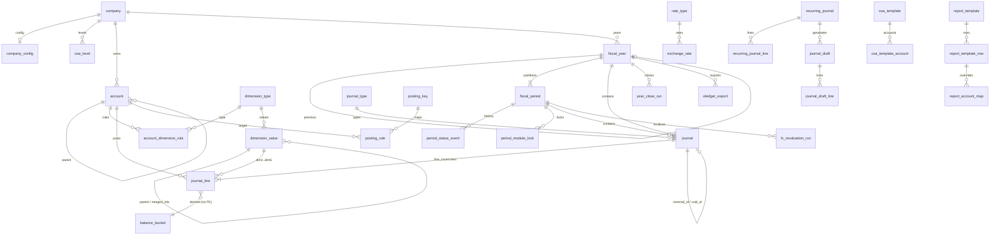

# 03 — هستهٔ حسابداری: کدینگ، ابعاد، سند، دفتر کل، دوره‌ها، ارز، بستن حساب‌ها و گزارش‌های مالی

> مرحله: ۱ (پایه). مالک اسکیمای `ledger` و ماژول پایتونی `hesabketab.ledger`.
> SQL: [`sql/20_ledger.sql`](sql/20_ledger.sql) — آزمون پایگاه داده: [`sql/tests/20_ledger_test.sql`](sql/tests/20_ledger_test.sql).
> وابستگی کد (DAG بخش ۰۱): `core`، `ref`، `rules`، `parties`. وابستگی فایل SQL: فقط `00_foundation.sql` (FKهای بیرونی در §۱۲).

## ۱. خلاصه

- **دفتر کل یک جدول سطر دارد** (`ledger.journal_line`). این جدول تنها منبع حقیقت گزارش‌های مالی است، فقط‌افزودنی است و هیچ ماژولی جز سرویس ثبت دفتر کل در آن نمی‌نویسد. ماژول‌های دیگر فقط با `PostingRequest` سند می‌سازند. این قرارداد idempotent است و با مرجع مبدأ (`source_module`, `source_doc_type`, `source_doc_id`, `source_event`) کلید می‌خورد.
- **کدینگ درختی است** و عمق آن برای هر شرکت تنظیم می‌شود (گروه، کل، معین و سطوح بیشتر). نوع، ماهیت، نقش استاندارد، `legacy_code` و سیاست ثبت (آزاد، فقط از زیردفتر، فقط سیستمی) روی خود حساب است. قالب کدینگ هر بستهٔ صنفی داده است، نه کد.
- **تفصیلی شناور با «بُعد» مدل می‌شود.** هر سطر شش جایگاه بُعد دارد و شعبه هم ستون جداگانه است. هر نوع بُعد (شخص، بانک، صندوق، مرکز هزینه، پروژه، ابعاد تعریف‌شدهٔ کاربر و ...) به یک جایگاه ثابت بسته است. برای هر حساب و هر نوع بُعد قاعدهٔ «اجباری، اختیاری یا ممنوع» تعریف می‌شود. مقدار بُعد، یعنی همان «تفصیلی»، در ledger ثبت می‌شود و به موجودیت مالکش (مثلاً شخص) اشاره دارد. ادغام دو تفصیلی بدون تغییر سطرهای دفتر انجام می‌شود.
- **چرخهٔ سند ایرانی:**
  - **پیش‌نویس:** فضای کاری قابل‌ویرایش و بیرون از دفتر کل.
  - **موقت:** در دفتر کل است و شمارهٔ عطف بی‌فاصله دارد، ولی هنوز تغییرناپذیر است.
  - **دائم (قطعی):** با «قطعی کردن تا تاریخ X» شمارهٔ دائم ۱..n می‌گیرد. این شماره بی‌فاصله است، به ترتیب تاریخ است و با زنجیرهٔ hash مهر می‌شود.
  - **باطل:** فقط سند موقت باطل می‌شود. ابطال یک جفت سند آینه با همان تاریخ می‌سازد و هیچ‌کدام شمارهٔ دائم نمی‌گیرند.
  - **برگشت (معکوس):** سند جدیدی است با تاریخ برابر یا بعد از سند اصل. «برگشت‌خورده» وضعیت ذخیره‌شده نیست و از وجود سند برگشت استنتاج می‌شود.
- **درستی ساختاری در خود PostgreSQL اجرا می‌شود.** موارد زیر با تریگر و قید پایگاه داده اجبار می‌شوند و جای دور زدن ندارند:
  - تراز سند به ارز پایه، با قید deferred در commit؛
  - مُهر بودن تعداد سطرها؛
  - تراز حساب‌های انتظامی میان خودشان؛
  - دقت مبلغ متناسب با ارز، و سازگاری مبلغ پایه با «مبلغ ارزی × نرخ»؛
  - حساب کنترلی، قواعد بُعد، و وضعیت دوره و سال؛
  - قفل ماژولی و بُرش نهایی‌سازی؛
  - ترتیب و پیوستگی شمارهٔ دائم، زنجیرهٔ hash، و آینه بودن ابطال و برگشت؛
  - ماشین حالت سند، دوره و سال؛
  - جداسازی مستأجر.
- **مانده‌ها از سطرها مشتق می‌شوند.** سطل‌های مانده (`balance_bucket`) فقط درج می‌شوند و در همان دستور درج سطرها ساخته می‌شوند، پس قفل داغ ندارند. بعد فشرده‌سازی می‌شوند و جمعشان ثابت می‌ماند. تابع راستی‌آزمایی و بازسازی هم دارند. گزارش برای دوره‌های کامل سطل و برای دورهٔ ناقص سطر را می‌خواند.
- **بستن سال به روش ایرانی است** و چهار سند دارد:
  1. بستن حساب‌های موقت به خلاصهٔ سود و زیان؛
  2. انتقال آن به سود انباشته؛
  3. سند اختتامیه؛
  4. سند افتتاحیهٔ سال بعد.

  بازگشایی فقط پیش از قطعی شدن ممکن است. پس از آن، اصلاح با «تعدیلات سنواتی» انجام می‌شود.
- **گزارش‌ها همه از یک primitive می‌آیند:** تراز ۲، ۴، ۶ و ۸ ستونی در هر سطح، کارت حساب و کارت تفصیلی، و دفتر روزنامه و دفتر کل قانونی. صورت‌های مالی ایرانی (وضعیت مالی، سود و زیان، و اسکلت جریان وجوه نقد) با قالب‌های نسخه‌دار ساخته می‌شوند. هر قالب ردیف کنترلی دارد که باید صفر بماند.
- **خروجی «دفاتر تجاری الکترونیکی»** با رابط `ELedgerExporter` تولید می‌شود. هر دو نسخهٔ قالب (بهمن ۱۴۰۳ گردش‌محور و اردیبهشت ۱۴۰۴ سندمحور) پشتیبانی می‌شوند و مشخصات قالب از موتور قواعد می‌آید.
- **وضعیت اعتبارسنجی:**
  - SQL روی PostgreSQL 18.7 در دو ترتیب اعمال شد: `00 → 20` و `00 → 10 → 20`.
  - `core.security_lint()` روی جدول‌های ledger خالی است.
  - ۲۰۰+ ادعای پایگاه داده‌ای پاس شدند.
  - ۳۰ جهش (mutation) عمدی روی تریگرها همه توسط آزمون‌ها گرفته شدند.

## ۲. دامنه

**در دامنه (این بخش):**
- کدینگ حساب‌ها: درخت، سطوح، نوع و ماهیت، حساب کنترلی، حساب انتظامی، `legacy_*`، قالب کدینگ بستهٔ صنفی و اعمال آن.
- ابعاد (تفصیلی شناور): نوع بُعد، جایگاه، مقدار بُعد، قواعد هر حساب، و ادغام.
- سال مالی و دوره: وضعیت‌ها، قفل ماژولی، تاریخچهٔ وضعیت، و بُرش نهایی‌سازی.
- سند حسابداری: پیش‌نویس، موقت، دائم، باطل، و برگشت؛ سه شماره (عطف، دائم، روزانه)؛ زنجیرهٔ hash؛ سند تکرارشونده؛ سند اصلاحی.
- `PostingRequest` و سرویس ثبت، و نگاشت حساب (posting key و posting rule).
- چندارزی: نوع نرخ، نرخ روزانه، گرد کردن، و تسعیر پایان دوره (طراحی کامل؛ فاز v2).
- بستن سال، بازگشایی، قفل سال، و تعدیلات سنواتی. ورود افتتاحیه (نقطهٔ ورود مهاجرت).
- مانده‌ها و سطل‌ها. تراز و کارت حساب. دفاتر قانونی. صورت‌های مالی و قالب‌هایشان. خروجی دفاتر الکترونیکی.
- توابع راستی‌آزمایی، مقادیر کنترلی (`ControlTotalsProvider`) و قلاب درون‌ریزی بستهٔ مستأجر.

**بیرون از دامنه (مالک):**
- **زیردفترها** با قرارداد `subledger_source` (§۵-۱۴) به دفتر کل وصل می‌شوند:
  - اقلام باز، سنی و تسویهٔ اشخاص: `sales`، `purchase` و `treasury`.
  - چک، صیاد، مغایرت بانکی و کارتخوان: `treasury`.
  - ارزش موجودی و COGS ادواری: `inventory`.
  - دارایی ثابت و دفتر مالیاتی مادهٔ ۱۴۹: `assets`.
  - حقوق: `payroll`.
- **ارزش افزوده، مؤدیان، فصلی ۱۶۹، و ارسال دفاتر به سامانه:** `tax`. ledger فقط فایل دفاتر را تولید می‌کند و رسید ارسال را ثبت می‌کند.
- **از `core`:**
  - موتور شماره‌گذاری (`core.number_*`)؛ ledger فقط سری `ledger.journal` را مصرف می‌کند.
  - گردش تأیید (`core.approval_*`) و ممیزی زنجیره‌ای (`core.audit_log`).
  - outbox و job، تنظیمات، و پیوست.
- **موتور قواعد** (پارامترهای قانونی نسخه‌دار، مثل قالب دفاتر الکترونیکی و ضریب حذف صفرها): `rules`.
- **ویرایش و انتشار قالب‌های کدینگ و صورت مالی در پنل مالک:** بخش پلتفرم. ledger کاتالوگ را می‌خواند.
- **آداپترهای مهاجرت** (هلو، سپیدار، حسابفا، Excel): `migration`. ledger نقطهٔ ورود افتتاحیه و سند تاریخی را می‌دهد.
- **رابط گزارش‌ساز و Pivot:** `reports`. ledger سرویس پرس‌وجو و ویوها را می‌دهد.
- **بودجه، تلفیق و بین‌شرکتی، و درآمد و هزینهٔ معوق:** v2، در همین ماژول یا ماژول بعدی (§۱۰).

## ۳. تصمیم‌های طراحی

### D-L01 — کدینگ درختی سخت‌گیر، به ازای شرکت
- **تصمیم:**
  - **ساختار:** `ledger.account` برای هر شرکت جداست و `parent_id` دارد.
    - `level` = سطح والد + ۱. پس دور در درخت ناممکن است، چون سطح در طول زنجیره کم می‌شود.
    - نوع فرزند = نوع والد.
    - فقط حساب `kind='posting'` (برگ) سند می‌پذیرد.
    - حداکثر عمق از `ledger.coa_level` خوانده می‌شود.
    - کدگذاری سلسله‌مراتبی (پیشوند والد و طول ثابت هر سطح) یا آزاد است و برای هر شرکت انتخاب می‌شود.
  - **قفل پس از ثبت:** وقتی حساب سند یا فرزند دارد، نوع آن عوض نمی‌شود. حسابِ دارای سند گروه نمی‌شود.
  - **حفظ کد قبلی:** `legacy_code`، `legacy_path` و `legacy_system` نگه داشته می‌شوند. حالت «حفظ کدینگ قبلی» همان `code_mode='free'` است.
- **دلیل:**
  - ابرمجموعهٔ هلو (سه سطح ثابت)، سپیدار، راهکاران و حسابفا است.
  - هم‌نوع بودن زیردرخت باعث می‌شود جمع صورت‌ها بر اساس نوع درست بماند.
  - برابری سطح و والد+۱ بی‌دوری را بدون CTE بازگشتی در تریگر تضمین می‌کند.
- **ردشده:**
  - کدینگ تخت مثل Odoo: با تراز چندسطحی ایرانی جور نیست.
  - کدینگ مشترک برای همهٔ شرکت‌های مستأجر: شرکت‌ها دفاتر مستقل دارند. کپی کدینگ بین شرکت‌ها با سرویس انجام می‌شود.
  - مسیر متنی `AccountPath` مثل حسابفا: تغییر کد را گران می‌کند.
- **مرجع:** [۰۶ §۷-۲](../research/06-feature-benchmark.md#۷-۲-هستهٔ-حسابداری)، [۰۲ §۴.۶](../research/02-migration-enterprise-and-generic.md#۴۶-ساختار-کدینگ-چندسطحی-و-تفصیلی-شناور)، [۰۱ §۵.۵](../research/01-migration-popular-apps.md#۵۵-نگاشت-کدینگ-حساب-کل--معین--تفصیلی)

### D-L02 — تفصیلی شناور = شش جایگاه بُعدِ نوع‌دار به‌اضافهٔ شعبه
- **تصمیم:**
  - **جایگاه‌ها:** هر سطر سند ستون‌های `dim1_id..dim6_id` و `branch_id` دارد. هر `dimension_type` یک `slot` ثابت (۱ تا ۶) دارد.
  - **پیش‌فرض جایگاه‌ها:**
    - جایگاه ۱ («طرف حساب/تفصیلی اصلی») مشترک است بین شخص، حساب بانکی، صندوق، تنخواه، پایانهٔ کارتخوان، کارمند و دارایی ثابت.
    - جایگاه ۲ = مرکز هزینه.
    - جایگاه ۳ = پروژه.
    - جایگاه‌های ۴ تا ۶ = ابعاد کاربر، مثل قرارداد، خودرو، یا کارگاه بیمه.
  - **قواعد بُعد برای هر (حساب، نوع بُعد):** `required`، `optional` یا `forbidden`. نوعی که فهرست نشده ممنوع است. در یک جایگاه حداکثر یک نوع اجباری هست، و نوع اجباری نوع دیگری را در همان جایگاه راه نمی‌دهد.
- **دلیل:**
  - گزارش «کارت شخص» با `WHERE dim1_id = :p` و یک ایندکس انجام می‌شود. اگر نوع به جایگاه بسته نبود، باید روی شش ستون OR می‌زدیم.
  - ۳ تا ۴ ستون تفصیلی سپیدار، راهکاران و میزان در این شش جایگاه جا می‌گیرد.
  - انواعی که با هم ناسازگارند (بانک و شخص روی یک سطر) جایگاه مشترک دارند و جای خالی هدر نمی‌رود.
- **ردشده:**
  - جدول جدای `line_dimension` (EAV): گزارش با JOIN سنگین می‌شود.
  - یک ستون برای هر نوع: DDL پویا لازم دارد.
  - تفصیلی به‌عنوان سطح چهارم درخت: شناور نیست و همان کد شخص زیر چند معین تکرار می‌شود.
- **مرجع:** [۰۶ §۷-۲](../research/06-feature-benchmark.md#۷-۲-هستهٔ-حسابداری)، [۰۲ §۴.۶](../research/02-migration-enterprise-and-generic.md#۴۶-ساختار-کدینگ-چندسطحی-و-تفصیلی-شناور)

### D-L03 — مقدار بُعد (تفصیلی) در ledger ثبت می‌شود و به موجودیت مالک اشاره دارد
- **تصمیم:**
  - **ساختار:** `ledger.dimension_value` با `source_module` و `source_entity_id`، مثلاً شناسهٔ شخص در `parties`. ستون مولد `party_id` برای FK به `parties.party` است.
  - **سازگاری جایگاه:** `slot` از نوع کپی می‌شود و FK ترکیبی `(tenant_id, dimension_type_id, slot)` آن را ساختاری تضمین می‌کند.
  - **ساخت مقدار:** ماژول مالک هنگام ساخت موجودیت `DimensionService.ensure_value` را صدا می‌زند. در لایه‌های بالاتر از ledger، موجودیت‌ها `dimension_value_id` را نگه می‌دارند (§۱۲).
  - **ادغام:** با `merged_into_id` انجام می‌شود. سطرهای قدیم تغییر نمی‌کنند. گزارش و تطبیق به مقدار «مؤثر» (`v_dimension_effective`) نسبت می‌دهند. ادغام برگشت‌ناپذیر است.
- **دلیل:** جهت FK در DAG (ledger→parties مجاز؛ treasury→ledger مجاز) رعایت می‌شود. کد تفصیلی ثابت می‌ماند (`parties.party.code` = «کد تفصیلی نمایشی»). ادغام اشخاص تکراری پس از مهاجرت هم دفتر را دست‌کاری نمی‌کند.
- **ردشده:** FK چندریختی از سطر سند به جدول هر ماژول، که خلاف DAG است. بازنویسی سطرهای قدیم هنگام ادغام هم ردّ شد، چون تغییرناپذیری را می‌شکند.
- **مرجع:** [۰۱ §۵.۵](../research/01-migration-popular-apps.md#۵۵-نگاشت-کدینگ-حساب-کل--معین--تفصیلی)

### D-L04 — چرخهٔ سند: پیش‌نویس جدا، موقت تغییرناپذیر، دائم با شمارهٔ قانونی
- **تصمیم:**
  - **پیش‌نویس:** در `ledger.journal_draft` و `journal_draft_line` است و تغییرپذیر و قابل‌حذف است. همان `id` پس از ارسال، `id` سند در `ledger.journal` می‌شود.
  - **موقت (`temporary`):** سند در دفتر کل است و در گزارش‌ها اثر دارد. سطرها و محتوای سرسند تغییرناپذیرند. فقط این ستون‌ها تغییر می‌کنند: وضعیت، فیلدهای دائم شدن، و یک‌بار بررسی (`reviewed_*`).
  - **دائم (`permanent`):** با `finalize_through` به دست می‌آید و پایانی است.
  - **باطل (`voided`):** فقط برای سند موقت. سند آینه با همان تاریخ ساخته می‌شود و هر دو باطل می‌شوند.
  - **برگشت:** سند جدید `reversal` است. سند اصل تغییر نمی‌کند.
  - **«ویرایش سند موقت» در UI** = ابطال به‌اضافهٔ پیش‌نویس جدید با همان محتوا.
- **دلیل:**
  - پژوهش هر سه حالت پیش‌نویس، موقت و قطعی را برای v1 لازم می‌داند.
  - قرارداد مشترک می‌گوید سطرهای دفتر کل تغییرناپذیرند. اگر سند موقت ویرایش‌پذیر بود، باید سطر دفتر را حذف می‌کردیم.
  - جفت ابطال در تاریخ اصل خالص صفر دارد. پس از دفاتر قانونی کنار می‌رود و هیچ ماندهٔ دوره‌ای را عوض نمی‌کند.
- **ردشده:**
  - نگه داشتن سطرهای پیش‌نویس در همان جدول دفتر کل: تغییرناپذیری را به وضعیت سرسند وابسته می‌کند و هر سطر هنگام درج باید JOIN شود.
  - وضعیت ذخیره‌شدهٔ `reversed`: با شمارهٔ دائم سند اصل تعارض دارد، چون سند برگشت‌خورده هنوز در دفاتر قانونی است.
- **مرجع:** [۰۶ §۴-الف](../research/06-feature-benchmark.md#۴-الف-هستهٔ-حسابداری)، [۰۶ §۷-۲](../research/06-feature-benchmark.md#۷-۲-هستهٔ-حسابداری)

### D-L05 — سه شماره: عطف (core)، دائم (ledger، ترتیب تاریخ)، روزانه
- **تصمیم:**
  - **`reference_no` (شمارهٔ عطف):**
    - در لحظهٔ ثبت موقت، در همان تراکنش، از `core.number_next` گرفته می‌شود. سری `doc_type='ledger.journal'` است، با `reset_policy='fiscal_year'` و کلید `fy:<uuid>`.
    - بی‌فاصله است، چون rollback شمارنده را هم برمی‌گرداند.
    - سند باطل هم شمارهٔ عطفش را نگه می‌دارد، پس توالی کامل می‌ماند.
  - **`permanent_no` (شمارهٔ سند دائم):**
    - هنگام «قطعی کردن تا تاریخ X» به ترتیب (تاریخ، رتبهٔ کلاس [افتتاحیه، عادی، اختتامیه]، شمارهٔ قدیمیِ مهاجرت، شمارهٔ عطف) داده می‌شود.
    - شمارنده `fiscal_year.last_permanent_no` است که زیر `FOR UPDATE` قفل می‌شود.
  - **`daily_no` (شمارهٔ روزانه):** در هر روز از ۱ شروع می‌شود.
- **دلیل:**
  - طبق یک منبع فروشنده، سپیدار سه نوع شماره دارد: شماره سند، شماره عطف و شماره روزانه. عطف هنگام صدور داده می‌شود و کاربر نمی‌تواند تغییرش دهد. شمارهٔ روزانه هر روز از یک شروع می‌شود. تبدیل اسناد موقت به دائم و «شماره‌گذاری مجدد اسناد» هم جزو عملیات پایان سال اوست (اطمینان: متوسط، منبع فروشنده).
  - دفتر روزنامه به ترتیب تاریخ نوشته می‌شود و فرض طراحی همین است. متن رسمی آیین‌نامهٔ مادهٔ ۹۵ و مادهٔ ۷ قانون تجارت در این بخش خوانده نشد، پس این فرض «تأییدنشده» است. ولی محدودیتی که از آن می‌آید (شماره به ترتیب تاریخ) در هر حال بی‌ضرر است.
  - موتور شماره‌گذاری core «بی‌فاصله و به ترتیب تاریخ» را نمی‌تواند بیان کند. پس شمارهٔ دائم با همان الگوی قرارداد («ردیف شمارنده با قفل در همان تراکنش»)، ولی در ledger، نگه داشته می‌شود.
- **ردشده:**
  - شمارهٔ دائم در لحظهٔ ثبت: سند با تاریخ گذشته ترتیب را می‌شکند.
  - بازشماری اسناد دائم: شمارهٔ قانونی را تغییر می‌دهد.
- **مرجع:** [سپیدار: ثبت سند حسابداری](https://www.sepidarsystem.com/blog/voucher-in-sepidar/)، [سپیدار: موضوعات پایان سال](https://www.sepidarsystem.com/courses/frequently-used-topics-in-sepidar/)، [۰۳ §۲-۱۳](../research/03-iran-tax-and-legal.md#۲-۱۳-دفاتر-قانونی-و-دفاتر-تجاری-الکترونیکی-ماده-۹۵)

### D-L06 — تراز با «مقادیر کنترلی سرسند» و قید deferred برای هر سند
- **تصمیم:**
  - **مقادیر کنترلی:** سرسند `line_count`، `total_debit_base`، `total_credit_base`، `memo_debit_base` و `memo_credit_base` را اعلام می‌کند. `CHECK` فوری برابری مقادیر اعلام‌شده را می‌سنجد.
  - **قید deferred:** تریگر قیدی `DEFERRABLE INITIALLY DEFERRED` روی **درج سرسند** (`trg_verify`) در commit یک بار برای هر سند اجرا می‌شود. تعداد سطرها، جمع بدهکار و بستانکار پایه، جمع انتظامی و آینه بودن ابطال و برگشت را می‌سنجد.
  - **جلوگیری از افزودن سطر بعدی:** `line_no ∈ [1, line_count]` است، با `UNIQUE (tenant_id, journal_id, line_no)` و تریگر BEFORE روی سطر. وقتی سند با `count = line_count` commit شد، همهٔ جایگاه‌های شمارهٔ سطر پرند و هیچ سطری بعداً اضافه نمی‌شود، بی آنکه به xmin یا GUC تکیه کنیم.
- **دلیل:**
  - تریگر deferred روی هر سطر در commit سندی با n سطر، n بار کل سند را جمع می‌زد: O(n²). این تصمیم O(n) است.
  - کش «سند بررسی‌شده» در GUC قابل جعل توسط برنامه بود.
- **ردشده:**
  - تریگر سطح دستور با transition table: deferrable نیست و ثبت سطرها در چند دستور را ناممکن می‌کند.
  - بررسی فقط در پایتون: پایگاه داده باید سد نهایی باشد.

### D-L07 — تغییرناپذیری در سه لایه
- **تصمیم:**
  - **لایهٔ ۱، grant:**
    - روی `journal_line` فقط `SELECT` و `INSERT`.
    - روی `journal` فقط `SELECT` و `INSERT`، به‌اضافهٔ `UPDATE` ستونی روی وضعیت، فیلدهای دائم شدن و بررسی.
  - **لایهٔ ۲، تریگر:**
    - `trg_immutable` (`core.forbid_mutation`) روی سطر.
    - `trg_nodelete` روی سرسند.
    - `journal_before_update` مقایسهٔ jsonb همهٔ ستون‌ها به‌جز ستون‌های مجاز را انجام می‌دهد. پس حتی مالک جدول هم نمی‌تواند محتوا را عوض کند.
  - **لایهٔ ۳، hash:** زنجیرهٔ hash سندهای دائم (D-L22) و زنجیرهٔ ممیزی core.
- **دلیل:** پژوهش و قرارداد مشترک دفتر کل فقط‌افزودنی می‌خواهند. آزمون T19 نشان می‌دهد که دست‌کاری با غیرفعال کردن تریگر هم با `verify_permanent_chain`، `verify_balance_buckets` و `check_trial_balance` کشف می‌شود.
- **مرجع:** [README §۲-ب بند ۱۱](../research/README.md#ب-هستهٔ-حسابداری-و-عملیات)

### D-L08 — شکل مبلغ سطر: بدهکار و بستانکار، به ارز معامله و ارز پایه، به‌اضافهٔ نرخ
- **تصمیم:**
  - **ستون‌ها:** `debit_txn`، `credit_txn`، `debit_base` و `credit_base` همه `core.amount ≥ 0` هستند. `currency` و `exchange_rate` (از نوع `core.rate`) و `rate_type_id` هم نگه داشته می‌شوند.
  - **شکل سطر:** هر سطر فقط یک طرف دارد، و طرف ارز معامله و ارز پایه یکی است. سطر تمام‌صفر ممنوع است.
  - **دقت:** دقت هر مبلغ برابر `minor_unit` ارز خودش است. برای ریال اعشار مجاز نیست.
  - **سطر به ارز پایه:** نرخ ۱ دارد و مبلغ معامله‌اش برابر مبلغ پایه است.
  - **سطر ارزی:** باید `|base − txn×rate| < 10^-minor(base)` برقرار باشد. حالت دقیق گرد کردن (`half_up`، `half_even` یا `truncate`) را سرویس از `company_config.fx_rounding_mode` اعمال می‌کند.
  - **سطر `base_adjustment`:** مبلغ معامله صفر و مبلغ پایه غیرصفر دارد. فقط در نوع سندهای مجاز می‌آید: تسعیر، بستن سال، آینه.
- **دلیل:**
  - شکل بدهکار و بستانکار با دفاتر و قالب‌های ایرانی، و ستون‌های `Bed_Arz` و `Bes_Arz` هلو، هم‌خوان است.
  - مدارا کمتر از یک واحد، مستقل از حالت گرد کردن، خطای ده‌هزار برابری یا خطای نرخ را می‌گیرد.
- **ردشده:** مبلغ علامت‌دار (مبهم برای سطر فقط-ارزی) و نگهداری فقط مبلغ پایه (خلاف قرارداد).
- **مرجع:** [۰۶ §۷-۲](../research/06-feature-benchmark.md#۷-۲-هستهٔ-حسابداری)، [README §۲-و](../research/README.md#و-ناسازگاریهای-بین-گزارشها-که-تیم-فنی-باید-پیش-از-شروع-ببندد)

### D-L09 — وضعیت دوره، قفل ماژولی، و قفل همروندی
- **تصمیم:**
  - **چهار وضعیت دوره:**
    - `open`؛
    - `soft_closed`: ثبت فقط با `soft_close_override` که سرویس فقط با مجوز `ledger.period.post_soft_closed` می‌گذارد؛
    - `closed`: هیچ ثبت عادی‌ای ندارد؛
    - `locked`: پس از قطعی شدن همهٔ تاریخ‌های دوره.
  - **گذارها:**
    - بستن دوره‌ها به ترتیب است.
    - بازگشایی دلیل لازم دارد.
    - قفل‌گشایی شناسهٔ تأیید (`core.approval_request`) لازم دارد.
    - همهٔ گذارها در `period_status_event` ثبت می‌شوند.
  - **قفل ماژولی:** `period_module_lock(period, module)` ثبت همان ماژول را در آن دوره می‌بندد، مثلاً `sales` پس از ارسال اظهارنامه.
  - **همروندی:**
    - تریگر درج سند ردیف سال و دوره را `FOR KEY SHARE` می‌خواند. FK همین قفل را هم می‌گیرد.
    - گذار محدودکنندهٔ دوره یا سال، و قطعی کردن، `FOR UPDATE` می‌گیرند. پس منتظر ثبت‌های در جریان می‌مانند، و ثبت‌های بعدی مقدار تازهٔ وضعیت را می‌خوانند.
- **دلیل:** بدون این قفل، ثبتی که پیش از بستن دوره آغاز شده بود می‌توانست پس از بستن commit شود.
- **مرجع:** [۰۶ §۴-الف](../research/06-feature-benchmark.md#۴-الف-هستهٔ-حسابداری)

### D-L10 — سال مالی: ماشین حالت، وضعیت افتتاحیه، بُرش نهایی‌سازی
- **تصمیم:**
  - **وضعیت‌ها:** `open → closing → closed → locked`. از `closing` می‌توان به `open` برگشت، به شرط باطل بودن اسناد بستن. از `closed` می‌توان به `closing` برگشت، به شرط قطعی‌نشدن.
  - **وضعیت افتتاحیه** (`opening_state`): `pending`، `posted` یا `not_required`. حالت سوم فقط برای سال اول است. قطعی کردن تا وقتی `pending` است ممنوع است، چون افتتاحیه باید شمارهٔ ۱ بگیرد.
  - **بُرش (`finalized_through`):** فقط جلو می‌رود. پس از آن هیچ سندی با تاریخ ≤ بُرش درج نمی‌شود و هیچ سند موقتی ≤ بُرش باقی نمی‌ماند. دائم بودن ⇔ تاریخ ≤ بُرش. این آخری را تریگر deferred `journal_permanent_verify` اجبار می‌کند.
  - **ارز پایه:** هر سال ارز پایه را snapshot می‌کند. سال‌ها به هم پیوسته‌اند (`previous_year_id`، شروع = پایان قبلی + ۱).
- **دلیل:**
  - «ثبت هم‌زمان در دو سال» در دورهٔ گذار ممکن است، چون هر دو سال `open` هستند.
  - بستن سال قبل ماه‌ها پس از شروع سال جدید هم ممکن است، چون قطعی کردن سال جدید منتظر افتتاحیه می‌ماند.
- **مرجع:** [۰۶ §۸-۱ V1-04](../research/06-feature-benchmark.md#۸-۱-نسخهٔ-۱-ضروری-برای-عرضه-به-کافه-کفشفروشی-لوازم-برقی-و-sme-عمومی)

### D-L11 — بستن سال به روش ایرانی با چهار سند؛ اصلاح پس از قطعی شدن با تعدیلات سنواتی
- **تصمیم:**
  - **چهار سند، همه در آخرین روز سال و در وضعیت `closing`:**
    1. `closing_pl`: بستن درآمد و هزینه به «خلاصهٔ سود و زیان».
    2. `closing_re`: انتقال آن به سود انباشته.
    3. `closing_balance`: سند اختتامیه، که همهٔ حساب‌های دائم و انتظامی را به تفکیک بُعد و ارز صفر می‌کند.
    4. `opening`: افتتاحیهٔ سال بعد در روز اول آن، که قرینهٔ اختتامیه است.
  - **قلاب‌های پیش از بستن** (`YearEndHook`): ماژول‌ها کارهای پیش‌نیاز را ثبت می‌کنند، مثل COGS ادواری انبار، استهلاک، و تسعیر.
  - **بازگشایی:** فقط تا وقتی اسناد بستن و افتتاحیهٔ بعدی قطعی نشده‌اند. با ابطال جفتی انجام می‌شود.
  - **پس از قطعی شدن:** اصلاح سال قبل با سند `prior_period_adjustment` (تعدیلات سنواتی) در سال جاری انجام می‌شود.
- **دلیل:**
  - سپیدار و هلو اختتامیه و افتتاحیه را صادر می‌کنند.
  - تعدیل سنواتی همان رفتار استاندارد حسابداری ایران برای اصلاح اشتباه دورهٔ قبل است (نیازمند تطبیق با متن استاندارد).
  - بازنویسی سال قطعی‌شده دفاتر ارسال‌شده را بی‌اعتبار می‌کرد.
- **ردشده:** «Period Closing Voucher» تک‌سندی مثل ERPNext بدون اختتامیه: کاربر ایرانی سند اختتامیه می‌خواهد.
- **مرجع:** [۰۶ §۴-الف](../research/06-feature-benchmark.md#۴-الف-هستهٔ-حسابداری)، [سپیدار: بستن حساب‌ها](https://www.sepidarsystem.com/blog/closing-document-in-sepidar/)

### D-L12 — مانده: سطل‌های مشتقِ فقط‌درج در همان تراکنش، به‌اضافهٔ فشرده‌سازی و راستی‌آزمایی
- **تصمیم:**
  - **درج:** تریگر سطح دستور (`AFTER INSERT ... REFERENCING NEW TABLE`) برای هر دستور درج سطر، یک ردیف تجمیعی برای هر کلید در `ledger.balance_bucket` **درج** می‌کند. کلید = (دوره، حساب، کلاس، شعبه، شش بُعد، ارز).
  - **فشرده‌سازی:** job فشرده‌سازی (`compact_balance_buckets`) ردیف‌های هر (شرکت، دوره) را در **یک دستور** حذف و جمع آن‌ها را درج می‌کند. جمع ثابت می‌ماند.
  - **راستی‌آزمایی:** `verify_balance_buckets` خالی بودن اختلاف را می‌سنجد. `rebuild_balance_buckets` بازسازی را در یک snapshot انجام می‌دهد.
  - **مسیر گزارش:** دوره‌های کامل از سطل و دورهٔ ناقص از سطر خوانده می‌شوند.
  - **دسترسی نوشتن:** فقط سه تابع `SECURITY DEFINER` با نقش `hk_ledger_definer` می‌نویسند. `hk_app` فقط `SELECT` دارد.
- **دلیل:**
  - با ۱۰ میلیون سطر در سال، تراز سال از سطر خام چند ثانیه طول می‌کشد. از سطل‌های فشرده (حدود ۵ تا ۲۰٪ تعداد سطر، بسته به تنوع بُعد) زیر یک ثانیه است.
  - **بدون قفل داغ:** «ماندهٔ به‌روزرسانی‌شونده» روی حساب صندوق شعبه، ثبت‌های همزمان POS را سریال و مستعد deadlock می‌کرد. درج تجمیعی هیچ ردیفی را قفل نمی‌کند.
- **ردشده:**
  - materialized view: ممنوع طبق D-32.
  - جدول مانده با UPDATE: hot row و deadlock دارد.
  - فقط سطر و ایندکس پوششی: کند برای داشبورد در مقیاس بزرگ.
- **مرجع:** [۰۶ §۷-۹](../research/06-feature-benchmark.md#۷-۹-گزارشگیری)، [۰۱-معماری D-32](01-architecture.md#d-32--security-definer-فقط-با-فهرست-مجاز-بازبینیشده-هیچ-materialized-view-روی-دادهٔ-مستأجر)

### D-L13 — `PostingRequest`: قرارداد درون‌فرایندی، idempotent با مرجع مبدأ
- **تصمیم:**
  - ماژول‌ها `LedgerPostingService.post(uow, PostingRequest)` را در **همان تراکنش** سند مبدأ صدا می‌زنند.
  - کلید idempotency، `(company, source_module, source_doc_type, source_doc_id, source_event)` روی سندهای باطل‌نشده است (ایندکس یکتای جزئی). `request_hash` محتوای کانونی درخواست را نگه می‌دارد.
  - **تکرار:**
    - تکرار با همان hash همان سند را برمی‌گرداند (`replayed=true`).
    - تکرار با hash دیگر خطای `ledger.posting.source_conflict` می‌دهد.
  - حساب سطر یا مستقیم (`account_id`) است یا با **کلید نگاشت** (`posting_key` به‌اضافهٔ ویژگی‌ها) حل می‌شود.
- **دلیل:**
  - سند مبدأ و سند حسابداری اتمیک‌اند. با این کلید، retry شبکه‌ای و تحویل دوبارهٔ رویداد نمی‌توانند ثبت دوبل بسازند.
  - پس از ابطال، همان سند مبدأ را می‌توان دوباره ثبت کرد.
- **ردشده:**
  - ثبت ناهمگام با رویداد: سند مبدأ بدون سند حسابداری commit می‌شد.
  - کلید HTTP: برای فراخوانی درون‌فرایندی معنا ندارد.

### D-L14 — نگاشت حساب: کاتالوگ سراسری کلیدها و قاعدهٔ شرکت با شرط، اولویت و اعتبار
- **تصمیم:**
  - **کاتالوگ کلیدها:** `ledger.posting_key` سراسری است، مثل `sales.revenue`، `tax.vat_payable`، `inventory.asset`، `inventory.cogs`، `ledger.rounding` و `ledger.fx.realized_gain`. هر کلید «نوع حساب مورد انتظار» دارد.
  - **قاعدهٔ شرکت:** `ledger.posting_rule` برای هر شرکت، با `priority`، `conditions` (jsonb)، `valid_from` و `valid_to`، و `dimension_defaults`.
    - کلید شرط: `branch`، `currency`، `dim:<type>` و `attr:<name>`، مثلاً `attr:item_posting_group` (گروه حساب کالا در catalog).
    - مقدار شرط: رشته یا فهرست.
  - **حل حساب** (`ledger.resolve_account`):
    - قاعده‌های فعال و منطبق را بر اساس اولویت و سپس «تعداد شرط بیشتر» مرتب می‌کند.
    - **گرهِ دو قاعدهٔ اول خطاست** (`HK_LEDGER_MAPPING_AMBIGUOUS`).
    - نبود قاعده هم خطاست. حساب پیش‌فرض بی‌صدا وجود ندارد.
    - قاعدهٔ تکراری با بازهٔ هم‌پوشان با EXCLUDE رد می‌شود.
  - **ردگیری:** سطر سند `posting_key` و `posting_rule_id` را نگه می‌دارد.
- **دلیل:**
  - ممنوعیت «حساب پیش‌فرض برای ناشناس» در پژوهش مهاجرت.
  - تغییر نگاشت در طول زمان، با نگهداری سابقه.
  - پشتیبانی از بستهٔ صنفی، مثلاً نگاشت جدا برای گروه کالای «کفش».
- **ردشده:** کد حساب hardcode در ماژول‌ها (خلاف قرارداد) و جدول تخت (کلید→حساب) بدون شرط.
- **مرجع:** [۰۱ §۵.۵](../research/01-migration-popular-apps.md#۵۵-نگاشت-کدینگ-حساب-کل--معین--تفصیلی)

### D-L15 — حساب کنترلی و قرارداد زیردفتر
- **تصمیم:**
  - **سیاست ثبت حساب:**
    - `posting_policy='subledger_only'`: فقط از `allowed_source_modules` می‌پذیرد، مثلاً موجودی کالا فقط از `inventory` و `migration`.
    - `system_only`: سند دستی و ورودی را نمی‌پذیرد، مثلاً خلاصهٔ سود و زیان.
    - `open`: همه را می‌پذیرد.
  - **نوع زیردفتر:** `subledger_kind` روی حساب، نوع زیردفتر را برای تطبیق می‌گوید.
  - **ثبت زیردفتر:** هر ماژول زیردفتر یک تابع ماندهٔ استاندارد در `ledger.subledger_source` ثبت می‌کند (§۵-۱۴).
  - **تطبیق:** `ledger.check_control_accounts(company, as_of)` دفتر کل (به تفکیک بُعد مؤثر و ارز) را با زیردفتر مقایسه می‌کند. اسناد تسعیر در این مقایسه کنار گذاشته می‌شوند.
  - **پیش‌فرض قالب:** صندوق، بانک و حساب‌های دریافتنی و پرداختنی اشخاص `open` با بُعد اجباری هستند. ماندهٔ آن‌ها همان دفتر کل به تفکیک تفصیلی است، مثل سپیدار. موجودی کالا، اسناد دریافتنی و پرداختنی، دارایی ثابت و انتظامی `subledger_only` هستند.
- **دلیل:**
  - حساب کنترلی واقعی (موجودی، چک، دارایی) بدون زیردفتر قابل تطبیق نیست.
  - در بازار ایران حسابدار انتظار دارد سند دستی شخص را بپذیریم.
- **ردشده:** همهٔ حساب‌های اشخاص `subledger_only`، چون مهاجرت و تعدیل دستی را سخت می‌کرد. این انتخاب داده است و در قالب عوض می‌شود.
- **مرجع:** [۰۵ §۲-۲](../research/05-iran-banking-cheques-payments.md#۲-۲-چرخهٔ-عمر-چک-و-ثبتهای-حسابداری)، [README §۲-ب بند ۱۴](../research/README.md#ب-هستهٔ-حسابداری-و-عملیات)

### D-L16 — حساب‌های انتظامی
- **تصمیم:** `account_type='memo'` (حساب انتظامی و طرف حساب انتظامی). تراز انتظامی در هر سند جدا اجبار می‌شود (`memo_debit_base = memo_credit_base`). این حساب‌ها در صورت‌های مالی نیستند، ولی در تراز و دفاتر هستند. چک تضمینی فقط اینجا ثبت می‌شود.
- **مرجع:** [README §۲-ب بند ۱۴](../research/README.md#ب-هستهٔ-حسابداری-و-عملیات)، [۰۶ §۴-الف «اسناد انتظامی»](../research/06-feature-benchmark.md#۴-الف-هستهٔ-حسابداری)

### D-L17 — چندارزی: نوع نرخ، نرخ روزانه، سطر با نرخ، تسعیر با برگشت خودکار
- **تصمیم:**
  - **نرخ:**
    - `ledger.rate_type` (رسمی، بازار، توافقی، گمرکی و ...)، با یک پیش‌فرض و `max_staleness_days`.
    - `ledger.exchange_rate` یکتا برای (نوع، جفت ارز، تاریخ). `rate_on` آخرین نرخ ≤ تاریخ را می‌دهد.
  - **سطر سند:** نرخ و نوع نرخ را نگه می‌دارد، پس تغییر بعدی جدول نرخ سابقه را عوض نمی‌کند.
  - **سود و زیان تحقق‌یافته:** هنگام تسویه، زیردفتر آن را با کلیدهای `ledger.fx.realized_*` ثبت می‌کند.
  - **تسعیر پایان دوره** (`FxService.revalue`):
    - موضوع آن ماندهٔ ارزی حساب‌های `revalue_fx` (پولی) به تفکیک بُعد است.
    - سند `fx_revaluation` با سطرهای `base_adjustment` در پایان دوره ثبت می‌شود.
    - سند `fx_revaluation_reversal` در روز اول دورهٔ بعد ثبت می‌شود.
  - **فاز:** v2، طبق پژوهش. اسکیما در v1 کامل است.
- **دلیل:**
  - در ایران چند نرخ هم‌زمان وجود دارد.
  - برگشت خودکار باعث می‌شود زیردفترها سود و زیان تحقق‌یافته را با نرخ تاریخی بسنجند و تسعیر وارد زیردفتر نشود.
- **ردشده:** تسعیر تجمعی بدون برگشت: هر زیردفتر را مجبور می‌کرد تسعیر را بشناسد.
- **مرجع:** [۰۶ §۷-۲](../research/06-feature-benchmark.md#۷-۲-هستهٔ-حسابداری)، [۰۶ §۸-۲ V2-02](../research/06-feature-benchmark.md#۸-۲-نسخهٔ-۲)

### D-L18 — حذف چهار صفر: ارز پایه به ازای سال، تبدیل فقط در بستن سال، هرگز ضرب بی‌صدا
- **تصمیم:**
  - `fiscal_year.base_currency` snapshot ارز پایهٔ شرکت در لحظهٔ ساخت سال است. همهٔ سندهای سال همان ارز را دارند (`HK_LEDGER_BASE_CURRENCY`).
  - **تغییر واحد پایه:** فقط از ابتدای یک سال ممکن است. بستن سال قبل، افتتاحیه را با `year_close_run.conversion_factor` تبدیل می‌کند. ضریب از پارامتر قواعد `currency.redenomination.factor` با منبع و تاریخ می‌آید. تفاوت گرد شدن به `ledger.rounding` می‌رود.
  - **مبلغ ورودی:** هر مبلغ ورودی از مهاجرت، API یا ورود Excel `input_amount_unit` دارد. تبدیل IRT×10 و IRR_NEW×ضریب صریح است و در سرسند ثبت می‌شود.
- **دلیل:** نام واحد جدید هم «ریال» است و ضریب ۱۰٬۰۰۰. خطای بی‌صدا ۱۰٬۰۰۰ برابر است.
- **ردشده:** ضرب همهٔ سطرهای تاریخی، که سابقه را جعل می‌کرد. تغییر وسط سال (v2؛ §۱۱).
- **مرجع:** [۰۲ §۴.۷](../research/02-migration-enterprise-and-generic.md#۴۷-کاراکتر-رقم-تاریخ-و-واحد-پول)، [README §۲-د بند ۲۴](../research/README.md#د-مهاجرت-داده)

### D-L19 — گزارش‌ها از یک primitive؛ صورت مالی با قالب نسخه‌دار و ردیف کنترلی
- **تصمیم:**
  - **primitive:** `ledger.trial_balance(company, from, to, include_closing)` برای هر حساب برگ گردش ناخالص «ابتدا» و «طی دوره» را برمی‌گرداند. «ابتدا» = همهٔ اسناد سال پیش از `from` به‌اضافهٔ اسناد کلاس افتتاحیه.
  - **از روی primitive:**
    - تراز ۲، ۴، ۶ و ۸ ستونی (§۵-۱۱)؛
    - تجمیع به هر سطح (`trial_balance_rollup`)؛
    - صورت‌های مالی.
  - **قالب صورت مالی** (`report_template` و `report_template_row`): ردیف `accounts` (انتخابگر برچسب، نقش، نوع یا بازهٔ کد، با مبنای closing، opening، period_net یا change)، `formula` (جمع و تفریق ردیف‌ها)، `pl_result`، و ردیف کنترلی `is_check_row`.
  - **نگاشت صریح:** نگاشت صریح هر شرکت (`report_account_map`) بر انتخابگر مقدم است.
  - **پوشش:** `report_coverage` تضمین می‌کند هر حساب برگ غیرانتظامی دقیقاً در یک ردیف صورت وضعیت مالی یا سود و زیان است.
  - **ردیف‌های کنترلی:** `BS_CHECK` = دارایی − (حقوق مالکانه + بدهی) = ۰، `CF_CHECK` = نقد اول + جریان خالص − نقد پایان = ۰، و `PL_CHECK` همیشه صفرند.
- **دلیل:**
  - یک منبع محاسبه، پس تراز و صورت‌ها هرگز با هم ناسازگار نمی‌شوند.
  - ردیف کنترلی خطای قالب را در CI و در زمان اجرا آشکار می‌کند.
  - قالب‌ساز کامل در v2 است و قالب‌های v1 داده‌اند.
- **مرجع:** [۰۶ §۷-۹](../research/06-feature-benchmark.md#۷-۹-گزارشگیری)، [۰۶ §۴-ط](../research/06-feature-benchmark.md#۴-ط-گزارشگیری)

### D-L20 — خروجی دفاتر تجاری الکترونیکی: هر دو نسخه، با مشخصات از موتور قواعد
- **تصمیم:**
  - رابط `ELedgerExporter` و دو پیاده‌سازی دارد:
    - **`1403-11-turnover`:** گردش‌محور با تفصیلی. ستون‌های قالب: کد و عنوان کل، کد و عنوان معین، کد و عنوان تفصیلی، گردش بدهکار، گردش بستانکار، تاریخ.
    - **`1404-02-document`:** سندمحور، ۹ ستون: شماره سند، کل، معین، بدهکار، بستانکار، تاریخ، شرح.
  - **از پارامتر قواعد `tax.eledger.format`:** عنوان دقیق ستون‌ها، ترتیب، قالب تاریخ (`YYYY/MM/DD` یا `DD/MM/YYYY`، ناهم‌خوان در منابع)، نوع فایل، واحد مبلغ، و شمارهٔ سند افتتاحیه («ردیف صفر»). نسخهٔ قاعده در `eledger_export.format_version` snapshot می‌شود.
  - **منبع داده:** فقط اسناد دائم.
  - **نگاشت سطح:** «کل» و «معین» از `company_config.eledger_kol_level` و `eledger_moein_level` می‌آیند. «تفصیلی» از `eledger_detail_source` می‌آید: `dim_slot:1` یا `level:4`.
  - **پس از ثبت رسید ارسال:** دوره‌های پوشش‌داده‌شده قفل می‌شوند.
- **دلیل:** پژوهش نسخهٔ جاری را نامطمئن می‌داند (اطمینان پایین تا متوسط). پس هر چیزی جز منطق تجمیع پارامتر است.
- **مرجع:** [۰۲ §۴.۳](../research/02-migration-enterprise-and-generic.md#۴۳-دفاتر-تجاری-الکترونیکی-قالب-ملی-دفتر-روزنامه-و-کل)، [۰۳ §۲-۱۳](../research/03-iran-tax-and-legal.md#۲-۱۳-دفاتر-قانونی-و-دفاتر-تجاری-الکترونیکی-ماده-۹۵)، [۰۳ §۳-۴](../research/03-iran-tax-and-legal.md#۳-۴-گزارشها-و-تکالیف-دورهای)

### D-L21 — ورود افتتاحیه با حساب «تراز افتتاحیه»
- **تصمیم:**
  - **مسیر دفتر کل:** `opening_import` (کلاس افتتاحیه، در روز اول سالِ اولِ `pending`، با `input_amount_unit` اجباری). ledger حساب‌های غیرکنترلی را در برابر حساب نقش‌دار `OPENING_BALANCE_CLEARING` ثبت می‌کند.
  - **مسیر زیردفترها:** هر ماژول زیردفتر (اقلام باز اشخاص، چک، موجودی، دارایی) افتتاحیهٔ خودش را با همان نوع سند و همان حساب واسط ثبت می‌کند.
  - **بستن افتتاحیه:** `opening_state → posted` در DB فقط وقتی مجاز است که حساب واسط در اسناد افتتاحیه صفر شده باشد.
- **دلیل:**
  - حساب کنترلی باید از زیردفتر ساخته شود تا تطبیق‌پذیر بماند.
  - چند تکهٔ افتتاحیه تراز کلی‌شان با یک قید ساختاری سنجیده می‌شود (الگوی Temporary Opening).
- **مرجع:** [۰۱ §۵.۶](../research/01-migration-popular-apps.md#۵۶-جلوگیری-از-ثبت-دوبل-پارتیشن-انحصاری-اسناد)، [۰۱ §۵.۷](../research/01-migration-popular-apps.md#۵۷-تطبیق-و-پذیرش)، [۰۲ §۶.۲](../research/02-migration-enterprise-and-generic.md#۶۲-حالتهای-مهاجرت-و-تاریخ-تبدیل)

### D-L22 — زنجیرهٔ hash اسناد دائم
- **تصمیم:**
  - **محاسبه:** `chain_hash = sha256(chain_prev_hash || canonical(journal+lines))`. پیوند سند ۱ به `chain_genesis(company, fy)` است.
  - **شکل متعارف:** زمان و کاربر را ندارد، پس بازپخش قطعی است.
  - **اجبار:**
    - تریگر پیوند و محتوا را هنگام دائم شدن می‌سنجد.
    - `verify_permanent_chain` کل سال را می‌سنجد.
    - `fiscal_year.chain_head_hash` با آخرین سند برابر نگه داشته می‌شود.
- **دلیل:** دفاتر قانونی باید «بدون دست‌کاری» باشند. زنجیرهٔ ممیزی core تغییر رکوردها را ثبت می‌کند، ولی محتوای سند را مهر نمی‌کند.
- **ردشده:** امضای دیجیتال هر سند (v2؛ وابسته به کلید شرکت و Q-C).

### D-L23 — تریگرهای deferred و زمینهٔ مستأجر
- **تصمیم:** همهٔ تریگرهای deferred با `ledger.assert_tenant_context(NEW.tenant_id)` شروع می‌شوند. تعویض `app.tenant_id` وسط تراکنش هر بررسی deferred را با خطای صریح `HK_LEDGER_TENANT_CONTEXT` رد می‌کند. بدون این بررسی، RLS ردیف‌ها را پنهان می‌کرد و بعضی بررسی‌ها «بی‌صدا» می‌گذشتند.
- **مرجع:** آزمون T17.

### D-L24 — `SECURITY DEFINER` فقط برای سطل‌ها
- **تصمیم:**
  - **توابع:** `bucket_from_lines` (تریگر)، `compact_balance_buckets` و `rebuild_balance_buckets`.
  - **مالک:** `hk_ledger_definer` (`NOLOGIN NOBYPASSRLS`)، با `search_path` ثابت و مقایسهٔ صریح مستأجر. SQL پویا ندارند و توضیح `HK_DEFINER_REVIEWED` دارند.
  - **باقی توابع:** همه با نقش فراخوان اجرا می‌شوند.
- **دلیل:** اگر `hk_app` حق `INSERT` روی سطل داشت، می‌توانست گزارش را جعل کند.
- **مرجع:** [۰۱-معماری D-32](01-architecture.md#d-32--security-definer-فقط-با-فهرست-مجاز-بازبینیشده-هیچ-materialized-view-روی-دادهٔ-مستأجر)

### D-L25 — بدون پارتیشن در v1
- **تصمیم:**
  - `journal_line` پارتیشن ندارد. همهٔ ایندکس‌ها با `tenant_id` شروع می‌شوند، و مستأجر بزرگ پایگاه دادهٔ اختصاصی می‌گیرد.
  - پارتیشن `HASH(tenant_id)` به PK شامل `tenant_id` نیاز دارد که با قرارداد `PRIMARY KEY (id)` تعارض دارد (§۱۳ C-L01).
- **دلیل:** حجم هدف هر مستأجر (≤ ۱۰ میلیون سطر در سال) با ایندکس‌های فعلی و سطل‌ها کار می‌کند. پارتیشن پیچیدگی تریگر و FK را بالا می‌برد.

### D-L26 — سند تکرارشونده با تقویم جلالی
- **تصمیم:**
  - **زمان‌بندی:** `recurring_journal` با بسامد، گام و قاعدهٔ روز (`same_day`، `first_day` یا `last_day`) و تقویم (جلالی به‌طور پیش‌فرض). `next_run_date` در پایتون با تقویم core حساب می‌شود.
  - **حالت:** `draft` (پیش‌نویس برای تأیید) یا `post` (ثبت مستقیم).
  - **idempotency هر نوبت:** ایندکس یکتای پیش‌نویس `(recurring_journal_id, recurring_occurrence)`، یا کلید مبدأ `ledger.recurring_journal / <id> / occ:<date>`.
- **مرجع:** [۰۶ §۴-الف](../research/06-feature-benchmark.md#۴-الف-هستهٔ-حسابداری)

### D-L27 — صدور و درون‌ریزی بستهٔ مستأجر
- **تصمیم:**
  - جدول‌های ledger در رجیستری صدور core حالت `rows` دارند. `balance_bucket` حالت `skip` دارد.
  - core درون‌ریزی را با `session_replication_role=replica` انجام می‌دهد.
  - پس از آن **قلاب درون‌ریزی ledger** اجباری است. برای هر (شرکت، سال):
    1. `rebuild_balance_buckets`؛
    2. `verify_permanent_chain`؛
    3. `check_trial_balance`؛
    4. `verify_balance_buckets`؛
    5. پیوستگی شمارهٔ عطف و دائم؛
    6. برابری مقادیر کنترلی با مبدأ.

    هر اختلاف درون‌ریزی را رد می‌کند.
- **دلیل:** بازپخش با تریگرهای روشن، سندهای دائم و دوره‌های بسته را رد می‌کرد. درج verbatim به‌اضافهٔ راستی‌آزمایی کامل هم امن است و هم ساده. تعارض با C-08 بخش ۰۱ در §۱۳ آمده است.
- **مرجع:** [۰۲-هسته §۱۳ بند ۸](02-core-platform.md)

## ۴. مدل داده

همهٔ جدول‌های مستأجری `tenant_id`، `UNIQUE (tenant_id, id)`، RLS اجباری (`core.enable_tenant_rls`) و FK ترکیبی دارند. FKهای سطر به حساب و شعبه سه‌ستونی‌اند (`tenant_id, company_id, x_id`)، پس هم‌شرکت بودن ساختاری است. جزئیات دقیق ستون‌ها و قیدها در [`sql/20_ledger.sql`](sql/20_ledger.sql) است.

### ۴-۱. نمای ER



### ۴-۲. کاتالوگ‌های سراسری (بدون `tenant_id`؛ `hk_app` فقط `SELECT`؛ با migration و انتشار پر می‌شوند)

| جدول | نقش |
|---|---|
| `ledger.journal_type` | نوع سند و رفتار آن. ستون‌ها:<br>• `entry_class`: opening، regular یا closing<br>• `class_rank`: ۰، ۱ یا ۲<br>• `origin`: manual، module، system، mirror یا import<br>• پرچم‌های `skip_line_rules`، `bypass_posting_policy`، `allows_base_only_lines`، `requires_input_unit` و `excluded_from_subledger_check`<br><br>۱۵ نوع: manual، adjustment، prior_period_adjustment، recurring، module، fx_revaluation، fx_revaluation_reversal، reversal، void، opening، opening_import، history_import، closing_pl، closing_re، closing_balance |
| `ledger.posting_key` | کلیدهای نگاشت حساب، با ماژول مالک و انواع حساب مورد انتظار. نوع حساب نگاشت‌شده با تریگر سنجیده می‌شود. ۴۳ کلید آغازین برای ledger و ماژول‌های مرحلهٔ ۲. مالکان می‌توانند با migration خود کلید بیفزایند |
| `ledger.dimension_type_catalog` | انواع بُعد سیستمی و جایگاهشان: party، bank_account، cash_box، petty_cash، pos_terminal، employee و fixed_asset در جایگاه ۱؛ cost_center در ۲؛ project در ۳ |
| `ledger.coa_template` و `coa_template_account` و `coa_template_posting_rule` | قالب کدینگ بستهٔ صنفی (کد، نسخه، بسته، سطوح، حالت کد، منبع، اطمینان، بازبین)، حساب‌ها (با قواعد بُعد jsonb) و نگاشت پیش‌فرض. نمونهٔ `ir.general v1` (۹۰ حساب) در SQL هست. انتشار تولیدی آن پیش از بازبینی حسابدار رسمی ممنوع است (`confidence='low'`) |
| `ledger.subledger_source` | ثبت تابع ماندهٔ هر زیردفتر (§۵-۱۴) |
| `ledger.report_template` و `report_template_row` | قالب صورت‌ها، شامل `ir.bs`، `ir.pl` و `ir.cf`، با ردیف و فرمول و ردیف کنترلی |

### ۴-۳. پیکربندی، کدینگ و ابعاد (مستأجری)

| جدول | توضیح کلیدی |
|---|---|
| `ledger.company_config` | یک ردیف برای هر شرکت. ستون‌ها:<br>• `code_mode`: hierarchical یا free<br>• `legal_book_level`: سطح دفاتر قانونی؛ پیش‌فرض ۲ (کل)<br>• سطح کل، معین و منبع تفصیلی دفاتر الکترونیکی<br>• `default_rate_type_id`<br>• `fx_rounding_mode`<br>• `require_review_before_finalize`: اگر روشن باشد، سند بررسی‌نشده دائم نمی‌شود<br>• قالب کدینگ اعمال‌شده |
| `ledger.coa_level` | نام سطح (گروه، کل، معین، ...) و طول بخش کد. حداکثر عمق را تعیین می‌کند |
| `ledger.account` | حساب. ستون‌ها:<br>• **درخت:** `parent_id`، `level` و `code` (ASCII، یکتا در شرکت)<br>• **نام:** `name` و `name_search` (نرمال‌شده با سرویس core)<br>• **دسته‌بندی:** `kind`، `account_type` و `nature` (debit، credit یا none؛ فقط برای گزارش «ماندهٔ خلاف ماهیت»)<br>• **نگاشت و گزارش:** `role` (واژگان نقش‌های استاندارد پژوهش ۰۱ مثل `AR_TRADE` و `CASH`؛ مبنای نگاشت مهاجرت) و `tags` (مبنای انتخابگر گزارش)<br>• **ثبت:** `posting_policy`، `allowed_source_modules`، `subledger_kind`، `currency_policy` (base_only، any یا fixed)، `fixed_currency`، `revalue_fx` و `branch_rule`<br>• **وضعیت و سابقه:** `is_active` و `legacy_*` |
| `ledger.account_dimension_rule` | (حساب، نوع بُعد) → required، optional یا forbidden. قید deferred سازگاری جایگاه را می‌سنجد |
| `ledger.dimension_type` | نوع بُعد مستأجر: `code`، `slot` (تغییرناپذیر پس از استفاده، با FK ترکیبی)، `kind` (system یا user)، `owner_module` و سلسله‌مراتبی بودن. سیستمی‌ها با `ledger.provision_tenant()` ساخته می‌شوند |
| `ledger.dimension_value` | «تفصیلی». ستون‌ها: `code` (یکتا در نوع)، `name`، `parent_id` (گروه)، `company_id` (NULL = مشترک)، `is_group`، `is_active`، `source_module` و `source_entity_id` (یکتا در نوع)، `party_id` (ستون مولد)، `legacy_code` و `merged_into_id` |

### ۴-۴. سال، دوره و قفل

| جدول | توضیح |
|---|---|
| `ledger.fiscal_year` | سال مالی. ستون‌ها:<br>• **بازه:** `start_date` و `end_date` (EXCLUDE هم‌پوشانی)<br>• **وضعیت:** `status` و `opening_state`<br>• **ارز پایه:** `base_currency` (snapshot)<br>• **زنجیرهٔ سال‌ها:** `previous_year_id` (یکتا؛ زنجیره)<br>• **نهایی‌سازی:** `finalized_through`، `last_permanent_no` و `chain_head_hash`<br>• **سابقه:** زمان و کاربر بستن و قفل |
| `ledger.fiscal_period` | دوره. ستون‌ها: `period_no` (به ترتیب تاریخ)، بازه (EXCLUDE)، `status`، `status_reason`، `status_approval_ref` و زمان و کاربر گذار. پوشش کامل سال با قید deferred سنجیده می‌شود |
| `ledger.period_status_event` | تاریخچهٔ فقط‌افزودنی گذارهای دوره، که تریگر می‌نویسد |
| `ledger.period_module_lock` | قفل یک ماژول در یک دوره (درج = قفل؛ حذف = گشودن، با ممیزی core) |

### ۴-۵. سند و دفتر کل

| جدول | توضیح |
|---|---|
| `ledger.journal_draft` و `journal_draft_line` | پیش‌نویس تغییرپذیر. وضعیت: editing، pending_approval یا approved. پیوند به `approval_request_id`، `recurring_journal_id` و `recurring_occurrence` (یکتا). سطر پیش‌نویس می‌تواند ناقص باشد |
| `ledger.journal` | سرسند. ستون‌ها:<br>• **هویت و جایگاه:** شرکت، سال و دوره (FKهای ترکیبی سه‌ستونی)، `branch_id` (دامنهٔ دسترسی)، `journal_date`<br>• **نوع:** `journal_type`، `entry_class` و `class_rank` (تریگر از نوع پر می‌کند)<br>• **وضعیت و شماره:** `status`، `reference_no` و `reference_text` (عطف)، `number_issued_id`، `permanent_no` و `daily_no`<br>• **مبدأ:** `source_module`، `source_doc_type`، `source_doc_id`، `source_doc_no`، `source_event` و `request_hash`<br>• **مقادیر کنترلی:** `base_currency`، `line_count`، `total_*_base` و `memo_*_base`<br>• **سایر:** `input_amount_unit`، `soft_close_override`، `reversal_of_journal_id`، `void_of_journal_id`، `adjusts_journal_id`، `recurring_journal_id`، `approval_request_id`، `legacy_ref`، `legacy_permanent_no`، `void_reason`، کنشگر و زمان ثبت، بررسی و قطعی شدن، و `chain_prev_hash` و `chain_hash`<br><br>ایندکس‌های یکتای جزئی: کلید مبدأ (باطل‌نشده)، یک برگشت فعال، یک ابطال. ایندکس جزئی اسناد موقت برای قطعی کردن |
| `ledger.journal_line` | **تنها منبع حقیقت.** ستون‌ها:<br>• `line_no`<br>• **رونوشت سرسند** (تریگر پر می‌کند): `company_id`، `fiscal_year_id`، `period_id`، `journal_date` و `entry_class`<br>• `is_memo`<br>• **حساب و ابعاد:** `account_id`، `branch_id` و `dim1..6`<br>• **مبلغ:** `currency`، `exchange_rate`، `rate_type_id`، `debit_txn`، `credit_txn`، `debit_base`، `credit_base` و `line_kind`<br>• **سایر:** `quantity`، `description`، `posting_key`، `posting_rule_id` و `source_line_ref`<br><br>ایندکس‌ها:<br>• پوششی کارت حساب: `(tenant, company, account, date, journal, line) INCLUDE (amounts)`<br>• دوره و حساب<br>• یک ایندکس جزئی برای هر جایگاه بُعد |
| `ledger.balance_bucket` | سطل مانده (مشتق). کلید = (دوره، حساب، کلاس، شعبه، ۶ بُعد، ارز). ستون‌ها: جمع چهار مبلغ، `line_count` و `is_compacted`. فقط توابع definer می‌نویسند |

### ۴-۶. نرخ، نگاشت، تکرار، اجراها

| جدول | توضیح |
|---|---|
| `ledger.rate_type` و `exchange_rate` | نوع نرخ (یک پیش‌فرض) و نرخ روزانه. نرخ مثبت است و برای (نوع، ارز، ارز پایه، تاریخ) یکتاست |
| `ledger.posting_rule` | قاعدهٔ نگاشت شرکت. شرط‌ها شکل‌سنجی‌شده‌اند (`valid_conditions`). EXCLUDE روی (کلید، اولویت، hash شرط، بازهٔ اعتبار) |
| `ledger.recurring_journal` و `recurring_journal_line` | الگوی سند تکرارشونده |
| `ledger.year_close_run` | اجرای بستن سال: سال، سال بعد، وضعیت، `conversion_factor`، نتیجهٔ خالص، و چهار سند ساخته‌شده. یک اجرای فعال برای هر سال |
| `ledger.fx_revaluation_run` | اجرای تسعیر: دوره، تاریخ، نوع نرخ، snapshot نرخ‌ها، سند تسعیر و سند برگشت |
| `ledger.eledger_export` | خروجی دفاتر: بازه، کلید و نسخهٔ قاعده، تعداد و جمع (برابر)، فایل (`core.attachment`)، hash، وضعیت و رسید ارسال |
| `ledger.integrity_run` | نتیجهٔ فقط‌افزودنی job راستی‌آزمایی (`check_code`، وضعیت، تعداد نقض، جزئیات) |
| `ledger.report_account_map` | نگاشت صریح حساب به ردیف قالب، برای کدینگ‌های «حفظ‌شده»ای که برچسب ندارند |

### ۴-۷. ویوها و توابع منتشرشده

| شیء | کاربرد |
|---|---|
| `ledger.v_journal_line` | سطر به‌اضافهٔ سرسند و حساب، و `is_reversed` (مشتق). ویوی منتشرشده برای reports |
| `ledger.v_period_balance` | جمع سطل‌ها به ازای کلید |
| `ledger.v_account_lineage` | نیاکان هر حساب، برای تجمیع سطحی |
| `ledger.v_dimension_effective` | مقدار مؤثر بُعد پس از ادغام |
| `ledger.trial_balance`، `trial_balance_rollup`، `evaluate_statement`، `report_row_accounts` و `report_coverage` | گزارش (فراخوان) |
| `ledger.void_journal`، `reverse_journal`، `finalize_through`، `resolve_account`، `rate_on`، `provision_tenant` و `apply_coa_template` | عملیات (فراخوان) |
| `ledger.check_trial_balance`، `verify_balance_buckets`، `verify_permanent_chain`، `check_control_accounts` و `check_year_close` | راستی‌آزمایی. خروجی خالی یعنی سالم |
| `ledger.compact_balance_buckets` و `rebuild_balance_buckets` | نگهداری سطل (definer) |
| `ledger.round_amount` | گرد کردن مرجع، همتای `Decimal.quantize` |

## ۵. منطق دامنه و سرویس‌ها

### ۵-۱. ساختار ماژول و سطح عمومی

```
backend/src/hesabketab/ledger/
  api/services.py   LedgerPostingService, ManualJournalService, AccountService, DimensionService, MappingService,
                    FiscalCalendarService, FinalizationService, YearEndService, FxService, RecurringJournalService,
                    OpeningBalanceService, ELedgerExportService, IntegrityService
  api/queries.py    FiscalYearQuery, AccountQuery, BalanceQuery, LedgerReportQuery, StatementQuery
  api/dto.py        PostingRequest, PostingLine, AccountRef, DimensionRef, PostingResult, ...
  api/errors.yaml   ledger.* (§۵-۱۶)
  domain/           rounding.py, resolution.py, finalization.py, closing.py, tb_columns.py, eledger/{base,v1403_11,v1404_02}.py
  infra/            SQLAlchemy models, repositories, SQL (توابع §۴-۷)
  jobs.py           ledger.recurring.generate, ledger.buckets.compact, ledger.integrity.run, ledger.year_close.run (async)
  permissions.py    ۳۲ مجوز (در SQL شرطی هم ثبت شده‌اند)
SPEC = ModuleSpec(name="ledger", schema="ledger", layer=3, depends_on={"core","ref","rules","parties"},
                  control_totals="hesabketab.ledger.api.queries:LedgerControlTotals", ...)
```

### ۵-۲. DTOهای قرارداد ثبت

```python
from datetime import date
from decimal import Decimal
from typing import Annotated, Literal
from uuid import UUID
from pydantic import BaseModel, Field, model_validator

Amount = Annotated[Decimal, Field(max_digits=24, decimal_places=4)]          # core.amount
Rate = Annotated[Decimal, Field(max_digits=28, decimal_places=12, gt=0)]      # core.rate
Qty = Annotated[Decimal, Field(max_digits=24, decimal_places=6, ge=0)]        # core.qty
AmountUnit = Literal["IRR", "IRT", "IRR_NEW"]                                 # core.amount_unit
CurrencyCode = Annotated[str, Field(pattern=r"^[A-Z]{3}$")]

class AccountRef(BaseModel, frozen=True):
    account_id: UUID | None = None
    posting_key: str | None = Field(default=None, pattern=r"^[a-z][a-z0-9_]*(\.[a-z0-9_]+){1,4}$")
    @model_validator(mode="after")
    def _one(self):
        if (self.account_id is None) == (self.posting_key is None):
            raise ValueError("exactly one of account_id / posting_key")
        return self

class DimensionRef(BaseModel, frozen=True):
    type_code: str                                  # 'party' | 'cost_center' | ...
    value_id: UUID | None = None                    # ledger.dimension_value.id
    entity_id: UUID | None = None                   # source_entity_id (مثلاً parties.party.id)
    @model_validator(mode="after")
    def _one(self):
        if (self.value_id is None) == (self.entity_id is None):
            raise ValueError("exactly one of value_id / entity_id")
        return self

class PostingLine(BaseModel, frozen=True):
    account: AccountRef
    side: Literal["debit", "credit"]
    amount: Amount = Field(ge=0)                    # به ارز معامله؛ ۰ فقط برای base_adjustment
    currency: CurrencyCode | None = None            # None = ارز پایهٔ سال
    exchange_rate: Rate | None = None               # None = rate_on(rate_type, currency, base, journal_date)
    rate_type: str | None = None                    # None = company_config.default_rate_type
    amount_base: Amount | None = None               # اگر داده شود باید با گرد کردن شرکت برابر باشد
    line_kind: Literal["normal", "base_adjustment"] = "normal"
    branch_id: UUID | None = None
    dimensions: tuple[DimensionRef, ...] = ()
    quantity: Qty | None = None
    description: str | None = Field(default=None, max_length=500)
    source_line_ref: str | None = Field(default=None, max_length=120)

class PostingRequest(BaseModel, frozen=True):
    company_id: UUID
    source_module: str = Field(pattern=r"^[a-z][a-z0-9_]{1,30}$")
    source_doc_type: str = Field(pattern=r"^[a-z][a-z0-9_]*\.[a-z][a-z0-9_]*$")      # 'sales.invoice'
    source_doc_id: UUID
    source_doc_no: str | None = None
    source_event: str = Field(default="post", pattern=r"^[a-z0-9][a-z0-9_:.-]{0,60}$")
    journal_type: Literal["module", "opening_import", "history_import", "fx_revaluation"] = "module"
    journal_date: date
    branch_id: UUID | None = None
    description: str = Field(default="", max_length=1000)
    lines: tuple[PostingLine, ...] = Field(min_length=2, max_length=100_000)
    attributes: dict[str, str] = Field(default_factory=dict)   # 'branch','currency','attr:item_posting_group','dim:cost_center'
    input_amount_unit: AmountUnit | None = None                # اجباری برای *_import
    rounding: Literal["strict", "to_rounding_account"] = "to_rounding_account"
    aggregate_identical_lines: bool = False
    soft_close_override: bool = False                          # فقط با مجوز ledger.period.post_soft_closed
    adjusts_journal_id: UUID | None = None
    approval_request_id: UUID | None = None

class PostedLine(BaseModel, frozen=True):
    line_no: int
    account_id: UUID
    posting_key: str | None
    posting_rule_id: UUID | None
    source_line_ref: str | None
    debit_base: Amount
    credit_base: Amount

class PostingResult(BaseModel, frozen=True):
    journal_id: UUID
    reference_no: int
    reference_text: str
    fiscal_year_id: UUID
    period_id: UUID
    status: Literal["temporary"]
    replayed: bool
    lines: tuple[PostedLine, ...]
```

### ۵-۳. سرویس‌ها (امضاها)

```python
class LedgerPostingService:
    async def post(self, uow: UnitOfWork, req: PostingRequest) -> PostingResult: ...
    async def validate(self, uow: UnitOfWork, req: PostingRequest) -> list[ProblemItem]: ...      # dry-run، بدون نوشتن
    async def reverse(self, uow: UnitOfWork, journal_id: UUID, *, on: date, caller_module: str,
                      source_event: str = "reverse", description: str | None = None,
                      soft_close_override: bool = False) -> PostingResult: ...
    async def reverse_by_source(self, uow: UnitOfWork, *, company_id: UUID, source_module: str, source_doc_type: str,
                                source_doc_id: UUID, original_event: str = "post", on: date,
                                cancel_event: str = "cancel") -> PostingResult: ...
    async def void(self, uow: UnitOfWork, journal_id: UUID, *, reason: str, caller_module: str) -> PostingResult: ...

class ManualJournalService:     # سند دستی (پیش‌نویس → ارسال)
    async def create_draft(self, uow, cmd: DraftCreate) -> DraftOut: ...
    async def update_draft(self, uow, draft_id: UUID, cmd: DraftUpdate, row_version: int) -> DraftOut: ...
    async def discard_draft(self, uow, draft_id: UUID, row_version: int) -> None: ...
    async def submit(self, uow, draft_id: UUID, row_version: int) -> PostingResult: ...   # نیاز به تأیید → pending_approval
    async def mark_reviewed(self, uow, journal_id: UUID) -> None: ...                      # تفکیک وظایف: بررسی‌کننده ≠ ثبت‌کننده
    async def copy_to_draft(self, uow, journal_id: UUID, *, reversed_sides: bool = False) -> DraftOut: ...

class AccountService:
    async def create(self, uow, cmd: AccountCreate) -> AccountOut: ...
    async def update(self, uow, account_id: UUID, cmd: AccountUpdate, row_version: int) -> AccountOut: ...
    async def move(self, uow, account_id: UUID, new_parent_id: UUID, new_code: str | None) -> AccountOut: ...  # بازکدگذاری زیردرخت در یک تراکنش
    async def set_dimension_rules(self, uow, account_id: UUID, rules: dict[str, Literal["required","optional","forbidden"]]) -> None: ...
    async def apply_template(self, uow, company_id: UUID, code: str, version: int, *, keep_legacy: bool = False) -> int: ...
    async def copy_chart(self, uow, from_company: UUID, to_company: UUID) -> int: ...

class DimensionService:
    async def ensure_value(self, uow, *, type_code: str, source_module: str, entity_id: UUID, code: str, name: str,
                           company_id: UUID | None = None) -> UUID: ...       # idempotent با (type, entity)
    async def create_value(self, uow, cmd: DimensionValueCreate) -> UUID: ...  # مرکز هزینه، پروژه، ابعاد کاربر
    async def rename(self, uow, value_id: UUID, name: str) -> None: ...        # مشترک رویداد parties.party.renamed
    async def merge(self, uow, loser_id: UUID, winner_id: UUID) -> None: ...   # مشترک parties.party.merged

class MappingService:
    async def resolve(self, uow, company_id: UUID, key: str, on: date, attributes: Mapping[str, str]) -> ResolvedAccount: ...
    async def coverage(self, uow, company_id: UUID, keys: Iterable[str]) -> list[MissingMapping]: ...   # پیش از فعال‌سازی ماژول

class FiscalCalendarService:
    async def create_year(self, uow, company_id: UUID, *, code: str, start: date, end: date,
                          scheme: Literal["jalali_month","jalali_quarter","custom"], custom_periods=None) -> UUID: ...
    async def set_period_status(self, uow, period_id: UUID, to: PeriodStatus, *, reason: str | None,
                                approval_request_id: UUID | None) -> None: ...
    async def lock_module(self, uow, period_id: UUID, module: str, reason: str) -> None: ...
    async def unlock_module(self, uow, period_id: UUID, module: str, reason: str) -> None: ...

class FinalizationService:
    async def finalize_through(self, uow, fiscal_year_id: UUID, through: date) -> FinalizeResult: ...

class YearEndService:
    async def checklist(self, uow, fiscal_year_id: UUID) -> list[CloseBlocker]: ...
    async def close(self, uow, fiscal_year_id: UUID) -> UUID: ...           # year_close_run.id (job ناهمگام برای سال بزرگ)
    async def reopen(self, uow, fiscal_year_id: UUID, reason: str) -> None: ...
    async def lock(self, uow, fiscal_year_id: UUID) -> None: ...

class YearEndHook(Protocol):                                                # ماژول‌ها ثبت می‌کنند
    module: str
    async def blockers(self, uow, company_id: UUID, fiscal_year_id: UUID) -> list[CloseBlocker]: ...

class FxService:
    async def set_rate(self, uow, rate_type: str, currency: str, on: date, rate: Decimal) -> None: ...
    async def convert(self, uow, company_id: UUID, amount: Decimal, currency: str, on: date,
                      rate_type: str | None = None) -> Converted: ...      # (base, rate, rate_date)
    async def revalue(self, uow, company_id: UUID, period_id: UUID, *, rate_type: str, preview: bool) -> RevaluationOut: ...

class OpeningBalanceService:
    async def import_opening(self, uow, company_id: UUID, fiscal_year_id: UUID, lines: Sequence[OpeningLine], *,
                             amount_unit: AmountUnit, source_ref: str) -> PostingResult: ...
    async def clearing_balance(self, uow, company_id: UUID, fiscal_year_id: UUID) -> Decimal: ...
    async def complete(self, uow, fiscal_year_id: UUID) -> None: ...        # opening_state → posted

class ELedgerExporter(Protocol):
    format_version: str                                                     # '1403-11-turnover' | '1404-02-document'
    def rows(self, ctx: ExportContext) -> Iterator[ELedgerRow]: ...
    def render(self, rows: Iterable[ELedgerRow], spec: FormatSpec) -> bytes: ...   # xlsx یا csv طبق spec

class FiscalYearQuery:                                                      # core.numbering برای کلید fy:<uuid> صدا می‌زند
    async def for_date(self, uow, company_id: UUID, d: date) -> FiscalYearRef | None: ...
```

### ۵-۴. الگوریتم `post` (یک تراکنش، داخل UoW فراخوان)

```
post(req):
  1  authz: actor ∈ {ماژول صاحب source_module (درون‌فرایندی)} یا مجوز ledger.journal.post؛ نقش edge → خطا (INV-EDGE-01)
  2  h ← sha256(JCS(req))
     j ← SELECT journal WHERE (company, source_module, source_doc_type, source_doc_id, source_event) AND status<>'voided'
     اگر j: اگر j.request_hash = h → return replayed(j) ؛ وگرنه → ledger.posting.source_conflict (409)
  3  fy ← FiscalYearQuery.for_date ؛ base ← fy.base_currency ؛ minor ← ref.currency(base).minor_unit
     پیش‌بررسی وضعیت سال، دوره، قفل ماژول و بُرش (همان قواعد تریگر، برای خطای خوانا)
  4  برای هر سطر i:
       a. حساب: account_id یا MappingService.resolve(key, journal_date, attributes ∪ {branch, currency, dim:*})
          (dimension_defaults قاعده فقط ابعاد خالی را پر می‌کند)
       b. ابعاد: DimensionRef(type, entity) → value_id ؛ جایگاه = type.slot ؛ دو مقدار در یک جایگاه → خطا
       c. ارز و نرخ: cur ← line.currency ?? base
          اگر cur = base: rate=1
          وگرنه rate ← line.exchange_rate ?? rate_on(rate_type, cur, base, date)
            (نبود نرخ یا کهنگی > max_staleness_days → ledger.fx.rate_missing)
       d. base ← line.amount_base ?? round_mode(amount × rate, minor, company.fx_rounding_mode)
          اگر amount_base داده شده و |amount_base − round(amount×rate)| ≥ 1 واحد → خطا
  5  اگر req.aggregate_identical_lines: ادغام سطرهای هم‌کلید (حساب، ابعاد، شعبه، ارز، نرخ، طرف، شرح)
  6  تراز پایه: d = Σdebit_base − Σcredit_base
     اگر d ≠ 0:
       اگر rounding='to_rounding_account' و |d| ≤ (#سطرهای ارزی) × 10^-minor:
         سطر 'rounding' روی کلید ledger.rounding در طرف مقابل افزوده می‌شود
       وگرنه ledger.journal.unbalanced (422)
     اگر همهٔ سطرها یک ارز غیرپایه دارند: Σdebit_txn = Σcredit_txn وگرنه ledger.journal.txn_unbalanced
  7  پیش‌بررسی قواعد سطر (همان تریگر): برگ، فعال، سیاست ثبت، ارز، شعبه، ابعاد. خطاها با pointer /lines/i
  8  ref ← core.number_next(series('ledger.journal', company), 'fy:'+fy.id, template, 'ledger.journal', journal_id)
  9  INSERT journal (status 'temporary', مقادیر کنترلی، request_hash, input_amount_unit, ...)
 10  INSERT journal_line ... در «یک» دستور چندسطری (یا COPY)؛ تریگر سطل یک بار اجرا می‌شود
 11  OutboxWriter.add(LedgerJournalPosted(...)) ؛ AuditWriter (core)
 12  return PostingResult   — قید deferred در commit فراخوان اجرا می‌شود
```

- خطاهای پایگاه داده (`P0001` با پیشوند `HK_LEDGER_*`) طبق جدول §۵-۱۶ به problem+json نگاشت می‌شوند. پیش‌بررسی پایتون همان قواعد را با پیام خوانا اجرا می‌کند، ولی سد نهایی تریگر است.
- `void` و `reverse` شمارهٔ عطف جدید می‌گیرند و توابع SQL `ledger.void_journal` و `ledger.reverse_journal` را صدا می‌زنند.
- قاعدهٔ مالکیت: سند ماژولی (`source_module ≠ 'ledger'`) فقط با درخواست همان ماژول برگشت یا باطل می‌شود. مسیر HTTP دفتر کل برای آن خطای `ledger.journal.reverse_via_source` می‌دهد.

### ۵-۵. ماشین‌های حالت

**سند (`ledger.journal` به‌اضافهٔ پیش‌نویس):**

| از | به | شرط | اثر جانبی |
|---|---|---|---|
| (هیچ) | draft:editing | `ledger.journal.create` | — |
| draft:editing | draft:pending_approval | سیاست تأیید شرکت (`core.approval_policy`، نوع `ledger.journal`، بازهٔ مبلغ) | `core.approval_request` |
| draft:pending_approval | draft:approved / editing | تصمیم تأیید یا رد | — |
| draft:editing/approved | temporary | `ledger.journal.post`. تراز. دورهٔ باز (یا soft_closed با مجوز). بُرش. قفل ماژول | عطف (core). سطر و سطل. حذف پیش‌نویس. رویداد `ledger.journal.posted` |
| temporary | temporary (بررسی‌شده) | `ledger.journal.review`. بررسی‌کننده ≠ ثبت‌کننده (`core.sod_rule`). فقط یک بار | — |
| temporary | voided | `ledger.journal.void`. تاریخ اصل هنوز باز. بدون برگشت فعال | سند `void` آینه (باطل). رویداد `ledger.journal.voided` |
| temporary | permanent | فقط در `finalize_through`. ترتیب تاریخ. زنجیره | `permanent_no`، `daily_no` و `chain_*`. رویداد `ledger.fiscal_year.finalized` |
| temporary/permanent (عادی) | «برگشت‌خورده» (مشتق) | `ledger.journal.reverse`. تاریخ ≥ اصل. مالکیت مبدأ | سند `reversal` موقت. رویداد `ledger.journal.reversed` |
| permanent / voided | — | پایانی | — |

**دوره:**

| از → به | شرط |
|---|---|
| open ↔ soft_closed | سال `open` برای برگشت به `open` |
| open/soft_closed → closed | همهٔ دوره‌های قبلی همان سال `closed` یا `locked` باشند |
| closed → open/soft_closed | سال `open`. دلیل ≥ ۵ نویسه. هنوز تاریخ قطعی‌نشده در دوره باشد. مجوز `ledger.period.reopen` |
| closed → locked | `finalized_through ≥ end_date`. مجوز `ledger.period.lock` |
| locked → closed | شناسهٔ تأیید و دلیل. سال قفل نباشد. مجوز `ledger.period.unlock` (بحرانی) |

**سال مالی:**

| از → به | شرط | اثر |
|---|---|---|
| open → closing | همهٔ دوره‌ها `closed` یا `locked` | فقط اسناد کلاس `closing` مجازند |
| closing → closed | سال بعد `opening_state='posted'` | `closed_at` و `closed_by` |
| closing → open | هیچ سند بستن یا افتتاحیهٔ بعدیِ باطل‌نشده نمانده باشد | — |
| closed → closing (بازگشایی) | اسناد بستن و افتتاحیهٔ بعدی دائم نشده باشند | سپس ابطال جفتی و `closing → open` |
| closed → locked | `finalized_through = end_date` و همهٔ دوره‌ها `locked` | `locked_at` |
| `opening_state`: pending → posted / not_required. posted → pending (فقط پیش از قطعی شدن و پس از ابطال) | حساب تراز افتتاحیه صفر باشد. `not_required` فقط برای سال اول | — |

**پیش‌نویس تکرارشونده:** `active ↔ paused → ended` (پس از `end_date` یا `max_occurrences`).
**خروجی دفاتر:** `generated → submitted` (رسید سامانه؛ قفل دوره‌ها) و `generated/submitted → superseded` (خروجی جدید همان بازه پس از تعدیل در سال بعد).

### ۵-۶. قطعی کردن

```
finalize_through(fy, X):       -- ledger.finalize_through (SQL)، در یک تراکنش
  قفل FOR UPDATE روی fy (ثبت‌های در جریان تمام می‌شوند؛ ثبت‌های بعدی بُرش تازه را می‌بینند)
  اگر X ≤ fy.finalized_through → 0 (idempotent)
  n ← fy.last_permanent_no ؛ prev ← head یا genesis
  for j in temporary(fy) where date ≤ X order by (date, class_rank, legacy_permanent_no nulls last, reference_no) FOR UPDATE:
      n += 1 ؛ daily ← (date = date قبلی) ? daily+1 : 1
      hash ← sha256(prev || canonical(j با permanent_no=n))
      UPDATE j SET status='permanent', permanent_no=n, daily_no, finalized_*, chain_prev_hash=prev, chain_hash=hash
        (تریگر: افتتاحیه پرداخته‌شده، بررسی در صورت لزوم، n−1 وجود دارد، ترتیب تاریخ، هیچ موقتِ زودتری نمانده، پیوند و محتوای hash)
      prev ← hash
  UPDATE fy SET finalized_through=X, last_permanent_no=n, chain_head_hash=prev
    (تریگر: هیچ موقتی ≤ X نیست؛ شمارنده و سر زنجیره = آخرین سند)
  commit → تریگر deferred: هر سند دائم تاریخ ≤ بُرش
```

سیاست پیشنهادی محصول:
- بستن ماهانهٔ هر دوره (`closed`) در UI با پیشنهاد «قطعی کردن تا پایان دوره» همراه است.
- قطعی کردن پیش از خروجی دفاتر الکترونیکی هر فصل اجباری است.
- مهاجرت: اسناد تاریخی که `legacy_permanent_no` پیوسته و به ترتیب تاریخ دارند همان شماره را می‌گیرند، چون مرتب‌سازی آن را حفظ می‌کند. گزارش «شمارهٔ جدید در برابر قدیم» اختلاف را نشان می‌دهد.

### ۵-۷. بستن، بازگشایی و قفل سال

```
close(fy):  (YearEndService؛ job برای سال بزرگ؛ همه در یک تراکنش، یا شکست کامل)
  0  checklist:
       • همهٔ دوره‌ها بسته‌اند
       • سال بعد وجود دارد (در غیر این صورت با پیش‌فرض جلالی ساخته می‌شود)
       • YearEndHookها مانعی ندارند (انبار ادواری: سند موجودی پایان دوره؛ دارایی: استهلاک؛ تسعیر در v2)
       • check_control_accounts(end_date) خالی است
       • سند موقتِ نیازمند تأیید باز نمانده است
  1  fy.status ← closing ؛ run ← year_close_run(running, conversion_factor = 1 یا قاعدهٔ حذف صفر)
  2  P ← مانده حساب‌های income/expense (تا end_date، بدون کلاس closing) به تفکیک حساب، شعبه، ابعاد و ارز
     closing_pl: هر مانده قرینه + خلاصهٔ سود و زیان (کلید ledger.income_summary) با جمع خالص
  3  closing_re: خلاصهٔ سود و زیان ↔ سود انباشته (ledger.retained_earnings) به مبلغ نتیجهٔ خالص
  4  B ← مانده همهٔ حساب‌های دیگر (asset، liability، equity و memo) پس از ۲ و ۳، به تفکیک کامل کلید
     closing_balance (اختتامیه): قرینهٔ B. سطر ارزی: مبلغ ارزی = مانده ارزی، نرخ = base/txn (۱۲ رقم اعشار)؛
     اگر مانده ارزی صفر و پایه ≠ ۰ → base_adjustment
  5  opening (سال بعد، روز اول): قرینهٔ اختتامیه × conversion_factor
     (گرد به minor ارز پایهٔ جدید؛ تفاوت به ledger.rounding سال بعد) ؛ next.opening_state ← posted
  6  check_year_close(fy) باید خالی باشد ؛ fy.status ← closed ؛ run ← completed ؛ رویداد ledger.fiscal_year.closed

reopen(fy, reason):
  شرط: fy.closed و نه قطعی (finalized_through < end_date) و next.finalized_through IS NULL
  fy.status ← closing → void_journal(opening of next) → void(closing_balance, closing_re, closing_pl)
  → next.opening_state ← pending → fy.status ← open ؛ run ← reverted
  (دوره‌ها بسته می‌مانند؛ کاربر دورهٔ لازم را با دلیل باز می‌کند)

lock(fy): finalize_through(fy, end_date) → همهٔ دوره‌ها locked → fy.status ← locked
```

- اصلاح پس از قفل، سند `prior_period_adjustment` در سال جاری است: «تعدیلات سنواتی» (کلید `ledger.prior_period_adjustment`).
- صورت تغییرات حقوق مالکانه (v2) آن را جدا نشان می‌دهد.

### ۵-۸. ارز و تسعیر (v2؛ اسکیمای v1)

```
revalue(company, period, rate_type):
  as_of ← period.end_date ؛ rates ← rate_on(rate_type, cur, base, as_of) برای هر ارز (snapshot در run)
  برای هر کلید (account[revalue_fx], branch, dims, currency≠base) با مانده ارزی T و مانده پایه B تا as_of:
      target ← round(T × rate) ؛ delta ← target − B
      اگر delta ≠ 0: سطر base_adjustment روی همان کلید (delta) و طرف مقابل
        ledger.fx.unrealized_gain (اگر delta>0 برای دارایی‌ها و <0 برای بدهی‌ها) یا unrealized_loss
  سند fx_revaluation (as_of) و سند fx_revaluation_reversal (روز اول دورهٔ بعد) ؛ run ثبت می‌شود
  هر دو نوع excluded_from_subledger_check هستند
```

### ۵-۹. ورود افتتاحیه و اسناد تاریخی (نقطهٔ ورود مهاجرت)

- `OpeningBalanceService.import_opening`:
  - ورودی‌ها: سطرهای (حساب، ابعاد، ارز، مبلغ ارزی، مبلغ پایه، طرف) و `amount_unit`.
  - تبدیل واحد با `AmountUnitConverter`:
    - IRT→IRR ×۱۰؛
    - IRR_NEW→IRR ×ضریب قاعده؛
    - IRR→IRR_NEW ÷ضریب، فقط اگر ارز پایه ریال جدید باشد.

    ضریب در `request_hash` و سرسند (`input_amount_unit`) ثبت می‌شود.
  - حساب‌های کنترلی را رد می‌کند (`ledger.opening.control_account_via_subledger`).
  - تفاوت را به حساب نقش‌دار `OPENING_BALANCE_CLEARING` می‌برد.
- ماژول‌های زیردفتر سندهای `opening_import` خودشان را با `source_module` خودشان ثبت می‌کنند (تریگر اجازه می‌دهد؛ واحد مبلغ اجباری).
- `complete()` وضعیت `opening_state` را `posted` می‌کند. DB این کار را فقط با حساب واسط صفر می‌پذیرد.
- اسناد تاریخی سال جاری (حالت B مهاجرت) با `history_import`:
  - واحد مبلغ اجباری است.
  - `legacy_ref` و `legacy_permanent_no` نگه داشته می‌شوند.
  - اسنادی که ماژول تخصصی دارند (فاکتور، چک، دریافت و پرداخت) از همان ماژول ساخته می‌شوند تا GL دوبار ثبت نشود (پارتیشن انحصاری اسناد پژوهش ۰۱).

### ۵-۱۰. سند تکرارشونده

```
job ledger.recurring.generate (روزانه، از core.schedule):
  برای هر active با next_run_date ≤ today (FOR UPDATE SKIP LOCKED):
    occ ← next_run_date
    mode=draft: INSERT journal_draft (recurring_journal_id, occ) ON CONFLICT DO NOTHING
    mode=post:  LedgerPostingService.post(source_doc_type='ledger.recurring_journal', source_doc_id=id,
                source_event='occ:'+occ)  -- idempotent
    occurrences_done += 1 ؛ next_run_date ← next(occ, frequency, interval, day_rule, calendar) ؛ پایان → ended
  خطای ثبت (مثلاً دورهٔ بسته) → پیش‌نویس ساخته می‌شود و اعلان می‌رود؛ نوبت گم نمی‌شود
```

### ۵-۱۱. گزارش‌ها

**ستون‌های تراز** (از `trial_balance`: OD و OC = گردش ابتدا، PD و PC = گردش دوره):

| تراز | ستون‌ها |
|---|---|
| ۲ ستونی | ماندهٔ پایان: بدهکار = max(OD+PD−OC−PC, 0)؛ بستانکار = max(−(…), 0) |
| ۴ ستونی | گردش دوره (PD، PC) + ماندهٔ پایان (۲) |
| ۶ ستونی | ماندهٔ ابتدا (خالص OD−OC، دو ستون) + گردش دوره + ماندهٔ پایان. گزینهٔ `opening_as='gross'` گردش ناخالص ابتدا را نشان می‌دهد، چون فروشندگان تعریف متفاوت دارند |
| ۸ ستونی | ماندهٔ ابتدا (۲) + گردش دوره (۲) + جمع گردش تا پایان (OD+PD، OC+PC) + ماندهٔ پایان (۲) |

- **سطح‌ها:** سطح ۱ تا n با `trial_balance_rollup`. سطح «تفصیلی» = گروه‌بندی بر اساس یک جایگاه بُعد زیر هر معین (از سطل‌ها).
- **فیلترها:** فقط اسناد دائم (مسیر سطر)، شعبه، بُعد، و «بدون اسناد بستن».
- **drill-down:** از ردیف تراز به کارت حساب و از آنجا به سند مبدأ (`source_doc_type/id`).
- **کارت حساب و کارت تفصیلی:**
  - ماندهٔ ابتدا = سطل‌های دوره‌های قبل از `from` + سطرهای بخش ناقص.
  - سطرها به ترتیب `(journal_date, permanent_no NULLS LAST, reference_no, line_no)`، با ماندهٔ جاری (پنجره).
  - صفحه‌بندی keyset با همین کلید.
  - بُعد با مقدار مؤثر پس از ادغام.
  - جفت‌های باطل به‌طور پیش‌فرض پنهان‌اند (اثرشان صفر است).
- **دفتر روزنامهٔ قانونی:** اسناد دائم به ترتیب `permanent_no`. هر سند با سطرهای تجمیع‌شده در سطح `legal_book_level` (کل) به تفکیک طرف. ستون‌ها: شماره، تاریخ جلالی، کد و عنوان، شرح، بدهکار، بستانکار. «نقل از صفحهٔ قبل» در رندر PDF.
- **دفتر کل قانونی:** برای هر حساب سطح کل، اقلام هر سند دائم (تجمیع در سند و طرف) با ماندهٔ جاری.
- **صورت‌های مالی:**
  - `evaluate_statement(template, from, to, include_closing)`.
  - ستون مقایسه‌ای سال قبل = فراخوانی دوم.
  - نمایش ریال یا تومان فقط در لایهٔ نمایش (`core.amount_display_unit`).
  - انتشار قالب در پنل مالک مشروط است به: `report_coverage` خالی روی کدینگ قالب، و صفر بودن ردیف‌های کنترلی روی دیتاست طلایی.
- **ماندهٔ خلاف ماهیت:** حساب با `nature` مشخص که ماندهٔ پایانش مخالف است. فقط هشدار، و در داشبورد.

### ۵-۱۲. خروجی دفاتر تجاری الکترونیکی

```
export(company, fy, from, to, version):
  spec ← RulesService.get('tax.eledger.format', version, on=to) (عنوان ستون، ترتیب، تاریخ، فایل، واحد، opening_doc_no)
  پیش‌شرط: [from, to] ⊆ fy ؛ fy.finalized_through ≥ to (فقط اسناد دائم) ؛ هر حساب برگ نیای سطح کل و معین دارد
  v1404_02 (سندمحور): برای هر سند دائم و هر (کل، معین، طرف): یک ردیف
                      (شماره = permanent_no؛ افتتاحیه = spec.opening_doc_no، مثلاً ۰)، شرح = شرح سند
  v1403_11 (گردش‌محور): برای هر (تاریخ، کل، معین، تفصیلی، طرف): جمع روزانه
                        (تفصیلی از eledger_detail_source؛ بدون بُعد = خالی)
  اعتبارسنجی: هر ردیف یک طرف؛ Σبدهکار = Σبستانکار؛ تاریخ داخل بازه؛ عدد بدون جداکننده؛ واحد طبق spec
  فایل → core.attachment ؛ eledger_export(generated, row_count, totals, sha256, format_version)
mark_submitted(export, submission_ref): همهٔ دوره‌های تماماً پوشش‌داده‌شده باید closed باشند → locked
```

### ۵-۱۳. راستی‌آزمایی، مقادیر کنترلی و قلاب درون‌ریزی

- **job `ledger.integrity.run`** شبانه، و پس از هر بستن سال و درون‌ریزی، برای هر (شرکت، سال باز یا اخیر) اجرا می‌شود.
  - بررسی‌ها: `check_trial_balance`، `verify_balance_buckets`، `verify_permanent_chain`، `check_control_accounts` (در `today` یا `end_date`)، `check_year_close` (سال‌های بسته)، `report_coverage` و `core.number_gaps` برای سری عطف.
  - نتیجه در `ledger.integrity_run` ثبت می‌شود.
  - نقض → رویداد `ledger.integrity.violated` به‌اضافهٔ اعلان به مالک مستأجر و مقدار سلامت در uplink (بدون دادهٔ مستأجر).
- **job `ledger.buckets.compact`** هر ساعت برای دوره‌های فعال و پس از بستن هر دوره اجرا می‌شود. معیار: بیش از k ردیف فشرده‌نشده.
- **`LedgerControlTotals.collect`:** برای هر (شرکت، سال) کلیدهای زیر را می‌دهد:
  - `ledger.lines:<company>:<fy>` = تعداد سطر؛
  - `ledger.debit_base:<…>`؛
  - `ledger.credit_base:<…>`؛
  - `ledger.last_permanent_no:<…>`؛
  - `ledger.chain_head:<…>` (hex)؛
  - `ledger.tb_hash:<…>` = sha256 تراز سطح معین، مرتب‌شده بر اساس کد.
- **قلاب درون‌ریزی** (پس از درون‌ریزی `.hkx` با replica): مراحل D-L27. هر اختلاف = رد درون‌ریزی.

### ۵-۱۴. قرارداد زیردفتر

```sql
-- هر ماژول زیردفتر در migration خود:
INSERT INTO ledger.subledger_source (subledger_kind, owner_module, balance_function, dim_slot, compare_txn, introduced_in)
VALUES ('cheque_receivable', 'treasury', 'treasury.ledger_subledger_cheques', 1, true, '1.0');
-- امضای اجباری تابع (SECURITY INVOKER، STABLE، با RLS):
--   <schema>.<fn>(p_company_id uuid, p_as_of date)
--   RETURNS TABLE (account_id uuid, dim_value_id uuid, currency char(3), balance_base numeric, balance_txn numeric)
-- معنا: ماندهٔ تجمعی زیردفتر تا p_as_of (شامل افتتاحیه)، به تفکیک حساب GL که زیردفتر در آن ثبت کرده،
-- و مقدار بُعد مؤثر (پس از ادغام) در جایگاه dim_slot.
```

مقایسه در `check_control_accounts` شرایط زیر را دارد:
- کلاس closing و انواع `excluded_from_subledger_check` کنار گذاشته می‌شوند.
- تفاوت پایه همیشه، و تفاوت ارزی اگر `compare_txn` روشن باشد، گزارش می‌شود.
- اگر تابع نصب نشده باشد، حساب‌های آن نوع «بی‌زیردفتر» گزارش می‌شوند.

انواع مورد انتظار مرحلهٔ ۲:

| نوع | مالک |
|---|---|
| `party` | sales، purchase، parties |
| `cheque_receivable` و `cheque_payable` | treasury |
| `guarantee_received` و `guarantee_given` | treasury |
| `inventory` | inventory |
| `fixed_asset` | assets |

### ۵-۱۵. رویدادهای دامنه (`contracts.events.ledger`، نسخهٔ ۱)

| نوع | aggregate | payload |
|---|---|---|
| `ledger.journal.posted` | journal | journal_id، company_id، fiscal_year_id، journal_date، journal_type، source_*، reference_no، total_debit_base، line_count |
| `ledger.journal.voided` | journal | journal_id، void_journal_id، reason |
| `ledger.journal.reversed` | journal | journal_id، reversal_journal_id، reversal_date، source_event |
| `ledger.fiscal_year.finalized` | fiscal_year | fiscal_year_id، through، from_permanent_no، to_permanent_no، chain_head (hex) |
| `ledger.period.status_changed` | fiscal_period | period_id، from، to، reason، approval_ref |
| `ledger.period.module_locked` و `ledger.period.module_unlocked` | fiscal_period | period_id، module، reason |
| `ledger.fiscal_year.closed`، `ledger.fiscal_year.reopened` و `ledger.fiscal_year.locked` | fiscal_year | fiscal_year_id، run_id، net_result_base |
| `ledger.account.changed` | account | account_id، changed_fields |
| `ledger.dimension_value.merged` | dimension_value | loser_id، winner_id |
| `ledger.mapping.changed` | posting_rule | company_id، posting_key |
| `ledger.eledger_export.generated` و `ledger.eledger_export.submitted` | eledger_export | export_id، format_version، from، to، totals |
| `ledger.integrity.violated` | integrity_run | check_code، violations، company_id، fiscal_year_id |

**اشتراک‌ها:**
- `parties.party.created` → `ensure_value`
- `parties.party.renamed` → `rename`
- `parties.party.merged` → `merge`
- رویدادهای مشابه treasury، assets و payroll برای بُعد خودشان.

### ۵-۱۶. نگاشت خطای پایگاه داده به کد API (نمونهٔ کامل در `errors.yaml`)

| پیشوند DB | کد API | وضعیت |
|---|---|---|
| `HK_UNBALANCED` | `ledger.journal.unbalanced` | 422 |
| `HK_LEDGER_LINE_COUNT` و `HK_LEDGER_LINE_SLOT` | `ledger.journal.line_count_mismatch` | 422 |
| `HK_LEDGER_MEMO_UNBALANCED` | `ledger.journal.memo_unbalanced` | 422 |
| `HK_IMMUTABLE` و `HK_LEDGER_BAD_TRANSITION` | `ledger.journal.immutable` | 409 |
| `HK_LEDGER_PERIOD_CLOSED`، `_SOFT_CLOSED` و `_MODULE_LOCKED` | `ledger.period.closed`، `ledger.period.soft_closed` و `ledger.period.module_locked` | 409 |
| `HK_LEDGER_YEAR_NOT_OPEN`، `_CLOSING_STATE` و `_OPENING_STATE` | `ledger.fiscal_year.state` | 409 |
| `HK_LEDGER_FINALIZED_DATE` | `ledger.period.finalized` | 409 |
| `HK_LEDGER_NO_FISCAL_YEAR` و `_NO_PERIOD` | `ledger.fiscal_year.not_found_for_date` | 422 |
| `HK_LEDGER_ACCOUNT_NOT_POSTABLE`، `_INACTIVE` و `_COMPANY` | `ledger.account.not_postable` | 422 |
| `HK_LEDGER_CONTROL_ACCOUNT` و `_SYSTEM_ONLY_ACCOUNT` | `ledger.account.control_only` | 422 |
| `HK_LEDGER_ACCOUNT_CURRENCY` | `ledger.account.currency_not_allowed` | 422 |
| `HK_LEDGER_DIM_*` و `HK_LEDGER_BRANCH_*` | `ledger.dimension.invalid` (پارامترها: slot، rule) | 422 |
| `HK_LEDGER_AMOUNT_PRECISION`، `_BASE_MISMATCH` و `_BASE_ONLY_LINE` | `ledger.journal_line.amount_invalid` | 422 |
| `HK_LEDGER_MAPPING_MISSING` و `_AMBIGUOUS` | `ledger.mapping.missing` و `ledger.mapping.ambiguous` | 422 |
| `HK_LEDGER_VOID_*` و `HK_LEDGER_REVERSAL_*` و `HK_LEDGER_MIRROR` | `ledger.journal.void_not_allowed` و `ledger.journal.reversal_not_allowed` | 409 |
| `HK_LEDGER_PERMANENT_*`، `HK_LEDGER_CHAIN_*`، `HK_LEDGER_FINALIZE_*` و `HK_LEDGER_OPENING_PENDING` | `ledger.finalize.not_allowed` | 409 |
| `HK_LEDGER_PERIOD_*` و `HK_LEDGER_FY_*` (گذار) | `ledger.period.transition_not_allowed` و `ledger.fiscal_year.transition_not_allowed` | 409 |
| `HK_LEDGER_OPENING_CLEARING` | `ledger.opening.clearing_not_zero` | 409 |
| `HK_LEDGER_INPUT_UNIT` | `ledger.import.amount_unit_required` | 422 |
| `HK_LEDGER_TENANT_CONTEXT` | `core.tenant.context_violation` | 500 (باگ) |
| unique `journal_source_uq` | `ledger.posting.source_conflict` | 409 |
| exclusion `posting_rule_*` | `ledger.mapping.duplicate_rule` | 409 |

### ۵-۱۷. همروندی و کارایی

- **سریال شدن ثبت‌ها:** شمارندهٔ عطف (`core.number_counter`) ثبت‌های یک (شرکت، سال) را سریال می‌کند (قفل ردیف تا commit). هدف ≥ ۱۰۰ سند در ثانیه برای هر شرکت است.
  - POS باید سند تجمیعی شیفت یا بازه بسازد، نه یک سند برای هر رسید. این تصمیم بخش POS است.
  - سند تکی برای هر رسید هم کار می‌کند تا حدود ۵۰ رسید در ثانیه.
- **قفل‌ها:** قفل‌های FK و `FOR KEY SHARE` روی ردیف حساب، سال و دوره اشتراکی‌اند و با هم تعارض ندارند. فقط گذار وضعیت و قطعی کردن انحصاری‌اند.
- **retry:** خطاهای `40001` و `40P01` (deadlock) را `UnitOfWork` با همان کلید idempotency تکرار می‌کند.
- **تریگر سطر:** هر سطر حدود ۶ تا ۹ index lookup دارد. هدف: ۱۰٬۰۰۰ سطر در کمتر از ۲ ثانیه (سند بستن سال)، و مهاجرت ۱ میلیون سطر در کمتر از ۵ دقیقه با COPY.
- **تراز سال:** با سطل‌های فشرده کمتر از ۱ ثانیه برای ۱۰ میلیون سطر در سال (معیار `bench_trial_balance_10m`). کارت حساب با ایندکس پوششی، کمتر از ۲۰۰ میلی‌ثانیه برای صفحهٔ ۲۰۰تایی.

## ۶. API

همهٔ مسیرها زیر `/api/v1/ledger`، JSON و snake_case هستند. خطاها problem+json‌اند. صفحه‌بندی cursor است. `If-Match: <row_version>` برای PUT، PATCH و DELETE لازم است. idempotency: «اجباری» یعنی `Idempotency-Key` لازم است (پول‌جابه‌جاکن یا ثبت‌کننده). مبلغ‌ها رشتهٔ دهدهی با واحد صریح‌اند.

| روش | مسیر | کار | مجوز | Idempotency |
|---|---|---|---|---|
| GET | `/coa-templates` | فهرست قالب‌های کدینگ منتشرشده | `ledger.account.read` | — |
| POST | `/companies/{company_id}/coa/apply-template` | اعمال قالب روی شرکت خالی | `ledger.coa.setup` | اجباری |
| POST | `/companies/{company_id}/coa/copy-from/{source_company_id}` | کپی کدینگ | `ledger.coa.setup` | اجباری |
| GET، PUT | `/companies/{company_id}/coa/levels` | سطوح و طول کد | `ledger.account.read` / `ledger.coa.setup` | اختیاری |
| GET | `/companies/{company_id}/accounts` | درخت یا فهرست (فیلتر: نوع، نقش، برچسب، legacy، جست‌وجو) | `ledger.account.read` | — |
| POST | `/companies/{company_id}/accounts` | ساخت حساب | `ledger.account.manage` | اختیاری |
| GET، PATCH، DELETE | `/accounts/{account_id}` | خواندن، ویرایش، حذف (فقط بی‌استفاده) | `ledger.account.read` / `.manage` | اختیاری |
| POST | `/accounts/{account_id}/move` | جابه‌جایی یا بازکدگذاری زیردرخت | `ledger.account.manage` | اختیاری |
| GET، PUT | `/accounts/{account_id}/dimension-rules` | قواعد بُعد | `ledger.account.read` / `.manage` | اختیاری |
| GET، POST | `/dimension-types` | انواع بُعد | `ledger.dimension.read` / `.manage` | اختیاری |
| PATCH | `/dimension-types/{id}` | نام، فعال بودن (جایگاه تغییرناپذیر) | `ledger.dimension.manage` | اختیاری |
| GET، POST | `/dimension-types/{type_id}/values` | تفصیلی‌ها (مرکز هزینه، پروژه، کاربر) | `ledger.dimension.read` / `.manage` | اختیاری |
| PATCH | `/dimension-values/{id}` | ویرایش یا غیرفعال کردن | `ledger.dimension.manage` | اختیاری |
| POST | `/dimension-values/{id}/merge` | ادغام در مقدار دیگر | `ledger.dimension.manage` | اجباری |
| GET، POST | `/companies/{company_id}/fiscal-years` | فهرست، ساخت سال با دوره‌ها | `ledger.fiscal.read` / `.manage` | اجباری (POST) |
| GET | `/fiscal-years/{id}` | جزئیات سال و دوره‌ها و بُرش | `ledger.fiscal.read` | — |
| GET | `/fiscal-years/for-date?company_id&date` | `FiscalYearQuery.for_date` | `ledger.fiscal.read` | — |
| POST | `/fiscal-periods/{id}/status` | گذار وضعیت دوره (`to`، `reason`، `approval_request_id`) | `ledger.period.close` / `.reopen` / `.lock` / `.unlock` | اجباری |
| PUT، DELETE | `/fiscal-periods/{id}/module-locks/{module}` | قفل یا گشودن ماژول | `ledger.period.lock` | اختیاری |
| POST | `/fiscal-years/{id}/finalize` | قطعی کردن تا تاریخ (`through`) | `ledger.journal.finalize` | اجباری |
| GET | `/fiscal-years/{id}/close-checklist` | موانع بستن سال | `ledger.year.close` | — |
| POST | `/fiscal-years/{id}/close` | بستن سال (۲۰۲ و job برای سال بزرگ) | `ledger.year.close` | اجباری |
| POST | `/fiscal-years/{id}/reopen` | بازگشایی (`reason`) | `ledger.year.reopen` | اجباری |
| POST | `/fiscal-years/{id}/lock` | قفل سال | `ledger.year.lock` | اجباری |
| POST | `/fiscal-years/{id}/opening/complete` | پایان ورود افتتاحیه (`opening_state`) | `ledger.opening.import` | اجباری |
| POST | `/companies/{company_id}/opening-balances` | ورود افتتاحیه (فایل یا JSON، `amount_unit` اجباری) | `ledger.opening.import` | اجباری |
| GET | `/journals` | جست‌وجو (تاریخ، وضعیت، نوع، شماره، مبدأ، حساب، بُعد) | `ledger.journal.read` | — |
| POST | `/journals` | ساخت پیش‌نویس سند دستی | `ledger.journal.create` | اجباری |
| POST | `/journals/validate` | اعتبارسنجی خشک (dry-run) | `ledger.journal.create` | — |
| GET | `/journals/{id}` | پیش‌نویس یا سند، با سطرها | `ledger.journal.read` | — |
| PUT، DELETE | `/journals/{id}` | ویرایش یا حذف پیش‌نویس | `ledger.journal.create` | اختیاری |
| POST | `/journals/{id}/submit` | پیش‌نویس → موقت (یا درخواست تأیید) | `ledger.journal.post` | اجباری |
| POST | `/journals/{id}/review` | علامت بررسی | `ledger.journal.review` | اختیاری |
| POST | `/journals/{id}/void` | ابطال سند موقت (`reason`) | `ledger.journal.void` | اجباری |
| POST | `/journals/{id}/reverse` | سند برگشت (`date`، `description`) | `ledger.journal.reverse` | اجباری |
| POST | `/journals/{id}/copy` | پیش‌نویس از روی سند (عادی یا قرینه) | `ledger.journal.create` | اختیاری |
| POST | `/journals/import` | ورود دسته‌ای اسناد به پیش‌نویس (کار ناهمگام) | `ledger.journal.create` | اجباری |
| GET، POST | `/companies/{company_id}/recurring-journals` | الگوهای تکرارشونده | `ledger.journal.read` / `ledger.recurring.manage` | اختیاری |
| PATCH، DELETE | `/recurring-journals/{id}` | ویرایش، توقف، حذف | `ledger.recurring.manage` | اختیاری |
| POST | `/recurring-journals/{id}/run-now` | اجرای نوبت جاری | `ledger.recurring.manage` | اجباری |
| GET، POST | `/rate-types` | انواع نرخ | `ledger.fx.manage` | اختیاری |
| GET، POST | `/exchange-rates` | نرخ‌ها (فیلتر نوع، ارز، بازه) | `ledger.fx.manage` | اختیاری |
| POST | `/exchange-rates/import` | ورود دسته‌ای نرخ | `ledger.fx.manage` | اجباری |
| POST | `/fiscal-periods/{id}/fx-revaluation` | پیش‌نمایش (`preview=true`) یا ثبت تسعیر (v2) | `ledger.fx.revalue` | اجباری |
| GET | `/posting-keys` | کاتالوگ کلیدهای نگاشت | `ledger.mapping.read` | — |
| GET، POST | `/companies/{company_id}/posting-rules` | قواعد نگاشت | `ledger.mapping.read` / `.manage` | اختیاری |
| PATCH، DELETE | `/posting-rules/{id}` | ویرایش یا غیرفعال کردن | `ledger.mapping.manage` | اختیاری |
| POST | `/companies/{company_id}/posting-rules/resolve` | آزمون حل حساب (کلید، تاریخ، ویژگی‌ها) | `ledger.mapping.read` | — |
| GET | `/companies/{company_id}/posting-rules/coverage` | کلیدهای بی‌نگاشت ماژول‌های فعال | `ledger.mapping.read` | — |
| GET | `/reports/trial-balance` | تراز (`columns=2\|4\|6\|8`، `level`، `from`، `to`، `include_closing`، `permanent_only`، فیلتر بُعد و شعبه) | `ledger.report.read` | — |
| GET | `/reports/account-ledger` | کارت حساب یا تفصیلی با ماندهٔ جاری | `ledger.report.read` | — |
| GET | `/reports/journal-book` | دفتر روزنامه (قانونی یا عملیاتی) | `ledger.report.read` | — |
| GET | `/reports/general-ledger-book` | دفتر کل قانونی | `ledger.report.read` | — |
| GET | `/reports/statements/{template_code}` | صورت مالی (`version`، بازه، مقایسه‌ای) | `ledger.report.read` | — |
| GET | `/reports/control-reconciliation` | تطبیق حساب کنترلی و زیردفتر | `ledger.report.read` | — |
| GET | `/reports/abnormal-balances` | ماندهٔ خلاف ماهیت | `ledger.report.read` | — |
| POST | `/reports/{report}/export` | Excel یا PDF (کار ناهمگام) | `ledger.report.export` | اجباری |
| GET، PUT | `/companies/{company_id}/report-account-map` | نگاشت صریح حساب به ردیف قالب | `ledger.mapping.manage` | اختیاری |
| POST | `/companies/{company_id}/eledger-exports` | تولید فایل دفاتر الکترونیکی (`from`، `to`، `format_version`) | `ledger.eledger.export` | اجباری |
| GET | `/eledger-exports/{id}` | وضعیت و دانلود (پیوند پیوست) | `ledger.eledger.export` | — |
| POST | `/eledger-exports/{id}/mark-submitted` | ثبت رسید و قفل دوره‌ها | `ledger.eledger.export` | اجباری |
| POST | `/companies/{company_id}/integrity/run` | اجرای فوری راستی‌آزمایی | `ledger.integrity.verify` | اختیاری |
| GET | `/companies/{company_id}/integrity/runs` | نتایج | `ledger.integrity.verify` | — |

`PostingRequest` مسیر HTTP عمومی ندارد. ماژول‌ها درون‌فرایندی صدا می‌زنند. API عمومی (یکپارچگی بیرونی) سند را از مسیر پیش‌نویس می‌سازد، یا از سند مبدأ ماژول صاحب آن.

## ۷. ناوردایی‌ها

نام آزمون‌های SQL برچسب‌های `tests/20_ledger_test.sql` هستند. آزمون‌های پایتون در `backend/tests/ledger/` قرار می‌گیرند.

| شناسه | گزاره | اجرا | آزمون |
|---|---|---|---|
| INV-LED-01 | هر سند غیرپیش‌نویس به ارز پایه تراز است: Σ`debit_base` = Σ`credit_base` = مقادیر سرسند > ۰ | CHECK روی `journal` + `ledger.journal_verify` (`trg_verify`، deferred) | T05 «unbalanced journal rejected at commit»، «header totals must equal line sums»؛ `property/test_posting_props.py::test_every_posted_journal_balances` |
| INV-LED-02 | تعداد سطر = `line_count`؛ `line_no` ∈ [1, line_count] یکتا؛ پس از commit هیچ سطری افزوده نمی‌شود | UNIQUE + `journal_line_guard` (`HK_LEDGER_LINE_SLOT`) + `journal_verify` | T05 «declared line count»، «line_no within line_count»؛ T07 «lines cannot be appended …» |
| INV-LED-03 | سطرهای انتظامی در هر سند میان خود تراز هستند | CHECK memo + `journal_verify` | T05 «memo lines balance among themselves» |
| INV-LED-04 | سطر یک‌طرفه است؛ طرف ارزی = طرف پایه؛ سطر تمام‌صفر ممنوع؛ `base_adjustment` مبلغ ارزی صفر دارد | CHECKهای `journal_line` | T05 «a line has a single side»، «zero lines rejected» |
| INV-LED-05 | دقت هر مبلغ ≤ `minor_unit` ارز خودش (ریال صحیح) | `journal_line_guard` | T05 «IRR has no decimals»، «txn precision» |
| INV-LED-06 | سطر ارز پایه: نرخ ۱ و ارزی = پایه. سطر ارزی: \|پایه − ارزی×نرخ\| < یک واحد پایه. سرویس حالت دقیق شرکت را اعمال می‌کند | تریگر + `LedgerPostingService` | T05 «base-currency line has rate 1»، «base = round(txn x rate)»؛ `property/test_rounding.py::test_base_matches_company_mode` |
| INV-LED-07 | سطر فقط-پایه فقط در نوع سندهای مجاز | تریگر (`allows_base_only_lines`) | T05 «base-only lines only for permitted journal types» |
| INV-LED-08 | سطر دفتر هرگز تغییر یا حذف نمی‌شود. محتوای سرسند تغییرناپذیر است. سرسند حذف نمی‌شود، حتی توسط مالک جدول | grant + `trg_immutable` + `trg_before_update` (jsonb) + `trg_nodelete` | T07 (چهار مورد permission)؛ T19 «owner …» (پنج مورد) |
| INV-LED-09 | سند temporary یا voided درج می‌شود. فقط temporary→permanent یا voided مجاز است. permanent و voided پایانی‌اند. بررسی فقط یک بار | `journal_before_insert` و `journal_before_update` | T07 «no direct jump to permanent»، «review is recorded once»؛ T08 «a voided journal cannot be voided» |
| INV-LED-10 | هیچ ثبتی در حساب گروه (غیربرگ) نیست | تریگر + `kind` | T05 «no posting into group accounts» |
| INV-LED-11 | حساب سطر به شرکت سند تعلق دارد و فعال است (به‌جز سند آینه و بستن) | FK سه‌ستونی + تریگر | T05 «account must belong to the journal company»، «inactive account rejected» |
| INV-LED-12 | حساب کنترلی فقط از ماژول‌های مجاز ثبت می‌گیرد. حساب `system_only` سند دستی و ورودی نمی‌پذیرد | تریگر | T06 «control account rejects manual journals»، «system-only account …» |
| INV-LED-13 | قواعد بُعد برقرارند. شرایط:<br>• مقدار اجباری با نوع درست هست<br>• نوع ممنوع یا فهرست‌نشده نیست<br>• مقدار در جایگاه نوع خودش است<br>• مقدار فعال است، گروه نیست، و هم‌شرکت یا مشترک است<br>• قاعدهٔ شعبه برقرار است | تریگر | T06 (هشت مورد) |
| INV-LED-14 | در هر جایگاهِ حساب حداکثر یک نوع اجباری هست، و نوع اجباری انحصاری است. قاعدهٔ بُعد فقط روی حساب برگ است | `account_rule_verify` (deferred) | T02 «required slot excludes other types»، «rules only on posting accounts» |
| INV-LED-15 | جایگاه مقدار بُعد = جایگاه نوعش. جایگاه نوعِ استفاده‌شده تغییرناپذیر است | FK ترکیبی (tenant, type, slot) | T00 «value slot copied»؛ T02 «slot of a used dimension type is immutable» |
| INV-LED-16 | درخت حساب: سطح = والد+۱ (پس بی‌دور)، والد گروه و هم‌شرکت و هم‌نوع، عمق ≤ سطوح تعریف‌شده، کد سلسله‌مراتبی (پیشوند و طول). پس از سند، نوع ثابت است و برگ گروه نمی‌شود | `account_guard` + `account_children_verify` (deferred) + FK | T02 (هشت مورد) |
| INV-LED-17 | سال‌های یک شرکت هم‌پوشانی ندارند و پیوسته‌اند. یک سال اول. ارز پایه = ارز شرکت هنگام ساخت. تاریخ‌ها تغییرناپذیر | EXCLUDE + `fiscal_year_guard` + ایندکس یکتا | T03 (شش مورد) |
| INV-LED-18 | دوره‌ها سال را دقیقاً افراز می‌کنند، به ترتیب تاریخ شماره دارند، داخل سال‌اند، و تاریخشان تغییرناپذیر است | EXCLUDE + `fiscal_year_verify` (deferred) + `fiscal_period_guard` | T03 «periods must cover the year»، «period inside its year»، «period dates immutable» |
| INV-LED-19 | دورهٔ closed یا locked ثبت عادی نمی‌پذیرد. soft_closed فقط با override. قفل ماژولی همان ماژول را می‌بندد. ثبت عادی فقط در سال open | `journal_before_insert` (+ سرویس برای مجوز override) | T09 (چهار مورد) |
| INV-LED-20 | گذارهای دوره طبق گراف‌اند: بستن ترتیبی، بازگشایی با دلیل، قفل پس از قطعی شدن، قفل‌گشایی با تأیید. هر گذار یک رویداد فقط‌افزودنی دارد | `fiscal_period_guard` + `fiscal_period_history` | T09 «periods close in order»، «open -> locked not allowed»، «reopen requires a reason»، «status history recorded»؛ T10 «unlock needs approval» |
| INV-LED-21 | بُرش نهایی‌سازی: درج با تاریخ ≤ بُرش ممنوع؛ بُرش فقط جلو می‌رود؛ هیچ موقتی ≤ بُرش؛ دائم ⇔ تاریخ ≤ بُرش | `journal_before_insert`، `fiscal_year_guard`، `journal_permanent_verify` (deferred) | T10 «no posting on finalized dates»، «cut-off moves forward only»، «cut-off cannot skip temporary»، «permanent journal outside the cut-off» |
| INV-LED-22 | شمارهٔ دائم در (شرکت، سال) ۱..n پیوسته است، به ترتیب (تاریخ، کلاس) غیرنزولی است، موقت‌های زودتر پیش‌تر دائم می‌شوند، شمارهٔ روزانه هر روز از ۱ است، و شمارندهٔ سال = بیشینه | UNIQUE + `journal_before_update` + `fiscal_year_guard` | T10 «gapless and date-ordered»، «permanent numbers cannot skip»، «follow date order»، «earlier temporary journals block»، «daily numbers restart»؛ T15 «opening first, closing last» |
| INV-LED-23 | زنجیرهٔ hash: پیوند به hash قبلی (یا genesis) و hash = sha256(قبلی ‖ متعارف). دست‌کاری آشکار می‌شود | `journal_before_update` + `verify_permanent_chain` | T10 «chain link enforced»، «chain hash must match canonical content»، «hash chain verifies»؛ T19 «tampering detected by the hash chain» |
| INV-LED-24 | ابطال فقط برای موقت است. سند ابطال هم‌تاریخ، هم‌شرکت و هم‌مبدأ است و سطر به سطر آینه است. هر دو در یک تراکنش باطل می‌شوند. سند دارای برگشت فعال باطل نمی‌شود. باطل‌ها شمارهٔ دائم ندارند و کلید مبدأ را آزاد می‌کنند | تریگرها + `journal_verify` + ایندکس‌های جزئی | T08 (هفت مورد)؛ T10 «permanent journal cannot be voided» |
| INV-LED-25 | برگشت فقط برای سند عادیِ موقت یا دائم است. تاریخ ≥ اصل و مبدأ یکسان. آینهٔ سطر به سطر، پس خالص صفر برای هر حساب، بُعد و ارز (پایه و ارزی). یک برگشت فعال. تسعیر فقط با نوع خودش برگشت می‌خورد | تریگر + `journal_verify` + ایندکس یکتا | T08 «reversal nets to zero per account»، «at most one active reversal»، «reversal dated on/after original»، «voided journals cannot be reversed»، «reversal journal must mirror» |
| INV-LED-26 | برای هر (شرکت، ماژول، نوع، شناسهٔ مبدأ، رویداد) حداکثر یک سند باطل‌نشده وجود دارد. تکرار با hash یکسان همان سند را برمی‌گرداند و با hash دیگر 409 می‌دهد | `journal_source_uq` + سرویس | T08 «idempotent source reference»؛ `integration/test_posting_service.py::test_replay_returns_same_journal`، `::test_same_source_different_payload_conflicts` |
| INV-LED-27 | مبدأ سند با نوعش می‌خواند (دستی و سیستمی ⇔ ledger؛ ماژولی ≠ ledger). نوع ورودی واحد مبلغ صریح دارد | `journal_before_insert` | T05 «manual journals belong to ledger»، «module journals name their module»، «imported amounts declare their unit» |
| INV-LED-28 | کلاس افتتاحیه فقط روز اول سالِ open است: `opening` فقط وقتی سال قبل closing است، `opening_import` فقط در سال اولِ pending. کلاس اختتامیه فقط روز آخرِ سالِ closing است | `journal_before_insert` | T05 «opening journals only on the first day»؛ T15 «closing journals only while closing»؛ T17 «no opening import after the opening is posted» |
| INV-LED-29 | ماشین حالت سال: open→closing فقط با همهٔ دوره‌های بسته؛ closed فقط با افتتاحیهٔ بعدی؛ open دوباره فقط پس از ابطال اسناد بستن؛ closing دوباره فقط پیش از قطعی شدن؛ locked فقط با قطعی شدن کامل و دوره‌های قفل | `fiscal_year_guard` | T15 (شش مورد) |
| INV-LED-30 | `opening_state=posted` فقط با سند افتتاحیه و حساب تراز افتتاحیهٔ صفر. قطعی کردن فقط وقتی `opening_state ≠ pending` | `fiscal_year_guard` + `journal_before_update` | T10 «finalization waits for the opening decision»؛ T17 «opening incomplete while clearing account is not zero» |
| INV-LED-31 | پس از بستن سال: حساب‌های موقت پیش از اختتامیه صفرند؛ همهٔ حساب‌ها پس از اختتامیه صفرند؛ افتتاحیهٔ بعد = قرینهٔ اختتامیه برای هر حساب، بُعد و ارز | `check_year_close` (شرط `YearEndService` پیش از `closed`، و job) | T15 «year close verified»؛ `property/test_year_close_props.py::test_close_then_check_is_empty` |
| INV-LED-32 | تراز آزمایشی در هر دوره، هر سطح و هر بازه تراز است | ناشی از INV-01 + `check_trial_balance` و `trial_balance_rollup` | T11 (چهار مورد)؛ T19 «… trial balance check» |
| INV-LED-33 | سطل‌ها = سطرها برای هر کلید. فشرده‌سازی و بازسازی جمع را حفظ می‌کنند. فقط توابع definer می‌نویسند | تریگر سطح دستور + grant + `verify_balance_buckets` | T01 «buckets are not writable»؛ T11 «compaction preserves sums»، «rebuild equals lines»، «not deletable»؛ T19 «bucket verification» |
| INV-LED-34 | ماندهٔ GL حساب کنترلی (به بُعد مؤثر و ارز، بدون تسعیر) = ماندهٔ زیردفتر ثبت‌شده | `check_control_accounts` (job، و شرط بستن سال) | T14 «GL equals subledger»، «difference detected»، «merged dimension resolved» |
| INV-LED-35 | صورت‌ها: `BS_CHECK` = ۰، `CF_CHECK` = ۰، `PL_CHECK` = ۰. هر حساب برگ غیرانتظامی دقیقاً در یک ردیف BS یا PL است | `evaluate_statement` + `report_coverage` (دروازهٔ انتشار قالب) | T15 «balance sheet balances»، «cash flow reconciles»، «P&L rows cover»، «every leaf account maps to one row»؛ T16 |
| INV-LED-36 | نگاشت قطعی است: قاعدهٔ تکراری با اعتبار هم‌پوشان رد می‌شود؛ گره و نبود قاعده خطاست؛ حساب مقصد برگ است و نوع مورد انتظار را دارد؛ شکل شرط معتبر است | EXCLUDE + `posting_rule_guard` + `resolve_account` + CHECK | T12 (نه مورد)؛ `property/test_resolution_props.py::test_resolution_independent_of_insert_order` |
| INV-LED-37 | نرخ مثبت و یکتا برای (نوع، جفت، تاریخ) است. جست‌وجو آخرین نرخ ≤ تاریخ را برمی‌گرداند | CHECK + UNIQUE + `rate_on` | T13 |
| INV-LED-38 | جداسازی مستأجر: RLS اجباری روی همهٔ جدول‌ها، FK ترکیبی، و رد تعویض مستأجر وسط تراکنش | `core.enable_tenant_rls` + `assert_tenant_context` | T01؛ T17 (هفت مورد)؛ `core.security_lint()` خالی |
| INV-LED-39 | مقدار ادغام‌شده غیرفعال است. مقصد هم‌نوع، هم‌جنس و ادغام‌نشده است. ادغام برگشت‌ناپذیر است. گزارش و تطبیق مقدار مؤثر را می‌بینند | CHECK + `dimension_value_guard` + `v_dimension_effective` | T14 (چهار مورد) |
| INV-LED-40 | شمارهٔ عطف در (شرکت، سال) یکتا و بی‌فاصله است | UNIQUE + `core.number_next` در همان تراکنش + `core.number_gaps` در job | `integration/test_numbering.py::test_reference_numbers_gapless_under_concurrency` |
| INV-LED-41 | هر مبلغ واردشده واحد اعلام‌شده دارد. تبدیل صریح است و ضریبش در سند ثبت می‌شود. ضرب بی‌صدا وجود ندارد | `requires_input_unit` + `AmountUnitConverter` | T05؛ `unit/test_amount_unit.py::test_irt_irr_new_conversion_explicit` |
| INV-LED-42 | خروجی دفاتر فقط اسناد دائم را دارد، در یک سال است، هر ردیف یک‌طرفه است، جمع‌ها برابرند، و هر حساب به کل و معین نگاشت دارد | سرویس + CHECK جمع `eledger_export` | `unit/test_eledger_formats.py::*`، `integration/test_eledger_export.py::test_only_permanent_rows` |
| INV-LED-43 | تولید سند تکرارشونده برای هر نوبت یک بار است | ایندکس یکتای پیش‌نویس + کلید مبدأ `occ:` | `integration/test_recurring.py::test_occurrence_idempotent` |

## ۸. سناریوهای مرزی و خطا

1. **سند با تاریخ گذشته پس از قطعی شدن:** خطای `ledger.period.finalized` می‌گیرد. راه درست سند اصلاحی با تاریخ باز است، یا اگر سال قفل شده، تعدیلات سنواتی.
2. **سند گذشته‌تاریخ پیش از قطعی شدن** (مثلاً فاکتور فراموش‌شده): مجاز است. شمارهٔ عطف ترتیب ثبت را نشان می‌دهد و شمارهٔ دائم ترتیب تاریخ را.
3. **POS آفلاین که پس از چند روز همگام می‌شود:**
   - سند در تاریخ واقعی ثبت می‌شود.
   - اگر دوره soft_closed است، فقط با override ثبت می‌شود و سیاست POS تصمیم می‌گیرد.
   - اگر دوره قطعی شده، سند در اولین تاریخ باز با `adjusts` و شرح مرجع ثبت می‌شود. تصمیم با بخش POS است، ولی قاعدهٔ ledger ثابت است.
4. **دو کاربر هم‌زمان:** یکی دوره را می‌بندد و دیگری ثبت می‌کند. بستن منتظر ثبت در جریان می‌ماند. ثبت بعدی وضعیت تازه را می‌بیند و رد می‌شود (§D-L09). آزمون: `integration/test_concurrency.py::test_close_period_waits_for_inflight_posting`.
5. **قطعی کردن هم‌زمان با ثبت:** قطعی کردن `FOR UPDATE` سال را می‌گیرد. ثبت‌های بعدی بُرش تازه را می‌بینند و در صورت لزوم رد می‌شوند. سند موقتِ گیرکرده ممکن نیست.
6. **بستن سال قبل وقتی سال جدید ماه‌ها جلو رفته:** مجاز است. قطعی کردن سال جدید تا ثبت افتتاحیه ممنوع است و UI این را در داشبورد هشدار می‌دهد.
7. **بازگشایی سال قبل پس از قطعی شدن افتتاحیهٔ سال جدید:** ممنوع است (`HK_LEDGER_FY_FINALIZED`). اصلاح با تعدیلات سنواتی انجام می‌شود.
8. **تغییر قاعدهٔ بُعد پس از ثبت** (مثلاً مرکز هزینه اجباری شود): سطرهای قدیم معتبر می‌مانند. سند آینه و بستن سال از قواعد معافند (`skip_line_rules`) و با `journal_verify` و `check_year_close` سنجیده می‌شوند. ثبت‌های جدید قاعدهٔ جدید را می‌گیرند.
9. **غیرفعال شدن حساب یا تفصیلی دارای مانده:** ثبت جدید ممنوع است، ولی اختتامیه، افتتاحیه، ابطال و برگشت کار می‌کنند. گزارش «مانده روی حساب غیرفعال» در checklist بستن سال می‌آید.
10. **ادغام دو شخص:** مقدار بازنده غیرفعال می‌شود و `merged_into` می‌گیرد. کارت شخص برنده هر دو را نشان می‌دهد. زیردفتر باید مقدار مؤثر را گزارش کند. ادغام زنجیره‌ای به مقصد نهایی اشاره می‌کند.
11. **نرخ ارز ناموجود یا کهنه:** `ledger.fx.rate_missing` با تاریخ آخرین نرخ. ثبت با نرخ صریح سند (نرخ توافقی) مجاز است و نوع نرخ ثبت می‌شود.
12. **ناترازی گرد کردن در سند چندارزی:** تا (تعداد سطر ارزی × ۱ واحد) به حساب گرد کردن می‌رود و بیش از آن خطاست. سند تک‌ارزی غیرپایه باید به ارز معامله هم تراز باشد.
13. **مانده ارزی صفر با ماندهٔ پایهٔ غیرصفر در بستن سال:** سطر `base_adjustment` در اختتامیه.
14. **حذف چهار صفر:**
    - فایل ورودی با سرستون «ریال» مبهم است و `amount_unit` آن اجباری است.
    - بستن سال با `conversion_factor`.
    - گرد شدن افتتاحیه به ۲ رقم اعشار ریال جدید و تفاوت به حساب گرد کردن.
    - تغییر وسط سال در v1 ممکن نیست (`HK_LEDGER_FY_CURRENCY`؛ §۱۱).
15. **کدینگ «حفظ‌شدهٔ» مهاجرت با کدهای غیرسلسله‌مراتبی:** `code_mode='free'`. صورت‌ها با `report_account_map` نگاشت می‌شوند. `report_coverage` حساب بی‌نگاشت را پیش از اولین گزارش نشان می‌دهد.
16. **سند خیلی بزرگ (بستن سال با ۱۰۰ هزار سطر):** `line_count` تا یک میلیون مجاز است. درج با COPY انجام می‌شود. تریگر سطل یک بار برای هر دستور اجرا می‌شود.
17. **حساب کنترلی بدون زیردفتر نصب‌شده** (ماژول غیرفعال طبق پلن): `check_control_accounts` آن را «بی‌زیردفتر» گزارش می‌کند. ثبت فقط از `migration` یا ماژول مالک ممکن است. فعال‌سازی ماژول در پلن (Q-H) پیش‌نیاز است.
18. **تعویض مستأجر وسط تراکنش** (باگ برنامه): بررسی deferred خطای صریح می‌دهد و تراکنش برمی‌گردد.
19. **درون‌ریزی بستهٔ مستأجر با سطرهای دست‌کاری‌شده:** قلاب درون‌ریزی با زنجیره، سطل، تراز یا مقادیر کنترلی رد می‌کند.
20. **ابطال سند ماژولی از UI دفتر کل:** خطای `ledger.journal.reverse_via_source`. کاربر باید سند مبدأ (فاکتور یا دریافت) را باطل کند.
21. **خروجی دفاتر برای فصلی که بخشی از آن از نرم‌افزار قبلی است:** پیشنهاد مهاجرت در ابتدای فصل است. در غیر این صورت `history_import` لازم است تا سند کامل باشد.

## ۹. برنامهٔ آزمون

**پایگاه داده (اجراشده):**
- **فایل:** `docs/design/sql/tests/20_ledger_test.sql`. ۱۸ گروه T00 تا T19 و ۲۰۰+ ادعا دارد، با نقش `hk_app`، `hk_readonly` و postgres (دست‌کاری و ROLLBACK).
- **در CI:** با `tests/db/test_sql_suites.py::test_20_ledger_suite` در هر دو ترتیب (`00→20` و `00→10→20`)، و `test_security_lint_clean`.
- **آزمون جهش** (`tools/db/mutate_triggers.py`): هر بررسی تریگر را با `IF false` خنثی می‌کند و انتظار شکست مجموعه را دارد. ۳۰ جهش اجرا و همه کشته شدند.

**واحد** (`backend/tests/ledger/unit/`):
- `test_rounding.py`: سه حالت گرد کردن در برابر `ledger.round_amount` با بردارهای طلایی مشترک.
- `test_posting_validation.py`: هر خطای §۵-۱۶ با pointer درست.
- `test_account_resolution.py` و `test_tb_columns.py`: ستون‌های ۲، ۴، ۶ و ۸ از OD، OC، PD و PC.
- `test_amount_unit.py` و `test_eledger_formats.py`: هر دو نسخه، با spec جعلی از rules؛ «ردیف صفر»؛ قالب تاریخ.
- `test_recurring_schedule.py`: آخر ماه جلالی ۲۹، ۳۰ و ۳۱؛ اسفند کبیسه.
- `test_canonical.py`: شکل متعارف پایتون = SQL.

**property-based** (hypothesis، روی PostgreSQL واقعی):

استراتژی‌ها:
- `st_amount(currency)`: `decimals` با `places = minor_unit`.
- `st_rate()`: ۱۰^-۴ تا ۱۰^۷ با ۱۲ رقم اعشار.
- `st_balanced_journal(chart, dims, currencies)`: سطرهای تصادفی، و سطر آخر برای تراز به‌اضافهٔ گرد کردن.
- `st_posting_ops`: دنباله‌ای از post، void، reverse، finalize_through، close_period، compact و rebuild.
- `st_chart(depth≤5)`: درخت تصادفیِ پوشیده با برچسب‌های قالب.

ویژگی‌ها:
- `test_posting_props.py::test_every_posted_journal_balances`، `::test_tb_balances_after_any_op_sequence`، `::test_void_and_reversal_net_zero`
- `test_finalization_props.py::test_permanent_numbers_gapless_and_date_ordered`، `::test_chain_verifies_after_random_finalizations`
- `test_buckets_props.py::test_buckets_equal_lines_under_interleaved_compaction`
- `test_rounding.py::test_rounding_line_bounded`: \|ناترازی\| ≤ n واحد.
- `test_resolution_props.py::test_resolution_independent_of_insert_order`، `::test_ambiguity_iff_top_tie`
- `test_year_close_props.py::test_close_then_check_is_empty`، `::test_reopen_then_close_idempotent`
- `test_statement_props.py::test_bs_cf_check_rows_zero_on_random_ledgers`
- **stateful:** `test_ledger_machine.py::LedgerMachine` (RuleBasedStateMachine). مدل مرجع پایتونی دوره، سال، بُرش و مانده را نگه می‌دارد. هر گام با DB مقایسه می‌شود.

**یکپارچگی** (`backend/tests/ledger/integration/`):
- `test_posting_service.py`: replay، تعارض، حل حساب، dimension_defaults، سطر گرد کردن، و `aggregate_identical_lines`.
- `test_concurrency.py`: با دو اتصال و `asyncio.gather`:
  - `test_close_period_waits_for_inflight_posting`
  - `test_finalize_vs_concurrent_posting`
  - `test_concurrent_posts_no_deadlock_1k`
- `test_numbering.py::test_reference_numbers_gapless_under_concurrency`.
- `test_year_end_flow.py`: بستن، بازگشایی و قفل؛ قلاب‌ها؛ conversion_factor.
- `test_fx_revaluation.py` (v2) و `test_opening_import.py`: چندتکه، حساب واسط، واحد مبلغ.
- `test_subledger_contract.py`: ثبت تابع جعلی، تطبیق، ادغام.
- `test_restore_hook.py`: صدور، درون‌ریزی replica، قلاب، و رد بستهٔ دست‌کاری‌شده.
- `test_control_totals.py`، `test_recurring.py` و `test_eledger_export.py`.
- `test_rls_ledger.py`: هر endpoint با کاربر مستأجر دیگر → 404.

**E2E (Playwright، `frontend/e2e/ledger/`):**
- `manual-journal.spec.ts`: ساخت، تراز زنده، ارسال، بررسی با کاربر دوم، ابطال، و نمایش شماره‌ها.
- `period-close.spec.ts`: بستن ماه، تلاش ثبت (خطای فارسی)، و بازگشایی با دلیل.
- `finalize-and-books.spec.ts`: قطعی کردن تا پایان ماه، سپس دفتر روزنامهٔ PDF با شمارهٔ دائم.
- `trial-balance.spec.ts`: ۸ ستونی، سطح کل، drill-down تا سند مبدأ.
- `year-end.spec.ts`: ویزارد، checklist، بستن، و افتتاحیهٔ سال بعد.
- `opening-import.spec.ts`: Excel با انتخاب اجباری واحد، و هشدار حساب واسط.
- `eledger-export.spec.ts`: دانلود، ثبت رسید، و قفل دوره.

**کارایی** (`backend/bench/ledger/`):
- `bench_trial_balance_10m.py`: ۱۰ میلیون سطر، تراز سال کمتر از ۱ ثانیه پس از فشرده‌سازی.
- `bench_post_throughput.py`: ≥ ۱۰۰ سند در ثانیه برای هر شرکت.
- `bench_close_year_100k_lines.py`.

**دیتاست طلایی:**
- `testdata/ledger/golden_cafe_1405.json` با خروجی موردانتظار تراز، صورت‌ها و فایل دفاتر هر دو نسخه.
- هر تغییر قالب یا تجمیع باید این دیتاست را عمداً به‌روز کند.

## ۱۰. فازبندی

| قابلیت | فاز |
|---|---|
| کدینگ درختی، سطوح، کد سلسله‌مراتبی یا آزاد، legacy، و قالب `ir.general`. قالب‌های کافه، کفش و پوشاک، و لوازم برقی به‌صورت داده | v1 |
| ابعاد ۶ جایگاه و شعبه، قواعد حساب، مرکز هزینه و پروژهٔ سلسله‌مراتبی، ابعاد کاربر، ادغام | v1 |
| سال و دوره، چهار وضعیت، قفل ماژولی، تاریخچه، ثبت هم‌زمان در دو سال | v1 |
| پیش‌نویس، موقت، دائم، ابطال، برگشت، سند اصلاحی، تأیید (core)، بررسی با تفکیک وظایف | v1 |
| شماره‌های عطف، دائم و روزانه؛ قطعی کردن؛ زنجیرهٔ hash | v1 |
| `PostingRequest`، کاتالوگ کلید و قواعد نگاشت، گرد کردن | v1 |
| چندارزی: نوع نرخ، نرخ روزانه، سطر ارزی، سود و زیان تحقق‌یافته (زیردفترها) | v1 |
| تسعیر پایان دوره با برگشت خودکار (اسکیما v1) | v2 |
| سند تکرارشونده (جلالی) | v1 |
| بستن، بازگشایی و قفل سال؛ اختتامیه و افتتاحیه؛ تعدیلات سنواتی | v1 |
| ورود افتتاحیه با حساب واسط و اسناد تاریخی | v1 |
| تراز ۲، ۴، ۶ و ۸ ستونی؛ کارت حساب و تفصیلی؛ دفتر روزنامه و کل قانونی؛ ماندهٔ خلاف ماهیت | v1 |
| صورت وضعیت مالی، سود و زیان، و اسکلت جریان وجوه نقد با قالب‌های داده‌ای و ردیف کنترلی | v1 |
| قالب‌ساز صورت مالی در UI؛ صورت تغییرات حقوق مالکانه؛ یادداشت‌ها | v2 |
| خروجی دفاتر تجاری الکترونیکی، هر دو نسخه | v1 |
| ارسال خودکار به سامانه (اگر API منتشر شود؛ وابسته به Q-C برای امضا) | later |
| سطل‌ها، فشرده‌سازی، راستی‌آزمایی، مقادیر کنترلی، قلاب درون‌ریزی | v1 |
| بودجه و کنترل تعهد | v2 |
| تلفیق، حذف معاملات بین‌شرکتی، FCTR | v2 |
| درآمد و هزینهٔ معوق؛ دفاتر چندگانهٔ عمومی (Finance Book) | v2 |
| تغییر ارز پایه وسط سال (حذف صفرها در دورهٔ گذار) | v2 |
| سری عطف به ازای شعبه، برای حجم بسیار بالا | v2 |
| پارتیشن `journal_line` (HASH tenant) | later |
| امضای دیجیتال سند دائم با کلید شرکت | later |
| حساب‌های فلز گرانبها و واحدهای شمارشی (طلا) | later (Q-A) |
| پیشنهاد هوشمند نگاشت حساب یا سند (مدل خودمیزبان) | later (Q-F) |

## ۱۱. وابستگی‌ها و تصمیم‌های باز

| پرسش | اثر بر این بخش | اگر «بله / گسترده» | اگر «نه / محدود» |
|---|---|---|---|
| Q-A دامنهٔ صنف | قالب کدینگ، انواع بُعد کاربر و کلیدهای نگاشت | فقط داده اضافه می‌شود:<br>• **تولید:** WIP، مرکز هزینهٔ تولید، کلیدهای `manufacturing.*`<br>• **پیمانکاری:** پروژه و قرارداد به‌عنوان بُعد، کلیدهای صورت وضعیت<br>• **داروخانه، پخش:** بُعد مسیر<br>• **طلا:** حساب مقداری، `quantity` در سطر و پرچم آینده `tracks_quantity`<br><br>اسکیمای دفتر کل تغییر نمی‌کند | فقط قالب‌های چهار صنف v1 |
| Q-B سیستم‌عامل On-prem | ندارد. SQL و پایتون مستقل از سیستم‌عامل‌اند | — | — |
| Q-C نگهداری کلید مؤدیان | فقط ارسال خودکار دفاتر و امضای سند دائم (later) | امضا سمت سرور با KMS | امضا روی دستگاه مشتری؛ v1 فقط فایل تولید می‌کند و کاربر در سامانه بارگذاری و امضا می‌کند |
| Q-D حقوق | نوع بُعد `employee`، کلیدهای `payroll.*`، کارگاه بیمه | کارگاه‌های متعدد = بُعد کاربر در جایگاه ۴ یا ۵ (`insurance_workshop`)؛ کمیسیون = کلید جدید | همان کلیدهای پایه |
| Q-E پورتال نمایندگان | ندارد | — | — |
| Q-F دستیار هوش مصنوعی | ندارد. اگر v1 باشد، فقط از API و سرویس‌های پرس‌وجوی همین بخش استفاده می‌کند و هرگز مستقیم در جدول نمی‌نویسد | پیشنهاد نگاشت و حساب در مهاجرت | — |
| Q-G نرم‌افزار و پشتیبان پایلوت | مهاجرت کدینگ (`legacy_*`، `code_mode`)، `legacy_permanent_no`، افتتاحیه | با نمونهٔ واقعی، قالب نگاشت هلو و سپیدار به `ir.general` تنظیم می‌شود | ورود Excel قالب جامع و `report_account_map` دستی |
| Q-H مبنای قیمت‌گذاری | شمارش شرکت، شعبه و سطر برای مصرف؛ فعال‌سازی ماژول‌ها (چندارزی، تسعیر، تلفیق) | entitlement در سرویس، با `core.entitlement` snapshot. اسکیما مستقل است | — |

**عدم قطعیت‌های پژوهش** (همه پارامتر یا داده، نه کد):
- قالب جاری دفاتر الکترونیکی (هر دو نسخه، قالب تاریخ، «ردیف صفر»). اطمینان پایین تا متوسط ([۰۲ §۴.۳](../research/02-migration-enterprise-and-generic.md#۴۳-دفاتر-تجاری-الکترونیکی-قالب-ملی-دفتر-روزنامه-و-کل)).
- مبنای قانونی ترتیب تاریخی دفتر روزنامه. تأییدنشده، ولی بی‌ضرر.
- قالب‌های صورت مالی طبق استانداردهای ۱ و ۲. `confidence=low` و بازبینی حسابدار رسمی لازم است.
- ضریب و زمان‌بندی حذف چهار صفر. پارامتر `currency.redenomination.factor`.

## ۱۲. کلیدهای خارجی بین‌ماژولی (برای `99_cross_fk.sql`)

```sql
-- ledger → core (جدول‌های core بیرون از وابستگی فایل SQL این بخش)
ALTER TABLE ledger.journal ADD CONSTRAINT fk_journal__core_number_issued
  FOREIGN KEY (tenant_id, number_issued_id) REFERENCES core.number_issued (tenant_id, id);
ALTER TABLE ledger.journal ADD CONSTRAINT fk_journal__core_approval_request
  FOREIGN KEY (tenant_id, approval_request_id) REFERENCES core.approval_request (tenant_id, id);
ALTER TABLE ledger.journal_draft ADD CONSTRAINT fk_journal_draft__core_approval_request
  FOREIGN KEY (tenant_id, approval_request_id) REFERENCES core.approval_request (tenant_id, id);
ALTER TABLE ledger.fiscal_period ADD CONSTRAINT fk_fiscal_period__core_approval_request
  FOREIGN KEY (tenant_id, status_approval_ref) REFERENCES core.approval_request (tenant_id, id);
ALTER TABLE ledger.period_status_event ADD CONSTRAINT fk_period_status_event__core_approval_request
  FOREIGN KEY (tenant_id, approval_ref) REFERENCES core.approval_request (tenant_id, id);
ALTER TABLE ledger.eledger_export ADD CONSTRAINT fk_eledger_export__core_attachment
  FOREIGN KEY (tenant_id, file_attachment_id) REFERENCES core.attachment (tenant_id, id);

-- ستون‌های کنشگر → عضویت مستأجر (پیشنهاد بخش هسته §۱۳ بند ۷)
ALTER TABLE ledger.journal ADD CONSTRAINT fk_journal__core_tenant_membership_posted
  FOREIGN KEY (tenant_id, posted_by) REFERENCES core.tenant_membership (tenant_id, user_id);
ALTER TABLE ledger.journal ADD CONSTRAINT fk_journal__core_tenant_membership_reviewed
  FOREIGN KEY (tenant_id, reviewed_by) REFERENCES core.tenant_membership (tenant_id, user_id);
ALTER TABLE ledger.journal ADD CONSTRAINT fk_journal__core_tenant_membership_finalized
  FOREIGN KEY (tenant_id, finalized_by) REFERENCES core.tenant_membership (tenant_id, user_id);
ALTER TABLE ledger.journal_draft ADD CONSTRAINT fk_journal_draft__core_tenant_membership
  FOREIGN KEY (tenant_id, created_by) REFERENCES core.tenant_membership (tenant_id, user_id);
ALTER TABLE ledger.fiscal_year ADD CONSTRAINT fk_fiscal_year__core_tenant_membership_closed
  FOREIGN KEY (tenant_id, closed_by) REFERENCES core.tenant_membership (tenant_id, user_id);
ALTER TABLE ledger.fiscal_year ADD CONSTRAINT fk_fiscal_year__core_tenant_membership_locked
  FOREIGN KEY (tenant_id, locked_by) REFERENCES core.tenant_membership (tenant_id, user_id);

-- ledger → parties (هم‌جهت DAG: L3 → L2). آزموده روی 00→10→20→25.
ALTER TABLE ledger.dimension_value ADD CONSTRAINT fk_dimension_value__parties_party
  FOREIGN KEY (tenant_id, party_id) REFERENCES parties.party (tenant_id, id);
```

**FKهای ورودی به ledger** که مالکشان بخش‌های دیگرند (برای هماهنگی):
- `core.role_assignment_scope.cost_center_id → ledger.dimension_value` (اعلام‌شده در بخش ۰۲).
- `treasury.bank_account`، `treasury.cash_box`، `treasury.petty_cash_fund`، `treasury.pos_terminal`، `assets.fixed_asset` و `payroll.employee`، هر کدام با `.dimension_value_id → ledger.dimension_value(tenant_id, id)`.
- سندهای مبدأ (`sales.invoice`، `treasury.receipt`، ...)، هر کدام با `.journal_id → ledger.journal(tenant_id, company_id, id)`. FK سه‌ستونی هم‌شرکت بودن را تضمین می‌کند.
- `catalog.item_posting_group` بدون FK به ledger است. کد آن در شرط `attr:item_posting_group` قاعدهٔ نگاشت می‌آید.

## ۱۳. تعارض‌ها و درخواست تغییر

| # | مورد | درخواست |
|---|---|---|
| C-L01 | قرارداد `PRIMARY KEY (id)` پارتیشن `HASH(tenant_id)` را برای جدول‌های پرحجم فقط‌افزودنی (`journal_line`، `balance_bucket`) ناممکن می‌کند. قید یکتای جدول پارتیشن‌شده باید کلید پارتیشن را داشته باشد | استثنای قرارداد برای جدول‌های پرحجم: `PRIMARY KEY (tenant_id, id)`. `UNIQUE (tenant_id, id)` و FKهای ترکیبی برقرار می‌مانند. v1 بدون پارتیشن است (D-L25)، ولی تصمیم قرارداد پیش از تولید لازم است تا بعداً جدول میلیاردی بازنویسی نشود |
| C-L02 | قرارداد چرخهٔ «draft → submitted (posted) → cancelled» با سه سطح ایرانی (موقت و دائم) و برگشت مشتق یکی نیست | واژه‌نامهٔ مشترک: برای ledger، posted = temporary ∪ permanent، cancelled = voided (موقت) یا reversed (مشتق). ماژول‌ها نباید «posted» سند خود را «قطعی قانونی» فرض کنند. وضعیت قانونی فقط `permanent` است |
| C-L03 | شمارهٔ دائم با موتور شماره‌گذاری core ساخته نمی‌شود («بی‌فاصله به ترتیب تاریخ» در آن بیان‌پذیر نیست) | بخش هسته `doc_type='ledger.journal.permanent'` را رزرو و مستند کند. شمارهٔ عطف همان `core.number_next` با سری `ledger.journal` و `fy:<uuid>` است (بند ۱۳ بخش ۰۲ پذیرفته شد: سال مالی دارای سند حذف‌شدنی نیست) |
| C-L04 | بخش ۰۱ (C-08) درون‌ریزی با تریگرهای روشن را می‌خواهد و بخش ۰۲ (بند ۸) `session_replication_role=replica` را. با تریگرهای روشن، سند دائم و دورهٔ بسته درج‌پذیر نیست | ledger روش بخش ۰۲ را می‌پذیرد، به شرط **قلاب راستی‌آزمایی اجباری پس از درون‌ریزی** (D-L27). `balance_bucket` حالت `skip` دارد و بازسازی می‌شود. یکپارچه‌ساز تعارض ۰۱ و ۰۲ را به نفع replica به‌اضافهٔ قلاب ببندد |
| C-L05 | تریگرهای deferred در commit با زمینهٔ مستأجرِ همان لحظه اجرا می‌شوند. قرارداد «یک تراکنش، یک مستأجر» صریح نیست | افزودن به قرارداد و `UnitOfWork`: تنظیم دوبارهٔ `app.tenant_id` با مقدار متفاوت در یک تراکنش خطاست. ledger خودش fail-safe است (`assert_tenant_context`) |
| C-L06 | سه تابع `SECURITY DEFINER` با نقش `hk_ledger_definer` | ورود به `secdef-allowlist.toml` (D-32). ساخت نقش به پایه منتقل شود (مثل درخواست بند ۲ بخش ۰۲) |
| C-L07 | دستور اعتبارسنجی فقط `00_foundation.sql` را پیش‌نیاز این فایل می‌داند، در حالی که DAG ledger را وابسته به core، rules و parties می‌داند. نتیجه‌ها:<br>• FKها به 99 رفته‌اند<br>• `name_search` با سرویس پر می‌شود، نه ستون مولد `core.fa_search_key` | فایل‌های SQL هم ترتیب DAG بگیرند: پارتی‌ها (فعلاً `25_masterdata.sql`) پیش از ledger، یا ledger شماره‌ای پس از آن. سپس `name_search` ستون مولد شود و FKهای §۱۲ مستقیم بیایند |
| C-L08 | ستون‌های کنشگر (`*_by`) | پیشنهاد بخش ۰۲ (FK به `core.tenant_membership(tenant_id, user_id)`) در §۱۲ پذیرفته شد. قرارداد مشترک شود |
| C-L09 | `core.company.base_currency` در پایه بی‌محافظ تغییرپذیر است | محافظ core: تغییر فقط اگر سال مالی باز آینده‌ای وجود نداشته باشد، یا از مسیر رویهٔ حذف صفر. ledger ارز پایه را برای هر سال snapshot می‌کند، پس سابقه امن است، ولی سال بعد باید با ارز درست ساخته شود |
| C-L10 | `ref.currency` ردیفی برای ریال جدید ندارد (فقط `amount_unit='IRR_NEW'`) | مالک ref پس از قطعی شدن کد ISO 4217 (یا کد داخلی موقت با minor_unit=2) ردیف را بیفزاید. ضریب در پارامتر قواعد `currency.redenomination.factor` با منبع |
| C-L11 | قالب‌های کدینگ و صورت مالی («دادهٔ استاندارد») جای مشخصی در قرارداد ندارند: نه پارامتر قانونی‌اند و نه کد | پیشنهاد: کاتالوگ‌های `ledger.coa_template*` و `ledger.report_template*` در انتشار نسخه یا بستهٔ صنفی پنل مالک بیایند. بازبین و `confidence` دارند و دروازهٔ انتشار آن‌ها `report_coverage` به‌اضافهٔ ردیف کنترلی صفر روی دیتاست طلایی است. مالک: بخش پلتفرم |
| C-L12 | D-29 فقط `Amount` (۴ رقم اعشار) را برای JSON تعریف می‌کند. نرخ ۱۲ رقم و مقدار ۶ رقم اعشار دارند | kernel نوع‌های `Rate` (`^\d{1,16}(\.\d{1,12})?$`) و `Qty` را تعریف کند و API client برایشان نوع برنددار بسازد |
| C-L13 | `core.permission.scope_dimensions` شامل `project` نیست، در حالی که گزارش‌ها به تفکیک پروژه محدود می‌شوند | افزودن `project` (دامنهٔ رکورد پروژه برای مدیر پروژه) |
| C-L14 | وضعیت `reversed` در شرح وظیفهٔ این بخش آمده است | به‌عمد ذخیره نمی‌شود (D-L04). `v_journal_line.is_reversed` و فیلد API `is_reversed` آن را نمایش می‌دهند |
| C-L15 | تسعیر ارز در شرح وظیفه آمده، ولی پژوهش آن را v2 گذاشته است (۰۶ V2-02) | طراحی و اسکیما کامل در v1؛ فعال‌سازی در v2. صاحب محصول می‌تواند آن را برای واردکنندگان (لوازم برقی) به v1 بیاورد، بدون migration |
| C-L16 | سریال شدن ثبت‌های یک (شرکت، سال) روی شمارندهٔ عطف core | برای POS پرحجم: بخش POS سند تجمیعی بسازد. در v2، core «سری با بازهٔ رزرو سمت سرور برای هر worker» را بررسی کند. یکتایی عطف در سال باید حفظ شود |
