# 04 — دادهٔ پایه: اشخاص و کالا/خدمت (کاتالوگ)

> **ورودی‌ها:** [`docs/00-decisions.md`](../00-decisions.md)، [`docs/research/README.md`](../research/README.md)، [`sql/00_foundation.sql`](sql/00_foundation.sql)، بخش‌های [01-architecture](01-architecture.md)، [02-core-platform](02-core-platform.md) و [03-ledger](03-ledger.md).
> **خروجی‌ها:** [`sql/25_masterdata.sql`](sql/25_masterdata.sql)، آزمون پایگاه داده [`sql/tests/25_masterdata_test.sql`](sql/tests/25_masterdata_test.sql)، بردارهای مشترک شناسه‌ها [`sql/tests/iran_id_vectors_v1.json`](sql/tests/iran_id_vectors_v1.json).
> **ماژول‌ها و اسکیماها:** `parties` (L2) و `catalog` (L2، وابسته به `parties`؛ CR-01)، به‌اضافهٔ دادهٔ مرجع سراسری لازم در `ref`.
> **وابستگی فایل SQL:** فقط `00_foundation.sql`. فایل روی زنجیرهٔ یکپارچهٔ `00 → 10 → 20 → 25` هم آزموده شد. FKهای بیرونی در §۱۲ هستند.

## ۱. خلاصه

این بخش «دادهٔ پایه» را تعریف می‌کند: هر طرف‌حساب (مشتری، تأمین‌کننده، کارمند، سهام‌دار، بانکِ طرف قرارداد، بازاریاب و ...) و هر کالا یا خدمت. سند فاکتور، رسید، حقوق، چک یا مؤدیان، داده‌اش را از همین‌جا می‌گیرد. تصمیم‌های اصلی:

1. **یک مدل شخص با نقش‌ها.** `parties.party` یک ردیف برای هر شخص حقیقی یا حقوقی است. نقش‌ها (`party_role`) تنظیمات تجاری هر نقش را دارند: گروه، سقف اعتبار، شرایط پرداخت و بازاریاب. این تنظیمات یک ردیف پیش‌فرض و استثنای هر شرکت دارند. شخص در سطح مستأجر است، پس یک مشتری در چند شرکتِ یک مستأجر یک «کارت» دارد.
2. **شناسه‌های ایرانی ساختاری کنترل می‌شوند.** کد ملی، شناسهٔ ملی (قاعدهٔ persian-tools)، شمارهٔ اقتصادی ۱۱ یا ۱۴ رقمی، کد پستی، شبا (mod-97)، کارت (Luhn) و بارکد GTIN همه یک تابع SQL خالص و یک همتای پایتون و TypeScript دارند. هر سه با یک فایل بردار مشترک آزموده می‌شوند. شکست checksum کد ملی و شناسهٔ ملی «خطای قابل override» است: با دلیل ثبت‌شده و مجوز جدا، و CHECK پایگاه داده آن را تضمین می‌کند.
3. **شخص = بُعد دفتر کل.** برای هر شخص دقیقاً یک مقدار بُعد `party` در `ledger.dimension_value` ساخته می‌شود (تفصیلی شناور، جایگاه ۱). کد آن همان کد شخص است. حساب دریافتنی و پرداختنی هرگز روی شخص ذخیره نمی‌شود. قاعدهٔ نگاشت ledger آن را با شرط `attr:<role>_group` (کد گروه شخص) پیدا می‌کند و تابع `parties.posting_attributes` این ویژگی‌ها را می‌سازد.
4. **تکراری و ادغام.** تشخیص تکراری دو مرحله دارد: «بلوک‌بندی» در SQL (شناسه، موبایل، شبا و شباهت trigram روی کلید نام) و امتیازدهی در پایتون. ادغام برگشت‌ناپذیر است. بخش درون‌ماژولی آن با تابع `parties.merge_parties` در یک تراکنش انجام می‌شود. ماژول‌های دیگر با رویداد `parties.party.merged` ارجاع‌های **تغییرپذیر** خود را جابه‌جا می‌کنند. اسناد قطعی بازنویسی نمی‌شوند و گزارش‌ها از `v_party_canonical` جانشین را می‌خوانند. ردیف ادغام‌شده فقط‌خواندنی است و ارجاع تازه نمی‌پذیرد.
5. **کالا = الگو + SKU.** هر کالا دست‌کم یک `item_variant` (SKU) دارد. کالای ساده یک variant پیش‌فرض با همان کد دارد. کالای variantدار تا سه محور دارد (مثلاً سایز × رنگ). پس انبار، فروش، بارکد و قیمت همیشه به یک SKU اشاره می‌کنند و تبدیل کالای ساده به variantدار، حتی پس از استفاده، تاریخچه را نمی‌شکند.
6. **واحد، بارکد، ترازو.** هر کالا یک واحد پایه و چند واحد فرعی با ضریب دارد (کارتن = ۲۴ عدد، گرم = ۰٫۰۰۱ کیلوگرم) و کد واحد مؤدیان (RC_UMGS) را از واحد یا استثنای کالا می‌گیرد. بارکد به (SKU، واحد) اشاره می‌کند. بارکد داخلی RCN-13 با پیشوند GS1 `04` و رقم کنترل ساخته می‌شود. الگوی بارکد ترازو (پیشوند `02` یا `20` تا `29`) قابل تنظیم است و پایگاه داده جلوی تداخل پیشوندها را می‌گیرد.
7. **مالیات فقط طبقه‌بندی است.** کالا `sstid` (۱۳ رقم، با نوع عمومی یا اختصاصی) و `tax_category_code` دارد. نرخ را موتور قواعد و بخش مالیات حل می‌کنند و این بخش هیچ نرخی نگه نمی‌دارد.
8. **قیمت.** فهرست قیمت فروش یا خرید، با ارز، دقت، تاریخ اعتبار، شکست مقداری، واحد، و فهرست مشتق (درصد و گرد کردن) تعریف می‌شود. ردیف قیمتی که اثرش آغاز شده تغییرناپذیر است: فقط «بسته» می‌شود و قیمت تازه از امروز ثبت می‌شود. انتساب فهرست به شخص، گروه، شعبه، شرکت یا کانال هم در همین بخش است. موتور تخفیف و قیمت‌یابی نهایی در بخش فروش است.
9. **BOM سبک.** سه نوع دارد: `kit` (بستهٔ فروشی)، `recipe` (دستور پخت کافه) و `production` (تولید داخلی نیمه‌آماده). هر BOM نسخه دارد و چرخهٔ `draft → active → archived` را طی می‌کند. هم‌پوشانی نسخهٔ فعال و چرخه در BOM ساختاری رد می‌شود. منطق مصرف در بخش انبار است.
10. **قفل پس از استفاده.** با اولین ثبت قطعی، کالا قفل می‌شود. از آن پس واحد پایه، نوع، ردیابی، ضریب واحدها و محورهای موجود ثابت‌اند و تریگر این را اجرا می‌کند (افزودن محور به کالای ساده مجاز است). حذف فیزیکی فقط پیش از استفاده ممکن است.

اندازه: ۳۹ جدول مستأجری (۱۵ در `parties` و ۲۴ در `catalog`)، ۸ جدول مرجع در `ref`، ۸ ویو با `security_invoker`، ۴۹ تابع، ۶۴ تریگر و ۵۵ ناوردا (§۷). آزمون پایگاه داده همهٔ ناورداهای سطح پایگاه داده را با نقش `hk_app` اجرا می‌کند و سبز است.

## ۲. دامنه

### ۲-۱. در دامنهٔ این بخش

| حوزه | محتوا |
|---|---|
| **اشخاص** | شخص حقیقی، حقوقی، مشارکت مدنی، تبعهٔ خارجی حقیقی و حقوقی؛ «مشتری عمومی» صندوق؛ شناسه‌ها و وضعیت بررسی آن‌ها؛ نقش‌ها و گروه‌ها؛ سقف اعتبار و شرایط پرداخت؛ راه‌های ارتباطی؛ نشانی با تقسیمات کشوری و کد شعبهٔ مؤدیان؛ حساب‌های بانکی (شبا و کارت)؛ روابط (سهام‌دار، مدیر، ضامن، ...)؛ توقیف تجاری؛ کد قدیمی؛ نتیجهٔ استعلام مؤدی؛ تشخیص تکراری و ادغام؛ سری کد نمایشی |
| **پیوند با دفتر کل** | تعریف دقیق «شخص = مقدار بُعد party»، ویژگی‌های شرط نگاشت حساب (`<role>_group`، `party_person_type`، `item_posting_group`، `item_type`، `item_category`) و قرارداد رویدادها با ledger |
| **کاتالوگ** | واحد سنجش و تبدیل؛ دستهٔ درختی؛ برند؛ گروه ثبت کالا؛ ویژگی‌ها و قالب ویژگی (بستهٔ صنفی)؛ کالا و خدمت؛ variant و تولید ماتریسی آن؛ بارکد (سازنده، داخلی، تأمین‌کننده، قدیمی)؛ الگوی بارکد ترازو و PLU؛ پرچم‌های سریال، بچ و انقضا؛ گارانتی؛ `sstid` و کد واحد مؤدیان؛ طبقهٔ مالیاتی؛ تصویر؛ کد کالای تأمین‌کننده؛ کد قدیمی؛ BOM سبک؛ فهرست قیمت، ردیف قیمت و انتساب؛ سری کد کالا |
| **دادهٔ مرجع** | `ref.country`، `ref.province`، `ref.city`، `ref.bank`، `ref.bank_sheba_code`، `ref.bank_card_bin`، `ref.moadian_unit` و `ref.sstid`، و توابع اعتبارسنجی `ref.is_valid_*` (CR-02 دربارهٔ مالکیت فایل) |
| **فیلد سفارشی** | ثبت موجودیت‌های `parties.party` و `catalog.item` در رجیستری فیلد سفارشی core (§۱۲) و ستون `custom` |

### ۲-۲. بیرون از دامنه (و مالک)

| موضوع | مالک |
|---|---|
| ماندهٔ شخص، کارت حساب، سن بدهی و تطبیق زیردفتر اشخاص | ledger (مانده بر حسب بُعد) و reports |
| محاسبهٔ «مصرف اعتبار» (ماندهٔ دریافتنی، سفارش باز، چک وصول‌نشده) و تصمیم «بستن فروش» | sales و treasury. این بخش فقط سقف و سیاست را نگه می‌دارد و توقیف `credit_control` را از سرویس می‌پذیرد |
| موتور تخفیف، طرح تبلیغاتی، باشگاه مشتریان و قیمت نهایی سطر فاکتور | sales/commerce. این بخش فقط دادهٔ پایهٔ فهرست قیمت و `resolve_price` را می‌دهد |
| موجودی، دفتر انبار، ارزیابی، سریال و بچ (شماره‌ها، تاریخ انقضا، گارانتی هر سریال)، مصرف دستور پخت و انفجار کیت | inventory |
| روش ارزیابی هر کالا یا دسته، حداقل موجودی و نقطهٔ سفارش | inventory (جدول تنظیمات خودش با FK به کالا) |
| نرخ ارزش افزوده، معافیت، عوارض، نگاشت به فیلدهای `tob`، `bid`، `tinb`، `bpc`، `bbc` و `mu`، و ارسال صورتحساب | tax. این بخش فقط طبقه‌بندی و ویوی `v_party_moadian_profile` را می‌دهد |
| استعلام شبا یا کارت از سرویس‌دهندهٔ داخلی (پولی) و استعلام taxpayer مؤدیان | integrations (آداپتر) و tax (استعلام مؤدی). نتیجه در جدول‌های این بخش ثبت می‌شود |
| حقوق‌بگیر: قرارداد کار، شمارهٔ بیمه، کارگاه، پایهٔ حقوق | payroll (`payroll.employee` با FK به `parties.party`) |
| منوی صندوق، modifier، ایستگاه آماده‌سازی، میز | pos. modifier یک کالای `non_stock` با دستور پخت خودش است |
| خواندن فایل منبع (هلو، سپیدار، حسابفا، اکسل) و نگاشت ستون‌ها | migration. این بخش سرویس import بالک idempotent را می‌دهد |
| ثبت پیوست و ذخیره‌ساز شیء | core (`core.attachment`) |
| ساختار بستهٔ صنفی، نسخه و توزیع آن | platform و rules. این بخش «اعمال بستهٔ کاتالوگ و اشخاص» را پیاده می‌کند |
| ادغام دو کالای تکراری پس از استفاده | later (بخش ۱۰). در v1 تکراری استفاده‌نشده حذف می‌شود و استفاده‌شده غیرفعال |

## ۳. تصمیم‌های طراحی

### D-M01 — یک مدل شخص با نقش‌ها، در سطح مستأجر
- **تصمیم:**
  - `parties.party` یک ردیف به ازای هر شخص است و `party_role` یک ردیف به ازای هر (شخص، نقش، شرکت یا NULL).
  - نقش‌ها: `customer`، `supplier`، `employee`، `shareholder`، `bank` (بانک طرف قرارداد وام یا ضمانت‌نامه)، `sales_agent` و `other`.
  - شخص در سطح مستأجر است. `party.company_id` اختیاری است و فقط **دید** را به یک شرکت محدود می‌کند.
  - تنظیمات نقش یک ردیف پیش‌فرض (`company_id IS NULL`) و ردیف‌های استثنای شرکت دارند. `parties.role_settings(party, role, company)` ردیف شرکت را بر پیش‌فرض ترجیح می‌دهد.
- **دلیل:**
  - در بازار ایران یک شخص هم‌زمان مشتری و تأمین‌کننده است (پرچم‌های `Forosh`، `Kharid`، `Personel` و `Vaseteh` روی یک ردیف `CUSTOMER` در هلو).
  - کارت حساب شخص باید یکی باشد.
  - مستأجرِ چندشرکتی (مثلاً کافه و شرکت پخش یک مالک) نباید شخص را دو بار بسازد. دفاتر جدا با `company_id` روی سطرهای دفتر کل جدا می‌مانند.
- **ردشده:**
  - جدول جدا برای مشتری و تأمین‌کننده (الگوی قدیمی): ادغام و کارت واحد را ناممکن می‌کند.
  - شخص در سطح شرکت: همان کد ملی دو ردیف می‌شود و یکتایی شناسه از دست می‌رود.
- **مرجع:** [۰۱ §۳.۱](../research/01-migration-popular-apps.md#۳۱-هلو-holoo-شرکت-مهندسی-نرمافزار-هلو--گروه-طرفهنگار)، [۰۲ §۴.۶](../research/02-migration-enterprise-and-generic.md#۴۶-ساختار-کدینگ-چندسطحی-و-تفصیلی-شناور)

### D-M02 — نوع شخص پنج‌گانه، یک ستون شناسهٔ ملی با «وضعیت بررسی»
- **تصمیم:**
  - `person_type ∈ {natural, legal, civil_partnership, foreign_natural, foreign_legal}`. این همان شمارش `tob` مؤدیان است (۱ تا ۴) به‌اضافهٔ «حقوقی خارجی».
  - ستون `national_id` بسته به نوع یکی از این‌هاست: کد ملی ۱۰ رقمی، شناسهٔ ملی ۱۱ رقمی، شناسهٔ مشارکت مدنی ۱۱ رقمی یا کد فراگیر اتباع ۱۲ رقمی. `national_id_status ∈ {valid, format_only, override}` آن را همراهی می‌کند.
    - `valid`: checksum درست است (کد ملی و شناسهٔ ملی).
    - `format_only`: الگوریتم منبع‌دار نداریم (مشارکت مدنی، اتباع)، پس فقط طول بررسی می‌شود.
    - `override`: checksum غلط است ولی کاربر با مجوز `parties.party.override_id` و دلیل حداقل ۵ نویسه آن را پذیرفته است. «همهٔ ارقام یکسان» حتی با override رد می‌شود.
  - تابع `parties.national_id_acceptable` در CHECK همهٔ این قواعد را اجرا می‌کند. وضعیت را سرویس تعیین می‌کند و کاربر آن را انتخاب نمی‌کند.
  - یکتایی: `(tenant_id, national_id)` بین اشخاص ادغام‌نشده.
- **دلیل:**
  - پژوهش ۰۲ روی ۳۱۱ شناسهٔ ملی و ۴۳۱ کد ملی واقعی نشان داد حدود ۱٪ داده‌ها خطای تایپی دارند. توصیهٔ نهایی «خطای قابل override با دلیل» است، نه هشدار صرف و نه مانع مطلق.
  - مؤدیان برای خریدار حقیقی «کد ملی + کد پستی» و برای حقوقی شمارهٔ اقتصادی می‌خواهد. پس نوع شخص باید دقیق باشد.
- **ردشده:**
  - ستون جدا برای هر نوع شناسه: یکتایی و جست‌وجو پیچیده می‌شود و ترکیب‌های نامعتبر ممکن می‌ماند.
  - رد مطلق checksum غلط: مهاجرت دادهٔ واقعی را متوقف می‌کند.
  - رد کد ملی با ارقام ۴ تا ۹ صفر: پژوهش آن را فقط هشدار می‌داند. این قاعده فقط در شناسهٔ ملی حقوقی (طبق persian-tools) اجرا می‌شود و آن هم override‌پذیر است.
- **مرجع:** [۰۳ §۲-۱۶](../research/03-iran-tax-and-legal.md#۲-۱۶-الگوریتمهای-اعتبارسنجی-شناسهها--با-آزمون)، [۰۲ §۶.۷](../research/02-migration-enterprise-and-generic.md#۶۷-اعتبارسنجی)، [۰۳ §۲-۵](../research/03-iran-tax-and-legal.md#۲-۵-ساختار-صورتحساب-الگوها-موضوعات-و-قواعد-کلیدی-s2)

### D-M03 — شمارهٔ اقتصادی و کد پستی فقط قالب؛ استعلام مؤدی تاریخچه‌دار
- **تصمیم:**
  - `economic_code` فقط ۱۱ یا ۱۴ رقم است. کد ۱۲ رقمی قدیمی رد می‌شود و مهاجرت باید آن را به ۱۱ یا ۱۴ رقم تبدیل یا خالی کند.
  - کد پستی ایران دقیقاً ۱۰ رقم است و رقم کنترل ندارد.
  - نتیجهٔ هر استعلام `taxpayer` در `party_taxpayer_inquiry` ذخیره می‌شود: فقط‌افزودنی، با آداپتر، خروجی خام و کاربر.
- **دلیل:**
  - رقم کنترل ۱۴ رقمی و کد پستی منبع رسمی ندارد (اطمینان پایین). پس فقط قالب قطعی است.
  - خطای `0101204` مؤدیان مخصوص قالب `tinb` است.
  - «آخرین نتیجهٔ استعلام» در مدل دادهٔ طرف‌حساب پژوهش ۰۳ آمده است.
- **ردشده:** regexهای غیررسمی کد پستی (مثل «۰ و ۲ در پنج رقم اول نیاید»)، چون تأیید رسمی ندارند.
- **مرجع:** [۰۳ §۲-۱۶](../research/03-iran-tax-and-legal.md#۲-۱۶-الگوریتمهای-اعتبارسنجی-شناسهها--با-آزمون)، [۰۳ §۳-۲](../research/03-iran-tax-and-legal.md#۳-۲-مدل-داده-حداقلها)

### D-M04 — پیوند شخص و دفتر کل: یک مقدار بُعد `party` برای هر شخص، و حساب از قاعدهٔ نگاشت
- **تصمیم:**
  1. **مقدار بُعد:** برای هر شخص دقیقاً یک `ledger.dimension_value` از نوع `party` (جایگاه ۱، کاتالوگ ۰۳) وجود دارد، با این مقادیر:
     - `source_module='parties'`
     - `source_entity_id = party.id`، که ستون مولد `party_id` آن به `parties.party` FK دارد
     - `code = party.code` (کد تفصیلی نمایشی)
     - `name = party.name`
     - `company_id = party.company_id`
     یکتایی `(type, source_entity_id)` در ledger تضمین شده است. **مقدار بُعد به نقش وابسته نیست.** شخصی که هم مشتری و هم تأمین‌کننده است یک تفصیلی دارد و دریافتنی و پرداختنی‌اش با «حساب معین» جدا می‌شود.
  2. **ساخت:** ledger `DimensionService.ensure_value(type_code='party', source_module='parties', entity_id, code, name, company_id)` را صدا می‌زند. این کار در subscriber رویداد `parties.party.created` انجام می‌شود، و به‌صورت **تنبل** در `post` اگر `DimensionRef(type='party', entity_id=…)` هنوز مقداری نداشت (CR-04). ورودی آن از ویوی `parties.v_party_ledger_identity` یا `PartyQuery.ledger_identity` می‌آید.
  3. **همگام‌سازی:** `parties.party.renamed` (تغییر نام یا کد) به `DimensionService.rename`، و `parties.party.merged` به `DimensionService.merge(loser_value, winner_value)` می‌رسد (`merged_into_id` در ledger). سطرهای قدیم دفتر تغییر نمی‌کنند.
  4. **حساب معین:** هیچ ستون «حساب دریافتنی» روی شخص نیست. ماژول صدازننده (فروش، خرید، خزانه، حقوق) در `PostingRequest` کلید نگاشت را می‌فرستد، مثلاً `sales.receivable` یا `purchase.payable`. ویژگی‌ها را `PartyQuery.posting_attributes(party, role, company)` می‌سازد: `{"customer_group": "WHOLESALE", "party_person_type": "legal"}`. حسابدار در `ledger.posting_rule` قاعده‌ای با شرط `{"attr:customer_group": "WHOLESALE"}` می‌گذارد. استثنای یک شخص خاص با شرط `dim:party` ممکن است.
  5. **گروه مؤثر:** گروه ردیف نقشِ شرکت، وگرنه ردیف پیش‌فرض، وگرنه گروه پیش‌فرض فعال همان نقش، وگرنه کلید حذف می‌شود و قاعدهٔ بدون شرط اعمال می‌شود. کد و نقش گروه تغییرناپذیرند (`HK_PARTY_GROUP_CODE_IMMUTABLE`)، چون کد انتخابگر قاعده است و FK ندارد.
- **دلیل:**
  - الگوی «تفصیلی شناور» سپیدار و راهکاران، و تصمیم D-L02 و D-L03 بخش ۰۳.
  - حساب در قاعدهٔ تاریخ‌دار، با سابقه و قابل‌تغییر، به‌جای کد حساب hardcode یا حساب روی هر شخص.
  - گزارش کارت شخص با یک ایندکس روی `dim1_id` انجام می‌شود.
- **ردشده:**
  - حساب دریافتنی روی هر شخص (`receivable_account_id`): مهاجرت از هلو (`CustomerSarfasl`) را ساده می‌کرد، ولی هزاران ردیف را به کدینگ گره می‌زند و تغییر سیاست حساب را ناممکن می‌کند. نیاز هلو با «قاعدهٔ `dim:party`» یا گروه پوشش داده می‌شود.
  - یک مقدار بُعد برای هر (شخص، نقش): کارت شخص را دو تکه می‌کند.
  - تفصیلی به‌عنوان سطح چهارم کدینگ: شناور نیست.
- **مرجع:** [۰۱ §۵.۵](../research/01-migration-popular-apps.md#۵۵-نگاشت-کدینگ-حساب-کل--معین--تفصیلی)، [۰۲ §۴.۶](../research/02-migration-enterprise-and-generic.md#۴۶-ساختار-کدینگ-چندسطحی-و-تفصیلی-شناور)، بخش ۰۳ D-L02، D-L03 و D-L14

### D-M05 — توقیف تجاری به‌صورت ردیف، نه پرچم
- **تصمیم:**
  - `party_hold` با `scope ∈ {sales, purchase, payment, all}` و `source ∈ {manual, credit_control, legal, compliance}` و دلیل اجباری ثبت می‌شود.
  - آزادسازی فقط یک بار و با یادداشت انجام می‌شود. بقیهٔ ستون‌ها تغییرناپذیرند و حذف grant ندارد.
  - برای هر (شخص، scope، source) حداکثر یک توقیف فعال هست. ویوی `v_party_hold_state` وضعیت تجمیعی را می‌دهد.
  - وضعیت `inactive` شخص (پنهان از انتخاب‌گرها، مانع سند تازه) از توقیف جداست.
- **دلیل:** توقیف اثر حقوقی و مالی دارد (چک برگشتی، دستور قضایی). «چه کسی، کی و چرا» باید بماند. منبع خودکار (کنترل اعتبار) و دستی نباید هم را پاک کنند.
- **ردشده:** پرچم بولی `is_blocked` بی‌تاریخچه.
- **مرجع:** [README §ب](../research/README.md#ب-هستهٔ-حسابداری-و-عملیات)، [۰۵ §۲-۲](../research/05-iran-banking-cheques-payments.md#۲-۲-چرخهٔ-عمر-چک-و-ثبتهای-حسابداری)

### D-M06 — تشخیص تکراری دو مرحله‌ای و «رد تکراری» ماندگار
- **تصمیم:**
  - **بلوک‌بندی در SQL** (`parties.find_duplicate_candidates`): هم‌خوانی شناسهٔ ملی، شمارهٔ اقتصادی، موبایل یا شبا، یا `similarity(name_key) ≥ 0.5` روی ایندکس trigram.
    - `name_key = parties.dedup_name_key(name)` ستون مولد است: کلید جست‌وجوی fa-norm، با حذف نشانه‌گذاری، عنوان‌ها («آقای»، «خانم»، «حاج»، «دکتر»، ...) و قالب‌های حقوقی («شرکت»، «سهامی خاص»، «فروشگاه»، ...).
  - **امتیازدهی در پایتون:** `rapidfuzz.token_set_ratio` روی `name_key`، به‌اضافهٔ وزن نشانه‌ها. آستانهٔ «احتمالاً یکسان» ۹۲ است و پارامتر تنظیمات (`parties.duplicate.threshold`) است.
  - جفتی که کاربر «تکراری نیست» اعلام کرده در `duplicate_dismissal` با ترتیب `(least, greatest)` ثبت می‌شود و دیگر پیشنهاد نمی‌شود.
  - هنگام ساخت شخص، نامزد قوی (شناسه، اقتصادی، شبا، یا موبایل و نام) خطای `409 parties.party.possible_duplicate` می‌دهد، مگر شناسه‌اش در `duplicate_ack` درخواست آمده باشد.
- **دلیل:** پژوهش ۰۲ همین کلیدها و آستانه را پیشنهاد کرده است. trigram و GIN کار بلوک‌بندی را برای ده‌ها هزار شخص زیر ۵۰ میلی‌ثانیه نگه می‌دارد. rapidfuzz (MIT) در آینهٔ بستهٔ داخلی در دسترس است.
- **ردشده:** امتیازدهی کامل در SQL (منطق وزن‌دار در PL/pgSQL سخت آزموده می‌شود)، و یکتایی سخت روی نام (نام تکراری واقعی رایج است).
- **مرجع:** [۰۲ §۶.۸](../research/02-migration-enterprise-and-generic.md#۶۸-تشخیص-تکراری-dedup)، [۰۲ §۶.۶](../research/02-migration-enterprise-and-generic.md#۶۶-نرمالسازی-مقادیر)

### D-M07 — ادغام برگشت‌ناپذیر: هستهٔ پایگاه داده‌ای، رویداد برای بقیه، جانشین در گزارش
- **تصمیم:**
  - `parties.merge_parties(winner, loser, reason, actor, participants)` در یک تراکنش این کارها را می‌کند:
    1. هر دو ردیف را با ترتیب ثابت قفل می‌کند.
    2. پیش‌شرط‌ها را بررسی می‌کند.
    3. فرزندان درون `parties` را با قواعد بخش ۵-۶-۳ جابه‌جا می‌کند.
    4. وضعیت بازنده را `merged` می‌کند.
    5. مسیر را فشرده می‌کند: هر شخصی که پیش‌تر در بازنده ادغام شده بود مستقیم به برنده اشاره می‌کند.
    6. شناسه‌های خالی برنده را از بازنده پر می‌کند.
    7. ردیف فقط‌افزودنی `party_merge` را با snapshot هر دو طرف ثبت می‌کند.
  - وضعیت `merged` فقط از همین مسیر قابل تنظیم است (`hk.parties_merge` در تراکنش). ردیف ادغام‌شده فقط‌خواندنی است، حذف نمی‌شود و فرزند یا ارجاع تازه نمی‌پذیرد (`HK_PARTY_MERGED`).
  - ماژول‌های دیگر با رویداد `parties.party.merged` فقط ارجاع‌های **تغییرپذیر** خود را جابه‌جا می‌کنند: پیش‌نویس‌ها، سفارش باز، تنظیمات، انتساب قیمت و کد تأمین‌کننده. این کار idempotent و در تراکنش خودشان است. اسناد قطعی و سطرهای دفتر هرگز تغییر نمی‌کنند. گزارش از `v_party_canonical` (و در ledger از `v_dimension_effective`) جانشین را می‌گیرد.
  - تریگر عمومی `parties.child_party_guard('<column>')` منتشر می‌شود تا هر ماژول آن را روی ستون‌های شخص جدول‌های تغییرپذیرش بگذارد.
- **دلیل:**
  - اصل تغییرناپذیری سند قطعی و دفتر کل (قرارداد مشترک).
  - احترام به DAG: parties در L2 است و نمی‌تواند جدول یا سرویس sales و treasury را صدا بزند. اشتراک رویداد وابستگی کد نیست.
  - فشرده‌سازی مسیر تضمین می‌کند جانشین با یک گام پیدا شود (`INV-PTY-15`).
- **ردشده:**
  - بازنویسی `party_id` در همهٔ اسناد: هم تغییرناپذیری را می‌شکند و هم DAG را.
  - ادغام برگشت‌پذیر (unmerge): هزینه و خطر زیاد، و با ادغام بُعد در ledger هم ناسازگار است.
  - hook هم‌زمانِ ماژول‌های بالادست در همان تراکنش: وابستگی معکوس در زمان اجرا می‌سازد.
- **مرجع:** [۰۲ §۶.۸](../research/02-migration-enterprise-and-generic.md#۶۸-تشخیص-تکراری-dedup)، بخش ۰۳ D-L03

### D-M08 — کد قدیمی در جدول جدا، چندمنبعی، ادغام‌پذیر
- **تصمیم:**
  - `party_legacy_code` و `item_legacy_code`، با یکتایی `(tenant, source_system, source_scope, legacy_code)`.
  - `source_scope` تمایز پایگاه‌های داده یا سال‌ها را نگه می‌دارد (`Holoo1` و `Holoo2`، یا سال سپیدار).
  - کد به شکل fa-norm `ident` ذخیره می‌شود. صفر ابتدا حفظ می‌شود، چون `01` و `1` در گروه‌های هلو متفاوت‌اند.
  - فقط `party_id` قابل تغییر است (در ادغام). کد خود بازنده هم با `source_system='hesabketab'` و `source_scope='merged'` به برنده اضافه می‌شود تا جست‌وجو با کد قدیم کار کند.
- **دلیل:**
  - idempotency مهاجرت (الگوی External ID): ورود دوبارهٔ همان فایل «به‌روزرسانی» است، نه ردیف تکراری.
  - یک شخص ممکن است در دو پایگاه دادهٔ مبدأ دو کد داشته باشد.
- **ردشده:** یک ستون `legacy_code` روی شخص: چندمنبعی و ادغام را پشتیبانی نمی‌کند.
- **مرجع:** [۰۲ §۶.۸](../research/02-migration-enterprise-and-generic.md#۶۸-تشخیص-تکراری-dedup)، [۰۱ §۴](../research/01-migration-popular-apps.md#۴-الگوهای-مشترک-و-تلههای-داده-در-محیط-ایران)

### D-M09 — سری کد نمایشی داده‌محور، جدا از شماره‌گذاری قانونی
- **تصمیم:**
  - `parties.code_series` (برای (نقش، گروه)، (نقش) یا پیش‌فرض) و `catalog.code_series` (برای دسته، که سری نزدیک‌ترین نیا برنده است) پیشوند، طول صفرگذاری و شمارهٔ بعدی دارند.
  - توابع `parties.next_party_code` و `catalog.next_item_code` ردیف سری را قفل می‌کنند. کدی که کاربر دستی گرفته رد می‌شود و عددِ بزرگ‌تر از طول صفرگذاری بریده نمی‌شود.
  - سطح مستأجر است و پیوستگی تضمین نمی‌شود. کاربر می‌تواند کد را دستی بدهد.
- **دلیل:**
  - کد شخص همان کد تفصیلی است و باید در همهٔ شرکت‌های مستأجر یکتا باشد. `core.number_series` شرکت‌محور و برای اسناد قانونی پیوسته است.
  - کدگذاری «گروه + شماره» عادت کاربران هلو و سپیدار است.
- **ردشده:**
  - استفادهٔ مستقیم از `core.number_series` (نیاز به شرکت، معنای پیوستگی و قفل سال مالی که این‌جا بی‌معناست).
  - کد فقط از `max(code)+1`: زیر هم‌روندی تکراری می‌سازد.
- **مرجع:** [۰۱ §۳.۱](../research/01-migration-popular-apps.md#۳۱-هلو-holoo-شرکت-مهندسی-نرمافزار-هلو--گروه-طرفهنگار)

### D-M10 — کالا = الگو + SKU، همیشه
- **تصمیم:**
  - `catalog.item` الگو است: نام، نوع، دسته، واحد پایه، مالیات، ردیابی و محورها. `catalog.item_variant` واحد نگهداری و فروش (SKU) است.
  - **هر کالا دست‌کم یک variant دارد.** کالای ساده دقیقاً یک variant با `is_default` و کد برابر کد کالا دارد. کالای variantدار هیچ variant پیش‌فرضی ندارد و هر variant دقیقاً مقادیر محورهای کالا را دارد.
  - تریگر deferred `check_item_integrity` این قاعده‌ها را در پایان تراکنش اجرا می‌کند.
  - همهٔ ماژول‌های پایین‌دستی به `variant_id` ارجاع می‌دهند. انبار، بارکد، سطر فاکتور، BOM و قیمتِ اختیاری variant هم همین‌طور.
- **دلیل:**
  - بدون این قاعده هر ماژول باید دو حالت «کالا یا variant» را مدیریت کند و کالای ساده‌ای که بعداً سایز می‌گیرد تاریخچهٔ انبارش را از دست می‌دهد.
  - تبدیل ساده به variantدار پس از استفاده مجاز است: variant پیش‌فرض با همان `id` محور می‌گیرد.
- **ردشده:**
  - ERPNext: کالای variant خودش یک Item جداست، پس الگو و SKU در یک جدول مخلوط‌اند.
  - `variant_id` اختیاری در سطرها: دو مسیر کد در هر ماژول.
- **مرجع:** [۰۶ §۷-۳](../research/06-feature-benchmark.md#۷-۳-انبار-و-ارزیابی)، [۰۶ §۵-۲](../research/06-feature-benchmark.md#۵-۲-کفش-و-پوشاک-مشتری-دوم)

### D-M11 — تا سه محور variant؛ ویژگی‌ها و قالب ویژگی از بستهٔ صنفی
- **تصمیم:**
  - `catalog.attribute` با `value_type ∈ {option, text, number, boolean}` و پرچم `can_be_variant_axis` تعریف می‌شود. فقط `option` می‌تواند محور باشد. `attribute_value` مقدارهای گزینه‌ای است.
  - کالا تا سه محور پیوسته و متمایز دارد (`variant_axis1..3_id`). ترکیب مقادیر هر variant یکتاست (`UNIQUE NULLS NOT DISTINCT`).
  - ویژگی‌های توصیفی غیرمحور (جنس، فصل، ولتاژ) در `item_attribute_value` هستند، با تطبیق نوع مقدار. ویژگی‌ای که محور همان کالاست توصیفی هم نمی‌شود.
  - قالب ویژگی (`attribute_set` و `attribute_set_member`) فهرست محورها و ویژگی‌های توصیفی هر نوع کالا را دارد، مثلاً «کفش» = سایز، رنگ و جنس. بستهٔ صنفی آن را با `source_pack` و نسخه می‌سازد.
  - تولید ماتریسی variantها در سرویس است (§۵-۶-۵).
- **دلیل:**
  - کفش و پوشاک «سایز × رنگ» و گاهی جنس یا قالب لازم دارند. سه محور همهٔ موارد واقعی پژوهش را می‌پوشاند و ستون ثابت ایندکس و یکتایی ساده می‌دهد.
  - «هسته فقط قابلیت دارد و منطق صنفی داده است» (اصل ۰۶ §۷-۱).
- **ردشده:**
  - EAV نامحدود برای ترکیب variant: یکتایی ترکیب را نمی‌شود ساختاری تضمین کرد.
  - محورهای hardcode «سایز» و «رنگ».
- **مرجع:** [۰۶ §۵-۲](../research/06-feature-benchmark.md#۵-۲-کفش-و-پوشاک-مشتری-دوم)، [۰۶ §۷-۱](../research/06-feature-benchmark.md#۷-۱-اصل-معماری-هستهٔ-عمومی-بهاضافهٔ-بستههای-صنفی)

### D-M12 — واحد سنجش: کاتالوگ مستأجر + واحدهای هر کالا با ضریب به واحد پایه
- **تصمیم:**
  - `catalog.uom` واحدهای مستأجر است، با `dimension` (شمارش، جرم، طول، سطح، حجم، زمان یا سایر)، `dimension_factor` اختیاری به واحد مرجع بُعد (برای پیشنهاد ضریب گرم و کیلوگرم)، `qty_decimals` و `moadian_unit_code` (FK به `ref.moadian_unit`).
  - `catalog.item_uom` واحدهای مجاز هر کالاست: `factor` (۱ واحد = factor × واحد پایه، از نوع `core.rate`)، مجاز بودن در فروش و خرید، پیش‌فرض فروش و خرید، و کد واحد مؤدیان اختصاصی همان کالا. واحد پایه ردیفی با `factor=1` است و تریگر deferred وجودش را تضمین می‌کند.
  - تبدیل همیشه از راه واحد پایه انجام می‌شود: `qty_to = round(qty × f_from / f_to, 6)` (تابع `catalog.convert_qty`).
- **دلیل:**
  - کالای برقی «حلقه، متر، کارتن، عدد» و کافه «کیلوگرم، گرم، لیتر، میلی‌لیتر، لیوان» دارند. ضریب کارتن هر کالا فرق می‌کند، پس ضریب باید روی کالا باشد.
  - مؤدیان کد واحد هر سطر را می‌خواهد (`mu`) و «لیوان» یا «جفت» کد اختصاصی دارند.
- **ردشده:**
  - جدول تبدیل سراسری واحدها: کارتن ۱۲تایی و ۲۴تایی را پوشش نمی‌دهد.
  - ضریب `float`: خلاف قرارداد.
- **مرجع:** [۰۳ §۲-۱۰](../research/03-iran-tax-and-legal.md#۲-۱۰-شناسهٔ-کالاخدمت-و-واحدها)، [۰۶ §۵-۳](../research/06-feature-benchmark.md#۵-۳-لوازم-برقی-و-خانگی-خرده-و-عمده-مشتری-سوم)

### D-M13 — `sstid` روی کالا با استثنای variant؛ مالیات فقط طبقه‌بندی
- **تصمیم:**
  - `item.sstid` (۱۳ رقم) و `sstid_kind` (`general` یا `specific`) جفت‌اند. `item_variant.sstid` اختیاری است و بر کالا مقدم است (`v_sku.sstid`).
  - `moadian_title` شرح کالا برای `sstt` است (حداکثر ۴۰۰ نویسه).
  - **FK به `ref.sstid` نیست.** snapshot ممکن است عقب باشد و شناسهٔ اختصاصی مؤدی در فهرست عمومی نیست. پس `CatalogService` در نبود شناسه در snapshot هشدار می‌دهد و job شبانه آن را گزارش می‌کند.
  - `tax_category_code` (پیش‌فرض `standard`) و `other_tax_category_code` (عوارض یا مالیات‌های دیگر) فقط **کد طبقه** هستند. بخش مالیات و موتور قواعد نرخ را با تاریخ و نسخهٔ قاعده حل می‌کنند. طبقه در کالا صریح ذخیره می‌شود و از دسته در زمان اجرا ارث برده نمی‌شود. پیش‌فرض دسته فقط فرم را پیش‌پر می‌کند تا تغییر طبقهٔ دسته بی‌صدا مالیات کالاها را عوض نکند.
- **دلیل:**
  - نرخ ارزش افزودهٔ قلم باید برابر نرخ ثبت‌شدهٔ همان شناسه باشد، و این نرخ تاریخ‌دار و در اختیار قواعد است.
  - پژوهش ۰۶ تعیین سطح شناسه (الگو یا variant) را به سیاست مالیات سپرده است. هر دو پشتیبانی می‌شود.
- **ردشده:**
  - نرخ مالیات روی کالا: خلاف قرارداد (پارامتر قانونی hardcode نمی‌شود).
  - FK سخت به snapshot: کالای با شناسهٔ اختصاصی را مسدود می‌کند.
- **مرجع:** [۰۳ §۲-۱۰](../research/03-iran-tax-and-legal.md#۲-۱۰-شناسهٔ-کالاخدمت-و-واحدها)، [۰۳ §۲-۱۱](../research/03-iran-tax-and-legal.md#۲-۱۱-مالیات-بر-ارزش-افزوده)، [۰۶ §۵-۲](../research/06-feature-benchmark.md#۵-۲-کفش-و-پوشاک-مشتری-دوم)

### D-M14 — بارکد چندتایی به (SKU، واحد)؛ RCN-13 «۰۴»؛ ترازوی قابل تنظیم
- **تصمیم:**
  - `catalog.barcode` به `(item, variant, uom)` اشاره می‌کند. FKهای ترکیبی تضمین می‌کنند variant و واحد مال همان کالا باشند. کد در مستأجر یکتاست و `is_primary` برای هر (variant، واحد) یکی است.
  - برای `ean13`، `ean8`، `upca` و `gtin14` طول و رقم کنترل GTIN در CHECK بررسی می‌شود.
  - هویت بارکد تغییرناپذیر است: حذف و افزودن دوباره.
  - **بارکد داخلی:** `source='internal'` فقط EAN-13 با پیشوند `04` است. `catalog.allocate_internal_barcode()` با شمارندهٔ قفل‌دار هر مستأجر `04` + ۱۰ رقم + رقم کنترل می‌سازد و کدهای دستیِ موجود را رد می‌کند.
  - **ترازو:** `scale_barcode_pattern` این‌ها را تعیین می‌کند:
    - پیشوند `02` یا `20` تا `29`
    - موقعیت و طول PLU و مقدار (ارقام ۳ تا ۱۲، بی‌هم‌پوشانی)
    - نوع مقدار: وزن، قیمت یا تعداد
    - اعشار
    - واحد جرم برای وزن، یا ارز و `core.amount_unit` صریح برای قیمت
    هر پیشوند حداکثر یک الگوی فعال دارد. بارکدی با پیشوند الگوی فعال، و الگویی با پیشوندی که بارکد موجود دارد، هر دو رد می‌شوند. `catalog.parse_scale_barcode` رقم کنترل کل را بررسی می‌کند و SKU را از `plu_code` پیدا می‌کند.
- **دلیل:**
  - GS1 پیشوند `04` را برای شماره‌گذاری داخلی هر شرکت آزاد گذاشته است. `02` و `2x` را سازمان عضو کشور برای توزیع محدود (ترازو) تعیین می‌کند و ساختارش ثابت نیست.
  - بارکد کارتن (GTIN-14) با ضریب واحد مقدار را درست می‌دهد.
  - قیمتِ درون بارکد ترازو مبلغ ورودی است و طبق قرارداد باید واحد صریح داشته باشد (ریال یا تومان).
- **ردشده:**
  - بارکد داخلی با پیشوند `2x`: با ترازو برخورد می‌کند.
  - ساختار ثابت ترازو.
  - بارکد فقط روی کالا: SKU و کارتن را پوشش نمی‌دهد.
- **مرجع:** [۰۶ §۵-۲](../research/06-feature-benchmark.md#۵-۲-کفش-و-پوشاک-مشتری-دوم)، [۰۶ §۵-۵](../research/06-feature-benchmark.md#۵-۵-سوپرمارکت)، [README §۴](../research/README.md#۴-چکلیست-الزامات-قانونی-با-یادداشت-نسخهبندی)

### D-M15 — سریال، بچ و انقضا پرچم کالا؛ داده‌اش در انبار
- **تصمیم:**
  - `track_serial`، `track_batch`، `track_expiry` (نیازمند بچ)، `shelf_life_days` (نیازمند انقضا)، `warranty_days` و `warranty_provider_party_id` روی کالا هستند. ردیابی فقط برای کالای `stock` مجاز است.
  - شمارهٔ سریال، بچ، تاریخ انقضا و گارانتی هر سریال جدول‌های inventory هستند (الگوی bundle).
  - این پرچم‌ها پس از استفاده قفل می‌شوند.
- **دلیل:** کالای برقی سریال و گارانتی، و داروخانه و سوپرمارکت بچ و انقضا لازم دارند. تغییر ردیابی پس از وجود موجودی، دفتر انبار را ناسازگار می‌کند.
- **ردشده:** ردیابی در سطح variant: بی‌نیاز است و پیچیدگی می‌آورد.
- **مرجع:** [۰۶ §۵-۳](../research/06-feature-benchmark.md#۵-۳-لوازم-برقی-و-خانگی-خرده-و-عمده-مشتری-سوم)، [۰۶ §۵-۴](../research/06-feature-benchmark.md#۵-۴-داروخانه)، [۰۶ §۷-۳](../research/06-feature-benchmark.md#۷-۳-انبار-و-ارزیابی)

### D-M16 — BOM سبک با سه نوع و نسخه؛ مصرف در انبار
- **تصمیم:**
  - `catalog.bom` با `kind` تعریف می‌شود:
    - `kit` و `recipe` فقط برای کالای `non_stock` یا `service` هستند و هنگام فروش منفجر یا مصرف می‌شوند.
    - `production` فقط برای کالای `stock` است و نیمه‌آماده‌ای مثل سیروپ یا سس را با «سند تولید داخلی» انبار می‌سازد.
  - هر BOM `version_no`، `yield_qty` و `yield_uom_id` دارد و سطرها `qty`، `uom_id` و `waste_percent` دارند.
  - چرخه: `draft → active → archived`. ایجاد فقط در `draft`. فعال‌سازی دست‌کم یک سطر می‌خواهد. BOM فعال فقط بسته (`valid_to`) یا بایگانی می‌شود. سطر فقط روی پیش‌نویس تغییر می‌کند. حذف فقط برای پیش‌نویس است.
  - بازهٔ اعتبار نسخه‌های فعالِ یک (کالا، variant، نوع) با EXCLUDE هم‌پوشانی ندارد. چرخه (مؤلفه‌ای که به والد برسد) رد می‌شود. مؤلفهٔ variantدار باید `component_variant_id` داشته باشد.
- **دلیل:**
  - کافه «دستور پخت با کسر خودکار» و «نیمه‌آماده با تولید داخلی ساده» لازم دارد.
  - نسخه و تاریخ اعتبار گزارش «مصرف نظری» گذشته را با همان دستور زمان فروش ممکن می‌کند.
  - BOM چندسطحی تولیدی بعداً در بستهٔ تولید روی همین ساختار می‌آید.
- **ردشده:**
  - ویرایش درجای دستور فعال: مصرف نظری گذشته را عوض می‌کند.
  - کیت به‌عنوان نوعی کالای ویژه: نوع BOM کافی است.
- **مرجع:** [۰۶ §۵-۱](../research/06-feature-benchmark.md#۵-۱-کافه-و-رستوران-مشتری-اول)، [۰۶ §۷-۳](../research/06-feature-benchmark.md#۷-۳-انبار-و-ارزیابی)، [۰۶ §۵-۸](../research/06-feature-benchmark.md#۵-۸-تولیدکنندگان)

### D-M17 — فهرست قیمت با تاریخچهٔ تغییرناپذیر، شکست مقداری و فهرست مشتق
- **تصمیم:**
  - `price_list` این‌ها را دارد: `kind ∈ {sales, purchase}`، `currency`، `price_precision`، `prices_include_tax`، اعتبار فهرست، پیش‌فرض (یکی برای هر (شرکت، نوع))، و فهرست پایه با `base_adjust_percent` و گرد کردن (`rounding_increment` و `rounding_mode`). فهرست پایه هم‌نوع و هم‌ارز است، بی‌چرخه است و عمق اشتقاق حداکثر ۳ است.
  - `price_list_item`: (کالا، variant یا همه، واحد، `min_qty`) با `[valid_from, valid_to]`. هم‌پوشانی بازه برای کلید یکسان با EXCLUDE رد می‌شود. دقت مبلغ ≤ دقت فهرست است.
    - **ردیفی که اثرش آغاز شده** (`valid_from < امروزِ مستأجر`) تغییر یا حذف نمی‌شود. فقط `valid_to ≥ دیروز` می‌گیرد. ردیف تازه از امروز یا آینده است.
    - ورود پس‌تاریخ فقط در UoW مهاجرت با مجوز `catalog.price.backdate` و پرچم تراکنشی `hk.catalog_allow_backdate` ممکن است.
  - `price_list_assignment`: انتساب فهرست به شخص یا گروه شخص (نه هر دو)، شعبه، شرکت یا کانال (`pos`، `invoice`، `online`)، با اولویت و بازه. گروه با نوع فهرست سازگار است: فروش برای مشتری و خرید برای تأمین‌کننده.
  - `catalog.resolve_price` قیمت پایهٔ یک فهرست را با قاعدهٔ ثابت می‌دهد (§۵-۶-۷). تخفیف، طرح و انتخاب فهرست بر اساس انتساب کار بخش فروش است.
- **دلیل:**
  - فاکتورِ گذشته باید با قیمتِ همان روز قابل بازسازی و ممیزی باشد.
  - کالای برقی فروش خرد و عمده با «تیپ قیمت» دارد. فهرست مشتق (عمده = خرده −۷٪، گرد به ۱۰۰۰ ریال) تعداد ردیف‌ها را کم می‌کند.
  - قیمت سطح الگو با استثنای variant نیاز پوشاک است.
- **ردشده:**
  - قیمت روی کالا (مثل `Sel_Price` هلو): تاریخچه و چند فهرست ندارد. پژوهش ۰۱ اختلاف ۲۲٬۱۳۲ قیمت بین دو منبع را در یک نصب هلو دیده است.
  - به‌روزرسانی درجای قیمت.
- **مرجع:** [۰۶ §۵-۳](../research/06-feature-benchmark.md#۵-۳-لوازم-برقی-و-خانگی-خرده-و-عمده-مشتری-سوم)، [۰۶ §۵-۲](../research/06-feature-benchmark.md#۵-۲-کفش-و-پوشاک-مشتری-دوم)، [۰۱ §۳.۱](../research/01-migration-popular-apps.md#۳۱-هلو-holoo-شرکت-مهندسی-نرمافزار-هلو--گروه-طرفهنگار)

### D-M18 — قفل کالا پس از اولین استفاده
- **تصمیم:**
  - `item.usage_locked_at` فقط با `CatalogService.mark_used` و فقط از NULL به زمان تنظیم می‌شود. هنگام درج ممنوع است و برگشت ندارد.
  - inventory، sales، purchase و pos آن را در همان تراکنشِ اولین ثبت قطعی سطر صدا می‌زنند.
  - پس از قفل این‌ها ثابت‌اند:
    - `base_uom_id`، `item_type`، `track_serial` و `track_batch`
    - محورهای موجود (افزودن محور تازه به کالای ساده مجاز است)
    - ضریب، واحد و پایه بودن `item_uom` (حذف هم ممنوع است؛ غیرفعال کنید)
    - مقدار محورهای موجودِ variantها
- **دلیل:** دفتر انبار مقدار را به واحد پایه ذخیره می‌کند. تغییر ضریب یا واحد پایه همهٔ مانده‌های گذشته را بی‌صدا غلط می‌کند.
- **ردشده:** پرس‌وجوی «آیا استفاده شده؟» از ماژول‌های بالادست هنگام هر ویرایش: خلاف DAG است و کند.
- **مرجع:** [۰۶ §۷-۳](../research/06-feature-benchmark.md#۷-۳-انبار-و-ارزیابی)

### D-M19 — گروه ثبت کالا و گروه شخص: کد پایدار، انتخابگر نگاشت
- **تصمیم:**
  - `item_posting_group` (مثل «کالای تجاری»، «مواد اولیه» یا «خدمات») روی کالا یا به‌صورت پیش‌فرض روی دسته است. نزدیک‌ترین نیای دارای پیش‌فرض برنده است (`v_category_effective`).
  - `catalog.posting_attributes(variant)` این‌ها را می‌دهد: `{"item_posting_group", "item_type", "item_category"}`.
  - کد گروه ثبت کالا تغییرناپذیر است.
- **دلیل:** قاعدهٔ نگاشت ledger با `attr:item_posting_group` حساب موجودی، بهای تمام‌شده و فروش را پیدا می‌کند (بخش ۰۳ D-L14). FK از ledger به catalog وجود ندارد، پس کد باید پایدار باشد.
- **ردشده:** حساب موجودی روی هر کالا: همان مشکل D-M04.
- **مرجع:** بخش ۰۳ D-L14، [۰۱ §۵.۵](../research/01-migration-popular-apps.md#۵۵-نگاشت-کدینگ-حساب-کل--معین--تفصیلی)

### D-M20 — دادهٔ مرجع نسخه‌دار با منبع و اطمینان
- **تصمیم:**
  - بانک‌ها داده‌محورند: `merged_into_code`، `is_active`، `status_note`، `source`، `confidence` و `data_version`. مثال: قوامین، انصار، حکمت، مهر اقتصاد و کوثر در سپه ادغام شده‌اند و مجوز آینده لغو شده است.
  - کد شبا → بانک (۳۸ کد)، BIN → بانک (با اطمینان؛ فقط برای نمایش نام بانک و هرگز برای رد کارت).
  - ۲۰ واحد مؤدیانِ با اطمینان بالا از RC_UMGS نسخهٔ 1.18. فهرست کامل ۱۰۲ واحد با بستهٔ مرجع می‌آید.
  - استان و شهر بذر ندارند و با بستهٔ مرجع و `divisions_version` بارگذاری می‌شوند. `ref.sstid` snapshot است با `snapshot_version`.
  - `hk_app` فقط `SELECT` دارد و به‌روزرسانی با `hk_migrator` انجام می‌شود (بخش ۰۱ C-05).
- **دلیل:** وضعیت بانک‌ها در حال تغییر است (اثر لغو مجوز آینده بر شبای ۰۶۲ نامعلوم است). قرارداد می‌گوید داده‌های کم‌اطمینان پارامتر نسخه‌دارند، نه مقدار hardcode.
- **ردشده:** enum بانک در کد، و رد کارت با BIN ناشناخته.
- **مرجع:** [۰۵ §۲-۴-۱](../research/05-iran-banking-cheques-payments.md#۲-۴-۱-اعتبارسنجی-آفلاین-شبا-و-کارت-بدون-هزینه-قطعی)، [۰۳ §۲-۱۰](../research/03-iran-tax-and-legal.md#۲-۱۰-شناسهٔ-کالاخدمت-و-واحدها)

### D-M21 — توابع اعتبارسنجی سه‌زبانه با بردار مشترک؛ NULL یعنی نامعتبر
- **تصمیم:**
  - `ref.is_valid_national_code`، `is_valid_legal_national_id`، `is_valid_economic_code`، `is_valid_postal_code`، `is_valid_sheba`، `sheba_bank_code`، `is_valid_card_number`، `gtin_check_digit` و `is_valid_gtin` همه `IMMUTABLE` و خالص‌اند. ورودی NULL `false` برمی‌گرداند، نه NULL، تا CHECK به‌اشتباه «عبور» ندهد.
  - ورودی تابع از قبل نرمال است: ارقام ASCII، بدون فاصله و خط تیره، و `IR` بزرگ. نرمال‌سازی کار سرویس است و بردار جدا دارد.
  - همتای پایتون در `hesabketab.kernel.validators.iran` و همتای TypeScript در `frontend/packages/validators` است. هر سه `iran_id_vectors_v1.json` را می‌خوانند و آزمون تفاضلی hypothesis خروجی SQL و پایتون را روی ورودی تصادفی مقایسه می‌کند.
  - کد clean-room نوشته می‌شود. persian-tools (MIT) فقط مرجع الگوریتم است و هیچ کد GPL استفاده نمی‌شود.
- **دلیل:** یک قاعده در سه جا (فرم کلاینت آفلاین، سرویس، CHECK پایگاه داده) بدون بردار مشترک واگرا می‌شود.
- **مرجع:** [۰۲ §۶.۷](../research/02-migration-enterprise-and-generic.md#۶۷-اعتبارسنجی)، [۰۵ §۲-۴-۱](../research/05-iran-banking-cheques-payments.md#۲-۴-۱-اعتبارسنجی-آفلاین-شبا-و-کارت-بدون-هزینه-قطعی)

### D-M22 — بستهٔ صنفی فقط داده است؛ فیلد سفارشی از core
- **تصمیم:**
  - بستهٔ صنفی، مثل `cafe`، `retail_apparel`، `retail_electrical` یا `general`، با `IndustryPackService.apply(pack, version)` این‌ها را می‌سازد:
    - واحدها
    - دسته‌ها با پیش‌فرض‌ها
    - ویژگی‌ها و قالب ویژگی
    - گروه‌های ثبت کالا و گروه‌های شخص
    - الگوی ترازو، سری کد، فیلد سفارشی پیشنهادی (از core) و قاعده‌های نگاشت پیشنهادی (از ledger)
  - هر ردیف ساخته‌شده `source_pack` دارد. اعمال idempotent است و کلیدش کد است. ردیفی که کاربر ویرایش کرده بازنویسی نمی‌شود.
  - چند بسته با هم فعال می‌شوند.
  - فیلد سفارشی با `core.custom_field_def` و ستون `custom jsonb` روی `party` و `item` است.
- **دلیل:** اصل «هستهٔ عمومی + بستهٔ صنفی» و پاسخ Q-A (صنف‌های تازه بعداً، بدون تغییر هسته).
- **ردشده:** ستون یا جدول ویژهٔ هر صنف در هسته.
- **مرجع:** [۰۶ §۷-۱](../research/06-feature-benchmark.md#۷-۱-اصل-معماری-هستهٔ-عمومی-بهاضافهٔ-بستههای-صنفی)، [۰۶ §۵-۰](../research/06-feature-benchmark.md#۵-۰-ماتریس-اهمیت-امکانات-برای-هر-صنف)

### D-M23 — نرمال‌سازی و جست‌وجو
- **تصمیم:**
  - ستون‌های متنی با `CHECK (x = core.fa_normalize_text(x))` اجبار می‌شوند (fa-norm-v1: ی و ک فارسی، ارقام فارسی در متن، ZWNJ حفظ).
  - کدها الگوی ASCII دارند. کد قدیمی و کد تأمین‌کننده با `fa_normalize_ident` ذخیره می‌شوند.
  - `name_search` (ستون مولد با `fa_search_key`) و ایندکس GIN trigram روی شخص، کالا، دسته و برند هستند.
  - ایمیل کوچک‌حرف است. موبایل `09xxxxxxxxx`، یا E.164 غیرایرانی (`+98` باید به `0` نرمال شود). تلفن ثابت `0` + ۱۰ رقم است.
- **دلیل:** دادهٔ مهاجرت ی و ک عربی و ارقام فارسی دارد. بدون نرمال‌سازی، تکراری و جست‌وجو شکست می‌خورند.
- **مرجع:** [۰۲ §۶.۶](../research/02-migration-enterprise-and-generic.md#۶۶-نرمالسازی-مقادیر)، بخش ۰۲ D-20

### D-M24 — catalog به parties وابسته است
- **تصمیم:** catalog این ارجاع‌ها را به parties دارد:
  - `item_supplier.supplier_party_id`
  - `item.warranty_provider_party_id`
  - `price_list_assignment.party_id` و `party_group_id`
  - تریگرهایی که «شخص ادغام‌شده» را رد می‌کنند
  پس در DAG `catalog → parties` (هر دو L2، parties پایین‌تر). parties هیچ ارجاعی به catalog ندارد.
- **دلیل:** کد کالای تأمین‌کننده، شرکت گارانتی و قیمت مشتری ذاتاً دادهٔ پایهٔ کاتالوگ‌اند.
- **ردشده:**
  - `party_role.price_list_id` (جهت معکوس): انتساب چندبعدی (شعبه، کانال، اولویت) را نمی‌پوشاند.
  - انتقال `item_supplier` به purchase: ماژول قیمت و POS هم به آن نیاز دارند.
- **مرجع:** بخش ۰۱ §۵-۱ (درخواست تغییر CR-01)

### D-M25 — حذف فیزیکی فقط پیش از استفاده
- **تصمیم:**
  - **شخص:** حذف فقط وقتی ممکن است که هیچ ارجاع FK وجود نداشته باشد. اسناد سایر ماژول‌ها FK دارند، پس پایگاه داده حذف را رد می‌کند و API خطای `parties.party.in_use` می‌دهد. در غیر این صورت وضعیت `inactive` می‌شود.
  - **کالا:** حذف فقط پیش از `usage_locked_at` ممکن است، و همان حفاظت FK را دارد. فرزندان درون‌ماژولی با `ON DELETE CASCADE` حذف می‌شوند.
- **دلیل:** دادهٔ آزمایشی یا اشتباه تایپیِ تازه باید پاک‌شدنی باشد. پس از استفاده، تاریخچه مقدم است.

## ۴. مدل داده

همهٔ جدول‌ها و توابع در [`sql/25_masterdata.sql`](sql/25_masterdata.sql) هستند. قواعد مشترک همهٔ جدول‌های مستأجری:
- `id uuid DEFAULT uuidv7()` و `tenant_id NOT NULL`
- `UNIQUE (tenant_id, id)` و `core.enable_tenant_rls`
- FK ترکیبی `(tenant_id, x_id)` بین جدول‌های مستأجری، و FK تک‌ستونی به `ref`
- ستون‌های `created_at`، `updated_at` و `row_version` با تریگر `core.touch_row` روی ردیف‌های تغییرپذیر
- خطای تریگرها `HK_<CODE>: …` با `ERRCODE P0001`

### ۴-۱. نمای ER

```mermaid
erDiagram
  PARTY ||--o{ PARTY_ROLE : "نقش‌ها (پیش‌فرض + شرکت)"
  PARTY_GROUP ||--o{ PARTY_ROLE : "گروه هم‌نقش"
  PAYMENT_TERM ||--|{ PAYMENT_TERM_LINE : "جمع = ۱۰۰٪"
  PAYMENT_TERM ||--o{ PARTY_ROLE : ""
  PARTY ||--o{ PARTY_CONTACT : ""
  PARTY ||--o{ PARTY_ADDRESS : ""
  PARTY ||--o{ PARTY_BANK_ACCOUNT : ""
  PARTY ||--o{ PARTY_RELATION : "دو طرف"
  PARTY ||--o{ PARTY_HOLD : ""
  PARTY ||--o{ PARTY_LEGACY_CODE : ""
  PARTY ||--o{ PARTY_TAXPAYER_INQUIRY : ""
  PARTY ||--o{ PARTY_MERGE : "برنده/بازنده"
  PARTY ||--o| PARTY : "merged_into_id"
  REF_CITY }o--|| REF_PROVINCE : ""
  PARTY_ADDRESS }o--o| REF_CITY : ""
  PARTY_BANK_ACCOUNT }o--o| REF_BANK : "از شبا"
  PARTY_GROUP ||--o{ PARTY_CODE_SERIES : ""

  ITEM_CATEGORY ||--o{ ITEM_CATEGORY : "parent"
  ITEM_CATEGORY ||--o{ ITEM : ""
  ITEM_CATEGORY ||--o| CATALOG_CODE_SERIES : ""
  ITEM_POSTING_GROUP ||--o{ ITEM : ""
  BRAND ||--o{ ITEM : ""
  ATTRIBUTE_SET ||--|{ ATTRIBUTE_SET_MEMBER : ""
  ATTRIBUTE ||--o{ ATTRIBUTE_VALUE : ""
  ATTRIBUTE ||--o{ ATTRIBUTE_SET_MEMBER : ""
  ITEM ||--|{ ITEM_VARIANT : "≥۱ SKU"
  ITEM ||--|{ ITEM_UOM : "پایه factor=1 + فرعی"
  UOM ||--o{ ITEM_UOM : ""
  UOM }o--o| REF_MOADIAN_UNIT : ""
  ATTRIBUTE_VALUE ||--o{ ITEM_VARIANT : "axis1..3"
  ITEM ||--o{ ITEM_ATTRIBUTE_VALUE : "توصیفی"
  ITEM_VARIANT ||--o{ BARCODE : ""
  ITEM_UOM ||--o{ BARCODE : ""
  ITEM ||--o{ ITEM_IMAGE : ""
  ITEM ||--o{ ITEM_SUPPLIER : ""
  PARTY ||--o{ ITEM_SUPPLIER : "تأمین‌کننده"
  ITEM ||--o{ ITEM_LEGACY_CODE : ""
  ITEM ||--o{ BOM : "نسخه‌ها"
  BOM ||--|{ BOM_LINE : ""
  ITEM ||--o{ BOM_LINE : "مؤلفه"
  PRICE_LIST ||--o{ PRICE_LIST : "base (≤۳)"
  PRICE_LIST ||--o{ PRICE_LIST_ITEM : ""
  ITEM_UOM ||--o{ PRICE_LIST_ITEM : ""
  PRICE_LIST ||--o{ PRICE_LIST_ASSIGNMENT : ""
  PARTY ||--o{ PRICE_LIST_ASSIGNMENT : ""
  PARTY_GROUP ||--o{ PRICE_LIST_ASSIGNMENT : ""
```



ارجاع‌های بیرونی:
- `ledger.dimension_value.party_id → parties.party`: FK در بخش ۰۳ §۱۲.
- `core.attachment ← catalog.item_image` و `core.tenant_membership ← *_by`: FK در §۱۲ همین بخش.
- ماژول‌های بالادست (`sales`، `purchase`، `inventory`، `treasury`، `pos`، `tax`، `payroll`) به `parties.party`، `catalog.item_variant` و `catalog.item_uom` ارجاع می‌دهند.

### ۴-۲. دادهٔ مرجع سراسری (`ref`؛ بدون `tenant_id`؛ `hk_app` و `hk_readonly` فقط `SELECT`)

| جدول | محتوا و قواعد |
|---|---|
| `ref.country` | ISO 3166-1 alpha-2، نام فارسی و انگلیسی. بذر ۱۵ کشور پرکاربرد، و بقیه با بستهٔ مرجع |
| `ref.province` | کد استان (رشته؛ کد رسمی از بستهٔ مرجع)، `country_code`، `divisions_version`. **بی‌بذر** در DDL، چون تقسیمات کشوری تغییر می‌کند و منبع رسمی نسخه‌دار باید وارد شود |
| `ref.city` | PK `(province_code, code)`. نشانی با FK ترکیبی `(province_code, city_code)` شهرِ بیرون از استان را رد می‌کند |
| `ref.bank` | کد متنی پایدار (`melli`، `sepah`، ...)، `kind` (بانک، مؤسسهٔ اعتباری، بانک مرکزی)، `swift_bic`، `is_active`، `merged_into_code` (CHECK: ادغام‌شده غیرفعال است و به خودش اشاره نمی‌کند)، `status_note`، `source`، `confidence`، `data_version='bank-v1'`. بذر: ۳۷ بانک و مؤسسه، شامل ۵ ادغام در سپه و لغو مجوز آینده |
| `ref.bank_sheba_code` | سه رقم بانک در شبا → بانک (۳۸ ردیف). `060` و `090` هر دو مهر ایران‌اند |
| `ref.bank_card_bin` | شش رقم اول کارت → بانک با `confidence`. **فقط نمایش**، و هرگز مبنای رد کارت نیست |
| `ref.moadian_unit` | کد واحد RC_UMGS (۳ تا ۸ رقم)، نام و `list_version`. بذر: ۲۰ واحد با اطمینان بالا (عدد 1627، جفت 1643، کیلوگرم 164، لیوان 16108، ...) |
| `ref.sstid` | snapshot شناسه‌های کالا و خدمت: `sstid char(13)`، `kind`، `title`، `is_active`، `snapshot_version`، `synced_at`. ایندکس trigram روی عنوان برای جست‌وجوی فرم کالا. **نرخ این‌جا نیست** |

**توابع `ref`** (همه `IMMUTABLE PARALLEL SAFE`، ورودی NULL → `false`):

| تابع | قاعده |
|---|---|
| `is_valid_national_code(text)` | ۱۰ رقم، نه همهٔ ارقام یکسان. `r = Σ_{i=1..9} d_i·(11−i) mod 11`، و رقم کنترل = `r` اگر `r<2`، وگرنه `11−r` |
| `is_valid_legal_national_id(text)` | ۱۱ رقم، ارقام ۴ تا ۹ همه صفر نباشند. `k = d_10 + 2`، وزن‌ها `29,27,23,19,17` چرخشی، `r = Σ_{i=1..10} (d_i + k)·w_i mod 11`، و رقم کنترل = `r` (۱۰ → ۰) |
| `is_valid_economic_code(text)` | فقط `^([0-9]{11}|[0-9]{14})$` |
| `is_valid_postal_code(text)` | فقط `^[0-9]{10}$` |
| `is_valid_sheba(text)` | `^IR[0-9]{24}$` و `(ارقام ۵..۲۶ ‖ '1827' ‖ ارقام ۳..۴) mod 97 = 1` |
| `sheba_bank_code(text)` | ارقام ۵ تا ۷ شبای خوش‌فرم، وگرنه NULL |
| `is_valid_card_number(text)` | ۱۶ رقم، نه همهٔ ارقام یکسان، Luhn |
| `gtin_check_digit(body)` | بدنهٔ ۷، ۱۱، ۱۲ یا ۱۳ رقمی. از راست، وزن ۳ و ۱ یک‌درمیان؛ `(10 − Σ mod 10) mod 10` |
| `is_valid_gtin(text)` | ۸، ۱۲، ۱۳ یا ۱۴ رقم با رقم کنترل درست |

### ۴-۳. `parties` — جدول‌ها

| جدول | نقش | ستون‌ها و قیدهای کلیدی |
|---|---|---|
| `party_group` | گروه هر نقش (مشتری خرده و همکار، تأمین‌کنندهٔ داخلی و خارجی، ...)؛ انتخابگر قاعدهٔ نگاشت و انتساب قیمت | `role`، `code` (ASCII، تغییرناپذیر با `trg_party_group_guard`)، `name`، `is_default` (یکی برای هر نقش، ایندکس جزئی)، `source_pack`. `UNIQUE (tenant_id, id, role)` هدف FK ترکیبی هم‌نقشی است |
| `payment_term` و `payment_term_line` | شرایط پرداخت چندقسطی | خط: `portion_percent` (۰ تا ۱۰۰)، `due_basis ∈ {document_date, end_of_jalali_month, end_of_gregorian_month}`، `due_days`، تخفیف نقدی زودهنگام (درصد و روز، جفت؛ روز ≤ سررسید). **تریگر قیدی deferred** `trg_payment_term_sum`/`trg_payment_term_has_lines`: جمع درصدها دقیقاً ۱۰۰ و دست‌کم یک خط |
| `party` | شخص | `code` (کد تفصیلی، یکتا در مستأجر)، `person_type`، `is_anonymous`، `name` (نرمال، بی‌شکست خط)، `name_search` و `name_key` (مولد)، `trade_name`، فیلدهای حقیقی (`first_name`، `last_name`، `father_name`، `gender`، `birth_date`، `birth_cert_no`، `birth_cert_issue_place`، `birth_cert_issue_date`)، `nationality`، `national_id` و `national_id_status` و ستون‌های override، `economic_code`، `registration_no` و `registration_date` (حقوقی)، `passport_no` و `passport_country`، `default_currency`، `status ∈ {active, inactive, merged}`، `merged_into_id` و `merged_at`، `notes`، `custom jsonb`، `company_id` (محدودیت دید). قیدها در §۷ (INV-PTY-01..05، 14 و 15) |
| `party_role` | نقش و تنظیمات تجاری | `role`، `company_id` (NULL = پیش‌فرض)، `group_id` (FK ترکیبی `(tenant_id, group_id, role)` → گروه هم‌نقش)، `credit_limit` و `credit_currency` (جفت؛ فقط مشتری و تأمین‌کننده)، `credit_control ∈ {none, warn, block}` (غیر none نیازمند سقف)، `credit_includes_uncleared_cheques`، `payment_term_id`، `default_agent_party_id` (فقط مشتری، نه خودش)، `bank_code` (فقط نقش bank). `UNIQUE NULLS NOT DISTINCT (tenant_id, party_id, role, company_id)`. تریگر `party_role_guard`: سازگاری با `party.company_id`، «مشتری عمومی» فقط مشتری بی‌اعتبار، بازاریاب ادغام‌نشده |
| `party_contact` | راه ارتباطی | `kind ∈ {mobile, phone, fax, email, website, other}`، `value` (قالب هر نوع با CHECK)، `person_name`، `job_title`، `is_primary` (یکی برای هر نوع فعال)، `sms_opt_in` (رضایت پیامک تبلیغاتی؛ پیامک تراکنشی وابسته نیست). `UNIQUE (tenant_id, party_id, kind, value)` |
| `party_address` | نشانی | `is_billing`، `is_shipping`، `is_registered` و `is_primary` (یکی)، `country_code`، `province_code` و `city_code` (FK ترکیبی به `ref.city`؛ فقط برای ایران)، `city_name` آزاد برای خارج یا شهر بی‌کد، `address_line`، پلاک، واحد، طبقه، `postal_code` (ایران ۱۰ رقم؛ خارج الگوی آزاد)، `moadian_branch_code` (`bbc` چهاررقمی؛ یکتا برای هر شخص)، مختصات (جفت)، تلفن |
| `party_bank_account` | حساب بانکی شخص | `sheba` (CHECK `is_valid_sheba`)، `card_number` (CHECK Luhn)، `account_number`، `bank_code` (از شبا پر می‌شود؛ ناسازگاری خطا؛ از BIN فقط اگر شبا نیست)، شعبه، صاحب حساب، `currency`، `is_primary` (یکی)، ستون‌های راستی‌آزمایی (`verified_holder_name`، `verified_at`، `verification_provider` و `verification_ref`، سه‌تایی جفت). تغییر شبا، کارت یا شماره حساب راستی‌آزمایی را پاک می‌کند. دست‌کم یک شناسه لازم است. `UNIQUE (party, sheba)` و `(party, card)` |
| `party_relation` | رابطهٔ دو شخص | `relation ∈ {contact_person, director, shareholder, guarantor, parent_company, family, other}`، `share_percent` فقط برای سهام‌دار، بازهٔ اعتبار، بی‌رابطه با خود |
| `party_hold` | توقیف | `scope`، `source`، `reason`، `placed_*` و `released_*`. یک فعال برای هر (شخص، scope، source). فقط آزادسازی یک‌باره (`trg_hold_guard`). بدون DELETE |
| `party_legacy_code` | کد در نرم‌افزار مبدأ | `source_system` (`holoo`، `sepidar`، `mahak`، `hesabfa`، `excel`، `hesabketab`، ...)، `source_scope`، `legacy_code` (ident نرمال)، `legacy_name` خام، `legacy_kind`، `migration_run_id` (ارجاع نرم؛ migration بالادست است). فقط `party_id` تغییر می‌کند |
| `party_merge` | سابقهٔ ادغام (فقط‌افزودنی) | `winner_party_id`، `loser_party_id` (یکتا: هر شخص حداکثر یک بار بازنده می‌شود)، `reason`، `merged_by`، `loser_snapshot` و `winner_before` (jsonb کامل ردیف)، `moved` (شمار ردیف‌های جابه‌جاشده به تفکیک جدول)، `participants` (مشترکان رویداد در لحظهٔ ادغام) |
| `duplicate_dismissal` | «این دو تکراری نیستند» | `party_a_id < party_b_id` (CHECK)، یکتا. هنگام ادغام ردیف‌های بازنده حذف می‌شوند |
| `party_taxpayer_inquiry` | نتیجهٔ استعلام مؤدی (فقط‌افزودنی) | `economic_code`، `outcome ∈ {found, not_found, error}`، `taxpayer_name`، `taxpayer_status`، `raw`، `adapter`، `inquired_*` |
| `code_series` | سری کد شخص | `role` و `group_id` (هر دو اختیاری؛ گروه نیازمند نقش و هم‌نقش)، `prefix`، `pad_width`، `next_value`، `is_active`. `UNIQUE NULLS NOT DISTINCT (tenant_id, role, group_id)` |

**تریگرهای `parties`:**

| تریگر | جدول | قاعده |
|---|---|---|
| `trg_party_guard` (`party_guard`) | `party` | درج با `merged` ممنوع است. `merged` فقط وقتی `hk.parties_merge = id` باشد (از `merge_parties`). ردیف ادغام‌شده فقط `merged_into_id` را تغییر می‌دهد (فشرده‌سازی مسیر) و حذف نمی‌شود. هدف ادغام خودش ادغام‌شده نیست. `tenant_id` و `id` تغییرناپذیرند |
| `trg_child_party_guard` (`child_party_guard(col)`) | `party_role`، `party_contact`، `party_address`، `party_bank_account`، `party_hold`، `party_legacy_code`، `party_taxpayer_inquiry`، `party_relation` (هر دو ستون) | درج یا ویرایش ردیفی که به شخص ادغام‌شده اشاره کند → `HK_PARTY_MERGED`. **تابع عمومی** و قابل استفادهٔ ماژول‌های دیگر |
| `trg_party_role_guard` | `party_role` | محدودیت شرکت، «مشتری عمومی» و بازاریاب ادغام‌شده |
| `trg_payment_term_sum` و `trg_payment_term_has_lines` | `payment_term_line` و `payment_term` | deferred؛ جمع ۱۰۰ و دست‌کم یک خط |
| `trg_bank_account_guard` | `party_bank_account` | استخراج یا تطبیق بانک از شبا، بانک از BIN، و پاک کردن راستی‌آزمایی |
| `trg_hold_guard` | `party_hold` | فقط یک آزادسازی |
| `trg_legacy_code_guard` | `party_legacy_code` | فقط `party_id` |
| `trg_party_group_guard` | `party_group` | کد و نقش تغییرناپذیر |
| `trg_immutable` (`core.forbid_mutation`) | `party_merge`، `party_taxpayer_inquiry` | فقط‌افزودنی (به‌اضافهٔ نبود grant) |
| `trg_touch` | جدول‌های تغییرپذیر | `updated_at` و `row_version` |

**توابع و ویوهای `parties`** (قرارداد عمومی برای ماژول‌های دیگر):

| شیء | امضا | کار |
|---|---|---|
| `dedup_name_key(text)` | IMMUTABLE | کلید نام برای تکراری (dedup-v1). نسخهٔ تازه = تابع تازه + بازتولید ستون |
| `national_id_acceptable(type, value, status)` | IMMUTABLE | قاعدهٔ CHECK شناسهٔ ملی (D-M02) |
| `merge_parties(winner, loser, reason, actor, participants)` | `→ uuid` (شناسهٔ `party_merge`) | ادغام درون‌ماژولی (§۵-۶-۳) |
| `find_duplicate_candidates(party, min_similarity=0.5, limit=20)` | `→ (candidate_id, reasons[], name_similarity)` | بلوک‌بندی تکراری |
| `role_settings(party, role, company)` | `→ SETOF party_role` | ردیف مؤثر نقش |
| `posting_attributes(party, role, company)` | `→ jsonb` | ویژگی‌های شرط قاعدهٔ نگاشت؛ ادغام‌شده → جانشین |
| `next_party_code(role=NULL, group=NULL)` | `→ text` | کد تازه از سری |
| `v_party_canonical` | ویو | `(party_id, canonical_party_id, status)`. برای گزارش و تجمیع اسناد قدیمی |
| `v_party_ledger_identity` | ویو | ورودی `ensure_value`: کد، نام، شرکت و جانشین |
| `v_party_hold_state` | ویو | توقیف‌های فعال تجمیعی (فروش، خرید، پرداخت) |
| `v_party_moadian_profile` | ویو | نوع شخص، شناسه‌ها، اقتصادی، گذرنامه، کد پستی و کد شعبهٔ نشانی برگزیده (ترتیب: ثبتی، صورتحساب، اصلی). نگاشت به فیلدهای مؤدیان کار بخش مالیات است |

### ۴-۴. `catalog` — جدول‌ها

| جدول | نقش | ستون‌ها و قیدهای کلیدی |
|---|---|---|
| `uom` | واحد مستأجر | `code`، `name`، `symbol`، `dimension`، `dimension_factor` (به واحد مرجع بُعد؛ نه برای `other`)، `qty_decimals` (۰ تا ۶؛ گرد کردن نمایش و ورود)، `moadian_unit_code`، `source_pack` |
| `item_posting_group` | گروه حساب کالا | `code` (تغییرناپذیر، `trg_posting_group_guard`)، `name` |
| `attribute` و `attribute_value` | ویژگی و مقدار گزینه‌ای | `value_type`، `can_be_variant_axis` (فقط option)، `unit_label`. مقدار: `code`، `name`، `sort_order`، `swatch_hex` (رنگ) |
| `attribute_set` و `attribute_set_member` | قالب ویژگی | عضو: `usage ∈ {variant_axis, descriptive}`، `axis_position` (۱ تا ۳، یکتا؛ فقط برای محور)، `is_required`. تریگر `trg_axis_guard`: محور باید `can_be_variant_axis` باشد |
| `brand` | برند | `code`، `name`، `name_search` |
| `item_category` | دستهٔ درختی | `parent_id` (FK خودی)، پیش‌فرض‌ها (`default_posting_group_id`، `default_tax_category_code`، `default_uom_id`، `default_attribute_set_id`). `trg_category_guard`: بی‌چرخه، عمق ≤ ۱۰ |
| `item` | الگوی کالا یا خدمت | `code`، `name`، `short_name` (چاپ رسید، ≤ ۴۰)، `description`، `item_type ∈ {stock, non_stock, service}`، دسته، برند، گروه ثبت، قالب ویژگی، `base_uom_id`، `has_variants` و `variant_axis1..3_id`، ردیابی (`track_serial`، `track_batch`، `track_expiry`، `shelf_life_days`)، گارانتی، `sstid` و `sstid_kind`، `moadian_title`، `tax_category_code` و `other_tax_category_code`، `is_sellable`، `is_purchasable`، `allow_discount`، `allow_price_override`، `status`، `usage_locked_at`، `custom`، `company_id` (محدودیت دید) |
| `item_variant` | SKU | `code` (یکتا در مستأجر، ≤ ۶۰)، `is_default`، `axis1..3_value_id`، `name_suffix`، `sstid` و `sstid_kind` (استثنا)، `plu_code` (کد ترازو و صندوق، یکتا)، `status`. `UNIQUE NULLS NOT DISTINCT (tenant_id, item_id, axis1, axis2, axis3)`. پیش‌فرض بی‌محور است. `UNIQUE (tenant_id, item_id, id)` هدف FKهای «variant همان کالا» است |
| `item_uom` | واحدهای کالا | `factor core.rate > 0`، `is_base` (یکی، با factor=1)، فروش و خرید مجاز، پیش‌فرض فروش و خرید (یکی؛ نیازمند مجاز بودن)، `moadian_unit_code` استثنا، `is_active`. هدف FK ترکیبی `(tenant_id, item_id, uom_id)` برای بارکد، قیمت و BOM |
| `item_attribute_value` | ویژگی توصیفی کالا | دقیقاً یکی از `value_id`، `value_text`، `value_number` یا `value_bool`. تریگر نوع مقدار و «نه محور» را بررسی می‌کند |
| `barcode` | بارکد | (کالا، variant، واحد)، `code` (ASCII چاپی، یکتا در مستأجر)، `symbology`، `source ∈ {manufacturer, internal, supplier, legacy}`، `is_primary`. CHECK طول و رقم کنترل GTIN، و `internal ⇒ ^04` |
| `barcode_counter` | شمارندهٔ RCN | `prefix='04'`، `next_value` (۱ تا ۱۰^۱۰) |
| `scale_barcode_pattern` | الگوی ترازو | §D-M14. CHECKهای بازه، بی‌هم‌پوشانی، جفت واحد جرم یا ارز و واحد مبلغ، و ریال/تومان فقط برای IRR. ایندکس یکتای جزئی پیشوند فعال |
| `price_list` | فهرست قیمت | §D-M17. ایندکس یکتای پیش‌فرض `(tenant, company, kind) NULLS NOT DISTINCT WHERE is_default AND is_active` |
| `price_list_item` | قیمت | `variant_id` (NULL = همهٔ variantها)، `uom_id`، `min_qty`، `valid_from` (اجباری)، `valid_to`، `price core.amount ≥ 0`. EXCLUDE با `btree_gist` روی `daterange(valid_from, valid_to, '[]')` |
| `price_list_assignment` | انتساب فهرست | حداکثر یکی از شخص و گروه، دست‌کم یک انتخابگر، `channel`، `priority`، بازه. یکتایی ترکیب |
| `item_supplier` | کالا نزد تأمین‌کننده | `supplier_item_code` (یکتا برای هر تأمین‌کننده؛ برای ورود فاکتور خرید با کد او)، `supplier_item_name`، `purchase_uom_id`، `min_order_qty`، `lead_time_days`، `is_preferred` (یکی برای هر (کالا، variant)) |
| `item_image` | تصویر | `attachment_id` (FK به `core.attachment` در §۱۲)، `variant_id` اختیاری، `position`، `is_primary` (یکی برای هر (کالا، variant))، `alt_text` |
| `item_legacy_code` | کد مبدأ | مثل شخص، به‌اضافهٔ `variant_id` اختیاری |
| `bom` و `bom_line` | BOM سبک | §D-M16. EXCLUDE نسخهٔ فعال، و یکتایی `(item, variant, kind, version_no)` |
| `code_series` | سری کد کالا | `category_id` (NULL = پیش‌فرض؛ یکی برای هر دسته)، `prefix`، `pad_width` و `next_value` |

**تریگرهای `catalog`:**

| تریگر | قاعده |
|---|---|
| `trg_category_guard` | بی‌چرخه و عمق ≤ ۱۰ |
| `trg_posting_group_guard` | کد تغییرناپذیر |
| `trg_axis_guard` و `trg_item_axis_guard` | محور فقط ویژگی محورپذیر |
| `trg_item_guard` | قفل هنگام درج ممنوع؛ پس از قفل، واحد پایه، نوع، ردیابی و محورهای موجود ثابت؛ قفل برگشت ندارد |
| `trg_variant_guard` | هویت variant ثابت؛ پس از قفل کالا، مقدار محورِ موجود ثابت (NULL → مقدار مجاز) |
| `trg_item_uom_guard` | پس از قفل: ضریب، واحد و پایه ثابت؛ حذف ممنوع |
| `trg_item_integrity` (سه جدول، deferred) | `check_item_integrity`: ردیف واحد پایه، variant پیش‌فرض کالای ساده با کد کالا، و مقادیر محور variantها |
| `trg_item_attribute_value_guard` | نوع مقدار و «نه محور» |
| `trg_barcode_guard` | هویت ثابت؛ برخورد با پیشوند ترازوی فعال |
| `trg_scale_pattern_guard` | برخورد با بارکد موجود؛ واحد وزن از جنس جرم |
| `trg_price_list_guard` | پایه هم‌نوع و هم‌ارز، بی‌چرخه، عمق ≤ ۳ |
| `trg_price_list_item_guard` | دقت؛ ممنوعیت پس‌تاریخ؛ تغییرناپذیری اثر گذشته؛ هویت ثابت |
| `trg_price_list_assignment_guard` | سازگاری گروه با نوع فهرست؛ شخص ادغام‌شده |
| `trg_item_supplier_guard` | تأمین‌کنندهٔ ادغام‌شده |
| `trg_bom_guard` و `trg_bom_line_guard` | ماشین حالت BOM، سازگاری نوع، چرخه و variant مؤلفه |
| `trg_touch` | `updated_at` و `row_version` |

**توابع و ویوهای `catalog`:**

| شیء | امضا | کار |
|---|---|---|
| `tenant_today(tenant)` | STABLE | «امروز» در منطقهٔ زمانی مستأجر (پیش‌فرض `Asia/Tehran`) |
| `allocate_internal_barcode()` | `→ text` | RCN-13 بعدی (§۵-۶-۶) |
| `parse_scale_barcode(code)` | `→ (pattern_id, plu_code, variant_id, item_id, value_kind, value, weight_uom_id, price_currency, price_amount_unit)` | تجزیهٔ بارکد ترازو. UPC-A ۱۲ رقمی با `0` به EAN-13 تبدیل می‌شود |
| `convert_qty(item, qty, from_uom, to_uom)` | `→ numeric` | تبدیل از راه واحد پایه، گرد به ۶ رقم |
| `resolve_price(list, variant, uom, qty, on)` | `→ (price, source_price_list_id, entry_id, via)` | قیمت پایهٔ یک فهرست (§۵-۶-۷) |
| `bom_reaches(tenant, from, target)` | STABLE | تشخیص چرخه تا عمق ۲۵ |
| `check_item_integrity(tenant, item)` | void | قاعدهٔ یکپارچگی، که از تریگر deferred صدا زده می‌شود |
| `posting_attributes(variant)` | `→ jsonb` | `item_posting_group`، `item_type` و `item_category` |
| `next_item_code(category=NULL)` | `→ text` | کد تازه از سری نزدیک‌ترین نیا |
| `v_category_effective` | ویو بازگشتی | مسیر (`path_ids`، `path_codes`، `path_names`)، عمق، و پیش‌فرض‌های ارث‌برده |
| `v_sku` | ویو | SKU با نام نمایشی، نوع، واحد پایه، گروه ثبت مؤثر، ردیابی، `sstid` مؤثر، طبقهٔ مالیات، پرچم‌ها، `is_active` (کالا و variant)، محورها و PLU |
| `v_item_uom_effective` | ویو | واحدهای کالا با کد، نام، اعشار و `moadian_unit_code` مؤثر |
| `v_barcode_lookup` | ویو | کد → (variant، کالا، واحد، ضریب، فعال بودن) |

### ۴-۵. دسترسی‌ها (grant)

| نقش | parties | catalog | ref |
|---|---|---|---|
| `hk_app` | SELECT، INSERT، UPDATE و DELETE روی جدول‌های تغییرپذیر؛ `party_hold`: بدون DELETE؛ `duplicate_dismissal`: بدون UPDATE؛ `party_merge` و `party_taxpayer_inquiry`: فقط SELECT و INSERT | SELECT، INSERT، UPDATE و DELETE روی جدول‌ها؛ `barcode_counter`: بدون DELETE | SELECT |
| `hk_readonly` | SELECT همه | SELECT همه | SELECT |
| هر دو | EXECUTE همهٔ توابع `ref`، `parties` و `catalog`؛ SELECT ویوها | | |

همهٔ توابع `SECURITY INVOKER` هستند. پس RLS در `merge_parties`، `resolve_price`، `parse_scale_barcode` و دیگر توابع هم برقرار است (`INV-MD-01`).

## ۵. منطق دامنه و سرویس‌ها

### ۵-۱. ساختار ماژول و سطح عمومی

```python
# backend/src/hesabketab/parties/__init__.py
SPEC = ModuleSpec(name="parties", schema="parties", layer=2, depends_on={"core", "ref", "rules"},
                  permissions=PARTIES_PERMISSIONS, field_guards=PARTIES_FIELD_GUARDS,
                  events=PARTIES_EVENTS, custom_field_entities=("parties.party",))
# backend/src/hesabketab/catalog/__init__.py
SPEC = ModuleSpec(name="catalog", schema="catalog", layer=2, depends_on={"core", "ref", "rules", "parties"},  # CR-01
                  permissions=CATALOG_PERMISSIONS, field_guards=CATALOG_FIELD_GUARDS,
                  events=CATALOG_EVENTS, custom_field_entities=("catalog.item",),
                  subscriptions={"parties.party.merged": "catalog.jobs.on_party_merged"})
```

سطح عمومی (`hesabketab.parties.api` و `hesabketab.catalog.api`): `PartyService`، `PartyMergeService`، `PartyQuery`، `PartySetupService`، `CatalogService`، `PriceListService`، `BomService`، `CatalogSetupService`، `IndustryPackService`، `CatalogQuery`، `PriceQuery`، `MasterdataImportService` و DTOها. اعتبارسنج‌ها در `hesabketab.kernel.validators.iran` هستند تا هر ماژول (migration، tax، treasury) بی‌وابستگی به parties از آن‌ها استفاده کند.

### ۵-۲. همتای پایتون توابع اعتبارسنجی (clean-room؛ بردار مشترک)

```python
# backend/src/hesabketab/kernel/validators/iran.py  — همتای ref.is_valid_* ؛ ورودی نرمال (ASCII، بی‌فاصله)
import re
from hesabketab.kernel.text import fa_digits_to_ascii   # fa-norm-v1

_D10, _D11, _D12 = re.compile(r"\d{10}"), re.compile(r"\d{11}"), re.compile(r"\d{12}")
_ECON = re.compile(r"\d{11}|\d{14}")
_SHEBA = re.compile(r"IR\d{24}")
_CARD = re.compile(r"\d{16}")
_GTIN = re.compile(r"\d{8}|\d{12,14}")
_LEGAL_W = (29, 27, 23, 19, 17)

def _same_digits(s: str) -> bool:
    return len(set(s)) == 1

def is_valid_national_code(s: str | None) -> bool:
    if s is None or not _D10.fullmatch(s) or _same_digits(s):
        return False
    r = sum(int(s[i]) * (10 - i) for i in range(9)) % 11
    return int(s[9]) == (r if r < 2 else 11 - r)

def is_valid_legal_national_id(s: str | None) -> bool:
    if s is None or not _D11.fullmatch(s) or s[3:9] == "000000":
        return False
    k = int(s[9]) + 2
    r = sum((int(s[i]) + k) * _LEGAL_W[i % 5] for i in range(10)) % 11
    return int(s[10]) == (0 if r == 10 else r)

def is_valid_economic_code(s: str | None) -> bool:
    return s is not None and _ECON.fullmatch(s) is not None

def is_valid_postal_code(s: str | None) -> bool:
    return s is not None and _D10.fullmatch(s) is not None

def is_valid_sheba(s: str | None) -> bool:
    return s is not None and _SHEBA.fullmatch(s) is not None and int(s[4:] + "1827" + s[2:4]) % 97 == 1

def sheba_bank_code(s: str | None) -> str | None:
    return s[4:7] if s is not None and _SHEBA.fullmatch(s) else None

def is_valid_card_number(s: str | None) -> bool:
    if s is None or not _CARD.fullmatch(s) or _same_digits(s):
        return False
    total = 0
    for i, ch in enumerate(s):                       # i زوج (۰-مبنا) ← رقم فرد ۱-مبنا ← ×۲
        v = int(ch) * (2 if i % 2 == 0 else 1)
        total += v - 9 if v > 9 else v
    return total % 10 == 0

def gtin_check_digit(body: str) -> int | None:
    if not re.fullmatch(r"\d{7}|\d{11,13}", body):
        return None
    s = sum(int(d) * (3 if j % 2 == 0 else 1) for j, d in enumerate(reversed(body)))
    return (10 - s % 10) % 10

def is_valid_gtin(s: str | None) -> bool:
    return s is not None and _GTIN.fullmatch(s) is not None and gtin_check_digit(s[:-1]) == int(s[-1])

# نرمال‌سازی ورودی کاربر/مهاجرت پیش از اعتبارسنجی (بردار جدا: iran_id_normalize_v1.json)
def normalize_digits_id(raw: str, *, width: int | None = None) -> str:
    """ارقام فارسی/عربی → ASCII؛ حذف فاصله، ZWNJ، '-'، '/'، '.'؛ اگر width و ورودی عددی کوتاه‌تر
    (اکسل صفر ابتدا را حذف کرده) ← padding با صفر و برگرداندن هشدار padded=True در لایهٔ فراخوان."""
def normalize_sheba(raw: str) -> str:      # → 'IR' + 24 رقم؛ پیشوند 'ir'/'IR ' و ارقام فارسی را درست می‌کند
def normalize_mobile(raw: str) -> str:     # '+98'/'0098'/'98' + 9xxxxxxxxx ← '09xxxxxxxxx'؛ بقیهٔ E.164 دست‌نخورده
```

همتای TypeScript (`frontend/packages/validators/src/iran.ts`) همین امضاها را با `string | null` دارد و در فرم‌ها، صندوق آفلاین و ویزارد مهاجرت پیش از ارسال اجرا می‌شود.

### ۵-۳. DTOها (Pydantic v2؛ `hesabketab.parties.api.dto` و `hesabketab.catalog.api.dto`)

```python
from datetime import date, datetime
from decimal import Decimal
from typing import Annotated, Any, Literal
from uuid import UUID
from pydantic import BaseModel, Field, model_validator
from hesabketab.kernel.money import AmountIn          # {value: Decimal-string, unit: 'IRR'|'IRT'|'IRR_NEW', currency}

PersonType = Literal["natural", "legal", "civil_partnership", "foreign_natural", "foreign_legal"]
PartyRole = Literal["customer", "supplier", "employee", "shareholder", "bank", "sales_agent", "other"]
Code = Annotated[str, Field(pattern=r"^[A-Za-z0-9][A-Za-z0-9._/-]{0,39}$")]

class NationalIdIn(BaseModel):
    value: str                                  # خام؛ سرویس نرمال و padding می‌کند
    override_reason: str | None = None          # فقط اگر checksum غلط است؛ مجوز parties.party.override_id

class PartyRoleIn(BaseModel):
    role: PartyRole
    company_id: UUID | None = None
    group_code: str | None = None
    credit_limit: AmountIn | None = None
    credit_control: Literal["none", "warn", "block"] = "none"
    credit_includes_uncleared_cheques: bool = True
    payment_term_code: str | None = None
    default_agent_party_id: UUID | None = None
    bank_code: str | None = None

class ContactIn(BaseModel):
    kind: Literal["mobile", "phone", "fax", "email", "website", "other"]
    value: str; label: str | None = None; person_name: str | None = None; job_title: str | None = None
    is_primary: bool = False; sms_opt_in: bool = False

class AddressIn(BaseModel):
    label: str | None = None
    is_billing: bool = False; is_shipping: bool = False; is_registered: bool = False; is_primary: bool = False
    country_code: str = "IR"; province_code: str | None = None; city_code: str | None = None; city_name: str | None = None
    district: str | None = None; address_line: str; plate: str | None = None; unit: str | None = None; floor: str | None = None
    postal_code: str | None = None; moadian_branch_code: str | None = None
    latitude: Decimal | None = None; longitude: Decimal | None = None; phone: str | None = None

class BankAccountIn(BaseModel):
    sheba: str | None = None; card_number: str | None = None; account_number: str | None = None
    bank_code: str | None = None; branch_name: str | None = None; branch_code: str | None = None
    holder_name: str | None = None; currency: str = "IRR"; is_primary: bool = False

class LegacyCodeIn(BaseModel):
    source_system: str; source_scope: str = ""; legacy_code: str; legacy_name: str | None = None; legacy_kind: str | None = None

class PartyCreate(BaseModel):
    code: Code | None = None                    # None ← next_party_code(نقش اول، گروه اول)
    person_type: PersonType
    name: str | None = None                     # None برای حقیقی ← «نام نام‌خانوادگی»
    trade_name: str | None = None
    first_name: str | None = None; last_name: str | None = None; father_name: str | None = None
    gender: Literal["male", "female"] | None = None; birth_date: date | None = None
    birth_cert_no: str | None = None; birth_cert_issue_place: str | None = None; birth_cert_issue_date: date | None = None
    nationality: str | None = None
    national_id: NationalIdIn | None = None
    economic_code: str | None = None
    registration_no: str | None = None; registration_date: date | None = None
    passport_no: str | None = None; passport_country: str | None = None
    company_id: UUID | None = None; default_currency: str | None = None; notes: str | None = None
    roles: list[PartyRoleIn] = []
    contacts: list[ContactIn] = []; addresses: list[AddressIn] = []; bank_accounts: list[BankAccountIn] = []
    legacy_codes: list[LegacyCodeIn] = []
    custom: dict[str, Any] = {}
    duplicate_ack: list[UUID] = []              # نامزدهای تکراری که کاربر دید و رد کرد

class PartyPatch(BaseModel):                     # فیلدهای سطح شخص؛ فرزندان با زیرمنبع‌های خودشان
    row_version: int
    changes: dict[str, Any]                      # کلیدهای مجاز = فیلدهای PartyCreate بدون فرزندان

class PartyOut(BaseModel):
    id: UUID; code: str; person_type: PersonType; name: str; status: Literal["active", "inactive", "merged"]
    merged_into_id: UUID | None; national_id: str | None; national_id_status: str | None   # با field_guard پوشانده
    economic_code: str | None; roles: list["PartyRoleOut"]; holds: "HoldState"; row_version: int

class DuplicateCandidate(BaseModel):
    party_id: UUID; code: str; name: str
    reasons: list[Literal["national_id", "economic_code", "mobile", "sheba", "name"]]
    name_similarity: float; score: int           # 0..100 (rapidfuzz + وزن نشانه‌ها)

class MergeRequest(BaseModel):
    winner_id: UUID; loser_id: UUID; reason: Annotated[str, Field(min_length=5)]
    winner_row_version: int; loser_row_version: int

class MergePreview(BaseModel):
    winner: PartyOut; loser: PartyOut
    blockers: list[str]                          # identity_conflict، company_scope، anonymous، already_merged
    moves: dict[str, int]                        # شمار ردیف‌های parties که جابه‌جا/غیرفعال می‌شوند
    identity_adopted: list[str]                  # فیلدهایی که برنده از بازنده می‌گیرد

# ---------- catalog ----------
ItemType = Literal["stock", "non_stock", "service"]

class ItemUomIn(BaseModel):
    uom_code: str; factor: Decimal = Field(gt=0)
    allow_sales: bool = True; allow_purchase: bool = True
    is_sales_default: bool = False; is_purchase_default: bool = False
    moadian_unit_code: str | None = None

class VariantAxisSpec(BaseModel):
    attribute_code: str
    value_codes: list[str] = Field(min_length=1)  # ترتیب = ترتیب تولید

class ItemCreate(BaseModel):
    code: Code | None = None                     # None ← next_item_code(category)
    name: str; short_name: str | None = None; description: str | None = None
    item_type: ItemType
    category_code: str | None = None; brand_code: str | None = None; posting_group_code: str | None = None
    attribute_set_code: str | None = None
    base_uom_code: str; extra_uoms: list[ItemUomIn] = []
    axes: list[VariantAxisSpec] = Field(default=[], max_length=3)   # خالی = کالای ساده
    variant_code_pattern: str = "{item}-{a1}{-a2}{-a3}"              # توکن‌ها: item, a1..a3 (کد مقدار)
    track_serial: bool = False; track_batch: bool = False; track_expiry: bool = False
    shelf_life_days: int | None = None; warranty_days: int | None = None; warranty_provider_party_id: UUID | None = None
    sstid: str | None = None; sstid_kind: Literal["general", "specific"] | None = None; moadian_title: str | None = None
    tax_category_code: str | None = None          # None ← پیش‌فرض دسته ← 'standard'
    other_tax_category_code: str | None = None
    is_sellable: bool = True; is_purchasable: bool = True; allow_discount: bool = True; allow_price_override: bool = True
    descriptive: dict[str, Any] = {}              # attribute_code → مقدار
    barcodes: list["BarcodeIn"] = []
    company_id: UUID | None = None; custom: dict[str, Any] = {}
    legacy_codes: list[LegacyCodeIn] = []

class BarcodeIn(BaseModel):
    code: str | None = None                       # None + source='internal' ← allocate_internal_barcode
    variant_code: str | None = None               # None = variant پیش‌فرض
    uom_code: str | None = None                   # None = واحد پایه
    symbology: Literal["ean13", "ean8", "upca", "gtin14", "code128", "code39", "qr", "other"] | None = None  # None ← تشخیص
    source: Literal["manufacturer", "internal", "supplier", "legacy"] = "manufacturer"
    is_primary: bool = False

class PriceEntryIn(BaseModel):
    item_code: str; variant_code: str | None = None; uom_code: str | None = None
    min_qty: Decimal = Decimal(0); valid_from: date | None = None   # None ← امروز مستأجر
    price: AmountIn                                                  # واحد صریح؛ تبدیل به ارز فهرست
    close_previous: bool = True                                      # ردیف باز قبلی را دیروز می‌بندد

class BomIn(BaseModel):
    item_code: str; variant_code: str | None = None
    kind: Literal["kit", "recipe", "production"]
    yield_qty: Decimal = Decimal(1); yield_uom_code: str | None = None
    lines: list["BomLineIn"] = Field(min_length=1)
    note: str | None = None

class BomLineIn(BaseModel):
    component_code: str; component_variant_code: str | None = None
    qty: Decimal = Field(gt=0); uom_code: str | None = None; waste_percent: Decimal = Decimal(0)

class ScaleParse(BaseModel):
    pattern_id: UUID; plu_code: str | None; variant_id: UUID | None; item_id: UUID | None
    value_kind: Literal["weight", "price", "quantity"]; value: Decimal
    weight_uom_id: UUID | None; price: AmountIn | None

class BarcodeHit(BaseModel):
    kind: Literal["barcode", "scale", "sku_code", "plu", "supplier_code", "legacy_code"]
    variant_id: UUID; item_id: UUID; uom_id: UUID; factor: Decimal
    qty: Decimal | None = None                   # از ترازو (وزن یا تعداد)
    embedded_price: AmountIn | None = None       # از ترازوی قیمتی
    is_active: bool

class ResolvedPrice(BaseModel):
    price: Decimal; currency: str; price_list_id: UUID; source_price_list_id: UUID; entry_id: UUID
    via: Literal["direct", "base_uom", "derived"]; prices_include_tax: bool
```

### ۵-۴. سرویس‌های parties (امضاها)

همهٔ متدها `uow` را می‌گیرند. tenant و user در UoW تنظیم‌اند. هر نوشتن، ممیزی (`core.AuditWriter`) و رویداد outbox را در همان تراکنش می‌نویسد. ویرایش‌ها `row_version` می‌گیرند (`If-Match`).

```python
class PartyService:
    async def create(self, uow, cmd: PartyCreate) -> PartyOut: ...
    async def update(self, uow, party_id: UUID, patch: PartyPatch) -> PartyOut: ...
    async def set_status(self, uow, party_id: UUID, status: Literal["active", "inactive"], row_version: int) -> PartyOut: ...
    async def delete(self, uow, party_id: UUID, row_version: int) -> None: ...          # فقط بی‌ارجاع ← parties.party.in_use
    async def upsert_role(self, uow, party_id: UUID, role: PartyRoleIn, row_version: int | None) -> UUID: ...
    async def deactivate_role(self, uow, role_id: UUID, row_version: int) -> None: ...
    async def add_contact(self, uow, party_id: UUID, c: ContactIn) -> UUID: ...           # و update/remove
    async def add_address(self, uow, party_id: UUID, a: AddressIn) -> UUID: ...           # و update/remove
    async def add_bank_account(self, uow, party_id: UUID, b: BankAccountIn) -> UUID: ...  # و update/deactivate
    async def verify_bank_account(self, uow, account_id: UUID) -> BankVerification: ...   # v2؛ integrations.BankInquiry؛ هزینه از اعتبار مستأجر
    async def add_relation(self, uow, party_id: UUID, related_id: UUID, relation: str, **kw) -> UUID: ...
    async def place_hold(self, uow, party_id: UUID, scope: str, source: str, reason: str) -> UUID: ...
    async def release_hold(self, uow, hold_id: UUID, note: str) -> None: ...
    async def add_legacy_code(self, uow, party_id: UUID, lc: LegacyCodeIn) -> UUID: ...
    async def dismiss_duplicate(self, uow, a: UUID, b: UUID, reason: str | None) -> None: ...
    async def record_taxpayer_inquiry(self, uow, party_id: UUID, result: TaxpayerInquiryResult) -> UUID: ...  # صدازننده: tax
    async def mark_tax_identity_confirmed(self, uow, party_id: UUID, inquiry_id: UUID) -> None: ...          # نام تجاری را پیشنهاد می‌دهد، بازنویسی نمی‌کند
    async def validate(self, uow, cmd: PartyCreate) -> ValidationReport: ...             # dry-run؛ بدون نوشتن (دستیار، مهاجرت)

class PartyMergeService:
    async def preview(self, uow, winner_id: UUID, loser_id: UUID) -> MergePreview: ...
    async def merge(self, uow, req: MergeRequest) -> UUID: ...                            # → party_merge.id

class PartySetupService:
    async def upsert_group(self, uow, role: PartyRole, code: str, name: str, *, is_default: bool = False) -> UUID: ...
    async def upsert_payment_term(self, uow, code: str, name: str, lines: list[PaymentTermLineIn]) -> UUID: ...
    async def upsert_code_series(self, uow, role: PartyRole | None, group_code: str | None, prefix: str, pad_width: int, next_value: int | None) -> UUID: ...

class PartyQuery:                                 # فقط‌خواندنی؛ قرارداد عمومی برای ماژول‌های دیگر و دستیار
    async def get(self, uow, party_id: UUID, *, follow_merge: bool = True) -> PartyOut: ...
    async def search(self, uow, q: str, *, role: PartyRole | None = None, company_id: UUID | None = None,
                     include_inactive: bool = False, cursor: str | None = None, limit: int = 50) -> Page[PartyListItem]: ...
    async def find_by_identifier(self, uow, *, national_id: str | None = None, economic_code: str | None = None,
                                 mobile: str | None = None, sheba: str | None = None,
                                 legacy: tuple[str, str, str] | None = None) -> list[PartyListItem]: ...
    async def canonical(self, uow, party_id: UUID) -> UUID: ...
    async def require_usable(self, uow, party_id: UUID, *, role: PartyRole, company_id: UUID,
                             purpose: Literal["sales", "purchase", "payment", "none"]) -> UsableParty: ...
        # جانشین را برمی‌گرداند (و `substituted=True`)؛ inactive ← parties.party.inactive؛
        # توقیف فعال هم‌دامنه ← parties.party.on_hold (۴۰۹، با شناسهٔ توقیف)؛ نقش فعال لازم نیست (اولین فروش نقش را می‌سازد)
    async def role_settings(self, uow, party_id: UUID, role: PartyRole, company_id: UUID) -> RoleSettings | None: ...
    async def credit_settings(self, uow, party_id: UUID, company_id: UUID) -> CreditSettings: ...   # سقف، سیاست، شمول چک
    async def posting_attributes(self, uow, party_id: UUID, role: PartyRole, company_id: UUID) -> dict[str, str]: ...
    async def ledger_identity(self, uow, party_id: UUID) -> PartyLedgerIdentity: ...      # ورودی ensure_value
    async def moadian_profile(self, uow, party_id: UUID) -> MoadianBuyerProfile: ...
    async def hold_state(self, uow, party_id: UUID) -> HoldState: ...
    async def duplicate_candidates(self, uow, party_id: UUID, *, threshold: int | None = None) -> list[DuplicateCandidate]: ...
    async def primary_bank_account(self, uow, party_id: UUID) -> BankAccountOut | None: ...   # پرداخت گروهی خزانه
    async def pos_snapshot(self, uow, company_id: UUID, branch_id: UUID, since: str | None) -> PartySnapshotPage: ...
```

### ۵-۵. سرویس‌های catalog (امضاها)

```python
class CatalogService:
    async def create_item(self, uow, cmd: ItemCreate) -> ItemOut: ...
    async def update_item(self, uow, item_id: UUID, patch: ItemPatch) -> ItemOut: ...      # فیلدهای قفل‌شده ← catalog.item.locked
    async def set_status(self, uow, item_id: UUID, status: Literal["active", "inactive"], row_version: int) -> None: ...
    async def delete_item(self, uow, item_id: UUID, row_version: int) -> None: ...         # فقط پیش از قفل
    async def add_variants(self, uow, item_id: UUID, axes: list[VariantAxisSpec], *, pattern: str | None = None,
                           only: list[tuple[str, ...]] | None = None) -> list[UUID]: ...  # ماتریس یا زیرمجموعه
    async def convert_to_variants(self, uow, item_id: UUID, axis_codes: list[str], default_values: list[str]) -> None: ...
    async def set_variant_status(self, uow, variant_id: UUID, status: str, row_version: int) -> None: ...
    async def upsert_item_uom(self, uow, item_id: UUID, u: ItemUomIn) -> UUID: ...
    async def add_barcode(self, uow, item_id: UUID, b: BarcodeIn) -> BarcodeOut: ...
    async def remove_barcode(self, uow, barcode_id: UUID) -> None: ...
    async def allocate_internal_barcodes(self, uow, item_id: UUID, *, uom_code: str | None = None,
                                         variants: list[UUID] | None = None) -> list[BarcodeOut]: ...
    async def set_images(self, uow, item_id: UUID, images: list[ItemImageIn]) -> None: ...   # attachment از core
    async def upsert_supplier_info(self, uow, item_id: UUID, s: ItemSupplierIn) -> UUID: ...
    async def mark_used(self, uow, variant_ids: Iterable[UUID]) -> int: ...                  # idempotent؛ صدازننده: inventory/sales/purchase/pos
    async def validate(self, uow, cmd: ItemCreate) -> ValidationReport: ...                  # dry-run

class PriceListService:
    async def create_list(self, uow, cmd: PriceListIn) -> UUID: ...
    async def update_list(self, uow, list_id: UUID, patch: PriceListPatch) -> None: ...
    async def set_prices(self, uow, list_id: UUID, entries: list[PriceEntryIn]) -> SetPricesResult: ...
    async def close_entry(self, uow, entry_id: UUID, valid_to: date, row_version: int) -> None: ...
    async def bulk_adjust(self, uow, list_id: UUID, rule: BulkAdjustRule, effective_from: date) -> BulkAdjustResult: ...
    async def assign(self, uow, a: PriceListAssignmentIn) -> UUID: ...                       # و unassign

class BomService:
    async def create_draft(self, uow, cmd: BomIn) -> UUID: ...                               # version_no = max+1
    async def replace_lines(self, uow, bom_id: UUID, lines: list[BomLineIn], row_version: int) -> None: ...
    async def activate(self, uow, bom_id: UUID, valid_from: date, row_version: int) -> None: ...
    async def archive(self, uow, bom_id: UUID, row_version: int) -> None: ...
    async def copy_to_new_version(self, uow, bom_id: UUID) -> UUID: ...

class CatalogSetupService:   # uom، دسته، برند، گروه ثبت، ویژگی، قالب، الگوی ترازو، سری کد
    ...

class IndustryPackService:
    async def available(self, uow) -> list[PackInfo]: ...                                   # از rules (بستهٔ امضاشده)
    async def apply(self, uow, pack_code: str, version: str, *, company_id: UUID | None) -> PackApplyReport: ...

class CatalogQuery:
    async def get_item(self, uow, item_id: UUID) -> ItemOut: ...
    async def get_sku(self, uow, variant_id: UUID) -> SkuOut: ...
    async def search(self, uow, q: str, *, category_id: UUID | None = None, sellable: bool | None = None,
                     cursor: str | None = None, limit: int = 50) -> Page[SkuListItem]: ...
    async def lookup_code(self, uow, code: str, *, supplier_id: UUID | None = None) -> list[BarcodeHit]: ...
    async def convert_qty(self, uow, item_id: UUID, qty: Decimal, from_uom: UUID, to_uom: UUID) -> Decimal: ...
    async def uoms(self, uow, item_id: UUID) -> list[ItemUomOut]: ...                       # از v_item_uom_effective
    async def posting_attributes(self, uow, variant_id: UUID) -> dict[str, str]: ...
    async def tax_profile(self, uow, variant_id: UUID) -> SkuTaxProfile: ...                # sstid مؤثر، طبقه‌ها، کد واحد مؤدیان
    async def bom_for(self, uow, variant_id: UUID, kind: str, on: date) -> BomOut | None: ...  # نسخهٔ فعال در تاریخ (variant > سطح کالا)
    async def require_sellable(self, uow, variant_id: UUID, *, purpose: Literal["sales", "purchase"],
                               company_id: UUID) -> SkuOut: ...   # inactive/غیرقابل فروش یا خرید/شرکت دیگر ← catalog.item.not_usable
    async def pos_snapshot(self, uow, company_id: UUID, branch_id: UUID, price_list_ids: list[UUID],
                           since: str | None) -> CatalogSnapshotPage: ...

class PriceQuery:
    async def resolve(self, uow, list_id: UUID, variant_id: UUID, uom_id: UUID, qty: Decimal, on: date) -> ResolvedPrice | None: ...
    async def applicable_lists(self, uow, *, kind: str, company_id: UUID, branch_id: UUID | None,
                               party_id: UUID | None, channel: str | None, on: date) -> list[UUID]: ...  # ترتیب‌شده برای sales

class MasterdataImportService:    # فقط برای migration (و API عمومی bulk)
    async def upsert_parties(self, uow, run_id: UUID, source_system: str, source_scope: str,
                             rows: list[PartyImportRow]) -> ImportBatchResult: ...
    async def upsert_items(self, uow, run_id: UUID, source_system: str, source_scope: str,
                           rows: list[ItemImportRow]) -> ImportBatchResult: ...
    async def upsert_prices(self, uow, run_id: UUID, rows: list[PriceImportRow], *, backdate: bool) -> ImportBatchResult: ...
```

### ۵-۶. الگوریتم‌های کلیدی

#### ۵-۶-۱. ساخت و ویرایش شخص

```
create(cmd):
  1  authz parties.party.create (+ parties.party.override_id اگر override؛ + parties.bank_account.manage اگر حساب)
  2  نرمال‌سازی: نام‌ها fa_normalize_text؛ شناسه‌ها normalize_digits_id(width=10|11|12 بر حسب نوع)؛
     اگر padding رخ داد ← هشدار W_ID_PADDED در پاسخ (نه خطا)؛ موبایل normalize_mobile؛ شبا normalize_sheba؛ ایمیل lower
     natural و name خالی ← name = first_name + ' ' + last_name
  3  وضعیت شناسه:
       natural/legal: valid اگر checksum؛ وگرنه اگر override_reason (≥5) و مجوز ← override؛ وگرنه 422 parties.party.national_id_invalid
                      (پاسخ پرچم `overridable: true` دارد تا UI دلیل بخواهد)
       civil_partnership/foreign_natural: format_only؛ foreign_legal: national_id ممنوع
  4  تکراری: candidates ← find_duplicate_candidates روی ورودی (پیش از درج، با CTE موقت) + امتیاز پایتون
       national_id یکسان ← 409 parties.party.duplicate_national_id (قطعی؛ با شناسهٔ موجود)
       candidates قوی (economic_code | sheba | mobile+name≥T | name≥T) − duplicate_ack ≠ ∅ ← 409 parties.party.possible_duplicate
       ackها ← duplicate_dismissal (پس از درج)
  5  code ← cmd.code ?? next_party_code(نقش اول، گروه اول)
  6  INSERT party، فرزندان، نقش‌ها (گروه با کد؛ پیش‌فرض نقش اگر نیامده)، legacy codes
  7  custom ← core.CustomFieldService.validate('parties.party', custom)
  8  audit + outbox parties.party.created {party_id, code, name, person_type, company_id, roles}
update: همان نرمال‌سازی؛ تغییر name یا code ← رویداد parties.party.renamed؛ تغییر شناسه/نوع ← parties.party.identity_changed
        (tax برای صورتحساب‌های باز هشدار می‌گیرد)؛ تغییر نوع شخص فقط اگر قیدهای ستون‌های نوع برقرار بماند (DB)
```

#### ۵-۶-۲. امتیاز تکراری

```
score(a, b) = max(
   100 اگر national_id برابر (قطعی؛ در عمل یکتایی DB جلوی آن را گرفته)،
    97 اگر economic_code برابر،
    95 اگر sheba برابر،
    min(99, 60 + 0.4·token_set_ratio(name_key)) اگر mobile برابر،
    token_set_ratio(name_key)                      اگر فقط نام)
«احتمالاً یکسان» ⇔ score ≥ T (پیش‌فرض ۹۲، تنظیم parties.duplicate.threshold، بازهٔ مجاز ۸۰..۱۰۰)
اسکن دوره‌ای (job هفتگی parties.duplicates.scan، با محدودیت تعداد): برای هر شخص تازه/ویرایش‌شده از آخرین اجرا،
نامزدها را حساب و در «صف بررسی تکراری» (core.notification به نقش مدیر داده) گزارش می‌کند؛ ادغام خودکار وجود ندارد.
```

#### ۵-۶-۳. ادغام شخص

```
PartyMergeService.merge(req):
  1  authz parties.party.merge؛ اگر core.approval_policy برای 'parties.party.merge' فعال است ← درخواست تأیید و توقف
  2  هر دو row_version با ردیف فعلی برابر (قفل خوش‌بینانه)
  3  participants ← فهرست مشترکان فعال رویداد parties.party.merged (core.event_subscription)
  4  merge_id ← SELECT parties.merge_parties(winner, loser, reason, actor, participants)   -- یک تراکنش
  5  outbox parties.party.merged {merge_id, winner_id, loser_id, loser_code, chain: [شناسه‌های فشرده‌شده]}
  6  audit (جزئیات = moved)
```

قواعد جابه‌جایی درون `parties.merge_parties`:

| داده | قاعده |
|---|---|
| پیش‌شرط‌ها | برنده ≠ بازنده؛ دلیل ≥ ۵ نویسه؛ هیچ‌کدام `merged` یا «مشتری عمومی» نیستند؛ اگر بازنده شناسهٔ ملی دارد، نوع شخص یکسان است و شناسهٔ برنده خالی یا برابر است؛ شمارهٔ اقتصادی هر دو در صورت وجود برابر است؛ اگر برنده به شرکتی محدود است، بازنده هم به همان شرکت محدود است |
| قفل | `FOR UPDATE` هر دو ردیف به ترتیب `id` (جلوگیری از بن‌بست ادغام‌های متقاطع) |
| `party_role` | ردیف (نقش، شرکت) که برنده ندارد منتقل می‌شود؛ بقیه روی بازنده غیرفعال می‌شوند. `default_agent_party_id = loser` در نقش‌های دیگران → برنده |
| `party_contact` | غیرتکراری‌ها (kind، value) منتقل می‌شوند. «اصلی» فقط اگر برنده اصلیِ آن نوع را ندارد. تکراری‌ها روی بازنده غیرفعال می‌شوند |
| `party_address` | همه منتقل می‌شوند. «اصلی» فقط اگر برنده اصلی ندارد. `moadian_branch_code` تکراری NULL می‌شود |
| `party_bank_account` | غیرتکراری‌ها (شبا یا کارت) منتقل می‌شوند. تکراری‌ها روی بازنده غیرفعال می‌مانند، چون treasury ممکن است به آن‌ها ارجاع داده باشد |
| `party_relation` | رابطهٔ برنده↔بازنده حذف می‌شود. بقیه در هر دو جهت بی‌تکرار منتقل می‌شوند و باقی‌مانده حذف می‌شود |
| `party_hold` فعال | منتقل می‌شود اگر برنده هم‌ارز (scope، source) فعال ندارد. وگرنه با یادداشت «آزاد در ادغام» آزاد می‌شود. **توقیف هرگز با ادغام گم نمی‌شود** |
| `party_legacy_code` | همه منتقل می‌شوند، به‌اضافهٔ کد خود بازنده (`hesabketab/merged`) |
| `duplicate_dismissal` | ردیف‌های بازنده حذف می‌شوند |
| ردیف بازنده | `status='merged'`، `merged_into_id`، `merged_at`. هر ردیفی که به بازنده اشاره می‌کرد → برنده (فشرده‌سازی مسیر) |
| هویت برنده | شناسهٔ ملی (با وضعیت و override)، اقتصادی، گذرنامه و ثبت، اگر خالی‌اند، از بازنده پر می‌شوند |
| سابقه | `party_merge` با `loser_snapshot`، `winner_before`، `moved` و `participants` |

قواعد subscriberها (هر ماژول، idempotent با `merge_id`):

| ماژول | جابه‌جا می‌شود | جابه‌جا نمی‌شود |
|---|---|---|
| ledger | `DimensionService.merge(value(loser), value(winner))`: `merged_into_id` و غیرفعال. قاعده‌های نگاشت با `dim:party = کد بازنده` گزارش می‌شوند تا حسابدار اصلاح کند | سطرهای سند |
| catalog | `price_list_assignment.party_id` (تکراری حذف)، `item_supplier.supplier_party_id` (تکراری: ادغام کد تأمین‌کننده، ترجیحی برنده)، `item.warranty_provider_party_id` | — |
| sales و purchase | پیش‌نویس، پیش‌فاکتور و سفارش باز | فاکتور و برگشت قطعی |
| treasury | چک‌های در جریان: فقط فیلد «طرف‌حساب جاری» برای پیگیری. حساب‌های بانکی شخص در treasury | سند دریافت و پرداخت قطعی |
| payroll | اگر هر دو قرارداد کار فعال داشته باشند، subscriber خطای عملیاتی گزارش می‌کند تا کاربر دستی تصمیم بگیرد | فیش قطعی |
| pos | مشتری در صف آفلاین: هنگام همگام‌سازی، `require_usable` جانشین را جایگزین می‌کند | رسید قطعی |

بین commit ادغام و اجرای subscriberها، هر سرویس نوشتنی که شخص می‌گیرد `PartyQuery.require_usable` را صدا می‌زند و شناسهٔ جانشین را می‌گیرد. پس سند تازه هرگز به بازنده اشاره نمی‌کند. لایهٔ دوم دفاع، تریگر `parties.child_party_guard` روی جدول‌های تغییرپذیر آن ماژول‌هاست (CR-06).

#### ۵-۶-۴. پیوند دفتر کل (جریان)

```
parties.party.created ──► ledger subscriber: ensure_value('party', 'parties', id, code, name, company_id)
sales.post(invoice):
   attrs ← PartyQuery.posting_attributes(customer, 'customer', company) ∪ CatalogQuery.posting_attributes(sku) (برای سطر کالا)
   PostingRequest.lines += {posting_key:'sales.receivable', attributes: attrs, dimensions:[DimensionRef('party', entity_id=customer)]}
   ledger.post: DimensionRef → value_id (اگر نبود: ensure_value تنبل با PartyQuery.ledger_identity؛ CR-04)
               MappingService.resolve('sales.receivable', attrs) → حساب (مثلاً «بدهکاران تجاری – همکاران» برای WHOLESALE)
parties.party.renamed ──► DimensionService.rename
parties.party.merged  ──► DimensionService.merge
nightly ledger.integrity: هر party فعال بدون dimension_value ← ensure_value؛ هر dimension_value(party) با کد ≠ party.code ← rename
```

نمونهٔ قاعده‌های نگاشت قالب «بازرگانی عمومی» (دادهٔ ledger، که بستهٔ صنفی پیشنهاد می‌دهد):

| `posting_key` | `conditions` | حساب (نقش حساب در قالب) |
|---|---|---|
| `sales.receivable` | `{}` | `AR_TRADE` |
| `sales.receivable` | `{"attr:customer_group": "WHOLESALE"}` | `AR_TRADE_PARTNERS` |
| `sales.receivable` | `{"attr:party_person_type": ["foreign_natural","foreign_legal"]}` | `AR_FOREIGN` |
| `purchase.payable` | `{}` | `AP_TRADE` |
| `inventory.asset` | `{"attr:item_posting_group": "RAW"}` | `INV_RAW_MATERIALS` |
| `sales.revenue` | `{"attr:item_type": "service"}` | `REV_SERVICES` |

#### ۵-۶-۵. تولید ماتریسی variant

```
add_variants(item, axes, pattern, only):
  0  اگر item.has_variants=false و کالا variant پیش‌فرض دارد ← convert_to_variants لازم است (نه این متد)
  1  هر axis: attribute محورپذیر، و در قالب ویژگی کالا (اگر قالب دارد) با همان axis_position
  2  مقادیر: attribute_value با کد؛ ناموجود ← 422 (ساخت مقدار تازه فقط در CatalogSetupService)
  3  combos ← حاصل‌ضرب دکارتی به ترتیب sort_order (یا فقط `only`)؛ سقف ۵۰۰ ترکیب در یک درخواست
  4  ترکیب موجود ← رد شدن بی‌خطا (idempotent)؛ ترکیب تازه ←
        code ← render(pattern, item=item.code, a1..a3=value.code)؛ اگر تکراری ← پسوند '-2'، '-3'، ...
        name_suffix ← ' / '.join(value.name)
  5  INSERT دسته‌ای؛ تریگر deferred یکپارچگی را در commit بررسی می‌کند
  6  اگر cmd.auto_internal_barcode ← allocate_internal_barcode برای هر variant تازه (واحد پایه)
convert_to_variants(item, axis_codes, default_values):  (پس از قفل هم مجاز)
  UPDATE item SET has_variants, variant_axis*؛ UPDATE variant پیش‌فرض SET is_default=false، axis*=default_values، code=render(...)
  (شناسهٔ variant ثابت ← موجودی و تاریخچهٔ آن روی همین SKU می‌ماند)
```

#### ۵-۶-۶. بارکد: تخصیص داخلی و جست‌وجوی کد در صندوق

```
allocate_internal_barcode():                      -- SQL، در همان تراکنش افزودن بارکد
  counter(tenant,'04') ← upsert؛ FOR UPDATE
  loop: body ← '04' ‖ lpad(next,10,'0'); code ← body ‖ check(body); next++; تا code آزاد باشد
  (فضای ۱۰^۱۰ کد برای هر مستأجر؛ پایان فضا ← HK_CATALOG_BARCODE_SPACE_EXHAUSTED)

CatalogQuery.lookup_code(raw, supplier):          -- ترتیب ثابت؛ اولین گام با نتیجه برنده است
  c ← normalize (ارقام ASCII، trim)
  1  barcode دقیق (v_barcode_lookup)
  2  اگر c ۱۳ رقمی و c[0]='0' ← barcode برابر c[1:] (UPC-A ذخیره‌شده ۱۲ رقمی)؛ اگر ۱۲ رقمی ← '0'+c
  3  اگر c ۱۳ رقمی و پیشوندش الگوی ترازوی فعال است ← parse_scale_barcode:
       weight: qty = value (به weight_uom) → تبدیل به واحد پایهٔ کالا؛ price: embedded_price با amount_unit؛ quantity: qty=value
  4  item_variant.code (SKU)
  5  plu_code
  6  item_supplier.supplier_item_code (اگر supplier داده شده؛ برای ورود فاکتور خرید)
  7  item_legacy_code.legacy_code (کد کالا در نرم‌افزار قبلی؛ برای کاربرانی که هنوز کد قدیم را حفظ‌اند)
  نتیجهٔ چندتایی فقط در گام‌های ۶ و ۷ ممکن است (UI انتخاب می‌کند)
```

#### ۵-۶-۷. قاعدهٔ `resolve_price`

```
resolve_price(L, v, u, q, d):
  item ← v.item؛ f_u ← factor(item, u) (فعال)؛ اگر نبود/q<0 ← هیچ
  L باید فعال و d ∈ [L.valid_from, L.valid_to] باشد (فهرست پایه فقط منبع داده است و این شرط را ندارد)
  برای فهرست جاری X (ابتدا L):
     نامزدها: ردیف‌های X برای item با (variant_id = v یا NULL)، d ∈ [valid_from, valid_to]،
               (uom = u یا uom = پایه)، min_qty·factor(uom) ≤ q·f_u
     ترتیب: uom دقیق > پایه؛ سپس variant مشخص > سطح کالا؛ سپس بزرگ‌ترین min_qty به واحد پایه
     اگر یافت: p ← (uom دقیق ? price : round(price·f_u, X.precision))
               برای فهرست‌های مشتقِ پیموده‌شده از درونی به بیرونی: p ← round_inc(p·(1+adj/100)) ؛ round(p, precision)
               return (p, X, entry, via ∈ {direct, base_uom, derived})
     وگرنه X ← X.base (عمق ≤ ۳)
  هیچ ← None (sales: «قیمت تعریف نشده»؛ هرگز صفر بی‌صدا)
```

قیمت کالای ترازوی قیمتی از خود بارکد می‌آید و `resolve_price` صدا زده نمی‌شود. sales ثبت می‌کند که منبع قیمت «بارکد» بوده است.

#### ۵-۶-۸. فعال‌سازی نسخهٔ BOM

```
activate(bom, valid_from):
  1  bom.status = draft، ≥۱ سطر (DB)
  2  prev ← نسخهٔ فعال همان (item, variant, kind) با بازهٔ شامل valid_from
     اگر prev: اگر prev.valid_from ≥ valid_from ← 409 catalog.bom.overlap (نسخهٔ آینده‌دار را دستی بایگانی کنید)
               وگرنه UPDATE prev SET valid_to = valid_from − 1
  3  UPDATE bom SET status='active', valid_from, activated_at=now(), activated_by  (EXCLUDE تضمین نهایی)
  4  رویداد catalog.bom.activated {bom_id, item_id, variant_id, kind, valid_from, previous_bom_id}
inventory.consume(sale_line): bom ← CatalogQuery.bom_for(variant, kind, sale_date) (variant-خاص > سطح کالا)
  مصرف مؤلفه = line_qty_in_yield_uom / yield_qty × qty × (1 + waste%/100) ← به واحد پایهٔ مؤلفه با convert_qty
  (نیمه‌آمادهٔ production مصرف از موجودی است و دوباره منفجر نمی‌شود؛ کیت شامل کیت تا عمق ۵ منفجر می‌شود)
```

#### ۵-۶-۹. قفل پس از استفاده

`mark_used(variant_ids)`: کالاهای مربوط را می‌گیرد و `UPDATE catalog.item SET usage_locked_at = now() WHERE id = ANY(...) AND usage_locked_at IS NULL` را اجرا می‌کند. صدازننده آن را در همان تراکنشِ ثبت قطعی صدا می‌زند. این متد idempotent است و قفل کالا را برای تراکنش‌های هم‌زمان سریال می‌کند. پس ویرایش هم‌زمان واحد پایه یا شکست می‌خورد یا پیش از ثبت دیده می‌شود. رویداد `catalog.item.locked` فقط بار اول منتشر می‌شود. مهاجرت پیش از ورود موجودی افتتاحیه همهٔ کالاهای وارد شده را قفل می‌کند.

#### ۵-۶-۱۰. ورود بالک از مهاجرت (idempotent)

```
upsert_parties(run, system, scope, rows):          -- دسته‌های ≤ ۱۰۰۰، هر دسته یک savepoint
  برای هر ردیف:
    1  نرمال‌سازی و اعتبارسنجی (همان create)؛ شناسهٔ غلط ← وضعیت override با دلیل خودکار
       «migration:<system>:<scope> checksum failed; approved in run <run>» فقط اگر کاربر در ویزارد «پذیرش گروهی» زده باشد،
       وگرنه ردیف خطا (سطح Error قابل override در گزارش dry-run)
    2  match: party_legacy_code(system, scope, code) ← update؛ وگرنه national_id ← پیوند به موجود (+ legacy code)؛
       وگرنه economic_code/sheba/mobile+name ≥ T ← «پیشنهاد پیوند» در گزارش (کاربر تأیید می‌کند)؛ وگرنه insert
    3  نقش‌ها از پرچم‌های مبدأ (هلو: Forosh→customer، Kharid→supplier، Personel→employee، Vaseteh→sales_agent)
    4  مبالغ (سقف اعتبار) با amount_unit صریح ورودی؛ تبدیل در kernel.money
  خروجی: شمار inserted/updated/linked/errors + نگاشت legacy→id برای مراحل بعد
upsert_items: همان الگو؛ کد کالا اگر با الگوی Code نخواند (فاصله، فارسی) ← کد تازه از سری + legacy code؛
  گروه اصلی/فرعی هلو ← دسته‌های دوسطحی با کد صفردار حفظ‌شده؛ واحدها با کد؛ قیمت‌ها با upsert_prices(backdate=true)
```

#### ۵-۶-۱۱. اعمال بستهٔ صنفی

```
apply(pack, version):
  manifest ← rules.PackQuery.manifest(pack, version)   (بستهٔ امضاشده؛ امضا در rules بررسی شده)
  برای هر نوع شیء به ترتیب وابستگی (uom → attribute → attribute_value → attribute_set → posting_group → category →
       party_group → payment_term → scale_pattern → code_series):
     موجود با همان code و source_pack=pack ← اگر row_version = نسخهٔ ساخت بسته (ویرایش‌نشده) ← به‌روزرسانی به نسخهٔ تازه؛ وگرنه رد و گزارش
     موجود با همان code و source_pack دیگر/NULL ← رد و گزارش «تعارض کد»
     ناموجود ← insert با source_pack
  فیلدهای سفارشی پیشنهادی ← core.CustomFieldService.ensure؛ قاعده‌های نگاشت پیشنهادی ← ledger.MappingService.propose (پیش‌نویس)
  رویداد catalog.pack.applied {pack, version, counts}
```

نمونهٔ محتوای بسته‌های v1:
- **`cafe`:** واحدهای لیوان، گرم، کیلوگرم، میلی‌لیتر، لیتر و عدد؛ دسته‌های نوشیدنی گرم و سرد، کیک، مواد اولیه و نیمه‌آماده؛ گروه‌های ثبت `MENU` (`non_stock`)، `RAW` و `SEMI`؛ ویژگی محور `cup_size`؛ الگوی ترازوی وزنی پیشوند `21`.
- **`retail_apparel`:** ویژگی‌های `size` و `color` (محور) و `material` و `season` (توصیفی)؛ قالب‌های «کفش» و «پوشاک»؛ واحد جفت و عدد؛ گروه مشتری `RETAIL`.
- **`retail_electrical`:** واحدهای حلقه، متر، کارتن، رول و دستگاه؛ ویژگی‌های `voltage`، `power_w` و `brand_model` (توصیفی)؛ پیش‌فرض دستهٔ «لوازم خانگی» با گارانتی ۱۸ ماه (پیش‌پر فرم)؛ گروه مشتری `CONTRACTOR` (پیمانکار) و `RETAIL`؛ فهرست قیمت مشتق «همکار».
- **`general`:** حداقل‌ها.

#### ۵-۶-۱۲. تغییر گروهی قیمت

`bulk_adjust(list, rule, effective_from)`. نوع `rule` یکی از این‌هاست:
- `percent` (مثلاً +۱۲٪ روی دسته یا برند)
- `from_list` (فهرست دیگر × ضریب؛ اگر ارز فهرست مبدأ فرق دارد × `fx_rate` **صریحِ** درخواست). catalog در L2 است و نرخ ledger را نمی‌خواند. UI نرخ را از API ارز ledger می‌گیرد و در درخواست می‌فرستد، و نرخ و منبعش در ممیزی و رویداد ثبت می‌شوند
- `set` (مقدار ثابت)

گرد کردن با `rounding_increment` و `rounding_mode` قاعده انجام می‌شود. برای هر ردیف مؤثر، یک ردیف تازه از `effective_from` ساخته و ردیف قبلی در `effective_from − 1` بسته می‌شود. همهٔ این‌ها یک تراکنش و یک رویداد `catalog.price_list.changed` است. پیش‌نمایش (dry-run) شمار و نمونهٔ تغییر را نشان می‌دهد.

### ۵-۷. ماشین‌های حالت

**شخص (`party.status`):**

| از | به | شرط | اثر |
|---|---|---|---|
| (درج) | `active` | — | `parties.party.created` |
| `active` | `inactive` | مجوز `parties.party.update` | پنهان از انتخاب‌گرها؛ `require_usable` ← `parties.party.inactive`؛ `parties.party.status_changed` |
| `inactive` | `active` | همان | همان |
| `active` یا `inactive` | `merged` | فقط `merge_parties` | `parties.party.merged`؛ ردیف فقط‌خواندنی |
| `merged` | هر | — | ممنوع (`HK_PARTY_MERGED_IMMUTABLE`) |

**توقیف:** `active (released_at IS NULL) → released`. فقط یک بار، با یادداشت ≥ ۳ نویسه. رویدادهای `parties.hold.placed` و `parties.hold.released`.

**کالا و variant (`status`):** `active ↔ inactive`. کالای غیرفعال در فروش و خرید تازه پذیرفته نمی‌شود (`require_sellable`)، ولی اسناد باز آن تکمیل می‌شوند. **قفل استفاده** متعامد است: `unlocked → locked` و برگشت ندارد.

**BOM:**

| از | به | شرط | اثر |
|---|---|---|---|
| (درج) | `draft` | همیشه draft | — |
| `draft` | `draft` | ویرایش آزاد، سطرها آزاد | — |
| `draft` | `active` | ≥۱ سطر، `valid_from` و `activated_at`، بی‌هم‌پوشانی | بستن نسخهٔ قبلی (سرویس)؛ `catalog.bom.activated` |
| `active` | `active` | فقط `valid_to` | — |
| `active` | `archived` | `archived_at`؛ بقیه بی‌تغییر | `catalog.bom.archived` |
| `draft` | (حذف) | — | سطرها cascade |
| `archived` | هر | — | ممنوع |

**ردیف قیمت (زمانی):** `future (valid_from ≥ today)`: آزاد. `effective (valid_from < today ≤ valid_to یا باز)`: فقط `valid_to ≥ دیروز`. `past (valid_to < دیروز)`: تغییرناپذیر.

### ۵-۸. رویدادهای دامنه (`contracts.events.parties` و `contracts.events.catalog`، نسخهٔ ۱)

| نوع | aggregate | payload | مشترکان شناخته‌شده |
|---|---|---|---|
| `parties.party.created` | party | party_id، code، name، person_type، company_id، roles[] | ledger (ensure_value)، pos-sync |
| `parties.party.renamed` | party | party_id، old_code، code، old_name، name | ledger (rename)، pos-sync |
| `parties.party.identity_changed` | party | party_id، changed_fields[] (person_type، national_id، economic_code، ...) | tax |
| `parties.party.status_changed` | party | party_id، from، to | pos-sync |
| `parties.party.merged` | party | merge_id، winner_id، loser_id، loser_code، compressed_ids[] | ledger، catalog، sales، purchase، treasury، payroll، pos، reports |
| `parties.role.changed` | party | party_id، role، company_id، group_code، credit_limit، credit_control | sales (کش اعتبار)، pos-sync |
| `parties.hold.placed` و `parties.hold.released` | party | party_id، hold_id، scope، source | sales، purchase، treasury، pos-sync |
| `parties.bank_account.changed` | party | party_id، account_id، sheba_last4، verified | treasury (هشدار پرداخت به شبای تازه) |
| `catalog.item.created` و `catalog.item.updated` | item | item_id، code، changed_fields[] | pos-sync، tax (تغییر sstid یا طبقه) |
| `catalog.item.locked` | item | item_id، locked_at | — (ممیزی) |
| `catalog.item.status_changed` | item | item_id، from، to | pos-sync |
| `catalog.variant.created` و `catalog.variant.changed` | item | variant_id، item_id، code | pos-sync |
| `catalog.barcode.added` و `catalog.barcode.removed` | item | code، variant_id، uom_id | pos-sync (حذف = tombstone) |
| `catalog.price_list.changed` | price_list | price_list_id، effective_from، item_ids[] (≤۵۰۰، وگرنه `full=true`) | pos-sync، sales (کش) |
| `catalog.bom.activated` و `catalog.bom.archived` | bom | bom_id، item_id، variant_id، kind، valid_from | inventory |
| `catalog.scale_pattern.changed` | scale_pattern | pattern_id، prefix، is_active | pos-sync |
| `catalog.pack.applied` | tenant | pack، version، counts | — |

همهٔ رویدادها در همان تراکنش با `OutboxWriter` نوشته می‌شوند (INV-OPS-01 بخش ۰۱). `pos-sync` (بخش POS) از این رویدادها دلتای کاتالوگ و اشخاص دستگاه را می‌سازد. حذف بارکد یا variant به‌صورت tombstone می‌رسد، چون جدول حذف‌شده قابل دلتاگیری نیست.

### ۵-۹. نگاشت خطای پایگاه داده به کد API (`errors.yaml` ماژول‌ها)

| پیشوند DB یا قید | کد API | وضعیت |
|---|---|---|
| CHECK `party_national_id_valid` یا `party_national_id_override` | `parties.party.national_id_invalid` (با `overridable`) | 422 |
| unique `party_national_id_uq` | `parties.party.duplicate_national_id` (با `existing_party_id`) | 409 |
| unique `(tenant_id, code)` روی party یا item یا variant | `parties.party.code_taken` و `catalog.item.code_taken` | 409 |
| سایر CHECKهای شخص (`party_*`، `contact_*`، `address_*`، `bank_account_*`) | `parties.validation` (با `constraint` و `field`) | 422 |
| `HK_PARTY_MERGED`، `HK_PARTY_MERGED_IMMUTABLE` و `HK_PARTY_MERGED_ONLY_VIA_MERGE` | `parties.party.merged` (با `successor_id`) | 409 |
| `HK_PARTY_MERGE_*` و `HK_PARTY_ALREADY_MERGED` | `parties.merge.not_allowed` (با `reason`) | 409 |
| `HK_PARTY_ROLE_COMPANY_SCOPE` و `HK_PARTY_ANONYMOUS_ROLE` | `parties.role.not_allowed` | 422 |
| `HK_PARTY_PAYMENT_TERM_SUM` | `parties.payment_term.invalid_lines` | 422 |
| `HK_PARTY_BANK_MISMATCH` | `parties.bank_account.bank_mismatch` | 422 |
| `HK_PARTY_HOLD_*` | `parties.hold.immutable` | 409 |
| `HK_PARTY_GROUP_CODE_IMMUTABLE`، `HK_CATALOG_POSTING_GROUP_CODE_IMMUTABLE` و `HK_PARTY_LEGACY_CODE_IMMUTABLE` | `*.code_immutable` | 409 |
| FK violation روی حذف شخص یا کالا | `parties.party.in_use` و `catalog.item.in_use` | 409 |
| `HK_CATALOG_ITEM_*` (یکپارچگی) و `HK_CATALOG_VARIANT_AXES` | `catalog.item.integrity` | 422 |
| `HK_CATALOG_ITEM_LOCKED` و `HK_CATALOG_VARIANT_LOCKED` | `catalog.item.locked` | 409 |
| `HK_CATALOG_ATTRIBUTE_*` و `HK_CATALOG_CATEGORY_*` | `catalog.setup.invalid` | 422 |
| CHECK `barcode_*` و unique barcode | `catalog.barcode.invalid` و `catalog.barcode.taken` | 422 و 409 |
| `HK_CATALOG_BARCODE_SCALE_PREFIX` و `HK_CATALOG_SCALE_PREFIX_CONFLICT` | `catalog.barcode.scale_prefix_conflict` | 409 |
| `HK_CATALOG_BARCODE_IMMUTABLE` | `catalog.barcode.immutable` | 409 |
| `HK_CATALOG_SCALE_WEIGHT_UOM` | `catalog.setup.invalid` | 422 |
| `HK_CATALOG_BARCODE_SPACE_EXHAUSTED`، `HK_CATALOG_CODE_SERIES_EXHAUSTED` و `HK_PARTY_CODE_SERIES_EXHAUSTED` | `catalog.code_space_exhausted` و `parties.code_space_exhausted` | 409 |
| `HK_CATALOG_PRICE_*` و EXCLUDE `price_list_item_no_overlap` | `catalog.price.immutable_history`، `catalog.price.overlap` و `catalog.price.precision` | 409 و 422 |
| `HK_CATALOG_PRICE_LIST_*` و `HK_CATALOG_ASSIGNMENT_GROUP_ROLE` | `catalog.price_list.invalid` | 422 |
| `HK_CATALOG_BOM_*` و EXCLUDE `bom_active_no_overlap` | `catalog.bom.invalid`، `catalog.bom.overlap` و `catalog.bom.immutable` | 422 و 409 |
| `HK_PARTY_ROLE_INVALID` | `parties.role.invalid` | 422 |
| `HK_PARTY_NOT_FOUND` (ادغام) | `parties.party.not_found` | 404 |
| `HK_PARTY_IMMUTABLE_FIELD` و `HK_CATALOG_IMMUTABLE_FIELD` (تغییر `tenant_id`، `id` یا والد) | `core.immutable_field` | 500 (باگ؛ API چنین تغییری را نمی‌فرستد) |
| `HK_CATALOG_CATEGORY_NOT_FOUND` | `catalog.category.not_found` | 404 |
| `HK_PARTY_CODE_SERIES_INACTIVE` و `HK_CATALOG_CODE_SERIES_INACTIVE` | `*.code_series.inactive` | 409 |
| `HK_ENCODING` (فقط هنگام migration) | — (شکست استقرار) | — |
| `HK_TENANT_CONTEXT_MISSING` | `core.tenant.context_violation` | 500 (باگ) |

### ۵-۱۰. سطح دستیار هوشمند (Q-F)

دستیار (بخش ۱۰) به نیابت یک کاربر و با سقف مجوزهای او کار می‌کند. parties و catalog هیچ مسیر ویژه‌ای برایش ندارند:

| نوع | سرویس | قید |
|---|---|---|
| خواندن | `PartyQuery.search`، `get`، `hold_state`، `duplicate_candidates` و `credit_settings`؛ `CatalogQuery.search`، `get_sku`، `lookup_code` و `uoms`؛ `PriceQuery.resolve` | همان RLS و مجوزهای `*.read`. فیلدهای محافظت‌شده (شناسهٔ ملی، شبا، کارت، قیمت خرید) با `field_guard` پوشانده می‌شوند و دستیار مجوز خواندن آن‌ها را در قالب نقشش ندارد |
| آزمون خشک | `PartyService.validate` و `CatalogService.validate` (`POST /parties/validate` و `/items/validate`) | بدون نوشتن |
| پیشنهاد | پیش‌نویس سمت کلاینت: دستیار payload پیشنهادی (شخص، کالا، تغییر قیمت) را به UI می‌دهد و فرم پیش‌پر می‌شود. ادغام هم فقط به‌صورت «پیشنهاد جفت تکراری» است | دادهٔ پایه وضعیت پیش‌نویس ندارد. **هیچ مجوز نوشتنی** از `parties.*` و `catalog.*` در قالب نقش دستیار نیست، و ادغام و تغییر قیمت فقط با کلیک انسان انجام می‌شوند |

parties و catalog هیچ import یا وابستگی به ماژول دستیار ندارند. خاموش بودن دستیار اثری ندارد.

### ۵-۱۱. هم‌روندی، کارایی و دادهٔ دستگاه

- **قفل‌ها:**
  - `next_party_code`، `next_item_code` و `allocate_internal_barcode` ردیف سری یا شمارنده را تا commit قفل می‌کنند (سریال‌سازی تخصیص کد).
  - ادغام دو ردیف شخص را به ترتیب `id` قفل می‌کند.
  - `mark_used` ردیف کالا را قفل می‌کند.
  - ورود بالک مهاجرت شمارنده را یک بار برای دسته قفل می‌کند.
- **هدف‌های کارایی** (معیارهای `bench_*` در CI شبانه):

  | معیار | هدف | مقیاس |
  |---|---|---|
  | `search` شخص و کالا (trigram) | کمتر از ۵۰ میلی‌ثانیه | ۲۰۰ هزار ردیف |
  | `lookup_code` | کمتر از ۵ میلی‌ثانیه | — |
  | `resolve_price` | کمتر از ۳ میلی‌ثانیه | فهرست ۱۰۰ هزار ردیفی |
  | `find_duplicate_candidates` | کمتر از ۸۰ میلی‌ثانیه | ۱۰۰ هزار شخص |
  | ورود بالک | ۵۰ هزار شخص یا کالا در کمتر از ۲ دقیقه | — |

- **کش:**
  - `posting_attributes` و `role_settings` در UoW کش می‌شوند (تا پایان درخواست).
  - کش Valkey فقط برای `pos_snapshot` نسخه‌دار است، با کلید `(tenant, branch, catalog_version)` و باطل‌سازی با رویداد. Valkey اختیاری است و نبودش فقط کندی می‌آورد.
- **دادهٔ دستگاه (POS و edge):**
  - `CatalogQuery.pos_snapshot` این‌ها را می‌دهد: SKUهای فعال قابل فروش (شرکت و NULL)، بارکدها، واحدها و ضریب‌ها، قیمت‌های **حل‌شده** فهرست‌های منتسب به شعبه و کانال `pos` برای امروز و فردا، الگوهای ترازو، و `tax_profile` (sstid، طبقه و کد واحد).
  - `PartyQuery.pos_snapshot` این‌ها را می‌دهد: مشتریان فعال شرکت با کد، نام، موبایل، گروه، `credit_control`، وضعیت توقیف فروش، و `moadian_profile` حداقلی. شناسهٔ ملی فقط اگر مجوز دستگاه `parties.party.identity.read` باشد. حساب بانکی و رابطه‌ها ارسال نمی‌شوند.
  - هر دو صفحه‌بندی cursor و توکن دلتا (`since`) دارند.
  - دستگاه آفلاین می‌تواند مشتری تازه بسازد. شناسهٔ UUIDv7 در کلاینت ساخته می‌شود و کد موقت `TMP-<device>-<n>` است. هنگام همگام‌سازی، `PartyService.create` با همان `id` اجرا می‌شود (idempotent). کد واقعی از سری گرفته می‌شود و تکراریِ قطعی (کد ملی) به شخص موجود پیوند می‌خورد. این قرارداد را بخش POS پیاده می‌کند.

### ۵-۱۲. مجوزها و محافظ فیلد

| مجوز | کار |
|---|---|
| `parties.party.read`، `parties.party.create`، `parties.party.update` و `parties.party.delete` | پایهٔ شخص و فرزندان |
| `parties.party.identity.read` (حساس) | دیدن کامل شناسهٔ ملی، شمارهٔ شناسنامه و گذرنامه (وگرنه `partial_last4`) |
| `parties.party.override_id` | پذیرش شناسهٔ با checksum غلط |
| `parties.party.merge` | ادغام (پیشنهاد: با `core.approval_policy`) |
| `parties.bank_account.read` (حساس) و `parties.bank_account.manage` | شبا و کارت (وگرنه `partial_last4`) |
| `parties.bank_account.verify` | استعلام پولی (v2) |
| `parties.hold.manage` | گذاشتن و برداشتن توقیف |
| `parties.setup.manage` | گروه‌ها، شرایط پرداخت و سری کد |
| `catalog.item.read`، `catalog.item.manage` و `catalog.item.delete` | کالا، variant، واحد کالا، بارکد، تصویر و تأمین‌کننده |
| `catalog.setup.manage` | واحد، دسته، برند، گروه ثبت، ویژگی، قالب، ترازو، سری کد و بستهٔ صنفی |
| `catalog.price.read`، `catalog.price.manage` و `catalog.price.purchase.read` (حساس) | فهرست فروش، و فهرست خرید فقط با مجوز جدا |
| `catalog.price.backdate` | فقط نقش مهاجرت و مدیر |
| `catalog.bom.read`، `catalog.bom.manage` و `catalog.bom.activate` | — |

`field_guard`ها:
- `parties.party.national_id` و `birth_cert_no` و `passport_no` ← `parties.party.identity.read` (`partial_last4`)
- `parties.party_bank_account.sheba` و `card_number` و `account_number` ← `parties.bank_account.read` (`partial_last4`)
- `catalog.price_list_item.price` برای فهرست `purchase` ← `catalog.price.purchase.read` (`omit`). این قاعده را سرویس با نوع فهرست اعمال می‌کند.

## ۶. API

قواعد مشترک:
- همهٔ مسیرها زیر `/api/v1`، JSON و snake_case هستند. خطاها problem+json با کدهای §۵-۹‌اند.
- صفحه‌بندی cursor است. `If-Match: <row_version>` برای PATCH، PUT و DELETE لازم است.
- مبلغ‌ها رشتهٔ دهدهی با `unit` و `currency` صریح‌اند (`AmountIn`).
- این بخش سند پول‌جابه‌جاکن ندارد. پس `Idempotency-Key` فقط برای عملیات برگشت‌ناپذیر، گروهی یا پولی (استعلام) «اجباری» است. برای ساخت، «توصیه‌شده» است: کلاینت‌های صندوق و موبایل همیشه می‌فرستند و تکرار همان پاسخ را برمی‌گرداند.
- شناسهٔ ساخته‌شده در کلاینت (UUIDv7) در `POST` پذیرفته می‌شود (ساخت آفلاین).

### ۶-۱. اشخاص (`/api/v1/parties`)

| روش | مسیر | کار | مجوز | Idempotency |
|---|---|---|---|---|
| GET | `/parties` | جست‌وجو و فهرست (`q`، `role`، `group`، `company_id`، `status`، `has_hold`) | `parties.party.read` | — |
| GET | `/parties/lookup` | یافتن با `national_id`، `economic_code`، `mobile`، `sheba` یا `legacy=system:scope:code` | `parties.party.read` | — |
| POST | `/parties` | ساخت شخص با فرزندان (`PartyCreate`). ۴۰۹ تکراری با نامزدها | `parties.party.create` (+ `override_id` و `bank_account.manage` بنا بر محتوا) | توصیه‌شده |
| POST | `/parties/validate` | آزمون خشک (نرمال‌سازی، شناسه‌ها، تکراری) | `parties.party.read` | — |
| GET | `/parties/{id}` | خواندن (`follow_merge=true` پیش‌فرض؛ پاسخ `merged_into_id` دارد) | `parties.party.read` | — |
| PATCH | `/parties/{id}` | ویرایش فیلدهای شخص | `parties.party.update` | — |
| DELETE | `/parties/{id}` | حذف شخص بی‌ارجاع | `parties.party.delete` | — |
| POST | `/parties/{id}/status` | `active` یا `inactive` | `parties.party.update` | — |
| GET، POST | `/parties/{id}/roles` | نقش‌ها؛ ساخت یا به‌روزرسانی نقش (پیش‌فرض یا شرکت) | `parties.party.read` / `.update` | — |
| PATCH، DELETE | `/party-roles/{role_id}` | ویرایش یا غیرفعال کردن نقش | `parties.party.update` | — |
| GET، POST | `/parties/{id}/contacts` | راه‌های ارتباطی | `parties.party.read` / `.update` | — |
| PATCH، DELETE | `/party-contacts/{id}` | — | `parties.party.update` | — |
| GET، POST | `/parties/{id}/addresses` | نشانی‌ها | `parties.party.read` / `.update` | — |
| PATCH، DELETE | `/party-addresses/{id}` | — | `parties.party.update` | — |
| GET، POST | `/parties/{id}/bank-accounts` | حساب‌های بانکی (پوشیده بی‌مجوز خواندن) | `parties.bank_account.read` / `.manage` | — |
| PATCH | `/party-bank-accounts/{id}` | ویرایش یا غیرفعال کردن | `parties.bank_account.manage` | — |
| POST | `/party-bank-accounts/{id}/verify` | استعلام نام صاحب حساب (v2؛ پولی) | `parties.bank_account.verify` | اجباری |
| GET، POST | `/parties/{id}/relations` | روابط | `parties.party.read` / `.update` | — |
| DELETE | `/party-relations/{id}` | — | `parties.party.update` | — |
| GET، POST | `/parties/{id}/holds` | توقیف‌ها؛ گذاشتن توقیف | `parties.party.read` / `parties.hold.manage` | توصیه‌شده |
| POST | `/party-holds/{id}/release` | آزادسازی با یادداشت | `parties.hold.manage` | توصیه‌شده |
| GET، POST | `/parties/{id}/legacy-codes` | کدهای قدیمی | `parties.party.read` / `.update` | — |
| GET | `/parties/{id}/duplicates` | نامزدهای تکراری با امتیاز | `parties.party.read` | — |
| POST | `/parties/duplicates/dismiss` | «تکراری نیستند» | `parties.party.update` | — |
| GET | `/parties/merge-preview?winner_id=&loser_id=` | پیش‌نمایش ادغام | `parties.party.merge` | — |
| POST | `/parties/merge` | ادغام برگشت‌ناپذیر (`MergeRequest`) | `parties.party.merge` (+ تأیید اگر سیاست دارد) | **اجباری** |
| GET | `/parties/{id}/merges` | سابقهٔ ادغام (برنده یا بازنده) | `parties.party.read` | — |
| GET | `/parties/{id}/taxpayer-inquiries` | سابقهٔ استعلام مؤدی (درخواست استعلام از مسیر `tax`) | `parties.party.read` | — |
| GET | `/parties/{id}/moadian-profile` | پروفایل خریدار برای صورتحساب | `parties.party.read` | — |
| GET | `/parties/{id}/posting-attributes?role=&company_id=` | توضیح ویژگی‌های نگاشت (برای صفحهٔ «چرا این حساب؟») | `parties.party.read` و `ledger.account.read` | — |
| GET، POST | `/party-groups` | گروه‌ها | `parties.party.read` / `parties.setup.manage` | — |
| PATCH | `/party-groups/{id}` | نام، پیش‌فرض، فعال (کد و نقش ثابت) | `parties.setup.manage` | — |
| GET، POST | `/payment-terms` | شرایط پرداخت با خطوط | `parties.party.read` / `parties.setup.manage` | — |
| PUT | `/payment-terms/{id}` | جایگزینی خطوط (یک تراکنش) | `parties.setup.manage` | — |
| GET، POST، PATCH | `/party-code-series` | سری کد | `parties.setup.manage` | — |
| GET | `/parties/next-code?role=&group=` | **پیشنهاد** کد بعدی بدون مصرف (ممکن است تا ثبت عوض شود) | `parties.party.create` | — |
| POST | `/parties/bulk` | upsert گروهی با کد بیرونی (`source_system='api:<client_id>'`)، حداکثر ۱۰۰۰ ردیف | `parties.party.create` و `.update` | **اجباری** |

### ۶-۲. کاتالوگ (`/api/v1/catalog`)

| روش | مسیر | کار | مجوز | Idempotency |
|---|---|---|---|---|
| GET، POST | `/catalog/uoms` | واحدها | `catalog.item.read` / `catalog.setup.manage` | — |
| PATCH | `/catalog/uoms/{id}` | — | `catalog.setup.manage` | — |
| GET | `/catalog/categories/tree` | درخت با مسیر و پیش‌فرض‌های مؤثر | `catalog.item.read` | — |
| POST، PATCH، DELETE | `/catalog/categories[/{id}]` | دسته (حذف فقط بی‌کالا و بی‌فرزند) | `catalog.setup.manage` | — |
| GET، POST، PATCH | `/catalog/brands[/{id}]`، `/catalog/posting-groups[/{id}]` | برند و گروه ثبت (کد گروه ثبت ثابت) | `catalog.item.read` / `catalog.setup.manage` | — |
| GET، POST، PATCH | `/catalog/attributes[/{id}]` و `/catalog/attributes/{id}/values` | ویژگی و مقدار | `catalog.item.read` / `catalog.setup.manage` | — |
| GET، POST، PUT | `/catalog/attribute-sets[/{id}]` | قالب ویژگی با اعضا | `catalog.item.read` / `catalog.setup.manage` | — |
| GET | `/catalog/items` | جست‌وجوی الگو (`q`، دسته، برند، نوع، وضعیت، قفل) | `catalog.item.read` | — |
| GET | `/catalog/skus` | جست‌وجوی SKU برای فرم سند و صندوق (نام نمایشی، واحد، فعال) | `catalog.item.read` | — |
| POST | `/catalog/items` | ساخت کالا با واحدها، محورها، variantها، بارکدها و ویژگی‌ها (`ItemCreate`) | `catalog.item.manage` | توصیه‌شده |
| POST | `/catalog/items/validate` | آزمون خشک | `catalog.item.read` | — |
| GET، PATCH، DELETE | `/catalog/items/{id}` | خواندن، ویرایش (فیلدهای قفل → ۴۰۹) و حذف (پیش از قفل) | `catalog.item.read` / `.manage` / `.delete` | — |
| POST | `/catalog/items/{id}/status` | فعال یا غیرفعال | `catalog.item.manage` | — |
| POST | `/catalog/items/{id}/variants` | تولید ماتریسی یا زیرمجموعه (`axes`، `only`، `pattern`، `auto_internal_barcode`) | `catalog.item.manage` | توصیه‌شده |
| POST | `/catalog/items/{id}/convert-to-variants` | تبدیل کالای ساده به variantدار | `catalog.item.manage` | — |
| PATCH | `/catalog/variants/{id}` | نام پسوند، PLU، `sstid` استثنا، وضعیت | `catalog.item.manage` | — |
| GET، PUT | `/catalog/items/{id}/uoms` | واحدهای کالا (پس از قفل: فقط افزودن و غیرفعال کردن) | `catalog.item.read` / `.manage` | — |
| POST | `/catalog/items/{id}/barcodes` | افزودن بارکد (`code=null` و `source=internal` → تخصیص) | `catalog.item.manage` | توصیه‌شده |
| POST | `/catalog/items/{id}/barcodes/allocate-internal` | بارکد داخلی برای همهٔ variantهای بی‌بارکد | `catalog.item.manage` | توصیه‌شده |
| DELETE | `/catalog/barcodes/{id}` | حذف بارکد | `catalog.item.manage` | — |
| GET | `/catalog/lookup?code=&supplier_id=` | جست‌وجوی کد در صندوق و ورود فاکتور (§۵-۶-۶) | `catalog.item.read` | — |
| PUT | `/catalog/items/{id}/images` | تصاویر (شناسه‌های attachment که از قبل در core بارگذاری شده‌اند) | `catalog.item.manage` | — |
| GET، POST، PATCH | `/catalog/items/{id}/suppliers` و `/catalog/item-suppliers/{id}` | کد و شرایط تأمین‌کننده | `catalog.item.read` / `.manage` | — |
| GET، POST | `/catalog/items/{id}/legacy-codes` | کدهای قدیمی | `catalog.item.read` / `.manage` | — |
| GET، POST، PATCH | `/catalog/scale-patterns[/{id}]` | الگوهای ترازو | `catalog.item.read` / `catalog.setup.manage` | — |
| POST | `/catalog/scale-patterns/parse` | آزمون یک بارکد ترازو | `catalog.item.read` | — |
| GET، POST، PATCH | `/catalog/price-lists[/{id}]` | فهرست قیمت | `catalog.price.read` / `.manage` | — |
| GET | `/catalog/price-lists/{id}/entries` | ردیف‌ها (`on=` برای قیمت‌های مؤثر در تاریخ) | `catalog.price.read` (+ `catalog.price.purchase.read` برای خرید) | — |
| POST | `/catalog/price-lists/{id}/entries` | ثبت گروهی قیمت (`PriceEntryIn[]`، بستن خودکار ردیف قبلی) | `catalog.price.manage` | **اجباری** |
| POST | `/catalog/price-list-entries/{id}/close` | بستن ردیف با `valid_to` | `catalog.price.manage` | — |
| DELETE | `/catalog/price-list-entries/{id}` | حذف ردیف آینده | `catalog.price.manage` | — |
| POST | `/catalog/price-lists/{id}/bulk-adjust` | تغییر گروهی (`dry_run=true` پیش‌نمایش) | `catalog.price.manage` | **اجباری** (اجرای واقعی) |
| GET | `/catalog/prices/resolve?price_list_id=&variant_id=&uom_id=&qty=&on=` | قیمت پایهٔ یک فهرست | `catalog.price.read` | — |
| GET، POST، PATCH، DELETE | `/catalog/price-list-assignments[/{id}]` | انتساب | `catalog.price.manage` | — |
| GET، POST | `/catalog/boms` | فهرست و ساخت پیش‌نویس (`BomIn`) | `catalog.bom.read` / `.manage` | — |
| GET، PATCH، DELETE | `/catalog/boms/{id}` | خواندن، ویرایش یا حذف پیش‌نویس | `catalog.bom.read` / `.manage` | — |
| PUT | `/catalog/boms/{id}/lines` | جایگزینی سطرهای پیش‌نویس | `catalog.bom.manage` | — |
| POST | `/catalog/boms/{id}/activate` | فعال‌سازی با `valid_from` (بستن نسخهٔ قبلی) | `catalog.bom.activate` | — |
| POST | `/catalog/boms/{id}/archive` و `/copy` | بایگانی، و نسخهٔ تازه از روی آن | `catalog.bom.manage` | — |
| GET، POST، PATCH | `/catalog/code-series[/{id}]` | سری کد کالا | `catalog.setup.manage` | — |
| GET | `/catalog/items/next-code?category_id=` | پیشنهاد کد بعدی بدون مصرف | `catalog.item.manage` | — |
| GET | `/catalog/packs` | بسته‌های صنفی در دسترس و وضعیت اعمال | `catalog.setup.manage` | — |
| POST | `/catalog/packs/{code}/apply` | اعمال بسته (`version`، `company_id`) | `catalog.setup.manage` و `parties.setup.manage` | **اجباری** |
| POST | `/catalog/items/bulk` | upsert گروهی کالا با کد بیرونی (حداکثر ۱۰۰۰) | `catalog.item.manage` | **اجباری** |

دادهٔ دستگاه (`pos_snapshot`) و ورود مهاجرت مسیر عمومی جدا ندارند. اولی از مسیرهای همگام‌سازی بخش POS و دومی از مسیرهای `migration` سرویس‌های §۵-۴ و §۵-۵ را صدا می‌زنند.

## ۷. ناوردایی‌ها

نام آزمون‌ها: «`T<nn> <label>`» برچسب assert در [`sql/tests/25_masterdata_test.sql`](sql/tests/25_masterdata_test.sql) است و بقیه pytest یا vitest (§۹).

| شناسه | گزاره | اجرا | آزمون |
|---|---|---|---|
| **INV-REF-01** | `ref.is_valid_*` و `gtin_check_digit` (SQL)، `kernel.validators.iran` (پایتون) و `packages/validators` (TS) روی همهٔ بردارهای `iran_id_vectors_v1.json` خروجی یکسان و برابر `valid` دارند. ورودی NULL همیشه `false` است، نه NULL | توابع `ref.*` با `IMMUTABLE`؛ فایل بردار مشترک | `T01 INV-REF-01 vector count`، `null is false`، `rcn check digit` و `sheba bank code`؛ `tests/unit/kernel/test_iran_validators.py::test_vectors`؛ `tests/db/masterdata/test_validators_differential.py::test_sql_equals_python` (hypothesis)؛ vitest `iran validators vectors` |
| **INV-REF-02** | جدول‌های `ref` برای `hk_app` فقط‌خواندنی‌اند. بذر بانک‌ها، کدهای شبا و واحدهای مؤدیان موجود و سازگارند (هر کد شبا به بانک موجود، هر ادغام‌شده غیرفعال) | GRANT فقط SELECT؛ FK و CHECK `ref.bank` | `T03 INV-REF-02 insert bank`، `update unit`، `banks seeded` و `sheba 017 = melli` |
| **INV-MD-01** | هیچ ردیفی از `parties` و `catalog` بیرون از مستأجر جاری دیده یا نوشته نمی‌شود، از جمله در توابع `merge_parties`، `resolve_price`، `parse_scale_barcode`، `next_*_code` و `allocate_internal_barcode`. بدون context مستأجر، خواندن صفر ردیف و تخصیص یا ادغام خطاست | `core.enable_tenant_rls` روی ۳۹ جدول (FORCE)؛ توابع `SECURITY INVOKER`؛ بررسی `core.current_tenant_id()` | `T17 INV-MD-01 tenant B sees nothing of tenant A`، `insert with foreign tenant_id`، `cross-tenant update affects no rows`، `merge across tenants`، `price function respects RLS`، `scale parse respects RLS` و `no tenant context: …`؛ `tests/security/test_rls_coverage.py::test_all_tenant_tables_have_forced_rls` |
| **INV-MD-02** | هر ارجاع بین جدول‌های مستأجری FK ترکیبی با `tenant_id` است. پس ارجاع به ردیف مستأجر دیگر ناممکن است | FKهای ترکیبی | `T17 INV-MD-02 reference to another tenant's party` و `barcode for another tenant's variant`؛ `tests/security/test_fk_lint.py::test_all_tenant_fks_are_composite` |
| **INV-MD-03** | همهٔ ویوهای این بخش `security_invoker` هستند | `WITH (security_invoker = true)` | `T17 INV-MD-03 views are security_invoker` |
| **INV-MD-04** | `hk_readonly` می‌خواند و نمی‌نویسد | GRANT | `T19 INV-MD-04 readonly can read` و `readonly cannot write` |
| **INV-MD-05** | ستون‌های متنی نرمال fa-norm-v1 هستند. کدها (شخص، کالا، SKU، گروه، ...) در مستأجر یکتا و ASCII‌اند. ستون‌های جست‌وجو مولدند | CHECK `x = core.fa_normalize_text(x)`؛ UNIQUE؛ `GENERATED` | `T02 INV-MD-05 fa-norm …`؛ `T06 INV-MD-05 unnormalized name (Arabic yeh)` و `duplicate party code` |
| **INV-MD-06** | هر به‌روزرسانی ردیف تغییرپذیر `row_version` را یک واحد زیاد و `updated_at` را تازه می‌کند | `trg_touch` (`core.touch_row`) | `T06 INV-MD-06 row_version increments`؛ `tests/db/masterdata/test_concurrency.py::test_if_match_conflict_409` |
| **INV-PTY-01** | `national_id` و `national_id_status` هر دو NULL یا هر دو پرند. قالب بر حسب نوع: حقیقی ۱۰، حقوقی ۱۱، مشارکت مدنی ۱۱ (`format_only`)، تبعهٔ حقیقی ۱۲ (`format_only`)، تبعهٔ حقوقی بدون شناسه | CHECK `party_national_id_presence` و `party_national_id_valid` (`parties.national_id_acceptable`) | `T06 INV-PTY-01 legal id with 10 digits`، `civil partnership marked valid`، `foreign legal with national id` و `national id without status` |
| **INV-PTY-02** | `valid` ⇔ checksum درست. `override` فقط برای checksum غلط، با دلیل ≥ ۵ نویسه و زمان، و هرگز برای «همه رقم یکسان». ستون‌های override فقط با `override` پرند | CHECK `party_national_id_valid` و `party_national_id_override`؛ سرویس: وضعیت را خودش تعیین می‌کند و مجوز `override_id` می‌خواهد | `T06 INV-PTY-02 bad checksum marked valid`، `override of a valid code`، `override without reason`، `override of all-same digits` و `override fields on valid`؛ `tests/integration/parties/test_party_create.py::test_override_requires_permission` |
| **INV-PTY-03** | شناسهٔ ملی در مستأجر بین اشخاص ادغام‌نشده یکتاست (بین مستأجرها نه) | ایندکس یکتای جزئی `party_national_id_uq` | `T06 INV-PTY-03 duplicate national id`؛ `T10 INV-PTY-03 duplicate of adopted id`؛ `T17` (همان کد در مستأجر B) |
| **INV-PTY-04** | شمارهٔ اقتصادی دقیقاً ۱۱ یا ۱۴ رقم است | CHECK `ref.is_valid_economic_code` | `T06 INV-PTY-04 economic code 12 digits` |
| **INV-PTY-05** | فیلدهای حقیقی (نام، پدر، جنسیت، تولد، شناسنامه) فقط برای حقیقی و تبعهٔ حقیقی‌اند. شناسنامه و محل و تاریخ صدورش فقط برای حقیقی ایرانی‌اند، و تاریخ صدور ≥ تاریخ تولد. ثبت فقط برای حقوقی‌ها. «مشتری عمومی» حقیقی و بی‌شناسه است. گذرنامه و کشورش جفت‌اند | CHECKهای `party_natural_fields`، `party_birth_cert_iranian`، `party_birth_cert_dates`، `party_legal_fields`، `party_anonymous` و `party_passport_pair` | `T06 INV-PTY-05 natural with registration no`، `legal with first name`، `anonymous with id`، `birth certificate on foreign natural` و `birth certificate issued before birth` |
| **INV-PTY-06** | گروه ردیف نقش، گروهی از همان نقش است | FK ترکیبی `(tenant_id, group_id, role)` → `party_group(tenant_id, id, role)` | `T07 INV-PTY-06 customer role with supplier group` |
| **INV-PTY-07** | برای هر (شخص، نقش، شرکت یا NULL) حداکثر یک ردیف هست. تنظیم مؤثر: ردیف شرکت، وگرنه پیش‌فرض. ردیف شرکت در محدودهٔ `party.company_id` است. «مشتری عمومی» فقط نقش مشتری بی‌اعتبار دارد | `UNIQUE NULLS NOT DISTINCT`؛ `parties.role_settings`؛ `trg_party_role_guard` | `T07 INV-PTY-07 duplicate role/company`، `company-specific role settings win`، `default role settings as fallback`، `role for a company outside party scope` و `anonymous as supplier` |
| **INV-PTY-08** | سقف اعتبار و ارزش جفت‌اند. `credit_control ≠ none` سقف لازم دارد. اعتبار فقط برای مشتری و تأمین‌کننده است. بازاریاب فقط برای مشتری و ≠ خود است | CHECKهای `party_role_credit_*` و `party_role_agent` | `T07 INV-PTY-08 credit limit without currency`، `block without limit` و `credit on employee role` |
| **INV-PTY-09** | خطوط هر شرایط پرداخت در پایان تراکنش جمعشان دقیقاً ۱۰۰٪ است و دست‌کم یک خط دارند. روز تخفیف ≤ روز سررسید | تریگرهای قیدی deferred `trg_payment_term_sum` و `trg_payment_term_has_lines`؛ CHECK | `T05 INV-PTY-09 sum 90 accepted`، `term without lines accepted` و `discount days > due days`؛ hypothesis `test_payment_term_split_sums_to_total` |
| **INV-PTY-10** | موبایل `09xxxxxxxxx` یا E.164 غیرایرانی است. تلفن و فکس قالب‌دارند. ایمیل کوچک‌حرف است. برای هر (شخص، نوع) حداکثر یک راه ارتباطی اصلی فعال هست | CHECKهای `contact_*`؛ ایندکس `party_contact_one_primary` | `T08 INV-PTY-10 mobile without leading zero`، `+98 must be normalized`، `email upper case` و `second primary mobile` |
| **INV-PTY-11** | شهرِ نشانی متعلق به استانش است. نشانی خارجی تقسیمات ایران ندارد. کد پستی ایران ۱۰ رقم است. یک نشانی اصلی و کد شعبهٔ مؤدیان یکتا برای هر شخص | FK ترکیبی به `ref.city`؛ CHECKهای `address_*`؛ ایندکس‌های جزئی | `T08 INV-PTY-11 city outside province`، `postal 9 digits` و `foreign address with Iranian province` |
| **INV-PTY-12** | شبا mod-97 و کارت Luhn معتبرند. دست‌کم یک شناسهٔ حساب هست. بانکِ شبا از کد شبا می‌آید و ناسازگاری خطاست. BIN فقط بانک نمایشی را پر می‌کند. تغییر شناسهٔ حساب راستی‌آزمایی را پاک می‌کند. یک حساب اصلی برای هر شخص | CHECKها؛ `trg_bank_account_guard`؛ ایندکس جزئی | `T08 INV-PTY-12 bank derived from SHEBA`، `bank from card BIN (display only)`، `invalid SHEBA`، `invalid card`، `SHEBA/bank mismatch`، `no identifier` و `SHEBA change clears verification` |
| **INV-PTY-13** | برای هر (شخص، scope، source) حداکثر یک توقیف فعال هست. توقیف فقط یک بار آزاد می‌شود، بقیهٔ ستون‌ها تغییرناپذیرند و حذف ممکن نیست. `v_party_hold_state` دقیقاً توقیف‌های فعال را تجمیع می‌کند | ایندکس `party_hold_one_active`؛ `trg_hold_guard`؛ نبود DELETE grant | `T09 INV-PTY-13 second active hold`، `hold state view`، `edit hold reason`، `release twice` و `delete hold` |
| **INV-PTY-14** | وضعیت `merged` فقط از `parties.merge_parties` تنظیم می‌شود. ردیف ادغام‌شده (جز `merged_into_id`) تغییرناپذیر و حذف‌نشدنی است. هیچ ردیف تازه یا ویرایش‌شده‌ای در parties یا catalog به شخص ادغام‌شده اشاره نمی‌کند | `trg_party_guard`؛ `trg_child_party_guard`؛ تریگرهای انتساب قیمت، تأمین‌کننده و نقش | `T06 INV-PTY-14 insert as merged` و `direct status merged`؛ `T10 INV-PTY-14 loser merged`، `merged row immutable`، `child for merged party` و `delete merged party`؛ `T15 INV-PTY-14 assignment to merged party` |
| **INV-PTY-15** | زنجیرهٔ ادغام وجود ندارد: `merged_into_id` همیشه به شخص ادغام‌نشده اشاره می‌کند. `v_party_canonical` جانشین نهایی را با یک گام می‌دهد | فشرده‌سازی مسیر در `merge_parties`؛ `trg_party_guard` (`HK_PARTY_MERGE_CHAIN`) | `T10 INV-PTY-15 canonical view`، `path compression` و `no merge chains`؛ hypothesis stateful `test_merge_machine` |
| **INV-PTY-16** | پیش‌شرط‌های ادغام (§۵-۶-۳) برقرارند. پس از ادغام: فرزندان بی‌تکرار منتقل شده‌اند، تکراری‌ها روی بازنده غیرفعال‌اند، برنده شناسه‌های خالی را گرفته، کد بازنده کد قدیمیِ برنده شده، و هیچ توقیف فعالی گم نشده است | `merge_parties` | `T10 INV-PTY-16 merge same`، `short reason`، `identity conflict`، `anonymous`، `winner adopts identity`، `contacts moved without duplicates`، `loser contacts deactivated`، `bank account moved`، `role moved`، `legacy codes moved + loser code recorded`، `merge already merged` و `identity travels along the chain`؛ `test_merge_machine::holds_never_lost` |
| **INV-PTY-17** | هر ادغام دقیقاً یک ردیف فقط‌افزودنی `party_merge` دارد (هر بازنده یک بار) | UNIQUE `(tenant_id, loser_party_id)`؛ `core.forbid_mutation`؛ grant | `T10 INV-PTY-17 merge record` و `merge record immutable` |
| **INV-PTY-18** | کد قدیمی در (سیستم، دامنه، کد) یکتاست و جز `party_id` تغییرناپذیر است | UNIQUE؛ `trg_legacy_code_guard` | `T09 INV-PTY-18 duplicate legacy code` و `legacy code immutable`؛ `tests/integration/masterdata/test_import.py::test_reimport_is_update` |
| **INV-PTY-19** | سابقهٔ استعلام مؤدی فقط‌افزودنی است | `core.forbid_mutation`؛ grant | `T09 INV-PTY-19 inquiry update` |
| **INV-PTY-20** | «رد تکراری» برای هر جفت یک ردیف با ترتیب `a < b` دارد | CHECK و UNIQUE | `T09 INV-PTY-20 dismissal order` |
| **INV-PTY-21** | `dedup_name_key` عنوان‌ها و قالب‌های حقوقی را حذف می‌کند. `find_duplicate_candidates` هر شخص هم‌شناسه، هم‌اقتصادی، هم‌شبا، هم‌موبایل یا هم‌نام (≥ آستانه) را برمی‌گرداند، و ادغام‌شده، مشتری عمومی و جفت ردشده را نه | توابع SQL؛ امتیاز پایتون | `T02 INV-PTY-21 dedup key strips legal forms` و `dedup key honorifics`؛ `T10 INV-PTY-21 duplicate found by mobile + name`؛ `tests/unit/parties/test_duplicate_score.py` |
| **INV-PTY-22** | کد و نقش گروه شخص تغییرناپذیرند (انتخابگر نگاشت) | `trg_party_group_guard` | `T05 INV-PTY-22 party group code immutable` و `party group role immutable` |
| **INV-PTY-23** | `next_party_code` کدی برمی‌گرداند که هیچ شخص مستأجر ندارد، از فعال‌ترین سری مشخص: (نقش، گروه) > نقش > پیش‌فرض. عدد بزرگ‌تر از طول صفرگذاری بریده نمی‌شود. هر (نقش، گروه) یک سری دارد و سری گروه هم‌نقش است | تابع و قفل ردیف؛ UNIQUE؛ FK ترکیبی؛ CHECK | `T18 INV-PTY-23 default series created on demand`، `allocator skips manually used code`، `role series`، `group series beats role series`، `no truncation past pad width`، `fallback to default series`، `group series with other role`، `group series without role` و `second default series`؛ `test_concurrency.py::test_parallel_code_allocation_unique` |
| **INV-PTY-24** | `posting_attributes(p, role, company)` = `{"<role>_group": گروه مؤثر, "party_person_type": نوع}` برای جانشینِ `p`. گروه مؤثر: ردیف شرکت > ردیف پیش‌فرض > گروه پیش‌فرض نقش > حذف کلید. `v_party_ledger_identity` کد، نام و جانشین را می‌دهد | تابع SQL؛ ویو | `T18 INV-PTY-24 company-specific group`، `default role row group`، `default group of the role when no role row`، `no group -> key omitted`، `merged party resolves to successor`، `invalid role` و `ledger identity view`؛ `tests/integration/masterdata/test_ledger_link.py::test_receivable_account_by_customer_group` |
| **INV-CAT-01** | هر کالا دقیقاً یک ردیف واحد پایه با `factor = 1` برابر `item.base_uom_id` دارد. تبدیل = `qty × f_from / f_to` | CHECK `item_uom_base_factor`؛ ایندکس `item_uom_one_base`؛ `check_item_integrity` (deferred)؛ `convert_qty` | `T12 INV-CAT-01 base row with factor <> 1`، `carton -> pieces`، `grams -> kg` و `posting group inherited from category in v_sku`؛ hypothesis `test_convert_roundtrip` |
| **INV-CAT-02** | هر کالا ≥ ۱ variant دارد. کالای ساده دقیقاً یک variant پیش‌فرض با کد برابر کد کالا دارد | `check_item_integrity` (deferred) | `T12 INV-CAT-02 item without variant accepted` و `default variant code accepted` |
| **INV-CAT-03** | variantهای کالای variantدار دقیقاً مقادیر محورهای کالا (ویژگی درست) را دارند، پیش‌فرض ندارند، و ترکیبشان یکتاست | `check_item_integrity`؛ `UNIQUE NULLS NOT DISTINCT`؛ CHECK `variant_default_no_axes` | `T12 INV-CAT-03 missing axis value accepted`، `wrong attribute value accepted`، `default variant on variant item accepted` و `duplicate combination` |
| **INV-CAT-04** | `has_variants ⇔ axis1`. محورها پیوسته و متمایزند. فقط ویژگی محورپذیر (گزینه‌ای) محور کالا یا قالب می‌شود | CHECK `item_axes_shape` و `item_axes_distinct`؛ `attribute_axis_guard` | `T12 INV-CAT-04 axes without has_variants`، `same axis twice`، `non-axis attribute as axis` و `axis member must be axis-capable` |
| **INV-CAT-05** | ردیابی سریال، بچ و انقضا فقط برای کالای انباری است. انقضا بچ می‌خواهد و عمر قفسه انقضا | CHECKهای `item_tracking_stock_only`، `item_expiry_needs_batch` و `item_shelf_life_needs_expiry` | `T12 INV-CAT-05 serial on service` و `expiry without batch` |
| **INV-CAT-06** | قفل استفاده فقط از NULL به زمان می‌رود و هنگام درج ممنوع است. پس از قفل: واحد پایه، نوع، سریال و بچ، محورهای موجود، ضریب، واحد و پایه بودن واحدهای کالا، و مقدار محورِ موجود variantها ثابت‌اند. واحد حذف نمی‌شود. تبدیل ساده به variantدار مجاز است | `trg_item_guard`، `trg_item_uom_guard` و `trg_variant_guard` | `T13 INV-CAT-06 lock on insert`، `base uom frozen`، `unlock`، `tracking frozen`، `factor frozen`، `unit delete`، `variant axis value frozen`، `existing axis frozen`، `simple -> variant conversion after use` و `variant -> simple after use`؛ `test_concurrency.py::test_mark_used_vs_base_uom_change` |
| **INV-CAT-07** | درخت دسته بی‌چرخه است و عمقش ≤ ۱۰ | `trg_category_guard` | `T12 INV-CAT-07 category cycle` |
| **INV-CAT-08** | کد بارکد در مستأجر یکتاست. GTINها طول و رقم کنترل درست دارند. variant و واحد بارکد مال همان کالایند. هویت بارکد تغییرناپذیر است. هر (variant، واحد) یک بارکد اصلی دارد. بارکد کارتن ضریب واحد را برمی‌گرداند | UNIQUE؛ CHECK `barcode_gtin_*`؛ FK ترکیبی `(item, variant)` و `(item, uom)`؛ `trg_barcode_guard`؛ `v_barcode_lookup` | `T14 INV-CAT-08 carton barcode resolves factor 24`، `bad EAN check digit`، `duplicate barcode`، `variant of another item`، `unit not allowed for item` و `barcode identity immutable` |
| **INV-CAT-09** | بارکد `internal` همیشه EAN-13 با پیشوند `04` است. تخصیص‌دهنده کدهای پیاپی با رقم کنترل درست می‌دهد و هیچ کد موجودی را تکرار نمی‌کند | CHECK `barcode_internal_rcn`؛ `allocate_internal_barcode` با قفل شمارنده | `T14 INV-CAT-09 internal barcode outside 04`، `first internal barcode` و `allocator skips manually used code`؛ `test_concurrency.py::test_parallel_internal_barcodes_unique` |
| **INV-CAT-10** | پیشوند الگوی ترازو ∈ {02، 20..29} است. بازه‌ها در ارقام ۳ تا ۱۲ و بی‌هم‌پوشانی‌اند. هر پیشوند یک الگوی فعال دارد. هیچ بارکد ۱۳ رقمی با پیشوند الگوی فعال وجود ندارد (هر دو جهت). وزن واحد جرم و قیمت ارز و واحد مبلغ صریح دارد. تجزیه فقط با رقم کنترل درست انجام می‌شود | CHECKهای `scale_*`؛ ایندکس `scale_pattern_active_prefix`؛ `trg_barcode_guard` و `trg_scale_pattern_guard`؛ `parse_scale_barcode` | `T14 INV-CAT-10 parse weight barcode`، `bad check digit not parsed`، `barcode collides with scale prefix`، `pattern collides with existing barcode`، `prefix outside 02/20-29 (19)`، `prefix 04 (internal RCN space) rejected`، `overlapping ranges`، `second active pattern on prefix`، `price pattern needs explicit amount unit` و `weight unit must be mass` |
| **INV-CAT-11** | برای یک (فهرست، کالا، variant یا همه، واحد، `min_qty`) بازه‌های اعتبار هم‌پوشانی ندارند | EXCLUDE `price_list_item_no_overlap` | `T15 INV-CAT-11 overlapping validity`؛ hypothesis `test_set_prices_never_overlaps` |
| **INV-CAT-12** | دقت مبلغ ردیف قیمت ≤ `price_precision` فهرست است | `trg_price_list_item_guard` | `T15 INV-CAT-12 precision of IRR list` |
| **INV-CAT-13** | ردیف قیمت با `valid_from < امروزِ مستأجر` تغییر یا حذف نمی‌شود، جز بستن `valid_to ≥ دیروز`. درج پس‌تاریخ ممنوع است، جز با `hk.catalog_allow_backdate` در UoW مهاجرت. هویت ردیف ثابت است. ردیف آینده آزاد است | `trg_price_list_item_guard`؛ سرویس: پرچم فقط با `catalog.price.backdate` | `T15 INV-CAT-13 backdated insert`، `change past price`، `delete effective entry`، `close into the past`، `identity immutable` و `history preserved, new price from today` |
| **INV-CAT-14** | فهرست پایه هم‌نوع و هم‌ارز است، بی‌چرخه، با عمق ≤ ۳. هر (شرکت، نوع) حداکثر یک فهرست پیش‌فرض فعال دارد | `trg_price_list_guard`؛ ایندکس `price_list_one_default` | `T15 INV-CAT-14 base list of other kind`، `derived cycle` و `second default list` |
| **INV-CAT-15** | `resolve_price` قاعدهٔ §۵-۶-۷ را دقیقاً اجرا می‌کند: فهرست درخواستی فعال و معتبر؛ واحد دقیق > پایه × ضریب؛ variant > سطح کالا؛ بزرگ‌ترین شکست ≤ مقدار؛ مشتق از درون به بیرون با گرد کردن؛ فهرست پایهٔ غیرفعال هنوز منبع است؛ نبود قیمت = هیچ (نه صفر) | تابع SQL؛ پیاده‌سازی مرجع پایتون | `T15 INV-CAT-15 direct`، `quantity break`، `exact unit wins`، `exact unit beats base-unit break`، `item-level price for variant`، `variant-specific price wins`، `base unit x factor`، `derived -7% rounded to 1000`، `no price before validity`، `inactive base still feeds derived` و `inactive requested list yields nothing`؛ hypothesis `test_resolve_price_matches_reference_model` |
| **INV-CAT-16** | انتساب فهرست حداکثر یکی از شخص و گروه را دارد. گروه با نوع فهرست سازگار است (فروش ← مشتری، خرید ← تأمین‌کننده) | CHECK؛ `trg_price_list_assignment_guard` | `T15 INV-CAT-16 sales list to supplier group` |
| **INV-CAT-17** | BOM فقط `draft` ساخته می‌شود. `draft → active` با ≥ ۱ سطر. ردیف فعال فقط `valid_to` یا بایگانی می‌گیرد و `archived` نهایی است. سطرها فقط روی پیش‌نویس تغییر می‌کنند و فقط پیش‌نویس حذف می‌شود. نسخه‌های فعال هم‌پوشانی ندارند. `kit` و `recipe` برای کالای غیرانباری و `production` برای کالای انباری است. بی‌چرخه است. مؤلفهٔ variantدار variant مشخص می‌خواهد | `trg_bom_guard`، `trg_bom_line_guard`، EXCLUDE `bom_active_no_overlap` و `bom_reaches` | `T16 INV-CAT-17 recipe for stock item`، `production for non-stock item`، `created active`، `line on active BOM`، `edit active BOM`، `delete active BOM`، `activate empty BOM`، `overlapping active versions`، `archived is final`، `cycle` و `component variant required`؛ hypothesis `test_bom_cycle_detection_matches_reference` |
| **INV-CAT-18** | ویژگی توصیفی دقیقاً یک مقدار از نوع درست دارد و محور همان کالا نیست | CHECK `num_nonnulls = 1`؛ `trg_item_attribute_value_guard` | `T12 INV-CAT-18 value type mismatch` و `descriptive value on an axis attribute` |
| **INV-CAT-19** | `sstid` ۱۳ رقم و جفت نوعش است. کد واحد مؤدیان مؤثر = استثنای کالا، وگرنه کد واحد | CHECKها؛ `v_item_uom_effective` | `T12 INV-CAT-19 sstid 12 digits`، `sstid without kind` و `moadian unit via uom` |
| **INV-CAT-20** | کد SKU در مستأجر یکتاست (پس کد کالای ساده با SKU کالای دیگر برخورد نمی‌کند) | UNIQUE `(tenant_id, code)` روی `item_variant` | `T12 INV-CAT-20 duplicate SKU code` |
| **INV-CAT-21** | کد گروه ثبت کالا تغییرناپذیر است | `trg_posting_group_guard` | `T12 INV-CAT-21 posting group code immutable` |
| **INV-CAT-22** | گروه ثبت مؤثر SKU = گروه کالا، وگرنه پیش‌فرض نزدیک‌ترین نیای دسته. `catalog.posting_attributes` آن را با `item_type` و کد دسته می‌دهد | `v_category_effective`؛ `v_sku`؛ تابع | `T18 INV-CAT-22 posting group inherited from ancestor category`، `category path` و `item posting attributes` |
| **INV-CAT-23** | `next_item_code` کدی می‌دهد که نه کالا و نه SKU مستأجر دارد، از سری خود دسته، نزدیک‌ترین نیا، یا پیش‌فرض. هر دسته یک سری دارد | تابع با قفل؛ UNIQUE | `T18 INV-CAT-23 default series created on demand`، `own category series`، `nearest ancestor series; skips used item/SKU code`، `own series beats ancestor`، `unknown category` و `second series for one category` |

## ۸. سناریوهای مرزی و خطا

| سناریو | رفتار |
|---|---|
| کد ملی در اکسل بدون صفر ابتدا (`13542419`) | `normalize_digits_id(width=10)` با صفر پر می‌کند و هشدار `W_ID_PADDED` می‌دهد. اگر پس از padding هم checksum غلط بود، خطای قابل override است |
| کد ملی با ارقام فارسی یا خط تیره (`۰۰۱-۳۵۴۲۴۱-۹`) | پیش از اعتبارسنجی نرمال می‌شود. تابع SQL فقط ورودی نرمال را می‌پذیرد (CHECK رد می‌کند) |
| شناسهٔ ملی که با قاعدهٔ parsitext «معتبر» است (`10861974687`) | نامعتبر است (بردار `legal_national_id-05`). فقط با override و دلیل ذخیره می‌شود |
| شمارهٔ اقتصادی ۱۲ رقمی قدیمی از مهاجرت | ردیف خطا با پیشنهاد «اگر حقوقی است، شناسهٔ ملی ۱۱ رقمی را وارد کنید». گزارش dry-run همه را فهرست می‌کند |
| تبعهٔ خارجی بی‌کد فراگیر، فقط گذرنامه | `foreign_natural`، `national_id` NULL، `passport_no` و `passport_country`. برای صورتحساب نوع ۱، بخش مالیات تصمیم می‌گیرد (`tinb` یا صورتحساب بی‌خریدار) |
| خریدار حقوقی خارجی | `foreign_legal` بدون شناسهٔ ملی. نگاشت `tob` در بخش مالیات است (پرسش باز آن بخش) |
| شخص هم مشتری، هم تأمین‌کننده، هم کارمند | یک ردیف و سه نقش. یک مقدار بُعد. دریافتنی، پرداختنی و حقوق پرداختنی با حساب‌های معین جدا (قاعدهٔ نگاشت) |
| شخصی که فقط برای شرکت ۱ تعریف شده و شرکت ۲ می‌خواهد به او بفروشد | `HK_PARTY_ROLE_COMPANY_SCOPE`. کاربر باید `company_id` شخص را NULL کند (گسترش دید) |
| ویرایش هم‌زمان یک شخص در دو مرورگر | دومی `If-Match` قدیمی دارد → ۴۰۹ `core.concurrency.conflict` |
| ادغام A←B و هم‌زمان B←A | قفل به ترتیب `id`. دومی پس از اولی `HK_PARTY_ALREADY_MERGED` می‌گیرد |
| ادغام وقتی بازنده چک در جریان دارد | چک در treasury به بازنده اشاره می‌ماند (سند قطعی). گزارش‌ها با جانشین تجمیع می‌کنند. subscriber treasury فقط «طرف‌حساب پیگیری» را عوض می‌کند |
| ادغام وقتی هر دو کد ملی متفاوت دارند | `HK_PARTY_MERGE_IDENTITY_CONFLICT`. کاربر ابتدا دادهٔ غلط را اصلاح می‌کند. ادغام دو شخص واقعاً متفاوت ممکن نیست |
| شخص اشتباه ادغام شد | ادغام برگشت ندارد. اصلاح: شخص تازه بسازید و اسناد تازه را با او ثبت کنید. اسناد گذشته با سند اصلاحی جابه‌جا می‌شوند (کار حسابدار). برای همین پیش‌نمایش و تأیید اجباری‌اند |
| حذف شخص دارای فاکتور | FK در sales → `parties.party.in_use`. پیشنهاد: غیرفعال کردن |
| توقیف `credit_control` و دستی هم‌زمان | دو ردیف جدا (source متفاوت). آزاد کردن یکی دیگری را نگه می‌دارد |
| شبای بانک ادغام‌شده (قوامین، `052`) | معتبر و ذخیره می‌شود. `bank_code='ghavamin'` (غیرفعال، `merged_into_code='sepah'`). UI «اکنون بانک سپه» را نشان می‌دهد |
| شبای بانک آینده (`062`) پس از لغو مجوز | معتبر است. `status_note` آینده هشدار می‌دهد. treasury پیش از پرداخت هشدار «احتمال بسته بودن حساب» می‌دهد (اطمینان متوسط) |
| کارت با BIN ناشناخته | پذیرفته می‌شود (Luhn درست) و `bank_code` خالی می‌ماند |
| کارت `0000000000000000` (از نظر Luhn درست) | رد می‌شود (همهٔ ارقام یکسان) |
| کالای ساده‌ای که پس از فروش سایز می‌گیرد | `convert_to_variants`: variant پیش‌فرض با همان `id` اولین مقدار محور را می‌گیرد. موجودی و تاریخچه روی همان SKU می‌ماند |
| تغییر ضریب کارتن از ۲۴ به ۲۰ پس از استفاده | `HK_CATALOG_ITEM_LOCKED`. راه درست: واحد تازه «کارتن ۲۰تایی» (کد دیگر) بسازید و قدیمی را غیرفعال کنید |
| تغییر واحد پایه از «عدد» به «کیلوگرم» پس از استفاده | ممنوع است. کالای تازه بسازید. انتقال موجودی با سند انبار انجام می‌شود |
| بارکد سازنده‌ای که با `21` شروع می‌شود و الگوی ترازوی `21` فعال است | `HK_CATALOG_BARCODE_SCALE_PREFIX`. فروشگاه باید پیشوند ترازو را عوض کند یا بارکد را با نوع `code128` ثبت کند (بدون تداخل تجزیه) |
| فعال کردن الگوی ترازو روی پیشوندی که بارکد قدیمی دارد | `HK_CATALOG_SCALE_PREFIX_CONFLICT` با شمار بارکدها. UI فهرست را نشان می‌دهد |
| بارکد ترازوی وزنی با رقم کنترل غلط (اسکن ناقص) | `parse_scale_barcode` نتیجه نمی‌دهد و `lookup_code` «یافت نشد» می‌دهد. هرگز کالای اشتباه انتخاب نمی‌شود |
| بارکد ترازوی قیمتی به تومان | الگو `price_amount_unit='IRT'` دارد. sales مبلغ را با `kernel.money` به ریال (ارز فهرست) تبدیل می‌کند. پایگاه داده ترکیب «ارز غیر IRR با IRT» را رد می‌کند |
| اسکن UPC-A ۱۲ رقمی که با EAN-13 (صفر ابتدا) ذخیره شده، یا برعکس | گام ۲ `lookup_code` هر دو شکل را امتحان می‌کند |
| دو کالا با یک بارکد در دادهٔ هلو | دومی رد می‌شود (یکتایی). گزارش مهاجرت «بارکد تکراری» با هر دو کد کالا و پیشنهاد ثبت دومی با `source='legacy'` و پسوند دستی |
| قیمت جدید از امروز در حالی که ردیف دیروز باز است | `set_prices(close_previous=true)` ردیف قبلی را `valid_to = امروز − ۱` می‌بندد و ردیف تازه را از امروز درج می‌کند. هر دو در یک تراکنش. EXCLUDE تضمین نهایی است |
| تغییر قیمت ساعت ۲۳:۵۹ به وقت تهران روی سرور UTC | «امروز» از `tenant_today` (منطقهٔ زمانی مستأجر) می‌آید، نه UTC |
| حذف چهار صفر پول ملی | فهرست قیمت با `currency='IRR'` و دقت ۰ است. پس از تغییر واحد پول، فهرست‌های تازه با ارز یا واحد تازه ساخته می‌شوند (با تبدیل گروهی `bulk_adjust` و نرخ ۱/۱۰۰۰۰ صریح) و قدیمی‌ها بسته می‌شوند. ضرب بی‌صدا وجود ندارد. سیاست کلی در بخش ۰۳ D-L18 است |
| دستور پخت تازه از فردا، در حالی که نسخهٔ فعلی باز است | `activate(valid_from=فردا)` نسخهٔ فعلی را تا امروز می‌بندد. فروش امروز با نسخهٔ قدیم و فروش فردا با نسخهٔ تازه مصرف می‌شود |
| کیتی که مؤلفه‌اش (با واسطه) خود کیت است | `HK_CATALOG_BOM_CYCLE` هنگام افزودن سطر |
| مهاجرت ۳۰ هزار کالا که فقط یکی گروه دارد (مشاهدهٔ پژوهش ۰۱ روی هلو) | دستهٔ پیش‌فرض «بدون گروه» از بستهٔ `general`. گروه ثبت از دستهٔ ریشه به ارث می‌رسد |
| کد کالای هلو با فاصله یا حرف فارسی | کد تازه از سری و `item_legacy_code` با کد اصلی (ident نرمال). جست‌وجو با کد قدیم کار می‌کند |
| کالایی با `sstid` که در snapshot نیست | هشدار `W_SSTID_NOT_IN_SNAPSHOT`، نه خطا (شناسهٔ اختصاصی یا snapshot قدیمی). job شبانه فهرست را به مالیات گزارش می‌دهد |
| مستأجر چندشرکتی با کالای مخصوص یک شرکت | `item.company_id`. `CatalogQuery.require_sellable` برای شرکت دیگر خطای `catalog.item.not_usable` می‌دهد. این در سرویس است (DB فقط FK را تضمین می‌کند) |
| پایان فضای کد بارکد داخلی (۱۰^۱۰) | `HK_CATALOG_BARCODE_SPACE_EXHAUSTED`. عملاً رخ نمی‌دهد و پیام روشن دارد |
| بستهٔ صنفی دو بار اعمال شود | idempotent است. گزارش «بدون تغییر» |
| دو بسته با کد یکسان (مثلاً `PCS`) | دومی رد و «تعارض کد» گزارش می‌شود. ردیف موجود دست‌نخورده می‌ماند |
| صندوق آفلاین مشتری تازه با کد ملیِ شخص موجود می‌سازد | همگام‌سازی `duplicate_national_id` را تشخیص می‌دهد و رسید را به شخص موجود پیوند می‌دهد (`id` کلاینت به‌عنوان نام مستعار در نگاشت همگام‌سازی POS) |

## ۹. برنامهٔ آزمون

### ۹-۱. سطح پایگاه داده (اجرا شده و سبز)

[`sql/tests/25_masterdata_test.sql`](sql/tests/25_masterdata_test.sql):
- بخش ۱ با `postgres` اجرا می‌شود و fixture است: دو مستأجر، دو شرکت، شعبه، و استان و شهر آزمایشی.
- بخش ۲ با `SET ROLE hk_app` اجرا می‌شود و شامل T01 تا T18 است: ادعاهای مثبت و منفی همهٔ ناورداهای DB، موارد deferred با `SET CONSTRAINTS ALL IMMEDIATE`، و جداسازی مستأجر T17.
- بخش ۳ با `hk_readonly` اجرا می‌شود (T19).

فرمان‌ها در سرآیند فایل است. خروجی موفق `ALL 25_masterdata TESTS PASSED` است. دو حالت اجرا شد: (۱) `00 → 25`، (۲) `00 → 10 → 20 → 25` و سپس FKهای §۱۲. آزمون جهش هم اجرا شد: خراب کردن عمدی `catalog.next_item_code` آزمون را با `TEST FAILED [INV-CAT-23 …]` شکست داد.

در CI همین فایل با `pytest tests/db/test_sql_suites.py::test_masterdata_sql_suite` روی PostgreSQL 18 واقعی اجرا می‌شود.

### ۹-۲. واحد (pytest)

| فایل | آزمون‌ها |
|---|---|
| `tests/unit/kernel/test_iran_validators.py` | `test_vectors` (همهٔ `iran_id_vectors_v1.json`)، `test_normalize_vectors` (`iran_id_normalize_v1.json`: ارقام فارسی و عربی، فاصله، خط تیره، padding، `+98`)، `test_none_is_false` |
| `tests/unit/parties/test_duplicate_score.py` | `test_dedup_key_matches_sql_vectors`، `test_score_weights` (اقتصادی ۹۷، شبا ۹۵، موبایل + نام)، `test_threshold_bounds` |
| `tests/unit/parties/test_party_normalize.py` | `test_name_from_first_last`، `test_status_resolution_table` (۵ نوع × valid، invalid یا override) |
| `tests/unit/catalog/test_variant_codes.py` | `test_render_pattern`، `test_collision_suffix`، `test_matrix_order_by_sort_order`، `test_cap_500` |
| `tests/unit/catalog/test_lookup_order.py` | `test_upc_ean_normalization`، `test_scale_before_sku` |
| `tests/unit/catalog/test_price_reference.py` | پیاده‌سازی مرجع خالص `resolve_price` (برای آزمون مدل‌محور) |

### ۹-۳. property-based (hypothesis)

| آزمون | راهبرد و ادعا |
|---|---|
| `test_validators_differential.py::test_sql_equals_python` | `st.text(alphabet='0123456789', min_size=0, max_size=27)` و `st.from_regex(r'IR\d{24}')` و ... → `ref.is_valid_*` (یک SELECT گروهی) = پایتون. ۵۰۰۰ نمونه برای هر تابع |
| `test_valid_constructions` | `national_codes()`: ۹ رقم تصادفی + رقم کنترل محاسبه‌شده (بی «همه یکسان») ⇒ معتبر. `legal_ids()` و `shebas()` (کد بانک از `ref.bank_sheba_code` + ۱۹ رقم + کنترل mod-97 محاسبه‌شده) ⇒ معتبر. `cards()` و `gtins(n∈{8,12,13,14})` ⇒ معتبر |
| `test_single_digit_substitution_detected` | برای شبا، کارت و GTIN: تغییر یک رقم ⇒ نامعتبر (ویژگی ریاضی mod-97، Luhn و وزن ۳/۱). برای کد ملی عمداً ادعا **نمی‌شود**، چون نگاشت `r→check` برای `r=1` و `r=10` برخورد دارد |
| `test_payment_term_split_sums_to_total` | خطوط تصادفی با جمع ۱۰۰ ⇒ پذیرفته. هر جمع دیگر ⇒ رد deferred |
| `test_convert_roundtrip` | ضریب‌های `Decimal` تصادفی ⇒ `convert(convert(q, a→b), b→a) ≈ q` با خطای ≤ ۱e-6 × بزرگی |
| `test_resolve_price_matches_reference_model` | فهرست‌های تصادفی (۱ تا ۳ سطح مشتق)، ردیف‌ها با شکست، واحد، variant و تاریخ ⇒ SQL = مدل پایتون |
| `test_set_prices_never_overlaps` | دنبالهٔ تصادفی `set_prices` و `close_entry` در روزهای مختلف (ساعت مستأجر شبیه‌سازی‌شده) ⇒ EXCLUDE هرگز نقض نمی‌شود و `resolve(d)` برای هر روز گذشته پس از هر عمل ثابت می‌ماند |
| `test_merge_machine` (`RuleBasedStateMachine`) | قواعد: ساخت شخص با شناسهٔ تصادفی، افزودن فرزند، توقیف، و ادغام جفت تصادفی. ناورداها پس از هر گام: بی‌زنجیره، `holds_never_lost` (شمار توقیف‌های فعال شخص‌های جانشین ≥ پیش از ادغام، به تفکیک scope)، بی‌فرزند فعال روی ادغام‌شده، و یکتایی کد ملی |
| `test_bom_cycle_detection_matches_reference` | گراف‌های تصادفی کیت و دستور پخت ⇒ پذیرش یا رد SQL = تشخیص چرخهٔ DFS پایتون |
| `test_parallel_code_allocation_unique` | N=۲۰ تراکنش هم‌زمان `next_party_code`، `next_item_code` و `allocate_internal_barcode` ⇒ همه یکتا |

### ۹-۴. یکپارچگی (pytest روی PostgreSQL واقعی با UoW)

| فایل | آزمون‌ها |
|---|---|
| `tests/integration/parties/test_party_create.py` | `test_create_full_payload`، `test_possible_duplicate_409_and_ack`، `test_override_requires_permission`، `test_padded_national_code_warning`، `test_events_and_audit_written_atomically` |
| `tests/integration/parties/test_merge.py` | `test_merge_moves_children`، `test_merge_event_payload`، `test_require_usable_returns_successor`، `test_merge_requires_approval_when_policy` |
| `tests/integration/masterdata/test_ledger_link.py` | `test_party_created_creates_dimension_value` (subscriber)، `test_lazy_ensure_on_post` (CR-04)، `test_receivable_account_by_customer_group`، `test_rename_propagates`، `test_merge_marks_dimension_merged`، `test_item_posting_group_selects_inventory_account` |
| `tests/integration/catalog/test_items.py` | `test_create_simple_and_variant_items`، `test_matrix_idempotent`، `test_convert_to_variants_keeps_variant_id`، `test_mark_used_locks_once_and_emits_event` |
| `tests/integration/catalog/test_prices.py` | `test_set_prices_closes_previous`، `test_bulk_adjust_dry_run_equals_apply`، `test_purchase_price_masked_without_permission` |
| `tests/integration/masterdata/test_import.py` | `test_reimport_is_update` (همان فایل دو بار ⇒ صفر insert)، `test_link_by_national_id`، `test_holoo_flags_to_roles`، `test_bad_item_code_gets_series_code_and_legacy`، `test_amount_unit_required` |
| `tests/integration/catalog/test_packs.py` | `test_apply_twice_noop`، `test_user_edit_not_overwritten`، `test_code_conflict_reported` |
| `tests/integration/catalog/test_pos_snapshot.py` | `test_delta_since_token`، `test_barcode_tombstone`، `test_identity_hidden_without_permission` |
| `tests/db/masterdata/test_concurrency.py` | `test_if_match_conflict_409`، `test_mark_used_vs_base_uom_change` (دو اتصال؛ یکی باید شکست بخورد)، `test_parallel_internal_barcodes_unique` و `test_parallel_code_allocation_unique` |
| `tests/security/test_rls_coverage.py` و `test_fk_lint.py` (مشترک بخش ۰۱) | همهٔ جدول‌های `parties` و `catalog` در فهرست |

### ۹-۵. E2E (Playwright، RTL فارسی) و vitest

**Playwright:**

| آزمون | سناریو |
|---|---|
| `party form persian digits` | ورود کد ملی با ارقام فارسی و خط تیره، و ذخیره |
| `party override invalid national code` | پیام خطا، فیلد «دلیل»، و ذخیره با کاربر دارای مجوز |
| `duplicate warning on create` | دیدن نامزد و «ادامه، تکراری نیست» |
| `merge two parties with preview` | پیش‌نمایش، ادغام، و هدایت صفحهٔ بازنده به برنده |
| `shoe item with size x color matrix` | ۳ × ۲ variant، بارکد داخلی و چاپ برچسب PDF |
| `electrical item with carton unit and price break` | واحد کارتن و شکست مقداری قیمت |
| `cafe latte recipe activate tomorrow` | دستور پخت لاته با فعال‌سازی از فردا |
| `scale barcode at POS` | اسکن بارکد وزنی پنیر، مقدار ۱٫۲۵۰ و قیمت |
| `price change effective today keeps yesterday invoice price` | تغییر قیمت از امروز، و دیدن قیمت دیروز روی فاکتور دیروز |
| `industry pack apply cafe` | اعمال بستهٔ کافه |

**vitest:**
- `iran validators vectors`: همان JSON
- `normalize mobile`
- `variant matrix grid` (کامپوننت ورود ماتریسی)
- `lookup order mock`

## ۱۰. فازبندی

| قابلیت | v1 | v2 | later |
|---|---|---|---|
| شخص، نقش‌ها، گروه، شرایط پرداخت، سقف اعتبار و سیاست | ● | | |
| شناسه‌ها با checksum، override و سه همتای اعتبارسنج | ● | | |
| راه ارتباطی، نشانی با تقسیمات (بستهٔ مرجع)، کد شعبهٔ مؤدیان | ● | | |
| حساب بانکی با شبا و کارت آفلاین، بانک از شبا | ● | | |
| استعلام نام صاحب شبا و کارت (فین‌تک داخلی، پولی، `verify`) | | ● | |
| استعلام taxpayer مؤدیان (اجرا در tax؛ ذخیره این‌جا) | ● | | |
| روابط، توقیف، کد قدیمی، سری کد | ● | | |
| تشخیص تکراری (SQL + rapidfuzz)، رد تکراری، ادغام با پیش‌نمایش | ● | | |
| اسکن دوره‌ای تکراری و صف بررسی | | ● | |
| پیوند دفتر کل (بُعد party و ویژگی‌های نگاشت) | ● | | |
| واحد و تبدیل، دسته، برند، گروه ثبت، ویژگی، قالب ویژگی | ● | | |
| کالا، SKU، تا ۳ محور، تولید ماتریسی، تبدیل ساده به variantدار | ● | | |
| ورود ماتریسی در اسناد خرید، فروش و انتقال (UI این بخش؛ اسناد در بخش‌های خودشان) | ● | | |
| بارکد چندتایی، داخلی RCN-13 «04»، چاپ برچسب | ● | | |
| الگوی ترازو (وزن، قیمت، تعداد) و PLU | ● | | |
| بررسی رقم کنترل داخلی قیمت یا وزن در بارکد ترازو (`value_check_position`) | | ● | |
| پرچم‌های سریال، بچ، انقضا و گارانتی | ● | | |
| `sstid` و کد واحد مؤدیان، طبقهٔ مالیاتی | ● | | |
| همگام‌سازی snapshot `ref.sstid` از پنل مالک | ● | | |
| تصویر کالا، کد تأمین‌کننده، کد قدیمی | ● | | |
| BOM: kit، recipe و production (یک‌سطحی + کیت تودرتو تا ۵) | ● | | |
| BOM چندسطحی تولید، مسیر تولید، محصول فرعی | | | ● (بستهٔ تولیدی) |
| فهرست قیمت، شکست مقداری، مشتق، انتساب، `resolve_price` | ● | | |
| تغییر گروهی قیمت (درصد، از فهرست دیگر با نرخ صریح، ثابت) | ● | | |
| قیمت فرمولی پویا (وابسته به نرخ ارز روز، طلا بر اساس عیار و وزن، بهای خرید + حاشیه) | | ● | |
| بستهٔ صنفی: cafe، retail_apparel، retail_electrical و general | ● | | |
| بسته‌های pharmacy، gold، distribution، manufacturing و contracting | | | ● (Q-A) |
| فیلد سفارشی روی شخص و کالا (core) | ● | | |
| ادغام کالای تکراری پس از استفاده | | | ● |
| dataset دستگاه (POS و edge) و مشتری آفلاین | ● | | |
| سطح دستیار (خواندن، آزمون خشک، پیش‌پر فرم) | ● (همراه عرضهٔ دستیار) | | |

## ۱۱. وابستگی‌ها و تصمیم‌های باز

### ۱۱-۱. وابستگی کد و داده

| جهت | ماژول | چه چیزی |
|---|---|---|
| این بخش ← | `kernel` | `UnitOfWork`، `OutboxWriter`، `AuditWriter`، `validators.iran`، `text` (fa-norm)، `money` (`AmountIn` و تبدیل واحد)، جلالی |
| این بخش ← | `core` | مجوز و `field_guard`، `core.attachment` (تصویر)، فیلد سفارشی، تنظیمات (`parties.duplicate.threshold`)، `approval_policy` (ادغام)، snapshot حق‌ها (Q-H)، اعلان (صف تکراری) |
| این بخش ← | `ref` | تقسیمات، بانک، واحد مؤدیان و snapshot `sstid`. در این فایل تعریف شده‌اند (CR-02) |
| این بخش ← | `rules` | manifest امضاشدهٔ بستهٔ صنفی؛ کاتالوگ کدهای طبقهٔ مالیاتی (CR-08) |
| این بخش ← | `integrations` | v2: `BankInquiry` (شبا و کارت) از راه سرویس‌دهندهٔ داخلی. parties در L2 مستقیم integrations (L1) را صدا می‌زند و این هم‌جهت DAG است |
| catalog ← parties | | CR-01 |
| ← این بخش | ledger | `v_party_ledger_identity`، `posting_attributes` (هر دو ماژول)، رویدادهای `party.created`، `renamed` و `merged` |
| ← این بخش | inventory | `item_variant`، `item_uom`، `convert_qty`، `bom_for`، `mark_used` و پرچم‌های ردیابی |
| ← این بخش | sales، purchase و pos | `require_usable`، `require_sellable`، `lookup_code`، `resolve_price`، `applicable_lists`، `credit_settings`، `hold_state`، `posting_attributes` و `pos_snapshot` |
| ← این بخش | tax | `moadian_profile`، `tax_profile`، `record_taxpayer_inquiry` و رویداد `identity_changed` |
| ← این بخش | treasury | `primary_bank_account`، `party_bank_account` (FK از treasury) و رویداد `bank_account.changed` |
| ← این بخش | payroll | `parties.party` (FK از `payroll.employee`) و فیلدهای هویتی لیست بیمه |
| ← این بخش | migration | `MasterdataImportService` و `validate` |
| ← این بخش | reports | ویوهای `v_party_canonical`، `v_sku` و `v_category_effective` |

### ۱۱-۲. اثر پاسخ‌های صاحب محصول (Q-x)

| پرسش | پاسخ | اثر بر این بخش | اگر پاسخ عوض شود |
|---|---|---|---|
| **Q-A** دامنهٔ صنفی | v1: کافه و رستوران، کفش و پوشاک، کالای برق و عمومی؛ بقیه بعداً بستهٔ صنفی | بسته‌های `cafe`، `retail_apparel`، `retail_electrical` و `general` در v1 (§۵-۶-۱۱). هسته ساختاری آماده است: داروخانه (بچ و انقضا و عمر قفسه)، تولیدی (BOM `production` با نسخه)، پخش (فهرست قیمت با کانال، شعبه، گروه و شکست مقداری؛ نقش `sales_agent`)، پیمانکاری (کالای `service`، نقش‌ها و روابط)، طلا (واحد جرم، ویژگی توصیفی عیار، و قیمت فرمولی v2) | صنف تازه = بستهٔ داده‌ای تازه. فقط «قیمت فرمولی» (طلا) و «BOM چندسطحی» (تولید) قابلیت تازه‌اند و در فازبندی آمده‌اند |
| **Q-B** سیستم‌عامل on-prem | v1 فقط لینوکس (Docker) | هیچ. افزونه‌های `pg_trgm` و `btree_gist` بخشی از contrib استاندارد PostgreSQL روی همهٔ سکوها هستند | — |
| **Q-C** کلید امضای مؤدیان | انتخاب مشتری؛ پیش‌فرض سرور با رمزنگاری لایه‌ای، یا عامل امضا روی دستگاه مشتری | استعلام `taxpayer` را بخش مالیات از همان مسیر ارسال انجام می‌دهد. در حالت «کلید روی دستگاه»، استعلام فقط وقتی دستگاه برخط است ممکن است. این بخش فقط نتیجه را با `adapter` ثبت می‌کند و منتظر آن نمی‌ماند | هیچ تغییر طرح‌واره |
| **Q-D** حقوق v1 | قانون کار + ساعتی و پاره‌وقت؛ فایل لیست بیمه و مالیات | فیلدهای هویتی لیست بیمه (نام، نام خانوادگی، نام پدر، شمارهٔ شناسنامه، محل و تاریخ صدور، تاریخ تولد، جنسیت، ملیت) روی `party` هستند (`DSW_FNAME` تا `DSW_NAT`). شمارهٔ بیمه، کارگاه و شغل در payroll است. نقش `employee` سقف اعتبار نمی‌گیرد | چند کارگاه یا قرارداد ساعتی فقط در payroll اثر دارد |
| **Q-E** شبکهٔ نمایندگی | مدل داده v1، پرتال v1.1 | نمایندهٔ فروش پلتفرم در صفحهٔ کنترل است، نه شخص مستأجر. بازاریاب خود مستأجر نقش `sales_agent` است و به هم ربطی ندارند | — |
| **Q-F** دستیار | در محصول، اختیاری، فقط پیشنهاد | §۵-۱۰: فقط query و validate. هیچ مجوز نوشتنی برای دستیار نیست | اگر دستیار خاموش باشد، هیچ اثری ندارد |
| **Q-G** و **Q-G2** نرم‌افزار مبدأ و نمونهٔ واقعی | هلو، سپیدار، حسابفا و اکسل در v1؛ نمونهٔ واقعی با رضایت کتبی | `MasterdataImportService` و جدول‌های کد قدیمی با `source_scope`. نگاشت پرچم‌های هلو به نقش‌ها. **نمونه‌های واقعی** (پس از ناشناس‌سازی) بردارهای `iran_id_normalize_v1.json` و fixtureهای `test_import.py` را می‌سازند: کد ملی بی‌صفر، ی و ک عربی و کد گروه صفردار | — |
| **Q-H** مبنای قیمت‌گذاری | قابل تنظیم در پنل مالک | قابلیت‌های قابل‌فروش جدا به‌صورت پرچم حق در snapshot core بررسی می‌شوند: `catalog.variants`، `catalog.scale_barcode`، `catalog.bom`، `catalog.price_lists.multi` و `parties.bank_inquiry`. سقف‌های شمارشی (`max_items` و `max_parties`) را سرویس هنگام ساخت بررسی می‌کند (`core.entitlements.limit`) و خطای `core.entitlement.exceeded` (۴۰۲) می‌دهد. هیچ قیدی در پایگاه داده نیست | هر طرح قیمت فقط داده است |

### ۱۱-۳. تصمیم‌های باز فنی (بیرون از Q-x)

| موضوع | پیش‌فرض این طرح | تصمیم‌گیرنده |
|---|---|---|
| سطح الزامی `sstid` (الگو یا variant) برای پوشاک | هر دو مجاز است و variant مقدم است. اجباری بودن برای فروش نوع ۱ را بخش مالیات تعیین می‌کند | tax |
| `tob` برای `foreign_legal` | نگاشتی در این بخش نیست | tax |
| آستانهٔ تکراری | ۹۲ (تنظیم مستأجر، ۸۰ تا ۱۰۰) | پس از آزمون روی دادهٔ واقعی Q-G2 بازبینی شود |
| فهرست کامل واحدهای RC_UMGS (۱۰۲) و تقسیمات کشوری | بستهٔ مرجع نسخه‌دار. منبع رسمی و نسخهٔ آن باید پیش از عرضه وارد شود | platform و rules |

## ۱۲. کلیدهای خارجی بین‌ماژولی

این دستورها را یکپارچه‌ساز در `99_cross_fk.sql` می‌گذارد. همه روی زنجیرهٔ `00 → 10 → 20 → 25` اجرا شدند و سپس آزمون `25_masterdata_test.sql` روی همان پایگاه سبز ماند. همهٔ FKها هم‌جهت DAG هستند: `parties` و `catalog` (L2) → `core` (L0).

```sql
-- 25_masterdata → core (10_core.sql): بازیگر هر عمل = عضو مستأجر. عمل سیستمی (job، مهاجرت بدون کاربر) ← NULL.
ALTER TABLE parties.party ADD CONSTRAINT fk_party__created_by
  FOREIGN KEY (tenant_id, created_by) REFERENCES core.tenant_membership (tenant_id, user_id);
ALTER TABLE parties.party ADD CONSTRAINT fk_party__national_id_override_by
  FOREIGN KEY (tenant_id, national_id_override_by) REFERENCES core.tenant_membership (tenant_id, user_id);
ALTER TABLE parties.party_hold ADD CONSTRAINT fk_party_hold__placed_by
  FOREIGN KEY (tenant_id, placed_by) REFERENCES core.tenant_membership (tenant_id, user_id);
ALTER TABLE parties.party_hold ADD CONSTRAINT fk_party_hold__released_by
  FOREIGN KEY (tenant_id, released_by) REFERENCES core.tenant_membership (tenant_id, user_id);
ALTER TABLE parties.party_merge ADD CONSTRAINT fk_party_merge__merged_by
  FOREIGN KEY (tenant_id, merged_by) REFERENCES core.tenant_membership (tenant_id, user_id);
ALTER TABLE parties.duplicate_dismissal ADD CONSTRAINT fk_duplicate_dismissal__dismissed_by
  FOREIGN KEY (tenant_id, dismissed_by) REFERENCES core.tenant_membership (tenant_id, user_id);
ALTER TABLE parties.party_taxpayer_inquiry ADD CONSTRAINT fk_party_taxpayer_inquiry__inquired_by
  FOREIGN KEY (tenant_id, inquired_by) REFERENCES core.tenant_membership (tenant_id, user_id);
ALTER TABLE catalog.item ADD CONSTRAINT fk_item__created_by
  FOREIGN KEY (tenant_id, created_by) REFERENCES core.tenant_membership (tenant_id, user_id);
ALTER TABLE catalog.barcode ADD CONSTRAINT fk_barcode__created_by
  FOREIGN KEY (tenant_id, created_by) REFERENCES core.tenant_membership (tenant_id, user_id);
ALTER TABLE catalog.price_list ADD CONSTRAINT fk_price_list__created_by
  FOREIGN KEY (tenant_id, created_by) REFERENCES core.tenant_membership (tenant_id, user_id);
ALTER TABLE catalog.price_list_item ADD CONSTRAINT fk_price_list_item__created_by
  FOREIGN KEY (tenant_id, created_by) REFERENCES core.tenant_membership (tenant_id, user_id);
ALTER TABLE catalog.bom ADD CONSTRAINT fk_bom__created_by
  FOREIGN KEY (tenant_id, created_by) REFERENCES core.tenant_membership (tenant_id, user_id);
ALTER TABLE catalog.bom ADD CONSTRAINT fk_bom__activated_by
  FOREIGN KEY (tenant_id, activated_by) REFERENCES core.tenant_membership (tenant_id, user_id);

-- 25_masterdata → core: فایل تصویر کالا (core.attachment)
ALTER TABLE catalog.item_image ADD CONSTRAINT fk_item_image__attachment
  FOREIGN KEY (tenant_id, attachment_id) REFERENCES core.attachment (tenant_id, id);

-- ثبت موجودیت‌های دارای فیلد سفارشی در رجیستری سراسری core (داده، نه FK؛ ستون json = custom)
INSERT INTO core.custom_field_entity (entity_type, module, table_name, json_column, max_fields, description_key) VALUES
  ('parties.party', 'parties', 'parties.party', 'custom', 50, 'custom_field.entity.parties.party'),
  ('catalog.item',  'catalog', 'catalog.item',  'custom', 50, 'custom_field.entity.catalog.item')
ON CONFLICT (entity_type) DO NOTHING;
```

ارجاع‌هایی که عمداً FK **ندارند**:
- `party_legacy_code.migration_run_id` و `item_legacy_code.migration_run_id` → `migration.*`: migration در L7 بالادست است و FK خلاف DAG می‌شد. ارجاع نرم است و job شبانهٔ migration آن را تطبیق می‌دهد.
- `item.tax_category_code`، `other_tax_category_code` و `item_category.default_tax_category_code` → کاتالوگ طبقه‌های rules. تا وقتی بخش rules جدول سراسری منتشر کند (CR-08)، سرویس آن را با `RulesQuery.classification_exists('tax_category', code, on)` اعتبارسنجی می‌کند. پیشنهاد پس از انتشار:
  ```sql
  -- (پیشنهادی؛ منوط به rules.tax_category (code text PRIMARY KEY, ...) سراسری در بخش rules)
  -- ALTER TABLE catalog.item ADD CONSTRAINT fk_item__tax_category
  --   FOREIGN KEY (tax_category_code) REFERENCES rules.tax_category (code);
  ```
- `item.sstid` و `item_variant.sstid` → `ref.sstid`: عمداً FK ندارند (D-M13).

FKهایی که **بخش‌های دیگر** به این بخش می‌زنند، و این بخش آن‌ها را قرارداد پایدار می‌داند. ستون‌ها و جدول‌های هدف بدون نسخهٔ تازهٔ قرارداد تغییر نمی‌کنند:
- `ledger.dimension_value (tenant_id, party_id) → parties.party (tenant_id, id)` (بخش ۰۳ §۱۲)
- `* (tenant_id, party_id) → parties.party (tenant_id, id)`، `* (tenant_id, item_id, variant_id) → catalog.item_variant (tenant_id, item_id, id)`، `* (tenant_id, item_id, uom_id) → catalog.item_uom (tenant_id, item_id, uom_id)`، `* (tenant_id, bank_account_id) → parties.party_bank_account (tenant_id, id)` و `* (tenant_id, bom_id) → catalog.bom (tenant_id, id)`
- همراه این FKها، تریگر `parties.child_party_guard('<column>')` روی جدول‌های **تغییرپذیر** آن ماژول (CR-06)

## ۱۳. تعارض‌ها و درخواست تغییر

| کد | موضوع | وضعیت فعلی | درخواست |
|---|---|---|---|
| **CR-01** | جهت DAG بین parties و catalog | بخش ۰۱ §۵-۱ `catalog` را فقط وابسته به `core`، `ref` و `rules` می‌داند و parties و catalog را خواهر مستقل L2 می‌گیرد. catalog سه ارجاع ذاتی به شخص دارد: تأمین‌کنندهٔ کالا، شرکت گارانتی و انتساب فهرست قیمت به شخص یا گروه (D-M24) | `catalog.depends_on += {"parties"}`. در import-linter، `parties` پایین‌تر از `catalog` در L2 (یا L2a و L2b). یال `catalog --> parties` در نمودار ۵-۲. parties هیچ ارجاعی به catalog ندارد، پس چرخه پیش نمی‌آید |
| **CR-02** | مالکیت فایل دادهٔ مرجع | جدول‌های `ref.country`، `province`، `city`، `bank`، `bank_sheba_code`، `bank_card_bin`، `moadian_unit` و `sstid`، و توابع `ref.is_valid_*` در `25_masterdata.sql` هستند، چون ماژول `ref` (L0) فایل SQL و بخش طراحی ندارد | یا فایل `05_ref.sql` (مالک: ماژول ref) ساخته و این تعریف‌ها عیناً به آن منتقل شود، یا مالکیت آن‌ها رسماً با این بخش بماند. در هر دو حالت هیچ بخش دیگری آن‌ها را دوباره تعریف نکند. همهٔ تعریف‌ها `IF NOT EXISTS` و `CREATE OR REPLACE` هستند، پس انتقال بی‌خطر است |
| **CR-03** | shim نرمال‌سازی | قانون اعتبارسنجی این بخش فقط `00_foundation.sql` را پیش‌نیاز می‌داند، ولی ستون‌های نرمال به `core.fa_*` از `10_core.sql` نیاز دارند. پس فایل اگر توابع نبودند، همان متن fa-norm-v1 را می‌سازد (shim محافظت‌شده با `to_regprocedure`). T02 هم‌خوانی را با بردارهای هسته اثبات می‌کند | پیش‌نیازهای اعتبارسنجی بخش‌های مرحلهٔ ۲ و این بخش `00 → 10` باشد. سپس shim حذف شود تا متن نرمال‌سازی فقط یک مالک داشته باشد. تا آن زمان، هر تغییر fa-norm (نسخهٔ v2) باید هر دو جا را به‌روز کند. آزمون T02 واگرایی را می‌گیرد |
| **CR-04** | ساخت تنبل مقدار بُعد | بخش ۰۳ ساخت مقدار بُعد شخص را به subscriber رویداد `parties.party.created` سپرده است. تحویل outbox ناهمگام است، پس فاکتورِ ثانیه‌ای پس از ساخت مشتری ممکن است مقدار بُعد پیدا نکند | در `ledger.post` گام ۴b: اگر `DimensionRef(type, entity_id)` مقدار ندارد و `type.owner_module` یک «منبع تفصیلی» ثبت‌شده است، `ensure_value` را با `PartyQuery.ledger_identity` (ledger مجاز است parties را بخواند) **در همان تراکنش** صدا بزند. subscriber هم می‌ماند، و چون `ensure_value` idempotent است هم‌روندی هر دو مسیر بی‌خطر است |
| **CR-05** | نوع بُعد `employee` در برابر `party` | کاتالوگ ابعاد بخش ۰۳ نوع `employee` (مالک payroll، جایگاه ۱) را جدا از `party` (جایگاه ۱) دارد. کارمندی که مشتری هم هست دو «کارت» می‌گیرد و سطر سند نمی‌تواند هر دو را داشته باشد | payroll برای مانده‌های شخصی کارمند (حقوق پرداختنی، مساعده، وام) از بُعد `party` استفاده کند، چون کارمند شخصی با نقش `employee` است. نوع `employee` فقط اگر payroll تفکیک بیشتری (مثلاً قرارداد کار) بخواهد و در جایگاهی جز ۱ بماند. تصمیم نهایی با بخش payroll است |
| **CR-06** | محافظ «شخص ادغام‌شده» در ماژول‌های دیگر | فقط parties و catalog تریگر دارند | هر ماژول با ستون شخص در جدول تغییرپذیر (پیش‌نویس‌ها، سفارش، چک در جریان، صف POS) `CREATE TRIGGER … EXECUTE FUNCTION parties.child_party_guard('<col>')` بگذارد، در `jobs.py` مشترک `parties.party.merged` شود (§۵-۶-۳) و در سرویس‌های نوشتنی `PartyQuery.require_usable` را صدا بزند |
| **CR-07** | ترتیب فایل‌های SQL | بخش ۰۳ (C-L07) پیشنهاد داده parties پیش از ledger اجرا شود تا FK `ledger.dimension_value → parties.party` مستقیم بیاید | موافق. این فایل فقط به `00` (و در عمل `10`) وابسته است. نام‌گذاری مجدد به `15_masterdata.sql` (پیش از `20_ledger.sql`) بی‌خطر است. آزمون این بخش روی ترتیب `00 → 10 → 25 → 20` هم معتبر می‌ماند، چون به ledger ارجاعی ندارد |
| **CR-08** | کاتالوگ طبقهٔ مالیاتی | `tax_category_code` کد آزاد با الگوی `^[a-z][a-z0-9_.]{1,63}$` است و FK ندارد | بخش rules یا tax جدول سراسری نسخه‌دار `rules.tax_category(code, title_fa, kind, valid_from, valid_to, source, confidence)` منتشر کند. سپس FK پیشنهادی §۱۲ افزوده شود. نرخ‌ها در پارامترهای تاریخ‌دار همان بخش می‌مانند |
| **CR-09** | بررسی encoding پایگاه داده | `00_foundation.sql` UTF8 بودن پایگاه را بررسی نمی‌کند. این فایل یک بلوک `DO` نگهبان دارد (`HK_ENCODING`)، چون CHECKهای نرمال‌سازی با encoding دیگر معنا ندارند | بررسی به `00_foundation.sql` منتقل شود. ساخت پایگاه در استقرار با `ENCODING 'UTF8' TEMPLATE template0` و collation ثابت مستند شود (آزمون‌ها `C.UTF-8` استفاده می‌کنند) |
| **CR-10** | GUCهای تراکنشی | این بخش دو GUC محلی تراکنش دارد: `hk.parties_merge` (فقط درون `merge_parties`) و `hk.catalog_allow_backdate` (فقط UoW مهاجرت با مجوز `catalog.price.backdate`). هر دو با `set_config(…, true)` تنظیم می‌شوند و با PgBouncer در حالت transaction سازگارند | core فهرست رسمی GUCهای `app.*` و `hk.*` را نگه دارد. `UnitOfWork` تنظیم `hk.*` را از کد غیرمجاز رد کند (فقط سرویس‌های ثبت‌شده) و lint آن را بررسی کند |
| **CR-11** | نقش‌های پایگاه داده | به‌روزرسانی `ref` (بانک، snapshot شناسهٔ کالا، تقسیمات) با `hk_migrator` فرض شده است که هنوز در foundation نیست | همان C-02 و C-05 بخش ۰۱. این بخش تغییر دیگری نمی‌خواهد |
| **C-01** (توضیح، نه درخواست) | شماره‌گذاری کد شخص و کالا | قرارداد «شماره‌گذاری پیوسته با شمارندهٔ قفل‌دار» برای اسناد است. کد شخص و کالا دادهٔ پایه است و این بخش سری خودش را دارد (D-M09). آن سری سطح مستأجر و غیرپیوسته است و کد دستی را می‌پذیرد | قرارداد مشترک بی‌تغییر می‌ماند. اگر core بعداً سری سطح مستأجر اضافه کند، `code_series` به آن مهاجرت می‌کند |
