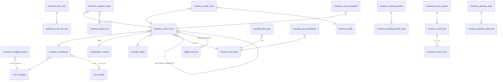
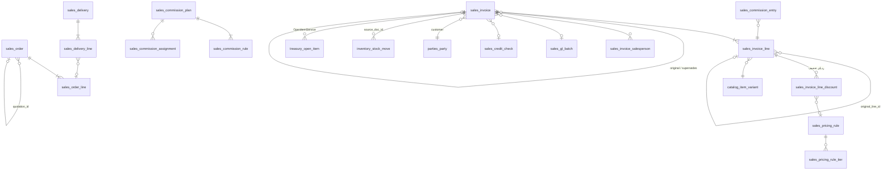
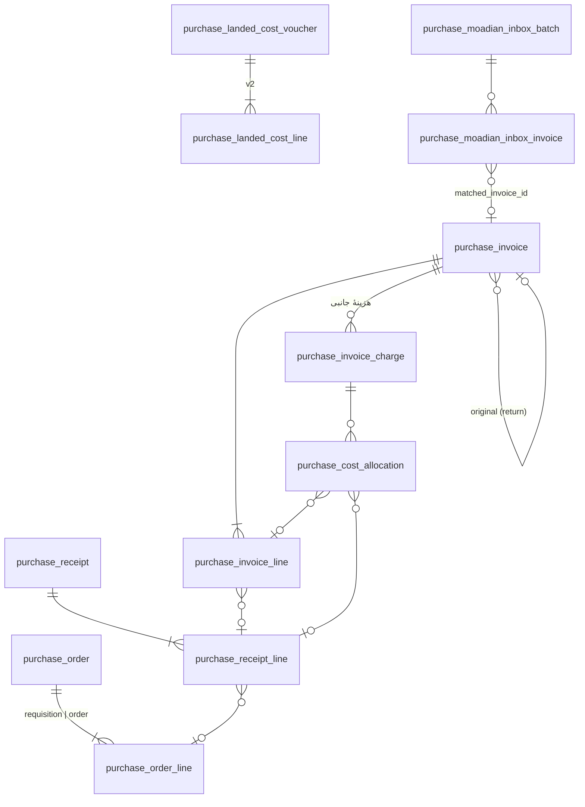

# 05 — بازرگانی: انبار و ارزیابی، فروش، خرید، قیمت و تخفیف، بسته‌های صنفی

> **وضعیت:** طراحی مرحلهٔ ۲؛ ۲۶ آبان ۱۴۰۵ (2026-11-17).
> **SQL:** [`sql/30_commerce.sql`](sql/30_commerce.sql) — آزمون: [`sql/tests/30_commerce_test.sql`](sql/tests/30_commerce_test.sql).
> **پیش‌نیاز SQL:** `00_foundation` → `10_core` → `20_ledger` → `25_masterdata` → این فایل. روی پایگاه یکپارچه با `40_treasury_pos.sql` (بخش ۰۶) هم آزموده شد.
> **اسکیماهای مالک:** `inventory`، `sales`، `purchase`. سازوکار بستهٔ صنفی (Industry Pack) هم در این سند طراحی شده است؛ جدول‌های ذخیرهٔ بسته در اسکیمای `rules` پیشنهاد شده‌اند (§۱۳، CR-C01).

## ۱. خلاصه

این بخش «چرخهٔ کالا و پول تجاری» را می‌سازد: انبار و ارزیابی موجودی، فروش (پیش‌فاکتور تا برگشت و اصلاحی)، خرید (درخواست تا برگشت از خرید و هزینهٔ جانبی)، قیمت و تخفیف، و سازوکار بستهٔ صنفی که محصول را بدون کد صنفی برای کافه، کفش‌فروشی، کالای برق و SME عمومی (و بعداً هر صنف دیگر) آماده می‌کند.

**تصمیم‌های کلیدی:**

- **دفتر موجودی فقط‌افزودنی + لایهٔ ارزش جدا.** هر حرکت (`inventory.stock_move`) یک سطر برای (سطر سند، انبار، SKU، بچ) است و هرگز تغییر نمی‌کند. ارزش در `inventory.valuation_layer` است: لایهٔ «ثابت» (ورودی بیرونی: بهای خرید، هزینهٔ جانبی، تعیین بهای نامعلوم) و لایهٔ «مشتق» (محاسبهٔ موتور: بهای خروج، تسویهٔ کسری، اصلاح بازارزیابی). ارزش هر حرکت = Σ لایه‌ها.
- **موتور ارزیابی در خود پایگاه داده است.** تریگرهای `stock_move` و توابع `SECURITY DEFINER` (مالک `hk_inventory_definer`، ۱۰ تابع بازبینی‌شده) ارزش را حساب و لایه‌ها، استخر بها، صف FIFO و موجودی جاری را نگه می‌دارند. `hk_app` روی این جدول‌ها فقط `SELECT` دارد؛ پس برنامه نمی‌تواند ارزش ساختگی بنویسد و یک الگوریتم واحد هم ثبت زنده و هم بازپخش را انجام می‌دهد.
- **میانگین موزون متحرک و FIFO** (بدون LIFO) برای هر شرکت؛ دامنهٔ استخر بها «شرکت» (پیش‌فرض، انتظار حسابدار ایرانی) یا «انبار». موجودی منفی با «بهای برآوردی» و «تسویهٔ کسری» هنگام ورود بعدی حل می‌شود؛ بهای نامعلوم «نامعلوم» ثبت می‌شود، نه صفرِ بی‌صدا.
- **ثبت پس‌تاریخ:** استخر از نقطهٔ پس‌تاریخ «کثیف» می‌شود؛ `inventory.repost_pool` از نزدیک‌ترین نقطهٔ بازیابی بازپخش می‌کند و فقط **تفاوت** را به‌صورت لایهٔ `repost` می‌افزاید (idempotent: استخر تمیز ← هیچ). سند GL اصلاح با کف تاریخ دورهٔ باز ثبت می‌شود.
- **حالت دائمی یا ادواری** در سیاست تاریخ‌دار شرکت (`inventory.company_policy`)؛ تغییر حالت فقط از آغاز سال مالی بعد. حسابداری بستن ادواری تعریف و در `inventory.periodic_close` با قید «بهای تمام‌شده = ابتدا + خرید − برگشت − پایان» اجبار شده است.
- **سیاست موجودی منفی برای هر انبار** (ارث از شرکت، `allow`، `allow_warn`، `block`). `block` در پایگاه داده حتی برای ثبت پس‌تاریخ (کمینهٔ ماندهٔ جاری پس از نقطه) اجبار می‌شود. فروش صندوق آفلاین هرگز رد نمی‌شود و «استثنای انبار» می‌سازد. انبار در راه همیشه `block` است.
- **سریال و بچ در bundle جدا از سطر سند** (`tracking_bundle` و `serial_move`)، با ماشین حالت سریال، گارانتی از تاریخ فروش، FEFO و سیاست فروش بچ منقضی. **تلهٔ «تکرار افتتاحیهٔ انبار»** با یکتایی افتتاحیه برای هر (انبار، SKU، بچ) و قاعدهٔ «افتتاحیه نخستین حرکت است» بسته شده است.
- **فروش:** سفارش (پیش‌فاکتور/سفارش)، حواله، فاکتور با سه نوع (`invoice`، `return`، `correction`) و مسیر فروش مستقیم پیشخوان (`stock_mode='immediate'`). حساب هر سطر **عین فرمول مؤدیان** در CHECK پایگاه داده است: `prdis = trunc(am×fee)`، `adis = prdis − dis`، `vam = trunc(adis×vra/100)`، `tsstam = adis+vam+odam+olam`. نرخ‌ها از ماشین‌حساب ماژول مالیات می‌آیند و نسخهٔ قاعده snapshot می‌شود؛ هیچ نرخی در بازرگانی ذخیره یا hardcode نیست.
- **برگشت و اصلاحی به سطر فاکتور اصلی گره خورده‌اند:** برگشت قیمت واحد و نرخ نسخهٔ جاری را حفظ می‌کند و از مقدار فروخته‌شده بیشتر نمی‌شود؛ زنجیرهٔ اصلاحی خطی است و خریدار، نوع، الگو، شناسهٔ کالا و نرخ را عوض نمی‌کند (قواعد `ins=2/4` مؤدیان).
- **موتور قیمت و تخفیف قطعی:** قاعده‌های قیمت با تقدم ثابت (اولویت ← اختصاص ← قدمت)، گروه انباشت، پلکان، زمان‌دار، کالای هدیه؛ ردپای هر ریال تخفیف در `sales.invoice_line_discount`؛ همان موتور در TypeScript برای صندوق آفلاین با بردار مشترک.
- **اقلام باز و تسویه مال treasury است** (`treasury.open_item`/`allocation`، بخش ۰۶). فروش و خرید هنگام ثبت قلم خود را در همان تراکنش ثبت می‌کنند؛ جدول تسویهٔ موازی ساخته نشد.
- **خرید:** درخواست، سفارش، رسید (GRN با حساب GRNI)، فاکتور (مستقیم یا بر اساس رسید) با هزینهٔ جانبی سرمایه‌ای و تسهیم، برگشت از خرید، و صندوق ورودی صورتحساب‌های خرید از Excel کارپوشهٔ مؤدیان با تطبیق. ورود دوبارهٔ فاکتور تأمین‌کننده (شماره یا taxid) ساختاری ناممکن است.
- **بستهٔ صنفی فقط داده است:** مانیفست `hkpack/1` درون HKSB، نصب/ارتقا/حذف با «ردپای مصنوع» و hash محتوا، اعمال‌کنندهٔ هر ماژول، و چهار بستهٔ v1 (`general`، `cafe`، `retail_apparel`، `retail_electrical`) به‌طور مشخص.

**اندازه:** ۵۳ جدول مستأجری (inventory ۲۵، sales ۱۶، purchase ۱۲)، ۹ ویو `security_invoker`، ۵۹ تابع، ۸۱ تریگر، ۱۰ تابع definer؛ ۱۰۳ ناوردای شماره‌دار (INV-INV ۴۰، INV-SAL ۳۵، INV-PUR ۱۵، INV-PCK ۸، INV-COM ۵)؛ آزمون پایگاه داده‌ای T01…T93 با حدود ۳۰۰ ادعا، سبز روی PostgreSQL 18.7.

## ۲. دامنه

### ۲-۱. در دامنهٔ این بخش

| حوزه | محتوا |
|---|---|
| **انبار** | انبار (عادی، در راه)، مکان/قفسه (مدل v2)، انبار پیش‌فرض شعبه، حداقل/حداکثر؛ سیاست تاریخ‌دار شرکت (روش ارزیابی، حالت دائمی/ادواری، دامنهٔ استخر، سیاست منفی، تفاوت قیمت)؛ اسناد انبار (انتقال یک/دومرحله‌ای، تعدیل، ضایعات، مصرف داخلی، تولید داخلی، افتتاحیه)؛ دفتر موجودی؛ لایهٔ ارزش؛ استخر بها، صف FIFO، نقطهٔ بازیابی؛ موجودی جاری؛ بازارزیابی؛ استثنای انبار؛ انبارگردانی؛ بستن ادواری؛ زیردفتر موجودی برای ledger |
| **ردیابی** | بچ، انقضا و FEFO؛ سریال، ماشین حالت و گارانتی؛ bundle سریال/بچ جدا از سطر |
| **کیت و دستور پخت** | انفجار کیت و کسر خودکار مواد (backflush) هنگام فروش با snapshot نسخهٔ BOM؛ تولید داخلی نیمه‌آماده (`production`) |
| **فروش** | پیش‌فاکتور، سفارش، حواله و رسید مرجوعی، فاکتور، برگشت از فروش، صورتحساب اصلاحی، ابطال؛ فروش مستقیم پیشخوان؛ دستهٔ GL صندوق؛ کنترل اعتبار؛ پورسانت (مدل داده) |
| **قیمت و تخفیف** | انتخاب فهرست قیمت، موتور قاعده (سطری، فاکتوری، پلکانی، قیمت جایگزین، کالای هدیه، زمان‌دار، گروه مشتری)، تسهیم تخفیف فاکتور، ردپای تخفیف، گرد کردن نقدی |
| **خرید** | درخواست، سفارش، رسید کالا، فاکتور خرید (مستقیم/بر اساس رسید)، هزینهٔ جانبی و تسهیم، سند هزینهٔ جانبی مستقل (مدل v2)، برگشت از خرید، صندوق ورودی صورتحساب‌های خرید کارپوشه |
| **ادغام GL** | کلیدهای نگاشت تازه، ویژگی‌های شرط نگاشت، قالب هر `PostingRequest`، ثبت حساب موجودی روی حرکت، قرارداد زیردفتر `inventory` |
| **بستهٔ صنفی** | قالب مانیفست، چرخهٔ نصب/ارتقا/حذف، ماژول هماهنگ‌کنندهٔ `packs`، اعمال‌کنندهٔ هر ماژول، محتوای چهار بستهٔ v1 |

### ۲-۲. بیرون از دامنه (و مالک)

| موضوع | مالک |
|---|---|
| اقلام باز، تخصیص دریافت/پرداخت، سنی بدهکاران، چک و کارتخوان | treasury (بخش ۰۶): `treasury.open_item`، `treasury.allocation`، `treasury.v_party_cheque_exposure` |
| نرخ ارزش افزوده و عوارض، انتخاب نوع/الگو/موضوع صورتحساب، taxid، امضا و ارسال به مؤدیان، خلاصه عملکرد | tax (ماشین‌حساب `TaxCalculator` و `TaxDocumentService`) |
| پارامترهای قانونی تاریخ‌دار و ذخیرهٔ بستهٔ امضاشده (مانیفست بستهٔ صنفی) | rules |
| فاکتور فروش صندوق، شیفت، روز کاری، میز، modifier، چاپ ایستگاه، همگام‌سازی آفلاین | pos (بخش ۰۶). pos فاکتور را از `SalesInvoiceService` می‌سازد |
| کالا، variant، واحد، بارکد، فهرست و ردیف قیمت، `catalog.resolve_price`، BOM | catalog (بخش ۰۴) |
| شخص، نقش، سقف اعتبار، شرایط پرداخت، گروه شخص | parties (بخش ۰۴) |
| `PostingRequest`، قاعدهٔ نگاشت، سال و دوره و قفل ماژول | ledger (بخش ۰۳) |
| شماره‌گذاری، گردش تأیید، تنظیمات، فیلد سفارشی، پیوست، outbox، job | core (بخش ۰۲) |
| آداپترهای مهاجرت (هلو، سپیدار، حسابفا، Excel) | migration؛ این بخش سرویس‌های import idempotent را می‌دهد |
| قالب چاپ، داشبورد و گزارش‌ساز | reports؛ بستهٔ صنفی محتوایشان را از راه اعمال‌کنندهٔ reports نصب می‌کند |
| RMA و ادعای گارانتی، رزرو موجودی، تطبیق سه‌طرفه، تولید چندسطحی، پخش و ویزیتور | v2 / بسته‌های بعدی (§۱۰) |

## ۳. تصمیم‌های طراحی

### D-C01 — دفتر موجودی فقط‌افزودنی و لایهٔ ارزش جدا (ثابت/مشتق)
- **تصمیم:** `inventory.stock_move` فقط درج می‌پذیرد (بدون grant به‌روزرسانی و حذف، به‌اضافهٔ `core.forbid_mutation`). ارزش در `inventory.valuation_layer` است که آن هم فقط‌افزودنی است. لایهٔ اولیهٔ حرکت ورودی با بهای بیرونی «ثابت» است؛ بقیه «مشتق». تعدیل ثابت (هزینهٔ جانبی، تفاوت قیمت، تعیین بهای نامعلوم، تجدید ارزیابی دستی) لایهٔ ثابت تازه است. ارزش حرکت = Σ لایه‌ها.
- **دلیل:** تغییر ارزش حرکت‌های گذشته (ثبت پس‌تاریخ، هزینهٔ جانبی دیرآمده) باید بدون دست زدن به سطرهای ثبت‌شده و با ردپا انجام شود؛ تفکیک ثابت/مشتق یعنی بازپخش فقط بخش مشتق را بازمحاسبه می‌کند و ورودی‌های بیرونی را دست نمی‌زند.
- **ردشده:** (۱) ستون ارزش تغییرپذیر روی سطر حرکت (الگوی بازنویسی Stock Ledger Entry در ERPNext): سطر ثبت‌شده عوض می‌شود و ممیزی ممکن نیست. (۲) یک لایه برای هر حرکت بدون تفکیک ثابت/مشتق: بازپخش نمی‌داند کدام بخش ورودی بیرونی است.
- **مرجع:** [۰۶ §۷-۳](../research/06-feature-benchmark.md#۷-۳-انبار-و-ارزیابی)، [README §۲ بند ۱۲](../research/README.md#ب-هستهٔ-حسابداری-و-عملیات)

### D-C02 — موتور ارزیابی درون پایگاه داده با `SECURITY DEFINER`
- **تصمیم:** BEFORE trigger (invoker) حرکت را اعتبارسنجی و استخر را با `inventory.pool_acquire` (definer) قفل می‌کند و `posting_seq` را **پس از قفل** می‌گیرد. AFTER trigger (definer) موجودی، سیاست منفی و ارزیابی (`inventory.valuate`) را اجرا می‌کند. `repost_pool`، `add_cost_adjustment`، `create_checkpoint`، `verify_pool_replay` و `rebuild_derived` هم definer و RLS‌مقید هستند. مالک همه `hk_inventory_definer` (`NOLOGIN NOBYPASSRLS`)، `search_path` ثابت، توضیح `HK_DEFINER_REVIEWED` (شرایط D-32 بخش ۰۱).
- **دلیل:** یک پیاده‌سازی برای ثبت زنده و بازپخش ⇒ نتیجهٔ قطعی و قابل‌راستی‌آزمایی (`verify_pool_replay` = ۰). برنامه نمی‌تواند لایه، استخر یا موجودی را مستقیم بنویسد (`42501`). ترتیب ارزیابی هر استخر = ترتیب قفل.
- **ردشده:** (۱) موتور فقط در پایتون: دو منبع حقیقت بین زنده و بازپخش، و دسترسی نوشتن `hk_app` روی مشتق‌ها. (۲) trigger بدون definer: نیازمند grant نوشتن به `hk_app`.
- **هزینه:** ۱۰ ورودی تازه در `secdef-allowlist` (درخواست §۱۳ CR-C04). همتای مرجع پایتون فقط برای آزمون تفاضلی است.

### D-C03 — دامنهٔ استخر بها: شرکت یا انبار؛ روش در سطح شرکت (ساده‌سازی آگاهانه)
- **تصمیم:** `company_policy.cost_pool_scope ∈ {company, warehouse}`؛ پیش‌فرض `company` (یک میانگین برای هر SKU در شرکت، انتظار رایج هلو و سپیدار). `warehouse` برای زنجیره‌های چندشعبه‌ای که سود شعبه و حساب موجودی هر شعبه می‌خواهند. روش ارزیابی و دامنه پس از اولین حرکت در v1 ثابت‌اند (`HK_INV_POLICY_METHOD_CHANGE`).
- **ساده‌سازی ثبت‌شده:** Odoo 19 روش و حالت را در «دستهٔ کالا» نگه می‌دارد؛ v1 فقط سطح شرکت را دارد. کلید استخر (`company, variant, warehouse?`) طوری است که «روش برای هر دسته» (v2) با افزودن ستون `method` به کلید و جدول `inventory.valuation_override` بدون مهاجرت دادهٔ حرکت ممکن است.
- **پیامد حسابداری دامنهٔ شرکت:** ارزش هر انبار برای گزارش = مقدار × میانگین استخر. پس قاعدهٔ نگاشت `inventory.asset` در دامنهٔ شرکت نباید به `attr:warehouse` شرط شود؛ سرویس هنگام پوشش نگاشت (`MappingService.coverage`) این را هشدار می‌دهد.
- **ردشده:** میانگین همیشه برای هر انبار (ERPNext): با انتظار بازار ایران نمی‌خواند؛ میانگین فقط شرکتی: سود شعبه ناممکن می‌شود.
- **مرجع:** [۰۶ §۷-۳ (راستی‌آزمایی Odoo)](../research/06-feature-benchmark.md#۷-۳-انبار-و-ارزیابی)، [README §۲-و](../research/README.md#و-ناسازگاریهای-بین-گزارشها-که-تیم-فنی-باید-پیش-از-شروع-ببندد)

### D-C04 — میانگین موزون و FIFO با موجودی منفی، بهای برآوردی و تسویهٔ کسری؛ بدون LIFO
- **تصمیم:**
  - **میانگین:** خروج = `round(v × q_out / q)` و اگر استخر خالی شود، دقیقاً `v` (بدون باقیماندهٔ گرد کردن). اگر `q ≤ 0`، بهای برآوردی = `last_unit_cost` (وضعیت `estimated`) یا ۰ با وضعیت `unknown`.
  - **FIFO:** مصرف از سر صف به ترتیب (تاریخ، `posting_seq`)؛ بخش آخر هر لایه کل ارزش باقی را می‌گیرد. کمبود صف ← «کسری» با بهای برآوردی در `deficit_qty/deficit_value`.
  - **تسویه:** ورود بعدی ابتدا کسری را پوشش می‌دهد؛ تفاوت «برآوردی − واقعی» لایهٔ `settlement` (مشتق) روی همان حرکت ورودی است و در GL به بهای تمام‌شده می‌رود.
  - **LIFO** ارائه نمی‌شود (IAS 2). شناسایی ویژه به تفکیک سریال برای کالای برقی گران v2 است (کلید استخر + `lot_valuated`).
- **دلیل:** فروش آفلاین و ورود دیرهنگام رسید در کافه و فروشگاه واقعی است؛ موجودی منفی باید بدون ساختن عدد جعلی و با اصلاح شفاف حل شود.
- **مرجع:** [۰۶ §۴-ج](../research/06-feature-benchmark.md#۴-ج-انبار-و-کالا)، [۰۶ §۷-۴](../research/06-feature-benchmark.md#۷-۴-pos-آفلاینمحور)

### D-C05 — ثبت پس‌تاریخ و بازارزیابی تکرارپذیر
- **تصمیم:** ترتیب ارزیابی = `(move_date, posting_seq)`. حرکتی که نقطه‌اش پیش از `last_date/last_seq` استخر است، استخر را از آن نقطه کثیف می‌کند. `repost_pool(pool, run, gl_floor)`: قفل استخر ← آخرین نقطهٔ بازیابی پیش از نقطهٔ کثیف ← بازگرداندن وضعیت و صف FIFO ← بازپخش همهٔ حرکت‌های پس از آن با همان `valuate` ← برای هر حرکت «مشتقِ مورد انتظار − Σ مشتق موجود» را اگر ≠ ۰ با لایهٔ `repost` (تاریخ GL = `max(move_date, gl_floor)`) درج می‌کند ← وابسته‌ها در استخرهای دیگر (ورود انتقال، برگشت فروش، خروجی تولید، برگشت حرکت) کثیف می‌شوند ← استخر تمیز. job `inventory.repost` استخرهای کثیف را به ترتیب نقطه پردازش می‌کند؛ اگر تعداد حرکت‌های بعدی ≤ `inventory.repost.inline_limit` (پیش‌فرض ۲۰۰) باشد، همان تراکنش ثبت را اصلاح می‌کند.
- **ضمانت‌ها:** idempotent (استخر تمیز ← ۰؛ اجرای دوم هیچ لایه‌ای نمی‌افزاید)، هم‌روند (قفل ردیف استخر؛ ثبت و بازپخش یک استخر سریالی‌اند)، بدون بازنویسی (فقط لایهٔ تفاوت)، و قابل‌راستی‌آزمایی (`verify_pool_replay` در زیرتراکنش برگشت‌خورده).
- **کف GL:** پایتون `gl_floor` را از `FiscalYearQuery` و قفل ماژول `inventory` و `finalized_through` می‌سازد: نخستین تاریخ باز. اصلاح دورهٔ بسته در اولین دورهٔ باز ثبت می‌شود و گزارش می‌شود.
- **ردشده:** بازمحاسبهٔ کامل و بازنویسی ارزش‌ها (ERPNext Repost Item Valuation با به‌روزرسانی SLE): ممیزی‌پذیر نیست؛ ممنوعیت ثبت پس‌تاریخ: برای مهاجرت و فاکتور خرید دیرآمده غیرعملی است.
- **مرجع:** [۰۶ §۷-۳](../research/06-feature-benchmark.md#۷-۳-انبار-و-ارزیابی)

### D-C06 — سیاست موجودی منفی برای هر انبار؛ صندوق آفلاین هرگز رد نمی‌شود
- **تصمیم:** `warehouse.negative_policy ∈ {inherit, allow, allow_warn, block}`؛ `inherit` ← `company_policy.negative_stock_default`. در `block`، ماندهٔ جاری و (برای ثبت پس‌تاریخ) کمینهٔ ماندهٔ جاری از آن نقطه به بعد نباید منفی شود (`HK_INV_NEGATIVE_STOCK`). حرکت با `origin='offline_device'` هرگز رد نمی‌شود (کالا فیزیکی فروخته شده است) و `stock_exception` نوع `negative_stock` می‌سازد. انبار در راه همیشه `block` است و استثنای آفلاین ندارد. سریال ناموجود در فروش آفلاین هم پذیرفته و `serial_conflict` ثبت می‌شود.
- **دلیل:** پاسخ پیشنهادی پژوهش برای کافه («موجودی منفی با هشدار») و واقعیت قطعی ۱۳۸روزه؛ رد کردن فرمان صندوق پس از همگام‌سازی، داده را از واقعیت جدا می‌کند.
- **مرجع:** [README §۶ پرسش ۳](../research/README.md#۶-پرسشهای-باز-برای-صاحب-محصول-تصمیمهای-کسبوکاری)، [۰۶ §۷-۴](../research/06-feature-benchmark.md#۷-۴-pos-آفلاینمحور)

### D-C07 — حالت دائمی یا ادواری برای هر شرکت، تاریخ‌دار؛ حسابداری ادواری تعریف‌شده
- **تصمیم:** `company_policy.inventory_mode`؛ ردیف تازه فقط از تاریخی که هیچ حرکتی پس از آن نیست (`HK_INV_POLICY_RETROACTIVE`)، عملاً آغاز سال مالی. در **ادواری**: دفتر موجودی مقدار و ارزش «حافظه‌ای» را نگه می‌دارد (برای گزارش و بستن) ولی هیچ حرکتی GL نمی‌سازد (`asset_account_id = NULL`)؛ خرید به `purchase.purchases` (۸۰۱ هلو) و برگشت از خرید به `purchase.returns` می‌رود؛ فروش بهای تمام‌شده ندارد. **بستن ادواری** (`inventory.periodic_close`): بهای تمام‌شده = موجودی ابتدا + خرید − برگشت از خرید − موجودی پایان (مبنای پایان: ارزیابی موتور، انبارگردانی یا دستی). سند GL بستن در §۵-۵ آمده است.
- **دلیل:** کدینگ هلو نشان می‌دهد بسیاری از کسب‌وکارهای کوچک ادواری‌اند و مهاجرت از هلو بدون آن ناممکن است.
- **ردشده:** حالت برای هر دسته (Odoo): v2 همراه روش ارزیابی برای هر دسته.
- **مرجع:** [۰۶ §۴-ج](../research/06-feature-benchmark.md#۴-ج-انبار-و-کالا)، [README §۲ بند ۱۲](../research/README.md#ب-هستهٔ-حسابداری-و-عملیات)

### D-C08 — سریال و بچ در bundle جدا؛ ماشین حالت سریال؛ FEFO
- **تصمیم:** سند (فاکتور، رسید، حواله، سند انبار) فقط `bundle_id` نگه می‌دارد. `tracking_bundle` (پیش‌نویس/ثبت‌شده) ورودی‌های سریال/بچ را دارد؛ ثبت آن جمع = مقدار سطر و «bundle خروجی سریال یا بچ تازه نمی‌سازد» را اجبار می‌کند. هنگام ثبت سند، سرویس برای هر بچ یک `stock_move` و برای هر سریال یک `serial_move` می‌سازد. سریال: `registered → in_stock (انبار) → out`؛ ورود فقط از `registered/out`، خروج فقط از `in_stock` در همان انبار. فروش، گارانتی (`warranty_days` کالا) و خریدار را روی سریال می‌نویسد. FEFO با `inventory.fefo_candidates` (بچ فعال، نامنقضی، به ترتیب انقضا) و سیاست فروش بچ منقضی (`inventory.expired_batch_sale`: هشدار یا مسدود).
- **دلیل:** الگوی Serial and Batch Bundle از انفجار سطر جلوگیری می‌کند؛ کالای برق سریال و گارانتی، و کافه بچ و انقضا لازم دارند.
- **مرجع:** [۰۶ §۷-۳](../research/06-feature-benchmark.md#۷-۳-انبار-و-ارزیابی)، [۰۶ §۵-۳](../research/06-feature-benchmark.md#۵-۳-لوازم-برقی-و-خانگی-خرده-و-عمده-مشتری-سوم)

### D-C09 — انتقال یک یا دومرحله‌ای با انبار در راه؛ بها همراه کالا
- **تصمیم:** سند `transfer`؛ دومرحله‌ای: ارسال (`transfer_out` از مبدأ + `transfer_in` به انبار در راه) ← `in_transit` ← دریافت (`transfer_out` از در راه + `transfer_in` به مقصد) ← `posted`. `transfer_in` با قاعدهٔ `source` دقیقاً ارزش خروج متناظر را می‌گیرد؛ تاریخ دریافت ≥ ارسال. کسری دریافت = تعدیل خروج از انبار در راه با دلیل.
- **GL:** در دامنهٔ انبار یا وقتی حساب موجودی مبدأ و مقصد فرق دارد: انتقال ارزش با کلید `inventory.goods_in_transit`؛ در دامنهٔ شرکت با حساب یکسان، سند GL لازم نیست (`gl_status='not_required'`).
- **مرجع:** [۰۶ §۴-ج](../research/06-feature-benchmark.md#۴-ج-انبار-و-کالا)

### D-C10 — انبارگردانی با تصویر روز شمارش، شمارش کور و دو دور
- **تصمیم:** `count_session`: `draft → counting → reviewing → posted` (لغو پیش از ثبت). یک انبارگردانی باز برای هر انبار. شمارش‌ها در `count_entry` فقط‌افزودنی‌اند؛ دور دوم توسط شخص دیگر. تصویر سیستم (`system_qty_base`) فقط هنگام ورود به بازبینی، برای «پایان روز شمارش» گرفته می‌شود تا حرکت‌های پس از آن در اختلاف نیایند. ثبت، یک سند `adjustment` با تاریخ روز شمارش می‌سازد (کسری با بهای استخر، اضافی با `pool_in`).
- **مرجع:** [۰۶ §۴-ج](../research/06-feature-benchmark.md#۴-ج-انبار-و-کالا)، [۰۶ §۵-۱](../research/06-feature-benchmark.md#۵-۱-کافه-و-رستوران-مشتری-اول)

### D-C11 — کیت، دستور پخت و تولید داخلی با snapshot نسخهٔ BOM
- **تصمیم:**
  - **کیت** (کالای غیرانباری با BOM `kit`): سطر فاکتور کیت است (درآمد و شناسهٔ مؤدیان کیت)؛ اجزا با `sale_issue` و `bom_id` و همان `source_line_id` کسر می‌شوند.
  - **دستور پخت** (BOM `recipe`): هنگام فروش، مواد با `backflush` = `qty × line_qty / yield × (1 + waste%)` از انبار مصرف شعبه کسر می‌شوند.
  - **تولید داخلی** (BOM `production`): سند `production` اجزا را `production_out` و محصول را `production_in` با قاعدهٔ `components` (ارزش = −Σ اجزای همان `cost_group_id`) ثبت می‌کند.
  - **ضایعات و مصرف داخلی:** سند `adjustment` با `reason_code` و حرکت `waste`/`consumption` (کلیدهای GL جدا).
  - نسخهٔ BOM فعالِ تاریخ فروش روی سطر و حرکت ثبت می‌شود تا گزارش «مصرف نظری در برابر واقعی» با دستور همان روز ممکن باشد.
- **مرجع:** [۰۶ §۵-۱](../research/06-feature-benchmark.md#۵-۱-کافه-و-رستوران-مشتری-اول)، بخش ۰۴ D-M16

### D-C12 — افتتاحیهٔ انبار یک‌بار و نخستین؛ بهای نامعلوم «نامعلوم» است
- **تصمیم:** یک حرکت `opening` برای هر (شرکت، انبار، SKU، بچ) (ایندکس یکتا)؛ افتتاحیه پیش از همهٔ حرکت‌های کلید است و هیچ حرکتی پیش از آن ثبت نمی‌شود. سند `opening` واحد مبلغ ورودی (`amount_unit`) را اجباری دارد. ورودی بدون بها `input_cost_status='unknown'` با ارزش ۰ و استثنای `unknown_cost` است؛ تعیین بها بعداً با `add_cost_adjustment(reason='cost_resolution')`. GL افتتاحیه از خود inventory با `journal_type='opening_import'` می‌آید و ledger ماندهٔ حساب کنترلی موجودی را در افتتاحیهٔ GL رد می‌کند.
- **دلیل:** تلهٔ سپیدار (تکرار ماندهٔ انبار در افتتاحیهٔ سال بعد)، تلهٔ هلو (ریال از ۱۰۶ و مقدار از `First_exist`؛ هر دو به GL نروند) و قاعدهٔ «بهای نامعلوم نامعلوم است، نه صفر».
- **مرجع:** [۰۱ §۳.۲](../research/01-migration-popular-apps.md#۳۲-سپیدار-sepidar-system-نصبی)، [۰۱ §۳.۱](../research/01-migration-popular-apps.md#۳۱-هلو-holoo-شرکت-مهندسی-نرمافزار-هلو--گروه-طرفهنگار)، [README §۳-۱](../research/README.md#۳-۱-قرارداد-صحت-انتقال-غیرقابل-مذاکره)

### D-C13 — ادغام GL فقط با `PostingRequest`؛ حساب موجودی روی حرکت ثبت می‌شود
- **تصمیم:** هر سند در همان تراکنش یک `PostingRequest` با `source_module/source_doc_type/source_doc_id` می‌فرستد. حساب‌ها با کلید نگاشت و ویژگی‌ها (`attr:item_posting_group`، `attr:item_type`، `attr:item_category` از catalog؛ `attr:customer_group`/`attr:supplier_group` از parties؛ `attr:warehouse` و `attr:warehouse_kind` و `attr:reason` از inventory) حل می‌شوند. inventory حساب موجودی حل‌شده را پیش از درج روی `stock_move.asset_account_id` می‌نویسد و سطر GL موجودی را با همان `account_id` می‌فرستد؛ پس زیردفتر (`inventory.ledger_subledger_stock`) بر حسب همان حساب‌ها با GL مقایسه‌پذیر است. تریگرهای deferred بررسی می‌کنند سند GL واقعاً از همان سند آمده است (`HK_COMMERCE_GL_LINK`، از ویوی منتشرشدهٔ `ledger.v_journal_line`).
- **کلیدهای تازه:** `purchase.grni`، `purchase.price_difference`، `purchase.purchases`، `purchase.returns`، `purchase.discount`، `purchase.landed_cost_clearing`، `inventory.waste`، `inventory.internal_consumption`، `inventory.opening_stock`، `sales.commission_expense`، `sales.commission_payable` (در SQL ثبت شده‌اند).
- **مرجع:** بخش ۰۳ D-L13/D-L14/D-L15

### D-C14 — مدل سند فروش: سفارش، حواله، فاکتور سه‌نوعه؛ مسیر پیشخوان
- **تصمیم:** `sales.order` با `kind ∈ {quotation, order}`؛ `sales.delivery` (خروج یا رسید مرجوعی)؛ `sales.invoice` با `doc_kind ∈ {invoice, return, correction}`. `stock_mode`: `immediate` (فروش پیشخوان: ثبت فاکتور کالا را هم خارج می‌کند)، `via_delivery` (کالا با حواله)، `none` (خدمت/اصلاحی). سند ثبت‌شده تغییرناپذیر است؛ ابطال = برگشت همهٔ حرکت‌ها + سند GL ابطال. شمارهٔ بی‌فاصله در لحظهٔ ثبت از core (`doc_type = sales.<doc_kind>`).
- **دلیل:** هلو و سپیدار فاکتور، برگشت و پیش‌فاکتور را با نوع از هم جدا می‌کنند؛ یک جدول با نوع، زنجیرهٔ مرجع (اصلی ← برگشت/اصلاحی) را ساده و قابل FK می‌کند.
- **مرجع:** [۰۶ §۴-ب](../research/06-feature-benchmark.md#۴-ب-چرخهٔ-فروش-و-خرید)

### D-C15 — حساب سطر = فرمول مؤدیان در CHECK؛ نرخ از ماژول مالیات؛ بدون نرخ در بازرگانی
- **تصمیم:** ستون‌های سطر عین فیلدهای `body` مؤدیان‌اند (`qty=am`، `unit_price=fee`، `gross=prdis`، `discount=dis`، `net=adis`، `vat_rate=vra`، `vat=vam`، `other_tax=odam`، `other_levy=olam`، `line_total=tsstam`). CHECKها: `gross = trunc(qty × unit_price, minor)`، `net = gross − dis`، `vam = sales.tax_part(net, vra, tax_rounding, minor)`، `tsstam = adis + vam + odam + olam`. `tax_rounding` (پیش‌فرض `truncate`) و نسخهٔ قاعده‌ها (`tax_snapshot`) از `TaxCalculator` snapshot می‌شوند؛ اگر قاعده عوض شود، CHECK با مقدار snapshot همان سطر می‌خواند. فیلدهای ویژهٔ الگو (طلا، ارز، پیمانکاری) در `moadian_extra` و اعتبارسنجی‌شان با ماژول مالیات و نسخهٔ دستورالعمل است.
- **دلیل:** «truncate نه round» و `tbill = Σtsstam` قاعدهٔ رسمی است؛ خطای یک ریال صورتحساب را رد می‌کند (خطای 0204501). نرخ ارزش افزوده پارامتر قانونی تاریخ‌دار است (قرارداد).
- **مرجع:** [۰۳ §۲-۵](../research/03-iran-tax-and-legal.md#۲-۵-ساختار-صورتحساب-الگوها-موضوعات-و-قواعد-کلیدی-s2)، [۰۳ §۳-۱](../research/03-iran-tax-and-legal.md#۳-۱-معماری-ماژول-مالیات-tax--compliance)

### D-C16 — برگشت و اصلاحی گره‌خورده به سطر اصلی؛ زنجیرهٔ اصلاحی خطی
- **تصمیم:**
  - هر سطر برگشت/اصلاحی `original_line_id` به سطر فاکتور **اصلی** (ریشه) دارد.
  - **برگشت (`ins=4`):** همان SKU و واحد؛ قیمت واحد و نرخ = نسخهٔ جاری سطر (پس از آخرین اصلاحی)؛ Σ برگشت ≤ مقدار فروش (قفل ردیف سطر اصلی)؛ همان مشتری و ارز؛ تاریخ ≥ فاکتور. بها در انبار = بهای خروج اصلی (`sale_return` با `source`). اگر همهٔ اقلام برگشت بخورند، ماژول مالیات به‌جای `ins=4` ابطالی (`ins=3`) می‌فرستد.
  - **اصلاحی (`ins=2`):** `supersedes_invoice_id` = آخرین نسخهٔ ثبت‌شده (ایندکس یکتای «یک اصلاحی ثبت‌شده برای هر نسخه»)؛ خریدار، نوع، الگو، SKU و نرخ ثابت؛ مقدار کالای انباری فقط با برگشت تغییر می‌کند؛ اصلاحی کالا جابه‌جا نمی‌کند (`stock_mode='none'`). GL اصلاحی = تفاوت با نسخهٔ قبل.
- **مرجع:** [۰۳ §۲-۵](../research/03-iran-tax-and-legal.md#۲-۵-ساختار-صورتحساب-الگوها-موضوعات-و-قواعد-کلیدی-s2)، [۰۳ §۳-۳](../research/03-iran-tax-and-legal.md#۳-۳-جریانهای-کاربری-کلیدی)

### D-C17 — موتور قیمت و تخفیف قطعی، قابل اجرا آفلاین
- **تصمیم:** قیمت پایه: فهرست‌های قابل اعمال از `PriceQuery.applicable_lists` (شخص > گروه > شعبه > شرکت؛ کانال) و `catalog.resolve_price`. قاعده‌ها (`sales.pricing_rule`): هر نوع با شکل CHECK‌شده؛ فیلترها (کالا، variant، دسته، برند، گروه ثبت، شخص، گروه شخص، شعبه، کانال، فهرست، بازه، روز هفته، ساعت، کمینهٔ مقدار/مبلغ). **تقدم:** (۱) `priority` کوچک‌تر، (۲) امتیاز اختصاص (variant=6، کالا=5، دسته=4، برند/گروه ثبت=3، شخص=+3، گروه شخص=+2، شعبه/کانال=+1)، (۳) `id` (UUIDv7 = ترتیب ساخت). در هر `stack_group` فقط برنده؛ `exclusive` بقیهٔ همان سطح را می‌بندد؛ سطری‌ها جمعی روی ناخالص سطر و محدود به ناخالص؛ فاکتوری‌ها روی خالص پس از سطری. قاعدهٔ استفاده‌شده تغییرناپذیر است (نسخهٔ تازه). تسهیم تخفیف فاکتور به سطرها: نسبتی با «بیشترین باقیمانده» و شکست تساوی با `line_no`؛ سطر بدون اجازهٔ تخفیف وزن صفر دارد. همان موتور در `frontend/packages/pricing` با بردار مشترک `testdata/pricing` (INV-FE-05 بخش ۰۱).
- **مرجع:** [۰۶ §۴-ب](../research/06-feature-benchmark.md#۴-ب-چرخهٔ-فروش-و-خرید)، [۰۶ §۵-۵](../research/06-feature-benchmark.md#۵-۵-سوپرمارکت)، بخش ۰۴ D-M17

### D-C18 — کنترل اعتبار با ثبت فقط‌افزودنی و استثنای تأییدشده
- **تصمیم:** مواجهه = ماندهٔ دریافتنی شخص (ledger، بُعد party روی حساب‌های دریافتنی) + سفارش‌های تأییدشدهٔ فاکتورنشده + چک‌های وصول‌نشده (`treasury.v_party_cheque_exposure`، اگر `credit_includes_uncleared_cheques`) + مبلغ همین سند. سیاست از `party_role` (none/warn/block). نتیجه در `sales.credit_check` با CHECKهای سازگاری؛ `block` فقط با مجوز `sales.credit.override` و درخواست تأیید core به `overridden` می‌رسد.
- **مرجع:** [۰۶ §۴-ب](../research/06-feature-benchmark.md#۴-ب-چرخهٔ-فروش-و-خرید)، بخش ۰۴ (party_role)

### D-C19 — اقلام باز و تسویه در treasury؛ بدون جدول تسویهٔ موازی
- **تصمیم:** هم‌راستا با بخش ۰۶: فاکتور فروش/خرید، برگشت و اصلاحی هنگام ثبت `OpenItemService.register` (treasury) را در همان تراکنش صدا می‌زنند (`source_module/source_doc_type/source_doc_id/source_line_key`). اصلاحی قلم تفاوت (`correction:<id>`) ثبت می‌کند. ابطال `OpenItemService.cancel` را صدا می‌زند که قلم دارای تخصیص را رد می‌کند (`treasury.open_item_cancel`). DAG: `sales/purchase → treasury` مجاز است.
- **ردشده:** `sales.invoice_settlement` و `purchase.invoice_settlement` (نسخهٔ پیش‌نویس این بخش): دو منبع حقیقت برای ماندهٔ شخص و تسویه.

### D-C20 — دستهٔ GL برای صندوق
- **تصمیم:** فاکتور صندوق می‌تواند `gl_mode='batched'` با `gl_batch_id` باشد: فاکتور قانونی (شماره، مؤدیان، حرکت انبار) فوراً ثبت می‌شود ولی GL یک سند تجمیعی برای هر شیفت است (`sales.gl_batch`). پیوستن فاکتور فقط به دستهٔ باز. پاسخ به C-L16 (رقابت روی شمارندهٔ عطف).

### D-C21 — خرید: GRNI، تفاوت قیمت، هزینهٔ جانبی، تکرار فاکتور
- **تصمیم:**
  - رسید (دائمی): Dr موجودی / Cr `purchase.grni` به بهای مورد انتظار.
  - فاکتور بر اساس رسید: Dr `purchase.grni` (به ارزش رسید) + Dr مالیات خرید / Cr پرداختنی. تفاوت قیمت: `price_difference_policy='revalue_stock'` (پیش‌فرض) ← `add_cost_adjustment(price_difference)` روی حرکت رسید و بازارزیابی (بخش مصرف‌شده به بهای تمام‌شده می‌رود)؛ یا `price_difference_account` ← کلید `purchase.price_difference`.
  - فاکتور مستقیم با کالا: Dr موجودی (خالص + هزینهٔ سرمایه‌ای) / Cr پرداختنی.
  - هزینهٔ جانبی سرمایه‌ای کاملاً و فقط روی سطرهای همان فاکتور یا رسیدهایش تسهیم می‌شود (ارزش، مقدار، وزن، حجم، دستی). سند هزینهٔ جانبی مستقل (فاکتور دیگری روی رسیدهای قبلی) v2 است و مدلش آماده است.
  - یک فاکتور فعال برای هر (شرکت، تأمین‌کننده، شمارهٔ فاکتور او) و هر taxid.
- **مرجع:** [۰۶ §۴-ب](../research/06-feature-benchmark.md#۴-ب-چرخهٔ-فروش-و-خرید)، [README §۵](../research/README.md#۵-دامنهٔ-پیشنهادی-نسخهها)

### D-C22 — صندوق ورودی صورتحساب‌های خرید کارپوشه
- **تصمیم:** فایل Excel کارپوشه (API خرید وجود ندارد) در `purchase.moadian_inbox_batch` (پیوست core، sha256 یکتا، `amount_unit` صریح، نسخهٔ قالب) پردازش و هر صورتحساب یک ردیف یکتا بر اساس taxid در `moadian_inbox_invoice` است؛ بارگذاری دوباره فقط وضعیت پورتال و واکنش خریدار را به‌روز می‌کند. تطبیق با فاکتور خرید (همان تأمین‌کننده و taxid سازگار؛ یک ردیف برای هر فاکتور) مبنای اعتبار مالیاتی خرید در ماژول مالیات است.
- **مرجع:** [۰۳ §۳-۳ بند ۵](../research/03-iran-tax-and-legal.md#۳-۳-جریانهای-کاربری-کلیدی)، [۰۳ §۲-۱۱](../research/03-iran-tax-and-legal.md#۲-۱۱-مالیات-بر-ارزش-افزوده)

### D-C23 — پورسانت فروشنده: مدل داده v1، محاسبه v2
- **تصمیم:** طرح (`commission_plan` با مبنای درآمد خالص، سود ناخالص یا وصول)، قاعده (دسته/کالا، کمینه، درصد یا مبلغ)، انتساب به بازاریاب (بی‌هم‌پوشانی)، سهم فروشندگان از فاکتور (جمع ۱۰۰)، و ثبت فقط‌افزودنی تعهد پورسانت با برگشت قرینه.

### D-C24 — بستهٔ صنفی: دادهٔ امضاشده، هماهنگ‌کنندهٔ بی‌اسکیما، ردپای مصنوع
- **تصمیم:** بسته = مانیفست `hkpack/1` (JSON) درون HKSB (C-07 بخش ۰۱)، ذخیره در `rules.industry_pack_version` (پیشنهاد CR-C01). ماژول `packs` (بدون اسکیما، بالاترین لایه، مثل `edge`) نصب را هماهنگ می‌کند و هر ماژول یک `PackApplier` دارد که فقط جدول‌های خودش را می‌نویسد. هر شیء ساخته‌شده یک «مصنوع» با hash محتوای نصب است؛ ارتقا فقط مصنوع ویرایش‌نشده را به‌روز می‌کند؛ حذف هرگز دادهٔ استفاده‌شده را پاک نمی‌کند. چند بسته هم‌زمان فعال‌اند. جزئیات §۵-۱۱.
- **مرجع:** [۰۶ §۷-۱](../research/06-feature-benchmark.md#۷-۱-اصل-معماری-هستهٔ-عمومی-بهاضافهٔ-بستههای-صنفی)، [۰۶ §۵-۰](../research/06-feature-benchmark.md#۵-۰-ماتریس-اهمیت-امکانات-برای-هر-صنف)، بخش ۰۴ D-M22، بخش ۰۳ C-L11

### D-C25 — پیوند سند با شماره، GL و انبار در تریگرهای deferred
- **تصمیم:** هنگام ثبت (در commit): شماره برای همین سند و نوع صادر شده باشد (`core.number_issued`)، سند GL از همین سند آمده باشد (`ledger.v_journal_line`)، و هر سطر کالای انباری با تحویل فوری دقیقاً به اندازهٔ مقدار حرکت داشته باشد. ابطال: هر حرکت برگشت خورده باشد و سند GL ابطال به سند اشاره کند.
- **دلیل:** «درستی ساختاری»: باگ سرویس نمی‌تواند فاکتوری بدون حرکت انبار، با سند GL دیگران یا با شمارهٔ سند دیگر commit کند.

### D-C26 — مشتق‌ها قابل راستی‌آزمایی و بازسازی‌اند
- **تصمیم:** `inventory.verify_derived` (استخر = Σ حرکت؛ ارزش استخر تمیز = Σ لایه؛ موجودی = Σ حرکت؛ وضعیت سریال = آخرین حرکت) شبانه در `inventory.integrity.run`. `inventory.rebuild_derived` قلاب درون‌ریزی `.hkx` است: موجودی را بازمی‌سازد، هر استخر را از ابتدا بازپخش می‌کند و اگر بازپخش با لایه‌های واردشده نخواند (`HK_INV_REBUILD_MISMATCH`) درون‌ریزی رد می‌شود.

## ۴. مدل داده

همهٔ اشیا در [`sql/30_commerce.sql`](sql/30_commerce.sql) هستند. قواعد مشترک همهٔ جدول‌های مستأجری: `id uuid DEFAULT uuidv7()`، `tenant_id NOT NULL`، `UNIQUE (tenant_id, id)` (و برای جدول‌های شرکتی `UNIQUE (tenant_id, company_id, id)`)، کلید خارجی ترکیبی با `tenant_id`، `core.enable_tenant_rls` (ENABLE + FORCE)، و برای جدول‌های قابل‌ویرایش `created_at/updated_at/row_version` با `core.touch_row`. مبلغ‌ها `core.amount`، مقدارها `core.qty`، نرخ‌ها و بهای واحد `core.rate`. ارز سند با `currency_minor` (snapshot از `ref.currency.minor_unit`) و همهٔ مبلغ‌های سند و سطر بر آن دقت. ستون‌های `source_pack/source_pack_version` روی جدول‌هایی که بستهٔ صنفی می‌سازد (انبار، سیاست، قاعدهٔ قیمت، طرح پورسانت) فقط اطلاعاتی‌اند؛ مالکیت مصنوع در `rules.pack_artifact` است.

### ۴-۱. نمای ER







### ۴-۲. انبار: پیکربندی (`inventory`)

| جدول | محتوا و قیدهای کلیدی |
|---|---|
| `company_policy` | سیاست تاریخ‌دار شرکت: `effective_from`، `valuation_method ∈ {moving_average, fifo}`، `inventory_mode ∈ {perpetual, periodic}`، `cost_pool_scope ∈ {company, warehouse}`، `negative_stock_default ∈ {allow, allow_warn, block}`، `price_difference_policy ∈ {revalue_stock, price_difference_account}`. یکتا (شرکت، تاریخ). نگهبان: ردیف پس از حرکت‌ها، ردیف پیش از ردیف بعدی، و تغییر روش/دامنه رد می‌شود. `inventory.policy_on(company, date)` ردیف مؤثر را می‌دهد |
| `warehouse` | `kind ∈ {standard, transit}`، `negative_policy ∈ {inherit, allow, allow_warn, block}`، `is_default_transit` (یکی برای هر شرکت)، `branch_id` (برای `standard` اجباری)، `is_active`. CHECK: در راه = `block`. کد تغییرناپذیر؛ نوع پس از اولین حرکت ثابت |
| `location` | مکان/قفسهٔ درختی درون انبار (فقط مدل؛ v2) |
| `branch_default` | انبار پیش‌فرض فروش، دریافت و مصرف (دستور پخت) هر شعبه |
| `reorder_rule` | حداقل، حداکثر و مقدار سفارش برای (انبار، SKU) |
| `batch` | `(item, variant, batch_no)` یکتا؛ `mfg_date`، `expiry_date` (اگر `catalog.item.track_expiry`)، `status ∈ {active, blocked, recalled}`؛ تاریخ‌ها پس از اولین حرکت ثابت |
| `serial` | `(item, serial_no)` یکتا؛ `status ∈ {registered, in_stock, out}`، `warehouse_id` (فقط در `in_stock`)، `last_move_id`، گارانتی (`warranty_start/end`، ارائه‌دهنده)، `sold_to_party_id`. وضعیت فقط با موتور؛ `hk_app` فقط `notes` و ارائه‌دهندهٔ گارانتی را به‌روز می‌کند |
| `tracking_bundle` / `tracking_bundle_entry` | bundle سریال/بچ سطر سند: `direction ∈ {in, out}`، `total_qty_base`، `status ∈ {draft, posted, cancelled}`؛ entry یا سریال موجود (`serial_id`)، یا سریال تازه (`serial_no`، فقط ورودی)، یا بچ موجود/تازه با مقدار. ثبت‌شده تغییرناپذیر و نیازمند سند مبدأ |

### ۴-۳. انبار: اسناد و دفتر موجودی

| جدول | محتوا و قیدهای کلیدی |
|---|---|
| `stock_doc` | `doc_type ∈ {transfer, adjustment, production, opening}`؛ `status ∈ {draft, in_transit, posted, cancelled}`؛ `warehouse_id`، `to_warehouse_id`، `transit_warehouse_id`، `two_step`؛ `reason_code` (تعدیل: `count`، `waste`، `consumption`، `damage`، `theft`، `cost_resolution`، …)؛ `amount_unit` (اجباری برای `opening`)؛ `origin`؛ `gl_status ∈ {pending, posted, not_required, deferred}`، `gl_journal_id`، `gl_receive_journal_id`، `cancel_journal_id`؛ شمارهٔ بی‌فاصله. ماشین حالت با `stock_doc_guard` |
| `stock_doc_line` | `direction ∈ {in, out}`، `role` (تولید: `component`/`output`)، `cost_group_id`، `batch_id`/`bundle_id`، بهای ورودی (`input_unit_cost`/`input_value`/`input_cost_status`)، `received_qty_base` (دومرحله‌ای) |
| **`stock_move`** | **دفتر موجودی، فقط‌افزودنی.** `move_date`، `posting_seq` (`inventory.posting_seq` پس از قفل استخر)، `move_kind` (۱۴ نوع: `receipt`، `purchase_return`، `sale_issue`، `sale_return`، `transfer_out`، `transfer_in`، `adjust_in`، `adjust_out`، `production_in`، `production_out`، `backflush`، `consumption`، `waste`، `opening`)، `qty_base` (علامت‌دار؛ علامت = `inventory.kind_sign(kind)` یا قرینه برای برگشت)، `uom_id`/`qty_uom` (`qty_base = qty_uom × factor` از `catalog.convert_qty`)، `valuation_rule ∈ {input, pool_out, pool_in, source, reverse, components}` (مجاز برای هر نوع: `inventory.rule_allowed`)، `input_value`/`input_unit_cost`/`input_cost_status`، `cost_source_move_id`، `reversal_of_move_id` (یکتا)، `cost_group_id`، `pool_id`، `party_id`، `bom_id`، `bundle_id`، `asset_account_id` (FK `ledger.account`)، `contra_posting_key` (FK `ledger.posting_key`)، `source_module/source_doc_type/source_doc_id/source_line_id`، `origin ∈ {online, offline_device, migration, system}`. یکتا: `(tenant, pool, posting_seq)`، یک افتتاحیه برای هر (شرکت، انبار، SKU، بچ) |
| `serial_move` | یک سطر برای هر سریال هر حرکت: `qty_sign`، `warehouse_id`؛ فقط‌افزودنی؛ تعداد = \|مقدار حرکت\| (تریگر deferred) |
| **`valuation_layer`** | **فقط‌افزودنی.** `layer_kind ∈ {initial, settlement, adjustment}`، `is_derived`، `reason ∈ {move, negative_settlement, repost, landed_cost, price_difference, cost_resolution, redenomination, manual_revaluation}`، `value` (علامت‌دار)، `cost_status ∈ {known, estimated, unknown}`، `unit_cost`، `gl_date`، `fifo_detail` (لایه‌های مصرف‌شده)، `repost_run_id`، مبدأ (برای ثابت‌ها اجباری). CHECKهای شکل: `initial ⇔ move`، `settlement ⇔ negative_settlement`، مشتق ⇔ (`negative_settlement`، `repost`، یا اولیهٔ غیر `input`)، `repost ⇔ run`. یک `initial` برای هر حرکت |
| `cost_pool` | کلید `(company, variant, warehouse?)`؛ `method`، `minor_unit`، `qty`، `value`، `deficit_qty`، `deficit_value`، `last_unit_cost`، `last_date/last_seq` (نقطهٔ پایانی)، `dirty_from_date/seq/since`، `move_count`. فقط موتور می‌نویسد؛ ردیف آن قفل سریال‌سازی استخر است |
| `fifo_layer` | صف FIFO: `(point_date, point_seq)`، `qty_in`، `qty_remaining`، `value_remaining` |
| `pool_checkpoint` | وضعیت کامل استخر و صف (`fifo_state`) در یک نقطه؛ مبدأ بازپخش |
| `stock_balance` | موجودی جاری برای (شرکت، انبار، SKU، بچ)؛ مشتق، فقط موتور |
| `repost_run` | اجرای بازارزیابی: `trigger_reason ∈ {backdated, cost_adjustment, cascade, manual, integrity}`، `status ∈ {running, completed, failed}`، `gl_floor_date`، شمارنده‌ها (`pools_processed`، `moves_scanned`، `layers_added`، `total_delta`، `journal_count`) |
| `stock_exception` | `kind ∈ {negative_stock, serial_conflict, expired_batch, unknown_cost}`؛ `status: open → acknowledged → resolved` (فقط رو به جلو؛ حل با یادداشت و زمان) |

### ۴-۴. انبار: شمارش و بستن ادواری

| جدول | محتوا و قیدهای کلیدی |
|---|---|
| `count_session` | `draft → counting → reviewing → posted`، لغو پیش از ثبت؛ `count_date`، `scope` (همه/دسته/فهرست)، `blind`، `rounds ∈ {1, 2}`، `adjustment_doc_id`. یک جلسهٔ باز (`counting`/`reviewing`) برای هر انبار |
| `count_line` | `system_qty_base` (فقط در `reviewing`)، `counted_qty_base` (پذیرفته‌شده)، `unit_cost_snapshot` |
| `count_entry` | فقط‌افزودنی: `round_no`، `qty`/`qty_base`، `counted_by`، `device_id`. دور ۲ با شخص دیگر؛ فقط در `counting` |
| `periodic_close` | `basis ∈ {valuation, count, manual}`، `status ∈ {draft, posted, reversed}`، `opening_value`، `purchases_value`، `purchase_returns_value`، `closing_value`، `cogs_value`؛ CHECK: `cogs = opening + purchases − returns − closing`؛ فقط در حالت ادواری |
| `periodic_close_line` | تفکیک ابتدا و پایان بر حسب حساب موجودی و گروه ثبت (برای سطرهای GL) |

### ۴-۵. فروش (`sales`)

| جدول | محتوا و قیدهای کلیدی |
|---|---|
| `pricing_rule` | قاعدهٔ قیمت و تخفیف نسخه‌دار: `code`، `version`، `status ∈ {draft, active, retired}`، `kind ∈ {line_discount, price_override, tiered, invoice_discount, free_item}`، `priority`، `stack_group`، `exclusive`؛ فیلترها (کالا، variant، دسته، برند، گروه ثبت، شخص، گروه شخص، شعبه، `channel ∈ {pos, invoice, online}`، فهرست قیمت، `valid_from/to`، `weekdays` ۰..۶ (شنبه = ۰)، `time_from/to`، `min_qty`، `min_amount` با ارز)؛ نتیجه (یکی از درصد، مبلغ، قیمت جایگزین، پلکان، هدیه با SKU و واحد)؛ `max_discount_amount`، `requires_approval`، `first_used_at` (یک‌بارنوشت). EXCLUDE: یک نسخهٔ فعال برای هر (شرکت، کد) در هر روز. پس از استفاده فقط کوتاه کردن اعتبار و بازنشستگی |
| `pricing_rule_tier` | پلکان (`min_qty` → یک مزیت)؛ فقط روی قاعدهٔ پیش‌نویس |
| `"order"` / `order_line` | `kind ∈ {quotation, order}`؛ پیش‌فاکتور `draft → open → won/lost/expired` (تأییدشدنی نیست)، سفارش `draft → confirmed → closed` (لغو)؛ `valid_until` فقط پیش‌فاکتور؛ `quotation_id`؛ ارسال‌شده/تأییدشده تغییرناپذیر |
| `delivery` / `delivery_line` | `direction ∈ {out, return}`؛ رسید مرجوعی `original_delivery_id`؛ هر سطر کالای انباری با حرکت مقدار برابر (deferred) |
| `gl_batch` | دستهٔ GL صندوق: `source_kind ∈ {pos_shift, manual}`، `source_ref` (شیفت؛ بدون FK)، `status: open → posted` |
| **`invoice`** | `doc_kind ∈ {invoice, return, correction}`، `status: draft → posted → cancelled`؛ `issued_at`؛ شماره (`number_source ∈ {server, device}`، `device_id`)؛ `original_invoice_id`، `supersedes_invoice_id`؛ snapshot خریدار (`buyer_person_type`، کد ملی، کد اقتصادی، کد پستی، کد شعبه، گذرنامه)؛ `currency`/`currency_minor`/`exchange_rate`؛ `price_list_id`، `prices_include_tax`، `pricing_date`؛ `settlement_method ∈ {cash, credit, mixed}` با `cash_amount/credit_amount`؛ `stock_mode ∈ {none, immediate, via_delivery}`، `warehouse_id`؛ جمع‌ها (`gross`، `line_discount_total`، تخفیف فاکتور با حالت/درصد/مبلغ، `net`، `vat`، `other_tax`، `other_levy`، `total`، `total_base`)؛ `moadian_required/type/pattern/extra`، `tax_snapshot`، `tax_document_id` (FK بین‌ماژولی §۱۲)؛ `channel ∈ {invoice, pos, online, migration}`، `source_ref`؛ `gl_mode ∈ {per_document, batched, none}`، `gl_journal_id`، `gl_batch_id`، `cancel_journal_id`؛ `credit_check_id`، `approval_request_id`؛ `custom` (فیلد سفارشی). یک اصلاحی ثبت‌شده برای هر نسخه (ایندکس یکتا) |
| **`invoice_line`** | ستون‌های مؤدیان: `qty`، `unit_price`، `gross_amount`، `line_discount_amount`، `invoice_discount_alloc`، `discount_amount`، `net_amount`، `tax_rounding` (snapshot)، `vat_rate`، `vat_amount`، `other_tax_code/rate/amount`، `other_levy_code/rate/amount`، `line_total`؛ `tax_category_code`، `sstid`، `moadian_unit_code`، `item_title`؛ `price_source ∈ {price_list, manual, rule, contract, migration}`، `price_list_id`، `price_entry_id`؛ `original_line_id`، `order_line_id`، `delivery_line_id`؛ `warehouse_id`، `bundle_id`، `bom_id`؛ ابعاد مرکز هزینه و پروژه؛ فروشنده؛ `moadian_extra`. CHECKهای فرمول در §D-C15 |
| `invoice_line_discount` | ردپای تخفیف: `seq`، `source ∈ {manual, rule, invoice, rounding, coupon}`، `pricing_rule_id`، `basis ∈ {percent, amount, price_override, free_item}`، `percent`، `amount`. Σ سطری = `line_discount_amount`، Σ فاکتوری = `invoice_discount_alloc` |
| `invoice_salesperson` | سهم فروشندگان (Σ = ۱۰۰) |
| `credit_check` | فقط‌افزودنی: `doc_type ∈ {sales.order, sales.invoice}`، `policy`، `credit_limit`، اجزای مواجهه، `total_exposure`، `result ∈ {ok, warn, blocked, overridden}`، تأییدکننده |
| `commission_plan` / `commission_rule` / `commission_assignment` / `commission_entry` | طرح (`basis ∈ {net_revenue, gross_profit, collected}`)، قاعده (دسته/کالا، کمینه، درصد یا مبلغ)، انتساب بی‌هم‌پوشان (EXCLUDE)، ثبت فقط‌افزودنی با برگشت قرینه (`reversal_of_id`) و `settled_ref` |

### ۴-۶. خرید (`purchase`)

| جدول | محتوا و قیدهای کلیدی |
|---|---|
| `"order"` / `order_line` | `kind ∈ {requisition, order}`؛ درخواست `draft → submitted → approved → closed`، سفارش `… → confirmed → closed` (لغو؛ سفارش رسیده فقط بسته می‌شود)؛ `requisition_id`، `expected_date`، `warehouse_id` |
| `receipt` / `receipt_line` | رسید کالا (GRN): تأمین‌کننده، سفارش، انبار، شمارهٔ بارنامه/حوالهٔ تأمین‌کننده؛ سطر با `unit_price`، `value_txn`، `value_base`، `bundle_id`؛ هر سطر با حرکت `receipt` برابر (deferred) |
| `invoice` | `doc_kind ∈ {invoice, return}`؛ `supplier_invoice_no/date`، `supplier_taxid`؛ `original_invoice_id`، `order_id`؛ ارز؛ `stock_mode`؛ جمع‌ها با `charges_amount`/`charges_vat_amount`؛ `amount_unit` (اجباری برای مهاجرت)؛ `channel ∈ {manual, moadian_inbox, migration, api}`. یکتا: (شرکت، تأمین‌کننده، شمارهٔ فاکتور او) و (شرکت، taxid) برای فاکتورهای لغونشده |
| `invoice_line` | مانند سطر فروش (بدون موتور تخفیف)؛ `receipt_line_id`، `order_line_id`، `original_line_id`، `warehouse_id`، `bundle_id`، `expense_posting_key` (خرید خدمت/هزینه) |
| `invoice_charge` | `charge_kind ∈ {freight, insurance, customs, handling, other}`، `amount`، `vat_amount`، `capitalize`، `allocation_basis ∈ {value, qty, weight, volume, manual}`، `expense_posting_key` (اگر سرمایه‌ای نیست) |
| `cost_allocation` | تسهیم هزینه: یا به سطر همان فاکتور یا به سطر رسید؛ Σ = مبلغ هزینهٔ سرمایه‌ای؛ پس از ثبت تغییرناپذیر |
| `landed_cost_voucher` / `landed_cost_line` | سند هزینهٔ جانبی مستقل روی رسیدهای قبلی (مدل؛ v2) |
| `moadian_inbox_batch` | فایل Excel کارپوشه: `attachment_id`، `file_sha256` یکتا، `format_version`، `amount_unit`، بازه، شمارنده‌ها، خطاها |
| `moadian_inbox_invoice` | یک ردیف برای هر taxid (یکتا در شرکت): `reference_taxid` (برای اصلاحی/برگشتی اجباری)، فروشنده (`seller_tin`، نام)، نوع/الگو/موضوع، مبلغ‌ها، `portal_status`، `buyer_reaction ∈ {none, accepted, rejected, auto_accepted}`، `raw_row`؛ `match_status ∈ {unmatched, candidate, matched, ignored}` با `matched_invoice_id` (یکتا در `matched`) |

### ۴-۷. ویوها و توابع منتشرشده

| شیء | کار |
|---|---|
| `inventory.v_move_value` | ارزش هر حرکت = Σ لایه‌ها، با بدترین وضعیت بها |
| `inventory.v_kardex` | کاردکس: حرکت، ارزش، ماندهٔ جاری مقدار (پنجره روی استخر یا انبار) |
| `inventory.v_stock_on_hand` | موجودی جاری با ارزش تقریبی (مقدار × میانگین استخر)؛ ستون‌های بها با `field_guard` |
| `inventory.v_batch_availability` | موجودی بچ‌ها با انقضا و وضعیت |
| `inventory.fefo_candidates(warehouse, variant, qty, on)` | پیشنهاد بچ برای خروج (FEFO) |
| `inventory.ledger_subledger_stock(company, as_of)` | قرارداد زیردفتر ledger: ماندهٔ موجودی بر حسب `asset_account_id` تا تاریخ (Σ لایه‌ها با `gl_date ≤ as_of`) |
| `inventory.verify_derived(company)` | ناسازگاری‌های مشتق (خالی = سالم) |
| `inventory.add_cost_adjustment(...)`، `repost_pool(...)`، `create_checkpoint(pool)`، `verify_pool_replay(pool)`، `rebuild_derived(company)` | سطح موتور برای سرویس‌ها (definer، RLS‌مقید) |
| `sales.v_invoice_current` | نسخهٔ جاری هر فاکتور (پس از آخرین اصلاحی) و جمع و ارزش افزودهٔ جاری |
| `sales.v_line_returnable` | مقدار قابل‌برگشت هر سطر اصلی |
| `sales.v_order_line_progress` | تحویل‌شده و فاکتورشدهٔ هر سطر سفارش |
| `sales.v_invoice_line_margin` | بهای تمام‌شده و حاشیهٔ هر سطر از ارزش حرکت‌ها؛ ستون‌ها با `field_guard` |
| `sales.tax_part(base, rate, mode, minor)` | محاسبهٔ مالیات سطر با حالت گرد کردن snapshot (پیش‌فرض قطع) |
| `purchase.v_receipt_line_unbilled` | رسیدهای صورتحساب‌نشده (مبنای ماندهٔ GRNI) |

### ۴-۸. ثبت در کاتالوگ‌های سراسری

- **`ledger.posting_key`:** ۱۱ کلید تازه (§D-C13).
- **`ledger.subledger_source`:** `('inventory', 'inventory', 'inventory.ledger_subledger_stock', NULL, false)`.
- **`core.permission`:** ۴۹ مجوز (`inventory.*` ۱۶، `sales.*` ۲۰، `purchase.*` ۱۳) و `role_template_permission` برای قالب‌های نقش core.
- **`core.field_guard`:** بها و ارزش در `inventory.stock`، و `cost_amount`/`margin_amount` در `sales.invoice_line` (مجوز `inventory.cost.read`).
- **`core.setting_def`:** `inventory.expired_batch_sale`، `inventory.fefo.enforce`، `inventory.repost.inline_limit`، `sales.discount.max_manual_percent`، `sales.credit.check_on`، `sales.cash_rounding.increment`، `sales.below_cost`، `sales.invoice.max_backdate_days`، `sales.return.window_days`، `purchase.receipt.over_receipt_percent`، `purchase.invoice.price_tolerance_percent`.
- **`core.event_subscriber`:** `inventory.party_merge`، `sales.party_merge`، `purchase.party_merge` (مشترک `parties.party.merged`) و `inventory.year_close` (مشترک `ledger.year.closed`).
- **`core.custom_field_entity`:** `sales.invoice`، `sales.order`.
- **`core.export_table_registry`:** همهٔ جدول‌ها به ترتیب FK (inventory ۵۰۰–۵۴۲، sales ۶۰۰–۶۳۲، purchase ۷۰۰–۷۲۴). `fifo_layer`، `pool_checkpoint` و `stock_balance` صادر نمی‌شوند و قلاب درون‌ریزی با `rebuild_derived` بازشان می‌سازد (D-C26).

### ۴-۹. نقش‌ها و grantها

| نقش | دسترسی |
|---|---|
| `hk_app` | پیکربندی و اسناد: `SELECT, INSERT, UPDATE, DELETE` (نگهبان‌ها حالت را کنترل می‌کنند). دفترها: `stock_move`، `serial_move`، `count_entry`، `credit_check`، `commission_entry` فقط `SELECT, INSERT`. `serial`: درج و `UPDATE(notes, warranty_provider_party_id)`. مشتق‌ها (`valuation_layer`، `cost_pool`، `fifo_layer`، `pool_checkpoint`، `stock_balance`) فقط `SELECT`؛ `stock_exception` فقط `SELECT` و `UPDATE` ستون‌های وضعیت. `USAGE` روی `posting_seq`. اجرای توابع سطح موتور منتشرشده؛ توابع داخلی (`valuate`، `fifo_take`، `pool_acquire`) `REVOKE` از `PUBLIC` |
| `hk_readonly` | `SELECT` روی همه |
| `hk_inventory_definer` | `NOLOGIN NOBYPASSRLS`؛ مالک ۱۰ تابع definer؛ `SELECT` روی inventory و `core.company`، `ref.currency`، `catalog.item`، و نوشتن فقط روی مشتق‌ها، `serial`، `stock_exception` و `repost_run` |

## ۵. منطق دامنه و سرویس‌ها

### ۵-۱. ساختار ماژول‌ها و سطح عمومی

```
backend/src/hesabketab/inventory/
  api/services.py   StockDocService, StockPostingService, CountService, ValuationService, PeriodicCloseService,
                    InventorySetupService, SerialService, StockExceptionService, InventoryImportService
  api/queries.py    StockQuery, KardexQuery, ValuationQuery, InventoryControlTotals
  api/dto.py        MoveSpec, MoveResult, StockDocCreate, BundleSpec, CountEntryIn, RepostReport, ...
  api/errors.yaml   inventory.* (§۵-۱۴)
  domain/           costing_ref.py (همتای مرجع پایتون موتور، فقط آزمون تفاضلی)، gl_builder.py، fefo.py
  infra/            مدل‌ها، مخزن‌ها
  jobs.py           inventory.repost، inventory.revaluation.post، inventory.integrity.run، inventory.checkpoint.compact
  pack.py           InventoryPackApplier
SPEC = ModuleSpec(name="inventory", schema="inventory", layer=4,
                  depends_on={"core","ref","rules","parties","catalog","ledger"},
                  control_totals="hesabketab.inventory.api.queries:InventoryControlTotals",
                  import_hook="hesabketab.inventory.infra.hkx:rebuild_derived")

backend/src/hesabketab/sales/      layer=5  depends_on={"core","ref","rules","parties","catalog","ledger","inventory","treasury","tax"}
  api/services.py   PricingEngine, QuotationService, SalesOrderService, DeliveryService, SalesInvoiceService,
                    SalesReturnService, SalesCorrectionService, CreditControlService, GlBatchService,
                    PricingRuleService, CommissionService, SalesImportService
  api/queries.py    SalesQuery, ReturnableQuery, MarginQuery, SalesControlTotals
  pricing/          engine.py (خالص؛ بدون I/O)، vectors.py (بارگذار testdata/pricing)

backend/src/hesabketab/purchase/   layer=5  depends_on={"core","ref","rules","parties","catalog","ledger","inventory","treasury","tax"}
  api/services.py   PurchaseOrderService, ReceiptService, PurchaseInvoiceService, PurchaseReturnService,
                    LandedCostService (v2)، MoadianInboxService, PurchaseImportService
  api/queries.py    PurchaseQuery, GrniQuery, PurchaseControlTotals

backend/src/hesabketab/packs/      layer=8 (بالاترین)، بدون اسکیما؛ depends_on = سرویس‌های PackApplier همهٔ ماژول‌ها (CR-C02)
  api/services.py   PackService (plan / install / upgrade / uninstall / repair)
  manifest.py       مدل Pydantic مانیفست hkpack/1 و اعتبارسنجی
```

همهٔ نوشتن‌ها درون `UnitOfWork` فراخوان است (یک تراکنش، `SET LOCAL app.tenant_id`). ثبت هر سند (شماره، حرکت‌ها، `PostingRequest`، قلم باز treasury، سند مالیاتی، رویداد outbox) یک تراکنش است و قیدهای deferred در commit پیوند آن‌ها را راستی‌آزمایی می‌کنند.

### ۵-۲. DTOهای کلیدی

```python
from datetime import date, datetime, time
from decimal import Decimal
from typing import Annotated, Literal
from uuid import UUID
from pydantic import BaseModel, Field, model_validator

Amount = Annotated[Decimal, Field(max_digits=24, decimal_places=4)]
Qty = Annotated[Decimal, Field(max_digits=24, decimal_places=6)]
UnitCost = Annotated[Decimal, Field(max_digits=28, decimal_places=12, ge=0)]
MoveKind = Literal["receipt","purchase_return","sale_issue","sale_return","transfer_out","transfer_in","adjust_in",
                   "adjust_out","production_in","production_out","backflush","consumption","waste","opening"]
ValuationRule = Literal["input","pool_out","pool_in","source","reverse","components"]

class MoveSpec(BaseModel, frozen=True):          # ورودی StockPostingService (فقط ماژول‌های مجاز)
    warehouse_id: UUID
    item_id: UUID
    variant_id: UUID
    batch_id: UUID | None = None
    move_kind: MoveKind
    qty_uom: Qty = Field(gt=0)                   # مقدار مثبت در واحد سند؛ علامت از نوع
    uom_id: UUID
    valuation_rule: ValuationRule
    input_value: Amount | None = None            # فقط input
    input_unit_cost: UnitCost | None = None
    input_cost_status: Literal["known","unknown"] = "known"
    cost_source_move_id: UUID | None = None      # source: خروج انتقال، خروج فروش، رسید خرید
    reversal_of_move_id: UUID | None = None
    cost_group_id: UUID | None = None            # تولید
    party_id: UUID | None = None
    bom_id: UUID | None = None
    bundle_id: UUID | None = None
    source_line_id: UUID | None = None
    contra_posting_key: str                       # inventory.cogs | purchase.grni | inventory.waste | ...
    @model_validator(mode="after")
    def _rule(self):
        if self.valuation_rule == "input" and self.input_cost_status == "known" \
           and (self.input_value is None) == (self.input_unit_cost is None):
            raise ValueError("input rule needs exactly one of input_value / input_unit_cost")
        return self

class MoveBatch(BaseModel, frozen=True):
    company_id: UUID
    move_date: date
    source_module: str
    source_doc_type: str
    source_doc_id: UUID
    origin: Literal["online","offline_device","migration","system"] = "online"
    moves: tuple[MoveSpec, ...] = Field(min_length=1, max_length=50_000)
    attributes: dict[str, str] = Field(default_factory=dict)       # ویژگی‌های نگاشت سند (branch، channel، ...)

class MoveResult(BaseModel, frozen=True):
    move_id: UUID
    pool_id: UUID
    posting_seq: int
    asset_account_id: UUID | None                # None در حالت ادواری
    value: Amount                                # Σ لایه‌های ساخته‌شده در همین ثبت
    cost_status: Literal["known","estimated","unknown"]
    exceptions: tuple[str, ...] = ()             # negative_stock، serial_conflict، expired_batch، unknown_cost

class PricingContext(BaseModel, frozen=True):
    company_id: UUID
    branch_id: UUID | None
    party_id: UUID | None
    party_group_ids: tuple[UUID, ...] = ()
    channel: Literal["pos","invoice","online"]
    currency: str
    pricing_at: datetime                          # روز هفته و ساعت محلی Asia/Tehran
    price_list_ids: tuple[UUID, ...]              # از PriceQuery.applicable_lists (ترتیب‌شده)
    rule_set_version: str                          # hash قاعده‌های فعال؛ برای بازتولید آفلاین

class PricingLineIn(BaseModel, frozen=True):
    line_no: int
    variant_id: UUID
    uom_id: UUID
    qty: Qty = Field(gt=0)
    manual_unit_price: Amount | None = None
    manual_discount: tuple[Literal["percent","amount"], Decimal] | None = None
    barcode_price: Amount | None = None           # ترازوی قیمتی

class PricedLine(BaseModel, frozen=True):
    line_no: int
    unit_price: Amount
    price_source: Literal["price_list","manual","rule","contract","barcode","migration"]
    price_list_id: UUID | None
    price_entry_id: UUID | None
    gross: Amount
    discounts: tuple["DiscountTrace", ...]
    line_discount: Amount
    invoice_discount_alloc: Amount
    net: Amount
    free_of: int | None = None                    # سطر هدیه ← line_no مبدأ

class DiscountTrace(BaseModel, frozen=True):
    seq: int
    source: Literal["manual","rule","invoice","rounding","coupon"]
    pricing_rule_id: UUID | None
    basis: Literal["percent","amount","price_override","free_item"]
    percent: Decimal | None
    amount: Amount

class SalesInvoiceDraft(BaseModel):
    company_id: UUID
    branch_id: UUID
    doc_kind: Literal["invoice","return","correction"] = "invoice"
    doc_date: date
    customer_party_id: UUID
    original_invoice_id: UUID | None = None
    supersedes_invoice_id: UUID | None = None
    currency: str = "IRR"
    price_list_id: UUID | None = None
    prices_include_tax: bool = False
    settlement_method: Literal["cash","credit","mixed"] = "credit"
    cash_amount: Amount | None = None
    stock_mode: Literal["none","immediate","via_delivery"] = "immediate"
    warehouse_id: UUID | None = None
    invoice_discount: tuple[Literal["percent","amount"], Decimal] | None = None
    lines: list["SalesLineDraft"] = Field(min_length=1, max_length=5000)
    salespersons: list[tuple[UUID, Decimal]] = []
    channel: Literal["invoice","pos","online","migration"] = "invoice"
    gl_mode: Literal["per_document","batched"] = "per_document"
    gl_batch_id: UUID | None = None
    custom: dict = {}
```

### ۵-۳. سرویس‌ها (امضاها)

```python
class StockPostingService:          # تنها درِ ورود حرکت؛ فقط برای inventory، sales، purchase، pos، migration
    async def post_moves(self, uow: UnitOfWork, batch: MoveBatch, *, gl_floor: date | None = None) -> list[MoveResult]: ...
    async def reverse_source(self, uow: UnitOfWork, *, company_id: UUID, source_doc_type: str, source_doc_id: UUID,
                             reason: str) -> list[MoveResult]: ...      # برگشت همهٔ حرکت‌های سند، همان تاریخ
    async def explode_for_sale(self, uow: UnitOfWork, *, company_id: UUID, branch_id: UUID, variant_id: UUID,
                               qty_base: Decimal, on: date) -> list[MoveSpec]: ...   # کیت/دستور پخت ← اجزا با bom_id
    async def gl_lines(self, uow: UnitOfWork, results: list[MoveResult]) -> list[PostingLine]: ...
        # سطرهای موجودی/طرف مقابل برای PostingRequest سند فراخوان (§۵-۶)

class StockDocService:
    async def create(self, uow, cmd: StockDocCreate) -> StockDocOut: ...
    async def update(self, uow, doc_id: UUID, cmd: StockDocUpdate, row_version: int) -> StockDocOut: ...
    async def post(self, uow, doc_id: UUID, row_version: int) -> StockDocOut: ...          # انتقال دومرحله‌ای ← in_transit
    async def receive(self, uow, doc_id: UUID, lines: list[ReceiveLine], received_date: date, row_version: int) -> StockDocOut: ...
    async def cancel(self, uow, doc_id: UUID, reason: str, row_version: int) -> StockDocOut: ...

class ValuationService:
    async def repost(self, uow, *, company_id: UUID, reason: Literal["backdated","cost_adjustment","cascade","manual","integrity"],
                     pool_ids: list[UUID] | None = None) -> RepostReport: ...   # استخرهای کثیف یا داده‌شده
    async def add_fixed_adjustment(self, uow, *, move_id: UUID, delta: Decimal,
                                   reason: Literal["landed_cost","price_difference","cost_resolution","manual_revaluation"],
                                   source_module: str, source_doc_type: str, source_doc_id: UUID,
                                   gl_date: date | None) -> UUID: ...
    async def resolve_unknown_cost(self, uow, *, move_id: UUID, unit_cost: Decimal, note: str) -> UUID: ...
    async def verify(self, uow, company_id: UUID) -> list[IntegrityIssue]: ...    # inventory.verify_derived + verify_pool_replay نمونه‌ای
    async def gl_floor(self, uow, company_id: UUID) -> date: ...                   # نخستین تاریخ باز (ledger)

class CountService:
    async def create(self, uow, cmd: CountCreate) -> CountOut: ...
    async def start(self, uow, count_id: UUID, row_version: int) -> CountOut: ...
    async def record(self, uow, count_id: UUID, entries: list[CountEntryIn]) -> int: ...        # idempotent با client_entry_id
    async def review(self, uow, count_id: UUID, row_version: int) -> CountReview: ...           # snapshot پایان روز شمارش
    async def accept(self, uow, count_id: UUID, decisions: list[LineDecision], row_version: int) -> CountOut: ...
    async def post(self, uow, count_id: UUID, row_version: int) -> CountOut: ...                # سند adjustment به تاریخ شمارش

class PeriodicCloseService:
    async def compute(self, uow, company_id: UUID, fiscal_year_id: UUID, *, basis: Literal["valuation","count","manual"],
                      closing_override: list[ClosingByAccount] | None = None) -> PeriodicCloseOut: ...
    async def post(self, uow, close_id: UUID, row_version: int) -> PeriodicCloseOut: ...
    async def reverse(self, uow, close_id: UUID, reason: str) -> PeriodicCloseOut: ...          # بازگشایی سال

class SerialService:
    async def lookup(self, uow, serial_no: str, *, item_id: UUID | None = None) -> SerialOut: ...  # تاریخچه و گارانتی
    async def register(self, uow, item_id: UUID, variant_id: UUID, serial_nos: list[str]) -> int: ...

class PricingEngine:                 # خالص و قطعی؛ همتای TypeScript در frontend/packages/pricing
    def price(self, ctx: PricingContext, lines: list[PricingLineIn], *, base_prices: dict[int, "BasePrice"],
              rules: list["RuleSnapshot"], invoice_discount: tuple[str, Decimal] | None,
              cash_rounding_increment: Decimal, minor: int) -> "PricingResult": ...

class SalesInvoiceService:
    async def create_draft(self, uow, cmd: SalesInvoiceDraft) -> InvoiceOut: ...     # قیمت‌گذاری + محاسبهٔ مالیات (پیش‌نمایش)
    async def update_draft(self, uow, invoice_id: UUID, cmd: SalesInvoiceDraft, row_version: int) -> InvoiceOut: ...
    async def post(self, uow, invoice_id: UUID, row_version: int, *, approval_request_id: UUID | None = None) -> InvoiceOut: ...
    async def post_counter_sale(self, uow, cmd: SalesInvoiceDraft, payments: list["PaymentIn"]) -> InvoiceOut: ...
        # پیشخوان: پیش‌نویس + ثبت + دریافت treasury در یک تراکنش
    async def post_from_pos(self, uow, ticket: "PosTicketIn") -> InvoiceOut: ...     # pos؛ origin و شمارهٔ دستگاه
    async def cancel(self, uow, invoice_id: UUID, reason: str, row_version: int) -> InvoiceOut: ...

class SalesReturnService:
    async def draft_from(self, uow, original_invoice_id: UUID, lines: list[tuple[UUID, Decimal]]) -> InvoiceOut: ...
    async def post(self, uow, return_id: UUID, row_version: int) -> InvoiceOut: ...

class SalesCorrectionService:
    async def draft_from(self, uow, invoice_id: UUID) -> InvoiceOut: ...             # کپی نسخهٔ جاری؛ فقط قیمت/تخفیف/مقدار خدمت
    async def post(self, uow, correction_id: UUID, row_version: int) -> InvoiceOut: ...

class CreditControlService:
    async def check(self, uow, *, company_id: UUID, party_id: UUID, doc_type: Literal["sales.order","sales.invoice"],
                    doc_id: UUID, doc_amount: Decimal, currency: str) -> CreditCheckOut: ...
    async def override(self, uow, credit_check_id: UUID, approval_request_id: UUID) -> CreditCheckOut: ...

class GlBatchService:
    async def open_for_shift(self, uow, *, company_id: UUID, branch_id: UUID, shift_ref: str, batch_date: date) -> UUID: ...
    async def post(self, uow, batch_id: UUID) -> UUID: ...          # یک PostingRequest تجمیعی

class ReceiptService:                # purchase
    async def post(self, uow, receipt_id: UUID, row_version: int) -> ReceiptOut: ...
    async def cancel(self, uow, receipt_id: UUID, reason: str, row_version: int) -> ReceiptOut: ...

class PurchaseInvoiceService:
    async def create_draft(self, uow, cmd: PurchaseInvoiceDraft) -> PurchaseInvoiceOut: ...
    async def from_receipts(self, uow, receipt_ids: list[UUID]) -> PurchaseInvoiceOut: ...
    async def allocate_charges(self, uow, invoice_id: UUID, row_version: int) -> list[AllocationOut]: ...
    async def post(self, uow, invoice_id: UUID, row_version: int) -> PurchaseInvoiceOut: ...
    async def cancel(self, uow, invoice_id: UUID, reason: str, row_version: int) -> PurchaseInvoiceOut: ...

class MoadianInboxService:
    async def import_file(self, uow, *, company_id: UUID, attachment_id: UUID, amount_unit: AmountUnit,
                          format_version: str) -> InboxBatchOut: ...        # idempotent با sha256 فایل
    async def suggest_matches(self, uow, inbox_row_id: UUID) -> list[MatchCandidate]: ...
    async def match(self, uow, inbox_row_id: UUID, purchase_invoice_id: UUID) -> InboxRowOut: ...
    async def create_invoice_from(self, uow, inbox_row_id: UUID, mapping: InboxLineMapping) -> PurchaseInvoiceOut: ...
    async def ignore(self, uow, inbox_row_id: UUID, reason: str) -> InboxRowOut: ...

class PackService:                   # ماژول packs
    async def plan(self, uow, *, pack_code: str, version: str, company_id: UUID | None) -> PackPlan: ...   # dry-run
    async def install(self, uow, *, pack_code: str, version: str, company_id: UUID | None, plan_sha256: str) -> PackReport: ...
    async def upgrade(self, uow, tenant_pack_id: UUID, to_version: str, plan_sha256: str) -> PackReport: ...
    async def uninstall(self, uow, tenant_pack_id: UUID, plan_sha256: str) -> PackReport: ...
    async def repair(self, uow, tenant_pack_id: UUID) -> PackReport: ...

class PackApplier(Protocol):         # هر ماژول یکی؛ فقط جدول‌های خودش
    module: str
    section: str                     # کلید بخش مانیفست، مثلاً "inventory"
    async def plan(self, uow, ctx: PackContext, section: dict, existing: list[ArtifactRef]) -> list[PlannedChange]: ...
    async def apply(self, uow, ctx: PackContext, changes: list[PlannedChange]) -> list[ArtifactRef]: ...
    async def is_used(self, uow, ref: ArtifactRef) -> bool: ...          # آیا داده‌ای به این شیء ارجاع می‌دهد
    async def remove(self, uow, ref: ArtifactRef) -> Literal["removed","deactivated","detached"]: ...
    def content_hash(self, entity_row: Mapping[str, Any]) -> bytes: ...  # hash فیلدهای مدیریت‌شده (canonical JSON)
```

**پرس‌وجوها (قرارداد خواندن برای reports، pos و دستیار):** `StockQuery.on_hand(company, warehouse?, variant?, as_of?)`، `StockQuery.availability(variant, branch)` (برای صندوق)، `KardexQuery.kardex(variant, warehouse?, from, to)` با ارزش (اگر مجوز بها)، `ValuationQuery.valuation_report(company, as_of, group_by)`، `SalesQuery.invoice(...)`، `ReturnableQuery.for_invoice(id)`، `MarginQuery.by_line/by_item/by_branch`، `GrniQuery.open_receipts(company, as_of)`. همه با مجوز و `field_guard` ستون‌های بها.

### ۵-۴. موتور ارزیابی

**ترتیب و قفل.** `stock_move_before` (invoker): اعتبارسنجی SKU و نوع کالا، بچ و سریال، `rule_allowed`، علامت، تبدیل واحد (`catalog.convert_qty`)، انبار فعال و نوع آن، شعبه از انبار، سیاست تاریخ‌دار (`HK_INV_POLICY_MISSING`)، «پیش از افتتاحیه نیست»، وضعیت بچ و انقضا، سپس `pool_acquire` (definer) استخر را می‌سازد یا با `SELECT … FOR UPDATE` قفل می‌کند و **پس از قفل** `posting_seq` از sequence گرفته می‌شود. پس ترتیب `posting_seq` در هر استخر = ترتیب ارزیابی و دو تراکنش هرگز یک استخر را هم‌زمان ارزیابی نمی‌کنند. `stock_move_after` (definer): موجودی جاری، سیاست منفی (§D-C06)، سریال‌ها (تریگر جدا)، و یا `valuate(move, 'initial')` (حرکت در انتهای استخر) یا علامت کثیفی (حرکت پیش از نقطهٔ پایانی).

**قواعد ارزش‌گذاری** (`valuate`؛ v = ارزش استخر، q = مقدار استخر، m = رقم اعشار ارز):

| قاعده | نوع حرکت مجاز | ارزش |
|---|---|---|
| `input` | `receipt`، `opening`، `adjust_in` (با بها)، `sale_return` (بدون مبدأ، مهاجرت) | ثابت: `input_value` یا `round(\|qty\| × input_unit_cost, m)`؛ `unknown` ← ۰ با وضعیت `unknown` |
| `pool_out` | همهٔ خروج‌ها | میانگین: `round(v × out / q, m)` یا دقیقاً `v` اگر استخر خالی شود؛ `q ≤ 0` ← `last_unit_cost × out` (`estimated`) یا ۰ (`unknown`). FIFO: `fifo_take` از سر صف؛ کمبود ← کسری با `last_unit_cost` |
| `pool_in` | `adjust_in` (اضافی انبارگردانی) | `round(avg × qty, m)`؛ avg = `v/q` یا `last_unit_cost` |
| `source` | `transfer_in`، `sale_return`، `purchase_return`، `production_in` (نه)، … | ارزش (یا نسبت از) حرکت مبدأ با علامت قرینه؛ خروج FIFO لایهٔ مبدأ را ترجیح می‌دهد |
| `reverse` | برگشت هر حرکت (ابطال) | دقیقاً قرینهٔ Σ لایه‌های حرکت اصلی |
| `components` | `production_in` | −Σ ارزش اجزای همان `cost_group_id` و سند |

**تسویهٔ کسری** هنگام ورود به استخر منفی: پوشش = `min(q_in, کسری)`؛ «برآورد» نسبتی از ارزش کسری؛ «واقعی» نسبتی از ارزش ورود؛ `settlement = برآورد − واقعی` (لایهٔ مشتق روی همان حرکت ورودی). ارزش استخر = `v + in + settlement`. با این کار جمع ارزش استخر همیشه Σ لایه‌هاست (INV-INV-12).

**لایهٔ ثابت تازه** (`add_cost_adjustment`): فقط روی حرکت ورودی `input`، دلتای ≠ ۰ با دقت ارز، ارزش ورودی منفی نمی‌شود؛ لایه با منبع درج و استخر از نقطهٔ همان حرکت کثیف می‌شود (حتی اگر حرکت آخرین باشد، چون ورود دیرآمده باید به خروج‌های بعدی برسد).

### ۵-۵. بازارزیابی (`inventory.repost`)

```
ValuationService.repost(company, reason):
  floor ← gl_floor(company)                       # نخستین تاریخ باز: ledger.FiscalYearQuery + قفل ماژول inventory + finalized_through
  run ← INSERT repost_run(status='running', gl_floor_date=floor, trigger_reason=reason)
  loop:
    pools ← SELECT id FROM cost_pool WHERE company=… AND dirty_from_date IS NOT NULL
            ORDER BY dirty_from_date, dirty_from_seq           # وابسته‌ها پس از مبدأ پردازش می‌شوند
    if pools خالی: break
    for pool in pools:                                       # هر استخر در savepoint خودش
      n ← SELECT inventory.repost_pool(pool, run, floor)     # definer: قفل، بازیابی checkpoint، بازپخش، لایهٔ تفاوت
      if n > 0 و استخرهای وابسته کثیف شدند: ادامهٔ loop
  for gl_date, lines in group(layers of run by gl_date, asset_account, contra_key):
      LedgerPostingService.post(PostingRequest(source_doc_type='inventory.repost_run', source_doc_id=run.id,
                                               source_event=f'repost:{gl_date}', journal_date=gl_date, lines=…))
  UPDATE repost_run SET status='completed', counters…
  outbox: inventory.repost.completed {run, pools, total_delta}

repost_pool(pool, run, floor):       # SQL، definer
  lock pool; if not dirty → return 0
  cp ← آخرین checkpoint با نقطه < نقطهٔ کثیف (یا وضعیت صفر)
  state ← cp؛ صف FIFO ← cp.fifo_state؛ checkpointهای پس از نقطهٔ کثیف حذف
  for move in moves(pool) where (date, seq) > cp.point order by (date, seq):
      valuate(move, 'replay', run, floor)   # «مشتقِ مورد انتظار − Σ مشتق موجود» ≠ 0 → لایهٔ repost
  pool.dirty_* ← NULL؛ return شمار لایه‌ها
```

- **inline یا job:** سرویس ثبت پس از درج حرکت‌ها، اگر استخری کثیف شد و `moves_after ≤ inventory.repost.inline_limit`، همان‌جا `repost` را صدا می‌زند؛ وگرنه job `inventory.repost` (صف core، کلید یکتایی `company`) زمان‌بندی می‌شود و گزارش‌های ارزش تا پایان آن برچسب «در حال بازارزیابی» دارند.
- **نقطهٔ بازیابی:** job شبانهٔ `inventory.checkpoint.compact` برای استخرهای پرحرکت (بیش از ۵۰۰۰ حرکت از آخرین نقطه) `create_checkpoint` می‌سازد؛ بازپخش از آخرین نقطه = بازپخش کامل (INV-INV-40).
- **سقف هزینه:** یک ثبت پس‌تاریخ یک‌ساله روی کالای پرفروش کافه (≈ ۱۰۰ هزار حرکت) با نقطهٔ بازیابی ماهانه حداکثر یک ماه حرکت را بازپخش می‌کند.

### ۵-۶. قالب‌های ثبت GL

ویژگی‌های مشترک: `branch`، `attr:item_posting_group` (از `CatalogQuery.posting_attributes`)، `attr:item_type`، `attr:item_category`، `attr:warehouse`، `attr:warehouse_kind`، `attr:customer_group` یا `attr:supplier_group`، `attr:reason` (سند انبار)، `attr:channel`. سطرهای موجودی با `account_id` حل‌شده‌ای که روی حرکت نشسته (نه کلید) فرستاده می‌شوند. بُعد `party` روی دریافتنی/پرداختنی. ستون «ادواری» جایی که فرق دارد.

| رویداد | دائمی | ادواری |
|---|---|---|
| فاکتور فروش | بد `sales.receivable` (total) · بد `sales.discount` (Σ تخفیف) · بس `sales.revenue` (Σ ناخالص) · بس `tax.vat_payable` (Σ vam) · بس کلیدهای مالیات/عوارض دیگر (مالک tax، CR-C09) · **و** بد `inventory.cogs` / بس موجودی (ارزش خروج‌ها) | بدون سطر بهای تمام‌شده |
| برگشت از فروش | قرینهٔ بالا با `sales.returns` به‌جای `sales.revenue`؛ موجودی بد / `inventory.cogs` بس به بهای خروج اصلی | بدون سطر موجودی |
| اصلاحی | فقط تفاوت با نسخهٔ قبل (هر مبلغ با علامت خودش به طرف درست) | همان |
| ابطال | `reverse_by_source` سند اصل در تاریخ ابطال (`source_event='cancel'`) | همان |
| رسید کالا | بد موجودی / بس `purchase.grni` (ارزش رسید) | بدون سند (فقط مقدار) |
| فاکتور خرید بر اساس رسید | بد `purchase.grni` (خالص سطرها) · بد `tax.vat_receivable` · بس `purchase.payable`؛ تفاوت با رسید: `revalue_stock` ← لایهٔ `price_difference` روی حرکت رسید (بد موجودی / بس `purchase.grni`) و بازارزیابی؛ `price_difference_account` ← بد/بس `purchase.price_difference` / `purchase.grni` | بد `purchase.purchases` · بد مالیات · بس پرداختنی |
| فاکتور خرید مستقیم کالا | بد موجودی (خالص + هزینهٔ سرمایه‌ای) · بد مالیات · بس پرداختنی؛ هزینهٔ غیرسرمایه‌ای ← `expense_posting_key` | بد `purchase.purchases` (کالا و هزینهٔ حمل سرمایه‌ای) |
| برگشت از خرید | بد پرداختنی / بس موجودی (به بهای رسید) · بس مالیات؛ تفاوت مبلغ برگشت و بها ← `purchase.price_difference` | بس `purchase.returns` |
| تعدیل انبار | اضافی: بد موجودی / بس `inventory.adjustment`؛ کسری: برعکس. ضایعات ← `inventory.waste`؛ مصرف داخلی ← `inventory.internal_consumption` | بدون سند |
| انتقال | حساب یکسان (دامنهٔ شرکت): بدون سند؛ وگرنه ارسال: بد `inventory.goods_in_transit` / بس موجودی مبدأ؛ دریافت: بد موجودی مقصد / بس در راه | بدون سند |
| تولید داخلی | اگر حساب اجزا و محصول یکسان: بدون سند؛ وگرنه بد موجودی محصول / بس موجودی اجزا | بدون سند |
| افتتاحیهٔ انبار | `journal_type='opening_import'`: بد موجودی / بس حساب تراز افتتاحیهٔ ledger (D-L21)؛ ledger ماندهٔ دستی حساب کنترلی موجودی را در افتتاحیهٔ GL رد می‌کند | ماندهٔ حساب موجودی از افتتاحیهٔ GL |
| لایهٔ مشتق بعدی (تسویهٔ کسری، repost) | بد/بس موجودی (`asset_account_id` حرکت) در برابر `contra_posting_key` حرکت؛ تسویهٔ کسری همیشه در برابر `inventory.cogs` | — |
| لایهٔ ثابت (`landed_cost`، `cost_resolution`، `manual_revaluation`) | در سند مبدأ همان لایه: بد موجودی / بس `purchase.landed_cost_clearing` یا `inventory.adjustment` | — |
| بستن ادواری | — | (۱) بد `inventory.cogs` / بس `inventory.opening_stock` (ابتدا) (۲) بد `inventory.cogs` / بس `purchase.purchases` (۳) بد `purchase.returns` و `purchase.discount` / بس `inventory.cogs` (۴) بد موجودی / بس `inventory.cogs` (پایان، تفکیک با `periodic_close_line`) |
| پورسانت (v2) | بد `sales.commission_expense` / بس `sales.commission_payable` | همان |

**نقدی پیشخوان:** فاکتور همیشه دریافتنی می‌سازد؛ `post_counter_sale` در همان تراکنش `treasury.ReceiptService` را صدا می‌زند (بد صندوق یا واسط کارتخوان / بس دریافتنی) و دریافت را به قلم باز فاکتور تخصیص می‌دهد. این یعنی ماندهٔ دریافتنی هر شخص (حتی «مشتری نقدی») همیشه از دو سند مستقل تشکیل می‌شود و گزارش «فروش نقدی ولی دریافت‌نشده» ممکن است.

### ۵-۷. ثبت فاکتور فروش

```
SalesInvoiceService.post(id, row_version):
  inv ← SELECT … FOR UPDATE؛ وضعیت draft و row_version
  require_permission(sales.invoice.post | sales.return.post | sales.correction.post)
  ledger.ModuleLock.assert_open(company, 'sales', doc_date)؛ backdate ≤ sales.invoice.max_backdate_days (وگرنه تأیید core)
  # ۱) قیمت و مالیات قطعی
  priced ← PricingEngine.price(ctx از inv، خطوط، base_prices از PriceQuery، قاعده‌های فعال در pricing_date)
     — سطرهای قیمت دستی/تخفیف دستی > sales.discount.max_manual_percent ← نیازمند approval_request_id
  tax ← tax.TaxCalculator.compute(TaxInput(seller=company, buyer snapshot, lines=priced, doc_kind, original refs))
     → برای هر سطر vra، vam (قطع)، odam/olam با کد، tax_rounding، rule_versions؛ سرسند: moadian_required/type/pattern
  UPDATE سطرها و سرسند با مقادیر قطعی (CHECKهای فرمول همین‌جا اجرا می‌شوند)
  # ۲) اعتبار
  if sales.credit.check_on ∈ {invoice, both} و settlement ≠ cash: CreditControlService.check(...) → blocked ← 409 مگر override
  # ۳) شماره
  num ← core.NumberingService.next(company, doc_type=f'sales.{doc_kind}', on=doc_date)
  # ۴) کالا (stock_mode='immediate')
  specs ← برای هر سطر انباری: یک MoveSpec (یا هر بچ bundle)؛ کیت/دستور پخت ← explode_for_sale
          برگشت: sale_return با valuation_rule='source' و cost_source_move_id = حرکت خروج سطر اصلی
  results ← StockPostingService.post_moves(MoveBatch(source_doc=inv, origin=…))
  # ۵) GL
  if gl_mode='per_document': jr ← LedgerPostingService.post(PostingRequest(… §۵-۶ …, attributes))
  else: assert batch open
  # ۶) قلم باز treasury (اگر total > 0)
  treasury.OpenItemService.register(source=('sales', f'sales.{doc_kind}', inv.id, 'main'), party, direction, amount, due_date)
  if counter sale: treasury.ReceiptService.record_and_allocate(...)
  # ۷) مالیات
  tax_doc ← tax.TaxDocumentService.create_for_sales(inv, tax) if moadian_required    # پیش‌نویس سند مؤدیان؛ ارسال async
  # ۸) سرسند
  UPDATE invoice SET status='posted', number_issued_id, doc_no, gl_journal_id, tax_document_id, posted_by, posted_at
  outbox: sales.invoice.posted {invoice_id, doc_kind, company_id, total, moadian_required}
  commit → deferred: invoice_verify (جمع‌ها، ردپای تخفیف، سهم‌ها، فیلدهای مؤدیان، شماره، GL، دسته، قواعد برگشت/اصلاحی، پیوند انبار)
```

**ابطال:** فقط بدون برگشت/اصلاحی ثبت‌شده؛ `StockPostingService.reverse_source` (هر حرکت `reverse` در همان تاریخ اصل؛ حرکت‌های بعدی بازارزیابی می‌شوند)؛ `LedgerPostingService.reverse_by_source(…, cancel_event='cancel')`؛ `OpenItemService.cancel` (اگر تخصیص دارد ← رد با `treasury.open_item.allocated`)؛ `TaxDocumentService.request_cancel` (ابطالی `ins=3` اگر ارسال شده بود). ابطال پس از ارسال موفق به مؤدیان فقط با مجوز `sales.invoice.cancel` و پیام هشدار.

**فاکتور صندوق (pos):** pos پس از دریافت فرمان آفلاین `post_from_pos` را با `origin='offline_device'`، `number_source='device'` و `device_id` صدا می‌زند. سرویس هرگز به دلیل موجودی منفی یا سریال ناموجود رد نمی‌کند (استثنا می‌سازد). اگر قیمت/تخفیف دستگاه با موتور سرور (همان `rule_set_version`) نخواند، **مقدار دستگاه** ثبت می‌شود (فاکتور قانونی صادر شده) و یک `stock_exception`/هشدار قیمت در گزارش مغایرت صندوق می‌آید؛ قاعدهٔ CHECKهای فرمول برقرار می‌ماند چون دستگاه همان کتابخانه را اجرا می‌کند.

### ۵-۸. موتور قیمت و تخفیف

```
price(ctx, lines, base_prices, rules, invoice_discount, rounding_inc, minor):
  # ۱) قیمت پایه
  for line: unit_price ← barcode_price ?? manual_unit_price (اگر allow_price_override، مجوز sales.price.override)
                         ?? نخستین فهرست در ctx.price_list_ids که resolve نتیجه دهد ?? خطا pricing.no_price
            gross ← trunc(qty × unit_price, minor)
  # ۲) قاعده‌های قابل اعمال
  R ← [r in rules | r.status='active' ∧ pricing_at ∈ [valid_from, valid_to] ∧ weekday/time ∧ channel ∧ branch ∧ party/party_group
                    ∧ price_list ∧ (scope سطری: کالا/variant/دسته/برند/گروه ثبت با line)]
  key(r) = (r.priority, −specificity(r), r.id)                       # کوچک‌تر = مقدم
  # ۳) سطری (برای هر سطر به ترتیب key)
  for line (به ترتیب line_no):
     applied_groups ← ∅؛ stop ← false
     for r in sorted(R_line(line), key):
        if stop or r.stack_group in applied_groups or qty < r.min_qty: continue
        benefit ← price_override: (unit_price − override) × qty | percent: trunc(gross × p/100) | amount: a × qty
                  | tiered: بزرگ‌ترین tier با min_qty ≤ qty | free_item: سطر هدیه با تخفیف ۱۰۰٪ (basis=free_item)
        benefit ← min(benefit, r.max_discount_amount ?? ∞, gross − Σdiscount(line))
        if benefit > 0: trace(source='rule', r)؛ applied_groups += r.stack_group؛ if r.exclusive: stop ← true
     manual discount (اگر allow_discount): trace(source='manual')؛ > سقف دستی ← نیاز به تأیید
  # ۴) فاکتوری
  net_lines ← Σ (gross − line_discount)؛ R_inv ← قاعده‌های invoice_discount با min_amount ≤ net_lines (همان ترتیب و گروه)
  D ← Σ مزایای R_inv + تخفیف دستی فاکتور
  allocate(D) بین سطرهای allow_discount به وزن (gross − line_discount):
      a_i = floor_minor(D × w_i / W)؛ باقیماندهٔ واحدها به ترتیب بیشترین کسر، تساوی ← line_no کوچک‌تر
  # ۵) گرد کردن نقدی (اختیاری): اگر rounding_inc > 0، تخفیف rounding = کوچک‌ترین مقداری که total پس از مالیات
  #     را به مضرب rounding_inc برساند یا (اگر با truncate ممکن نباشد) نزدیک‌ترین total بزرگ‌تر؛ تخصیص مثل ۴
  return lines با DiscountTrace کامل (Σ سطری = line_discount، Σ invoice+rounding = invoice_discount_alloc)
```

- **قطعیت:** خروجی فقط تابع ورودی‌ها و `rule_set_version` است (بدون ساعت سیستم؛ `pricing_at` ورودی است). پایتون و TypeScript روی `testdata/pricing/*.json` (هر بردار: ورودی، قاعده‌ها، خروجی کامل با ردپا) سبز می‌شوند؛ ناسازگاری = شکست CI (INV-FE-05 بخش ۰۱).
- **specificity:** variant=6، کالا=5، دسته=4، برند=3، گروه ثبت=3؛ شخص +3، گروه شخص +2، شعبه +1، کانال +1، فهرست قیمت +1.
- **پیش‌فاکتور و سفارش** همان موتور را با `channel='invoice'` و تاریخ سند صدا می‌زنند؛ فاکتورِ از سفارش به‌طور پیش‌فرض قیمت سفارش را با `price_source='contract'` نگه می‌دارد.
- **کالای هدیه** سطر جدای فاکتور است (همان SKU یا SKU هدیه) با `discount = gross` ← `adis = 0` ← `vam = 0`؛ مؤدیان سطر را با مبلغ و تخفیف کامل می‌پذیرد.

### ۵-۹. کنترل اعتبار

```
check(company, party, doc_type, doc_id, doc_amount, currency):
  cs ← parties.PartyQuery.credit_settings(party, company)  → credit_control ∈ {none, warn, block}, credit_limit, credit_currency,
                                                             credit_includes_uncleared_cheques  (ردیف شرکت بر پیش‌فرض مقدم)
  ar ← ledger.BalanceQuery.party_balance(company, party, account_role='receivable', as_of=today)   # منبع واحد
  oo ← Σ total سفارش‌های confirmed و فاکتورنشدهٔ همین شخص (به‌جز doc_id)
  ch ← credit_includes_uncleared_cheques ? treasury.ChequeQuery.party_exposure(company, party) : 0   # treasury.v_party_cheque_exposure
  total ← ar + oo + ch + doc_amount
  result ← control='none' or total ≤ limit ? 'ok' : (control='warn' ? 'warn' : 'blocked')
  INSERT credit_check(...)                          # CHECKهای سازگاری؛ append-only
```

`override` با مجوز `sales.credit.override` و درخواست تأیید core یک ردیف تازهٔ `overridden` با `override_by` می‌نویسد (ردیف قبلی دست نمی‌خورد).

### ۵-۱۰. خرید و صندوق ورودی کارپوشه

- **رسید:** `ReceiptService.post` حرکت `receipt` با `input_value = value_base` و `contra_posting_key='purchase.grni'` می‌سازد. بیش‌دریافت نسبت به سفارش تا `purchase.receipt.over_receipt_percent`.
- **فاکتور بر اساس رسید:** سطرها `receipt_line_id` دارند و حرکت تازه نمی‌سازند. تفاوت قیمت در حد `purchase.invoice.price_tolerance_percent` بی‌هشدار، بیشتر نیازمند تأیید. `revalue_stock` ← `ValuationService.add_fixed_adjustment(receipt_move, Δ, 'price_difference', …)`.
- **هزینهٔ جانبی:** `allocate_charges` برای هر هزینهٔ سرمایه‌ای به نسبت مبنا (ارزش خالص، مقدار پایه، وزن یا حجم از catalog، یا دستی) با «بیشترین باقیمانده» تسهیم می‌کند. سطر رسیدشده ← `add_fixed_adjustment(receipt_move, 'landed_cost')`؛ سطر مستقیم ← در `input_value` همان حرکت.
- **برگشت از خرید:** `purchase_return` با `source` به حرکت رسید یا افتتاحیه؛ مقدار ≤ خریداری‌شده منهای برگشت‌های قبلی؛ همان تأمین‌کننده.
- **صندوق ورودی کارپوشه:**

```
import_file(company, attachment, amount_unit, format_version):
  sha ← sha256(file)؛ اگر batch با همین sha هست ← همان را برگردان (idempotent)
  rows ← parse با پارسر نسخهٔ format_version (rules: نگاشت ستون‌ها؛ ⚠ قالب پورتال تغییر می‌کند)
  for row: normalize (ارقام فارسی، taxid ۲۲ نویسه، مبلغ به ریال با amount_unit)
           upsert moadian_inbox_invoice ON (company, taxid): فقط portal_status، buyer_reaction، last_batch_id و raw_row
           supplier_party_id ← parties.PartyQuery.find_by_identifier(economic_code=seller_tin) یا national_id (اگر یکتا)
  suggest_matches: نامزدها = فاکتورهای خرید همان تأمین‌کننده و بدون تطبیق؛ امتیاز =
           40×(supplier_taxid = taxid) + 25×(|total − total| ≤ 1 ریال) + 15×(|تاریخ| ≤ 3 روز) + 10×(شمارهٔ فاکتور تأمین‌کننده در taxid/raw)
           + 10×(vat برابر)؛ ≥ 80 ← candidate خودکار؛ تأیید کاربر ← matched
```

  تطبیق یعنی ماژول مالیات می‌تواند اعتبار مالیاتی خرید را محاسبه کند (فقط صورتحساب «تأییدشده» یا «تأیید خودکار» مؤدیان و منطبق با فاکتور ثبت‌شده). واکنش خریدار (تأیید/رد در پورتال) فقط ردیابی می‌شود؛ این محصول آن را از راه API نمی‌فرستد چون API خرید وجود ندارد (⚠ واقعیت تاریخ‌دار پژوهش ۰۳).

### ۵-۱۱. بستهٔ صنفی

**قالب مانیفست `hkpack/1`** (JSON درون HKSB امضاشده؛ کلیدهای ناشناخته در هر بخش ← رد):

```json
{
  "format": "hkpack/1",
  "pack": "cafe",
  "version": "1.0.0",
  "name_fa": "کافه و رستوران",
  "kind": "industry",
  "requires": [{"pack": "general", "min": "1.0.0"}],
  "conflicts": [],
  "min_app_version": "2026.11",
  "entitlement": "pack.cafe",
  "scope": "company",
  "confidence": "medium",
  "reviewed_by": "<بازبین حسابدار>",
  "sections": {
    "ledger":    {"coa_template": {"code": "ir.cafe", "version": 1, "extends": "ir.general"},
                  "posting_rules": [{"key": "inventory.cogs", "when": {"attr:item_posting_group": "MENU"}, "account_code": "6102"}]},
    "catalog":   {"uoms": [{"code": "CUP", "name_fa": "لیوان", "moadian_unit": "<کد از rules>"}],
                  "categories": [{"code": "HOT", "name_fa": "نوشیدنی گرم", "defaults": {"item_type": "non_stock", "posting_group": "MENU"}}],
                  "posting_groups": ["MENU", "RAW", "SEMI"], "attributes": [{"code": "cup_size", "axis": true}],
                  "scale_patterns": [{"prefix": "21", "kind": "weight"}]},
    "parties":   {"groups": [{"code": "STAFF", "role": "customer"}], "payment_terms": []},
    "inventory": {"policy": {"valuation_method": "moving_average", "inventory_mode": "perpetual",
                             "negative_stock_default": "allow_warn"},
                  "warehouses": [{"code": "STORE", "name_fa": "انبار مرکزی"}, {"code": "BAR", "name_fa": "بار"}, {"code": "KITCHEN", "name_fa": "آشپزخانه"}],
                  "branch_defaults": {"sales": "BAR", "consumption": "BAR"}},
    "sales":     {"pricing_rules": [{"code": "HAPPY_HOUR", "kind": "line_discount", "status": "draft", "discount_percent": "10",
                                     "time_from": "15:00", "time_to": "17:00", "channel": "pos"}]},
    "pos":       {"features": ["tables", "modifiers", "kitchen_print"], "layout": "cafe_grid_v1"},
    "core":      {"settings": {"inventory.expired_batch_sale": "warn"}, "feature_flags": ["recipes"],
                  "custom_fields": [], "number_series": [{"doc_type": "sales.invoice", "pattern": "{yy}{seq:6}"}]},
    "reports":   {"print_templates": ["receipt_80mm_v1"], "dashboards": ["cafe_daily_v1"]}
  }
}
```

**چرخهٔ عمر:**

```
plan(pack, version, company):
  m ← rules.PackQuery.manifest(pack, version)            # فقط published؛ امضای HKSB در rules بررسی شده
  check entitlement (core.EntitlementQuery)، requires (نصب‌شده با نسخهٔ ≥ min یا در همین طرح)، conflicts، min_app_version
  for section in ترتیب ثابت (core → ledger → parties → catalog → inventory → sales → pos → reports):
      changes += Applier[section].plan(ctx, m.sections[section], artifacts(tenant_pack, section))
  هر change ∈ {create, update (مصنوع managed و hash فعلی = hash نصب), keep_modified (hash ≠), conflict_code (کد موجود با مالک دیگر یا بدون مالک),
               orphan (در نسخهٔ قبل بود، در این نسخه نیست)}
  return PackPlan(changes, plan_sha256)

install(plan_sha256):  plan دوباره ساخته و sha مقایسه می‌شود (تغییر بین پیش‌نمایش و اجرا ← 409)
  tenant_pack(status='installing') ← apply هر بخش (همه در یک تراکنش؛ برای بستهٔ بزرگ job با savepoint هر بخش و status='failed' قابل repair)
  هر شیء ساخته‌شده ← pack_artifact(state='managed', content_sha256=Applier.content_hash(row), installed_version)
  conflict_code ← ساخته نمی‌شود، گزارش می‌شود
  status='active'؛ tenant_pack_event(action='install', plan, result)؛ outbox packs.pack.installed

upgrade(to_version):  create ← ساخت؛ update ← به‌روزرسانی و hash تازه؛ keep_modified ← state='modified' و گزارش (بازنویسی هرگز)
  orphan ← اگر Applier.is_used ← state='detached' (شیء می‌ماند)، وگرنه remove
uninstall:  feature flags و تنظیمات بسته خاموش؛ هر مصنوع: is_used ← detached؛ استفاده‌نشده ← remove
  هرگز: حساب دارای گردش، کالا/شخص دارای سند، انبار دارای حرکت، قاعدهٔ قیمت استفاده‌شده (first_used_at)، دادهٔ حسابداری
  status='uninstalled' (ردیف و رویدادها می‌مانند)
```

- **هم‌زمانی چند بسته:** دو بسته که یک کد می‌سازند ← دومی `conflict_code` می‌گیرد (یک مالک مدیریت‌شده برای هر شیء، ایندکس یکتای `pack_artifact_one_owner`).
- **تشخیص ویرایش کاربر** با hash فیلدهای مدیریت‌شده است، نه `row_version` (ممیزی و touch آن را بی‌ربط بالا می‌برند)؛ catalog می‌تواند همان روش D-M22 را با ثبت `row_version` نصب در `content_sha256` حفظ کند (CR-C10).
- **دادهٔ نمونه** (کالای منو، شخص نمونه) بخش جدا `samples` دارد و فقط با انتخاب صریح در Onboarding نصب می‌شود؛ مصنوع‌هایش با `uninstall` اگر استفاده نشده باشند پاک می‌شوند.

**محتوای چهار بستهٔ v1 (پاسخ Q-A):**

| بسته | ledger | catalog / parties | inventory / sales | pos / core / reports |
|---|---|---|---|---|
| `general` (پایه، پیش‌نیاز همه) | قالب `ir.general` و قاعده‌های نگاشت پایهٔ همهٔ کلیدهای §D-C13 | واحدهای عدد، کیلوگرم، متر، لیتر، بسته، کارتن؛ دستهٔ «کالا» و «خدمت»؛ گروه ثبت `GOODS`/`SERVICE`؛ گروه شخص `RETAIL`/`WHOLESALE`؛ شرایط پرداخت نقد، ۳۰ و ۶۰ روزه | سیاست: میانگین، دائمی، دامنهٔ شرکت، `allow_warn`؛ انبار `MAIN`؛ بدون قاعدهٔ قیمت | تنظیمات پیش‌فرض، قالب چاپ A4/A5 فاکتور رسمی و فروشگاهی |
| `cafe` | `ir.cafe` (extends `ir.general`): بهای تمام‌شدهٔ منو جدا، ضایعات آشپزخانه، مصرف کارکنان | واحدهای لیوان، گرم، میلی‌لیتر؛ دسته‌های نوشیدنی گرم/سرد، کیک، مواد اولیه، نیمه‌آماده؛ گروه ثبت `MENU` (`non_stock` با دستور پخت)، `RAW`، `SEMI`؛ محور `cup_size`؛ ترازوی وزنی پیشوند `21`؛ گروه شخص `STAFF` | انبارهای `STORE`، `BAR`، `KITCHEN` و پیش‌فرض مصرف شعبه؛ منفی `allow_warn`؛ دلایل تعدیل `waste_kitchen`، `staff_meal`، `spill`؛ قاعدهٔ پیش‌نویس «ساعت خوش» | pos: میز، modifier، چاپ آشپزخانه/بار، چیدمان کافه؛ داشبورد فروش ساعتی و «مصرف نظری در برابر واقعی» |
| `retail_apparel` | `ir.apparel`: درآمد و بهای تمام‌شده به تفکیک گروه کفش/پوشاک | محورهای `size`، `color`؛ ویژگی‌های `material`، `season`؛ قالب ویژگی «کفش» و «پوشاک»؛ واحد «جفت»؛ سری کد داخلی و بارکد داخلی پیشوند `04` | دامنهٔ استخر پیشنهادی `warehouse` برای چندشعبه (فقط پیش از اولین حرکت)؛ انتقال دومرحله‌ای بین شعب؛ قاعدهٔ پیش‌نویس «حراج پایان فصل» (دسته + بازه) | چاپ برچسب بارکد، ماتریس سایز/رنگ موجودی، گزارش فروش به تفکیک سایز/رنگ/فصل |
| `retail_electrical` | `ir.electrical`: درآمد خرده/عمده، ذخیرهٔ گارانتی (later) | واحدهای حلقه، متر، رول، کارتن، دستگاه؛ ویژگی‌های `voltage`، `power_w`، `brand_model`؛ دستهٔ «لوازم خانگی» با `track_serial` و گارانتی ۱۸ ماه (پیش‌پر)؛ گروه شخص `CONTRACTOR`، `RETAIL` | فهرست قیمت مشتق «همکار» (−۸٪، پیش‌نویس)؛ قاعدهٔ پلکانی پیش‌نویس برای کابل؛ کنترل اعتبار `warn` پیش‌فرض گروه `CONTRACTOR` | پیش‌فرض نوع ۱ صورتحساب برای خریدار حقوقی، چاپ کارت گارانتی، گزارش سریال و گارانتی |

همهٔ کدهای حساب و نرخ‌ها در این بسته‌ها **پیش‌نویس با `confidence`** هستند و انتشار تولیدی‌شان پس از بازبینی حسابدار رسمی (پنل مالک) است (C-L11 بخش ۰۳).

### ۵-۱۲. ماشین‌های حالت

| موجودیت | گذارها | نگهبان |
|---|---|---|
| `stock_doc` | `draft → posted`؛ `draft → in_transit → posted` (دومرحله‌ای)؛ `in_transit/posted → cancelled`؛ پیش‌نویس حذف می‌شود؛ درج مستقیم ثبت‌شده فقط برای `origin ∈ {migration, offline_device, system}` | `stock_doc_guard`، `stock_doc_line_guard` |
| `count_session` | `draft → counting → reviewing → posted`؛ `draft/counting/reviewing → cancelled` | `count_session_guard`، `count_line_guard`، `count_entry_guard` |
| `periodic_close` | `draft → posted → reversed` | `periodic_close_guard` |
| `serial` | `registered → in_stock ⇄ out` (فقط موتور) | `serial_guard`، `serial_move_before` |
| `tracking_bundle` | `draft → posted → cancelled` | `bundle_guard` |
| `stock_exception` | `open → acknowledged → resolved` (رو به جلو) | `stock_exception_guard` |
| `repost_run` | `running → completed / failed` | CHECK + سرویس |
| `cost_pool` | `clean ⇄ dirty` | موتور |
| `sales.order` پیش‌فاکتور | `draft → open → won / lost / expired`؛ `→ cancelled` | `order_guard` |
| `sales.order` سفارش | `draft → confirmed → closed`؛ `draft/confirmed → cancelled` (فاکتورشده نه) | `order_guard` |
| `sales.invoice`، `delivery` | `draft → posted → cancelled` | `posted_doc_guard`، `invoice_cancel_guard` |
| `sales.gl_batch` | `open → posted`؛ `open → cancelled` (فقط بدون فاکتور زنده)؛ حذف فقط خالی | `gl_batch_guard` |
| `sales.pricing_rule` | `draft → active → retired`؛ پس از استفاده فقط کوتاه کردن اعتبار | `pricing_rule_guard` |
| `purchase.order` | درخواست `draft → submitted → approved → closed`؛ سفارش `… → confirmed → closed`؛ لغو (رسیده نه) | `order_guard` |
| `purchase.receipt`، `invoice` | `draft → posted → cancelled` | `posted_doc_guard` |
| `moadian_inbox_invoice.match_status` | `unmatched → candidate → matched`؛ `→ ignored` | `inbox_guard` |
| `rules.tenant_pack` | `installing → active ⇄ upgrading`؛ `→ failed → (repair) active`؛ `active → uninstalled` | PackService |

### ۵-۱۳. رویدادهای دامنه (`contracts.events.*`، نسخهٔ ۱)

| رویداد | محموله | مشترک‌های شناخته |
|---|---|---|
| `inventory.doc.posted` / `.cancelled` | `doc_id`، `doc_type`، `company_id`، `doc_date` | reports |
| `inventory.exception.raised` | `exception_id`، `kind`، `warehouse_id`، `variant_id` | core اعلان (مدیر شعبه) |
| `inventory.repost.completed` | `run_id`، `company_id`، `pools`، `total_delta`، `gl_floor` | reports (باطل کردن cache) |
| `inventory.stock.below_min` | `warehouse_id`، `variant_id`، `qty`، `min_qty` | core اعلان، purchase (پیشنهاد درخواست، v2) |
| `sales.invoice.posted` / `.cancelled` | `invoice_id`، `doc_kind`، `company_id`، `customer_party_id`، `total`، `moadian_required` | reports، CRM آینده، webhook |
| `sales.order.confirmed` / `sales.quotation.sent` | `order_id`، `customer_party_id`، `total` | webhook |
| `purchase.receipt.posted`، `purchase.invoice.posted` | شناسه‌ها و جمع | reports |
| `purchase.inbox.imported` | `batch_id`، `rows`، `unmatched` | core اعلان |
| `packs.pack.installed` / `.upgraded` / `.uninstalled` | `tenant_pack_id`، `pack`، `version`، شمارش‌ها | platform (telemetry بدون داده) |

مشترک‌ها: `parties.party.merged` ← سه مشترک inventory/sales/purchase ارجاع شخص بازنده را در **اسناد پیش‌نویس** به برنده منتقل می‌کنند (اسناد ثبت‌شده تغییر نمی‌کنند؛ گزارش‌ها از `parties.v_party_identity` می‌خوانند). `ledger.year.closed` ← `inventory.year_close` (حذف چهار صفر: لایهٔ `redenomination`، v2).

### ۵-۱۴. نگاشت خطای پایگاه داده به API (نمونه؛ کامل در `errors.yaml` هر ماژول)

| کد DB | کد API | HTTP |
|---|---|---|
| `HK_INV_NEGATIVE_STOCK` | `inventory.negative_stock` (با کالا، انبار و کمبود) | 409 |
| `HK_INV_POLICY_MISSING` / `_RETROACTIVE` / `_LOCKED` / `_METHOD_CHANGE` | `inventory.policy.*` | 422 / 409 |
| `HK_INV_SERIAL_STATE`، `_COUNT`، `_SKU` | `inventory.serial.*` | 409 / 422 |
| `HK_INV_BATCH_EXPIRED`، `_BLOCKED`، `_REQUIRED` | `inventory.batch.*` | 409 / 422 |
| `HK_INV_OPENING_NOT_FIRST`، `HK_INV_BEFORE_OPENING`، unique `stock_move_one_opening` | `inventory.opening.*` | 409 |
| `HK_INV_DOC_TRANSITION`، `HK_COMMERCE_DOC_TRANSITION` | `<module>.doc.invalid_transition` | 409 |
| `HK_INV_DOC_IMMUTABLE`، `HK_COMMERCE_DOC_IMMUTABLE` | `<module>.doc.immutable` | 409 |
| `HK_INV_REPOST_RUN`، `HK_INV_POOL_NOT_FOUND` | `inventory.repost.*` | 409 / 404 |
| `HK_SALES_RETURN_QTY` / `_PRICE` / `_LINE` | `sales.return.*` | 422 |
| `HK_SALES_CORRECTION_SCOPE` / `_LINE` | `sales.correction.*` | 422 |
| `HK_SALES_MOADIAN_FIELDS` / `_BUYER` / `_SETTLEMENT` | `sales.moadian.*` (فیلد مشخص) | 422 |
| `HK_SALES_TOTALS`، `HK_SALES_DISCOUNT_TRACE` | `sales.internal_inconsistency` (باگ سرویس؛ Sentry) | 500 |
| `HK_COMMERCE_GL_LINK`، `HK_COMMERCE_NUMBER_LINK`، `HK_SALES_STOCK_LINK`، `HK_PUR_STOCK_LINK` | `commerce.internal_link` (باگ سرویس) | 500 |
| `HK_SALES_CANCEL_HAS_DEPENDENTS`، `HK_PUR_CANCEL_HAS_DEPENDENTS` | `<module>.cancel.has_dependents` | 409 |
| `HK_SALES_RULE_USED` | `sales.pricing_rule.used` | 409 |
| `HK_PUR_INBOX_MATCH`، unique `pinv_supplier_no_uq` / `pinv_taxid_uq` | `purchase.duplicate_supplier_invoice` | 409 |
| `23503` / `42501` با `app.tenant_id` | `not_found` (هرگز «مال مستأجر دیگر است») | 404 |

### ۵-۱۵. مهاجرت، درون‌ریزی و صدور

- **ورودی مهاجرت** (Q-G؛ آداپترهای هلو، سپیدار، حسابفا، Excel): `InventoryImportService.opening(company, as_of, rows, amount_unit)` (سند `opening`؛ ریال از حساب موجودی مبدأ، مقدار از جدول موجودی ابتدا؛ کنترل: Σ ارزش = ماندهٔ حساب موجودی مبدأ ± ۰، وگرنه گزارش مغایرت)، `SalesImportService.history(...)` و `PurchaseImportService.history(...)` (فاکتورهای تاریخی با `channel='migration'`، `price_source='migration'`، `origin='migration'`، `gl_mode='none'` اگر GL تاریخی از ledger می‌آید، و `stock_mode='none'` اگر کاردکس تاریخی وارد نمی‌شود). همه idempotent با `(run_id, source_key)` در `migration.id_map`.
- **صدور `.hkx`:** جدول‌ها با ترتیب ثبت‌شده. **درون‌ریزی:** پس از COPY جدول‌ها، `setval(inventory.posting_seq, max+1)` و `inventory.rebuild_derived(company)` برای هر شرکت؛ ناسازگاری ← رد درون‌ریزی (D-C26).
- **مقادیر کنترلی** (`InventoryControlTotals`، `SalesControlTotals`، `PurchaseControlTotals`): شمار و Σ ارزش حرکت‌ها، Σ لایه‌ها برای هر حساب، شمار و Σ جمع فاکتورها به تفکیک نوع؛ قرارداد صحت انتقال (README §۳-۱).

### ۵-۱۶. همروندی و کارایی

- **قفل‌ها:** ردیف `cost_pool` (ثبت و بازپخش یک استخر)؛ ردیف سطر فاکتور اصلی `FOR NO KEY UPDATE` هنگام ثبت برگشت (دو برگشت هم‌زمان از یک سطر)؛ ردیف سرسند `FOR UPDATE` در ثبت؛ قفل مشورتی `hk:inventory:repost:<company>` برای job. ترتیب قفل در یک سند: استخرها به ترتیب `pool_id` (سرویس حرکت‌ها را پیش از درج مرتب می‌کند) ← جلوگیری از بن‌بست بین دو فاکتور با کالاهای مشترک.
- **هدف‌ها (روی سخت‌افزار مرجع بخش ۰۱):** ثبت فاکتور ۲۰ سطری با ۲۰ حرکت p95 < ۸۰ms؛ `resolve` قیمت + موتور برای ۲۰ سطر < ۵ms؛ بازپخش ۱۰۰ هزار حرکت یک استخر < ۲۰s؛ `ledger_subledger_stock` برای ۱ میلیون حرکت < ۲s (ایندکس `valuation_layer_gl_idx`).
- **حجم:** کافهٔ پرفروش ≈ ۳۰۰ فاکتور × ۸ سطر دستور پخت × ۵ ماده در روز ≈ ۱۲ هزار حرکت در روز ≈ ۴.۴ میلیون در سال. v1 بدون پارتیشن (مانند D-L25)؛ پارتیشن سالانهٔ `stock_move` و `valuation_layer` در v2 اگر سنجه‌ها بخواهند. حالت «تجمیع backflush هر شیفت» (یک حرکت برای هر ماده در شیفت، با ردپای سطرها در جدول جانبی) گزینهٔ v2 است.

### ۵-۱۷. سطح دستیار هوشمند (Q-F)

دستیار فقط از پرس‌وجوهای مجوزدار §۵-۳ می‌خواند (`StockQuery`، `KardexQuery`، `SalesQuery`، `MarginQuery`، `GrniQuery`) و ستون‌های بها برایش هم با `field_guard` پنهان‌اند. فقط **پیش‌نویس** می‌سازد: پیش‌فاکتور، سفارش خرید (از `inventory.stock.below_min`)، سند انبار پیش‌نویس، قاعدهٔ قیمت `draft`. هر `post`، `cancel`، `receive`، `override`، `install` بسته و ثبت انبارگردانی برای principal با `is_ai_assistant` پاسخ ۴۰۳ می‌گیرد (`assistant.write_forbidden`)، مانند ledger.

## ۶. API

همهٔ مسیرها زیر `/api/v1`، JSON و snake_case هستند. خطاها problem+json با کدهای §۵-۱۴‌اند. صفحه‌بندی cursor است. `If-Match: <row_version>` برای PUT، PATCH، DELETE و هر گذار حالت لازم است. idempotency: «اجباری» یعنی `Idempotency-Key` لازم است (ثبت‌کننده، جابه‌جاکنندهٔ کالا یا پول). مبلغ‌ها رشتهٔ دهدهی با ارز صریح‌اند؛ ستون‌های بها و حاشیه بدون مجوز `inventory.cost.read` حذف می‌شوند (`field_guard`). مسیرهای «ثبت» برای principal دستیار ۴۰۳ برمی‌گردانند (§۵-۱۷).

### ۶-۱. انبار (`/api/v1/inventory`)

| روش | مسیر | کار | مجوز | Idempotency |
|---|---|---|---|---|
| GET، POST | `/companies/{company_id}/policies` | سیاست‌های تاریخ‌دار؛ ردیف تازه | `inventory.warehouse.read` / `inventory.policy.manage` | اختیاری |
| GET، POST | `/companies/{company_id}/warehouses` | فهرست؛ ساخت انبار | `inventory.warehouse.read` / `.manage` | اختیاری |
| GET، PATCH | `/warehouses/{id}` | خواندن؛ نام، سیاست منفی، فعال بودن | `inventory.warehouse.read` / `.manage` | اختیاری |
| GET، PUT | `/branches/{branch_id}/defaults` | انبار پیش‌فرض فروش، دریافت و مصرف | `inventory.warehouse.read` / `.manage` | اختیاری |
| GET، POST، PATCH | `/reorder-rules` | حداقل و حداکثر | `inventory.warehouse.read` / `.manage` | اختیاری |
| GET، POST | `/batches` | فهرست (با انقضا)؛ ساخت بچ | `inventory.stock.read` / `inventory.serial.manage` | اختیاری |
| PATCH | `/batches/{id}` | وضعیت (`blocked`، `recalled`)، یادداشت | `inventory.serial.manage` | اختیاری |
| GET | `/serials?serial_no=&item_id=` | جست‌وجوی سریال با تاریخچه و گارانتی | `inventory.stock.read` | — |
| POST | `/serials/register` | ثبت پیشاپیش سریال‌ها | `inventory.serial.manage` | اجباری |
| GET، POST | `/stock-docs` | فهرست؛ پیش‌نویس انتقال، تعدیل، تولید، افتتاحیه | `inventory.stock.read` / `inventory.doc.create` | اختیاری |
| GET، PUT، DELETE | `/stock-docs/{id}` | خواندن؛ ویرایش یا حذف پیش‌نویس | `inventory.stock.read` / `inventory.doc.create` | اختیاری |
| POST | `/stock-docs/{id}/post` | ثبت (انتقال دومرحله‌ای ← در راه) | `inventory.doc.post` | اجباری |
| POST | `/stock-docs/{id}/receive` | دریافت انتقال دومرحله‌ای (مقدار هر سطر، تاریخ) | `inventory.doc.post` | اجباری |
| POST | `/stock-docs/{id}/cancel` | ابطال با دلیل | `inventory.doc.cancel` | اجباری |
| POST | `/companies/{company_id}/opening-stock` | ورود افتتاحیهٔ انبار (فایل یا JSON؛ `amount_unit` اجباری) | `inventory.opening.import` | اجباری |
| POST | `/bundles` و PUT `/bundles/{id}` | ساخت و ویرایش bundle سریال/بچ پیش‌نویس | `inventory.doc.create` | اختیاری |
| GET | `/fefo?warehouse_id&variant_id&qty&on` | پیشنهاد بچ | `inventory.stock.read` | — |
| GET | `/stock/on-hand` | موجودی (فیلتر شرکت، انبار، دسته، SKU، تاریخ) | `inventory.stock.read` | — |
| GET | `/stock/availability?branch_id&variant_ids` | موجودی قابل فروش شعبه (صندوق، فروش) | `inventory.stock.read` | — |
| GET | `/kardex?variant_id&warehouse_id&from&to` | کاردکس مقداری و ریالی | `inventory.stock.read` (+ `inventory.cost.read`) | — |
| GET | `/valuation?company_id&as_of&group_by` | گزارش ارزش موجودی | `inventory.cost.read` | — |
| POST | `/moves/{move_id}/cost-adjustments` | تعیین بهای نامعلوم یا تجدید ارزیابی دستی | `inventory.cost.adjust` | اجباری |
| POST | `/companies/{company_id}/repost` | بازارزیابی (همه یا استخرهای داده‌شده)؛ ۲۰۲ با job | `inventory.valuation.repost` | اجباری |
| GET | `/repost-runs` و `/repost-runs/{id}` | اجراها و شمارنده‌ها | `inventory.cost.read` | — |
| GET | `/exceptions` | استثناها (نوع، وضعیت، انبار) | `inventory.stock.read` | — |
| POST | `/exceptions/{id}/acknowledge` و `/resolve` | پیشبرد وضعیت (حل با یادداشت) | `inventory.exception.resolve` | اختیاری |
| GET، POST | `/counts` | انبارگردانی‌ها؛ ساخت | `inventory.stock.read` / `inventory.count.manage` | اختیاری |
| POST | `/counts/{id}/start`، `/review`، `/cancel` | گذار حالت | `inventory.count.manage` | اجباری |
| POST | `/counts/{id}/entries` | ثبت شمارش (دسته‌ای؛ `client_entry_id` برای تکرار امن) | `inventory.count.manage` | اجباری |
| POST | `/counts/{id}/accept`، `/post` | پذیرش اختلاف؛ ثبت سند تعدیل | `inventory.count.post` | اجباری |
| POST | `/companies/{company_id}/periodic-close` | محاسبهٔ بستن ادواری (پیش‌نویس) | `inventory.periodic.close` | اجباری |
| POST | `/periodic-close/{id}/post`، `/reverse` | ثبت؛ برگشت | `inventory.periodic.close` | اجباری |
| GET | `/companies/{company_id}/integrity` | `verify_derived` و آخرین بررسی شبانه | `inventory.cost.read` | — |

### ۶-۲. فروش (`/api/v1/sales`)

| روش | مسیر | کار | مجوز | Idempotency |
|---|---|---|---|---|
| GET، POST | `/pricing-rules` | فهرست؛ ساخت پیش‌نویس | `sales.pricing.read` / `.manage` | اختیاری |
| GET، PUT، DELETE | `/pricing-rules/{id}` | خواندن؛ ویرایش یا حذف (فقط استفاده‌نشده) | `sales.pricing.read` / `.manage` | اختیاری |
| POST | `/pricing-rules/{id}/activate`، `/retire`، `/new-version` | گذار حالت؛ نسخهٔ تازه | `sales.pricing.manage` | اجباری |
| POST | `/pricing/preview` | قیمت و تخفیف و مالیات یک سبد (بدون نوشتن) | `sales.invoice.create` | — |
| GET | `/pricing/snapshot?branch_id&since` | قاعده‌های فعال و `rule_set_version` برای صندوق | `sales.pricing.read` | — |
| GET، POST | `/quotations` | پیش‌فاکتورها؛ ساخت | `sales.invoice.read` / `sales.order.create` | اختیاری |
| POST | `/quotations/{id}/send`، `/won`، `/lost` | گذار؛ `won` سفارش می‌سازد | `sales.order.create` / `sales.order.confirm` | اجباری |
| GET، POST | `/orders` | سفارش‌ها؛ ساخت | `sales.invoice.read` / `sales.order.create` | اختیاری |
| GET، PUT | `/orders/{id}` | خواندن؛ ویرایش پیش‌نویس | `sales.invoice.read` / `sales.order.create` | اختیاری |
| POST | `/orders/{id}/confirm`، `/close`، `/cancel` | گذار (تأیید با کنترل اعتبار) | `sales.order.confirm` / `sales.order.cancel` | اجباری |
| GET | `/orders/{id}/progress` | تحویل‌شده و فاکتورشده | `sales.invoice.read` | — |
| GET، POST | `/deliveries` | حواله‌ها و رسیدهای مرجوعی | `sales.invoice.read` / `sales.delivery.post` | اختیاری |
| POST | `/deliveries/{id}/post`، `/cancel` | ثبت؛ ابطال | `sales.delivery.post` / `sales.delivery.cancel` | اجباری |
| GET | `/invoices` | جست‌وجو (نوع، وضعیت، شخص، تاریخ، شماره، کانال، وضعیت مؤدیان) | `sales.invoice.read` | — |
| POST | `/invoices` | پیش‌نویس فاکتور | `sales.invoice.create` | اختیاری |
| POST | `/invoices/counter-sale` | فروش پیشخوان: ثبت و دریافت در یک تراکنش | `sales.invoice.post` | اجباری |
| GET، PUT، DELETE | `/invoices/{id}` | خواندن (با نسخهٔ جاری)؛ ویرایش یا حذف پیش‌نویس | `sales.invoice.read` / `.create` | اختیاری |
| POST | `/invoices/{id}/post` | ثبت (ممکن است ۲۰۲ با درخواست تأیید) | `sales.invoice.post` | اجباری |
| POST | `/invoices/{id}/cancel` | ابطال با دلیل | `sales.invoice.cancel` | اجباری |
| GET | `/invoices/{id}/returnable` | مقدار قابل‌برگشت هر سطر | `sales.invoice.read` | — |
| POST | `/invoices/{id}/returns` | پیش‌نویس برگشت از سطرها | `sales.return.post` | اختیاری |
| POST | `/invoices/{id}/corrections` | پیش‌نویس اصلاحی از نسخهٔ جاری | `sales.correction.post` | اختیاری |
| POST | `/invoices/{id}/credit-override` | استثنای اعتبار با درخواست تأیید | `sales.credit.override` | اجباری |
| GET | `/parties/{party_id}/credit` | مواجهه و آخرین بررسی‌ها | `sales.invoice.read` | — |
| GET، POST | `/gl-batches` | دسته‌های GL؛ باز کردن دستی | `sales.invoice.read` / `sales.invoice.post` | اختیاری |
| POST | `/gl-batches/{id}/post` | ثبت سند تجمیعی | `sales.invoice.post` | اجباری |
| GET، POST، PATCH | `/commission-plans`، `/commission-plans/{id}/rules`، `/commission-assignments` | پیکربندی پورسانت | `sales.commission.read` / `.manage` | اختیاری |
| GET | `/commission-entries` | تعهدهای پورسانت | `sales.commission.read` | — |
| GET | `/reports/margin`، `/reports/sales-by` | حاشیه و فروش به تفکیک | `sales.report.read` (+ `inventory.cost.read`) | — |
| POST | `/imports/history` | ورود فاکتورهای تاریخی (migration) | `sales.history.import` | اجباری |

### ۶-۳. خرید (`/api/v1/purchase`)

| روش | مسیر | کار | مجوز | Idempotency |
|---|---|---|---|---|
| GET، POST | `/requisitions` | درخواست‌های خرید | `purchase.invoice.read` / `purchase.order.create` | اختیاری |
| POST | `/requisitions/{id}/submit`، `/approve`، `/close` | گذار | `purchase.order.create` / `purchase.order.approve` | اجباری |
| GET، POST | `/orders` | سفارش‌های خرید | `purchase.invoice.read` / `purchase.order.create` | اختیاری |
| POST | `/orders/{id}/submit`، `/approve`، `/confirm`، `/close`، `/cancel` | گذار | `purchase.order.create` / `.approve` / `.cancel` | اجباری |
| GET، POST | `/receipts` | رسیدهای کالا | `purchase.invoice.read` / `purchase.receipt.post` | اختیاری |
| POST | `/receipts/{id}/post`، `/cancel` | ثبت؛ ابطال (صورتحساب‌نشده) | `purchase.receipt.post` / `.cancel` | اجباری |
| GET | `/receipts/unbilled` | رسیدهای صورتحساب‌نشده (GRNI) | `purchase.invoice.read` | — |
| GET، POST | `/invoices` | فاکتورهای خرید؛ پیش‌نویس | `purchase.invoice.read` / `.create` | اختیاری |
| POST | `/invoices/from-receipts` | پیش‌نویس از رسیدها | `purchase.invoice.create` | اختیاری |
| GET، PUT، DELETE | `/invoices/{id}` | خواندن؛ ویرایش یا حذف پیش‌نویس | `purchase.invoice.read` / `.create` | اختیاری |
| POST | `/invoices/{id}/charges/allocate` | تسهیم هزینه‌های جانبی | `purchase.invoice.create` | اختیاری |
| POST | `/invoices/{id}/post`، `/cancel` | ثبت؛ ابطال | `purchase.invoice.post` / `.cancel` | اجباری |
| POST | `/invoices/{id}/returns` | پیش‌نویس برگشت از خرید | `purchase.return.post` | اختیاری |
| GET، POST | `/landed-cost-vouchers` (v2) | سند هزینهٔ جانبی مستقل | `purchase.landed_cost.post` | اجباری (POST) |
| POST | `/moadian-inbox/imports` | بارگذاری Excel کارپوشه (`attachment_id`، `amount_unit`، `format_version`) | `purchase.inbox.import` | اجباری |
| GET | `/moadian-inbox` | ردیف‌ها (وضعیت تطبیق، واکنش، تأمین‌کننده) | `purchase.invoice.read` | — |
| GET | `/moadian-inbox/{id}/candidates` | نامزدهای تطبیق با امتیاز | `purchase.inbox.match` | — |
| POST | `/moadian-inbox/{id}/match`، `/ignore`، `/create-invoice` | تطبیق؛ نادیده؛ ساخت فاکتور خرید از ردیف | `purchase.inbox.match` (+ `purchase.invoice.create`) | اجباری |

### ۶-۴. بستهٔ صنفی (`/api/v1/packs`)

| روش | مسیر | کار | مجوز | Idempotency |
|---|---|---|---|---|
| GET | `/available` | بسته‌های منتشرشده و قابل استفاده با حق اشتراک | `packs.pack.read` (CR-C02) | — |
| GET | `/installed` | بسته‌های نصب‌شده با نسخه و وضعیت | `packs.pack.read` | — |
| POST | `/plan` | پیش‌نمایش نصب/ارتقا/حذف (`pack`، `version`، `company_id`، `action`) | `packs.pack.manage` | — |
| POST | `/install` | نصب با `plan_sha256` (۲۰۲ و job برای بستهٔ بزرگ) | `packs.pack.manage` | اجباری |
| POST | `/installed/{id}/upgrade`، `/uninstall`، `/repair` | ارتقا؛ حذف؛ ادامهٔ نصب ناتمام | `packs.pack.manage` | اجباری |
| GET | `/installed/{id}/artifacts` | مصنوع‌ها با وضعیت (`managed`، `modified`، `detached`) | `packs.pack.read` | — |
| GET | `/installed/{id}/events` | تاریخچهٔ نصب و ارتقا | `packs.pack.read` | — |

## ۷. ناوردایی‌ها

نام آزمون‌های SQL برچسب‌های `tests/30_commerce_test.sql` هستند (پیشوند گروه، مثل T05). آزمون‌های پایتون در `backend/tests/{inventory,sales,purchase,packs}/` و آزمون‌های TypeScript در `frontend/packages/pricing/test/` قرار می‌گیرند.

### ۷-۱. انبار

| شناسه | گزاره | اجرا | آزمون |
|---|---|---|---|
| INV-INV-01 | انبار در راه همیشه `block` است؛ انبار عادی شعبه دارد (هم‌شرکت)؛ یک انبار در راه پیش‌فرض در هر شرکت؛ کد تغییرناپذیر و نوع پس از حرکت ثابت؛ انبار غیرفعال حرکت تازه نمی‌گیرد | CHECK، ایندکس یکتای جزئی، FK سه‌ستونی، `warehouse_guard`، `stock_move_before` | T01 «transit must block negative»، «standard warehouse needs a branch»، «one default transit per company»، «branch of another company»؛ T17 «warehouse code immutable»، «kind fixed after moves»؛ T23 «inactive warehouse takes no new moves» |
| INV-INV-02 | هر حرکت سیاست مؤثر دارد؛ سیاست تازه نه روی حرکت‌های موجود، نه پیش از سیاست بعدی؛ روش و دامنه پس از اولین حرکت ثابت (v1) | `stock_move_before` (`HK_INV_POLICY_MISSING`)، `company_policy_guard` | T01 «move before first policy»؛ T16 «valuation method change is v2»، «no policy over existing moves»، «policy locked by moves»، «no policy before a later one» |
| INV-INV-03 | دفتر موجودی فقط‌افزودنی است؛ لایه، استخر، موجودی، صف و سریال فقط با موتور نوشته می‌شوند؛ توابع داخلی موتور برای `hk_app` اجرا‌شدنی نیستند | grant + `core.forbid_mutation` + definer + `REVOKE … FROM PUBLIC` | T02 «stock_move has no UPDATE grant»، «… DELETE grant»، «valuation layers are engine-only»، «cost pool is engine-only»، «stock balance is engine-only»، «internal engine function is not executable by hk_app»؛ T10 «serial state is engine-only» |
| INV-INV-04 | علامت مقدار = علامت نوع حرکت (قرینه برای برگشت)؛ `qty_base = qty_uom × ضریب` واحد | `stock_move_before` (`HK_INV_MOVE_SIGN`، `HK_INV_MOVE_UOM`) | T02 «receipt must be positive»، «issue must be negative»، «carton receipt converted to base»، «qty_base must equal qty_uom × factor» |
| INV-INV-05 | قاعدهٔ ارزش‌گذاری برای نوع حرکت مجاز است؛ `input` بها (یا وضعیت نامعلوم) دارد | `rule_allowed` + CHECK | T02 «receipt rule must be input»، «input rule needs a cost» |
| INV-INV-06 | فقط کالای انباری حرکت دارد؛ variant مال همان کالاست؛ کالای بچ‌دار بچ دارد؛ انبار هم‌شرکت است | `stock_move_before` + FK سه‌ستونی | T02 «non-stock item has no moves»، «variant must belong to item»، «batch item needs batch»، «warehouse of another company» |
| INV-INV-07 | انبار در راه فقط حرکت انتقال می‌پذیرد؛ شعبهٔ حرکت از انبار است | `stock_move_before` | T02 «transit only for transfers»، «branch taken from warehouse» |
| INV-INV-08 | ترتیب ارزیابی هر استخر = `posting_seq` (پس از قفل)؛ خروج میانگین = `round(v·out/q)`؛ ارزش و مقدار استخر = Σ لایه و Σ حرکت؛ بازپخش کامل همان لایه‌ها را می‌سازد | `pool_acquire` + `valuate` + `verify_derived` + `verify_pool_replay` | T02 «posting_seq increases»، «moving-average issue = 5 × 150»، «company-scope pool state»، «stock balance»، «derived state consistent»، «full replay reproduces layers»؛ `property/test_costing.py::test_db_engine_matches_reference` |
| INV-INV-09 | خروج از استخر خالی ارزش ساختگی نمی‌گیرد (`unknown` یا `estimated`)؛ منفی و بهای نامعلوم استثنا می‌سازند؛ استثنا فقط رو به جلو و حل با یادداشت | `valuate` + `stock_move_after` + `stock_exception_guard` | T03 «issue from empty pool is unknown, not invented»، «negative + unknown-cost exceptions recorded»؛ T23 «exceptions move forward only»، «resolution needs a note and time» |
| INV-INV-10 | ورود به استخر منفی (میانگین) لایهٔ تسویه = برآورد − واقعی می‌سازد و استخر = Σ لایه | `valuate` | T03 «settlement layer for deficit»، «pool after settlement = 2 × 100»، «replay reproduces settlement» |
| INV-INV-11 | FIFO از سر صف مصرف می‌کند؛ کمبود صف کسری با بهای آخر است و ورود بعدی آن را تسویه می‌کند | `fifo_take` + `valuate` | T04 (نه مورد: «FIFO issue 10×100 + 5×200» … «replay reproduces FIFO») |
| INV-INV-12 | حرکت پس‌تاریخ استخر را از نقطه‌اش کثیف می‌کند؛ بازارزیابی فقط لایهٔ تفاوت می‌افزاید (سطر قبلی دست نمی‌خورد)، استخر را تمیز می‌کند و کف تاریخ GL را رعایت می‌کند | `stock_move_after` + `repost_pool` + CHECK `layer_repost_run` | T05 «backdated move marks the pool dirty»، «repost adds one delta: issue now 4 × 200»، «pool clean after repost»، «GL floor date applied» |
| INV-INV-13 | بازارزیابی idempotent است: استخر تمیز ← هیچ؛ بازپخش کامل پس از آن ← هیچ؛ اجرا فقط در حالت `running` و یک‌بار‌مصرف | `repost_pool` + `verify_pool_replay` | T05 «repost of a clean pool is a no-op»، «idempotent: full replay adds nothing»، «run counters»، «repost needs a running run»، «completed run cannot be reused» |
| INV-INV-14 | تعدیل بهای ثابت فقط روی حرکت ورودی `input`، ناصفر، با دقت ارز، با دلیل ثابت و منبع است؛ ارزش ورودی منفی نمی‌شود؛ استخر را از آن نقطه کثیف و به خروج‌های بعدی منتقل می‌شود | `add_cost_adjustment` + CHECK `layer_fixed_source` | T06 (هشت مورد) |
| INV-INV-15 | در انبار `block` ماندهٔ جاری و ماندهٔ هر نقطهٔ پس از یک ثبت پس‌تاریخ منفی نمی‌شود | `stock_move_after` (کمینهٔ ماندهٔ جاری) | T07 «block warehouse rejects negative»، «backdated issue that makes a past point negative is rejected» |
| INV-INV-16 | فروش آفلاین هرگز رد نمی‌شود و استثنا می‌سازد؛ انبار در راه حتی آفلاین منفی نمی‌شود | `stock_move_after` | T07 «offline sale accepted with exception»، «transit never goes negative, even offline» |
| INV-INV-17 | برگشت حرکت: همان تاریخ، کل مقدار، قرینهٔ دقیق ارزش؛ یکی برای هر حرکت؛ برگشتِ برگشت ممنوع | `stock_move_before` + ایندکس یکتا + قاعدهٔ `reverse` | T08 (پنج مورد) |
| INV-INV-18 | یک افتتاحیه برای هر (شرکت، انبار، SKU، بچ) و پیش از هر حرکت دیگر | ایندکس یکتا + `stock_move_before` | T09 «opening repeated for the same key (Sepidar trap)»، «no move before opening»، «opening after other moves»، «second opening rejected (committed)» |
| INV-INV-19 | سریال: ورود فقط از `registered/out`، خروج فقط از `in_stock` همان انبار؛ سریال تازه `registered` است | `serial_move_before` + `serial_move_after` | T10 «received serials in stock»، «cannot issue a serial that is not in stock»، «cannot receive a serial already in stock»، «new serial starts registered» |
| INV-INV-20 | تعداد سریال‌های حرکت = \|مقدار\|؛ فقط کالای سریالی؛ سریال همان SKU | `stock_move_verify` (deferred) + `serial_guard` | T10 «serial count must equal quantity»، «serial only for serial-tracked items»، «serial of another SKU» |
| INV-INV-21 | تعارض سریال در فروش آفلاین پذیرفته و ثبت می‌شود | `serial_move_after` | T10 «offline serial conflict recorded» |
| INV-INV-22 | فروش، گارانتی و خریدار سریال را می‌نویسد؛ شمارهٔ سریال تغییرناپذیر؛ حرکت سریال فقط‌افزودنی | `serial_move_after` + `serial_guard` + grant | T10 «sale sets warranty and buyer»، «serial number immutable»، «serial moves are append-only» |
| INV-INV-23 | بچ فقط برای کالای بچ‌دار؛ انقضا برای کالای انقضادار؛ تاریخ‌ها پس از اولین حرکت ثابت | `batch_guard` | T11 «batch only for batch items»، «expiry required»، «batch dates fixed after first move» |
| INV-INV-24 | FEFO نامنقضی‌ها را به ترتیب انقضا پیشنهاد می‌کند؛ فروش بچ منقضی طبق تنظیم هشدار یا رد؛ بچ فراخوانده فروخته نمی‌شود | `fefo_candidates` + `stock_move_before` | T11 «FEFO picks earliest expiry first»، «FEFO covers the quantity»، «FEFO skips expired batches»، «expired sale warns by default»، «expired sale blocked by setting»، «recalled batch cannot be sold» |
| INV-INV-25 | جمع ورودی‌های bundle = مقدار سطر؛ ورودی سریال یک واحد؛ bundle خروجی سریال یا بچ تازه نمی‌سازد | `bundle_guard` + `bundle_entry_guard` + CHECK | T12 «bundle entries must sum to the line quantity»، «a serial entry is one unit»، «outgoing bundle cannot invent serials» |
| INV-INV-26 | bundle ثبت‌شده و ورودی‌هایش تغییرناپذیرند و سند مبدأ دارند | `bundle_guard` + CHECK | T12 «posted bundle entries are immutable»، «posted bundle is immutable»، «posted bundle needs its source document» |
| INV-INV-27 | سند انبار از پیش‌نویس شروع می‌شود (به‌جز مهاجرت، آفلاین و سیستم)؛ گذارهای مجاز §۵-۱۲؛ ابطال دلیل دارد؛ ثبت‌شده حذف نمی‌شود | `stock_doc_guard` + CHECK | T13 «documents start as draft»، «no posted → draft»، «cancel needs a reason»، «posted doc cannot be deleted» |
| INV-INV-28 | سرسند و سطرهای ثبت‌شده تغییرناپذیرند؛ سطر تازه پس از ثبت نیست؛ در راه فقط مقدار دریافتی تغییر می‌کند و دریافت تاریخ دارد | `stock_doc_guard` + `stock_doc_line_guard` | T13 «posted header immutable»، «posted lines immutable»، «no lines added after posting»، «in-transit lines: only received qty»، «receiving needs a received date» |
| INV-INV-29 | ثبت سند انبار شماره و سند GL همان سند را دارد (مگر `not_required`/`deferred`)؛ انتقال به همان انبار نیست | `stock_doc_guard` + CHECK | T13 «posting needs a number and GL link»، «transfer to the same warehouse» |
| INV-INV-30 | شمارش فقط در `counting`؛ گذار پرشی نیست؛ یک انبارگردانی باز در هر انبار | `count_entry_guard` + `count_session_guard` + ایندکس یکتای جزئی | T14 «entries only while counting»، «draft cannot jump to reviewing»، «one open count per warehouse» |
| INV-INV-31 | دور دوم توسط شخص دیگر و فقط اگر دو دوره‌ای است؛ شمارش‌ها فقط‌افزودنی | `count_entry_guard` + grant | T14 «second round by another counter»، «count entries are append-only»؛ T23 «single-round count has no round 2» |
| INV-INV-32 | تصویر سیستم فقط در بازبینی؛ هر سطر پیش از ثبت شمارش پذیرفته دارد؛ ثبت‌شده تغییرناپذیر | `count_line_guard` + `count_session_guard` | T14 «system snapshot only in review»، «every line needs an accepted count»، «posted count immutable»، «posted count lines immutable» |
| INV-INV-33 | بهای تمام‌شدهٔ ادواری = ابتدا + خرید − برگشت − پایان | CHECK | T15 «COGS = opening + purchases − returns − closing» |
| INV-INV-34 | بستن ادواری از پیش‌نویس، فقط در حالت ادواری، و ثبت‌شده تغییرناپذیر | `periodic_close_guard` | T15 «close starts as draft»، «posted close immutable»، «periodic close only in periodic mode» |
| INV-INV-35 | زیردفتر موجودی بر حسب حساب و تاریخ = Σ لایه‌ها و در ledger ثبت است؛ با GL برابر است (حالت دائمی) | `ledger_subledger_stock` + `ledger.subledger_source` + `IntegrityService` | T18 (سه مورد)؛ `integration/test_inventory_gl.py::test_subledger_equals_gl_after_scenarios` |
| INV-INV-36 | انتقال: در راه ارزش مبدأ را می‌گیرد و پس از دریافت خالی می‌شود؛ `transfer_in` از `transfer_out` تغذیه می‌شود و پیش از آن نیست | `stock_move_before` + `source` | T19 (پنج مورد) |
| INV-INV-37 | ارزش خروجی تولید = Σ ارزش اجزا؛ حرکت تولید گروه بها دارد | `components` + CHECK | T20 (دو مورد) |
| INV-INV-38 | برگشت از فروش به بهای خروج اصلی، از خروج فروش، نه پیش از آن و نه بیش از آن | `stock_move_before` + `source` | T21 (پنج مورد) |
| INV-INV-39 | بازسازی مشتق‌ها همان موجودی و لایه‌ها را می‌سازد و دست‌کاری لایهٔ مشتق کشف می‌شود | `rebuild_derived` (`HK_INV_REBUILD_MISMATCH`) | T22 «rebuild reproduces balances and layers»، «consistent after rebuild»؛ T93 «tampered derived layer not detected» (منفی) |
| INV-INV-40 | نقطهٔ بازیابی صف را کامل نگه می‌دارد؛ نقطه‌های پیش از کثیفی می‌مانند؛ بازپخش از نقطه = بازپخش کامل | `create_checkpoint` + `repost_pool` | T23 «checkpoint captures the FIFO queue»، «checkpoint before the dirty point survives»، «replay from checkpoint = full replay» |

### ۷-۲. فروش

| شناسه | گزاره | اجرا | آزمون |
|---|---|---|---|
| INV-SAL-01 | شکل قاعدهٔ قیمت برای نوعش درست است (یک مزیت، دامنه، ارز، کالای هدیه، روز هفته، پلکان) | CHECK + `pricing_rule_tier_guard` | T30 «one discount value per line rule»، «invoice rule has no item scope»، «amount needs currency»، «free item needs its SKU and unit»، «weekdays are 0..6 (Saturday = 0)»، «one benefit per tier» |
| INV-SAL-02 | برای هر (شرکت، کد) در هر روز حداکثر یک نسخهٔ فعال | EXCLUDE | T30 «one active version per code and date» |
| INV-SAL-03 | قاعدهٔ استفاده‌شده محتوای ثابت دارد، حذف نمی‌شود و فقط اعتبارش کوتاه می‌شود؛ `first_used_at` یک‌بارنوشت؛ پلکان فقط روی پیش‌نویس | `pricing_rule_guard` | T30 «used rule content immutable»، «first_used_at write-once»، «used rule cannot be deleted»، «validity can only shorten»، «tiers only on draft rules» |
| INV-SAL-04 | پیش‌فاکتور تأیید نمی‌شود؛ سفارش از پیش‌نویس؛ اعتبار فقط روی پیش‌فاکتور | CHECK + `order_guard` | T31 «quotation is never confirmed»، «orders start as draft»، «validity only on quotations» |
| INV-SAL-05 | پیش‌فاکتور ارسال‌شده و سفارش تأییدشده (و سطرهایشان) تغییرناپذیرند؛ سفارش فاکتورشده لغو نمی‌شود | `order_guard` + `child_of_draft_guard` | T31 «sent quotation immutable»، «confirmed order lines immutable»؛ T34 «invoiced order cannot be cancelled» |
| INV-SAL-06 | `prdis = trunc(am × fee)` و `adis = prdis − dis` | CHECK `invoice_line_gross`، `invoice_line_net` | T32 «RC_TICS golden vector»، «prdis = trunc(am × fee)» |
| INV-SAL-07 | `vam = tax_part(adis, vra, tax_rounding snapshot)` (پیش‌فرض قطع)؛ `tsstam = adis + vam + odam + olam` | CHECK `invoice_line_vat`، `invoice_line_total` | T32 «VAT is truncated»، «rounded VAT rejected» |
| INV-SAL-08 | دقت سطر = دقت ارز سند؛ تخفیف ≤ ناخالص؛ مالیات دیگر کد دارد | `invoice_line_guard` + CHECK | T32 «line minor = invoice minor»، «discount cannot exceed the line»، «other tax needs its code» |
| INV-SAL-09 | کالای بدون اجازهٔ تخفیف یا قیمت دستی آن را نمی‌گیرد؛ فاکتور عادی سطر اصلی ندارد | `invoice_line_guard` | T32 «item without discounts»، «item without manual price»، «plain invoice has no original line» |
| INV-SAL-10 | فاکتور ثبت‌شده سطر دارد و جمع سرسند = Σ سطرها | `invoice_verify` (deferred) | T33 «empty invoice»، «header totals must match lines»، «posted invoice totals»، «current total of an uncorrected invoice» |
| INV-SAL-11 | ردپای تخفیف هر سطر تخفیف آن را دقیقاً توضیح می‌دهد | `invoice_verify` | T33 «discount trace must explain the discount» |
| INV-SAL-12 | هر سطر کالای انباری با تحویل فوری دقیقاً به اندازهٔ مقدار حرکت دارد؛ خدمت حرکت ندارد؛ تحویل فوری انبار دارد | `invoice_verify` + CHECK | T33 «stock line issued once; service has no move»، «stock line needs its stock move»، «immediate stock needs a warehouse»، «margin from stock moves» |
| INV-SAL-13 | سند GL فاکتور از همین فاکتور آمده است؛ حالت تک‌سند سند GL دارد | `assert_gl_link` + CHECK `invoice_gl_shape` | T33 «GL journal must originate from the invoice»، «per-document GL is mandatory» |
| INV-SAL-14 | شمارهٔ فاکتور برای همین فاکتور و نوع صادر شده است | `assert_number_link` | T33 «number must be issued to this invoice» |
| INV-SAL-15 | فیلدهای مؤدیان: خریدار نوع ۱ شناسه دارد؛ هر سطر `sstid` دارد؛ نوع ۲ (و ۳) فقط نقدی | `invoice_verify` + CHECK `invoice_moadian_shape` | T33 «type-1 natural buyer needs economic code or national id + postal code»، «every line needs sstid»، «type-2 is cash only» |
| INV-SAL-16 | تقسیم تسویهٔ مختلط (نقد + نسیه = جمع) حتی در پیش‌نویس | CHECK `invoice_settlement_split` | T33 «mixed settlement split checked on drafts too» |
| INV-SAL-17 | سهم فروشندگان = ۱۰۰ | `invoice_verify` | T33 «salesperson shares sum to 100» |
| INV-SAL-18 | فاکتور ثبت‌شده، سطرها، ردپای تخفیف و سهم‌ها تغییرناپذیر؛ بازگشت به پیش‌نویس و حذف ممنوع | `posted_doc_guard` + `invoice_line_child_guard` | T34 (شش مورد) |
| INV-SAL-19 | Σ مقدار برگشتی هر سطر ≤ مقدار فروخته‌شده (قفل سطر اصلی) | `invoice_verify` (`FOR NO KEY UPDATE`) | T35 «returned qty tracked»، «cannot return more than remaining» |
| INV-SAL-20 | برگشت فاکتور اصلی، همان مشتری و سطرهای همان فاکتور را دارد | CHECK `invoice_chain_shape` + `invoice_verify` | T35 «return needs the original invoice»، «return for the same customer»، «return line references the sold line»؛ T43 «return line from another invoice» |
| INV-SAL-21 | برگشت قیمت واحد و نرخ نسخهٔ جاری را حفظ می‌کند (`ins=4`)، پیش از فاکتور نیست و کالا را به بهای خروج اصلی برمی‌گرداند | `invoice_verify` + `source` | T35 «return keeps the unit price (Moadian ins=4)»، «return cannot predate the invoice»، «return restocks at source cost» |
| INV-SAL-22 | زنجیرهٔ اصلاحی خطی است: فقط آخرین نسخه اصلاح می‌شود و نسخهٔ جاری = آخرین اصلاحی | ایندکس یکتای `invoice_one_correction` + `invoice_verify` + `version_line` | T36 «only the latest version can be corrected»، «current version follows the latest correction»، «current line follows the latest correction» |
| INV-SAL-23 | اصلاحی نوع، نرخ ارزش افزوده، خریدار، SKU و الگو را تغییر نمی‌دهد | `invoice_verify` (`HK_SALES_CORRECTION_SCOPE/LINE`) | T36 «correction keeps the invoice type»، «correction keeps the VAT rate» |
| INV-SAL-24 | اصلاحی کالا جابه‌جا نمی‌کند؛ مقدار کالای انباری فقط با برگشت عوض می‌شود؛ برگشت پس از اصلاحی با قیمت اصلاح‌شده است | CHECK `invoice_correction_no_stock` + `invoice_verify` | T36 «correction moves no stock»، «stock quantity changes only by return»، «return after correction uses the corrected price» |
| INV-SAL-25 | هر فاکتور/برگشت/اصلاحی ثبت‌شده با مبلغ > ۰ دقیقاً یک قلم باز فعال در treasury دارد و ابطال آن را لغو می‌کند | سرویس در همان UoW + یکتای `open_item_source_uq` (treasury) | `integration/test_sales_treasury.py::test_posted_invoice_registers_one_open_item`، `::test_cancel_with_allocation_rejected` |
| INV-SAL-26 | ابطال فاکتور فقط بدون برگشت/اصلاحی ثبت‌شده | `invoice_cancel_guard` | T38 «cancel returns/corrections first» |
| INV-SAL-27 | ابطال هر حرکت انبار فاکتور را برمی‌گرداند | `invoice_verify` (`HK_SALES_CANCEL_STOCK`) | T38 «every stock move is reversed»، «cancelled with reversal» |
| INV-SAL-28 | ابطال سند GL ابطال دارد که به فاکتور اشاره می‌کند؛ ابطال پایانی است | CHECK `invoice_cancel_gl` + `assert_gl_link` + `posted_doc_guard` | T38 «cancel needs its GL journal»، «cancel journal must reference the invoice»، «cancelled is final» |
| INV-SAL-29 | نتیجهٔ بررسی اعتبار با سیاست، سقف و مواجهه سازگار است؛ مواجهه = Σ اجزا؛ استثنا تأییدکننده دارد؛ بررسی‌ها فقط‌افزودنی | CHECK + `forbid_mutation` | T39 (چهار مورد) |
| INV-SAL-30 | سند دستهٔ GL از همان دسته است؛ فاکتور فقط به دستهٔ باز می‌پیوندد؛ دستهٔ ثبت‌شده تغییرناپذیر و دستهٔ دارای فاکتور لغونشدنی | `gl_batch_guard` + `invoice_verify` | T40 «batch journal must originate from the batch»، «no invoice joins a posted batch»، «posted batch immutable»، «batch with invoices cannot be cancelled» |
| INV-SAL-31 | یک طرح فعال برای هر بازاریاب در هر تاریخ؛ برگشت پورسانت قرینه است؛ ثبت‌ها فقط‌افزودنی | EXCLUDE + `commission_entry_guard` + grant | T41 (سه مورد) |
| INV-SAL-32 | حوالهٔ ثبت‌شده حرکت برابر دارد؛ رسید مرجوعی به حوالهٔ اصلی اشاره می‌کند؛ سطرهای ثبت‌شده تغییرناپذیر | `delivery_verify` + CHECK + guard | T42 (سه مورد) |
| INV-SAL-33 | موتور قیمت قطعی است: ورودی و `rule_set_version` یکسان ← خروجی و ردپای یکسان در پایتون و TypeScript | بردار مشترک `testdata/pricing` | `sales/test_pricing_vectors.py::test_all_vectors`، `frontend/packages/pricing/test/vectors.test.ts`، `property/test_pricing.py::test_permutation_invariance` |
| INV-SAL-34 | تسهیم تخفیف فاکتور: Σ سهم‌ها = D دقیقاً، سهم ≥ ۰، سطر بدون اجازهٔ تخفیف صفر، تساوی با `line_no` | `PricingEngine.allocate` | `property/test_pricing.py::test_allocation_exact_and_stable` |
| INV-SAL-35 | ماندهٔ دریافتنی مواجهه فقط از ledger (بُعد party) می‌آید، نه از جمع فاکتورها | `CreditControlService` | `sales/test_credit.py::test_exposure_uses_ledger_balance` |

### ۷-۳. خرید

| شناسه | گزاره | اجرا | آزمون |
|---|---|---|---|
| INV-PUR-01 | هزینهٔ سرمایه‌ای کاملاً و فقط روی سطرهای همین فاکتور (یا رسیدهایش) تسهیم می‌شود و ارزش موجودی را بالا می‌برد؛ هزینهٔ غیرسرمایه‌ای کلید نگاشت دارد؛ پس از ثبت هزینه و تسهیم تغییرناپذیرند | `invoice_verify` + `cost_allocation_guard` + CHECK | T50 «capitalized freight raises the stock value»، «capitalized charge fully allocated»، «allocate only to this invoice»، «expensed charge names its posting key»، «allocations of a posted invoice immutable»، «no charges after posting» |
| INV-PUR-02 | یک فاکتور فعال برای هر (تأمین‌کننده، شمارهٔ فاکتور او) و هر taxid | ایندکس یکتای جزئی | T50 «same supplier invoice number entered twice»، «same Moadian taxid entered twice» |
| INV-PUR-03 | جمع سرسند = Σ سطرها + هزینه‌ها | `invoice_verify` | T50 «header totals equal lines + charges» |
| INV-PUR-04 | سطر کالای انباری فاکتور مستقیم حرکت ورود دارد | `invoice_verify` (`HK_PUR_STOCK_LINK`) | T50 «stock lines need receipt moves» |
| INV-PUR-05 | فاکتور ثبت‌شده تغییرناپذیر است؛ فاکتور مهاجرت واحد مبلغ دارد | `posted_doc_guard` + CHECK | T50 «posted purchase invoice immutable»، «migrated purchase declares its amount unit» |
| INV-PUR-06 | هر سطر رسید حرکت `receipt` برابر دارد؛ رسید صورتحساب‌شده ابطال نمی‌شود | `receipt_verify` | T51 «receipt lines need receipt moves»، «invoiced receipt cannot be cancelled» |
| INV-PUR-07 | GRNI = رسیدهای صورتحساب‌نشده و با فاکتور تسویه می‌شود | `v_receipt_line_unbilled` + قالب GL | T51 «GRNI before invoice»، «GRNI cleared by the invoice» |
| INV-PUR-08 | برگشت از خرید ≤ خریداری‌شده، به بهای رسید، از سطر همان فاکتور و همان تأمین‌کننده | `invoice_verify` + `source` | T52 (چهار مورد) |
| INV-PUR-09 | فاکتور دارای برگشت ابطال نمی‌شود؛ ابطال سند GL دارد | `invoice_verify` + CHECK | T53 (دو مورد) |
| INV-PUR-10 | هر فایل کارپوشه یک‌بار؛ یک ردیف برای هر taxid (بارگذاری دوباره به‌روز می‌کند)؛ taxid تغییرناپذیر | یکتای `file_sha256` و `(company, taxid)` + `inbox_guard` | T54 «same file imported twice»، «one row per taxid (re-import updates it)»، «taxid immutable» |
| INV-PUR-11 | تطبیق فقط با فاکتور همان تأمین‌کننده و یک ردیف برای هر فاکتور؛ ردیف تطبیق‌شده فاکتور را نام می‌برد | CHECK + یکتای `inbox_one_match` + `inbox_guard` | T54 «match only the same supplier»، «one inbox row per purchase invoice»، «matched row names the purchase invoice» |
| INV-PUR-12 | صورتحساب اصلاحی/برگشتی کارپوشه taxid مرجع دارد | CHECK | T54 «corrective/return invoices reference their original taxid» |
| INV-PUR-13 | درخواست خرید تأیید (confirm) نمی‌شود؛ سفارش از پیش‌نویس؛ تأییدشده تغییرناپذیر؛ بازگشت به پیش‌نویس نیست | CHECK + `order_guard` | T55 (چهار مورد) |
| INV-PUR-14 | فاکتور خرید ثبت‌شده سطر دارد | `invoice_verify` | T56 «posted purchase invoice has lines» |
| INV-PUR-15 | سفارش خرید رسیده فقط بسته می‌شود (لغو نه) | `order_guard` | T56 «received PO only closes» |

### ۷-۴. بستهٔ صنفی (روی DDL پیشنهادی CR-C01؛ اسکریپت آزمون همراه پیشنهاد اجرا شد)

| شناسه | گزاره | اجرا | آزمون |
|---|---|---|---|
| INV-PCK-01 | مانیفست قالب `hkpack/1` دارد و `pack`/`version` آن با کلید ردیف یکسان است | CHECK | `rules_pack_test.sql` «manifest pack mismatch accepted» (منفی) |
| INV-PCK-02 | نسخهٔ منتشرشده بازبین، زمان انتشار و hash بستهٔ امضاشده دارد | CHECK | «unreviewed publish accepted» (منفی) |
| INV-PCK-03 | یک نصب برای هر (مستأجر، شرکت، بسته)، از جمله سطح مستأجر (`NULLS NOT DISTINCT`) | UNIQUE | «same pack twice» |
| INV-PCK-04 | هر شیء حداکثر یک مالک مدیریت‌شده دارد | ایندکس یکتای جزئی `pack_artifact_one_owner` | «two managed owners of one entity» |
| INV-PCK-05 | تاریخچهٔ نصب فقط‌افزودنی است | grant + `forbid_mutation` | «event log mutable» |
| INV-PCK-06 | نسخهٔ نصب‌شده منتشرشده و موجود است | FK + سرویس | «unknown version» |
| INV-PCK-07 | ارتقا مصنوع ویرایش‌شده (hash ≠ نصب) را بازنویسی نمی‌کند | `PackService.upgrade` | `packs/test_lifecycle.py::test_modified_artifact_kept` |
| INV-PCK-08 | حذف بسته هیچ شیء استفاده‌شده و هیچ دادهٔ حسابداری را پاک نمی‌کند | `PackApplier.is_used` + FK ماژول‌ها (آخرین سد) | `packs/test_lifecycle.py::test_uninstall_detaches_used`، `::test_uninstall_never_deletes_posted_data` |

### ۷-۵. مشترک

| شناسه | گزاره | اجرا | آزمون |
|---|---|---|---|
| INV-COM-01 | هیچ ردیف inventory، sales و purchase بیرون از مستأجر جاری دیده، نوشته یا ارجاع نمی‌شود، از جمله در ویوها، توابع definer و تابع زیردفتر؛ بدون context مستأجر هیچ ردیفی دیده نمی‌شود و موتور کار نمی‌کند | `enable_tenant_rls` (FORCE) روی ۵۳ جدول؛ `security_invoker`؛ `require_tenant` | T90 (شانزده مورد) |
| INV-COM-02 | ارجاع بین جدول‌ها با FK ترکیبی `tenant_id` است | FK ترکیبی | T90 «cannot reference another tenant's branch»، «cannot move another tenant's SKU»، «cannot return another tenant's invoice» |
| INV-COM-03 | کاتالوگ‌ها (کلید نگاشت، مجوز، تنظیم) ثبت‌اند و برای `hk_app` فقط‌خواندنی؛ lint امنیتی core برای این اسکیماها پاک است | migration + `core.security_lint` | T91 (چهار مورد)؛ `tests/security/test_rls_coverage.py` |
| INV-COM-04 | `hk_readonly` می‌خواند و هیچ چیز نمی‌نویسد (حتی از راه موتور) | grant | T92 (سه مورد) |
| INV-COM-05 | توابع definer RLS را دور نمی‌زنند (`NOBYPASSRLS`)، `search_path` ثابت دارند و در allowlist بازبینی‌اند | مالک `hk_inventory_definer` + توضیح `HK_DEFINER_REVIEWED` + CI | T90 «definer repost/verify/adjustment/checkpoint/rebuild cannot reach another tenant»؛ `tools/db/check_secdef_allowlist.py` |

## ۸. سناریوهای مرزی و خطا

| سناریو | رفتار |
|---|---|
| فاکتور خرید دیرآمده: فروش‌ها پیش از رسید ثبت شده‌اند (استخر منفی) | خروج‌ها با بهای آخر یا نامعلوم؛ ورود دیرآمده کسری را تسویه می‌کند (لایهٔ `settlement` در برابر بهای تمام‌شده)؛ اگر رسید با تاریخ گذشته ثبت شود، بازارزیابی ارزش خروج‌ها را اصلاح می‌کند |
| ثبت پس‌تاریخ در دورهٔ بسته | حرکت فقط با `soft_close_override` و مجوز ledger؛ لایه‌های اصلاح با `gl_date = gl_floor` (نخستین تاریخ باز) و گزارش «اصلاح دورهٔ بسته» |
| دو صندوق هم‌زمان یک کالا را می‌فروشند | قفل ردیف استخر سریال می‌کند؛ `posting_seq` ترتیب را تعیین می‌کند؛ مرتب‌سازی حرکت‌ها بر حسب `pool_id` از بن‌بست جلوگیری می‌کند |
| همگام‌سازی فروش آفلاین ۳ روز بعد با موجودی صفر | پذیرفته؛ استثنای `negative_stock`؛ اگر حرکت‌های بعدی وجود دارند، پس‌تاریخ و بازارزیابی؛ در انبار `block` هم پذیرفته می‌شود (فقط انبار در راه رد می‌کند و pos آن را به انبار شعبه هدایت می‌کند) |
| سریال فروخته‌شده در دو صندوق آفلاین | دومی `serial_conflict`؛ وضعیت سریال `out` می‌ماند؛ کاربر در صف استثنا تصمیم می‌گیرد (برگشت یکی یا اصلاح سریال) |
| بچ منقضی در کافه | پیش‌فرض هشدار و استثنای `expired_batch`؛ با `inventory.expired_batch_sale='block'` رد (به‌جز آفلاین که استثنا می‌سازد) |
| فاکتور فروش کیت که یکی از اجزایش ناموجود است | سطر کیت درآمد را می‌گیرد؛ کمبود جزء طبق سیاست انبار جزء (هشدار/رد)؛ ارزش اجزا = بهای تمام‌شدهٔ کیت |
| تغییر دستور پخت در میانهٔ روز | فروش‌های پیش و پس با نسخهٔ BOM خودشان (`bom_id` روی سطر و حرکت)؛ گزارش مصرف نظری درست |
| انبارگردانی در حالی که فروش ادامه دارد | تصویر سیستم برای پایان روز شمارش؛ حرکت‌های پس از آن در اختلاف نمی‌آیند؛ تعدیل به تاریخ شمارش ← بازارزیابی حرکت‌های بعد |
| بهای نامعلوم در افتتاحیهٔ مهاجرت (هلو بدون بها) | `input_cost_status='unknown'`، ارزش صفر و استثنا؛ گزارش «کالاهای بدون بها»؛ `resolve_unknown_cost` بعداً و بازارزیابی؛ سند GL افتتاحیه فقط برای ارزش معلوم (`gl_status='deferred'` تا تکمیل) |
| ورود دوبارهٔ ماندهٔ انبار در سال بعد (تلهٔ سپیدار) | ایندکس یکتای افتتاحیه ← رد با پیام «افتتاحیهٔ این کالا قبلاً ثبت شده؛ اگر انتقال سال است نیازی نیست» |
| برگشت جزئی پس از اصلاحی قیمت | قیمت واحد برگشت = قیمت نسخهٔ جاری؛ ارزش افزوده با نرخ snapshot همان سطر؛ مؤدیان `ins=4` با ارجاع به آخرین نسخه |
| برگشت کامل همهٔ اقلام فاکتور ارسال‌شده | sales برگشت را ثبت می‌کند؛ ماژول مالیات به‌جای `ins=4` ابطالی `ins=3` می‌فرستد (تصمیم با tax) |
| ابطال فاکتوری که دریافت به آن تخصیص یافته | `treasury.open_item_cancel` رد می‌کند؛ پیام «ابتدا تخصیص دریافت را برگردانید» |
| دو برگشت هم‌زمان از یک سطر | قفل `FOR NO KEY UPDATE` روی سطر اصلی در `invoice_verify`؛ دومی پس از commit اولی بررسی می‌شود و اگر از سقف گذشت رد |
| تخفیف دستی ۲۵٪ با سقف ۱۰٪ | ۲۰۲ با درخواست تأیید core؛ پس از تأیید با `approval_request_id` ثبت؛ ردپا `source='manual'` |
| قاعدهٔ قیمت پس از اولین استفاده ویرایش شود | رد؛ «نسخهٔ تازه بسازید» (نسخهٔ قبلی تا امروز کوتاه و نسخهٔ تازه از فردا) |
| فاکتور صندوق با `rule_set_version` قدیمی | مقدار دستگاه ثبت می‌شود (فاکتور قانونی صادرشده) و مغایرت قیمت در گزارش صندوق؛ نسخهٔ قاعده‌ها در `tax_snapshot`/`source_ref` نگهداری می‌شود |
| گرد کردن نقدی که با قطع ارزش افزوده دقیق نمی‌شود | نزدیک‌ترین جمع بزرگ‌تر از هدف؛ تفاوت باقیمانده در دریافت صندوق (حساب گرد کردن treasury)، نه در فاکتور |
| خریدار نوع ۱ بدون کد ملی/اقتصادی | ثبت رد با `HK_SALES_MOADIAN_BUYER`؛ UI پیشنهاد نوع ۲ (اگر نقدی) را می‌دهد |
| فاکتور ارزی | `currency_minor` ارز؛ CHECKهای فرمول با دقت ارز؛ `total_base` با نرخ؛ قیمت فهرست ارزی فقط با فهرست هم‌ارز (catalog نرخ نمی‌خواند) |
| فاکتور تأمین‌کننده دوبار (یکی دستی، یکی از کارپوشه) | یکتای شماره یا taxid رد می‌کند؛ صندوق ورودی آن را با فاکتور موجود تطبیق می‌دهد |
| فایل کارپوشه با قالب تازهٔ پورتال | پارسر نسخهٔ ناشناخته ← دسته `failed` با خطای «نسخهٔ قالب»؛ هیچ ردیفی نوشته نمی‌شود؛ پارسر تازه با انتشار rules |
| هزینهٔ حمل که سطر هدف ندارد (فقط خدمت) | تسهیم ناممکن ← ثبت رد (`HK_PUR_CHARGE_ALLOCATION`)؛ کاربر آن را غیرسرمایه‌ای می‌کند |
| حذف بستهٔ `cafe` پس از سه ماه کار | انبارهای دارای حرکت، کالاهای منو با فروش و قاعدهٔ استفاده‌شده `detached` می‌مانند؛ تنظیمات و نمایه‌های pos خاموش؛ هیچ داده‌ای پاک نمی‌شود |
| نصب `retail_apparel` پس از `cafe` روی یک شرکت | واحد «عدد» و گروه `RETAIL` موجود ← `conflict_code` (مالک اول می‌ماند)؛ گزارش در طرح |
| تغییر حالت دائمی به ادواری در میانهٔ سال | رد (`HK_INV_POLICY_RETROACTIVE`) اگر حرکتی پس از تاریخ هست؛ از آغاز سال بعد مجاز |
| مستأجر بدون context یا با مستأجر دیگر | خواندن صفر ردیف؛ موتور `HK_TENANT_CONTEXT_MISSING`؛ نوشتن ۴۲۵۰۱؛ API ۴۰۴ |

## ۹. برنامهٔ آزمون

- **پایگاه داده (موجود، سبز):** [`tests/30_commerce_test.sql`](sql/tests/30_commerce_test.sql) روی پایگاه تازه پس از `00 → 10 → 20 → 25 → 30`: fixture با نقش postgres (دو مستأجر، چهار شرکت با میانگین/FIFO/ادواری، هفت انبار، هفت کالا با سریال، بچ، دستور پخت و تولید، کدینگ `ir.general` و سال ۱۴۰۵، سری شماره‌ها)، سپس همهٔ ادعاها با `SET ROLE hk_app` در بلوک‌های DO: T01–T23 انبار، T30–T43 فروش، T50–T56 خرید، T90 جداسازی، T91 کاتالوگ و lint، T92 فقط‌خواندنی، T93 کشف دست‌کاری (با ROLLBACK). روی پایگاه یکپارچه با `40_treasury_pos.sql` و FKهای §۱۲ هم سبز است. در CI: `tests/db/test_sql_suites.py::test_30_commerce_suite`.
- **آزمون جهش (برنامه):** مانند ledger، هر `core.raise_hk(...)` در `30_commerce.sql` یکی‌یکی بی‌اثر می‌شود؛ هر جهش بازمانده یا آزمون تازه می‌خواهد یا حذف کد مرده. هدف: ۱۰۰٪ کشته‌شدن کدهای `HK_INV_*`، `HK_SALES_*`، `HK_PUR_*`.
- **تفاضلی موتور (Hypothesis):** `property/test_costing.py` دنباله‌های تصادفی (ورود، خروج، برگشت، پس‌تاریخ، تعدیل ثابت، انتقال بین دو استخر، تولید) را روی پایگاه و `domain/costing_ref.py` اجرا و مقایسه می‌کند: ارزش هر حرکت، وضعیت استخر و صف؛ و پس از هر دنباله `verify_pool_replay = 0` و `verify_derived = ∅`. حالت‌ها: میانگین/FIFO × دامنهٔ شرکت/انبار × دقت ریال/ارز دودهی.
- **قیمت و تخفیف:** بردارهای `testdata/pricing` (دست‌کم ۲۰۰ بردار: تقدم، انباشت، انحصار، پلکان، هدیه، زمان‌دار، تسهیم با تساوی، گرد کردن نقدی، ارز) در پایتون و TypeScript؛ property: جایگشت سطرها خروجی را عوض نمی‌کند (جز `line_no`)، Σ تسهیم دقیق است.
- **ریاضی مؤدیان:** بردارهای طلایی RC_TICS (T32) و مجموعهٔ مشترک با ماژول مالیات (`testdata/moadian/*.json`)؛ هر فاکتور ثبت‌شده در آزمون‌های یکپارچه از `TaxDocumentService` بدون خطای 0204501 عبور می‌کند.
- **یکپارچه (pytest + پایگاه واقعی):** سناریوهای کامل کافه (خرید مواد، فروش ۵۰۰ فاکتور صندوق با دستور پخت، انبارگردانی، ضایعات، بستن روز)، کفش (ماتریس سایز/رنگ، انتقال دومرحله‌ای بین دو شعبه، حراج)، برق (سریال و گارانتی، همکار با اعتبار، فاکتور نوع ۱، برگشت جزئی پس از اصلاحی) و SME عمومی (ادواری و بستن سال)؛ در پایان هر سناریو: زیردفتر = GL، قلم‌های باز treasury = ماندهٔ دریافتنی/پرداختنی، `verify_derived = ∅`.
- **مهاجرت (پس از دریافت نمونه‌های صاحب محصول؛ Q-G):** دیتاست طلایی هلو و سپیدار: افتتاحیهٔ انبار = ماندهٔ حساب موجودی مبدأ، کاردکس تاریخی = گزارش کاردکس مبدأ، و آزمون «دوبار وارد کردن = بی‌اثر» ([۰۱ §۵.۱۰](../research/01-migration-popular-apps.md#۵۱۰-آزمون-برای-رسیدن-به-خروجی-مطمئن)).
- **آفلاین و هم‌روندی:** شبیه‌ساز ۲۰ صندوق با ۷۲ ساعت قطعی و همگام‌سازی هم‌زمان؛ بدون بن‌بست؛ همهٔ استثناها ثبت؛ نتیجهٔ نهایی مستقل از ترتیب همگام‌سازی (پس از بازارزیابی).
- **کارایی:** k6/pytest-benchmark روی اهداف §۵-۱۶؛ رگرسیون > ۲۰٪ = شکست شبانه.
- **بستهٔ صنفی:** برای هر بستهٔ v1: نصب روی شرکت خالی، نصب دوباره (بی‌تغییر)، ارتقا با مصنوع ویرایش‌شده، حذف پس از دادهٔ واقعی؛ و «طرح = اجرا» (`plan_sha256`).
- **امنیت:** `test_rls_coverage` (همهٔ جدول‌های مستأجری FORCE RLS)، allowlist definer، و آزمون API که هر مسیر §۶ بدون مجوز ۴۰۳ و برای مستأجر دیگر ۴۰۴ می‌دهد.

## ۱۰. فازبندی

| قابلیت | فاز |
|---|---|
| دفتر موجودی فقط‌افزودنی، لایهٔ ثابت/مشتق، موتور definer، میانگین و FIFO، دامنهٔ شرکت/انبار، موجودی منفی با تسویهٔ کسری، بهای نامعلوم | v1 |
| ثبت پس‌تاریخ، بازارزیابی inline/job، نقطهٔ بازیابی، راستی‌آزمایی و بازسازی مشتق‌ها | v1 |
| حالت دائمی و ادواری (تاریخ‌دار، از آغاز سال) و بستن ادواری | v1 |
| سیاست منفی برای هر انبار، استثنای انبار، پذیرش بی‌قید فروش آفلاین | v1 |
| بچ، انقضا، FEFO، سیاست بچ منقضی؛ سریال، ماشین حالت و گارانتی؛ bundle | v1 |
| انتقال یک/دومرحله‌ای، تعدیل، ضایعات، مصرف داخلی، تولید داخلی تک‌سطحی، افتتاحیه | v1 |
| کیت و دستور پخت با backflush و snapshot نسخهٔ BOM | v1 |
| انبارگردانی با شمارش کور و دو دور، شمارش از موبایل | v1 |
| پیش‌فاکتور، سفارش، حواله، فاکتور، برگشت، اصلاحی، ابطال، فروش پیشخوان، دستهٔ GL صندوق | v1 |
| حساب سطر مؤدیان در CHECK؛ تحویل به ماژول مالیات؛ کنترل اعتبار | v1 |
| موتور قیمت و تخفیف (سطری، فاکتوری، پلکانی، قیمت جایگزین، هدیه، زمان‌دار) با بردار مشترک آفلاین | v1 |
| درخواست، سفارش، رسید (GRNI)، فاکتور خرید با هزینهٔ جانبی و تسهیم، برگشت از خرید، صندوق ورودی کارپوشه | v1 |
| مدل دادهٔ پورسانت | v1 |
| سازوکار بستهٔ صنفی و بسته‌های `general`، `cafe`، `retail_apparel`، `retail_electrical` | v1 (Q-A) |
| محاسبه، تأیید و پرداخت پورسانت (با treasury/payroll) | v2 |
| روش ارزیابی و حالت برای هر دستهٔ کالا (الگوی Odoo)؛ شناسایی ویژه به تفکیک سریال | v2 |
| مکان و قفسه، رزرو موجودی، چیدن (picking) و برچسب حمل | v2 |
| RFQ، مقایسهٔ پیشنهاد تأمین‌کننده، تطبیق سه‌طرفهٔ کامل با تلورانس، سند هزینهٔ جانبی مستقل | v2 |
| کوپن، باشگاه مشتریان، کارت هدیه؛ طرح «X بخر Y بگیر» بین کالاهای مختلف | v2 |
| RMA و ادعای گارانتی؛ ذخیرهٔ گارانتی در GL | v2 |
| لایهٔ تبدیل حذف چهار صفر (`redenomination`) هنگام بستن سال تبدیل | v2 (همراه D-L18) |
| تجمیع backflush هر شیفت، پارتیشن سالانهٔ دفتر موجودی | v2 (بر اساس سنجه) |
| پیشنهاد خودکار سفارش خرید از حداقل موجودی و پیش‌بینی تقاضا | v2 |
| بسته‌های داروخانه، سوپرمارکت، پخش، پیمانکاری، تولیدی، طلا (قیمت فرمولی)؛ تولید چندسطحی در ماژول `manufacturing` | later (Q-A) |
| فروش امانی، drop-ship، فروش اقساطی | later |

## ۱۱. وابستگی‌ها و تصمیم‌های باز

### ۱۱-۱. وابستگی‌ها

| ماژول | آنچه این بخش استفاده می‌کند |
|---|---|
| `core` | `NumberingService` و `core.number_issued` (پیوند شماره در تریگر deferred)، گردش تأیید (`approval_request`)، `setting_def/setting_effective`، `custom_field_entity`، پیوست (`attachment`)، outbox، job، `export_table_registry`، `permission` و `role_template_permission`، `field_guard`، `device`، `event_subscriber`، `forbid_mutation`، `touch_row`، `raise_hk`، `security_lint` |
| `ref` | `ref.currency` (`minor_unit`) |
| `rules` | مانیفست بستهٔ صنفی (CR-C01)، پارسر نسخه‌دار قالب Excel کارپوشه، نسخهٔ قواعد مؤدیان (از راه tax) |
| `parties` | `party`، `party_role` (`credit_control`، سقف و ارز اعتبار، `credit_includes_uncleared_cheques`) از `PartyQuery.credit_settings`، `payment_term`، گروه‌ها، `PartyQuery.find_by_identifier/require_usable/moadian_profile/posting_attributes`، رویداد `parties.party.merged` |
| `catalog` | `v_sku`، `item` (`warranty_days`)، `convert_qty`، `PriceQuery.applicable_lists/resolve`، `price_list`، `bom`، `CatalogQuery.posting_attributes/tax_profile/bom_for/require_sellable` |
| `ledger` | `LedgerPostingService.post/reverse_by_source`، `posting_key`، `account`، `journal`، ویوی `v_journal_line`، `subledger_source`، `FiscalYearQuery`، قفل ماژول، `BalanceQuery.party_balance`، `MappingService.coverage` |
| `treasury` (L4) | `OpenItemService.register/cancel`، `ReceiptService.record_and_allocate` (پیشخوان)، `ChequeQuery.party_exposure` / `v_party_cheque_exposure` |
| `tax` (L4) | `TaxCalculator.compute`، `TaxDocumentService.create_for_sales/request_cancel`، اعتبار مالیاتی خرید از تطبیق صندوق ورودی |
| مصرف‌کننده‌ها | `pos` (`SalesInvoiceService.post_from_pos`، `StockQuery.availability`، `pricing/snapshot`)، `reports`، `migration`، `packs` |

### ۱۱-۲. تصمیم‌های صاحب محصول که این بخش بر آن‌ها تکیه دارد

| پرسش | پاسخ | اثر در این بخش |
|---|---|---|
| Q-A دامنهٔ صنفی v1 | کافه، پوشاک/کفش، برق، SME عمومی؛ بقیه بعداً به‌شکل بسته | چهار بستهٔ v1 (§۵-۱۱)؛ هسته برای داروخانه (بچ/انقضا/FEFO)، سوپرمارکت (ترازو، قاعدهٔ زمان‌دار)، پخش (فهرست کانال، گروه، اعتبار)، تولیدی (BOM تولید، `components`) آماده است |
| Q-F دستیار هوشمند | فقط پیش‌نویس؛ خواندن از سرویس‌های مجوزدار | §۵-۱۷ |
| Q-G آداپترهای مهاجرت | هلو، سپیدار، حسابفا، Excel در v1؛ نمونه از صاحب محصول | سرویس‌های import idempotent (§۵-۱۵)؛ تله‌های افتتاحیه در D-C12؛ آزمون طلایی منتظر نمونه‌ها |
| Q-H قیمت‌گذاری قابل تنظیم | پیکربندی‌پذیر | بسته‌ها با `entitlement` در مانیفست؛ هیچ قابلیت هسته‌ای این بخش پشت حق اشتراک قفل نمی‌شود مگر با پرچم core |
| Q-B، Q-C، Q-D، Q-E | — | اثر مستقیم ندارند |

### ۱۱-۳. تصمیم‌های باز

| شناسه | پرسش | پیشنهاد این بخش | چه کسی |
|---|---|---|---|
| Q-C01 | روش ارزیابی پیش‌فرض شرکت تازه | میانگین موزون متحرک با دامنهٔ شرکت (رایج‌ترین در هلو/سپیدار) | حسابدار رسمی مشاور |
| Q-C02 | سیاست پیش‌فرض تفاوت قیمت خرید | `revalue_stock` (بهای واقعی)؛ `price_difference_account` برای شرکت‌های بزرگ | حسابدار |
| Q-C03 | ثبت تخفیف فروش: حساب جدا یا خالص درآمد | حساب جدا `sales.discount` (رویهٔ رایج ایرانی، گزارش‌پذیر)؛ قاعدهٔ نگاشت می‌تواند آن را به همان حساب فروش ببرد | حسابدار |
| Q-C04 | گرد کردن نقدی صندوق: تخفیف فاکتور یا حساب گرد کردن صندوق | تخفیف `rounding` در فاکتور (مؤدیان سازگار)؛ باقیمانده در treasury | صاحب محصول + حسابدار |
| Q-C05 | فروش آفلاین در انبار `block` | پذیرش با استثنا (واقعیت فیزیکی)؛ دستگاه هنگام آنلاین بودن جلوی فروش را می‌گیرد | صاحب محصول |
| Q-C06 | حد inline بازارزیابی | ۲۰۰ حرکت (تنظیم مستأجر) | فنی، پس از سنجش |
| Q-C07 | ذخیرهٔ گارانتی و هزینهٔ خدمات پس از فروش در کالای برق | v2؛ فعلاً فقط ردیابی | صاحب محصول |
| Q-C08 | اولویت مبنای پورسانت (درآمد، سود ناخالص، وصول) | v2؛ مدل هر سه را دارد | صاحب محصول |

## ۱۲. کلیدهای خارجی بین‌ماژولی (برای `99_cross_fk.sql`)

**از جدول‌های این بخش به ماژول‌های بیرون از فایل‌های وابستگی** (ستون `uuid` بدون FK در `30_commerce.sql`):

```sql
-- sales.invoice.tax_document_id → سند مالیاتی ماژول tax (نام جدول را بخش tax قطعی می‌کند؛ کلید هدف باید (tenant_id, id) یکتا باشد)
ALTER TABLE sales.invoice
  ADD CONSTRAINT fk_invoice__tax_invoice FOREIGN KEY (tenant_id, tax_document_id) REFERENCES tax.invoice (tenant_id, id);
```

**از ماژول‌های دیگر به جدول‌های این بخش** (اعلام‌شده در بخش‌های ۰۲ و ۰۶؛ روی پایگاه یکپارچهٔ `00→10→20→25→30→40` اجرا و تأیید شد):

```sql
ALTER TABLE core.role_assignment_scope
  ADD CONSTRAINT fk_role_assignment_scope__inventory_warehouse FOREIGN KEY (tenant_id, warehouse_id) REFERENCES inventory.warehouse (tenant_id, id);
ALTER TABLE pos.terminal
  ADD CONSTRAINT fk_terminal__inventory_warehouse FOREIGN KEY (tenant_id, warehouse_id) REFERENCES inventory.warehouse (tenant_id, id);
ALTER TABLE pos.ticket
  ADD CONSTRAINT fk_ticket__sales_invoice FOREIGN KEY (tenant_id, company_id, sales_doc_id) REFERENCES sales.invoice (tenant_id, company_id, id);
```

**ارجاع نرم (عمداً بدون FK):**
- `treasury.open_item.(source_module, source_doc_type, source_doc_id)` ← فاکتور فروش/خرید: چندریختی؛ یکپارچگی با سرویس در همان UoW و آزمون INV-SAL-25.
- `sales.gl_batch.source_ref` ← شیفت pos: pos در L6 است و FK از sales به pos جهت DAG را می‌شکند؛ اگر لازم شد، FK معکوس از `pos.shift.gl_batch_id` به `sales.gl_batch` (پیشنهاد به بخش ۰۶).
- `sales.commission_entry.settled_ref` ← سند پرداخت treasury/payroll (v2).
- `inventory.stock_move.(source_module, source_doc_type, source_doc_id, source_line_id)` ← سند مبدأ (چندریختی؛ تریگرهای deferred اسناد پیوند را بررسی می‌کنند).
- شناسه‌های نسخهٔ قاعدهٔ مالیاتی در `sales.invoice.tax_snapshot` (jsonb؛ مالک tax/rules).

## ۱۳. تعارض‌ها و درخواست تغییر

| شناسه | به | موضوع | پیشنهاد |
|---|---|---|---|
| CR-C01 | rules | جدول‌های ذخیره و نصب بستهٔ صنفی جایی ندارند | DDL زیر به `rules` افزوده شود (روی کپی `ds_commerce` اجرا و آزموده شد: «RULES PACK PROPOSAL OK»). کاتالوگ سراسری `industry_pack`/`industry_pack_version` با انتشار پنل مالک پر می‌شود؛ `tenant_pack`، `tenant_pack_event` و `pack_artifact` مستأجری‌اند |
| CR-C02 | معماری (بخش ۰۱) | نصب بسته به نوشتن در همهٔ ماژول‌ها نیاز دارد، ولی هیچ ماژول موجودی مجاز به import همه نیست | ماژول کدی `packs` بالاتر از `reports`/`migration` (بدون اسکیما؛ مانند `edge` «سیم‌کشی»)، وابسته فقط به `PackApplier` هر ماژول؛ مجوزهای `packs.pack.read` و `packs.pack.manage` در کاتالوگ core. این با «بسته ماژول نیست» سازگار است: بسته داده می‌ماند و `packs` فقط نصب‌کننده است |
| CR-C03 | foundation | نقش مالک توابع موتور | مانند `hk_core_definer` و `hk_ledger_definer` (C-L06 بخش ۰۳)، `30_commerce.sql` نقش `hk_inventory_definer` (`NOLOGIN NOBYPASSRLS`) را شرطی می‌سازد؛ پیشنهاد: ساخت همهٔ نقش‌های definer به `00_foundation.sql` و فهرست نقش‌های استقرار منتقل شود تا migration ماژول به `CREATEROLE` نیاز نداشته باشد، و `INV-TEN-04` این نقش را هم بپوشاند |
| CR-C04 | معماری (D-32، INV-ARCH-04) | موتور ارزیابی در پایگاه داده گسترده‌ترین استفادهٔ definer تا اینجاست (ledger فقط سه تابع سطل دارد، D-L24) | ۱۰ تابع (`pool_acquire`، `fifo_take`، `valuate`، `stock_move_after`، `serial_move_after`، `add_cost_adjustment`، `repost_pool`، `create_checkpoint`، `verify_pool_replay`، `rebuild_derived`) به `secdef-allowlist.toml` افزوده شوند. همه پنج شرط D-32 را دارند (مالک `NOLOGIN NOBYPASSRLS`، `search_path` ثابت، بدون SQL پویا، `HK_DEFINER_REVIEWED`، `REVOKE … FROM PUBLIC`). دلیل: یک الگوریتم برای ثبت و بازپخش و نبود دسترسی نوشتن `hk_app` به مشتق‌ها (D-C02)؛ جایگزین (موتور فقط پایتون) دو منبع حقیقت می‌ساخت |
| CR-C05 | pos (بخش ۰۶) | `pos.ticket.sales_doc_id` به `sales.document` اشاره می‌کند | هدف `sales.invoice (tenant_id, company_id, id)` است (§۱۲؛ آزموده شد). همچنین `line_rounding` پیش‌فرض `half_up` در بلیت صندوق با قاعدهٔ قطع مؤدیان ناسازگار است: دستگاه باید `tax_rounding` و نرخ را از snapshot ماشین‌حساب مالیات بگیرد؛ CHECKهای `sales.invoice_line` مقدار گردشده را رد می‌کنند. فاکتور صندوق فقط با `SalesInvoiceService.post_from_pos` ساخته شود |
| CR-C06 | treasury (بخش ۰۶) و ledger (بخش ۰۳) | مالک اقلام باز | هم‌راستا شد: فقط treasury (`open_item`/`allocation`). بخش ۰۳ (§۲) که «sales/purchase/treasury» را نام برده اصلاح شود. قرارداد لازم از treasury: `OpenItemService.register(source…, party, direction, amount, due_date)`، `cancel` (رد قلم تخصیص‌یافته)، `ReceiptService.record_and_allocate`، `ChequeQuery.party_exposure` |
| CR-C07 | core (بخش ۰۲) | خواندن `core.number_issued` در تریگر deferred؛ FK `core.role_assignment_scope → inventory.warehouse` | `number_issued` به‌عنوان قرارداد خواندن منتشر شود. FK از core (L0) به inventory (L4) فقط در `99_cross_fk.sql` بماند و کد core هرگز inventory را import نکند (پرچم برای بازبینی DAG) |
| CR-C08 | catalog (بخش ۰۴) | `catalog.v_sku` ستون `warranty_days` ندارد؛ موتور سریال `catalog.item` را مستقیم می‌خواند | `warranty_days` و `warranty_basis` به `v_sku` افزوده شوند. منبع قیمت «بارکد» ترازو در `sales.invoice_line.price_source = 'barcode'` ثبت می‌شود (هم‌راستا با §۵-۶-۷ بخش ۰۴) |
| CR-C09 | tax | قرارداد ماشین‌حساب و سند مالیاتی | `TaxCalculator.compute(TaxInput) → TaxResult` (برای هر سطر `vra`، `vam`، `odam/olam` با کد و نرخ، `tax_rounding`، نسخهٔ قاعده‌ها؛ برای سرسند `moadian_required/type/pattern` و فیلدهای ویژهٔ الگو) و `TaxDocumentService.create_for_sales` در همان UoW پیش از گذار به `posted`. کلیدهای نگاشت مالیات/عوارض دیگر (`tax.other_tax_payable`، `tax.levy_payable`) و قاعدهٔ «برگشت کامل ← `ins=3`» در tax. نام جدول هدف FK §۱۲ |
| CR-C10 | catalog (بخش ۰۴، D-M22) | تشخیص «ردیف ویرایش‌شده توسط کاربر» در اعمال بسته با `row_version` | یکسان‌سازی با `rules.pack_artifact.content_sha256` (hash فیلدهای مدیریت‌شده)؛ `row_version` با هر touch بالا می‌رود و مثبت کاذب می‌دهد. `IndustryPackService` کاتالوگ به `CatalogPackApplier` (§۵-۳) تبدیل شود |
| CR-C11 | ledger (بخش ۰۳) | قراردادهای خواندن و افتتاحیه | (۱) `ledger.v_journal_line` که تریگرهای deferred برای پیوند GL می‌خوانند، ویوی منتشرشده بماند. (۲) inventory منبع مجاز `journal_type='opening_import'` برای حساب کنترلی موجودی باشد. (۳) `MappingService.coverage` برای کلید `inventory.asset` با شرط `attr:warehouse` در دامنهٔ استخر شرکت هشدار دهد (D-C03). (۴) متد `BalanceQuery.party_balance(company, party, account_role, as_of)` (ماندهٔ بُعد party روی حساب‌های با نقش دریافتنی/پرداختنی) برای کنترل اعتبار منتشر شود |
| CR-C12 | core (صدور/درون‌ریزی `.hkx`) | مشتق‌های موجودی صادر نمی‌شوند | درون‌ریز `.hkx` پس از COPY قلاب `import_hook` هر ماژول را صدا بزند: `setval(inventory.posting_seq)` و `inventory.rebuild_derived(company)`؛ ناسازگاری ← رد درون‌ریزی |
| CR-C13 | ledger (D-L18) | حذف چهار صفر در سال تبدیل | مشترک `inventory.year_close` روی `ledger.year.closed` لایه‌های `redenomination` می‌سازد (v2)؛ ledger ترتیب «بستن سال ← تبدیل زیردفترها ← افتتاحیه» را تضمین کند |
| CR-C14 | masterdata (بخش ۰۴) | lint امنیتی core روی `25_masterdata.sql` | روی پایگاه تازه پس از `25_masterdata.sql` هنوز ۳۹ یافتهٔ `tenant_table_not_in_export_registry` هست (catalog ۲۴، parties ۱۵)؛ ثبت آن‌ها در `core.export_table_registry` لازم است. برای inventory، sales و purchase صفر است |

**DDL پیشنهادی CR-C01 (اسکیمای `rules`):**

```sql
-- پیشنهاد DDL برای بخش rules (مالک اسکیمای rules) — بستهٔ صنفی
CREATE TABLE IF NOT EXISTS rules.industry_pack (
  code           text PRIMARY KEY CHECK (code ~ '^[a-z][a-z0-9_]{1,40}$'),
  name_fa        text NOT NULL,
  kind           text NOT NULL CHECK (kind IN ('base','industry','addon')),
  status         text NOT NULL DEFAULT 'published' CHECK (status IN ('draft','published','retired')),
  introduced_in  text NOT NULL
);
CREATE TABLE IF NOT EXISTS rules.industry_pack_version (
  pack_code          text NOT NULL REFERENCES rules.industry_pack(code),
  version            text NOT NULL CHECK (version ~ '^[0-9]+\.[0-9]+\.[0-9]+$'),
  manifest           jsonb NOT NULL CHECK (jsonb_typeof(manifest) = 'object' AND manifest->>'format' = 'hkpack/1'
                                           AND manifest->>'pack' IS NOT NULL AND manifest->>'version' IS NOT NULL),
  manifest_sha256    bytea NOT NULL CHECK (octet_length(manifest_sha256) = 32),
  hksb_sha256        bytea CHECK (octet_length(hksb_sha256) = 32),
  requires           jsonb NOT NULL DEFAULT '[]'::jsonb CHECK (jsonb_typeof(requires) = 'array'),
  conflicts          text[] NOT NULL DEFAULT '{}',
  min_app_version    text NOT NULL,
  status             text NOT NULL DEFAULT 'draft' CHECK (status IN ('draft','published','retired')),
  confidence         text NOT NULL DEFAULT 'low' CHECK (confidence IN ('high','medium','low')),
  source             text,
  reviewed_by        text,
  published_at       timestamptz,
  PRIMARY KEY (pack_code, version),
  CHECK (manifest->>'pack' = pack_code AND manifest->>'version' = version),
  CHECK (status = 'draft' OR (published_at IS NOT NULL AND reviewed_by IS NOT NULL AND hksb_sha256 IS NOT NULL))
);
CREATE TABLE IF NOT EXISTS rules.tenant_pack (
  tenant_id          uuid NOT NULL REFERENCES core.tenant(id),
  id                 uuid NOT NULL DEFAULT uuidv7(),
  company_id         uuid,
  pack_code          text NOT NULL,
  installed_version  text NOT NULL,
  status             text NOT NULL DEFAULT 'installing' CHECK (status IN ('installing','active','upgrading','failed','uninstalled')),
  installed_by       uuid,
  installed_at       timestamptz NOT NULL DEFAULT now(),
  updated_at         timestamptz NOT NULL DEFAULT now(),
  row_version        integer NOT NULL DEFAULT 1,
  PRIMARY KEY (id),
  UNIQUE (tenant_id, id),
  UNIQUE NULLS NOT DISTINCT (tenant_id, company_id, pack_code),
  FOREIGN KEY (pack_code, installed_version) REFERENCES rules.industry_pack_version(pack_code, version),
  FOREIGN KEY (tenant_id, company_id) REFERENCES core.company(tenant_id, id),
  FOREIGN KEY (tenant_id, installed_by) REFERENCES core.tenant_membership(tenant_id, user_id)
);
SELECT core.enable_tenant_rls('rules.tenant_pack');
CREATE TABLE IF NOT EXISTS rules.tenant_pack_event (
  tenant_id       uuid NOT NULL REFERENCES core.tenant(id),
  id              uuid NOT NULL DEFAULT uuidv7(),
  tenant_pack_id  uuid NOT NULL,
  action          text NOT NULL CHECK (action IN ('install','upgrade','uninstall','repair')),
  from_version    text,
  to_version      text,
  outcome         text NOT NULL CHECK (outcome IN ('dry_run','succeeded','failed')),
  plan            jsonb NOT NULL CHECK (jsonb_typeof(plan) = 'object'),
  result          jsonb NOT NULL DEFAULT '{}'::jsonb CHECK (jsonb_typeof(result) = 'object'),
  actor_user_id   uuid,
  job_id          uuid,
  occurred_at     timestamptz NOT NULL DEFAULT now(),
  PRIMARY KEY (id),
  UNIQUE (tenant_id, id),
  FOREIGN KEY (tenant_id, tenant_pack_id) REFERENCES rules.tenant_pack(tenant_id, id),
  FOREIGN KEY (tenant_id, actor_user_id) REFERENCES core.tenant_membership(tenant_id, user_id),
  CHECK ((action = 'install') = (from_version IS NULL)),
  CHECK ((action = 'uninstall') = (to_version IS NULL))
);
SELECT core.enable_tenant_rls('rules.tenant_pack_event');
CREATE TRIGGER trg_immutable BEFORE UPDATE OR DELETE ON rules.tenant_pack_event FOR EACH ROW EXECUTE FUNCTION core.forbid_mutation();
CREATE TABLE IF NOT EXISTS rules.pack_artifact (
  tenant_id          uuid NOT NULL REFERENCES core.tenant(id),
  id                 uuid NOT NULL DEFAULT uuidv7(),
  tenant_pack_id     uuid NOT NULL,
  module             text NOT NULL CHECK (module ~ '^[a-z][a-z0-9_]{1,30}$'),
  entity_type        text NOT NULL CHECK (entity_type ~ '^[a-z][a-z0-9_]*\.[a-z][a-z0-9_]*$'),
  artifact_key       text NOT NULL CHECK (artifact_key ~ '^[A-Za-z0-9][A-Za-z0-9._:/-]{0,119}$'),
  entity_id          uuid NOT NULL,
  installed_version  text NOT NULL,
  content_sha256     bytea NOT NULL CHECK (octet_length(content_sha256) = 32),
  state              text NOT NULL DEFAULT 'managed' CHECK (state IN ('managed','modified','detached','removed')),
  updated_at         timestamptz NOT NULL DEFAULT now(),
  PRIMARY KEY (id),
  UNIQUE (tenant_id, id),
  UNIQUE (tenant_id, tenant_pack_id, entity_type, artifact_key),
  FOREIGN KEY (tenant_id, tenant_pack_id) REFERENCES rules.tenant_pack(tenant_id, id),
  CHECK (split_part(entity_type, '.', 1) = module)
);
SELECT core.enable_tenant_rls('rules.pack_artifact');
CREATE UNIQUE INDEX IF NOT EXISTS pack_artifact_one_owner ON rules.pack_artifact (tenant_id, entity_type, entity_id)
  WHERE state IN ('managed','modified');
GRANT SELECT ON rules.industry_pack, rules.industry_pack_version TO hk_app, hk_readonly;
GRANT SELECT, INSERT, UPDATE ON rules.tenant_pack, rules.pack_artifact TO hk_app;
GRANT SELECT, INSERT ON rules.tenant_pack_event TO hk_app;
GRANT SELECT ON rules.tenant_pack, rules.tenant_pack_event, rules.pack_artifact TO hk_readonly;
```
