# 06 — خزانه‌داری، بانک، چک صیادی، پرداخت، و صندوق فروشگاهی آفلاین

> **بخش:** ۰۶ (مرحلهٔ ۲) · **اسکیماها:** `treasury` و `pos` · **SQL:** [`sql/40_treasury_pos.sql`](sql/40_treasury_pos.sql) · **آزمون پایگاه داده:** [`sql/tests/40_treasury_pos_test.sql`](sql/tests/40_treasury_pos_test.sql)
> **پیش‌نیازها:** [01-architecture](01-architecture.md)، [02-core-platform](02-core-platform.md)، [03-ledger](03-ledger.md)، [04-masterdata](04-masterdata.md). **تاریخ:** ۲۶ آبان ۱۴۰۵ (2026-11-17).

## ۱. خلاصه

این بخش دو ماژول را طراحی می‌کند:
- `treasury` (لایهٔ L4 در DAG): وجه نقد، بانک، تنخواه، دریافت و پرداخت، اقلام باز طرف‌حساب، چک صیادی، کارتخوان، درگاه پرداخت مستأجر، صورتحساب بانک و مغایرت‌گیری.
- `pos` (لایهٔ L6): صندوق فروشگاهی و رستوران، و پروتکل کامل همگام‌سازی آفلاین.

تصمیم‌های اصلی:

1. **یک سند دریافت/پرداخت چندابزاری.** هر سند `money_document` چند ابزار دارد (نقد، کارتخوان، انتقال، کارت‌به‌کارت، چک، خرج چک، درگاه، تنخواه) و چند سطر طرف حساب. ثبت سند یک `PostingRequest` می‌سازد. در commit، جمع ابزارها، جمع طرف‌ها و مبلغ سند با یک قید deferred برابر سنجیده می‌شود.
2. **زیردفتر تسویهٔ اشخاص (اقلام باز) مال treasury است.** فاکتور فروش و خرید، برگشتی، رسید و پرداخت هر کدام یک «قلم باز» بدهکار یا بستانکارند. تخصیص (`allocation`) یک قلم بدهکار را با یک قلم بستانکار جفت می‌کند. sales، purchase و payroll در DAG بالای treasury هستند، پس اقلام را در همان تراکنش سند خود از راه `OpenItemService.register` ثبت می‌کنند. مبلغ تخصیص‌یافتهٔ هر قلم با قید deferred برابر جمع تخصیص‌های فعال آن نگه داشته می‌شود. treasury زیردفتر `party` را در `ledger.subledger_source` ثبت می‌کند، پس ماندهٔ دریافتنی و پرداختنی هر شخص در هر تاریخ با GL تطبیق می‌شود (INV-TRS-18). تسعیر تحقق‌یافته در تسویهٔ ارزی (INV-TRS-19) و سوخت مطالبات با تأیید (INV-TRS-20) در v1 هستند.
3. **چک = رکورد + دفتر رویداد فقط‌افزودنی.** وضعیت حسابداری چک فقط با درج رویداد عوض می‌شود. گذارهای مجاز در کاتالوگ `cheque_transition` هستند: ردیف‌های جدول پژوهش ۰۵ عیناً (R1..R14 با R3' و R5'، و P1..P7)، به‌اضافهٔ گذارهای ضمانت، ورود مهاجرت و چند افزودهٔ مستند. قالب سند هر گذار داده است و حساب‌ها از قواعد نگاشت ledger می‌آیند. هر رویداد «محل نگهداری ارزش چک» را نگه می‌دارد، پس زیردفتر چک مستقل از دفتر کل محاسبه و با `ledger.check_control_accounts` تطبیق داده می‌شود.
4. **بُعد صیاد جداست.** این بُعد فقط رو به جلو حرکت می‌کند. رنگ اعتباری فقط از استعلام ثبت‌شده می‌آید. کاتالوگ رنگ‌ها داده‌محور و بدون آستانه است. حساب‌کتاب چک را در صیاد ثبت یا منتقل نمی‌کند (OTP روی سیم‌کارت شخص لازم است) و فقط رخداد، وضعیت و یادآور نگه می‌دارد. یکتایی شناسهٔ صیاد فقط بین چک‌های «فعال» است.
5. **صورتحساب بانک و مغایرت‌گیری:**
   - ورود پروفایل‌محور با تشخیص سرستون فارسی از فرهنگ مترادف.
   - کنترل پیوستگی مانده هنگام قطعی شدن ورود اجباری است؛ عبور از آن فقط با دلیل ثبت‌شده ممکن است.
   - سطر تکراری با hash حذف می‌شود.
   - تطبیق «گروهی» بین سطرهای صورتحساب و **سطرهای دفتر کل حساب بانک** انجام می‌شود. هر گروه تراز است و هر سطر حداکثر در یک گروه فعال است.
   - موتور تطبیق چهار مرحله دارد: کلید دقیق، قاعده، تقریبی، دستی.
   - صورت مغایرت قطعی، تطبیق‌های تا تاریخ خودش را قفل می‌کند.
6. **کارتخوان:**
   - حساب واسط هر پایانه با بُعد `pos_terminal` جدا می‌شود.
   - هر تراکنش کارتی RRN و STAN را به‌صورت رشته نگه می‌دارد.
   - تسویهٔ شاپرک (واریز تجمیعی) با مجموعهٔ تراکنش‌ها جفت می‌شود و جمع آن در commit سنجیده می‌شود.
   - هر تراکنش فقط یک بار تسویه می‌شود.
   - گزارش سنی حساب واسط و بستن روز پایانه وجود دارد.
7. **درگاه پرداخت مستأجر:**
   - هر مستأجر اعتبارنامهٔ درگاه خودش را دارد که مهروموم‌شده نگه داشته می‌شود.
   - ماشین حالت پرداخت در پایگاه داده اجبار می‌شود.
   - کد ۴۸ ملت در آداپتر به `reversed` نگاشت می‌شود، نه `verified`.
   - کلید `(provider, provider_ref)` در هر مستأجر یکتاست.
   - رسید فقط برای پرداخت verify‌شده ساخته می‌شود.
   - ارائه‌دهندهٔ مسدود (آیدی‌پی) قابل پیکربندی نیست.
8. **صندوق:**
   - رسید (`pos.ticket`) تغییرناپذیر است و **فقط** از یک فرمان امضاشدهٔ ذخیره‌شده ساخته می‌شود (FK به `device_command`).
   - جمع‌ها، پرداخت‌ها، سقف مرجوعی و سقف تقسیم صورتحساب در commit سنجیده می‌شوند.
   - صندوق هرگز سند حسابداری نمی‌سازد. pos در DAG به ledger وابسته نیست (کد `pos` هرگز `ledger` را import نمی‌کند، INV-POS-14). تنها ارجاع پایگاه داده‌ای `pos.cash_movement.posting_key → ledger.posting_key` است که فقط وجود کد را در کاتالوگ سراسری تضمین می‌کند و استثنای برچسب‌دار R-XFK بند ۵ است (`fk_cash_movement__ledger_posting_key`، RV-ARCH-08).
   - فروش از راه سرویس فروش (`sales`) و دریافت از راه سرویس خزانه ثبت می‌شود. کسری و اضافهٔ صندوق را treasury ثبت می‌کند.
9. **پروتکل آفلاین:**
   - هر فرمان این‌ها را دارد: `cmd_id` (UUIDv7)، `device_seq` پیوسته، `prev_hash`، بدنهٔ کانونی ذخیره‌شده، و امضای ۶۴ بایتی.
   - در پایگاه داده اجبار می‌شود: `hash = sha256(body)` (CHECK)، برابری ستون‌ها با بدنه، پیوستگی دنباله، و زنجیرهٔ hash از «hash آغاز» وابسته به شناسهٔ دستگاه.
   - امضا را سرویس پیش از درج می‌سنجد.
   - «پذیرفته» یعنی ذخیرهٔ ماندگار. نتیجهٔ پردازش جداگانه و به ترتیب `device_seq` ثبت می‌شود. صف «نیازمند بررسی» مسدودکننده نیست.
   - سرور تنها مرجع دفتر کل است. واقعیت‌های فروش آفلاین هرگز دور ریخته نمی‌شوند. اختلاف قیمت، موجودی منفی، دورهٔ بسته و سقف اعتبار علامت می‌خورند یا به صف بررسی می‌روند.
10. **سقف آفلاین و مهلت مؤدیان:**
    - سقف آفلاین پیش‌فرض ۷۲ ساعت از شروع نشست آفلاین است، به‌اضافهٔ سقف مبلغ و نسیه. این‌ها روی دستگاه اجبار و به سرور گزارش می‌شوند.
    - مهلت ۷ روزهٔ مؤدیان پارامتر قواعد است. هشدار پیش از روز ششم هم روی دستگاه و هم در سرور (برای دستگاه همگام‌نشده) داده می‌شود.

**اندازه:**
- **SQL:** ۷۱ جدول (۶۴ مستأجری و ۷ کاتالوگ)، ۲ جدول مرجع `ref`، ۸۳ تابع، ۱۷۴ تریگر (با تریگرهای قید deferred) و ۵ ویو.
- **ناوردایی‌ها:** ۱۰۰ ناوردایی شماره‌دار: ۷۸ با سد پایگاه داده‌ای و آزمون SQL سبز، یکی با `core.security_lint()`، و ۲۱ سرویسی، کلاینتی یا CI.
- **آزمون پایگاه داده:** ۴۷۵ ادعا در ۳۵ گروه (T00 تا T24 و T30 تا T38، با همروندی واقعی دو نشستی در T34). هر کد خطای `HK_*` این فایل (۱۳۰ کد) دست‌کم یک آزمون منفی با الگوی دقیق دارد. آزمون روی PostgreSQL 18.7 سبز است و جهش‌های هدفمند را می‌کشد (§۹-۱).

## ۲. دامنه

### ۲-۱. در دامنهٔ این بخش

| حوزه | محتوا |
|---|---|
| منابع وجه | صندوق (اصلی، کشوی صندوق فروشگاه، گاوصندوق)، حساب بانکی شرکت (شبا، کارت ماسک، نوع حساب، ارز)، تنخواه‌گردان با سقف، پایانهٔ کارتخوان (PSP، شمارهٔ پایانه، حساب تسویه، تسهیم)، حساب درگاه پرداخت مستأجر |
| اسناد | دریافت و پرداخت چندابزاری؛ انتقال وجه داخلی با «وجوه در راه»؛ شمارش نقد و کسری/اضافه؛ صورت‌خرج تنخواه و جایگزینی؛ لغو با سند برگشت |
| تسویهٔ اشخاص | اقلام باز (فاکتور، برگشتی، رسید، پرداخت، چک برگشتی به حساب شخص)، تخصیص دستی و خودکار، تهاتر دریافتنی با پرداختنی، لینک پرداخت روی قلم باز |
| چک | دسته‌چک کاغذی و الکترونیک، برگ؛ چک دریافتی، پرداختی و تضمینی؛ ۲۱ گذار پژوهش + گذارهای ضمانت و ورود؛ undo و ابطال ثبت؛ بُعد صیاد و استعلام رنگ؛ وضعیت حقوقی؛ چاپ چک؛ یادآور سررسید و ثبت صیاد؛ گزارش‌های سررسید، در جریان وصول، برگشتی و ریسک شخص |
| بانک | ورود صورتحساب (xlsx، xls، HTML-as-xls، CSV، PDF متنی)، پروفایل سراسری و مستأجر، فرهنگ مترادف سرستون، کلیدواژه‌های طبقه‌بندی، کنترل پیوستگی، حذف تکرار؛ مغایرت‌گیری چهارمرحله‌ای، قاعدهٔ ثبت خودکار (کارمزد، سود)، صورت مغایرت قطعی |
| کارتخوان | تراکنش کارتی، تسویهٔ شاپرک (RRN یا بازهٔ زمانی)، کارمزد، بستن روز پایانه، گزارش سنی واسط |
| درگاه | لینک پرداخت فاکتور، ماشین حالت، رخدادنگار، استعلام شبانه، verify دیرهنگام، بازپرداخت |
| استعلام و پیامک | فقط **رابط** (`InquiryProvider`، `SmsProvider`، `PaymentGateway`) و سیاست failover؛ پیاده‌سازی در `integrations` |
| صندوق | پایانه، روز کاری، شیفت، شمارش اسکناس، ورود و خروج نقد؛ فروش، مرجوعی، تعویض، نگه‌داشتن (hold)؛ میز، سالن، کورس، modifier، ایستگاه و چاپ ایستگاه، تقسیم صورتحساب، حق سرویس، انعام، بیرون‌بر و پیک؛ ورود PIN (از core) |
| همگام‌سازی | دستگاه، دسته، فرمان امضاشده، نتیجه، کسری اعلام‌شده، نام مستعار شناسه، نشست آفلاین، جریان‌های خواندنی و snapshot |
| سخت‌افزار | قرارداد استفاده از `DeviceHub` بخش ۰۱: چاپ رسید و ایستگاه، کشو، بارکد، ترازو، کارتخوان PSP |

### ۲-۲. بیرون از دامنه (و مالک آن)

| موضوع | مالک |
|---|---|
| فاکتور فروش، قیمت‌گذاری نهایی، تخفیف‌ها، محاسبهٔ مالیات خطوط، سند فروش و بهای تمام‌شده | بخش ۰۵ (`sales`، `inventory`). این بخش فقط مصرف‌کنندهٔ `SalesInvoiceService.post_from_pos` بخش ۰۵ است و DTO آن را مشخص می‌کند (§۵-۲۰) |
| کسر مواد از روی دستور پخت و ارزیابی موجودی | بخش ۰۵ (`inventory`) با `catalog.bom` بخش ۰۴ |
| شمارهٔ مالیاتی (taxid)، شناسهٔ حافظه، سریال، ارسال به مؤدیان و امضا | بخش مالیات (`tax`). این بخش اتصال پایانه به حافظه و رزرو بازه را مدل می‌کند |
| دفتر کل، `PostingRequest`، کدینگ، ابعاد، قواعد نگاشت | بخش ۰۳ (`ledger`) |
| شماره‌گذاری بی‌فاصله، دستگاه، توکن دستگاه، PIN، اعلان، پیامک، job و outbox | بخش ۰۲ (`core`) |
| پل سخت‌افزار، `DeviceHub`، `LocalStore`، صف فرمان سمت کلاینت، پوسته‌ها | بخش ۰۱ (`packages/devices`، `packages/offline`، `packages/sync`). معنای فرمان‌ها مال همین بخش است |
| آداپترهای درگاه، پیامک، استعلام، قالب فایل بانک | `integrations` (بی‌حالت؛ C-10 بخش ۰۱). پیکربندی و لاگ در treasury و core |
| پرداخت اشتراک SaaS و کیف پول پیامک مستأجر | بخش پلتفرم مالک (پایگاه دادهٔ کنترل). از همین رابط `PaymentGateway` استفاده می‌کند |
| پرداخت حقوق | بخش حقوق. دستور پرداخت از راه `MoneyDocumentService` ساخته می‌شود |
| نگاشت چک‌ها و مانده‌ها از هلو، سپیدار و حسابفا | بخش مهاجرت. نقطهٔ ورود: `ChequeImportService` (§۵-۳) |
| KDS، منوی QR و کیوسک، کانال‌های سفارش بیرونی از نوع اسنپ‌فود، کیف پول مشتری، باشگاه مشتریان و کارت هدیه | v2 (§۱۰، هم‌خوان با ۰۵ §۱۰ و پژوهش V2-05). مالک‌ها در §۱۰ آمده‌اند. «تخفیف عضویت» v1 از قاعدهٔ قیمت گروه مشتری بخش ۰۵ است، نه از این بخش |

## ۳. تصمیم‌های طراحی

### D-T01 — زیردفتر اقلام باز و تسویه در treasury
- **تصمیم:**
  - `treasury.open_item` و `treasury.allocation` زیردفتر تسویهٔ اشخاص را تشکیل می‌دهند. هر سند مالیِ شخص یک قلم دارد با `direction` (debit/credit از دید حساب شخص) و `account_class` (receivable/payable).
  - ثبت قلم با `OpenItemService.register` در همان تراکنش سند مبدأ انجام می‌شود. مبدأ یکی از این‌هاست: فاکتور sales، فاکتور purchase، سند حقوق، یا رسید و پرداخت خود treasury.
  - تخصیص فقط درج یا «برگشت» (active→reversed) است.
  - مانده و GL حساب شخص همچنان همان دفتر کل به تفکیک بُعد شخص است (D-L15). اقلام باز فقط «کدام فاکتور با کدام دریافت تسویه شد» را نگه می‌دارند و اثر GL ندارند، جز تهاتر بین دو کلاس که سند دارد.
- **دلیل:**
  - DAG بخش ۰۱ (§۵-۱) اجازه نمی‌دهد treasury، sales یا purchase را بخواند. ولی sales و purchase می‌توانند treasury را صدا بزنند.
  - یک مدل متقارن (قلم بدهکار با قلم بستانکار) برای فروش، خرید، برگشتی، پیش‌دریافت و چک برگشتی کار می‌کند. این همان مدل تطبیق در Odoo و Payment Ledger در ERPNext است.
- **ردشده:**
  - تخصیص در sales و purchase جدا: در این صورت دریافت مشترک بین فاکتور فروش و خرید، و تهاتر، ناممکن می‌شد.
  - تطبیق مستقیم سطرهای دفتر کل (`journal_line`): ledger این ستون‌ها را ندارد و تغییرناپذیر است.
- **مرجع:** [۰۵ §۳-۱](../research/05-iran-banking-cheques-payments.md#۳-۱-ماژول-خزانهداری-treasury-مدل-داده)، [README §۲-ب بند ۱۵](../research/README.md#ب-هستهٔ-حسابداری-و-عملیات)

### D-T02 — سند دریافت/پرداخت: چند ابزار، چند طرف، یک سند حسابداری
- **تصمیم:**
  - `money_document(direction ∈ receipt|payment)` با `money_instrument` (ستون‌های نوع‌دار برای هر ابزار، با CHECK شکل) و `money_counter_line` (شخص طبق نقش، پیش‌دریافت/پیش‌پرداخت، حساب صریح، یا تسویهٔ چک برگشتی).
  - چرخه draft → posted → cancelled است. لغو یک سند برگشت با `LedgerPostingService.reverse_by_source` است.
  - شماره با `core.number_next` گرفته می‌شود: سری بی‌فاصله برای `treasury.receipt` و `treasury.payment` به ازای شرکت و سال مالی.
  - برای مبدأهای خودکار (رسید صندوق، درگاه، سطر صورتحساب) کلید یکتای `(origin, origin_ref)` روی اسناد زنده گذاشته شده است.
- **دلیل:**
  - رسید کافه با نقد، کارت و کارت‌به‌کارت در یک سند می‌آید.
  - Idempotency ساختاری لازم است: پردازش دوبارهٔ فرمان صندوق یا callback درگاه نباید سند دوم بسازد.
- **ردشده:** یک سند برای هر ابزار (تکه شدن رسید و تخصیص)؛ مبلغ در JSON (بدون قید).
- **مرجع:** [۰۵ §۳-۳](../research/05-iran-banking-cheques-payments.md#۳-۳-کارتخوان-و-فروشگاه-کافه-کفشفروشی-لوازم-برقی)، [۰۶ §۵-۱](../research/06-feature-benchmark.md#۵-۱-کافه-و-رستوران-مشتری-اول)

### D-T03 — هر منبع وجه یک مقدار بُعد دفتر کل دارد؛ دفتر کل همان دفتر صندوق و بانک است
- **تصمیم:**
  - صندوق، حساب بانکی، تنخواه، پایانهٔ کارتخوان و حساب درگاه هر کدام یک `ledger.dimension_value` با `source_module='treasury'` دارند. انواع بُعد به ترتیب: `cash_box`، `bank_account`، `petty_cash`، `pos_terminal` و `payment_gateway`. نوع آخر در این فایل به کاتالوگ ledger افزوده شد.
  - تریگر `assert_fund_dimension` نوع و مالکیت مقدار را می‌سنجد.
  - جدول ماندهٔ جدا برای صندوق و بانک وجود ندارد. ماندهٔ هر منبع از سطرهای دفتر کل با بُعد آن محاسبه می‌شود. حساب GL با کلیدهای نگاشت (`treasury.cash`، `treasury.bank`، `treasury.card_clearing`، `treasury.gateway_clearing`، ...) و قواعد شرکت حل می‌شود.
- **دلیل:**
  - «دفتر کل تنها منبع حقیقت» (قرارداد مشترک).
  - D-L15 بخش ۰۳: صندوق و بانک حساب `open` با بُعد اجباری‌اند.
- **ردشده:** جدول ماندهٔ صندوق (دو منبع حقیقت)؛ حساب GL جدا برای هر صندوق (کدینگ متورم و ناسازگار با مهاجرت).
- **مرجع:** [۰۳ D-L02/D-L03](03-ledger.md#d-l02--تفصیلی-شناور--شش-جایگاه-بُعدِ-نوعدار-بهاضافهٔ-شعبه)، [۰۵ §۲-۵-۲](../research/05-iran-banking-cheques-payments.md#۲-۵-۲-الگوی-حسابداری-پیشنهادی)

### D-T04 — ماشین حالت چک با رویداد فقط‌افزودنی و کاتالوگ گذار
- **تصمیم:**
  - **ستون‌های چک:** `treasury.cheque` ستون‌های ثابت (مبلغ، صیاد، سررسید، طرفین) و ستون‌های وضعیت دارد: `state`، `last_event_seq`، `collected_amount`، `deposit_bank_account_id`، `endorsee_party_id` و `is_long_term`.
  - **تغییر وضعیت:** ستون‌های وضعیت فقط با درج `cheque_event` عوض می‌شوند. تریگر `trg_apply` آن‌ها را از مقادیر «پس از» رویداد می‌نویسد. تریگر `cheque_before_write` هر به‌روزرسانی دیگری را رد می‌کند (`HK_CHQ_STATE_VIA_EVENT`).
  - **گذارهای مجاز:** ردیف‌های `treasury.cheque_transition` هستند.
    - کاتالوگ ۵۵ ردیف دارد (۵۱ ردیف نسخهٔ نخست + R2B، R2C، R2D و R7PC در بازبینی؛ RV-X2-02، RV-TP-23).
    - ردیف‌های برگرفته از پژوهش ۰۵ با `is_research_row = true` (۳۵ ردیف):
      - جدول گذارها (۲۶ ردیف): R1، R2، R3، R3B (=R3')، R4، R5، R5B (=R5')، R6، R7، R8، R9، R10، R11، R12، R13 (به ازای هر وضعیت مبدأ یک ردیف: R13A..F)، R14، و P1، P2، P3، P4، P7. P5 و P6 گذار «برگ دسته‌چک»‌اند (§۵-۵).
      - چک تضمینی G1..G3 و ورود مهاجرت IMP_* (۹ ردیف) از بخش‌های ضمانت و مهاجرت همان پژوهش. G4..G6 (ضمانت صادره) انحراف مستند از متن پژوهش‌اند و `is_research_row = false` دارند (RV-TP-25).
    - افزوده‌ها با `is_research_row = false` (۲۰ ردیف: G4..G6 و ۱۷ ردیف زیر):
      - R6B/C، R7B/C و R8B/C: اعمال R6، R7 و R8 روی «وصول بخشی» و «برگشت از ثالث».
      - R7P، R7PB و R7PC: تسویهٔ قسطی چک برگشتی، وصول بخشی و برگشت از ثالث (مبلغ کمتر از مانده؛ چک در همان وضعیت می‌ماند و مانده کم می‌شود؛ RV-TP-23).
      - R2B، R2C و R2D: ارائهٔ دوبارهٔ چک دریافتی برگشتی، وصول بخشی یا برگشت از ثالث به بانک (RV-X2-02).
      - X2: پاس شدن پس از برگشت (ارائهٔ دوباره).
      - X4: عودت برگ برگشتی پس از تسویهٔ دیگر.
      - XC1: ابطال ثبت چک پرداختی، قرینهٔ R13.
      - GXR و GXI: ابطال ثبت چک تضمینی.
  - **ایجاد:** رویداد اول (`seq=1`) باید گذار ایجاد باشد. چک بدون آن commit نمی‌شود.
  - **undo:** `kind='undo'` یک رویداد جبرانی است. فقط آخرین گذار مؤثر را برمی‌گرداند، فقط یک بار، با بازگرداندن دقیق مقادیر پس از گذار قبلی و ارجاع به سند برگشت.
- **دلیل:**
  - پژوهش ۰۵ ماشین حالت با سند خودکار برای هر گذار و «حذف فیزیکی ممنوع» می‌خواهد.
  - رویدادنگار فقط‌افزودنی، تاریخچه و ممیزی را ساختاری می‌کند.
  - کاتالوگ داده‌ای را می‌شود آزمود و در پنل نشان داد.
- **ردشده:**
  - enum وضعیت در کد پایتون بدون سد پایگاه داده (باگ یک سرویس وضعیت را خراب می‌کند).
  - «undo» با حذف رویداد (خلاف تغییرناپذیری).
  - یک جدول وضعیت و یک جدول سند جدا بدون پیوند ساختاری.
- **مرجع:** [۰۵ §۲-۲-۲](../research/05-iran-banking-cheques-payments.md#۲-۲-۲-چک-دریافتی)، [۰۵ §۲-۲-۳](../research/05-iran-banking-cheques-payments.md#۲-۲-۳-چک-پرداختی)، [۰۵ §۳-۱](../research/05-iran-banking-cheques-payments.md#۳-۱-ماژول-خزانهداری-treasury-مدل-داده)

### D-T05 — سند خودکار هر گذار از قالب داده‌ای و سیاست‌های مستأجر
- **تصمیم:**
  - **قالب:** `cheque_transition.journal_template` آرایهٔ سطرهاست: `{side, key, amount, dim}`.
  - **کلید:** یا کلید نگاشت ledger است، یا یکی از نمادهای زیر:
    - `@holding`: اسناد دریافتنی جاری یا بلندمدت.
    - `@holding_payable`.
    - `@counter`: کلید طرف که هنگام دریافت یا پرداخت ثبت شد، مثلاً `sales.receivable` یا `purchase.payable`.
    - `@bounce_target`: طبق تنظیم `treasury.cheque.bounce_target`، یکی از `treasury.cheque_bounced` یا `sales.receivable`.
    - `@fund`: صندوق یا بانک رویداد.
    - `@cost_target`.
  - **مبلغ:** نمادهای `face`، `partial`، `remainder`، `outstanding` و `explicit`. برای هر قالب، چندمجموعهٔ نماد مبلغ دو طرف برابر است (آزمون T01). پس سند ساختاراً تراز است.
  - **حساب واقعی:** از `ledger.posting_rule` شرکت با شرط‌های `attr:cheque_purpose`، `attr:bank_code`، `dim:bank_account` و گروه شخص حل می‌شود.
  - **سیاست‌های مستأجر:** تنظیم‌های تاریخچه‌دار core هستند (§۵-۲۸). نمونه‌ها: هدف برگشتی، هدف هزینهٔ واخواست، الزام تأیید صیاد پیش از واگذاری (off/warn/block)، آستانهٔ بلندمدت (۱۲ ماه)، روزهای یادآور.
- **دلیل:**
  - «سند خودکار قابل‌پیکربندی» بدون اینکه مستأجر بتواند منطق بدهکار و بستانکار را بشکند. اگر منطق شکسته شود، زیردفتر با GL نمی‌خواند.
  - حساب‌ها فقط با نگاشت تعیین می‌شوند (قرارداد: بدون کد حساب hardcode).
- **ردشده:**
  - قالب سند آزاد برای هر مستأجر، با ریسک ناترازی و ناسازگاری زیردفتر.
  - کد حساب ثابت در کد.
- **مرجع:** [۰۳ D-L14](03-ledger.md#d-l14--نگاشت-حساب-کاتالوگ-سراسری-کلیدها-و-قاعدهٔ-شرکت-با-شرط-اولویت-و-اعتبار)، [۰۵ §۲-۲-۱](../research/05-iran-banking-cheques-payments.md#۲-۲-۱-حسابهای-لازم-کدینگ-پیشنهادی-پیشفرض)

### D-T06 — بُعد صیاد مستقل، فقط رو به جلو؛ رنگ فقط از استعلام
- **تصمیم:**
  - `sayad_state` برای دریافتی این مقادیر را می‌پذیرد: `not_inquired → inquired → accepted → transferred` و `rejected` فقط پیش از تأیید. برای پرداختی: `not_registered → registered → accepted_by_payee → transferred_by_payee`. برای چک قدیمی: `legacy`. همه با تریگر رو به جلو هستند.
  - رنگ اعتباری فقط از `cheque_sayad_inquiry` می‌آید. این جدول فقط‌افزودنی است و با کانال دستی یا ارائه‌دهنده پر می‌شود. فقط استعلام تازه‌تر رنگ روی چک را عوض می‌کند. ستون رنگ FK به `ref.sayad_credit_status` است: فقط برچسب و ترتیب، **بدون هیچ آستانهٔ تعداد یا مبلغ**.
  - هشدارها در سرویس اجرا می‌شوند:
    - واگذاری (R2) یا خرج (R9) چکی که صیادش `accepted` نیست، طبق تنظیم مسدود می‌شود یا هشدار می‌گیرد.
    - چک صادره‌ای که تا ۲۴ ساعت `registered` نشده، یادآور پیامکی و درون‌برنامه‌ای می‌گیرد.
  - حساب‌کتاب در صیاد ثبت یا انتقال انجام نمی‌دهد. UI یک «چک‌لیست اپ بانک» نشان می‌دهد و کاربر نتیجه را علامت می‌زند.
- **دلیل:**
  - پژوهش ۰۵ §۲-۱-۲: OTP روی سیم‌کارت شخص لازم است.
  - قید راستی‌آزمایی پژوهش: آستانه‌های رنگ hardcode نشوند و فهرست رنگ داده‌محور باشد.
- **ردشده:**
  - محاسبهٔ رنگ از سابقهٔ برگشتی داخلی. ریسک داخلی جدا (§۵-۶) گزارش می‌شود و رنگ صیاد نیست.
  - یکپارچه‌سازی ثبت صیاد در v1 (ناممکن؛ فاز ۲ فقط استعلام از فین‌تک).
- **مرجع:** [۰۵ §۲-۱-۳](../research/05-iran-banking-cheques-payments.md#۲-۱-۳-استعلام-اعتبار-صادرکننده-رنگبندی-صیاد)، [۰۵ §۲-۱-۵](../research/05-iran-banking-cheques-payments.md#۲-۱-۵-آیا-نرمافزار-ثالث-میتواند-با-صیاد-یکپارچه-شود)، [۰۵ §۲-۲-۴](../research/05-iran-banking-cheques-payments.md#۲-۲-۴-بُعد-صیاد-مستقل-از-وضعیت-حسابداری)

### D-T07 — یکتایی شناسهٔ صیاد فقط بین چک‌های فعال
- **تصمیم:**
  - کاتالوگ `cheque_state.sayad_unique` می‌گوید هر وضعیت در یکتایی شمرده می‌شود یا نه:
    - برای دریافتی: «نزد ما»‌ها (in_hand، deposited، partially_collected، bounced، returned_by_third_party، held).
    - برای صادره: هر وضعیت جز cancelled.
  - تریگر مقدار را روی ستون `cheque.sayad_unique` می‌نویسد. ایندکس یکتای جزئی `cheque_sayad_active_uq (tenant_id, direction, sayad_id) WHERE sayad_unique` قید را اعمال می‌کند.
  - چک خرج‌شده (endorsed) فعال نیست. همان برگ اگر از شخص دیگری برگردد، رکورد تازه می‌شود. «برگشت از ثالث» (R10) روی رکورد قدیم در حضور رکورد فعال هم‌شناسه رد می‌شود (آزمون T09).
- **دلیل:** قید راستی‌آزمایی پژوهش ۰۵ §۳-۱.
- **ردشده:**
  - `UNIQUE(tenant, direction, sayad_id)` کامل: چک برگشته را رد می‌کرد.
  - نوشتن فهرست وضعیت‌ها در شرط ایندکس: با تغییر کاتالوگ ناهماهنگ می‌شد.
- **مرجع:** [۰۵ §۳-۱](../research/05-iran-banking-cheques-payments.md#۳-۱-ماژول-خزانهداری-treasury-مدل-داده)، [README بند ۱۴](../research/README.md#ب-هستهٔ-حسابداری-و-عملیات)

### D-T08 — چک تضمینی فقط در حساب‌های انتظامی
- **تصمیم:**
  - `purpose='guarantee'` فقط گذارهای G* را می‌پذیرد (`HK_CHQ_TRANSITION_KIND`). قالب‌های این گذارها فقط کلیدهای `treasury.guarantee_*` با نوع مورد انتظار `{memo}` دارند (آزمون T01). D-L16 بخش ۰۳ هم تراز انتظامی را جدا اجبار می‌کند.
  - به اجرا گذاشتن ضمانت (G3 یا G6) ثبت انتظامی را برمی‌گرداند و یک چک «پرداخت» تازه می‌سازد. این چک با `converted_from_cheque_id` به ضمانت پیوند دارد و با R1 یا P1 روی مبلغ مطالبه ثبت می‌شود. ضمانت اجراشده دیگر در یکتایی صیاد شمرده نمی‌شود (`sayad_unique=false`) و در ضمانت صادره، برگ دسته‌چک همان برگ چک تبدیل‌شده می‌ماند؛ پایگاه داده می‌سنجد که مبدأ ضمانتِ enforced با همان جهت، صیاد و برگ باشد (`HK_CHQ_CONVERSION`؛ RV-TP-06). undo اجرای ضمانت فقط پس از ابطال چک تبدیل‌شده ممکن است.
  - **انحراف مستند از متن پژوهش (RV-TP-25):** پژوهش ۰۵ §۲-۲-۳ برای ضمانت صادره «بدهکار طرف اسناد تضمینی پرداختی / بستانکار اسناد تضمینی پرداختی» می‌گوید. G4، G5 و G6 عمداً برعکس‌اند، چون حساب نگهداری زیردفتر (8102، `guarantee_given`) در قالب ledger مثل 8101 ماهیت بدهکار دارد و `check_control_accounts` ماندهٔ هم‌علامت می‌خواهد. جمع و افشای انتظامی تغییر نمی‌کند. این سه ردیف `is_research_row=false` دارند.
- **مرجع:** [۰۵ §۲-۲-۲ (چک ضمانت)](../research/05-iran-banking-cheques-payments.md#۲-۲-۲-چک-دریافتی)، [۰۳ D-L16](03-ledger.md#d-l16--حسابهای-انتظامی)

### D-T09 — زیردفتر چک مستقل از GL و تطبیق‌پذیر
- **تصمیم:**
  - **ستون‌های محل نگهداری:** هر رویداد `holding_account_id`، `holding_dim_value_id`، `holding_amount` و `holding_amount_base` دارد. این‌ها حساب، بُعد و مانده‌ای‌اند که ارزش چک پس از رویداد در آن نشسته است و از `PostingResult.lines` همان سند پر می‌شوند.
  - **سنجش تریگر:** در وضعیت‌های «نزد ما» این ستون‌ها اجباری‌اند و مبلغ = اسمی − وصول‌شده. در وضعیت‌های دیگر خالی‌اند.
  - **تاریخ رویداد:** یکنواخت است (`HK_CHQ_EVENT_DATE`). پس «وضعیت در تاریخ X» همان آخرین رویداد تا X است.
  - **توابع زیردفتر:** `treasury.subledger_cheque_receivable`، `subledger_cheque_payable`، `subledger_guarantee_received` و `subledger_guarantee_given` با امضای قرارداد §۵-۱۴ بخش ۰۳ در `ledger.subledger_source` ثبت شده‌اند. `ledger.check_control_accounts` آن‌ها را با GL مقایسه می‌کند (آزمون T22: صفر اختلاف پس از R1 و R2؛ کشف سند بیرونی روی ۱۲۰۲).
- **ردشده:** محاسبهٔ زیردفتر از خود سطرهای GL (همان‌گویی).
- **مرجع:** [۰۳ §۵-۱۴](03-ledger.md#۵-۱۴-قرارداد-زیردفتر)، [۰۵ §۳-۱۰](../research/05-iran-banking-cheques-payments.md#۳-۱۰-راهبرد-آزمون-حداقل)

### D-T10 — دسته‌چک و برگ؛ P5 و P6 در سطح برگ
- **تصمیم:**
  - `cheque_book` بازهٔ سریال دارد که در هر حساب و سری همپوشانی ندارد (EXCLUDE). `cheque_leaf` حالت‌های `unused → issued | void | lost` را می‌پذیرد. `issued → unused` فقط وقتی مجاز است که چک صادره ابطال ثبت شده باشد (XC1).
  - چک صادره (به‌جز قدیمی یا ورودی مهاجرت) باید برگ unused از دسته‌چک فعال همان حساب و همان نوع (کاغذی یا الکترونیک) داشته باشد. صیاد برگ و صیاد چک هم باید برابر باشند.
  - هر برگ حداکثر یک چک ابطال‌نشده دارد.
- **مرجع:** [۰۵ §۲-۲-۳ (دسته‌چک)](../research/05-iran-banking-cheques-payments.md#۲-۲-۳-چک-پرداختی)

### D-T11 — چاپ چک سمت سرور با قالب میلی‌متری و لاگ hash
- **تصمیم:**
  - قالب `cheque_print_template` به ازای بانک و نوع برگ است. هر فیلد از فهرست مجاز است و مختصات میلی‌متری دارد (CHECK با jsonpath).
  - رندر PDF در سرور با WeasyPrint انجام می‌شود: تاریخ جلالی با ارقام فارسی، مبلغ به عدد و حروف (الگوریتم پژوهش ۰۳ §۲-۱۷ در `kernel`)، نام و کد ملی ذی‌نفع، و «بابت».
  - هر چاپ در `cheque_print_log` ثبت می‌شود: sha256 خروجی و تعداد نسخه، فقط‌افزودنی.
- **دلیل:** چاپ دقیق روی برگ صیادی به چاپگر لیزری یا جوهرافشان اداری نیاز دارد، نه چاپگر حرارتی صندوق.
- **ردشده:** چاپ از مرورگر بدون کنترل مقیاس (جابه‌جایی میلی‌متری).
- **مرجع:** [۰۵ §۲-۲-۵](../research/05-iran-banking-cheques-payments.md#۲-۲-۵-گزارشهای-لازم-حداقل)، [۰۳ §۲-۱۷](../research/03-iran-tax-and-legal.md#۲-۱۷-عدد-به-حروف-فارسی-برای-جمع-کل-به-حروف)

### D-T12 — مهاجرت چک: رکورد با وضعیت جاری، بدون سند
- **تصمیم:**
  - چک‌های باز نرم‌افزار قبلی با `origin ∈ {migration, opening}` و یکی از گذارهای `IMP_*` ساخته می‌شوند: نزد صندوق، در جریان وصول، برگشتی، ضمانت، صادرهٔ پاس‌نشده.
  - این گذارها **سند ندارند** (`HK_CHQ_JOURNAL_UNEXPECTED`) و مانده از سند افتتاحیهٔ ledger می‌آید.
  - مقادیر نگهداری، حساب افتتاحیهٔ همان چک را نشان می‌دهند. پس زیردفتر از روز اول با GL می‌خواند.
  - چک بی‌شناسهٔ صیاد فقط با `is_legacy` مجاز است.
- **مرجع:** [۰۵ §۳-۹](../research/05-iran-banking-cheques-payments.md#۳-۹-مهاجرت-از-نرمافزار-قبلی-پیوند-با-پژوهشهای-۰۱-و-۰۲)، [README §۳ «چک‌های باز»](../research/README.md#۳-مهاجرت-داده-دامنه-روش-و-معیار-پذیرش)

### D-T13 — ورود صورتحساب پروفایل‌محور با کنترل پیوستگی اجباری
- **تصمیم:** pipeline هفت گام دارد (§۵-۸):
  1. آپلود به `core.attachment`.
  2. تشخیص نوع فایل از **محتوا**.
  3. انتخاب پروفایل: پروفایل مستأجر، یا پروفایل سراسری منتشرشده از پنل مالک (`statement_profile_global`)، یا تشخیص خودکار سرستون با امتیازدهی فرهنگ مترادف `statement_header_synonym`.
  4. نرمال‌سازی ارقام، حروف، تاریخ جلالی و علامت.
  5. staging.
  6. اعتبارسنجی.
  7. قطعی شدن.

  کنترل‌ها:
  - **واحد مبلغ:** واحد فایل (`amount_unit`) صریح و تغییرناپذیر است.
  - **پیوستگی:** پیوستگی مانده (`balance[i] = balance[i-1] + signed`، و ماندهٔ اول و آخر) هنگام `committed` با `statement_continuity_breaks` سنجیده می‌شود. شکست فقط با دلیل ثبت‌شده و کاربر عبور می‌کند.
  - **تکرار:** `dedupe_hash` شامل شمارهٔ تکرار در گروه یکسان است و ورود هم‌پوشان را بی‌تکرار می‌کند.
  - **تکرار فایل:** یک فایل (sha256) دو بار وارد نمی‌شود.
  - **رد ورود:** ورود ردشده سطرهایش را `is_superseded` می‌کند.
- **دلیل:** بانک‌های ایران قالب ماشینی استاندارد عرضه نمی‌کنند و فایل‌ها HTML با پسوند xls، ارقام فارسی و سربرگ و پانویس دارند (پژوهش ۰۵).
- **ردشده:**
  - تشخیص از پسوند.
  - پروفایل hardcode در کد (افزودن بانک تازه به انتشار نسخه نیاز پیدا می‌کرد).
  - پذیرش بی‌صدای شکست مانده.
- **مرجع:** [۰۵ §۲-۳](../research/05-iran-banking-cheques-payments.md#۲-۳-ورود-صورتحساب-بانک-و-مغایرتگیری)، [۰۵ §۳-۲](../research/05-iran-banking-cheques-payments.md#۳-۲-ورود-صورتحساب-و-مغایرتگیری)

### D-T14 — مغایرت‌گیری گروهی بین صورتحساب و دفتر کل
- **تصمیم:**
  - **گروه تطبیق:** `recon_match` با اقلامی از دو نوع است. «قلم صورتحساب»: کل سطر صورتحساب یک ورود قطعی. «قلم دفتری»: کل سطر GL روی حساب دارایی غیرزیردفتری با بُعد مؤثر همین حساب بانکی و ارز آن.
  - **قیدها:** گروه فعال تراز است (قید deferred). هر سطر صورتحساب و هر سطر GL حداکثر در یک گروه فعال است (ایندکس یکتای جزئی). شکل‌های ۱-به-n و n-به-۱ مجازند و مبلغ جزئی نداریم.
  - **موتور:** چهار مرحله و آستانهٔ تطبیق خودکار (§۵-۹).
  - **سطرهای بی‌سند:** کارمزد، سود و واریز ناشناس با `recon_rule.action='auto_post'` یا تأیید دستی سند می‌گیرند. سند با `source_doc_type='treasury.statement_line'` است و بعد تطبیق می‌خورد.
  - **صورت مغایرت قطعی:** اتحاد «ماندهٔ بانک + اقلام دفتری تطبیق‌نشده = ماندهٔ دفتر + اقلام بانکی تطبیق‌نشده» را CHECK می‌کند. undo تطبیق‌های تا آن تاریخ را قفل می‌کند.
- **دلیل:** طرف «دفتری» باید خود GL باشد. اسناد دستی حسابدار روی بانک هم تطبیق‌پذیرند و صورت مغایرت با ترازنامه می‌خواند.
- **ردشده:**
  - تطبیق با اسناد treasury: اسناد دستی GL جا می‌ماندند.
  - تطبیق مبلغ جزئی سطر: پیچیدگی بی‌نیاز؛ گروه n-به-m همان کار را می‌کند.
- **مرجع:** [۰۵ §۳-۲ بند ۲ و ۳](../research/05-iran-banking-cheques-payments.md#۳-۲-ورود-صورتحساب-و-مغایرتگیری)

### D-T15 — کارتخوان: واسط هر پایانه، تراکنش با RRN رشته‌ای، تسویهٔ یک‌باره
- **تصمیم:**
  - **ثبت فروش کارتی:** بدهکار `treasury.card_clearing` با بُعد پایانه است.
  - **`card_txn`:** برای هر تراکنش. RRN با `an 12` و STAN با `n 6` رشته‌اند. RRN در پایانه یکتاست، بین تراکنش‌های باطل‌نشده.
  - **`card_settlement`:** برای هر واریز شاپرک. جفت شدن با RRN (فایل پنل PSP) یا با بازهٔ D تا D+N روز کاری. کارمزد اختیاری است. سند: بدهکار بانک و کارمزد / بستانکار واسط. جمع تراکنش‌ها = ناخالص (deferred). هر تراکنش یک بار تسویه می‌شود و ابطال تسویه آن‌ها را آزاد می‌کند.
  - **`card_day_close`:** گزارش پایان روز دستگاه در برابر جمع دفتری.
  - **گزارش سنی:** `v_card_clearing_aging` تراکنش‌های تسویه‌نشده را نشان می‌دهد.
- **مرجع:** [۰۵ §۲-۵](../research/05-iran-banking-cheques-payments.md#۲-۵-تطبیق-تسویهٔ-کارتخوان-pos)

### D-T16 — درگاه پرداخت خود مستأجر با ماشین حالت پایگاه داده‌ای
- **تصمیم:**
  - `gateway_account` اعتبارنامهٔ مهروموم‌شده دارد (`credentials_sealed` + `credentials_key_ref` از `KeyManager.seal`؛ hk_readonly ستون را نمی‌بیند). callback فقط https است و حساب تسویه به همان شرکت تعلق دارد.
  - **ماشین حالت `gateway_payment`:** این گذارها در تریگر اجبار می‌شوند (`HK_GW_TRANSITION`):
    - `created→redirected|failed|expired`
    - `redirected→callback_received|verified|failed|expired`
    - `callback_received→verified|failed|expired|reversed`
    - `expired→verified` فقط با `late_verification`
    - `verified→refunded|reversed`؛ برای reversed باید رسید پیش‌تر لغو شده باشد.
  - **نگاشت کد پاسخ** در آداپتر `integrations` است: زرین‌پال ۱۰۰ و ۱۰۱ = موفق؛ ملت ۴۳ و ۴۵ = «تکراری موفق»؛ ملت ۴۸ = `reversed`. این نگاشت با آزمون قرارداد پوشش داده می‌شود.
  - **کلیدهای یکتا:** `(tenant, provider_code, provider_ref)`، `(tenant, provider_code, provider_txn_ref)` و `(tenant, order_id)`.
  - **مبلغ:** ریال صحیح ذخیره می‌شود. مبلغ API و واحد آن (تومان برای پی‌پینگ و نکست‌پی) در درج سنجیده می‌شود.
  - **رسید:** ابزار `gateway` فقط به پرداخت verify‌شدهٔ هم‌مبلغ و هم‌شرکت اشاره می‌کند و هر پرداخت حداکثر یک ابزار دارد.
  - **ارائه‌دهندهٔ مسدود:** آیدی‌پی `status='blocked'` دارد و قابل پیکربندی نیست.
  - **job شبانه و دوره‌ای:** `treasury.gateway.reconcile` استعلام می‌کند (§۵-۱۱).
- **دلیل:**
  - اصلاح راستی‌آزمایی پژوهش (۴۸ = ناموفق).
  - callback غیرقابل اعتماد است و verify باید سریع و idempotent باشد.
  - «پول مشتریان مستأجر از درگاه حساب‌کتاب عبور نکند».
- **ردشده:** یکتایی سراسری بین مستأجرها (افشای وجود تراکنش دیگران و بی‌فایده، چون اعتبار دوبل درون یک مستأجر رخ می‌دهد)؛ وضعیت آزاد در پایتون.
- **مرجع:** [۰۵ §۲-۶-۲](../research/05-iran-banking-cheques-payments.md#۲-۶-۲-نکات-حیاتی-پیادهسازی-همه-درگاهها)، [۰۵ §۲-۶-۳](../research/05-iran-banking-cheques-payments.md#۲-۶-۳-درگاه-برای-مستأجران-لینک-پرداخت-فاکتور)، [۰۵ §۳-۵](../research/05-iran-banking-cheques-payments.md#۳-۵-پرداخت-اشتراک-صاحب-پلتفرم)

### D-T17 — پیامک و استعلام فقط رابط؛ جدول نه
- **تصمیم:**
  - **`SmsProvider`:** متدهای `send_text`، `send_template` و `get_status` را دارد. failover به ارائه‌دهندهٔ دوم و OTP صوتی در `integrations` پیاده می‌شود. اعلان، صف و لاگ در `core.notification` است (C-10 بخش ۰۱).
  - **`InquiryProvider`:** استعلام نام صاحب شبا را انجام می‌دهد (فینوتک و جیبیت). نتیجه روی `bank_account.sheba_verified_*` یا `parties.party_bank_account.verified_*` می‌نشیند.
  - **یادآورها:** یادآور سررسید چک، ثبت صیاد، چک برگشتی و مهلت مؤدیان دسته‌های اعلان treasury و pos هستند (§۴-۱۲).
- **مرجع:** [۰۵ §۲-۷](../research/05-iran-banking-cheques-payments.md#۲-۷-سامانههای-پیامک-اعلان-و-otp)، [۰۵ §۳-۶](../research/05-iran-banking-cheques-payments.md#۳-۶-پیامک-و-اعلان)

### D-T18 — تنخواه‌گردان با سقف، صورت‌خرج و تفکیک وظایف
- **تصمیم:**
  - `petty_cash_fund` نگه‌دارنده (شخص کارمند) و سقف دارد.
  - `petty_cash_claim` حالت‌های draft→submitted→approved→posted را دارد. تأییدکننده ≠ ارسال‌کننده (CHECK). سطرها فقط در پیش‌نویس تغییر می‌کنند. جمع سطرها = مبلغ (deferred).
  - جایگزینی با `fund_transfer(purpose='petty_replenish')` به سمت همان تنخواه انجام می‌شود. صورت‌خرج‌ها با `replenished_by_transfer_id` یک‌بار به آن پیوند می‌خورند.
- **مرجع:** [۰۶ §۷-۸](../research/06-feature-benchmark.md#۷-۸-دسترسی-کنترل-داخلی-و-ممیزی)

### D-T19 — انتقال وجه داخلی با «وجوه در راه» اختیاری
- **تصمیم:**
  - `fund_transfer` دقیقاً یک مبدأ و یک مقصد از سه نوع دارد. مبدأ و مقصد یکی نیستند و ارزشان یکی است.
  - انتقال در راه (`via_in_transit`) دو مرحله دارد: ارسال (بستانکار مبدأ / بدهکار `treasury.cash_in_transit`) و دریافت (عکس آن).
  - تخلیهٔ کشوی صندوق (`pos_drop`) و پول خرد اول شیفت (`pos_float`) هم همین سند هستند.

### D-T20 — پایانهٔ صندوق روی `core.device`؛ سری رسید دستگاه؛ بازهٔ مالیاتی
- **تصمیم:**
  - `pos.terminal` پیکربندی فروش را روی یک `core.device` نگه می‌دارد. نام همان است که core انتظار دارد (`pos.terminal` در §۱۲ بخش ۰۲).
  - تریگر این‌ها را می‌سنجد:
    - دستگاه هم‌شرکت و هم‌شعبه است و از نوع صندوق‌پذیر.
    - سری رسید از نوع `pos.ticket` است، `allocation='device'`، و متعلق به همان دستگاه.
    - صندوق از نوع `pos_drawer` و در همان شعبه است.
    - مشتری عمومی، شخص ناشناس است.
  - هر دستگاه حداکثر یک پایانهٔ فعال دارد و هر کشو هم حداکثر یک پایانهٔ فعال.
  - **مؤدیان:** `tax_mode ∈ {none, online, device_memory, reserved_range}`، همراه با `tax_memory_ref` (FK به tax در §۱۲) و `tax_serial_series_id` (سری core با `reserved_ranges`). پس هر دو راه پژوهش ۰۳ ممکن است: حافظهٔ جدا برای هر دستگاه، یا بازهٔ سریال رزروشده.
- **مرجع:** [۰۳ §۳-۱ بند ۴](../research/03-iran-tax-and-legal.md#۳-۱-معماری-ماژول-مالیات-tax--compliance)، [۰۲ §۴.۸](02-core-platform.md#۴۸-شمارهگذاری)

### D-T21 — پروتکل فرمان امضاشده با سدهای پایگاه داده‌ای
- **تصمیم:**
  - **بدنهٔ فرمان (envelope v1):** JSON کانونی (RFC 8785 JCS) شامل `v`، `cmd_id`، `device_id`، `device_seq`، `type`، `schema_version`، `occurred_at`، `prev_hash` (hex) و `payload`.
  - **hash و امضا:** `hash = sha256(utf8(body))` و `sig = Sign(device_key, hash)`. امضا ۶۴ بایت است: Ed25519، یا ECDSA P-256 در قالب IEEE P1363 (r‖s).
  - **سدهای پایگاه داده** در `pos.device_command`:
    - CHECK `hash = sha256(body)`.
    - تریگر برابری هر ستون با بدنه.
    - تریگر `device_seq = head+1` و `prev_hash = head.hash`. سر زنجیره در `device_sync_state` است و با `FOR UPDATE` قفل می‌شود.
    - «hash آغاز» = `sha256('hk-pos-genesis:v1:' || device_id)`.
    - دستگاه فعال باشد. برای دستگاه باطل یا گم‌شده (RV-TP-01): `occurred_at` را خود دستگاه امضا می‌کند و سد امنیتی **نیست**. فرمان فقط وقتی پذیرفته می‌شود که `device_seq ≤ device_sync_state.accept_through_seq` باشد (سقفی که مدیر پس از شمارش رسیدهای همگام‌نشدهٔ دستگاه، با دلیل و یک‌بار، اعلام می‌کند؛ `HK_SYNC_ACCEPT_BOUND`) و پیش از `revoked_at` تاریخ خورده باشد. چنین فرمانی پرچم `after_revocation` می‌گیرد و فقط از راه بازبینی حل‌شده اعمال می‌شود (`HK_SYNC_REVIEW_REQUIRED`). بی‌سقف، هیچ فرمانی از دستگاه باطل پذیرفته نمی‌شود.
    - رسید باید همان payload امضاشده باشد (RV-TP-21): `id` و `occurred_at` رسید = `payload.ticket_id` و `occurred_at` فرمان؛ `subtotal`، `tax_total`، `tip_amount`، `total`، تعداد سطر و پرداخت و جمع پرداخت‌ها = رشته‌های دهدهی payload (`HK_POS_TICKET_PAYLOAD`).
    - الگوریتم امضا با کلید دستگاه یکی باشد.
  - **امضا:** سرویس امضا را با کلید عمومی `core.device` می‌سنجد و بعد درج می‌کند. ابزار ممیزی `pos.verify_device_chain` زنجیره را مستقل می‌سنجد.
  - **نتیجهٔ پردازش:** در `command_outcome` است و تریگر آن را هم‌زمان با فرمان «pending» می‌سازد.
- **دلیل:**
  - پژوهش ۰۷ §۲-۶-۲.
  - ذخیرهٔ بدنهٔ کانونی، شواهد امضاشده را برای حسابرسی بازتولیدپذیر می‌کند.
  - سدهای پایگاه داده جلوی باگ سرویس در ترتیب و زنجیره را می‌گیرند.
- **ردشده:**
  - تأیید امضا در PostgreSQL (افزونهٔ Ed25519 استاندارد نیست).
  - CRDT یا همگام‌سازی جدول (قیدهای حسابداری را نمی‌پوشاند؛ D-11 بخش ۰۱).
  - پذیرش فرمان بی‌ترتیب و پر کردن کسری بعداً (پیچیدگی؛ صف FIFO دستگاه همیشه می‌تواند از N دوباره بفرستد).
- **مرجع:** [۰۷ §۲-۶-۲](../research/07-saas-onprem-platform.md#۲-۶-۲-طرح-پیشنهادی-همگامسازی-حسابکتاب)، [۰۱ §۴-۶](01-architecture.md#۴-۶-ذخیرهساز-محلی-کلاینت-لایهٔ-عمومی-packagesoffline-و-packagessync)

### D-T22 — دریافت ماندگار و پردازش ناهمگام به ترتیب دستگاه
- **تصمیم:**
  - `POST /api/v1/pos/sync/push` در یک تراکنش این کارها را می‌کند: پاکت دسته را ثبت می‌کند، امضا و زنجیره را می‌سنجد، فرمان‌ها را درج می‌کند (تکراری‌ها با `cmd_id` و hash برابر «duplicate» می‌شوند)، و `202` برمی‌گرداند با `accepted_through_seq`.
  - پردازش در صف `sync` انجام می‌شود، با `concurrency_key = device_id` (core.job). پس پردازش یک دستگاه هم‌زمان نیست.
  - پردازش به ترتیب `device_seq` است (`HK_SYNC_OUT_OF_ORDER`). فرمان «review» یا «deferred» بقیه را مسدود نمی‌کند، به‌جز فرمان‌های وابسته (§۵-۱۷).
  - دستگاه فرمان را فقط پس از `accepted` پاک می‌کند (INV-DEV-04 بخش ۰۱). نتیجه (`applied/review/rejected`) را با `GET /pos/sync/outcomes` می‌گیرد.
- **دلیل:** توصیهٔ بخش ۰۱ (§۸ ردیف ۱۴) برای هجوم پس از قطعی سراسری. پیام‌های ذخیره و پردازش هم جدا می‌شوند.
- **ردشده:** پردازش هم‌زمان در درخواست push، که timeout و retry بی‌پایان می‌ساخت.

### D-T23 — سرور تنها مرجع دفتر کل؛ واقعیت فروش آفلاین دور ریخته نمی‌شود
- **تصمیم:**
  - **قاعدهٔ اصلی:** فروش آفلاین «رخ داده» است: پول گرفته شده و کالا رفته. پس رد شدن آن در سرور دادهٔ واقعی را پاک می‌کند. سیاست برخورد در §۵-۱۷ جدول شده است.
  - **پذیرش با ثبت اختلاف:** قیمت متفاوت با قیمت امروز سرور پذیرفته می‌شود و اختلاف در `server_list_price` ثبت و گزارش می‌شود. کالای غیرفعال یا حذف‌شده هم با شناسهٔ SKU پذیرفته می‌شود.
  - **موجودی منفی:** طبق سیاست `pos.offline.negative_stock` پذیرفته می‌شود و هشدار می‌گیرد، یا به صف بررسی می‌رود.
  - **صف بررسی:** فرمان به «review» می‌رود اگر دورهٔ مالی بسته یا قفل باشد، مشتری اعتباری از سقف عبور کند، رسید اصلی مرجوعی نرسیده باشد (deferred و سپس review)، یا اختلاف ساعت بیش از حد باشد.
  - **رد امنیتی:** فقط این موارد رد می‌شوند: امضای نامعتبر، فرمان پس از ابطال دستگاه، و بازپرداخت کارتی آفلاین.
- **مرجع:** [۰۷ §۲-۶-۲ بند ۱ و ۴](../research/07-saas-onprem-platform.md#۲-۶-۲-طرح-پیشنهادی-همگامسازی-حسابکتاب)، [۰۶ §۷-۴](../research/06-feature-benchmark.md#۷-۴-pos-آفلاینمحور)

### D-T24 — سقف آفلاین از شروع نشست آفلاین؛ اجرا روی دستگاه، گزارش به سرور
- **تصمیم:**
  - **پیش‌فرض‌ها:** `pos.offline.max_hours = 72` از شروع نشست آفلاین، نه از زمان هر فروش. سقف مبلغ (`max_amount`) و سقف نسیه (`max_credit_amount`) هم وجود دارند. هر سه در سطوح مستأجر، شرکت و شعبه تنظیم‌پذیرند و پایانه می‌تواند `offline_policy` خودش را داشته باشد.
  - **روی دستگاه:** با رسیدن به سقف، فروش تازه **روی دستگاه** مسدود می‌شود. این عملیات در حالت آفلاین ممنوع‌اند: بازپرداخت کارتی، تغییر قیمت پایه و تعریف مشتری اعتباری تازه.
  - **در سرور:** نشست با فرمان‌های `offline.session_started/ended` در `pos.offline_session` ثبت می‌شود. سرور مجموع‌ها را بازمی‌شمارد و `limit_exceeded` را علامت می‌زند. فروش را رد نمی‌کند (D-T23).
- **دلیل:** الگوی Square (پژوهش ۰۷ §۲-۶-۱). کارتخوان ایران دستگاه مستقل PSP است، پس ریسک «پرداخت کارتی منقضی» Square اینجا نیست. ریسک اصلی، طولانی شدن عدم ارسال به مؤدیان و حسابرسی است.
- **مرجع:** [۰۷ §۲-۶-۱](../research/07-saas-onprem-platform.md#۲-۶-۱-شواهد-از-محصولات-و-ابزارها)

### D-T25 — ساعت دستگاه: ثبت هر دو زمان، علامت‌گذاری اختلاف
- **تصمیم:**
  - **زمان‌های ثبت‌شده:** هر فرمان `occurred_at` (ساعت دستگاه) و `received_at` (سرور) دارد.
  - **اختلاف ساعت:** هر دسته `device_sent_at` دارد. سرور `clock_offset_ms = received_at − device_sent_at − rtt/2` را حساب و در دسته، فرمان و `device_sync_state` نگه می‌دارد.
  - **مرز تاریخ:** تاریخ ثبت فروش = `business_date` روز کاری است، نه ساعت دستگاه. پس اختلاف ساعت مرز تاریخ را نمی‌شکند.
  - **علامت‌گذاری:** اگر |offset| > `pos.sync.clock_skew_max_s` (پیش‌فرض ۱۲۰ ثانیه)، یا `occurred_at` جلوتر از زمان سرور باشد، یا از `highest_occurred_at` قبلی دستگاه عقب‌تر باشد (بیش از تحمل)، فرمان در نتیجه `pos.sync.clock_skew` می‌گیرد. اگر ساخت taxid آفلاین به آن وابسته باشد، به review می‌رود.
  - **کلاینت:** پیش از ساخت taxid و `indatim` (پژوهش ۰۳: یک epoch برای هر دو، و تاریخ آینده بیش از ۳۰ ثانیه رد) ساعت را با سرور (یا NTP لبه) هم‌سنجی می‌کند. اگر انحراف از حد بگذرد، صدور صورتحساب الکترونیکی آفلاین را متوقف می‌کند و فقط رسید غیرمالیاتی می‌دهد.
- **مرجع:** [۰۳ §۳-۱ بند ۵](../research/03-iran-tax-and-legal.md#۳-۱-معماری-ماژول-مالیات-tax--compliance)

### D-T26 — مسیر خواندن: جریان نسخه‌دار، دلتا با tombstone، snapshot
- **تصمیم:**
  - **جریان‌ها:** `pos.sync_stream_version` برای هر جریان (`catalog`، `prices`، `parties`، `tax_profile`، `settings`، `layout`، `tables`، `staff`) و هر دامنه (`tenant`، `company:<id>`، `branch:<id>`) یک نسخهٔ یکنواخت دارد.
  - **ثبت تغییر:** مشترک `pos.sync_streams` روی رویدادهای catalog، parties و pos، در هر تراکنش انتشار یک بار `bump_stream` را صدا می‌زند و `stream_change` (upsert یا tombstone) درج می‌کند.
  - **قید پایگاه داده:** تغییر فقط در نسخهٔ جاری درج می‌شود. حذف فقط برای فشرده‌سازی پشت snapshot مجاز است. snapshot یک پیوست امضاشده با sha256 است.
  - **ثبت در فروش:** هر فروش `prices_snapshot_version` را ثبت می‌کند.
- **مرجع:** [۰۷ §۲-۶-۲ بند ۲](../research/07-saas-onprem-platform.md#۲-۶-۲-طرح-پیشنهادی-همگامسازی-حسابکتاب)، [۰۴ §۵-۶-۶](04-masterdata.md)

### D-T27 — رسید تغییرناپذیر؛ ثبت فروش از راه sales؛ صندوق هرگز سند حسابداری نمی‌سازد
- **تصمیم:**
  - **ساخت رسید:** `pos.ticket` فقط از یک فرمان `*.completed` همان دستگاه ساخته می‌شود. FK به `device_command(cmd_id)` است و تریگر نوع فرمان را می‌سنجد.
  - **شماره:** شمارهٔ رسید با `core.number_record_external` روی سری دستگاه ثبت می‌شود. FK `number_issued_id` یکتاست.
  - **تغییرناپذیری:** سطرها و پرداخت‌ها فقط در تراکنشِ ساخت رسید نوشته می‌شوند (`created_xact`). پس از آن فقط این ستون‌ها، یک‌بار، پر می‌شوند: `posting_status`، `sales_doc_id`، `money_document_id`، `tax_doc_id`، `posted_at`، و `card_txn_id` پرداخت.
  - **ثبت:**
    - `SalesInvoiceService.post_from_pos` (بخش ۰۵) فاکتور فروش با `channel='pos'` و `number_source='device'`، مالیات و موجودی را می‌سازد.
    - `MoneyDocumentService` رسید خزانه را برای پرداخت‌ها می‌سازد و آن را به قلم باز سند فروش تخصیص می‌دهد.
    - کسری و اضافهٔ شیفت را `CashCountService` ثبت می‌کند.
    - pos خودش `LedgerPostingService` را صدا نمی‌زند، چون DAG بخش ۰۱ آن را مجاز نمی‌داند.
  - **مد ثبت:** `pos.gl_posting_mode`. پیش‌فرض `per_ticket` است. حالت `per_shift` (سند تجمیعی هر شیفت) همان `sales.gl_batch(source_kind='pos_shift')` و `sales.invoice.gl_mode='batched'` بخش ۰۵ است (§۵-۲۰، §۱۳ CR-T06).
- **ردشده:** ساخت سند دفتر کل در صندوق یا لبه (دو مرجع حقیقت؛ D-11)؛ رسید تغییرپذیر (حسابرسی ناممکن).
- **مرجع:** [۰۷ §۲-۶-۲](../research/07-saas-onprem-platform.md#۲-۶-۲-طرح-پیشنهادی-همگامسازی-حسابکتاب)، [۰۳ C-L16](03-ledger.md#۱۳-تعارضها-و-درخواست-تغییر)

### D-T28 — رستوران: سفارش باز نسخه‌دار، خط ارسال‌شده باطل نه حذف، تقسیم صورتحساب ساختاری
- **تصمیم:**
  - **سفارش باز:** `pos.open_order` (میز، نگه‌داشته، بیرون‌بر، پیک) هر بار با `version + 1` تغییر می‌کند. این هم‌روندی بین صندوق‌ها را در حالت برخط یا لبه ممکن می‌کند.
  - **خطوط سفارش:** `open_order_line` حالت‌های pending→sent→served و voided را دارد. خط ارسال‌شده به ایستگاه حذف نمی‌شود و فقط با دلیل باطل می‌شود (`voided_after_send` = ضایعات). مقدار و قیمت خط ارسال‌شده ثابت است.
  - **تقسیم صورتحساب:** هر سطر رسید می‌تواند `open_order_line_id` داشته باشد. جمع مقدار فروخته‌شدهٔ هر سطر سفارش در همهٔ رسیدها ≤ مقدار آن است، و سطر باطل صورتحساب نمی‌شود (deferred).
  - **سایر امکانات:**
    - modifier یک SKU با قیمت فهرست است: کالای non_stock با دستور پخت خودش (D بخش ۰۴). در رسید، خط فرزند `parent_line_no` است.
    - کورس و صندلی ستون‌های خط‌اند.
    - ایستگاه با `station_route` (کالا یا دسته) تعیین می‌شود.
    - حق سرویس و انعام ستون‌های رسیدند.
    - پیک با `delivery_info` ثبت می‌شود.
- **مرجع:** [۰۶ §۵-۱](../research/06-feature-benchmark.md#۵-۱-کافه-و-رستوران-مشتری-اول)، [۰۶ §۴-د](../research/06-feature-benchmark.md#۴-د-صندوق-فروشگاهی-pos-و-رستوران)

### D-T29 — روز کاری که از نیمه‌شب می‌گذرد، و شیفت
- **تصمیم:**
  - **روز کاری:** `pos.business_day` برای هر شعبه یک روز باز دارد. تاریخ ثبت فروش‌ها `business_date` است. بستن روز به بسته بودن همهٔ شیفت‌هایش وابسته است.
  - **شیفت:** `pos.shift` برای هر پایانه یک شیفت باز دارد. شناسهٔ آن UUIDv7 ساخت دستگاه است. پول خرد اول شیفت، شمارش اسکناس (`shift_count`) و جابه‌جایی نقد (`cash_movement`) در آن ثبت می‌شود.
  - **بستن شیفت:** `expected_cash` محاسبهٔ سرور است. `over_short = counted − expected` (CHECK) و پیوند به `treasury.cash_count` دارد.
  - **ادغام روز کاری آفلاین:** چند دستگاه آفلاین در یک شعبه ممکن است روز را جدا باز کنند. فرمان `business_day.opened` برای هر (شعبه، تاریخ) idempotent است.

### D-T30 — مؤدیان در صندوق آفلاین: حافظه یا بازهٔ رزرو برای هر دستگاه، هشدار پیش از روز ششم
- **تصمیم:**
  - **ساخت taxid:** taxid آفلاین روی دستگاه ساخته می‌شود. یا با حافظهٔ جدای دستگاه (`device_memory`)، یا با سریال از بازهٔ رزروشدهٔ `core.number_reservation` روی سری مالیاتی (`reserved_range`). سریال سوخته با `tax.serial_voided` اعلام می‌شود.
  - **مهلت:** «مهلت ارسال» پارامتر قواعد است (`tax.moadian.send_deadline_days`؛ مالک: بخش مالیات، همان پارامتر سرور و صندوق؛ CR-CMP-05). هرگز ثابت کد نیست.
  - **هشدار روی دستگاه:** وقتی قدیمی‌ترین صورتحساب ارسال‌نشده به «مهلت − `pos.tax.warn_before_deadline_h`» برسد (پیش‌فرض ۲۴ ساعت، یعنی روز ششم)، دستگاه هشدار مسدودکننده می‌دهد: «اتصال برقرار کنید».
  - **هشدار سرور:** job `pos.tax.deadline_watch` برای دستگاهی که `last_cmd_received_at` آن از همان آستانه گذشته، اعلان اجباری `pos.tax_deadline` می‌فرستد، چون سرور فروش همگام‌نشده را نمی‌بیند.
- **مرجع:** [۰۳ §۳-۱ بند ۴](../research/03-iran-tax-and-legal.md#۳-۱-معماری-ماژول-مالیات-tax--compliance)، [README بند ۶](../research/README.md#الف-پلتفرم-و-زیرساخت)

### D-T31 — سرور لبه (v2) با رلهٔ بدون تغییر
- **تصمیم:**
  - طبق D-11 بخش ۰۱، لبه فرمان پایانه را با بدنه و امضای اصلی رله می‌کند.
  - `sync_batch.via_edge_node_id` و `edge_sig` (امضای پاکت) ثبت می‌شوند و فرمان `edge_node_id` دارد.
  - فرمان‌های خود لبه (میز مشترک، ارسال به آشپزخانه) با `device_id` لبه و زنجیرهٔ خودش هستند.
  - اسکیمای `pos.edge_node` در v1 هست و فعال‌سازی در v2 است.

### D-T32 — سخت‌افزار از `DeviceHub`؛ «unknown» کارت هرگز تکرار نمی‌شود
- **تصمیم:**
  - صندوق فقط از `DeviceHub` بخش ۰۱ استفاده می‌کند.
  - پیش از `CardTerminalPort.pay` فرمان `card.payment_started` با `saleRef` در صف ثبت می‌شود. نتیجهٔ «unknown» با `lastTransaction()` و تطبیق اپراتور حل و در `card.payment_resolved` ثبت می‌شود (INV-DEV-01 بخش ۰۱).
  - کشو فقط برای پرداخت نقدی باز می‌شود.
  - چاپ ایستگاه با تکه‌بندی سفارش به ازای `station_id` انجام می‌شود.

### D-T33 — الگوریتم کلید دستگاه: Ed25519 یا ECDSA P-256
- **تصمیم:** هر دو را می‌پذیریم: `sig_alg ∈ {ed25519, ecdsa_p256}`، برابر `core.device.key_alg` (تریگر).
- **دلیل:**
  - مرورگر (WebCrypto با `extractable=false`) و Android Keystore به‌طور فراگیر P-256 دارند.
  - بخش‌های ۰۱ و ۰۲ همین را پذیرفته‌اند. شرح کار فقط Ed25519 گفته بود (§۱۳ CR-T01).

### D-T34 — پول: ریال صحیح در صندوق و درگاه؛ واحد صریح در هر ورودی
- **تصمیم:**
  - مبالغ `core.amount` و در پایتون `Decimal` هستند.
  - مبلغ درگاه و کارتخوان ریال صحیح است (CHECK `amount = trunc(amount)` در درگاه). تبدیل به تومان فقط در آداپتر انجام می‌شود و درج با واحد API ارائه‌دهنده سنجیده می‌شود.
  - هر ورودی بیرونی واحد صریح دارد: صورتحساب بانک (`amount_unit`)، سند API یا مهاجرت (`input_amount_unit`)، و فرمان صندوق (`payload.amount_unit`، v1 فقط IRR).
  - ناخالص سطر رسید = `trunc(qty × price, minor_unit)`، همان قاعدهٔ RC_IITP (prdis) و همان CHECK `sales.invoice_line_gross` بخش ۰۵. پس رسید صندوق بی‌تغییر به فاکتور فروش تبدیل می‌شود. ستون `line_rounding` فقط `truncate` می‌پذیرد و حالت‌های دیگر رزرو است.
- **مرجع:** [۰۱ D-29](01-architecture.md#d-29--پول-در-کل-پشته)


## ۴. مدل داده

همهٔ DDL در [`sql/40_treasury_pos.sql`](sql/40_treasury_pos.sql) است. قواعد مشترک:
- **کلید:** `id uuid DEFAULT uuidv7()`. در جدول‌هایی که شناسه را دستگاه آفلاین می‌سازد (`pos.shift`، `pos.ticket`، `pos.open_order`، `pos.cash_movement`، `pos.offline_session`) پیش‌فرض ندارد.
- **جدول مستأجری:** `tenant_id` و `UNIQUE (tenant_id, id)` و `core.enable_tenant_rls`. هر ارجاع، FK ترکیبی است. ارجاع «همان شرکت» FK سه‌ستونی `(tenant_id, company_id, x_id)` است.
- **ستون کنشگر:** FK به `core.tenant_membership (tenant_id, user_id)`.
- **جدول تغییرپذیر:** `updated_at` و `row_version` با `core.touch_row`.
- **جدول فقط‌افزودنی:** `core.forbid_mutation` و grant فقط `SELECT, INSERT`.
- **جدول بدون حذف:** تریگر `trg_no_delete` و grant بدون `DELETE`.
- **کاتالوگ‌ها:** بدون `tenant_id`، با migration پر می‌شوند و برای `hk_app` و `hk_readonly` فقط `SELECT` دارند.

### ۴-۱. نمای ER

```mermaid
erDiagram
  treasury_bank_account ||--o{ treasury_card_terminal : "settles"
  treasury_bank_account ||--o{ treasury_gateway_account : "settles"
  treasury_bank_account ||--o{ treasury_cheque_book : "chequebooks"
  treasury_cheque_book ||--o{ treasury_cheque_leaf : "leaves"
  treasury_cheque_leaf ||--o| treasury_cheque : "issued as"
  treasury_cheque ||--o{ treasury_cheque_event : "state via events"
  treasury_cheque_transition ||--o{ treasury_cheque_event : "allowed by"
  treasury_cheque_state ||--o{ treasury_cheque : "state"
  treasury_cheque ||--o{ treasury_cheque_sayad_inquiry : "colour"
  treasury_cheque ||--o{ treasury_cheque_print_log : "printed"
  treasury_money_document ||--o{ treasury_money_instrument : "instruments"
  treasury_money_document ||--o{ treasury_money_counter_line : "counter side"
  treasury_money_instrument }o--o| treasury_cheque : "cheque"
  treasury_money_instrument }o--o| treasury_gateway_payment : "gateway"
  treasury_money_instrument }o--o| treasury_card_txn : "card"
  treasury_open_item ||--o{ treasury_allocation : "debit side"
  treasury_open_item ||--o{ treasury_allocation : "credit side"
  treasury_gateway_account ||--o{ treasury_gateway_payment : "payments"
  treasury_gateway_payment ||--o{ treasury_gateway_event : "log"
  treasury_card_terminal ||--o{ treasury_card_txn : "transactions"
  treasury_card_settlement ||--o{ treasury_card_txn : "settles"
  treasury_statement_import ||--o{ treasury_statement_line : "lines"
  treasury_recon_match ||--o{ treasury_recon_match_item : "items"
  treasury_statement_line ||--o{ treasury_recon_match_item : "statement side"
  ledger_journal_line ||--o{ treasury_recon_match_item : "book side"
  treasury_petty_cash_fund ||--o{ treasury_petty_cash_claim : "claims"
  treasury_petty_cash_claim ||--o{ treasury_petty_cash_claim_line : "lines"
  treasury_cash_box ||--o{ treasury_cash_count : "counts"
  core_device ||--o| pos_terminal : "configured as"
  treasury_cash_box ||--o| pos_terminal : "drawer"
  pos_terminal ||--o{ pos_shift : "shifts"
  pos_business_day ||--o{ pos_shift : "in day"
  pos_shift ||--o{ pos_ticket : "sales"
  pos_ticket ||--o{ pos_ticket_line : "lines"
  pos_ticket ||--o{ pos_ticket_payment : "payments"
  pos_device_command ||--o| pos_ticket : "source command"
  pos_sync_batch ||--o{ pos_device_command : "envelope"
  pos_device_sync_state ||--o{ pos_device_command : "chain head"
  pos_device_command ||--|| pos_command_outcome : "outcome"
  pos_open_order ||--o{ pos_open_order_line : "lines"
  pos_open_order_line ||--o{ pos_ticket_line : "billed by (split)"
  pos_sync_stream_version ||--o{ pos_stream_change : "delta"
  pos_sync_stream_version ||--o{ pos_stream_snapshot : "snapshot"
```



### ۴-۲. دادهٔ مرجع و کاتالوگ‌ها (بدون `tenant_id`)

| جدول | نقش و قواعد |
|---|---|
| `ref.sayad_credit_status` | برچسب رنگ‌های صیاد: سفید، زرد، نارنجی، قهوه‌ای، قرمز و «نمایش داده نشد». ستون‌ها: `severity` (فقط ترتیب)، منبع، اطمینان (`low`) و نسخهٔ داده. **هیچ آستانهٔ تعداد یا مبلغی ندارد.** به‌روزرسانی فقط با migration یا بستهٔ امضاشده (C-05 بخش ۰۱) |
| `ref.psp` | شرکت‌های PSP و خدمات آن‌ها (`card_pos`، `ipg`). کد همان نام درایور در integrations است |
| `treasury.cheque_state` | وضعیت‌ها به ازای (جهت، کاربرد)، با `is_holding`، `is_terminal` و `sayad_unique`. CHECK: وضعیت «نزد ما» نهایی نیست |
| `treasury.cheque_transition` | ۵۵ گذار (۳۵ ردیف برگرفته از پژوهش و ۲۰ افزوده یا انحراف مستند) با ستون‌های `code`، جهت، کاربرد، `from_state` (NULL = ایجاد)، `to_state`، `op`، `requires_journal`، `amount_rule`، `requires_fund`، `requires_counterparty`، `journal_template`، مرجع پژوهش و `is_research_row`. FK وضعیت‌ها به `cheque_state`. ایندکس یکتای شکل `(direction, purpose, from, to, op)`. CHECK: «سنددار ⇔ قالب ≥ ۲ سطر» |
| `treasury.gateway_provider` | رجیستری آداپترهای درگاه. ستون‌ها: نوع (PSP بانکی یا پرداخت‌یار)، `psp_code`، **واحد مبلغ API** (`IRR` یا `IRT`)، مهلت verify، نیاز به settle (ملت)، پشتیبانی استعلام و بازپرداخت، وضعیت (`active`/`deprecated`/`blocked` با یادداشت اجباری)، منبع و اطمینان. آیدی‌پی `blocked` است |
| `treasury.statement_header_synonym` | فرهنگ مترادف سرستون: (فیلد استاندارد، مترادف نرمال‌شده با `core.fa_search_key`، وزن). بذر از پژوهش ۰۵ §۲-۳-۲ |
| `treasury.statement_keyword` | الگوهای شرح برای طبقه‌بندی تراکنش (پایا، ساتنا، پل، کارت‌به‌کارت، شاپرک، چک، کارمزد، سود، ...) با کلید نگاشت پیشنهادی. بذر در بستهٔ دادهٔ پنل مالک |
| `treasury.statement_profile_global` | پروفایل سراسری منتشرشده (کد، نسخه، بانک، config، وضعیت، مرجع fixture نمونه، اطمینان). دو پروفایل عمومی `generic.split` و `generic.signed` در v1 هست. پروفایل هر بانک از نمونهٔ واقعی پایلوت (Q-G2) |
| `pos.command_type` | کاتالوگ نوع فرمان: (نوع، نسخهٔ طرح، پولی بودن، نیاز به شیفت، مجاز آفلاین، فقط لبه). FK فرمان به آن، پس نوع ناشناخته رد می‌شود |

### ۴-۳. منابع وجه

| جدول | توضیح |
|---|---|
| `treasury.bank_account` | حساب بانکی شرکت. ستون‌ها:<br>• **شناسه‌ها:** کد، نام نرمال، `bank_code` (ref.bank)، شعبه، شمارهٔ حساب، `sheba` (CHECK mod-97).<br>• **کارت:** `card_masks[]` فقط ماسک (`is_masked_pan`).<br>• **نوع و ارز:** `account_type` (جاری، قرض‌الحسنه، کوتاه‌مدت، بلندمدت، ارزی؛ ارزی ⇔ ارز ≠ IRR) و `currency`.<br>• `supports_deposit_id`.<br>• `dimension_value_id`.<br>• **نتیجهٔ استعلام شبا:** `sheba_verified_*` (سه ستون با هم).<br>• `opened_on` و `closed_on`.<br><br>تریگر `bank_account_guard`: کد بانک شبا با `bank_code` یا جانشین ادغامش بخواند (`merged_into_code`؛ مثلاً شبای قوامین روی سپه). شرکت و ارز تغییرناپذیرند. بُعد `bank_account` از treasury. یکتا: `(tenant, sheba)` |
| `treasury.cash_box` | صندوق: `kind ∈ main, pos_drawer, safe, other` (کشوی صندوق شعبه می‌خواهد)، ارز، نگه‌دارنده (عضو)، بُعد `cash_box`، `allow_negative` |
| `treasury.petty_cash_fund` | تنخواه: نگه‌دارنده (شخص، معمولاً کارمند) و کاربر اختیاری، سقف (`imprest_amount > 0`)، بُعد `petty_cash`، وضعیت |
| `treasury.card_terminal` | پایانهٔ کارتخوان PSP. ستون‌ها:<br>• `psp_code`، `terminal_no`، `merchant_no`.<br>• حساب تسویه (FK سه‌ستونی، همان شرکت).<br>• اتصال: `standalone`، `pc_pos` یا `android_integrated`.<br>• `split_rules` (تسهیم).<br>• `tax_file_linked`.<br>• بُعد `pos_terminal`.<br><br>یکتا: `(tenant, psp, terminal_no)` |
| `treasury.gateway_account` | حساب درگاه مستأجر. ستون‌ها:<br>• `provider_code`، حالت (sandbox یا live).<br>• `merchant_public_ref`.<br>• `credentials_sealed` (۱۶ تا ۱۶۳۸۴ بایت) و `credentials_key_ref`.<br>• `callback_base_url` (فقط https).<br>• حساب تسویه (همان شرکت)، `settles_net_of_fee`.<br>• بُعد `payment_gateway`.<br><br>تریگر: ارائه‌دهندهٔ blocked فعال نمی‌شود، و شرکت و ارائه‌دهنده تغییرناپذیرند. `hk_readonly` ستون راز را نمی‌بیند (grant ستونی) |

### ۴-۴. اسناد خزانه

| جدول | توضیح |
|---|---|
| `treasury.money_document` | سند دریافت یا پرداخت. ستون‌ها:<br>• **هویت:** جهت، تاریخ، شخص اصلی (اختیاری)، ارز، `total_amount > 0`، شعبه.<br>• **وضعیت:** draft/posted/cancelled.<br>• **شماره:** `number_issued_id` (یکتا) و `doc_no`.<br>• **اسناد حسابداری:** `journal_id` و `cancel_journal_id` (FK سه‌ستونی به `ledger.journal`).<br>• **مبدأ:** `origin` (manual، pos، gateway، statement، migration، payroll، api، petty_cash، assistant)، `origin_ref` و `input_amount_unit` (برای api و migration اجباری).<br>• `approval_request_id`.<br><br>CHECKها: ستون‌های ثبت و لغو با وضعیت؛ برای مبدأ خودکار `origin_ref` اجباری. ایندکس یکتای `(origin, origin_ref)` روی اسناد زنده. تریگر `money_document_guard`: پیش‌نویس آزاد است (لغو ممنوع، حذف مجاز). ثبت‌شده فقط ← لغو و بقیهٔ ستون‌ها ثابت. لغوشده نهایی. قید deferred `money_document_check`: سند ثبت‌شده ≥۱ ابزار و ≥۱ طرف دارد، جمع هر دو = مبلغ، و ابزار چک به رکورد چک اشاره دارد |
| `treasury.money_instrument` | ابزار. ستون‌ها:<br>• `company_id` (از سند؛ تریگر) و همهٔ FKهای منبع وجه سه‌ستونی «همان شرکت» (RV-TP-07).<br>• `kind`.<br>• **یکی از** `cash_box_id`، `bank_account_id`، `card_terminal_id`، `gateway_payment_id`، `cheque_id`/`cheque_draft` یا `petty_cash_fund_id` (CHECK `instrument_shape`).<br>• `transfer_method`: پایا، ساتنا، پل، داخلی یا کارت‌به‌کارت.<br>• کد رهگیری، RRN و STAN (رشته)، کارت ماسک.<br>• شبا و کارت ماسک طرف.<br>• `card_txn_id`، کارمزد انتقال.<br><br>تریگر `money_line_guard`: فقط در پیش‌نویس. نوع ابزار با جهت سند بخواند: دریافت بدون تنخواه و خرج چک؛ پرداخت بدون کارتخوان و درگاه. درگاه فقط با پرداخت verify‌شدهٔ هم‌مبلغ و هم‌شرکت. چک با مبلغ، شرکت و جهت درست. ارز منبع وجه = ارز سند (`HK_TRS_CURRENCY_MISMATCH`). هر پرداخت درگاه حداکثر یک ابزار در سند **زنده** (سند لغوشده جای رسید اصلاحی را نمی‌گیرد؛ RV-TP-17). متن آزاد (مرجع، شرح، کد رهگیری) شمارهٔ کارت کامل نمی‌پذیرد (`treasury.contains_pan`؛ INV-TRS-02) |
| `treasury.money_counter_line` | طرف دیگر سند. ستون‌ها:<br>• `kind`: `party` (حساب طبق نقش: customer → `sales.receivable`، supplier → `purchase.payable`، employee → `payroll.salary_payable`، other → `treasury.other_*` طبق قاعده)، `party_advance` (پیش‌دریافت یا پیش‌پرداخت)، `account` (کلید یا حساب صریح) ، `bounced_cheque` (تسویهٔ چک برگشتی یا برگشت‌خورده از دست سوم؛ RV-TP-23) . همهٔ سطرها مثبت‌اند؛ اضافهٔ گرد کردن نقدی صندوق سطر `account` با `treasury.cash_over_short` است (۰۵ D-C30؛ RV-X2-14).<br>• `company_id` از سند؛ حساب و چک «همان شرکت».<br>• مرکز هزینه و پروژه.<br><br>CHECK شکل |
| `treasury.open_item` | قلم باز. ستون‌ها:<br>• شرکت، شعبه، شخص، نقش، `account_class`، `direction`.<br>• **مبدأ:** ماژول، نوع و شناسهٔ سند، شماره، `source_line_key` (برای قسط).<br>• تاریخ سند و سررسید (≥ تاریخ سند).<br>• ارز، مبلغ، مبلغ پایه، `allocated_amount`، وضعیت (open، closed، cancelled)، `journal_id`.<br>• `account_id`: حساب کنترل (همان شرکت) که سند مبدأ برای این شخص ثبت کرده؛ اگر ندهند تریگر از سند حل می‌کند (RV-IT2-04).<br>• `cancel_date`: تاریخ دفتری ابطال برای زیردفتر در تاریخ.<br><br>یکتا: یک قلم زنده به ازای هر سطر مبدأ. تریگر `open_item_guard`: هویت و مبلغ ثابت؛ وضعیت open/closed از تخصیص مشتق؛ لغو فقط بدون تخصیص؛ لغو نهایی. قید deferred `open_item_check`: `allocated_amount` = جمع تخصیص‌های فعال؛ و سند مبدأ حساب قلم را برای همان شخص و سمت ثبت کرده است (`HK_TRS_OPEN_ITEM_ACCOUNT`) |
| `treasury.allocation` | تخصیص. ستون‌ها: قلم بدهکار و بستانکار، مبلغ، ارز، تاریخ، `kind ∈ normal, offset` (تهاتر سند می‌خواهد)، `journal_id`، منبع (`manual`، `auto`، `payment`، `gateway`، `pos`، `write_off`، ...)، وضعیت (active ← reversed با دلیل، `reverse_date` و `reverse_journal_id`).<br>• **پایه (RV-X3-01):** `debit_base` و `credit_base` (پایهٔ مصرف‌شدهٔ هر قلم؛ تریگر) و `fx_diff_base` (تولیدی = بستانکار − بدهکار). تفاوت ≠ ۰ یا دو حساب کنترل متفاوت سند می‌خواهد (`HK_TRS_ALLOC_FX_JOURNAL`، `HK_TRS_ALLOC_ACCOUNT`).<br><br>تریگر `allocation_guard` (قفل دو قلم به ترتیب شناسه): جهت‌ها درست، هر دو باز، هم‌شرکت، هم‌ارز، شخص مؤثر یکسان (پس از ادغام)، هم‌کلاس (یا تهاتر بین دو کلاس)، و تجاوز نکردن از ماندهٔ هیچ‌کدام. تریگر `allocation_apply` مبلغ تخصیص‌یافتهٔ دو قلم را به‌روز می‌کند. حذف ممنوع |
| `treasury.fund_transfer` | انتقال وجه. ستون‌ها:<br>• یک مبدأ و یک مقصد از سه نوع (CHECK)، نه خودش (CHECK)، ارز یکسان (تریگر).<br>• `purpose`: transfer، deposit_cash، withdraw_cash، petty_replenish (مقصد تنخواه)، pos_drop، pos_float.<br>• `transfer_method`، کد رهگیری، کارمزد.<br>• `via_in_transit`، تاریخ دریافت.<br>• وضعیت draft/sent/posted/cancelled.<br>• سه سند (ارسال، دریافت، لغو) و شماره.<br><br>تریگر: پس از draft فقط تکمیل یا لغو. یکتایی مبدأ خودکار |
| `treasury.cash_count` | شمارش نقد. ستون‌ها: صندوق، زمان، تاریخ کاری، مورد انتظار، شمارش‌شده، `difference` (تولیدی)، اسکناس‌ها `[{value: رشتهٔ اعشاری, qty}]` (جمع = شمارش‌شده)، منبع (`pos_shift` با `source_ref` = شیفت؛ یکتا)، وضعیت.<br><br>CHECK: ثبت‌شده با اختلاف ≠ ۰ سند دارد. ثبت‌شده تغییرناپذیر |
| `treasury.petty_cash_claim` و `petty_cash_claim_line` | صورت‌خرج تنخواه و سطرها. سطر: تاریخ هزینه، شرح، مبلغ، ارزش افزوده، **یکی از** کلید یا حساب، مرکز هزینه، پروژه، فروشنده، پیوست رسید؛ `vat_treatment` (`expense` یا `input_credit`)، `seller_taxid`، `tax_invoice_taxid` و `tax_purchase_entry_id` (RV-TP-10).<br><br>CHECKها: ستون‌های ارسال، تأیید، ثبت و رد با وضعیت؛ `approved_by ≠ submitted_by`؛ اعتبار ارزش افزوده فقط با شناسهٔ مالیاتی فروشنده و صورتحساب. تریگر: گذارها، و تغییرناپذیری پس از بسته شدن (جز پیوند جایگزینی، یک‌بار). سطرها فقط در پیش‌نویس. قید deferred: جمع سطرها = مبلغ از submitted به بعد؛ سطر `input_credit` در صورت‌خرج ثبت‌شده به دفتر خرید مالیاتی پیوند دارد (`HK_TRS_PETTY_VAT_REGISTER`) |
| `treasury.receivable_write_off` | سوخت مطالبه (RV-X2-06). ستون‌ها: شخص، قلم بدهکار (هدف) و قلم بستانکار (اثر سوخت)، مبلغ، ارز، تاریخ، دلیل (≥ ۱۰ نویسه)، `approval_request_id` با FK چهارستونی به درخواست تأیید `treasury.write_off`، `journal_id`، وضعیت (posted ← reversed با `reverse_journal_id` و دلیل).<br><br>تریگر `write_off_guard`: درخواست تأیید approved، هویت ثابت، برگشت نهایی. قید deferred `write_off_check`: سند منبع `treasury.write_off/<id>`، قلم بستانکار از همان منبع با حساب و شخص قلم هدف، و تخصیص `write_off` فعال تا وقتی سوخت فعال است (`HK_TRS_WRITE_OFF_*`) |

### ۴-۵. چک

| جدول | توضیح |
|---|---|
| `treasury.cheque_book` | دسته‌چک. ستون‌ها: حساب (همان شرکت)، کاغذی یا الکترونیک، سری، بازهٔ سریال (≤ ۵۰۰ برگ)، تاریخ دریافت، وضعیت.<br><br>`EXCLUDE` همپوشانی بازه در (حساب، سری) |
| `treasury.cheque_leaf` | برگ. ستون‌ها: سریال (در بازهٔ دسته؛ تریگر)، `sayad_id` (یکتا در مستأجر، یک‌بار تنظیم)، وضعیت، دلیل (برای باطل و مفقود ≥ ۳ نویسه).<br><br>تریگر `cheque_leaf_guard`: گذارهای برگ. `unused→issued` فقط با چک فعال روی برگ؛ `issued→unused` فقط بدون چک فعال |
| `treasury.cheque` | چک. **ستون‌های ثابت** (تغییرناپذیر پس از ثبت؛ تریگر): جهت، کاربرد، نوع برگ، ابزار (شخصی، تضمین‌شده، بانکی)، صیاد، سریال، سری، `is_legacy`، مبلغ، ارز، مبلغ پایه، تاریخ صدور و سررسید، بابت، **صادرکننده** (شخص، نام، کد ملی، بانک، شعبه، حساب، شبا)، `received_from_party_id`، **چک ما** (حساب، برگ، ذی‌نفع)، مبدأ، سند ایجادکننده، تبدیل‌شده از، جایگزینِ.<br>**ستون‌های وضعیت** (فقط با رویداد): `state`، `last_event_seq`، `collected_amount`، `deposit_bank_account_id`، `endorsee_party_id`، `is_long_term`.<br>**بُعد صیاد:** `sayad_state` (CHECK به ازای جهت؛ تریگر رو به جلو)، رنگ و زمان استعلام (جفت؛ فقط از استعلام تازه‌تر).<br>**`legal_status`:** none → گواهی عدم پرداخت → اجراییه → تسویه (رو به جلو).<br>CHECKهای وضعیت: وصول کامل ⇒ وصول‌شده = اسمی؛ وصول بخشی ⇒ 0 < وصول‌شده < اسمی؛ در جریان وصول ⇒ بانک واگذاری؛ خرج‌شده یا برگشت از ثالث ⇒ گیرنده؛ شکل جهت‌ها؛ منع حامل؛ برگ برای صادرهٔ غیرقدیمی؛ صیاد یا legacy.<br>ایندکس‌ها: `cheque_sayad_active_uq` و `cheque_leaf_active_uq`.<br>قید deferred: رویداد ایجاد دارد. تریگر `cheque_leaf_sync`: برگ را issued یا unused می‌کند |
| `treasury.cheque_event` | رویداد (فقط‌افزودنی). ستون‌ها:<br>• `seq` (پیوسته)، `kind` (transition یا undo)، `transition_code` یا `undoes_event_id` (یکتا: هر رویداد حداکثر یک‌بار undo).<br>• `from_state` و `to_state`، `event_date` (یکنواخت).<br>• `amount` (وصول بخشی، هزینهٔ واخواست، ...).<br>• بانک یا صندوق رویداد، طرف تازه.<br>• **مقادیر «پس از»:** `collected_after`، `deposit_bank_after`، `endorsee_after`، `long_term_after`.<br>• **محل نگهداری:** `holding_account_id`، `holding_dim_value_id`، `holding_amount` و `holding_amount_base` (با هم).<br>• `journal_id`، سند خزانه، سطر صورتحساب (وصول یا پاس از روی صورتحساب)، چک مرتبط (R8، G3، G6)، دلیل، کنشگر.<br><br>تریگر `cheque_event_guard` (۱۷ بررسی، §۵-۵). تریگر `cheque_event_apply` چک را به‌روز می‌کند |
| `treasury.cheque_sayad_inquiry` | استعلام (فقط‌افزودنی): زمان، رنگ (FK)، کانال (دستی یا ارائه‌دهنده با نام)، شناسهٔ پیگیری، «مندرجات خواند؟»، یادداشت. فقط چک دریافتی. تازه‌ترین روی چک می‌نشیند |
| `treasury.cheque_print_template` | قالب چاپ. ستون‌ها: بانک، نوع برگ، ابعاد میلی‌متری، `layout` (هر فیلد از فهرست مجاز با `x_mm` و `y_mm`؛ CHECK با `jsonb_path_exists`)، پیش‌فرض یکتا به ازای (بانک، نوع) |
| `treasury.cheque_print_log` | چاپ (فقط‌افزودنی): قالب، تعداد ۱ تا ۵، sha256 خروجی، چاپ‌کننده |

### ۴-۶. کارتخوان و درگاه

| جدول | توضیح |
|---|---|
| `treasury.card_txn` | تراکنش کارتی. ستون‌ها:<br>• پایانه (همان شرکت)، زمان، تاریخ کاری، مبلغ.<br>• وضعیت approved → reversed یا void (void با دلیل).<br>• `rrn` (`[0-9A-Za-z]{1,12}`)، `stan` (`[0-9]{1,6}`)، کارت ماسک.<br>• `entry_mode`، منبع (pos، receipt، psp_file، migration) و `source_ref` (یکتا).<br>• سند دریافت، تسویه و زمان تسویه (با هم).<br><br>یکتا: RRN در پایانه بین غیرباطل‌ها. تراکنش تسویه‌شده باطل نمی‌شود. تریگر: هویت و مبلغ ثابت؛ RRN، STAN و ماسک یک‌بار؛ تسویه یک‌بار (آزادسازی فقط با حذف پیش‌نویس یا لغو تسویه) |
| `treasury.card_settlement` | تسویهٔ شاپرک. ستون‌ها: پایانه، حساب بانک، تاریخ، ناخالص، کارمزد (< ناخالص)، `net_amount` (تولیدی)، روش جفت‌سازی (rrn، window، manual)، سطر صورتحساب، وضعیت، سند و سند لغو.<br><br>قید deferred: ثبت‌شده = جمع تراکنش‌های تأییدشدهٔ همان پایانه. لغو تراکنش‌ها را آزاد می‌کند |
| `treasury.card_day_close` | بستن روز پایانه (فقط‌افزودنی): جمع و تعداد دستگاه در برابر دفتر، `difference` تولیدی، وضعیت. CHECK: «ok ⇔ برابر»، و resolved با یادداشت |
| `treasury.gateway_payment` | پرداخت درگاه. ستون‌ها:<br>• حساب درگاه و `provider_code` (رونوشت؛ تریگر).<br>• قلم باز یا شخص هدف.<br>• `order_id` (یکتا).<br>• مبلغ ریال صحیح، `api_amount` و `api_amount_unit` (تریگر تبدیل را می‌سنجد).<br>• وضعیت.<br>• `provider_ref` (authority، token یا trackId)، `provider_txn_ref` (ref_id یا RRN)، کارت ماسک یا hash.<br>• `verified_amount` (= مبلغ)، کارمزد، آخرین کد پاسخ، دلیل شکست.<br>• `link_token_hash` (لینک عمومی)، انقضا، زمان‌ها، `late_verification`.<br>• سند دریافت، تلاش‌ها، زمان استعلام بعدی.<br><br>CHECKها و تریگر §۵-۱۱ |
| `treasury.gateway_event` | رخدادنگار فقط‌افزودنی: نوع (request، redirect، callback، verify، settle، inquiry، reverse، refund)، نتیجهٔ نرمال‌شده، کد پاسخ، HTTP، تأخیر، `request_trace_id`، یادداشت. **بدون راز و شمارهٔ کامل کارت** |

### ۴-۷. صورتحساب و مغایرت

| جدول | توضیح |
|---|---|
| `treasury.statement_profile` | پروفایل مستأجر: کد، نام، بانک، پروفایل سراسری پایه (FK)، `config` |
| `treasury.statement_import` | ورود. ستون‌ها:<br>• حساب (همان شرکت)، پیوست، `file_sha256` (یکتا بین ورودهای ردنشدهٔ حساب).<br>• `file_kind`: xlsx، xls، html_xls، csv، pdf_text، xml یا api.<br>• پروفایل (مستأجر یا سراسری؛ حداکثر یکی).<br>• `amount_unit` (اجباری و ثابت).<br>• بازه، ماندهٔ اول و آخر، تعداد.<br>• وضعیت، پیوستگی، دلیل و کاربر عبور (با هم)، خطاها، زمان و کاربر قطعی، دلیل رد.<br><br>تریگر: گذارها، پیوستگی هنگام قطعی شدن، رد ورود تطبیق‌خورده ممنوع، و رد ← سطرها superseded. حذف ممنوع |
| `treasury.statement_line` | سطر. ستون‌ها:<br>• تاریخ و ساعت، تاریخ ارزش.<br>• شرح خام و `description_norm` (تولیدی با fa-norm).<br>• برداشت یا واریز (دقیقاً یکی > ۰) و `signed_amount` (تولیدی).<br>• مانده، مرجع، شمارهٔ چک، شناسهٔ واریز، طرف، شعبه، پایانه.<br>• طبقه، شخص پیشنهادی.<br>• `dedupe_hash`، `is_superseded`، `match_status` (matched ⇔ عضو گروه فعال؛ ignored با دلیل).<br><br>تریگر: درج فقط در ورود قطعی‌نشده با همان حساب. پس از قطعی شدن فقط ستون‌های تطبیق تغییر می‌کنند و حذف ممنوع است. ایندکس trigram روی شرح نرمال |
| `treasury.recon_rule` | قاعدهٔ مستأجر: حساب (اختیاری)، اولویت، جهت، الگوی regex (تریگر کامپایل‌پذیری را می‌سنجد)، بازهٔ مبلغ، `suggest` یا `auto_post` (کلید یا حساب لازم)، طبقه، شخص |
| `treasury.recon_match` | گروه تطبیق. ستون‌ها: حساب، روش (exact، rule، fuzzy، manual، auto_post)، اطمینان (جز دستی)، قاعده، وضعیت (active ← undone با دلیل).<br><br>تریگر: فقط undo؛ undo ممنوع اگر سطری با تاریخ ≤ آخرین صورت مغایرت قطعی دارد. قید deferred تراز |
| `treasury.recon_match_item` | قلم گروه: `statement` (سطر صورتحساب) یا `book` (سطر `ledger.journal_line`)، مبلغ علامت‌دار، `is_active`.<br><br>ایندکس‌های یکتای جزئی فعال برای هر دو نوع. تریگر §۵-۹. فقط با undo گروه غیرفعال می‌شود |
| `treasury.bank_reconciliation` | صورت مغایرت: تاریخ، ماندهٔ بانک و دفتر، جمع علامت‌دار تطبیق‌نشده‌ها، `outstanding` (گزارش snapshot: چک‌های پاس‌نشده، در جریان وصول، واریزهای در راه، اقلام بانکی ثبت‌نشده)، وضعیت.<br><br>CHECK اتحاد. قطعی تغییرناپذیر است |

### ۴-۸. صندوق: پایانه، روز، شیفت، نقد، چیدمان

| جدول | توضیح |
|---|---|
| `pos.edge_node` | سرور لبه (v2). ستون‌ها: شعبه، کلید (Ed25519 ۳۲ بایت یا P-256 ۶۵ بایت؛ CHECK)، وضعیت (فعال با کلید؛ باطل با زمان و دلیل)، کد جفت‌شدن (hash)، آخرین دیده‌شدن |
| `pos.terminal` | پایانه. ستون‌ها:<br>• کد، نام، دستگاه، وضعیت (فعال با دستگاه).<br>• کشو، کارتخوان پیش‌فرض.<br>• سری رسید، انبار (FK §۱۲)، فهرست قیمت، مشتری عمومی.<br>• `service_modes[]`.<br>• `tax_mode`، `tax_memory_ref` (§۱۲) و سری سریال مالیاتی.<br>• `offline_policy` (jsonb)، لبه، `config_version`.<br><br>ایندکس‌های یکتای جزئی: یک پایانهٔ فعال برای هر دستگاه و برای هر کشو. تریگر §۵-۱۴ |
| `pos.business_day` | روز کاری: شعبه، تاریخ (یکتا در شعبه)، وضعیت (یک باز در شعبه)، زمان‌ها و کنشگران، دستگاه بازکننده |
| `pos.shift` | شیفت: پایانه (همان شرکت)، روز، کشو، بازکننده، زمان باز (دستگاه) و دریافت (سرور)، پول خرد، وضعیت، بستن (کنشگر، زمان، مورد انتظار، شمارش، کسری/اضافه)، پیوند شمارش خزانه، فرمان‌های باز و بستن، آمار.<br><br>CHECKها و تریگر §۵-۲۲ |
| `pos.shift_count` | شمارش اسکناس (فقط‌افزودنی): نوع (باز، بستن، تخلیه، برداشت)، ارزش اسکناس، تعداد، ارز، فرمان |
| `pos.cash_movement` | ورود یا خروج نقد کشو: نوع، مبلغ، دلیل، زمان، کلید طرف (برای pay_in و pay_out)، صندوق مقصد (برای drop و pickup)، پیوند سند خزانه یا انتقال (یک‌بار)، فرمان (یکتا) |
| `pos.floor` و `pos.dining_table` | سالن و میز (کد، صندلی، چیدمان jsonb) |
| `pos.station` و `pos.station_route` | ایستگاه آماده‌سازی (آشپزخانه، بار، شیرینی، کباب، ...) و مسیر کالا یا دسته به ایستگاه (دقیقاً یکی، با اولویت) |
| `pos.printer` | چاپگر: هدف (رسید، ایستگاه با ایستگاه اجباری، برچسب)، میزبان (پایانه یا لبه؛ دقیقاً یکی)، transport، نشانی، عرض نقطه‌ای، کاتر، کشو |
| `pos.modifier_group`، `pos.modifier_option`، `pos.item_modifier_group` | گروه modifier (حداقل ≤ حداکثر)، گزینه = SKU، پیوند کالا به گروه |

### ۴-۹. صندوق: همگام‌سازی

| جدول | توضیح |
|---|---|
| `pos.device_sync_state` | سر زنجیرهٔ هر دستگاه: `last_seq`، `last_hash` (ابتدا = `genesis_hash`؛ تریگر)، زمان آخرین فرمان و push، اختلاف ساعت آخر و بیشینه، `highest_occurred_at`، وضعیت (ok، quarantined با دلیل، retired).<br><br>تریگر: سر فقط با فرمان ذخیره‌شده یک گام جلو می‌رود |
| `pos.sync_batch` | پاکت دسته (فقط‌افزودنی): دستگاه، شناسهٔ دستهٔ کلاینت (یکتا؛ کلید idempotency پاکت)، لبهٔ رله‌کننده و امضای پاکت (با هم)، زمان ارسال دستگاه، اختلاف ساعت، بازهٔ seq (برابر تعداد)، تعداد (۱ تا ۱۰۰۰) |
| `pos.device_command` | فرمان (فقط‌افزودنی). ستون‌ها: دستگاه، `device_seq`، `cmd_id` (یکتا)، نوع (FK کاتالوگ)، نسخهٔ طرح، زمان رخداد و دریافت، اختلاف ساعت، `body`، `payload` (تولیدی از بدنه)، `prev_hash`، `hash` (CHECK = sha256(body))، `sig` (۶۴ بایت)، `sig_alg`، دسته و لبه.<br><br>تریگرها §۵-۱۵ |
| `pos.command_outcome` | نتیجه. یکی برای هر فرمان؛ ساخت تریگر. ستون‌ها: وضعیت (pending، deferred، applied، review، rejected)، کد خطا (برای review، rejected و deferred اجباری)، جزئیات، `produced` (شناسه‌های ساخته‌شده)، تلاش‌ها، زمان‌ها، حل‌کننده و یادداشت |
| `pos.device_seq_gap` | بازهٔ از دست رفتهٔ اعلام‌شده (دستگاه از دست رفته یا پاک‌شده)، دلیل ≥ ۱۰ نویسه، اعلام‌کننده |
| `pos.client_id_alias` | نگاشت شناسهٔ کلاینت به شناسهٔ مرجع (مشتری آفلاین با کد ملی موجود، شخص ادغام‌شده) |
| `pos.offline_session` | نشست آفلاین گزارش‌شده. ستون‌ها: شروع و پایان (با فرمان)، snapshot سیاست (ساعت، سقف مبلغ و نسیه)، تعداد و جمع فروش و نسیه، `limit_exceeded` |
| `pos.sync_stream_version`، `pos.stream_change`، `pos.stream_snapshot` | جریان‌های خواندنی (§۵-۱۹). تغییر با FK به (جریان، دامنه)؛ upsert با payload و delete بدون آن |

### ۴-۱۰. صندوق: سفارش و رسید

| جدول | توضیح |
|---|---|
| `pos.open_order` | سفارش باز. ستون‌ها: نوع (سالن با میز، بیرون‌بر، پیک با اطلاعات، نگه‌داشته)، وضعیت (open، paid، voided با دلیل)، مهمان، مشتری، گارسون، `version` (هر تغییر +۱؛ تریگر)، آخرین فرمان |
| `pos.open_order_line` | سطر سفارش. ستون‌ها: SKU و واحد (FK «همان کالا»)، مقدار، قیمت، والد (modifier)، کورس، صندلی، ایستگاه، یادداشت، وضعیت، زمان ارسال، `voided_after_send` (مشتق)، دلیل باطل، `billed_qty` (شمارندهٔ صورتحساب تقسیمی زیر قفل ردیف؛ ≤ مقدار؛ RV-TP-02) |
| `pos.ticket` | رسید. ستون‌ها:<br>• پایانه، شیفت، روز، دستگاه، `cmd_id` (FK به فرمان؛ یکتا)، `created_xact`.<br>• نوع (sale، return، exchange)، نوع سفارش، سفارش و میز.<br>• شماره و `number_issued_id` (یکتا)، رسید اصلی (برای تعویض اجباری، برای فروش ممنوع).<br>• مشتری، فهرست قیمت و نسخهٔ snapshot، قیمت با مالیات.<br>• ارز، روش گرد کردن.<br>• **جمع‌ها (علامت‌دار):** جمع خالص، تخفیف، حق سرویس و نرخ، مالیات، گرد کردن، انعام، کل.<br>• **مالیات:** نسخهٔ قاعدهٔ مالیات، `taxid` (یکتا)، `tax_indatim_ms`، `tax_inty` (نوع ۱/۲/۳) و `tax_inp` (الگو) — همه با هم (RV-X2-16)، حافظه و سند مالیاتی (§۱۲).<br>• زمان‌ها، آفلاین (با نشست)، صندوقدار.<br>• **ثبت:** وضعیت ثبت، سند فروش (§۱۲)، سند دریافت، زمان ثبت.<br><br>CHECK علامت (فروش ≥ ۰، مرجوعی ≤ ۰). ایندکس‌ها برای صف ثبت |
| `pos.ticket_line` | سطر رسید. ستون‌ها:<br>• جهت (فروش یا برگشت)، SKU و واحد، مقدار > ۰، قیمت.<br>• منبع قیمت (فهرست، دستی، قیمت باز، modifier، صفر)، قیمت فهرست دستگاه و سرور (برای اختلاف قیمت).<br>• ناخالص، تخفیف، خالص (= ناخالص − تخفیف)، مالیات، دستهٔ مالیاتی.<br>• والد، کورس، صندلی، ایستگاه، سطر سفارش، سطر اصلی (فقط برگشت).<br>• شمارنده‌های مرجوعی سطر فروش: `returned_qty`، `returned_net`، `returned_tax` (فقط تریگر، فقط افزایش؛ ≤ فروش؛ RV-TP-02، RV-TP-15) |
| `pos.ticket_line_tracking` | سریال و دستهٔ سطر رسید (RV-TP-09): سطر، ترتیب، `serial_no` یا `batch_no`، تاریخ انقضا، مقدار (سریال = ۱). فقط با رسید نوشته می‌شود؛ `post_from_pos` از آن `inventory.tracking_bundle` می‌سازد |
| `pos.ticket_payment` | پرداخت. ستون‌ها:<br>• روش: نقد، کارتخوان، کارت‌به‌کارت، انتقال، نسیه.<br>• مبلغ علامت‌دار، دریافتی و باقی (نقد: مبلغ = دریافتی − باقی).<br>• پایانه و نتیجهٔ کارت (کارتی ⇔ هر دو)، RRN، STAN و ماسک (فقط کارتی و کارت‌به‌کارت).<br>• حساب بانک (کارت‌به‌کارت و انتقال ⇔)، کد رهگیری، شخص (نسیه ⇔)، تراکنش کارتی (یک‌بار).<br><br>CHECK: پرداخت کارتی همیشه مثبت (بازپرداخت کارتی در صندوق ممنوع) |

### ۴-۱۱. ویوها و توابع منتشرشده

| شیء | کاربرد |
|---|---|
| `treasury.v_open_item` | قلم باز با شخص مؤثر و مانده (`outstanding`). مصرف‌کننده: sales، purchase، reports، دستیار |
| `treasury.v_cheque_due` | چک‌های «نزد ما» با سررسید، طرف، بانک و وضعیت صیاد. منبع گزارش سررسید، پیش‌بینی جریان نقد و یادآور |
| `treasury.v_party_cheque_exposure` | به ازای شخص مؤثر: جمع چک‌های وصول‌نشده و برگشتی. ورودی کنترل اعتبار sales (`credit_includes_uncleared_cheques` بخش ۰۴) |
| `treasury.v_card_clearing_aging` | تراکنش‌های تسویه‌نشده به تفکیک پایانه و روز |
| `pos.v_device_sync_health` | سر زنجیره، آخرین دریافت، اختلاف ساعت و شمار pending، review و deferred هر دستگاه |
| `treasury.cheque_holdings(kind, company, as_of)` و چهار تابع `subledger_*` چک | زیردفتر چک برای `ledger.check_control_accounts` |
| `treasury.subledger_party(company, as_of)` | زیردفتر اشخاص (حساب کنترل، بُعد شخص مؤثر، ارز، ماندهٔ ارزی و پایه در تاریخ) برای `ledger.check_control_accounts` (INV-TRS-18) |
| `treasury.party_dim(tenant, party)`، `open_item_resolve` | بُعد `party` شخص مؤثر؛ حل حساب کنترل قلم باز از سند مبدأ |
| `treasury.luhn_ok`، `pan_candidates`، `contains_pan`، `mask_pans` | تشخیص و ماسک شمارهٔ کارت در متن آزاد (INV-TRS-02) |
| `treasury.minor_unit_guard()` | تریگر واحد خرد ارز برای همهٔ مبالغ (INV-TRS-17) |
| `pos.close_blockers(company, from, to)` | موانع بستن دوره و سال برای قلاب بستن (§۵-۲۲) |
| `treasury.statement_continuity_breaks(import)` | شکست‌های پیوستگی مانده (سطر، مورد انتظار، واقعی) |
| `treasury.is_masked_pan`، `all_masked_pans`، `canonical_party`، `assert_fund_dimension`، `fund_currency`، `denominations_total`، `sayad_rank` | کمکی |
| `pos.genesis_hash(device)` | hash آغاز زنجیره |
| `pos.verify_device_chain(device)` | راستی‌آزمایی مستقل. خروجی خالی = سالم |
| `pos.bump_stream(stream, scope)` | گام نسخهٔ جریان |

### ۴-۱۲. ثبت در کاتالوگ‌های ماژول‌های دیگر (در همین فایل، idempotent)

- **`ledger.posting_key`:** `treasury.cheque_bounced`، `cheque_receivable_lt`، `cheque_payable_lt`، `cheque_protest_cost`، `gateway_clearing`، `cash_in_transit`، `cash_over_short`، `bank_interest_income`، `unidentified_receipt` و `pos.tips_payable` (همراه کلیدهای پایهٔ ۰۳، جمعاً ۲۲ کلید با مالک treasury/pos). کلید سوخت مطالبات را ۰۳ با نگاشت قالب ثبت می‌کند (CR-T17)؛ تسعیر تحقق‌یافته از کلیدهای خود ۰۳ (`ledger.fx.realized_*`).
- **`ledger.dimension_type_catalog`:** `payment_gateway` در جایگاه ۱.
- **`ledger.subledger_source`:** چهار نوع زیردفتر چک و زیردفتر `party` (`treasury.subledger_party`؛ RV-IT2-04).
- **`core.permission`:** ۵۱ مجوز (۳۱ `treasury.*` و ۲۰ `pos.*`). شامل `pos.session.open` که بخش ۰۲ برای ورود PIN ارجاع داده است، `treasury.write_off.post` (critical) و `treasury.reminder.send` (C-AS-09).
- **`core.role_template_permission`:** برای accountant، cashier، sales_clerk و auditor.
- **`core.setting_def`:** ۲۱ تنظیم (§۵-۲۸). تنظیم قدیمی `pos.cash_rounding_increment` حذف شد؛ گام گرد کردن `sales.cash_rounding.increment` بخش ۰۵ است (CR-C19).
- **`core.notification_category`:** ۵ دسته.
- **`core.event_subscriber` و `core.event_subscription`:** §۵-۲۵.
- **`core.export_table_registry`:** همهٔ ۶۴ جدول مستأجری (با `receivable_write_off` و `ticket_line_tracking`). ستون‌های راز در `secret_columns` (R-GRANT؛ RV-IT2-11).
  - `gateway_account` با `hook`، برای مهروموم دوباره با KEK مقصد.
  - سه جدول جریان با `skip` (مشتق؛ دستگاه‌ها پس از جابه‌جایی مستأجر از نو bootstrap می‌کنند).


## ۵. منطق دامنه و سرویس‌ها

### ۵-۱. ساختار ماژول‌ها و وابستگی

```
backend/src/hesabketab/treasury/
  api/services.py   FundService, MoneyDocumentService, OpenItemService, AllocationService, TransferService, CashCountService,
                    PettyCashService, ChequeService, ChequeBookService, ChequePrintService, ChequeImportService,
                    CardService, GatewayService, StatementImportService, ReconciliationService
  api/queries.py    FundQuery, OpenItemQuery, ChequeQuery, CardQuery, GatewayQuery, ReconQuery, TreasuryControlTotals
  api/dto.py        (§۵-۲)        api/errors.yaml (treasury.*)      domain/  posting.py (قالب→PostingRequest), cheque_sm.py,
                    statement/{sniff.py, profile.py, normalize.py, parse.py, dedupe.py}, recon/{engine.py, scoring.py}
  jobs.py           treasury.cheque.reminders (روزانه)، treasury.gateway.reconcile (هر ۱۵ دقیقه + شبانه)، treasury.card.aging_alert،
                    treasury.statement.parse، treasury.recon.auto_match، treasury.sayad.register_reminder
SPEC = ModuleSpec(name="treasury", schema="treasury", layer=4,
                  depends_on={"core","ref","rules","parties","ledger","integrations"},
                  control_totals="hesabketab.treasury.api.queries:TreasuryControlTotals")

backend/src/hesabketab/pos/
  api/services.py   TerminalService, BusinessDayService, ShiftService, SyncIngestService, SyncProcessService, OrderService,
                    TicketService, StreamService, ReviewQueueService, EdgeService (v2)
  api/queries.py    PosQuery, SyncHealthQuery, PosReportQuery
  domain/           envelope.py (JCS + hash + verify), commands/{sale.py, return_.py, shift.py, order.py, cash.py, card.py, ...},
                    conflict.py (§۵-۱۷), totals.py (همتای TypeScript با بردار طلایی)
  jobs.py           pos.sync.process_device (صف sync، concurrency_key=device)، pos.stream.snapshot، pos.tax.deadline_watch،
                    pos.sync.stale_device_alert
SPEC = ModuleSpec(name="pos", schema="pos", layer=6,
                  depends_on={"core","ref","rules","parties","catalog","inventory","treasury","tax","sales","integrations"})
```

pos هیچ import از `hesabketab.ledger` ندارد (قرارداد import-linter). کسری و اضافهٔ صندوق، دریافت‌ها و انتقال‌ها از راه سرویس‌های treasury ثبت می‌شوند.

### ۵-۲. DTOها (Pydantic v2)

```python
from datetime import date, datetime
from decimal import Decimal
from typing import Annotated, Literal
from uuid import UUID
from pydantic import BaseModel, Field, model_validator
from hesabketab.kernel.money import Amount, AmountUnit     # Annotated[Decimal, max_digits=24, decimal_places=4]

Rrn = Annotated[str, Field(pattern=r"^[0-9A-Za-z]{1,12}$")]
Stan = Annotated[str, Field(pattern=r"^[0-9]{1,6}$")]
MaskedPan = Annotated[str, Field(pattern=r"^[0-9]{4,6}\*{2,8}[0-9]{4}$", min_length=16, max_length=16)]
SayadId = Annotated[str, Field(pattern=r"^[0-9]{16}$")]

class ChequeDraft(BaseModel, frozen=True):
    medium: Literal["paper", "electronic"]
    instrument: Literal["personal", "certified", "bank_cheque"] = "personal"
    sayad_id: SayadId | None = None
    serial_no: str | None = None
    due_date: date
    issue_date: date | None = None
    reason_text: str | None = Field(default=None, max_length=300)
    drawer_party_id: UUID | None = None
    drawer_name: str | None = None
    drawer_national_id: str | None = None
    drawer_bank_code: str | None = None
    drawer_sheba: str | None = None
    leaf_id: UUID | None = None                      # چک پرداختی
    payee_party_id: UUID | None = None
    is_legacy: bool = False

class InstrumentIn(BaseModel, frozen=True):
    kind: Literal["cash", "card_pos", "bank_transfer", "card_to_card", "cheque", "cheque_endorse", "gateway", "petty_cash"]
    amount: Amount = Field(gt=0)
    cash_box_id: UUID | None = None
    bank_account_id: UUID | None = None
    card_terminal_id: UUID | None = None
    gateway_payment_id: UUID | None = None
    cheque: ChequeDraft | None = None                # kind=cheque (تازه)
    cheque_id: UUID | None = None                    # kind=cheque_endorse (چک دریافتی موجود)
    petty_cash_fund_id: UUID | None = None
    transfer_method: Literal["internal", "paya", "satna", "pol", "card_to_card", "unknown"] | None = None
    reference_no: str | None = None
    rrn: Rrn | None = None
    stan: Stan | None = None
    masked_pan: MaskedPan | None = None
    counterparty_sheba: str | None = None
    fee_amount: Amount = Decimal(0)

class CounterLineIn(BaseModel, frozen=True):
    kind: Literal["party", "party_advance", "account", "bounced_cheque"]
    amount: Amount = Field(gt=0)
    party_id: UUID | None = None
    party_role: Literal["customer", "supplier", "employee", "other"] | None = None
    posting_key: str | None = None
    account_id: UUID | None = None
    cheque_id: UUID | None = None
    cost_center_id: UUID | None = None
    project_id: UUID | None = None
    allocate_to: tuple["AllocationIntent", ...] = ()   # تخصیص هم‌زمان به اقلام باز

class AllocationIntent(BaseModel, frozen=True):
    open_item_id: UUID
    amount: Amount = Field(gt=0)

class MoneyDocumentCreate(BaseModel, frozen=True):
    company_id: UUID
    branch_id: UUID | None = None
    direction: Literal["receipt", "payment"]
    doc_date: date
    party_id: UUID | None = None
    currency: str = "IRR"
    input_amount_unit: AmountUnit | None = None        # اجباری برای API عمومی و مهاجرت
    instruments: tuple[InstrumentIn, ...] = Field(min_length=1, max_length=500)
    counter_lines: tuple[CounterLineIn, ...] = Field(min_length=1, max_length=500)
    description: str | None = None
    @model_validator(mode="after")
    def _balanced(self):
        if sum(i.amount for i in self.instruments) != sum(c.amount for c in self.counter_lines):
            raise ValueError("instruments and counter lines must have equal totals")
        return self

class ChequeTransitionCmd(BaseModel, frozen=True):
    cheque_id: UUID
    transition_code: str                               # 'R2', 'R4', 'P2', 'G3', ...
    event_date: date
    expected_row_version: int                          # هم‌روندی خوش‌بینانه
    amount: Amount | None = None                       # partial / explicit
    bank_account_id: UUID | None = None
    cash_box_id: UUID | None = None
    counterparty_party_id: UUID | None = None          # R9
    statement_line_id: UUID | None = None              # وصول/پاس از روی صورتحساب
    replacement: ChequeDraft | None = None             # R8 / G3 / G6
    reason: str | None = None
    override_sayad_gate: bool = False                  # نیاز به مجوز treasury.cheque.override_sayad

class OpenItemRegistration(BaseModel, frozen=True):
    company_id: UUID
    branch_id: UUID | None = None
    party_id: UUID
    party_role: Literal["customer", "supplier", "employee", "other"]
    account_class: Literal["receivable", "payable"]
    direction: Literal["debit", "credit"]
    source_module: str
    source_doc_type: str
    source_doc_id: UUID
    source_doc_no: str | None = None
    source_line_key: str = "main"
    doc_date: date
    due_date: date
    currency: str
    amount: Amount = Field(gt=0)
    amount_base: Amount = Field(gt=0)
    journal_id: UUID | None = None

class StatementUpload(BaseModel, frozen=True):
    bank_account_id: UUID
    attachment_id: UUID
    amount_unit: AmountUnit                             # صریح؛ پیش‌فرض UI = IRR
    profile_id: UUID | None = None
    global_profile: tuple[str, int] | None = None

class GatewayLinkCreate(BaseModel, frozen=True):
    gateway_account_id: UUID
    open_item_id: UUID | None = None
    party_id: UUID | None = None
    amount: Amount = Field(gt=0)                       # ریال صحیح؛ مبلغ اعشاری رد می‌شود
    expires_in_s: int = Field(default=86400, ge=300, le=7 * 86400)
```

### ۵-۳. سرویس‌های treasury (امضاها)

```python
class FundService:
    async def create_bank_account(self, uow, cmd: BankAccountCreate) -> BankAccountOut: ...   # + DimensionService.ensure_value('bank_account')
    async def create_cash_box(self, uow, cmd: CashBoxCreate) -> CashBoxOut: ...
    async def create_petty_cash(self, uow, cmd: PettyCashCreate) -> PettyCashOut: ...
    async def create_card_terminal(self, uow, cmd: CardTerminalCreate) -> CardTerminalOut: ...
    async def create_gateway_account(self, uow, cmd: GatewayAccountCreate) -> GatewayAccountOut: ...  # KeyManager.seal(tenant, 'gateway_credentials', ...)
    async def verify_sheba_owner(self, uow, bank_account_id: UUID) -> ShebaInquiryOut: ...           # InquiryProvider؛ هزینه از کیف پول

class MoneyDocumentService:
    async def create_draft(self, uow, cmd: MoneyDocumentCreate) -> MoneyDocumentOut: ...
    async def update_draft(self, uow, doc_id: UUID, cmd: MoneyDocumentCreate, row_version: int) -> MoneyDocumentOut: ...
    async def post(self, uow, doc_id: UUID, row_version: int) -> MoneyDocumentOut: ...          # §۵-۴
    async def create_and_post(self, uow, cmd: MoneyDocumentCreate, *, origin: str, origin_ref: UUID | None) -> MoneyDocumentOut: ...
    async def cancel(self, uow, doc_id: UUID, reason: str, row_version: int) -> MoneyDocumentOut: ...  # reverse_by_source + لغو اقلام/چک‌ها
    async def discard_draft(self, uow, doc_id: UUID, row_version: int) -> None: ...

class ReceiptService:                                 # نمای ساده برای sales (پیشخوان، post_counter_sale) و pos؛ نام هم‌خوان با بخش ۰۵
    async def record_and_allocate(self, uow, cmd: MoneyDocumentCreate, *, origin: str, origin_ref: UUID | None) -> MoneyDocumentOut: ...
    # = MoneyDocumentService.create_and_post با سطرهای طرف دارای allocate_to؛ همهٔ قواعد §۵-۴ برقرار است

class OpenItemService:                               # صدازننده: sales, purchase, payroll, treasury
    async def register(self, uow, reg: OpenItemRegistration) -> UUID: ...                       # idempotent با کلید مبدأ
    async def cancel_by_source(self, uow, *, source_module: str, source_doc_type: str, source_doc_id: UUID, reason: str,
                               cancel_date: date) -> int: ...                                # cancel_date = تاریخ سند برگشت (زیردفتر در تاریخ)

class AllocationService:
    async def allocate(self, uow, debit_item_id: UUID, credit_item_id: UUID, amount: Amount, *, on: date,
                       source: str = "manual") -> UUID: ...
    async def auto_allocate(self, uow, company_id: UUID, party_id: UUID, *, strategy: Literal["fifo_due", "exact_amount"] = "fifo_due") -> list[UUID]: ...
    async def offset(self, uow, receivable_item_id: UUID, payable_item_id: UUID, amount: Amount, *, on: date) -> UUID: ...  # سند تهاتر
    async def reclass(self, uow, advance_item_id: UUID, invoice_item_id: UUID, amount: Amount, *, on: date) -> UUID: ...  # دو حساب کنترل → سند
    async def reverse(self, uow, allocation_id: UUID, reason: str, *, on: date) -> None: ...   # سنددار → سند برگشت؛ reverse_date = on
    # allocate/offset/reclass: debit_base/credit_base را تریگر حساب می‌کند؛ fx_diff_base ≠ 0 → سند treasury.allocation/<id>
    # (ledger.fx.realized_gain|loss در برابر حساب کنترل [شخص]) پیش از commit (RV-X3-01)

class WriteOffService:                                # سوخت مطالبات (RV-X2-06)؛ مجوز treasury.write_off.post (critical)
    async def request(self, uow, cmd: WriteOffCreate) -> ApprovalRequestOut: ...   # subject_type='treasury.write_off'
    async def post(self, uow, write_off_id: UUID) -> WriteOffOut: ...                # پس از approved: سند + قلم بستانکار + تخصیص write_off
    async def reverse(self, uow, write_off_id: UUID, reason: str, *, on: date) -> WriteOffOut: ...  # وصول بعدی: برگشت سند، تخصیص و قلم

class PartyReminderService:                           # C-AS-09؛ مجوز treasury.reminder.send (sensitive)
    async def preview(self, uow, party_id: UUID, template: str, vars: Mapping[str, str]) -> ReminderPreview: ...  # فقط خواندن
    async def send(self, uow, party_id: UUID, template: str, vars: Mapping[str, str]) -> UUID: ...  # فقط با رضایت ثبت‌شدهٔ شخص؛ الگوی تأییدشده

class TreasuryImportService:                          # صدازننده: migration (CR-MG02)
    async def unreconciled_items(self, uow, cmd: OpenItemImportCmd) -> list[UUID]: ...    # source_module='migration'، بی‌سند (journal_id NULL)
    async def money_document_history(self, uow, cmd: MoneyDocumentImportCmd) -> UUID: ... # origin='migration'، input_amount_unit اجباری
    async def cancel_history(self, uow, import_job_id: UUID) -> int: ...                   # بازگشت کل یک کار مهاجرت

class TransferService:
    async def create(self, uow, cmd: TransferCreate) -> TransferOut: ...
    async def post(self, uow, transfer_id: UUID, row_version: int) -> TransferOut: ...          # در راه: sent
    async def receive(self, uow, transfer_id: UUID, on: date, row_version: int) -> TransferOut: ...
    async def cancel(self, uow, transfer_id: UUID, reason: str) -> TransferOut: ...

class CashCountService:
    async def record(self, uow, cmd: CashCountCreate) -> CashCountOut: ...
    async def post(self, uow, count_id: UUID) -> CashCountOut: ...    # اختلاف ≠ ۰ → PostingRequest(treasury.cash_over_short)
    async def post_shift_close(self, uow, cmd: ShiftCloseCount) -> CashCountOut: ...           # صدازننده: pos

class PettyCashService:
    async def create_claim(self, uow, cmd: PettyClaimCreate) -> PettyClaimOut: ...
    async def submit(self, uow, claim_id: UUID) -> None: ...
    async def approve(self, uow, claim_id: UUID) -> None: ...         # SoD: approver ≠ submitter (CHECK + core.sod_rule)
    async def post(self, uow, claim_id: UUID) -> None: ...            # بدهکار هزینه‌ها (و فقط برای input_credit: tax.vat_receivable) / بستانکار تنخواه
    # input_credit: پیش از post، TaxRegisterService.record_purchase(...) و پر کردن tax_purchase_entry_id (RV-TP-10)
    async def replenish(self, uow, fund_id: UUID, claim_ids: list[UUID], source: FundRef) -> TransferOut: ...

class ChequeService:
    async def receive(self, uow, cmd: ChequeReceiveCmd) -> ChequeOut: ...              # مستقل از سند دریافت (چک ضمانت، R1 ساده)
    async def issue(self, uow, cmd: ChequeIssueCmd) -> ChequeOut: ...
    async def transition(self, uow, cmd: ChequeTransitionCmd) -> ChequeOut: ...        # §۵-۶
    async def bulk_deposit(self, uow, cheque_ids: list[UUID], bank_account_id: UUID, on: date) -> list[ChequeOut]: ...  # یک سند تجمیعی
    async def undo_last(self, uow, cheque_id: UUID, reason: str, row_version: int) -> ChequeOut: ...
    async def cancel(self, uow, cheque_id: UUID, reason: str, row_version: int) -> ChequeOut: ...  # R13/XC1: برگشت همهٔ اسناد مؤثر
    async def record_sayad_inquiry(self, uow, cheque_id: UUID, color_code: str, *, channel: str, provider_ref: str | None,
                                   details_matched: bool | None) -> None: ...
    async def set_sayad_state(self, uow, cheque_id: UUID, state: str) -> None: ...    # تأیید کاربر پس از انجام در اپ بانک
    async def set_legal_status(self, uow, cheque_id: UUID, status: str, note: str) -> None: ...

class ChequeImportService:                            # صدازننده: migration
    async def import_open_cheque(self, uow, cmd: ChequeImportCmd, *, amount_unit: AmountUnit) -> UUID: ...  # IMP_*؛ بدون سند
    # import_cheque_history(cheque, events) برای CHEQUE→regenerate در v2 (CR-MG02)

class ChequeBookService:
    async def register_book(self, uow, cmd: ChequeBookCreate) -> ChequeBookOut: ...   # برگ‌ها با sayad_id اختیاری
    async def void_leaf(self, uow, leaf_id: UUID, reason: str) -> None: ...           # P5
    async def mark_leaf_lost(self, uow, leaf_id: UUID, reason: str) -> None: ...      # P6 + اعلان «اعلام مفقودی به بانک»

class ChequePrintService:
    async def render(self, uow, cheque_id: UUID, template_id: UUID, copies: int = 1) -> PrintArtifact: ...  # PDF + لاگ

class CardService:
    async def record_txn(self, uow, cmd: CardTxnIn) -> UUID: ...                      # idempotent با (source, source_ref)
    async def import_psp_file(self, uow, card_terminal_id: UUID, attachment_id: UUID) -> int: ...
    async def propose_settlements(self, uow, bank_account_id: UUID, statement_line_ids: list[UUID]) -> list[SettlementProposal]: ...
    async def post_settlement(self, uow, proposal: SettlementProposal) -> UUID: ...   # سند + تطبیق سطر صورتحساب
    async def close_day(self, uow, card_terminal_id: UUID, business_date: date, device_total: Amount, device_count: int) -> UUID: ...

class GatewayService:
    async def create_link(self, uow, cmd: GatewayLinkCreate) -> GatewayLinkOut: ...   # token لینک ۲۵۶ بیتی؛ hash ذخیره
    async def start(self, uow, link_token: str) -> RedirectOut: ...                   # درخواست به آداپتر؛ redirected
    async def handle_callback(self, uow, provider_code: str, params: Mapping[str, str]) -> GatewayResultOut: ...   # §۵-۱۱
    async def reconcile(self, uow, payment_id: UUID) -> GatewayResultOut: ...          # استعلام/verify دیرهنگام
    async def refund(self, uow, payment_id: UUID, reason: str) -> GatewayResultOut: ...

class StatementImportService:
    async def upload(self, uow, cmd: StatementUpload) -> UUID: ...                    # job parse
    async def preview(self, uow, import_id: UUID) -> StatementPreview: ...            # سرستون‌های تشخیص‌داده، نمونه سطر، شکست‌ها
    async def remap(self, uow, import_id: UUID, mapping: ColumnMapping, *, save_as_profile: str | None) -> None: ...
    async def validate(self, uow, import_id: UUID) -> list[ProblemItem]: ...
    async def commit(self, uow, import_id: UUID, *, override_reason: str | None) -> None: ...   # override: treasury.statement.override
    async def reject(self, uow, import_id: UUID, reason: str) -> None: ...

class ReconciliationService:
    async def auto_match(self, uow, bank_account_id: UUID, *, through: date) -> AutoMatchReport: ...   # §۵-۹
    async def match(self, uow, bank_account_id: UUID, statement_line_ids: list[UUID], journal_line_ids: list[UUID],
                    *, method: str = "manual") -> UUID: ...
    async def post_and_match(self, uow, statement_line_id: UUID, posting_key: str | None, account_id: UUID | None,
                             party_id: UUID | None) -> UUID: ...                       # سند بانکی از سطر (کارمزد، سود، واریز ناشناس)
    async def undo(self, uow, match_id: UUID, reason: str) -> None: ...
    async def ignore(self, uow, statement_line_id: UUID, reason: str) -> None: ...
    async def draft_reconciliation(self, uow, bank_account_id: UUID, as_of: date) -> BankReconciliationOut: ...
    async def finalize(self, uow, reconciliation_id: UUID) -> None: ...               # treasury.recon.finalize

class ChequeQuery:
    async def due(self, uow, company_id: UUID, *, start: date, end: date, direction: str | None) -> list[ChequeDueRow]: ...
    async def cash_forecast(self, uow, company_id: UUID, *, start: date, days: int, bucket: Literal["day","week"]) -> list[ForecastRow]: ...
    async def party_exposure(self, uow, company_id: UUID, party_id: UUID) -> ChequeExposure: ...   # برای sales.credit_control (RV-TP-22)

class ChequeExposure(BaseModel, frozen=True):          # از treasury.v_party_cheque_exposure، به شخص مؤثر و ارز
    uncleared: Amount            # in_hand + deposited؛ فقط وقتی sales.credit_includes_uncleared_cheques روشن است جزء exposure
    bounced_outside_ar: Amount   # ماندهٔ برگشتی که بیرون از AR نشسته (چک برگشتی، برگشت از ثالث)؛ همیشه جزء exposure
    endorsed_contingent: Amount  # چک خرج‌شده که ممکن است با R10 برگردد؛ فقط هشدار، جزء exposure نیست
    bounced_count: int
    # برگشتیِ داخل AR (bounce_target=party_receivable) این‌جا نیست، چون در ماندهٔ AR شخص هست (دوبار شمرده نشود)
    async def party_risk(self, uow, party_id: UUID) -> PartyChequeRisk: ...          # سابقهٔ برگشتی داخلی (نه رنگ صیاد)
```

### ۵-۴. الگوریتم ثبت سند دریافت/پرداخت

```
post(doc):                                                            # یک تراکنش، داخل UoW
  1  authz: treasury.document.post با دامنهٔ شرکت/شعبه/صندوق هر ابزار؛ SoD با core.sod_rule (ایجادکننده≠ثبت‌کننده اگر قاعده)
  2  قفل سند (row_version)، status = draft
  3  برای هر ابزار cheque (دریافت): ChequeService._create(draft, origin='receipt') → چک با state=in_hand (یا held اگر ضمانت نیست مجاز نیست)
     برای ابزار cheque (پرداخت): برگ unused قفل؛ چک با state=issued
     برای cheque_endorse: چک دریافتی in_hand؛ هشدار/مسدود دروازهٔ صیاد (§۵-۶ گام ۲)
     instrument.cheque_id = چک (هنوز draft)
  4  number ← core.number_next(series(direction, company), 'fy:'+fy, template, 'treasury.receipt|payment', doc.id)
  5  PostingRequest(source_module='treasury', source_doc_type='treasury.receipt|payment', source_doc_id=doc.id, journal_date=doc_date):
       برای هر ابزار (دریافت: بدهکار؛ پرداخت: بستانکار):
         cash → treasury.cash [cash_box]            card_pos → treasury.card_clearing [pos_terminal]
         bank_transfer/card_to_card → treasury.bank [bank_account] (+ fee: treasury.bank_fee در پرداخت)
         gateway → treasury.gateway_clearing [payment_gateway]
         cheque (دریافت) → @holding = treasury.cheque_receivable یا _lt (اگر due − doc_date > long_term_months) [party:from]
         cheque (پرداخت) → @holding_payable = treasury.cheque_payable یا _lt [party:payee]
         cheque_endorse → @holding چک [party:from]  (R9: بستانکار)
         petty_cash → treasury.petty_cash [petty_cash]
       برای هر سطر طرف (دریافت: بستانکار؛ پرداخت: بدهکار):
         party → کلید نقش (customer: sales.receivable، supplier: purchase.payable، employee: payroll.salary_payable،
                 other: قاعدهٔ شرکت روی attr:party_role=other) [party] با attributes=parties.posting_attributes(party, role, company)
         party_advance → sales.customer_advance / purchase.supplier_advance [party]
         account → posting_key یا account_id [ابعاد سطر]
         bounced_cheque → @bounce_target چک [party:from]
  6  result ← LedgerPostingService.post(uow, req)
  7  UPDATE doc: posted, journal_id, number, posted_at   (قید deferred جمع‌ها در commit)
  8  رویداد چک‌ها: R1/P1 (یا G1/G4) با journal_id = result.journal_id و holding از result.lines (سطر کلید @holding همان چک: source_line_ref='chq:<id>')
     cheque_endorse: رویداد R9 با counterparty = party سطر طرف
     bounced_cheque: رویداد R7/R7B/R7C با همین journal اگر مبلغ = مانده؛ R7P/R7PB (قسط) اگر مبلغ کمتر از مانده است
  9  اقلام باز: سطر party/party_advance/bounced(اگر هدف برگشتی = AR) → OpenItemService.register(direction = credit برای دریافت، debit برای پرداخت)
     allocate_to → AllocationService.allocate در همین تراکنش
 10  card_pos → CardService.record_txn(source='receipt', source_ref=instrument.id) و instrument.card_txn_id (در گام ۳ پیش از ثبت)
 11  Outbox: treasury.money_document.posted ؛ Audit
```

`source_line_ref` هر سطر حسابداری، ابزار یا طرف مبدأ را نشان می‌دهد (`inst:<line_no>`، `ctr:<line_no>`، `chq:<cheque_id>`). از همین مرجع محل نگهداری هر چک از `PostingResult.lines` خوانده می‌شود.

**لغو:**
- `cancel(doc)` دو کار در دفتر کل می‌کند: `reverse_by_source(source_doc=doc)`، یا اگر سند موقت هنوز قطعی نشده، `void`.
- روی خود سند و پیوندهایش:
  - سند `cancelled` می‌شود.
  - اقلام باز سند لغو می‌شوند (تخصیص‌ها باید پیش‌تر برگشت خورده باشند، وگرنه خطای `HK_TRS_OPEN_ITEM_ALLOCATED` به‌صورت `treasury.document.allocated`).
  - چک‌های ساخته‌شده با R13 یا XC1 لغو می‌شوند، بدون سند جدا، چون سند مشترک برگشت خورده است.
  - تراکنش کارتی `void` می‌شود.
- اگر چکی پس از دریافت گذار دیگری خورده باشد (مثلاً واگذار شده)، لغو سند ممنوع است (`treasury.document.cheque_moved`). کاربر باید اول آن گذارها را undo کند.

### ۵-۵. ماشین‌های حالت

**چک دریافتی (پرداخت).** ستون «سند» قالب `journal_template` است (بدهکار / بستانکار):

| کد | از ← به | عملیات | سند (بدهکار / بستانکار) | شرط و اثر |
|---|---|---|---|---|
| R1 | ∅ ← in_hand | دریافت | @holding[شخص] / @counter[شخص] | معمولاً در سند دریافت؛ بلندمدت اگر سررسید > آستانه |
| R2 | in_hand ← deposited | واگذاری | چک در جریان وصول[بانک] / @holding[شخص] | بانک اجباری؛ دروازهٔ صیاد (`sayad_accept_required`) |
| R3 | deposited ← collected | وصول | @fund[بانک] / در جریان وصول[بانک واگذاری] (مانده) | ترجیحاً از سطر صورتحساب؛ کارمزد سند جدا |
| R3B (R3') | in_hand ← collected | وصول مستقیم | @fund / @holding | بانک یا صندوق |
| R4 | deposited ← partially_collected | وصول بخشی | @fund (partial) + @bounce_target (remainder) / در جریان وصول (partial + remainder) | 0 < مبلغ < مانده؛ remainder = مانده − مبلغ؛ collected += مبلغ |
| R5 | deposited ← bounced | برگشت از بانک | @bounce_target / در جریان وصول (مانده) | اعلان `treasury.cheque.bounced`؛ ریسک داخلی شخص |
| R2B، R2C، R2D | bounced، partial یا rtp ← deposited | ارائهٔ دوباره (RV-X2-02) | در جریان وصول[بانک] / @bounce_target (rtp: چک برگشتی) (مانده) | بانک اجباری؛ سپس R3، R4 یا R5 دوباره |
| R5B (R5') | in_hand ← bounced | برگشت در شعبه | @bounce_target / @holding | |
| R6، R6B، R6C | bounced، partial یا rtp ← همان | هزینهٔ گواهی | @cost_target / @fund | مبلغ صریح |
| R7، R7B، R7C | bounced، partial یا rtp ← settled | تسویه | @fund / @bounce_target (rtp: چک برگشتی) | مبلغ = مانده؛ معمولاً در سند دریافت با سطر `bounced_cheque` |
| R7P، R7PB، R7PC | bounced، partial یا rtp ← همان | تسویهٔ قسطی | @fund / @bounce_target (rtp: چک برگشتی) (explicit) | 0 < مبلغ < مانده؛ `collected_amount` به‌اندازهٔ قسط بالا و محل نگهداری پایین می‌رود. R7PC برای برگشت از ثالث (RV-TP-23) |
| R8، R8B، R8C | bounced، partial یا rtp ← replaced | تعویض | @holding (چک تازه) / @bounce_target | چک تازه با `replaces_cheque_id`؛ R1 آن در همان سند |
| R9 | in_hand ← endorsed | خرج (انتقال به غیر) | @counter[گیرنده] / @holding[شخص] | گیرنده اجباری؛ دروازهٔ صیاد؛ یادآور «انتقال در صیاد» |
| R10 | endorsed ← returned_by_third_party | برگشت از ثالث | چک برگشتی[شخص اصلی] / @counter[گیرنده] | بدهی ما به گیرنده زنده می‌شود |
| R11 | in_hand ← returned_to_drawer | عودت | @counter / @holding | |
| R12 | deposited ← in_hand | برگشت از بانک بدون ارائه | @holding / در جریان وصول (مانده) | |
| R13A..F | in_hand، deposited، partial، bounced، rtp یا endorsed ← cancelled | ابطال ثبت | برگشت همهٔ اسناد گذارهای مؤثر (هر کدام `reverse` با `source_event='cancel:<seq>'`) | فقط وقتی هیچ تطبیق بانکی یا تسویهٔ قطعی به آن‌ها وابسته نباشد |
| R14 | in_hand ← in_hand | طبقه‌بندی جاری | اسناد دریافتنی / اسناد دریافتنی بلندمدت | فقط اگر `is_long_term`. job پایان دوره |

**چک پرداختی:**

| کد | از ← به | عملیات | سند |
|---|---|---|---|
| P1 | ∅ ← issued | صدور | @counter[ذی‌نفع] / @holding_payable[ذی‌نفع] |
| P2 | issued ← cleared | پاس | @holding_payable / بانک[حساب ما] |
| P3 | issued ← bounced | برگشت چک ما | @holding_payable / @counter (هشدار ریسک سوءاثر) |
| P4 | issued ← returned | عودت از گیرنده | @holding_payable / @counter |
| P7 | issued ← issued | طبقه‌بندی جاری | اسناد پرداختنی بلندمدت / اسناد پرداختنی |
| X2 | bounced ← cleared | پاس پس از ارائهٔ دوباره | @counter / بانک |
| X4 | bounced ← returned | عودت برگ پس از تسویهٔ دیگر | بدون سند |
| XC1 | issued ← cancelled | ابطال ثبت | برگشت اسناد مؤثر. برگ دوباره unused می‌شود |
| P5 و P6 | برگ: unused ← void / lost | باطل یا مفقود | بدون سند. P6 اعلان «اعلام مفقودی به بانک» |

**ضمانت:**
- **دریافتی:** G1 (∅←held) بدهکار اسناد تضمینی دریافتی / بستانکار طرف آن. G2 (held←returned_to_drawer) عکس آن. G3 (held←enforced) عکس آن به‌اضافهٔ ساخت چک پرداختِ تازه با R1 روی مبلغ مطالبه.
- **صادره:** G4، G5 و G6 قرینهٔ همین‌ها. GXR و GXI ابطال ثبت‌اند.

**ورود مهاجرت:** IMP_RP_IN_HAND، IMP_RP_DEPOSITED، IMP_RP_BOUNCED، IMP_RG_HELD، IMP_IP_ISSUED و IMP_IG_ISSUED. ∅ ← وضعیت جاری، بدون سند.

**undo:** از وضعیت جاری به وضعیت پس از آخرین گذار مؤثرِ پیش از گذار undo‌شده می‌رود. سند آن برگشت سند گذار undo‌شده است (از treasury برای همین چک). ابطال ثبت (R13*، XC1، GXR، GXI) **نهایی است** و undo نمی‌شود، چون سندهای برگشت ابطال جایی ثبت نشده‌اند و بازگرداندن آن چک را بی‌سند به وضعیت نگهداری می‌برد (RV-TP-05). undo تعویض (R8*) یا اجرای ضمانت (G3، G6) فقط پس از ابطال چک جانشین یا تبدیل‌شده در همان تراکنش (`HK_CHQ_UNDO_DEPENDENT`).

**بُعد صیاد:**
- **دریافتی:** `not_inquired → inquired → accepted → transferred`، و `rejected` از not_inquired یا inquired.
- **پرداختی:** `not_registered → registered → accepted_by_payee → transferred_by_payee`.
- `legacy` ثابت است.

**برگ دسته‌چک:** `unused → issued | void | lost`، و `issued → unused` (فقط با XC1).

**بررسی‌های تریگر `cheque_event_guard`** (به ترتیب):
1. چک وجود دارد (`HK_CHQ_NOT_FOUND`) و با `FOR UPDATE` قفل می‌شود.
2. `seq = last+1` (`HK_CHQ_EVENT_SEQ`).
3. تاریخ رویداد از رویداد قبلی عقب‌تر نیست (`HK_CHQ_EVENT_DATE`).
4. گذار با جهت و کاربرد چک می‌خواند (`HK_CHQ_TRANSITION_KIND`).
5. اولین رویداد گذار ایجاد است و به وضعیت ثبت‌شده می‌رود (`HK_CHQ_TRANSITION`).
6. گذار ایجاد با مبدأ چک می‌خواند: import برای مهاجرت، عادی برای بقیه (`HK_CHQ_IMPORT_ORIGIN`).
7. از رویداد دوم به بعد، گذار با وضعیت جاری می‌خواند (`HK_CHQ_TRANSITION`).
8. گذار سنددار سند دارد (`HK_CHQ_JOURNAL_REQUIRED`).
9. گذار بی‌سند، سند ندارد (`HK_CHQ_JOURNAL_UNEXPECTED`).
10. منبع وجه لازم داده شده است؛ واگذاری فقط به بانک (`HK_CHQ_FUND_REQUIRED`).
11. طرف تازه لازم داده شده است (`HK_CHQ_COUNTERPARTY_REQUIRED`).
12. قاعدهٔ مبلغ رعایت شده است (`HK_CHQ_AMOUNT`).
13. مقادیر «پس از» ایجاد = چک ثبت‌شده (`HK_CHQ_AFTER_VALUES`).
14. مقادیر «پس از» گذار طبق عملیات‌اند: فقط R14 و P7 پرچم بلندمدت را true→false می‌کنند؛ وصول کامل، وصول بخشی، بانک واگذاری و گیرنده هر کدام در گذار خودشان (`HK_CHQ_AFTER_VALUES`).
15. محل نگهداری فقط در وضعیت «نزد ما» و برابر مانده (`HK_CHQ_HOLDING`).
16. هدف undo یک گذار بعدی از همین چک است (`HK_CHQ_UNDO_TARGET`)، آخرین گذار مؤثر است (`HK_CHQ_UNDO_NOT_LAST`)، مقادیر را دقیقاً بازمی‌گرداند (`HK_CHQ_UNDO_VALUES`)، و سند برگشت دارد (`HK_CHQ_JOURNAL_REQUIRED`).
17. هر رویداد یک‌بار undo می‌شود (ایندکس یکتا).

### ۵-۶. الگوریتم گذار چک

```
transition(cmd):
  1  c ← SELECT cheque FOR UPDATE ؛ c.row_version = cmd.expected_row_version وگرنه 409 treasury.cheque.stale
  2  t ← catalog(cmd.transition_code) ؛ پیش‌بررسی همان قواعد تریگر (پیام خوانا)
     دروازهٔ صیاد: اگر t.op ∈ {deposit, endorse} و c.sayad_state ∉ {accepted} و c.is_legacy = false:
        setting treasury.cheque.sayad_accept_required: off → ادامه ؛ warn → ادامه + هشدار در پاسخ ؛
        block → 422 treasury.cheque.sayad_not_accepted مگر override_sayad_gate با مجوز treasury.cheque.override_sayad (ممیزی)
  3  اگر t.requires_journal:
       lines ← expand(t.journal_template, ctx)  # ctx: holding = c.is_long_term ? cheque_receivable_lt : cheque_receivable
                                                #      counter = کلید سطر طرف سند ایجادکننده (یا role پیش‌فرض)
                                                #      bounce_target = setting (bounced_account → treasury.cheque_bounced ؛ party_receivable → sales.receivable)
                                                #      cost_target = setting (expense → treasury.cheque_protest_cost ؛ party_receivable → sales.receivable)
                                                #      fund = treasury.bank[cmd.bank] یا treasury.cash[cmd.cash_box]
                                                #      amounts: face=c.amount, partial=cmd.amount, remainder=(c.amount−c.collected_amount)−cmd.amount,
                                                #               outstanding=c.amount−c.collected_amount, explicit=cmd.amount
                                                #      dims: party:from=c.received_from_party_id, party:payee, party:endorsee, deposit_bank, own_bank, fund
       result ← LedgerPostingService.post(PostingRequest(source_module='treasury', source_doc_type='treasury.cheque',
                                                          source_doc_id=c.id, source_event=f'{t.code.lower()}:{seq}', journal_date=cmd.event_date,
                                                          attributes={'attr:cheque_purpose': c.purpose, 'attr:bank_code': ...}))
  4  holding ← سطر بدهکار نگهدارنده در وضعیت مقصد (اگر is_holding): account_id و dim1 از result.lines (source_line_ref='chq:<cheque_id>'؛ همان قرارداد §۵-۴)
  5  INSERT cheque_event (seq=c.last+1, after-values, holding_*, journal_id=result.journal_id)   ← تریگرها چک را به‌روز می‌کنند
  6  اقلام باز (RV-TP-11، RV-X2-01): برای **هر سطر** result.lines که روی حساب subledger_kind='party' نشسته (دریافتنی یا پرداختنی
     تجاری) OpenItemService.register(direction = سمت سطر، party = بُعد سطر، account_id = حساب سطر، amount = مبلغ سطر،
     source = treasury.cheque/<c.id>، source_line_key = '<lower(code)>:<seq>[:n]'). نمونه‌ها: R5، R5B و باقی‌ماندهٔ R4 با
     bounce_target=party_receivable (بدهکار مشتری)؛ R6* با cost_target=party_receivable (پیش‌فرض)؛ R7*/R8* بستانکار مشتری و
     auto_allocate به قلم برگشت؛ R10 بستانکار گیرندهٔ انتقال (بدهی ما زنده می‌شود)؛ R11 و P3/P4 (@counter) بدهی را زنده می‌کنند؛
     R9 مستقل بدهی گیرنده را کم می‌کند. قید deferred `trg_open_items` برابری «سطرهای party = اقلام» را برای هر گذار، ابطال اقلام را
     برای undo و ابطال ثبت می‌سنجد (`HK_CHQ_OPEN_ITEM`). R1/P1 درون سند دریافت/پرداخت اقلامشان را از خود سند دارند.
     R8 → چک تازه (R1) ؛ G3/G6 → چک پرداخت تازه + R1/P1 ؛ R9 → sayad_state هدف «transferred» پس از تأیید کاربر
            اعلان: bounced (اجباری برای حسابدار)، endorsed (یادآور انتقال در صیاد)
  7  Outbox: treasury.cheque.<op> (§۵-۲۵) ؛ Audit
```

**عملیات گروهی:**
- واگذاری گروهی چند چک به یک بانک یک سند تجمیعی با چند سطر می‌سازد و برای هر چک رویداد R2 جدا دارد. همه به همان `journal_id` اشاره می‌کنند و `source_doc_type='treasury.cheque_batch'`.
- وصول گروهی از روی صورتحساب همین الگو را دارد (R3 با `statement_line_id`).

**ریسک داخلی شخص** (`ChequeQuery.party_risk`): از رکوردهای خود حساب‌کتاب ساخته می‌شود و **رنگ صیاد نیست**. شامل این‌هاست: تعداد و جمع برگشتی‌ها در ۱۲ ماه، برگشتی‌های تسویه‌نشده، میانگین تأخیر وصول، و آخرین رنگ استعلام‌شده (فقط نمایش). هشدار هنگام دریافت چک تازه از همین داده است.

**یادآورها** (job روزانهٔ `treasury.cheque.reminders`؛ dedupe_key = `chq:<id>:<kind>:<n>`):
- سررسید دریافتی و پرداختی ۳ و ۱ روز پیش (تنظیم `reminder_days`).
- چک صادره‌ای که تا `sayad_register_reminder_h` (۲۴) ساعت `registered` نشده.
- چک دریافتی `not_inquired` هنگام دریافت.
- برگشتی‌های بدون پیگیری حقوقی بیش از N روز.
- (اختیاری، با رضایت ثبت‌شدهٔ شخص) یادآور سررسید به صادرکننده.

### ۵-۷. اقلام باز و تخصیص خودکار

```
register(reg): INSERT open_item ON CONFLICT (کلید مبدأ زنده) → اگر موجود و برابر: برگرداندن id (idempotent)؛ اگر نابرابر: 409 treasury.open_item.source_conflict
     reg.account_id = حساب کنترل سطر شخص در PostingResult مبدأ (اگر ندهد، تریگر از سند مبدأ حل می‌کند؛ RV-IT2-04)
cancel_by_source(src, cancel_date): قلم‌های بی‌تخصیص مبدأ → cancelled با cancel_date = تاریخ سند برگشت
auto_allocate(company, party, 'fifo_due'):
  credits ← اقلام credit باز شخص مؤثر (به ترتیب doc_date, id) ؛ debits ← اقلام debit باز (به ترتیب due_date, doc_date, id)
  هم‌کلاس، هم‌ارز ؛ دو اشاره‌گر: amt = min(credit.outstanding, debit.outstanding) → allocate(...) تا تمام شدن یکی
  خروجی: فهرست تخصیص‌ها (پیش‌نمایش در UI؛ اعمال با تأیید یا خودکار برای origin=pos/gateway)
offset(receivable_item, payable_item, amount): سند تهاتر (بدهکار purchase.payable / بستانکار sales.receivable [شخص]) + allocation(kind=offset)
reclass(advance_item, invoice_item, amount): دو حساب کنترل (پیش‌دریافت 3301 و دریافتنی 1201): سند طبقه‌بندی + allocation(normal, journal_id)
     (بی‌سند ممنوع: HK_TRS_ALLOC_ACCOUNT)
```

**زیردفتر اشخاص (RV-IT2-04، RV-X3-02).** treasury مالک زیردفتر `party` است (CR-C06) و `treasury.subledger_party(company, as_of)` را در `ledger.subledger_source` ثبت می‌کند. پس `ledger.check_control_accounts` دریافتنی و پرداختنی تجاری (1201، 3101) را با اقلام باز به تفکیک حساب، بُعد شخص مؤثر و ارز تطبیق می‌دهد:
- ماندهٔ هر قلم در تاریخ = مبلغ − تخصیص‌های تا آن تاریخ (پایه: `amount_base` − پایهٔ مصرف‌شده)، بدهکار مثبت و بستانکار منفی؛ قلم باطل‌شده تا `cancel_date` و تخصیص برگشت‌خورده تا `reverse_date` شمرده می‌شوند.
- هر قلم `account_id` دارد و قید deferred می‌سنجد که سند مبدأ همان حساب را برای همان شخص و سمت ثبت کرده است (`HK_TRS_OPEN_ITEM_ACCOUNT`).
- تخصیص عادی دو قلم یک حساب اثر خالص ندارد؛ تهاتر، طبقه‌بندی و تفاوت تسعیر سند خودشان را دارند. پس سند دستی روی دریافتنی بی‌قلم باز، یا قلم بی‌سند، کشف می‌شود (آزمون T37).
- درخواست به ۰۳: `allowed_source_modules` حساب‌های 1201 و 3101 در بسته‌های v1 به ماژول‌های صاحب قلم باز محدود شود (§۱۳).

**تسعیر تحقق‌یافته در تسویه (RV-X3-01؛ v1).** ۰۳ سود و زیان تحقق‌یافته را v1 و کار زیردفتر می‌داند (03 §۵ و §۱۰). هر تخصیص پایهٔ مصرف‌شدهٔ هر قلم را ثبت می‌کند: ارز پایه = همان مبلغ؛ ارز دیگر = به نسبت مبلغ (گرد به واحد خرد ارز پایه)، و تخصیصی که قلم را می‌بندد باقی‌ماندهٔ پایه را می‌گیرد. `fx_diff_base = credit_base − debit_base`. اگر ≠ ۰، تخصیص بدون سند `treasury.allocation/<id>` ثبت نمی‌شود (`HK_TRS_ALLOC_FX_JOURNAL`): مثبت → بدهکار حساب کنترل [شخص] / بستانکار `ledger.fx.realized_gain`؛ منفی → بدهکار `ledger.fx.realized_loss` / بستانکار حساب کنترل. برگشت تخصیص سنددار سند برگشت می‌خواهد (`allocation_reverse_journal`). تسعیر پایان دوره (unrealized) همچنان پرسش باز صاحب محصول دربارهٔ ۰۳ است (C-L15) و به این بخش مربوط نیست.

**سوخت مطالبات (RV-X2-06؛ v1).** `WriteOffService.post(party, receivable_item, amount, reason)`:
1. مجوز `treasury.write_off.post` (critical) و درخواست تأیید با `subject_type='treasury.write_off'` که پیش از ثبت approved باشد (`core.approval_assert_approved`؛ FK چهارستونی RV-CORE-26).
2. سند `treasury.write_off/<id>`: بدهکار `treasury.bad_debt_expense` / بستانکار حساب کنترل [شخص] (کلید را ۰۳ ثبت و نگاشت می‌کند؛ §۱۳).
3. قلم باز بستانکار با منبع `treasury.write_off/<id>` روی همان حساب، و تخصیص `source='write_off'` به قلم بدهکار؛ مبلغ ≤ ماندهٔ قلم.
4. **وصول بعدی:** برگشت سوخت = سند برگشت، برگشت تخصیص، ابطال قلم بستانکار (همه با همان تاریخ)، سپس دریافت عادی.
5. ارزش افزودهٔ صورتحسابی که در مؤدیان ثبت شده برگشت نمی‌خورد (یادداشت برای حسابدار؛ اصلاح مالیاتی فقط از مسیر صورتحساب برگشت از فروش).
پایگاه داده (`receivable_write_off` و قید deferred) هم‌خوانی سند، قلم و تخصیص را در ثبت و برگشت اجبار می‌کند (`HK_TRS_WRITE_OFF_*`). ذخیرهٔ مطالبات مشکوک‌الوصول (روش ذخیره) v2 است.

### ۵-۸. ورود صورتحساب بانک (pipeline)

1. **آپلود:** پیوست در `core.attachment` (ضدویروس با وضعیت `clean`) و `statement_import(uploaded)` با `amount_unit` صریح. اگر `file_sha256` تکراری باشد: `409 treasury.statement.duplicate_file`.
2. **تشخیص نوع از محتوا** (`statement/sniff.py`):
   - `PK\x03\x04` + `[Content_Types].xml` → xlsx.
   - `D0 CF 11 E0` (OLE2) → xls (xlrd، فقط خواندن).
   - شروع با `<html` یا `<table` یا `<?xml` (پس از حذف BOM) → html_xls (lxml.html).
   - `%PDF` → pdf_text (pdfplumber؛ فقط PDF متنی؛ اسکن‌شده رد با `treasury.statement.scanned_pdf`).
   - غیر از این‌ها → csv (تشخیص جداکننده و رمزگذاری: UTF-8، UTF-16 یا cp1256).
3. **ناحیهٔ جدول و سرستون:**
   - ردیف‌های سربرگ (شماره حساب، نام، بازه، ماندهٔ ابتدا) با regex خوانده و در `period_from/to` و `opening_balance` نگه داشته می‌شوند.
   - ردیف سرستون، ردیفی است با بیشترین امتیاز: جمع وزن مترادف‌های `statement_header_synonym` که پس از `fa_search_key` با سلول برابرند.
   - نگاشت ستون = پروفایل انتخاب‌شده، یا پیشنهاد خودکار با امتیاز ≥ آستانه. در غیر این صورت پیش‌نمایش برای نگاشت دستی، که با «ذخیره به‌عنوان پروفایل» در `statement_profile` می‌ماند.
   - سلول‌های ادغام‌شده باز می‌شوند. ردیف جمع و پانویس (`footer_regex`) حذف می‌شود.
4. **نرمال‌سازی** (`statement/normalize.py`؛ هر تابع با property test):
   - **ارقام:** فارسی و عربی → ASCII. جداکنندهٔ هزارگان (`,`، `٬`، `،`) حذف. منفی با `-` یا پرانتز.
   - **مبلغ:** حالت `split` (برداشت و واریز جدا) یا `signed`. بعد ضرب در ضریب واحد: IRT × ۱۰؛ IRR_NEW طبق پارامتر قواعد `currency.redenomination.factor` با تاریخ.
   - **تاریخ:** جلالی در قالب‌های `1405/08/26`، `14050826`، `1405-08-26` و دو رقمی `05/08/26`، که دو رقمی با قرن قرارداد پروفایل کامل می‌شود. تاریخ و ساعت در یک سلول جدا می‌شوند. سپس به میلادی تبدیل می‌شود.
   - **شرح:** fa-norm-v1 (`description_norm` تولیدی).
5. **ترتیب و شماره:**
   - اگر تاریخ‌ها نزولی‌اند (یا پروفایل `order=desc`)، سطرها برعکس می‌شوند.
   - `line_no` به ترتیب زمانی است، چون پیوستگی مانده به آن تکیه دارد.
6. **کلید تکرار:**
   - `dedupe_hash = sha256(jcs([bank_account_id, txn_date, txn_time, signed_amount, reference, balance, occurrence]))`.
   - `occurrence` شمارهٔ تکرار سطرهای کاملاً یکسان در همان فایل است.
   - تکرار در ورود هم‌پوشان با فایل قبلی، پیش از درج حذف و در گزارش «n سطر تکراری نادیده گرفته شد» ثبت می‌شود. ایندکس یکتا سد نهایی است.
7. **طبقه‌بندی:** `statement_keyword`، سپس `recon_rule` مستأجر، `txn_class` و `suggested_party_id` را پر می‌کنند. شخص پیشنهادی از سه راه پیدا می‌شود: شناسهٔ واریز، کارت ماسک (کارت‌های ماسک‌شدهٔ شناخته‌شدهٔ شخص در `parties.party_bank_account`، مقایسهٔ ۶ رقم اول و ۴ رقم آخر)، یا نام در شرح با trigram.
8. **اعتبارسنجی و قطعی شدن:**
   - `statement_continuity_breaks` اجرا می‌شود. شکست‌ها در `errors` و پیش‌نمایش نشان داده می‌شوند.
   - قطعی شدن بدون شکست، یا با `override_reason` و مجوز `treasury.statement.override` ممکن است.
   - **پیوستگی با ورود قبلی** (ماندهٔ آخر ورود قبلی حساب = ماندهٔ اول این ورود) هشدار سرویس است، نه سد، چون ورودها ممکن است بی‌ترتیب برسند. گزارش «فاصلهٔ صورتحساب» آن را نشان می‌دهد.

**پروفایل:**
- پروفایل‌های سراسری از پنل مالک منتشر می‌شوند: بستهٔ امضاشدهٔ HKSB با اعمال migrator (C-05 بخش ۰۱).
- برای هر بانک پرتکرار پایلوت یک fixture ناشناس‌شده در CI لازم است (Q-G2، §۹).

### ۵-۹. موتور مغایرت‌گیری

```
auto_match(bank_account, through):
  S ← سطرهای unmatched (غیرsuperseded، ورود committed، txn_date ≤ through)
  B ← سطرهای GL حساب بانک (بُعد مؤثر = بُعد حساب؛ حساب دارایی غیرزیردفتری؛ ارز حساب) بدون قلم تطبیق فعال، journal غیر voided
  مرحلهٔ ۱ — کلید دقیق (confidence 1.0):
     شمارهٔ چک: s.cheque_no = سریال چک صادره در وضعیت issued و مبلغ = −s.signed → P2 (ثبت + تطبیق در یک تراکنش)
                s.cheque_no/شرح «وصول چک» + مبلغ = چک deposited در همین بانک → R3
     شناسهٔ واریز: s.deposit_id = شناسهٔ واریز قلم باز/فاکتور → سند دریافت (transfer) + تخصیص + تطبیق
     پایانه: s.terminal_no ∈ card_terminal(settlement=این حساب) → CardService.propose_settlements (D..D+N روز)
     درگاه: s.reference = provider_txn_ref تسویهٔ درگاه → سند تسویهٔ درگاه
     سند موجود: یک b با همان تاریخ ±0 روز و همان مبلغ و همان مرجع (reference_no سند خزانه = s.reference) → match
  مرحلهٔ ۲ — قاعده (recon_rule، به ترتیب priority؛ confidence 0.95): الگوی regex روی description_norm + جهت + بازهٔ مبلغ
     action=auto_post → post_and_match (کارمزد: treasury.bank_fee؛ سود: treasury.bank_interest_income)
     action=suggest → صف پیشنهاد
  مرحلهٔ ۳ — تقریبی (confidence = امتیاز):
     کاندید b با همان مبلغ و |تاریخ| ≤ date_window_days؛ امتیاز = 0.6 (مبلغ) + 0.2 × (1 − |Δd|/window)
        + 0.2 × شباهت (مرجع، نام شخص پیشنهادی ↔ بُعد شخص سند مقابل، trigram)
     ۱-به-n: زیرمجموعهٔ ≤ 4 سطر b هم‌روز/هم‌شخص که جمعشان = s (subset-sum محدود)
     اگر امتیاز ≥ treasury.recon.auto_match_threshold (پیش‌فرض 0.95) و بهترین کاندید یکتاست → match(method='fuzzy')
     وگرنه → پیشنهاد برای تأیید
  مرحلهٔ ۴ — دستی: UI دو ستونه؛ انتخاب چند سطر هر طرف؛ تراز لازم (قید پایگاه داده)
  هر match در یک تراکنش با قلم‌ها؛ قید deferred تراز را در commit می‌سنجد
```

**صورت مغایرت** (`draft_reconciliation(as_of)`):
- **محاسبه:**
  - `statement_balance` = آخرین ماندهٔ سطر تا as_of، یا ماندهٔ ابتدا + جمع.
  - `book_balance` = جمع GL حساب با بُعد آن تا as_of.
  - جمع علامت‌دار تطبیق‌نشده‌ها.
- **`outstanding`:** چک‌های پرداختی پاس‌نشده، چک‌های در جریان وصول، واریزهای در راه، اقلام بانکی ثبت‌نشده (کارمزد، سود، ناشناس) و مانده‌های تطبیق‌شده.
- **قطعی شدن:** اتحاد CHECK می‌شود و تطبیق‌ها تا as_of قفل می‌شوند.

### ۵-۱۰. تطبیق تسویهٔ کارتخوان

```
propose_settlements(bank_account, lines):
  برای هر سطر s با txn_class='pos_settlement' (یا terminal_no شناخته):
    T ← card_terminal با settlement_bank_account_id = bank_account و terminal_no = s.terminal_no (یا همهٔ پایانه‌های حساب)
    اگر فایل PSP وارد شده: تراکنش‌های آن تسویه با RRN → مجموعهٔ دقیق
    وگرنه: تراکنش‌های approved و تسویه‌نشدهٔ T در business_date ∈ [s.txn_date − settlement_window_days, s.txn_date − 0]
           زیرمجموعه‌ای از روزهای کامل (پیشوند زمانی) که جمعش g با s.credit = g − fee و fee ≥ 0 کوچک (≤ سقف درصدی پارامتر)
    خروجی: (terminal, txns, gross, fee, net = s.credit) یا «ناشناخته» برای بررسی
post_settlement(p): card_settlement(posted) + سند: بدهکار بانک[حساب] (net) + بدهکار treasury.bank_fee (fee) / بستانکار treasury.card_clearing[پایانه] (gross)
                    + match(statement s ↔ سطر بانک همین سند)
```

**گزارش سنی واسط:** هشدار وقتی تراکنشی بیش از `clearing_alert_days` روز تسویه نشده باشد: برگشتی، قطعی یا شبای اشتباه.

**بستن روز پایانه:** جمع دستگاه (رسید پایان روز یا `psp_settle_report` پل سخت‌افزار) در برابر جمع `card_txn` همان روز. اختلاف `mismatch` می‌شود و حل آن با یادداشت ثبت می‌شود.

### ۵-۱۱. درگاه پرداخت (آداپتر و جریان)

```python
class PaymentGateway(Protocol):                     # hesabketab.integrations.payments (بی‌حالت)
    code: str
    api_amount_unit: Literal["IRR", "IRT"]
    async def request(self, creds: GatewayCredentials, *, amount_api: int, order_id: str, callback_url: str,
                      payer: PayerHint | None, trace_id: str) -> RequestResult: ...       # authority/token + redirect_url
    async def parse_callback(self, params: Mapping[str, str]) -> CallbackData: ...      # provider_ref, status hint, (amount?)
    async def verify(self, creds, *, provider_ref: str, amount_api: int, trace_id: str) -> VerifyResult: ...
    async def settle(self, creds, *, provider_ref: str, trace_id: str) -> VerifyResult: ...   # ملت
    async def inquire(self, creds, *, order_id: str, provider_ref: str | None) -> VerifyResult: ...
    async def reverse(self, creds, *, provider_ref: str) -> VerifyResult: ...
    async def refund(self, creds, *, provider_txn_ref: str, amount_api: int, method: Literal["card","paya"]) -> RefundResult: ...

class VerifyResult(BaseModel, frozen=True):
    outcome: Literal["success", "duplicate_success", "failed", "reversed", "pending", "error"]
    response_code: str | None
    provider_txn_ref: str | None          # ref_id / SaleReferenceId / RRN
    amount_api: int | None                # مقایسهٔ مبلغ اجباری
    card_masked: str | None
    card_hash: bytes | None
    fee_api: int | None
```

**نگاشت کد** (جدول آداپتر، با آزمون قرارداد):
- زرین‌پال: `100` → success؛ `101` → duplicate_success.
- ملت:
  - `0` → success.
  - `43` (verify تکراری) و `45` (settle تکراری) → duplicate_success.
  - `48` → **reversed**.
  - بقیه → failed، یا pending برای خطای ارتباطی.
- سامان: `Status=2` و verify موفق؛ `-6` (مهلت) → failed.

اگر مبلغ بازگشتی ≠ مبلغ ثبت‌شده باشد، نتیجه **failed** است (`amount_mismatch`) و `reverse` درخواست می‌شود.

```
handle_callback(provider, params):                       # بدون نشست کاربر؛ مسیر عمومی با محدودیت نرخ
  1  cb ← adapter.parse_callback ؛ p ← gateway_payment by (provider, provider_ref) FOR UPDATE ؛ نبود → 404 بدون افشا
  2  gateway_event(callback) ؛ state → callback_received (اگر redirected)
  3  r ← adapter.verify (و settle برای ملت) با trace_id پایدار = p.id
     success|duplicate_success و amount = p.api_amount → state=verified, provider_txn_ref, card_masked/hash, fee
         → MoneyDocumentService.create_and_post(receipt: instrument gateway, counter party(+allocate_to open_item),
                                                origin='gateway', origin_ref=p.id) ← یکتایی (origin, origin_ref) از دوبل جلوگیری می‌کند
     reversed → state=reversed (هرگز verified؛ کد ۴۸ ملت)
     failed → state=failed ؛ pending/error → بدون تغییر state، next_inquiry_at = now + backoff
  4  پاسخ به مرورگر: صفحهٔ نتیجهٔ مستأجر (بدون جزئیات حساس)
reconcile job (هر ۱۵ دقیقه برای pending، شبانه برای همه):
  برای created/redirected/callback_received با next_inquiry_at ≤ now: inquire → همان نگاشت گام ۳
  expired: اگر expires_at گذشته و inquire = not paid → expired ؛ اگر بعداً inquire = paid → verified با late_verification=true
  گزارش «verify‌نشده‌ها» و استعلام دستی در پنل مستأجر
```

**بازپرداخت:** API بازپرداخت (زرین‌پال) یا روال دستی (واریز به شبای مشتری) است. سند پرداخت با `counter = party` ثبت می‌شود و پرداخت درگاه `refunded` می‌شود. اگر پیش از تسویه reverse شود: اول رسید لغو و بعد `reversed` (`HK_GW_REVERSE_WITH_RECEIPT`).

**تسویهٔ درگاه:** واریز خالص پرداخت‌یار در صورتحساب با همان الگوی کارتخوان ثبت و تطبیق می‌شود. بدهکار بانک + کارمزد / بستانکار `treasury.gateway_clearing`.

**On-prem:** همان آداپترها کار می‌کنند. سرور باید دسترسی برون‌رو به درگاه و IP ثبت‌شده نزد درگاه داشته باشد. اگر دسترسی نباشد، لینک پرداخت غیرفعال است (`treasury.gateway.unreachable`).

### ۵-۱۲. پیامک و استعلام (رابط)

```python
class SmsProvider(Protocol):                         # integrations؛ پیاده‌سازی: kavenegar, melipayamak, smsir, ippanel, ghasedak
    code: str
    async def send_text(self, to: str, text: str, *, sender: str | None) -> SmsSendResult: ...
    async def send_template(self, to: str, template_code: str, params: Mapping[str, str]) -> SmsSendResult: ...
    async def get_status(self, message_id: str) -> SmsStatus: ...
    def segments(self, text: str) -> int: ...       # UCS-2: ۷۰ تک‌بخشی، ۶۷ (یا ۶۶ طبق تنظیم ارائه‌دهنده) چندبخشی

class SmsRouter:                                     # core.notification آن را صدا می‌زند
    providers: list[SmsProvider]                     # ترتیب از تنظیم پلتفرم/مستأجر (BYO)
    async def send(self, n: NotificationOut) -> SmsSendResult: ...
    # failover: خطای ارتباطی/۵xx/محدودیت → ارائه‌دهندهٔ بعدی (حداکثر ۲)، با همان dedupe_key ؛ OTP: fallback صوتی کاوه‌نگار
    # قالب: template_key → کد الگوی هر ارائه‌دهنده (notification_template_def.sms_pattern) ؛ OTP فقط الگو

class InquiryProvider(Protocol):                     # finnotech, jibit
    async def iban_owner(self, iban: str, *, track_id: str) -> IbanOwnerResult: ...   # همیشه پس از ref.is_valid_sheba
    async def card_to_iban(self, masked_or_full_card: str, *, track_id: str) -> CardToIbanResult: ...   # کارت کامل فقط در حافظه؛ ذخیره نمی‌شود
```

### ۵-۱۳. تنخواه، انتقال، شمارش نقد

- **ثبت صورت‌خرج:** بدهکار حساب یا کلید هر سطر با مرکز هزینه / بستانکار `treasury.petty_cash[تنخواه]`.
- **ارزش افزودهٔ تنخواه (RV-TP-10):** هر سطر `vat_treatment` دارد:
  - `expense` (پیش‌فرض؛ رسید عادی بی‌شناسهٔ مالیاتی فروشنده): مالیات جزء هزینهٔ سطر است و جدا ثبت نمی‌شود.
  - `input_credit`: فقط با `vat_amount > 0`، شناسهٔ مالیاتی فروشنده و شمارهٔ صورتحساب مالیاتی (CHECK). پیش از `posted` باید در دفتر خرید مالیاتی (`tax.purchase_entry`) ثبت و `tax_purchase_entry_id` پر شده باشد (`HK_TRS_PETTY_VAT_REGISTER`). فقط همین بخش بدهکار `tax.vat_receivable` می‌شود.
  - ثبت ارزش افزودهٔ اعتباری بدون دفتر خرید مالیاتی ممنوع است تا گزارش فصلی ارزش افزوده و دفتر کل از هم جدا نشوند.
- **جایگزینی:** `TransferService` از بانک یا صندوق به تنخواه، به مبلغ جمع صورت‌خرج‌های ثبت‌شدهٔ جایگزین‌نشده (پیشنهاد = سقف − مانده). پیوند `replenished_by_transfer_id` یک‌بار نوشته می‌شود.
- **انتقال:**
  - بی‌واسطه: بدهکار مقصد / بستانکار مبدأ، به‌اضافهٔ کارمزد.
  - در راه: مرحلهٔ ارسال بدهکار `treasury.cash_in_transit` / بستانکار مبدأ؛ مرحلهٔ دریافت بدهکار مقصد / بستانکار وجوه در راه.
  - مرحلهٔ دریافت می‌تواند از تطبیق صورتحساب بیاید: واریز نقد به بانک وقتی در صورتحساب دیده شد.
- **شمارش نقد:**
  - مورد انتظار = ماندهٔ GL صندوق تا لحظهٔ شمارش.
  - برای شیفت: پول خرد اول شیفت + نقد فروش − نقد برگشت + ورود − خروج نقد شیفت (محاسبهٔ pos).
  - اختلاف بدهکار یا بستانکار `treasury.cash_over_short` و طرف دیگر `treasury.cash[صندوق]` ثبت می‌شود.
  - اگر اختلاف از آستانهٔ تنظیم بیشتر باشد، پیش از ثبت تأیید (`core.approval_request`) لازم است.

### ۵-۱۴. صندوق: راه‌اندازی پایانه و bootstrap

```
TerminalService.provision(company, branch, device_id, cash_box?, ...):
  1  اگر cash_box داده نشده: FundService.create_cash_box(kind=pos_drawer, branch) + بُعد
  2  core.number_series(scope=device, allocation=device, doc_type='pos.ticket', pattern='{branch}-{device}-{jy}-{seq:6}', reset=jalali_year)
  3  tax_mode=reserved_range: TaxOfflineService.ensure_series(memory_ref) (مالک tax) ؛ device_memory: memory_ref از tax
  4  INSERT pos.terminal (تریگر §۴-۸) ؛ INSERT pos.device_sync_state(last_seq=0, last_hash=genesis(device))
  5  Outbox pos.terminal.provisioned → جریان settings/layout
bootstrap (GET /pos/sync/bootstrap با توکن دستگاه):
  terminal config + offline_policy مؤثر (setting_effective + overrides) + نسخهٔ جریان‌ها و نشانی snapshotها
  + سری رسید (آخرین شمارهٔ ثبت‌شده در سرور برای بازیابی) + رزرو سریال مالیاتی فعال (range) + زمان سرور
  + اعضای مجاز با PIN verifier آفلاین (از core §۵.۲) ؛ امضاشده با کلید سلول (Ed25519) تا دستگاه دستکاری را تشخیص دهد
```

**ذخیره‌ساز محلی** (روی `LocalStore` بخش ۰۱؛ جدول‌های این بخش):
- **دادهٔ مرجع:** `catalog_items`، `prices`، `parties`، `tax_profile`، `layout`، `tables`، `staff_pins` (verifier).
- **سفارش و رسید:** `open_orders` و `open_order_lines` (مرجع محلی در حالت مستقل)، و `tickets` (نسخهٔ چاپی و وضعیت ارسال).
- **صف و نشست:** `cmd_outbox` (بخش ۰۱)، `offline_session` و `shift_state`.
- **شماره:** `number_state` (seq رسید و سریال مالیاتی بعدی و بازهٔ فعال).
- **قاعدهٔ رسید:** رسید و فرمانش در **یک تراکنش محلی** نوشته می‌شوند، پس رسید بدون فرمان وجود ندارد.

### ۵-۱۵. پروتکل همگام‌سازی آفلاین

**پاکت فرمان (envelope v1).** بدنه JSON کانونی RFC 8785 است: کلیدها مرتب، بدون فاصله، رشته‌ها UTF-8 و اعداد به قاعدهٔ JCS. **مبالغ در payload رشتهٔ اعشاری‌اند** تا JCS عدد را تغییر ندهد.

```json
{"cmd_id":"0195f3a2-…","device_id":"…","device_seq":1042,"occurred_at":"2026-04-05T10:21:33.512Z",
 "payload":{…},"prev_hash":"9f2c…(64 hex)","schema_version":1,"type":"sale.completed","v":1}
```

- `hash = SHA-256(UTF8(body))`
- `sig = Ed25519.sign(hash)` یا `ECDSA-P256-SHA256(hash)` در قالب P1363
- برای فرمان اول: `prev_hash = SHA-256("hk-pos-genesis:v1:" + device_id)`

**ساخت فرمان روی دستگاه** (`CommandQueue.append`، اتمی):
1. خواندن `meta.last_seq` و `last_hash`.
2. ساخت بدنه.
3. hash.
4. امضا با کلید غیرقابل‌استخراج.
5. درج در `cmd_outbox(status=pending)` و به‌روزرسانی meta، در یک تراکنش محلی.

خرابی دستگاه در میانهٔ کار یا همه‌چیز را باقی می‌گذارد یا هیچ را (آزمون fast-check بخش ۰۱).

**push:**

```
POST /api/v1/pos/sync/push     (Idempotency-Key = client_batch_id ؛ توکن دستگاه ؛ نرخ: کلاس sync هر دستگاه)
{ "batch_id": uuid, "device_sent_at": ts, "commands": [ {"body": "<jcs text>", "sig": "<base64>", "sig_alg": "ed25519"} … ≤1000, ≤4 MiB ],
  "edge": {"edge_node_id": …, "sig": …} | null }
SyncIngestService.push (یک تراکنش):
  1  device ← principal (توکن ۱ ساعته) ؛ via edge: امضای پاکت با کلید لبه + هر فرمان با کلید پایانهٔ خودش
  2  INSERT sync_batch (seq بازهٔ اعلام‌شده) ← تکرار batch_id: پاسخ ذخیره‌شدهٔ idempotency
  3  برای هر فرمان به ترتیب seq:
       parse body ؛ type ∈ command_type ؛ verify(sig, hash, device.public_key) — شکست → توقف دسته، 422 pos.sync.bad_signature
       existing ← device_command by cmd_id: اگر hash برابر → 'duplicate' ؛ اگر نابرابر → 409 pos.sync.cmd_conflict + quarantine
       seq ≤ head: (همان seq با cmd دیگر) → fork → quarantine دستگاه (pos.sync.fork) — هرگز بازنویسی
       seq > head+1 → توقف: پاسخ gap {expected_seq: head+1} (دستگاه از آن seq دوباره می‌فرستد)
       INSERT device_command (تریگرها: بدنه، hash، زنجیره، دستگاه) ← outcome 'pending' با تریگر
  4  enqueue job pos.sync.process_device (dedupe/concurrency_key = device_id)
  5  202 { accepted_through_seq, duplicates[], gap, server_time, clock_offset_ms }
```

**تأیید دومرحله‌ای:**
- دستگاه پس از `accepted_through_seq` فرمان‌ها را `acked` می‌کند و می‌تواند آن‌ها را پس از ۳۰ روز پاک کند (بخش ۰۱).
- نتیجهٔ پردازش با `GET /pos/sync/outcomes?since_seq=` (یا رویداد SSE `pos.sync`) گرفته و در UI صندوق نشان داده می‌شود: رسید «نیازمند بررسی».

**پردازش** (`pos.sync.process_device`):

```
loop:
  o ← کوچک‌ترین outcome pending (یا deferred با next_attempt_at ≤ now) دستگاه ؛ FOR UPDATE SKIP LOCKED
  cmd ← device_command
  savepoint ; handler(cmd.type).apply(uow, cmd)  ← سرویس‌های sales/treasury/inventory/tax در همین تراکنش
     موفق → outcome applied (produced: ticket_id, sales_doc_id, money_document_id, …)
     ConflictReview(code, detail) → outcome review (سند ساخته نمی‌شود؛ رسید با posting_status=review اگر داده ذخیره‌شدنی است)
     DependencyMissing(code) → outcome deferred، next_attempt_at = backoff (≤ ۲۴ ساعت، سپس review)
     SecurityReject(code) → outcome rejected
  commit هر فرمان جدا (دستهٔ کوچک ≤ ۵۰ برای کارایی، با savepoint برای هر فرمان)
```

**قاعدهٔ ترتیب:**
- outcome pending با seq کمتر جلوی پردازش بقیه را می‌گیرد (تریگر).
- deferred و review نمی‌گیرند. فرمان‌های وابسته به یک فرمان review‌شده خودشان deferred می‌شوند: مرجوعیِ رسیدی که review است، بستن شیفتِ دارای فروش review.

**بازیابی فروش دستگاه باطل یا گم‌شده (RV-X4-04):**
- توکن دستگاه باطل دیگر حل نمی‌شود (`core.auth_resolve_token`)، پس `/pos/sync/push` برای آن بسته است. فروش‌های واقعی پیش از ابطال که روی دستگاه مانده‌اند فقط از مسیر بازیابی می‌آیند:
  1. مدیر با نشست کاربر و مجوز `pos.sync.recover` (critical، با تأیید دونفره) و `Idempotency-Key`، رسیدهای چاپی و شمارش کشو را با دستگاه مقایسه و `accept_through_seq` را با دلیل ثبت می‌کند (`POST /api/v1/pos/devices/{id}/accept-bound`).
  2. خروجی امضاشدهٔ صف فرمان دستگاه (همان بدنه‌ها و امضاها) با `POST /api/v1/pos/devices/{id}/recovery-upload` بارگذاری می‌شود. امضا با کلید عمومی ثبت‌شدهٔ دستگاه سنجیده می‌شود.
  3. فرمان‌های تا سقف ذخیره و همه `review` می‌شوند (`pos.sync.device_revoked`). هیچ‌کدام خودکار اعمال نمی‌شود.
- فرمان بالاتر از سقف، یا با `occurred_at ≥ revoked_at`، رد پایگاه داده‌ای است، حتی اگر امضای معتبر داشته باشد (کلید دزدیده‌شده).

**کسری غیرقابل‌جبران:**
- اگر IndexedDB پاک شده باشد، کلید دستگاه هم از بین رفته است. دستگاه باید از نو ثبت شود (`core.device` تازه).
- مدیر بازهٔ از دست رفتهٔ دستگاه قدیم را در `device_seq_gap` اعلام می‌کند. شمارهٔ رسیدهای همان بازه با `core.number_void` ابطال می‌شوند و سریال‌های مالیاتی با `tax.serial_voided`.
- گزارش «کسری دنباله» برای حسابرس است.

### ۵-۱۶. کاتالوگ فرمان‌ها و payload

| نوع | payload (کلیدهای اصلی) | handler |
|---|---|---|
| `business_day.opened` / `closed` | branch_id، business_date | `BusinessDayService` (idempotent برای هر شعبه و تاریخ) |
| `shift.opened` | shift_id، terminal_id، business_date، opening_float، counts[]، opened_by | `ShiftService.open` |
| `shift.closed` | shift_id، counts[]، counted_cash، card_totals[{card_terminal_id, total, count}]، closed_by | `ShiftService.close`. سرور expected را محاسبه می‌کند. `CashCountService.post_shift_close` و `CardService.close_day` |
| `cash.moved` | movement_id، kind، amount، reason، posting_key یا target_cash_box_id | `ShiftService.cash_move` + سند پرداخت متفرقه یا `fund_transfer(pos_drop)` |
| `sale.completed`، `return.completed`، `exchange.completed` | `ticket_id`، `subtotal`، `tax_total`، `tip_amount`، `total` (رشتهٔ دهدهی؛ پایگاه داده با رسید می‌سنجد)، ticket (بقیهٔ §۴-۱۰)، `lines[]` (با `tracking[]` سریال و دسته)، `payments[]` (هر کدام `amount` رشتهٔ دهدهی)، open_order_ref، customer (id یا client_id)، prices_snapshot_version، tax {taxid, indatim_ms, memory_ref, serial, inty, inp}، offline_session_id، amount_unit='IRR' | `TicketService.ingest` (§۵-۲۰) |
| `order.upserted` | order (کامل با lines)، base_version | `OrderService.upsert`. نسخهٔ پایه ≠ نسخهٔ سرور → ادغام سطرمحور، و اگر ناسازگار باشد review (`pos.order.conflict`) |
| `order.voided` | order_id، reason، voided_lines[] | ضایعات برای سطرهای ارسال‌شده (رویداد برای inventory) |
| `kitchen.sent` | order_id، line_ids[]، course_no، station_id | سطرها sent می‌شوند. چاپ محلی است و فرمان فقط ثبت است |
| `card.payment_started` / `card.payment_resolved` | sale_ref، amount، card_terminal_id / result، rrn، stan، masked_pan | ممیزی حل unknown (INV-DEV-01) |
| `customer.created` | client_id، party fields | `PartyService.create(id=client_id)`. کد ملی تکراری → `client_id_alias(duplicate_national_id)` |
| `offline.session_started` / `ended` | session_id، started_at، policy snapshot / ended_at، totals | `pos.offline_session` و `limit_exceeded` |
| `receipt.number_voided` | value، reason | `core.number_void` روی سری دستگاه |
| `tax.serial_voided` | memory_ref، serial، reason | `TaxOfflineService.void_serial` (مالک tax) |
| `device.clock_report` | device_now، ntp_offset_ms | ثبت در وضعیت همگام‌سازی |
| `table.transferred` (لبه یا برخط) | from_table، to_table، order_ids[] | `OrderService.transfer` |

### ۵-۱۷. سیاست برخورد (سرور تنها مرجع دفتر کل)

| وضعیت هنگام دریافت | تصمیم | خروجی |
|---|---|---|
| امضای نامعتبر، بدنهٔ نابرابر، fork دنباله | رد دسته؛ quarantine دستگاه | `pos.sync.bad_signature` / `pos.sync.fork` (۴۲۲/۴۰۹)؛ اعلان امنیتی |
| فرمان دستگاه باطل یا گم‌شده | بالاتر از `accept_through_seq` یا با `occurred_at ≥ revoked_at`: رد پایگاه داده‌ای. تا سقف اعلام‌شدهٔ مدیر: ذخیره و **همیشه بررسی** | `rejected: pos.sync.device_revoked` / `review: pos.sync.device_revoked` (RV-TP-01) |
| SKU غیرفعال یا حذف‌شده | پذیرش (فروش رخ داده) | applied. گزارش «فروش کالای غیرفعال» |
| SKU ناشناخته (هرگز در کاتالوگ نبوده) | بررسی | `review: pos.sale.unknown_sku` |
| قیمت دستگاه ≠ قیمت فهرست امروز سرور | پذیرش. `server_list_price` ثبت. اگر اختلاف بیش از `price_variance_pct` باشد: هشدار | applied + گزارش «اختلاف قیمت آفلاین» |
| تخفیف یا قیمت دستی بدون مجوز کاربر در لحظهٔ فروش | پذیرش با پرچم | applied + ممیزی `pos.sale.unauthorized_override` (مجوز از snapshot نقش‌های دستگاه سنجیده می‌شود) |
| موجودی منفی | `allow_warn` → پذیرش؛ `review` → بررسی. کالای سریالی یا دسته‌ای همیشه review | inventory با `allow_negative=true` برای مبدأ آفلاین |
| مشتری آفلاین با کد ملی موجود | پیوند به شخص موجود | `client_id_alias` |
| مشتری ادغام‌شده | جانشین | `client_id_alias(merged_party)` |
| فروش نسیه بیش از سقف اعتبار یا با توقیف | پذیرش (کالا رفته)، توقیف تجاری پیشنهادی و اعلان | applied + `parties.hold` (سرویس sales) |
| تاریخ کاری در دورهٔ بسته یا قفل | بررسی | `review` با کد ledger (`ledger.period.closed`، `.soft_closed`، `.module_locked` یا `.finalized`). قاعدهٔ رسید دیررس (RV-X2-13): سند فروش و سند مؤدیان **تاریخ دستگاه** را نگه می‌دارند، چون taxid روز صدور را دارد (`issue_taxid_day`). دورهٔ بسته یا بستهٔ نرم: حسابدار با مجوز بازگشایی دوره را باز و رسید را با همان تاریخ ثبت می‌کند. سال قفل یا قطعی: فروش و دریافت با سند `prior_period_adjustment` در سال جاری ثبت می‌شوند و سند مؤدیان دست نمی‌خورد؛ ردیف تطبیق GL و اظهارنامهٔ ارزش افزوده با دستهٔ توضیح `pos_late_ticket` (درخواست به بخش مالیات) توضیح داده می‌شود. برای پیشگیری، قلاب بستن pos بستن دوره و سال را تا رسیدن فرمان‌ها سد می‌کند (§۵-۲۲) |
| مرجوعیِ رسیدی که هنوز نرسیده (دستگاه دیگر) | تعویق ≤ ۲۴ ساعت، سپس بررسی | `deferred: pos.return.original_missing` |
| مرجوعی بیش از مقدار، خالص یا مالیات فروش (یا بیش از سهم نسبی سطر) | بررسی | `review: pos.return.exceeds` (سد DB `HK_POS_RETURN_EXCEEDS` مانع ذخیره است؛ دو صندوق هم‌زمان هم سد می‌شوند) |
| نسیه به مشتری عمومی یا شخص دیگر | بررسی | `review: pos.sale.on_account_party` (سد DB `HK_POS_ON_ACCOUNT_PARTY`) |
| نسیهٔ آفلاین برای مشتری بدون هویت کامل نوع ۱ مؤدیان | دستگاه اجازه نمی‌دهد (snapshot جریان `parties` پرچم «هویت نوع ۱ کامل» دارد). اگر برسد: بررسی | `review: pos.tax.type1_identity` (سد DB `HK_POS_TYPE2_CASH_ONLY` و `HK_POS_TYPE1_BUYER`) |
| کالای سریالی بی‌سریال یا سریال تکراری | بررسی | `review: pos.sale.serial_conflict` (سریال در `ticket_line_tracking`؛ تکرار را inventory در `post_from_pos` می‌گیرد) |
| بازپرداخت کارتی (نباید آفلاین ساخته شود) | رد | `rejected: pos.refund.card_offline` (CHECK هم مانع است) |
| اختلاف ساعت بیش از حد، یا taxid با `indatim` آینده | بررسی برای بخش مالیاتی؛ فروش ذخیره | `review: pos.sync.clock_skew` |
| سقف آفلاین (ساعت، مبلغ یا نسیه) شکسته | پذیرش با پرچم نشست | applied + `limit_exceeded` + اعلان مدیر |
| شیفت بسته‌شده در سرور پیش از رسیدن فروش (`force_close`) | پذیرش در همان شیفت. اختلاف شمارش دوباره محاسبه و تعدیل جدا ثبت می‌شود | applied + `pos.shift.late_ticket` |
| شمارهٔ رسید تکراری (دستگاه بازگردانی‌شده) | رد ساختاری (یکتایی) → بررسی | `review: pos.ticket.duplicate_number` |

### ۵-۱۸. سقف آفلاین، ساعت، مهلت مؤدیان

**روی دستگاه** (`packages/sync` + منطق صندوق):

```
on connectivity lost: offline_session(started_at = now_corrected) + command offline.session_started
before each sale:
  hours = (now − session.started_at) ; if hours ≥ policy.max_hours → block «حداکثر زمان آفلاین؛ اتصال برقرار کنید»
  if policy.max_amount > 0 and session.sales_amount + total > max_amount → block
  if payment.on_account and session.credit_amount + amount > policy.max_credit_amount → block
  oldest unsent tax invoice age ≥ deadline_days(rules) − warn_before_deadline_h → banner مسدودکننده (قابل تأیید مدیر با PIN)
  forbidden offline: card refund, base price change, new credit customer
on reconnect: push → offline.session_ended(totals)
```

**ساعت:**
- `clock_offset_ms` از پاسخ push و از `GET /pos/sync/time` (هر ۱۵ دقیقه) گرفته می‌شود.
- `now_corrected = Date.now() + offset` است.
- اگر |offset| > آستانه باشد، taxid آفلاین متوقف می‌شود و فقط «رسید موقت غیرمالیاتی» صادر می‌شود. این رسید بعد از اتصال صورتحساب الکترونیکی می‌گیرد: بخش مالیات صورتحساب را با زمان سرور می‌سازد.

**سرور** (job ساعتی `pos.tax.deadline_watch`): برای هر پایانه با `tax_mode ∈ {device_memory, reserved_range}`، اگر `now − last_cmd_received_at ≥ deadline − warn` باشد، اعلان اجباری `pos.tax_deadline` به مدیر شعبه و مالک فرستاده می‌شود: «صندوق X بیش از N روز همگام نشده است».

### ۵-۱۹. مسیر خواندن (جریان‌ها)

| جریان | محتوا (از query service مالک) | دامنه |
|---|---|---|
| `catalog` | SKUهای قابل فروش، بارکد، واحد و ضریب، modifier و مسیر ایستگاه (`CatalogQuery.pos_snapshot`) | company |
| `prices` | قیمت‌های **حل‌شده** فهرست‌های منتسب به شعبه و کانال `pos` برای امروز و فردا | branch |
| `parties` | مشتریان (کد، نام، موبایل، کد ملی hash، گروه، سقف اعتبار، توقیف)، و مشتری عمومی | company |
| `tax_profile` | sstid، دستهٔ مالیاتی، کد واحد، نرخ‌های مؤثر (از rules با نسخه) | company |
| `settings` | سیاست آفلاین، حق سرویس، انعام، گرد کردن، چاپ | branch |
| `layout` | چیدمان دکمه‌ها و دسته‌ها (بستهٔ صنفی) | branch |
| `tables` | سالن و میز | branch |
| `staff` | اعضای مجاز پایانه و PIN verifier (رمزشده برای دستگاه) | branch |

```
GET /api/v1/pos/sync/pull?stream=prices&scope=branch:<id>&since=<v>&limit=5000
  اگر since < snapshot_version − retention یا since نامعتبر → {"snapshot": {version, url(signed, attachment), sha256}}
  وگرنه → {"changes": [{v, entity_type, entity_id, op, payload}], "next": v_max, "complete": bool}
دستگاه: اعمال upsert/delete در LocalStore؛ cursor = next ؛ snapshot: جایگزینی اتمی جدول محلی
pos.stream.snapshot (روزانه یا پس از ۱۰۰۰۰ تغییر): ساخت پیوست + stream_snapshot + snapshot_version ؛ فشرده‌سازی changes ≤ snapshot − retention
```

### ۵-۲۰. قرارداد POS → sales و treasury (ثبت رسید)

```python
class PosTicketIn(BaseModel, frozen=True):            # در hesabketab.contracts (DTO مشترک)؛ نام هم‌خوان با بخش ۰۵
    ticket_id: UUID; company_id: UUID; branch_id: UUID; warehouse_id: UUID | None
    kind: Literal["sale", "return", "exchange"]; business_date: date; occurred_at: datetime
    customer_party_id: UUID; original_sales_doc_id: UUID | None
    lines: tuple[PosTicketLineIn, ...]                 # variant, uom, qty, unit_price, line_gross=trunc(qty×price), discount, line_net, tax_amount,
                                                       # tax_category, parent_line_no (modifier), direction, original_line_ref,
                                                       # tracking: tuple[{serial_no | batch_no, expiry_date, qty}] (RV-TP-09)
    order_discount: Amount; service_charge: Amount; tip_amount: Amount; rounding_adjustment: Amount; total: Amount
    prices_include_tax: bool; tax_rule_version: str
    tax: PosTaxData | None                             # taxid, indatim_ms, memory_ref, serial, inty, inp (اگر آفلاین ساخته شده؛ RV-X2-16)
    gl_mode: Literal["per_document", "batched"]        # همان مقدارهای sales.invoice.gl_mode؛ batched فقط با per_shift
    allow_negative_stock: bool                          # مبدأ آفلاین
    source_ref: str                                     # 'pos:<cmd_id>'

class SalesInvoiceService(Protocol):                   # بخش ۰۵ (§۵-۳ آن) تعریف و پیاده می‌کند؛ اینجا فقط بخش مصرفی
    async def post_from_pos(self, uow, ticket: PosTicketIn) -> InvoiceOut: ...
    # origin='offline_device'، number_source='device'، channel='pos'. هرگز به دلیل موجودی منفی رد نمی‌کند (بخش ۰۵ §۵-۷)
    # InvoiceOut: invoice_id، open_item_id (قلم بدهکار مشتری = total)، tax_doc_id، inventory_doc_ids
    async def post_shift_batch(self, uow, company_id: UUID, branch_id: UUID, shift_id: UUID) -> UUID: ...   # درخواست CR-T06؛ فقط per_shift؛ sales.gl_batch(pos_shift)
```

**`TicketService.ingest(cmd)`** — یک تراکنش، داخل پردازش فرمان:

1. مشتری حل می‌شود: alias، ادغام، یا مشتری عمومی پایانه. پرداخت نسیه فقط به نام همین مشتری نام‌دار است (INV-POS-16). نوع صورتحساب مؤدیان دستگاه (`inty`) با تسویه و هویت خریدار می‌خواند (INV-POS-17).
2. شمارهٔ رسید: `core.number_record_external(series_dev, period, value, formatted, 'pos.ticket', ticket_id, device)`.
3. درج `pos.ticket` همراه با سطرها و پرداخت‌ها. قید deferred جمع‌ها و پرداخت‌ها را در commit می‌سنجد.
4. `SalesInvoiceService.post_from_pos` اجرا می‌شود: سند فروش، کسر موجودی و دستور پخت (inventory)، و سند مالیاتی (tax). سند GL فروش و بهای تمام‌شده را خود sales ثبت می‌کند.
5. `ReceiptService.record_and_allocate` (نمای `MoneyDocumentService.create_and_post` با `allocate_to`) رسید خزانه را برای پرداخت‌های غیرنسیه می‌سازد:
   - `origin='pos'` و `origin_ref=ticket_id`.
   - ابزارها: نقد → کشوی پایانه؛ کارتخوان → پایانهٔ کارتخوان، با `CardService.record_txn(source='pos', rrn, stan)`؛ کارت‌به‌کارت یا انتقال → بانک.
   - طرف: مشتری `customer` با `allocate_to` قلم باز سند فروش.
   - انعام سطر طرف جدا با کلید `pos.tips_payable` دارد و جزء مبلغ رسید است.
   - گرد کردن نقدی (`rounding_adjustment`؛ RV-X2-14) طبق قرارداد یکتای ۰۵ D-C30 (CR-C19): اگر مشتری **کمتر** پرداخته، همان مبلغ تخفیف فاکتوری `rounding` در سند فروش است و جمع فاکتور = جمع رسید صندوق؛ اگر **بیشتر** پرداخته، رسید خزانه سطر طرف `kind='account'` با کلید `treasury.cash_over_short` به همان مبلغ دارد. پس: ابزارها = پرداخت‌ها = قلم فاکتور (`allocate_to`) + انعام + اضافهٔ گرد کردن. هیچ سطر طرف منفی نیست (CHECK `amount > 0`) و حساب «گرد کردن» جدایی وجود ندارد. گام گرد کردن تنظیم واحد ۰۵ است (`sales.cash_rounding.increment`) و از جریان تنظیمات به دستگاه می‌رسد.
   - باقی پول نقد در خود ابزار خالص شده است (مبلغ = دریافتی − باقی).
6. پرداخت نسیه سند خزانه ندارد. قلم باز فروش باز می‌ماند و بعداً تسویه می‌شود.
7. مرجوعی و تعویض:
   - sales سند برگشت از فروش و قلم بستانکار مشتری را می‌سازد.
   - پرداخت منفی (بازپرداخت نقدی) سند «پرداخت» خزانه می‌سازد: بستانکار کشو / بدهکار مشتری، با تخصیص به قلم بستانکار برگشتی.
   - تعویض: خالص دو طرف در یک سند.
8. رسید: `posting_status='posted'` و پیوندها، یا `review` با کد.

**مد `per_shift`** (اختیاری؛ همان سازوکار `sales.gl_batch` بخش ۰۵):
- گام‌های ۴ و ۵ با `gl_mode='batched'` اجرا می‌شوند: سند فروش بدون سند GL جدا ساخته و به `sales.gl_batch(source_kind='pos_shift', source_ref=shift_id)` باز همان شیفت وصل می‌شود.
- در بستن شیفت (§۵-۲۲)، `post_shift_batch` یک سند تجمیعی فروش و مالیات برای شیفت می‌سازد. treasury هم یک رسید تجمیعی به ازای ابزار می‌سازد (نقد کشو و کارت هر پایانهٔ کارتخوان)، با `origin='pos'` و `origin_ref = shift_id` (شناسه‌های UUIDv7 رسید و شیفت هرگز برخورد نمی‌کنند، پس یکتایی `(origin, origin_ref)` همچنان یک سند زنده برای هر مبدأ را تضمین می‌کند).
- رسیدهای نسیه و مشتری نام‌دار همیشه per_ticket (`per_document`) ثبت می‌شوند، چون قلم باز لازم دارند.
- سری عطف دفتر کل در این مد چند ده برابر کمتر مصرف می‌شود (C-L16 بخش ۰۳). مرز شیفت با شمارش نقد هم‌خوان است، پس کسری و اضافه و فروش نقدی همان شیفت در یک بازه می‌نشینند.

### ۵-۲۱. رستوران

- **سفارش:**
  - **چرخه:** `order.upserted` حالت کامل سفارش را با `base_version` می‌فرستد. سرور اگر نسخه برابر باشد اعمال و +۱ می‌کند. اگر نسخه نابرابر باشد ادغام سطرمحور انجام می‌دهد: سطر تازه با شناسهٔ کلاینت اضافه می‌شود؛ سطر ارسال‌شده فقط باطل می‌شود؛ تغییر هم‌زمان یک سطر pending با «آخرین نویسنده برنده + ممیزی» حل می‌شود.
  - **بدون لبه، آفلاین:** سفارش میز روی همان دستگاه می‌ماند (حالت مستقل). پایانهٔ دیگر آن را نمی‌بیند.
  - **با لبه (v2):** لبه مرجع سفارش‌های باز شعبه است.
- **کورس و ارسال:**
  - سطر `course_no` دارد. «ارسال کورس» سطرهای pending همان کورس را `kitchen.sent` می‌کند.
  - چاپ ایستگاه برای هر `station_id` جدا انجام می‌شود. ایستگاه از `station_route` می‌آید: کالا بر دسته مقدم است، بعد priority.
  - رندر فیش آشپزخانه در پوسته‌ها با پل سخت‌افزار بخش ۰۱ است.
- **modifier:** گروه‌ها با `min_select` و `max_select` در UI اجبار می‌شوند. هر گزینه یک خط فرزند (`parent_line_no`) با قیمت فهرست SKU خودش است. دستور پخت آن در inventory کسر می‌شود.
- **تقسیم صورتحساب:**
  - بر اساس قلم یا صندلی: هر رسید سطرهای `open_order_line_id` خودش را دارد. سقف ساختاری در §۴-۱۰ آمده است.
  - بر اساس مبلغ (مساوی): یک رسید با چند پرداخت از چند نفر.
- **حق سرویس و انعام:**
  - حق سرویس درصدی از جمع خالص است (تنظیم `pos.service_charge.percent`). در فاکتور یک «خط هزینه» می‌شود و کلید آن را sales تعیین می‌کند (CR-T07). بر آن مالیات تعلق می‌گیرد (`tax_total`).
  - انعام درآمد نیست. بستانکار `pos.tips_payable` است و بعداً از راه سند پرداخت به کارکنان (شخص کارمند) تسویه می‌شود.
- **بیرون‌بر و پیک:** `order_type` به‌اضافهٔ `delivery_info` (نشانی، پیک، هزینهٔ ارسال به‌عنوان SKU خدمت).
- **ضایعات:** سطر `voided_after_send` به رویداد `pos.order.line_wasted` تبدیل می‌شود. inventory مصرف مواد را ضایعات ثبت می‌کند و گزارش «food cost نظری و واقعی» از آن ساخته می‌شود (بخش ۰۵).

### ۵-۲۲. شیفت و روز کاری

```
ShiftService.close(cmd):  (از فرمان shift.closed)
  1  shift FOR UPDATE ؛ status=open
  2  expected = opening_float + Σ نقد فروش (پرداخت cash مثبت) − Σ نقد برگشت + Σ pay_in − Σ pay_out − Σ drop + Σ pickup
     (فقط رسیدهای همین شیفت که applied شده‌اند؛ اگر review دارد → close به deferred تا حل)
  3  count ← CashCountService.post_shift_close(cash_box, expected, counted, denominations, source_ref=shift.id)
       اختلاف ≠ 0 → سند treasury.cash_over_short ؛ بیش از آستانه → approval
  4  UPDATE shift: closed, expected_cash, counted_cash, over_short = counted − expected, cash_count_id, summary
  5  card_totals → CardService.close_day برای هر پایانهٔ کارتخوان
  6  اختیاری: drop به گاوصندوق (fund_transfer pos_drop)
force_close (مدیر، مجوز pos.shift.force_close): وقتی دستگاه از دست رفته؛ counted = شمارش دستی مدیر
  7  per_shift: SalesInvoiceService.post_shift_batch(shift) + رسید تجمیعی treasury (origin='pos', origin_ref=shift)
BusinessDayService.close: همهٔ شیفت‌ها بسته (تریگر؛ باز کردن هم‌زمان شیفت با FOR SHARE روز سد می‌شود، RV-TP-03) ؛ گزارش Z روز
```

**قلاب بستن دوره و سال (RV-X2-13).** pos یک `YearEndHook` (03 §۵-۷) و همان را به‌عنوان `PeriodCloseHook` (درخواست به بخش ۰۳) ثبت می‌کند. `blockers(company, from, to)` همان `pos.close_blockers(company_id, from, to)` است و این موارد را مانع می‌داند:
- فرمان حل‌نشده (`pending`، `deferred`، `review`) دستگاه‌های شرکت با `occurred_at` تا یک روز پس از پایان بازه؛
- رسید ثبت‌نشده (`pending`، `review`) با روز کاری درون بازه؛
- روز کاری یا شیفت باز درون بازه؛
- نشست آفلاین بازی که پیش از پایان بازه شروع شده است (دستگاهی که فروشش هنوز نرسیده).
عبور از مانع فقط با مجوز `ledger.period.close` به‌اضافهٔ دلیل ثبت‌شده ممکن است. فروشی که بعداً برسد طبق ردیف «تاریخ کاری در دورهٔ بسته یا قفل» §۵-۱۷ رفتار می‌شود.

### ۵-۲۳. سرور لبه (v2؛ اسکیمای v1)

- **جفت شدن:** `POST /api/v1/edge/nodes` (بخش ۰۱) ردیف `pos.edge_node(pending)` با hash کد جفت‌شدن می‌سازد. لبه کلید Ed25519 خودش را می‌سازد و فعال می‌شود.
- **پایین‌دست:** لبه همهٔ جریان‌های شعبه را pull می‌کند و به پایانه‌های LAN می‌دهد.
- **بالادست:**
  - پایانه فرمان را به لبه می‌فرستد. لبه آن را در Postgres محلی ذخیره و ack محلی می‌دهد، ولی پایانه فقط پس از `acked_by_cloud` پاک می‌کند (INV-POSEDGE-03).
  - لبه پاکت دسته را با کلید خودش امضا می‌کند (`edge_sig`). ابر هر دو امضا را می‌سنجد (INV-POSEDGE-02).
- **فرمان‌های خود لبه:** `order.upserted`، `kitchen.sent` و `table.transferred` با دستگاه لبه (`core.device`؛ CR-T03) و زنجیرهٔ جدا هستند.
- **محدودیت:** لبه سند ثبت نمی‌کند (INV-POSEDGE-01).

### ۵-۲۴. سخت‌افزار (قرارداد استفاده از `DeviceHub`)

| کار | فراخوانی | قاعده |
|---|---|---|
| چاپ رسید | `print({kind:'raster', ...})` (رستر Vazirmatn، QR صورتحساب) | فقط پس از ذخیرهٔ محلی رسید و فرمان. چاپ دوباره «نسخهٔ دوم» علامت می‌خورد |
| کشو | `openDrawer(printerId)` | فقط با پرداخت نقدی یا `cash.moved`. باز کردن بی‌فروش با مجوز و ممیزی (`pos.cash.movement`) |
| بارکد | `useBarcodeScanner` → `catalog.v_barcode_lookup` محلی | بارکد وزنی با `parse_scale_barcode` (بخش ۰۴) |
| ترازو (v2) | `scale().read()` | فقط وزن پایدار |
| کارتخوان | `cardTerminal().pay({amountIrr: string, saleRef, timeoutSec})` | پیش از آن `card.payment_started`. نتیجهٔ `unknown` → `lastTransaction()` → تطبیق اپراتور. هرگز تکرار خودکار نیست. RRN و STAN رشته‌اند. مبلغ ریال صحیح است |
| کارتخوان مستقل | ورود دستی RRN اختیاری | `card_result='manual_entry'` |

### ۵-۲۵. رویدادهای دامنه (`contracts.events.treasury` و `contracts.events.pos`، نسخهٔ ۱)

| نوع | payload | مشترک‌ها |
|---|---|---|
| `treasury.money_document.posted` / `.cancelled` | doc_id، direction، party_id، total، instruments[kind,amount] | reports، uplink (شمار)، webhooks |
| `treasury.cheque.received`، `.deposited`، `.collected`، `.bounced`، `.endorsed`، `.settled`، `.issued`، `.cleared`، `.cancelled` | cheque_id، direction، amount، due_date، party_id، state | notify (bounced اجباری)، sales (اعتبار)، reports |
| `treasury.open_item.closed` | open_item_id، source_doc | sales و purchase (وضعیت پرداخت فاکتور) |
| `treasury.gateway_payment.verified` / `.reversed` | payment_id، order_id، amount، open_item_id | sales (وضعیت فاکتور)، notify |
| `treasury.statement.committed` | import_id، lines، breaks | recon auto_match |
| `pos.ticket.ingested` / `.posted` / `.review` | ticket_id، terminal_id، total، posting_status | reports، SSE `pos.tables`، دستیار |
| `pos.shift.closed` | shift_id، over_short | notify (کسری بزرگ) |
| `pos.order.line_wasted` | order_line_id، variant_id، qty | inventory |
| `pos.sync.review_required` | device_id، seq، error_code | notify (`pos.sync`) |
| `pos.terminal.provisioned` / `.updated` | terminal_id | `pos.sync_streams` |

**مشترک‌های این بخش در catalog core:**
- `pos.sync_streams` (مرتب): روی `catalog.*`، `parties.party.*`، `parties.role.changed`، `parties.hold.*` و `pos.terminal.*`.
- `pos.party_merged` و `treasury.party_merged`: بازنویسی ارجاع‌های **تغییرپذیر** (پیش‌نویس سند، سفارش باز، چک در جریان، فقط ستون پیگیری) به جانشین. اسناد قطعی دست‌نخورده می‌مانند (CR-06 بخش ۰۴).
- `treasury.payee_bank_changed`: هشدار پرداخت به شبای تازه.

### ۵-۲۶. نگاشت خطای پایگاه داده به کد API (نمونه از `errors.yaml`)

| کد پایگاه داده | کد API | HTTP |
|---|---|---|
| `HK_TRS_DOC_UNBALANCED` | `treasury.document.unbalanced` | 422 |
| `HK_TRS_DOC_IMMUTABLE` / `HK_TRS_DOC_TRANSITION` | `treasury.document.immutable` | 409 |
| `HK_TRS_INSTRUMENT_DIRECTION` / `instrument_shape` | `treasury.instrument.invalid` | 422 |
| `HK_TRS_ALLOC_*` | `treasury.allocation.<direction\|party\|currency\|class\|exceeds\|company\|item_state>` | 422 |
| `HK_TRS_ALLOC_DRIFT` | `core.internal.invariant` (هشدار عملیاتی؛ باگ) | 500 |
| `HK_TRS_SHEBA_BANK_MISMATCH` | `treasury.bank_account.sheba_bank_mismatch` | 422 |
| `HK_TRS_FUND_DIMENSION` | `treasury.fund.dimension_mismatch` | 500 (باگ سرویس) |
| `HK_TRS_TRANSFER_CURRENCY` | `treasury.transfer.currency_mismatch` | 422 |
| `HK_TRS_CASH_COUNT_*` | `treasury.cash_count.invalid_denominations` | 422 |
| `HK_TRS_IMMUTABLE_FIELD` | `treasury.field.immutable` (pointer = ستون) | 409 |
| `HK_CHQ_TRANSITION` / `_KIND` | `treasury.cheque.transition_not_allowed` | 409 |
| `HK_CHQ_EVENT_SEQ` | `treasury.cheque.stale` | 409 |
| `HK_CHQ_AMOUNT` | `treasury.cheque.amount_invalid` | 422 |
| `HK_CHQ_FUND_REQUIRED` / `_COUNTERPARTY_REQUIRED` | `treasury.cheque.missing_field` | 422 |
| `HK_CHQ_UNDO_*` | `treasury.cheque.undo_not_allowed` | 409 |
| `cheque_sayad_active_uq` | `treasury.cheque.sayad_duplicate` | 409 |
| `HK_CHQ_LEAF_*` | `treasury.chequebook.leaf_unavailable` | 409 |
| `cheque_no_bearer` | `treasury.cheque.payee_required` | 422 |
| `HK_CHQ_SAYAD_*` / `HK_CHQ_LEGAL_TRANSITION` | `treasury.cheque.status_backward` | 409 |
| `HK_CHQ_STATE_VIA_EVENT` / `_AFTER_VALUES` / `_HOLDING` / `_JOURNAL_*` / `_IMPORT_ORIGIN` / `_NO_CREATION_EVENT` | `core.internal.invariant` (باگ سرویس) | 500 |
| `HK_BNK_CONTINUITY` | `treasury.statement.balance_break` (با فهرست سطرها) | 422 |
| `statement_import_file_uq` | `treasury.statement.duplicate_file` | 409 |
| `HK_BNK_MATCH_UNBALANCED` / `_LINE` / `_BOOK` / `recon_item_*_active_uq` | `treasury.recon.invalid_match` | 422 |
| `HK_BNK_RECON_FINALIZED` | `treasury.recon.period_finalized` | 409 |
| `HK_CRD_SETTLEMENT_TOTAL` / `_SETTLED_ONCE` | `treasury.card.settlement_mismatch` | 422 |
| `HK_GW_PROVIDER_BLOCKED` | `treasury.gateway.provider_blocked` | 422 |
| `HK_GW_TRANSITION` / `HK_GW_REVERSE_WITH_RECEIPT` | `treasury.gateway.state_conflict` | 409 |
| `HK_GW_NOT_VERIFIED` | `treasury.gateway.not_verified` | 409 |
| `HK_POS_TERMINAL_*` | `pos.terminal.invalid_binding` | 422 |
| `shift_one_open_uq` / `business_day_one_open_uq` | `pos.shift.already_open` / `pos.business_day.already_open` | 409 |
| `HK_POS_DAY_OPEN_SHIFTS` | `pos.business_day.open_shifts` | 409 |
| `HK_POS_TICKET_*` / `HK_POS_RETURN_EXCEEDS` / `HK_POS_SPLIT_EXCEEDS` | (پردازش فرمان) outcome `review` با همین کد پایین‌حرف | — |
| `HK_POS_ORDER_VERSION` | `pos.order.version_conflict` | 409 |
| `HK_SYNC_SEQ_GAP` | پاسخ push با `gap.expected_seq` | 202 |
| `HK_SYNC_CHAIN_BROKEN` / `HK_SYNC_BODY_MISMATCH` | `pos.sync.chain_broken` | 422 |
| `device_command_tenant_id_cmd_id_key` | «duplicate» در پاسخ push (پس از سنجش hash) | 202 |
| `HK_SYNC_DEVICE_REVOKED` / `HK_SYNC_QUARANTINED` | `pos.sync.device_not_allowed` | 403 |
| `HK_SYNC_OUT_OF_ORDER` / `HK_SYNC_OUTCOME` | `core.internal.invariant` | 500 |
| `HK_SYNC_ACCEPT_BOUND` | `pos.sync.accept_bound_invalid` | 409 |
| `HK_SYNC_REVIEW_REQUIRED` | `pos.sync.review_required` | 409 |
| `HK_POS_TICKET_PAYLOAD` / `HK_POS_ON_ACCOUNT_PARTY` / `HK_POS_TYPE2_CASH_ONLY` / `HK_POS_TYPE1_BUYER` / `HK_POS_TRACKING_QTY` | (پردازش فرمان) outcome `review` با همین کد پایین‌حرف | — |
| `HK_TRS_MINOR_UNIT` | `treasury.amount.minor_unit` | 422 |
| `HK_TRS_INSTRUMENT_CURRENCY` | `treasury.instrument.currency_mismatch` | 422 |
| `HK_TRS_OPEN_ITEM_ACCOUNT` / `HK_CHQ_OPEN_ITEM` / `HK_CHQ_JOURNAL_SOURCE` | `core.internal.invariant` (باگ سرویس) | 500 |
| `HK_TRS_ALLOC_ACCOUNT` | `treasury.allocation.account_mismatch` | 422 |
| `HK_TRS_ALLOC_FX_JOURNAL` | `treasury.allocation.fx_journal_required` | 422 |
| `HK_TRS_WRITE_OFF_ITEM` / `HK_TRS_WRITE_OFF_JOURNAL` / `HK_TRS_WRITE_OFF_IMMUTABLE` | `treasury.write_off.invalid` | 422 |
| `HK_APPROVAL_REQUIRED` (از core) | `core.approval.required` | 409 |
| `HK_TRS_PETTY_VAT_REGISTER` | `treasury.petty_cash.vat_not_registered` | 422 |
| `HK_GW_DUPLICATE_RECEIPT` | `treasury.gateway.receipt_exists` | 409 |
| `HK_CRD_SETTLEMENT_STATE` | `treasury.card.settlement_closed` | 409 |
| `HK_CHQ_UNDO_DEPENDENT` / `HK_CHQ_CONVERSION` | `treasury.cheque.undo_not_allowed` / `treasury.cheque.conversion_invalid` | 409 / 422 |

### ۵-۲۷. سطح دستیار هوشمند (Q-F)

دستیار فقط از راه query serviceها و با مجوز کاربر نماینده می‌خواند:
- `OpenItemQuery`
- `ChequeQuery.due`، `cash_forecast` و `party_risk`
- `ReconQuery.unmatched`
- `PosReportQuery.daily`

دستیار فقط **پیش‌نویس** می‌سازد:
- `MoneyDocumentService.create_draft` با `origin='assistant'`.
- پیشنهاد تطبیق (`ReconciliationService` در حالت پیشنهاد).
- پیشنهاد تخصیص (`auto_allocate` در حالت پیش‌نمایش).

دستیار هرگز `post`، گذار چک، تطبیق قطعی یا ثبت فرمان صندوق انجام نمی‌دهد. principal دستیار (`is_ai_assistant`؛ C-L17 بخش ۰۳) در مسیرهای post خطای `403` می‌گیرد. خاموشی یا خطای دستیار اثری بر این ماژول ندارد.

### ۵-۲۸. تنظیم‌ها (`core.setting_def`)

| کلید | نوع، پیش‌فرض | سطوح |
|---|---|---|
| `treasury.cheque.bounce_target` | enum `bounced_account`، `party_receivable` | tenant، company |
| `treasury.cheque.protest_cost_target` | enum `expense`، `party_receivable` | tenant، company |
| `treasury.cheque.sayad_accept_required` | enum `off`، `warn` (پیش‌فرض)، `block` | tenant، company |
| `treasury.cheque.long_term_months` | int ۱۲ (۱..۶۰) | tenant، company |
| `treasury.cheque.reminder_days` | json `[3,1]` | tenant، company، user |
| `treasury.cheque.sayad_register_reminder_h` | int ۲۴ | tenant، company |
| `treasury.recon.auto_match_threshold` | decimal "0.95" | tenant، company |
| `treasury.recon.date_window_days` | int ۳ | tenant، company |
| `treasury.card.settlement_window_days` / `clearing_alert_days` | int ۳ / ۵ | tenant، company |
| `treasury.gateway.inquiry_after_min` | int ۱۵ | tenant |
| `pos.offline.max_hours` | int ۷۲ (۱..۷۲۰) | tenant، company، branch |
| `pos.offline.max_amount` / `max_credit_amount` | decimal "0" (= بی‌سقف) | tenant، company، branch |
| `pos.offline.negative_stock` | enum `allow_warn`، `review` | tenant، company، branch |
| `pos.offline.price_variance_pct` | decimal "0" (هر اختلاف گزارش) | tenant، company |
| `pos.sync.clock_skew_max_s` | int ۱۲۰ | tenant |
| `pos.gl_posting_mode` | enum `per_ticket`، `per_shift` | tenant، company، branch |
| `pos.service_charge.percent`، `pos.tips.enabled` (گام گرد کردن نقدی: `sales.cash_rounding.increment` بخش ۰۵) | | tenant، company، branch |
| `pos.tax.warn_before_deadline_h` | int ۲۴ | tenant |

**عدد قانونی در این تنظیم‌ها نیست.** مهلت ارسال مؤدیان، نرخ‌ها، سقف ماده ۱۴ مکرر و «رسید کارتخوان = صورتحساب نوع ۳ تا پایان ۱۴۰۵» همه پارامترهای تاریخ‌دار `rules` هستند. مالک آن‌ها بخش مالیات و موتور قواعد است.


## ۶. API

قواعد مشترک (بخش ۰۱ §۵-۸ و بخش ۰۲):
- **قالب:** همهٔ مسیرها زیر `/api/v1`، JSON و snake_case هستند. خطاها problem+json با کدهای §۵-۲۶‌اند.
- **صفحه‌بندی و هم‌روندی:** صفحه‌بندی cursor است. `If-Match: "<row_version>"` برای PATCH، PUT، DELETE و هر تغییر وضعیت لازم است. نبودش `428` و عدم تطابقش `412` می‌دهد.
- **مبلغ:** مبلغ‌ها رشتهٔ دهدهی‌اند. در API عمومی و مهاجرت، `unit` صریح (`IRR`، `IRT` یا `IRR_NEW`) اجباری است. UI داخلی ریال می‌فرستد و ستون `input_amount_unit` را پر می‌کند.
- **Idempotency:**
  - هر درخواستی که پول جابه‌جا می‌کند یا سند قطعی می‌سازد، `Idempotency-Key` **اجباری** دارد (نبودش `428`). این‌ها شامل ثبت، لغو، گذار چک، تطبیق، تسویه، لینک پرداخت، بازپرداخت و push صندوق است.
  - ساخت پیش‌نویس «توصیه‌شده» است.
  - شناسهٔ UUIDv7 ساخته‌شده در کلاینت در `POST` پذیرفته می‌شود.
- **مجوز:** ستون «مجوز» کد `core.permission` است. دامنهٔ آن (شرکت، شعبه، `cash_box` یا `pos_terminal`) از بدنه یا مسیر حل می‌شود. اقدام‌های `sensitive` و `critical` ممیزی کامل دارند. در `critical`، نشست با MFA تازه لازم است (بخش ۰۲).
- **مسیرهای `/pos/sync/*`:** با **توکن دستگاه** احراز می‌شوند، نه نشست کاربر. توکن یک‌ساعته است و با امضای چالش با کلید دستگاه گرفته می‌شود (بخش ۰۲ §۵-۲). کاربرِ پشت هر فرمان، `actor_user_id` درون بدنهٔ امضاشده است. مجوز او هنگام پردازش از snapshot نقش‌های دستگاه سنجیده می‌شود (§۵-۱۷).

### ۶-۱. منابع وجه (`/api/v1/treasury`)

| روش | مسیر | کار | مجوز | Idempotency |
|---|---|---|---|---|
| GET | `/treasury/bank-accounts` | فهرست با مانده از GL (`as_of`) | `treasury.fund.read` | — |
| POST | `/treasury/bank-accounts` | ساخت: اعتبار شبا و بانک، کارت ماسک، بُعد `bank_account` | `treasury.fund.manage` | توصیه‌شده |
| PATCH | `/treasury/bank-accounts/{id}` | نام، وضعیت، شمارهٔ کارت ماسک، شعبه (ستون‌های ثابت: ۴۰۹) | `treasury.fund.manage` | — |
| POST | `/treasury/bank-accounts/{id}/verify-owner` | استعلام نام صاحب شبا (`InquiryProvider`؛ هزینه از کیف پول) | `treasury.inquiry.sheba` | اجباری |
| GET، POST، PATCH | `/treasury/cash-boxes` | صندوق اصلی، کشوی صندوق فروشگاه و گاوصندوق | `treasury.fund.read` / `treasury.fund.manage` | توصیه‌شده |
| GET، POST، PATCH | `/treasury/petty-cash-funds` | تنخواه با سقف و نگهدار (شخص کارمند) | همان | توصیه‌شده |
| GET، POST، PATCH | `/treasury/card-terminals` | پایانهٔ کارتخوان: PSP، شمارهٔ پایانه، حساب تسویه، تسهیم | همان | توصیه‌شده |
| GET، POST، PATCH | `/treasury/gateway-accounts` | حساب درگاه. `credentials` فقط نوشتنی است و هرگز بازگردانده نمی‌شود. ارائه‌دهندهٔ مسدود: ۴۲۲ | `treasury.gateway.manage` (`critical`) | اجباری |
| GET | `/treasury/funds/balances` | ماندهٔ همهٔ منابع وجه از GL با بُعد (`as_of`، شرکت، شعبه) | `treasury.fund.read` | — |

### ۶-۲. دریافت، پرداخت، اقلام باز، انتقال، شمارش، تنخواه

| روش | مسیر | کار | مجوز | Idempotency |
|---|---|---|---|---|
| GET | `/treasury/documents` | فهرست (جهت، وضعیت، شخص، بازهٔ تاریخ، ابزار، مبدأ) | `treasury.document.read` | — |
| POST | `/treasury/documents` | پیش‌نویس (`MoneyDocumentCreate`) | `treasury.document.create` | توصیه‌شده |
| PUT | `/treasury/documents/{id}` | جایگزینی پیش‌نویس | `treasury.document.create` | — (If-Match) |
| DELETE | `/treasury/documents/{id}` | دور انداختن پیش‌نویس | `treasury.document.create` | — (If-Match) |
| POST | `/treasury/documents/{id}/post` | ثبت قطعی (§۵-۴) | `treasury.document.post` | اجباری |
| POST | `/treasury/documents:post-new` | ساخت و ثبت در یک گام (مسیر سریع صندوقدار) | `treasury.document.create` + `post` | اجباری |
| POST | `/treasury/documents/{id}/cancel` | لغو با سند برگشت (`reason` اجباری) | `treasury.document.cancel` | اجباری |
| GET | `/treasury/documents/{id}/print` | PDF رسید یا دستور پرداخت (A5 یا حرارتی) | `treasury.document.read` | — |
| GET | `/treasury/open-items` | اقلام باز (`party_id`، `account_class`، `overdue`، `as_of`) و سنی مطالبات و بدهی‌ها | `treasury.document.read` | — |
| POST | `/treasury/allocations` | تخصیص دستی | `treasury.allocation.manage` | اجباری |
| POST | `/treasury/allocations:auto` | `auto_allocate`. پیش‌فرض `apply=false` و فقط پیش‌نمایش | `treasury.allocation.manage` | اجباری اگر `apply=true` |
| POST | `/treasury/allocations/{id}/reverse` | برگشت تخصیص (`reason`) | `treasury.allocation.manage` | اجباری |
| POST | `/treasury/offsets` | تهاتر دریافتنی و پرداختنی یک شخص (سند + تخصیص) | `treasury.allocation.offset` | اجباری |
| POST | `/treasury/reclassifications` | تخصیص پیش‌دریافت یا پیش‌پرداخت به فاکتور (سند طبقه‌بندی + تخصیص؛ INV-TRS-18) | `treasury.allocation.manage` | اجباری |
| POST | `/treasury/write-offs` | درخواست سوخت مطالبه (`WriteOffCreate`: قلم، مبلغ، دلیل) → درخواست تأیید | `treasury.write_off.post` | اجباری |
| POST | `/treasury/write-offs/{id}/post` و `/{id}/reverse` | ثبت پس از تأیید؛ برگشت در وصول بعدی (`reason`، `on`) (INV-TRS-20) | `treasury.write_off.post` | اجباری |
| POST | `/treasury/parties/{id}/reminders:preview` و `/reminders` | پیش‌نمایش و ارسال پیامک یادآوری بدهی (فقط با رضایت ثبت‌شده؛ C-AS-09) | `treasury.document.read` / `treasury.reminder.send` | اجباری (ارسال) |
| POST | `/treasury/transfers` و `/{id}/post`، `/{id}/receive`، `/{id}/cancel` | انتقال داخلی، مستقیم یا با وجوه در راه | `treasury.transfer.create` | اجباری (به‌جز ساخت) |
| POST | `/treasury/cash-counts` و `/{id}/post` | شمارش با اسکناس و سکه، و ثبت اختلاف (بیش از آستانه: تأیید) | `treasury.cash_count.post` | اجباری |
| POST | `/treasury/petty-cash-claims` و `/{id}/submit` | صورت‌خرج تنخواه | `treasury.petty_cash.claim` | توصیه‌شده |
| POST | `/treasury/petty-cash-claims/{id}/approve` و `/{id}/post` | تأیید (SoD) و ثبت | `treasury.petty_cash.approve` | اجباری |
| POST | `/treasury/petty-cash-funds/{id}/replenish` | جایگزینی تنخواه از بانک یا صندوق | `treasury.transfer.create` | اجباری |

### ۶-۳. چک و دسته‌چک

| روش | مسیر | کار | مجوز | Idempotency |
|---|---|---|---|---|
| GET | `/treasury/cheques` | جست‌وجو (جهت، کاربرد، وضعیت، بازهٔ سررسید، شخص، `sayad_id`، بانک، وضعیت صیاد) | `treasury.cheque.read` | — |
| GET | `/treasury/cheques/{id}` | چک با رویدادها، استعلام‌ها، چاپ‌ها و اسناد | `treasury.cheque.read` | — |
| GET | `/treasury/cheques/{id}/allowed-transitions` | گذارهای مجاز از وضعیت جاری با پیش‌نمایش سند | `treasury.cheque.read` | — |
| POST | `/treasury/cheques` | ثبت مستقل: دریافت یا صدور، تضمینی یا عادی | `treasury.cheque.manage` | اجباری |
| POST | `/treasury/cheques/{id}/transitions` | اجرای گذار (`ChequeTransitionCmd`). `override_sayad_gate` به مجوز جدا نیاز دارد | `treasury.cheque.manage` (+ `treasury.cheque.override_sayad`) | اجباری + If-Match |
| POST | `/treasury/cheques:bulk-deposit` و `:bulk-collect` | واگذاری یا وصول گروهی با یک سند تجمیعی | `treasury.cheque.manage` | اجباری |
| POST | `/treasury/cheques/{id}/undo` | undo آخرین گذار مؤثر | `treasury.cheque.manage` | اجباری + If-Match |
| POST | `/treasury/cheques/{id}/cancel` | ابطال ثبت (R13 یا XC1 یا GXR/GXI) | `treasury.cheque.cancel` (`critical`) | اجباری + If-Match |
| POST | `/treasury/cheques/{id}/sayad-inquiries` | ثبت نتیجهٔ استعلام رنگ: دستی (از اپ بانک) یا با ارائه‌دهنده | `treasury.cheque.manage` | اجباری |
| POST | `/treasury/cheques/{id}/sayad-state` | تأیید رخداد صیاد (ثبت، تأیید، انتقال)؛ فقط رو به جلو | `treasury.cheque.manage` | توصیه‌شده |
| POST | `/treasury/cheques/{id}/legal-status` | وضعیت حقوقی (گواهی عدم پرداخت، اجرائیه، دادخواست، ...) | `treasury.cheque.manage` | توصیه‌شده |
| POST | `/treasury/cheques/{id}/print` | PDF با قالب و لاگ hash | `treasury.cheque.print` | اجباری |
| GET، POST | `/treasury/chequebooks` | ثبت دسته‌چک (بازه یا فهرست سریال، شناسهٔ صیاد برگ‌ها) | `treasury.chequebook.manage` | توصیه‌شده |
| POST | `/treasury/cheque-leaves/{id}/void` و `/lost` | P5 و P6 | `treasury.chequebook.manage` | اجباری |
| GET، POST، PATCH | `/treasury/cheque-print-templates` | قالب میلی‌متری (پیش‌فرض برای هر بانک) | `treasury.chequebook.manage` | — |
| GET | `/treasury/reports/cheques-due` | سررسید روزانه و هفتگی، دریافتنی و پرداختنی | `treasury.cheque.read` | — |
| GET | `/treasury/reports/cash-forecast` | پیش‌بینی نقد از چک‌ها و اقلام باز | `treasury.cheque.read` | — |
| GET | `/treasury/reports/party-cheque-exposure/{party_id}` | چک‌های در جریان شخص، برای کنترل اعتبار | `treasury.cheque.read` | — |
| GET | `/treasury/reports/party-cheque-risk/{party_id}` | ریسک داخلی (نه رنگ صیاد) | `treasury.cheque.read` | — |
| POST | `/treasury/migration/cheques` | ورود چک باز از مهاجرت (`ChequeImportService`)؛ فقط حساب سرویس مهاجرت | `treasury.cheque.manage` + نشست مهاجرت | اجباری |

### ۶-۴. صورتحساب بانک و مغایرت‌گیری

| روش | مسیر | کار | مجوز | Idempotency |
|---|---|---|---|---|
| POST | `/treasury/statements` | ورود (`attachment_id`، `amount_unit`، پروفایل) و job تجزیه | `treasury.statement.import` | اجباری |
| GET | `/treasury/statements/{id}/preview` | سرستون‌های تشخیص‌داده، نمونه سطر، شکست‌های پیوستگی، تکراری‌ها | `treasury.statement.import` | — |
| PUT | `/treasury/statements/{id}/mapping` | نگاشت دستی و «ذخیره به‌عنوان پروفایل» | `treasury.statement.import` | — |
| POST | `/treasury/statements/{id}/commit` | قطعی شدن. `override_reason` به مجوز جدا نیاز دارد | `treasury.statement.import` (+ `treasury.statement.override`) | اجباری |
| POST | `/treasury/statements/{id}/reject` | رد ورود | `treasury.statement.import` | توصیه‌شده |
| GET، POST، PATCH | `/treasury/statement-profiles` | پروفایل‌های مستأجر. سراسری‌ها فقط‌خواندنی‌اند | `treasury.statement.import` | — |
| GET | `/treasury/bank-accounts/{id}/statement-lines` | سطرها (`status`، بازه، طبقه) | `treasury.recon.match` | — |
| GET | `/treasury/bank-accounts/{id}/book-lines` | سطرهای GL حساب بانک بدون تطبیق | `treasury.recon.match` | — |
| POST | `/treasury/bank-accounts/{id}/recon:auto` | تطبیق خودکار تا تاریخ | `treasury.recon.match` | اجباری |
| GET | `/treasury/bank-accounts/{id}/recon-suggestions` | پیشنهادهای مرحلهٔ ۲ و ۳ با امتیاز | `treasury.recon.match` | — |
| POST | `/treasury/recon-matches` | تطبیق دستی n-به-m | `treasury.recon.match` | اجباری |
| POST | `/treasury/statement-lines/{id}/post-and-match` | ساخت سند بانکی از سطر (کارمزد، سود، واریز نامشخص، دریافت از شخص) و تطبیق | `treasury.recon.match` + `treasury.document.post` | اجباری |
| POST | `/treasury/recon-matches/{id}/undo` | برگشت تطبیق (`reason`) | `treasury.recon.match` | اجباری |
| POST | `/treasury/statement-lines/{id}/ignore` | نادیده (`reason`) | `treasury.recon.match` | توصیه‌شده |
| GET، POST، PATCH | `/treasury/recon-rules` | قاعده‌های مستأجر | `treasury.recon.rule.manage` | — |
| POST | `/treasury/bank-accounts/{id}/reconciliations` | پیش‌نویس صورت مغایرت تا تاریخ | `treasury.recon.match` | توصیه‌شده |
| POST | `/treasury/reconciliations/{id}/finalize` | قطعی کردن و قفل تطبیق‌ها | `treasury.recon.finalize` | اجباری |

### ۶-۵. کارتخوان و درگاه پرداخت

| روش | مسیر | کار | مجوز | Idempotency |
|---|---|---|---|---|
| GET | `/treasury/card-txns` | تراکنش‌های کارتی (پایانه، تاریخ، وضعیت تسویه، RRN) | `treasury.card.read` | — |
| POST | `/treasury/card-txns` | ثبت دستی تراکنش کارتی (کارتخوان مستقل) | `treasury.card.settle` | اجباری |
| POST | `/treasury/card-terminals/{id}/psp-files` | ورود فایل پنل PSP | `treasury.card.settle` | اجباری |
| POST | `/treasury/card-settlements:propose` | پیشنهاد جفت‌سازی سطرهای صورتحساب با تراکنش‌ها | `treasury.card.settle` | — |
| POST | `/treasury/card-settlements` | ثبت تسویه (سند و تطبیق) | `treasury.card.settle` | اجباری |
| POST | `/treasury/card-settlements/{id}/cancel` | لغو تسویه و آزاد شدن تراکنش‌ها | `treasury.card.settle` | اجباری |
| POST | `/treasury/card-terminals/{id}/day-closes` | بستن روز پایانه با جمع دستگاه | `treasury.card.settle` | اجباری |
| GET | `/treasury/reports/card-clearing-aging` | سنی حساب واسط هر پایانه | `treasury.card.read` | — |
| POST | `/treasury/payment-links` | لینک پرداخت روی قلم باز یا مبلغ آزاد (`GatewayLinkCreate`). ارسال با پیامک یا رونوشت | `treasury.gateway.link.create` | اجباری |
| GET | `/treasury/gateway-payments` | پرداخت‌ها با وضعیت و رخدادها | `treasury.gateway.read` | — |
| POST | `/treasury/gateway-payments/{id}/inquire` | استعلام یا verify دیرهنگام دستی | `treasury.gateway.link.create` | اجباری |
| POST | `/treasury/gateway-payments/{id}/refund` | بازپرداخت (API یا روال دستی) | `treasury.gateway.manage` + `treasury.document.post` | اجباری |
| GET | `/public/t/{tenant_slug}/pay/{link_token}` | صفحهٔ پرداخت عمومی (مبلغ، نام فروشنده، شمارهٔ فاکتور) | عمومی (محدودیت نرخ IP) | — |
| POST | `/public/t/{tenant_slug}/pay/{link_token}/start` | ساخت `gateway_payment` و redirect | عمومی (نرخ) | token لینک + `order_id` یکتا |
| GET، POST | `/public/t/{tenant_slug}/gateway/{provider}/callback/{order_id}` | callback و verify (§۵-۱۱). پاسخ صفحهٔ نتیجه است | عمومی (نرخ؛ IP allowlist اختیاری برای هر ارائه‌دهنده) | idempotent با `order_id` و `provider_ref` |

### ۶-۶. مدیریت صندوق (`/api/v1/pos`)

| روش | مسیر | کار | مجوز | Idempotency |
|---|---|---|---|---|
| GET | `/pos/terminals` | پایانه‌ها و وضعیت همگام‌سازی | `pos.terminal.read` | — |
| POST | `/pos/terminals` | راه‌اندازی پایانه روی دستگاه (`TerminalService.provision`) | `pos.terminal.manage` | اجباری |
| PATCH | `/pos/terminals/{id}` | کشو، کارتخوان پیش‌فرض، فهرست قیمت، انبار، حالت مالیاتی، سیاست آفلاین | `pos.terminal.manage` | — (If-Match) |
| POST | `/pos/terminals/{id}/retire` | بازنشستگی (دستگاه باید باطل یا جابه‌جا شده باشد) | `pos.terminal.manage` | اجباری |
| GET | `/pos/business-days`، `/pos/shifts` | روزها و شیفت‌ها با خلاصه | `pos.report.read` | — |
| POST | `/pos/shifts/{id}/force-close` | بستن اجباری شیفت دستگاه ازدست‌رفته با شمارش مدیر | `pos.shift.force_close` | اجباری |
| POST | `/pos/business-days/{id}/force-close` | بستن روز (همهٔ شیفت‌ها بسته) | `pos.shift.force_close` | اجباری |
| GET، POST، PATCH | `/pos/floors`، `/pos/tables`، `/pos/stations`، `/pos/station-routes`، `/pos/printers`، `/pos/modifier-groups`، `/pos/layouts` | چیدمان رستوران و فروشگاه | `pos.menu.manage` | توصیه‌شده |
| GET | `/pos/tickets`، `/pos/tickets/{id}` | رسیدها با پیوند سند فروش، رسید خزانه و صورتحساب مالیاتی | `pos.report.read` | — |
| GET | `/pos/tickets/{id}/reprint` | نسخهٔ دوم رسید (علامت «المثنی») | `pos.report.read` | — |
| GET | `/pos/review-queue` | outcomeهای `review` و `deferred` با کد و جزئیات | `pos.sync.review` | — |
| POST | `/pos/review-queue/{outcome_id}/resolve` | حل: `retry`، `post_in_open_period`، `accept_with_note`، `link_party`، `void_with_note`. حل با یادداشت و کنشگر (INV-SYNC-05) | `pos.sync.review` | اجباری |
| POST | `/pos/devices/{device_id}/seq-gaps` | اعلام کسری دنبالهٔ غیرقابل‌جبران (§۵-۱۵) | `pos.sync.review` + MFA تازه | اجباری |
| POST | `/pos/devices/{device_id}/quarantine-release` | رفع قرنطینه پس از بررسی | `pos.terminal.manage` | اجباری |
| POST | `/pos/devices/{device_id}/accept-bound` | سقف پذیرش دنبالهٔ دستگاه باطل یا گم‌شده (`accept_through_seq` + دلیل؛ یک‌بار؛ §۵-۱۵، RV-TP-01) | `pos.sync.recover` (critical، تأیید دونفره) | اجباری |
| POST | `/pos/devices/{device_id}/recovery-upload` | بارگذاری خروجی امضاشدهٔ صف فرمان دستگاه باطل با نشست مدیر؛ فرمان‌ها تا سقف ذخیره و همه `review` می‌شوند (RV-X4-04) | `pos.sync.recover` | اجباری |
| GET | `/pos/sync/health` | `v_device_sync_health`: سر زنجیره، اختلاف ساعت، صف‌ها، سن آخرین دریافت | `pos.terminal.read` | — |
| GET | `/pos/reports/x`، `/z`، `/daily`، `/offline-variance`، `/waste` | گزارش‌های X، Z، روزانه، اختلاف قیمت آفلاین و ضایعات | `pos.report.read` | — |
| GET، POST | `/pos/edge-nodes` | فهرست و جفت کردن لبه (v2؛ مسیر جفت شدن در بخش ۰۱) | `pos.edge.read` / `pos.edge.manage` | اجباری |

### ۶-۷. همگام‌سازی صندوق (توکن دستگاه)

| روش | مسیر | کار | احراز | Idempotency |
|---|---|---|---|---|
| GET | `/pos/sync/bootstrap` | پیکربندی امضاشدهٔ پایانه، سیاست آفلاین، نسخهٔ جریان‌ها، شمارهٔ آخر سری، زمان سرور (§۵-۱۴) | توکن دستگاه | — |
| POST | `/pos/sync/push` | دستهٔ فرمان‌های امضاشده؛ ≤ ۱۰۰۰ فرمان یا ۴ MiB؛ پاسخ ۲۰۲ (§۵-۱۵) | توکن دستگاه (+ امضای لبه) | اجباری: `Idempotency-Key = batch_id` |
| GET | `/pos/sync/outcomes?since_seq=` | نتیجهٔ پردازش فرمان‌ها | توکن دستگاه | — |
| GET | `/pos/sync/pull?stream=&scope=&since=` | دلتا یا ارجاع به snapshot (§۵-۱۹) | توکن دستگاه | — |
| GET | `/pos/sync/snapshots/{id}` | دانلود snapshot (URL امضاشدهٔ کوتاه‌عمر) | توکن دستگاه | — |
| GET | `/pos/sync/time` | زمان سرور برای محاسبهٔ `clock_offset_ms` | توکن دستگاه | — |
| GET | `/events?channels=pos.sync,pos.tables` (SSE) | اعلان outcome، تغییر جریان و وضعیت میزها (بخش ۰۱) | توکن دستگاه یا نشست | — |

**قاعدهٔ مسیر واحد:** صندوق در حالت برخط هم فرمان می‌سازد و push می‌کند. در برخط، push بلافاصله پس از ثبت محلی است و پاسخ outcome با SSE در کمتر از یک ثانیه می‌رسد. پس صندوق API جدا برای «فروش برخط» ندارد و منطق برخورد یک مسیر دارد.

## ۷. ناوردایی‌ها

نام آزمون‌ها: «`T<nn> <label>`» برچسب assert در [`sql/tests/40_treasury_pos_test.sql`](sql/tests/40_treasury_pos_test.sql) است. بقیه pytest یا vitest‌اند (§۹). ستون «اجرا» نشان می‌دهد سد کجاست: DB (CHECK، UNIQUE، EXCLUDE، تریگر، قید deferred، GRANT) یا سرویس.

### ۷-۱. خزانه (TRS)

| شناسه | گزاره | اجرا | آزمون |
|---|---|---|---|
| **INV-TRS-01** | شبای هر حساب بانکی شرکت mod-97 معتبر است و کد بانک آن با بانک حساب می‌خواند. شبای بانک ادغام‌شده روی بانک جانشین پذیرفته می‌شود | CHECK `ref.is_valid_sheba`؛ تریگر `bank_account_guard` (`HK_TRS_SHEBA_BANK_MISMATCH`) با `ref.bank.merged_into` | `T02 INV-TRS-01 invalid mod-97 SHEBA`، `SHEBA of Parsian on a Mellat account`، `old Ghavamin SHEBA accepted on its merge successor (Sepah)` |
| **INV-TRS-02** | هیچ شمارهٔ کارت کامل (PAN) در هیچ جدولی ذخیره نمی‌شود، نه در ستون کارت و نه در متن آزاد (شرح و طرف صورتحساب، مرجع و یادداشت ابزار، یادداشت‌ها و دلیل‌ها). فقط قالب ماسک ۶+۶ ستاره+۴. «کارت» = هر رشتهٔ ۱۶ رقمی جدا (ارقام فارسی هم، با جداکنندهٔ اختیاری) که از Luhn بگذرد؛ نرمال‌ساز و سرویس‌ها با `treasury.mask_pans` پیش از ذخیره ماسک می‌کنند. ستون «شمارهٔ کارت مبدأ» صورتحساب به `counterparty_card_masked` می‌رود. `deposit_id` کلید تطبیق است و ماسک نمی‌شود | CHECK `treasury.is_masked_pan` / `all_masked_pans` روی ستون‌های کارت؛ CHECK `NOT treasury.contains_pan(col)` (`*_no_pan`) روی ۳۱ ستون متن آزاد treasury و pos (RV-TP-08) | `T02 INV-TRS-02 full card number rejected`، `T12 INV-TRS-02 no full PAN on card transactions`، `T31 RV-TP-08 statement description with a full PAN rejected` (و counterparty، مرجع و یادداشت ابزار، یادداشت رسید)، `T31 mask_pans masks to the masked-PAN shape` |
| **INV-TRS-03** | هر منبع وجه یک مقدار بُعد اختصاصی از نوع درست دارد (`bank_account`، `cash_box`، `petty_cash`، `pos_terminal`، `payment_gateway`) و آن مقدار به منبع دیگری داده نمی‌شود | تریگر `assert_fund_dimension` (`HK_TRS_FUND_DIMENSION`)؛ UNIQUE روی ستون بُعد | `T02 INV-TRS-03 bank account with a cash-box dimension`، `cash box with another cash box dimension` |
| **INV-TRS-04** | سند ثبت‌شده تراز است: Σ ابزارها = Σ سطرهای طرف = مبلغ سند. پس از ثبت، سند و سطرهایش تغییرناپذیرند | قید deferred `money_document_check` (`HK_TRS_DOC_UNBALANCED`)؛ تریگرهای guard (`HK_TRS_DOC_IMMUTABLE`) | `T03 INV-TRS-04 posted document must balance`، `posted document immutable`، `no lines after posting` |
| **INV-TRS-05** | شکل هر ابزار با نوع و جهتش می‌خواند: نقد ↔ صندوق، کارتخوان ↔ پایانه و RRN، تنخواه فقط در پرداخت، روش انتقال فقط برای انتقال، سطر «چک برگشتی» فقط با چک برگشتی. منبع وجه، چک، تراکنش کارت، پرداخت درگاه و حساب سطر طرف از **همان شرکتِ** سند و با **همان ارز** سندند؛ همین برای رویداد چک، جابه‌جایی نقد و پرداخت رسید صندوق (RV-TP-07) | CHECKهای `money_instrument`؛ ستون `company_id` (از والد با تریگر) و FK سه‌ستونی `(tenant_id, company_id, x)`؛ تریگر (`HK_TRS_INSTRUMENT_DIRECTION`، `HK_TRS_COUNTER_CHEQUE`، `HK_TRS_INSTRUMENT_CURRENCY`) | `T03 INV-TRS-05 cash needs a cash box`، `rrn only on card instruments`، `petty cash is not a receipt instrument`، `T03 card_to_card method`، `T24 bounced-cheque settlement needs a bounced cheque`، `T35 RV-TP-07 a cash box of another company never funds a document`، `… a USD bank account never funds an IRR document`، `… company of a line is the company of its document` |
| **INV-TRS-17** | هر مبلغ پولی treasury و pos (قلم باز، تخصیص، سند و سطرها، چک و رویداد، تراکنش کارت، تسویه، شمارش نقد، انتقال، تنخواه، رسید صندوق و سطر و پرداخت، شیفت، جابه‌جایی نقد) با `minor_unit` ارز خودش گرد است؛ مبلغ پایه با ارز پایهٔ شرکت. همان قاعدهٔ سطر سند ledger (RV-TP-20) | تریگر `treasury.minor_unit_guard` (`HK_TRS_MINOR_UNIT`) | `T35 RV-TP-20 fractional rial on a document` (و قلم باز، تراکنش کارت، شمارش نقد، رسید صندوق) |
| **INV-TRS-06** | برای هر قلم باز: `allocated_amount` = Σ تخصیص‌های فعال، و 0 ≤ تخصیص‌یافته ≤ مبلغ. وضعیت (`open` یا `closed`) از همین مشتق است؛ `cancelled` فقط با تخصیص صفر و با `cancel_date` (تاریخ دفتری ابطال، برای زیردفتر در تاریخ). «بخشی تسویه‌شده» وضعیت نیست و از `0 < allocated_amount < amount` خوانده می‌شود | تریگر allocation به‌روزرسانی هر دو قلم؛ قید deferred (`HK_TRS_ALLOC_DRIFT`) | `T04 INV-TRS-06 allocation updates both items`، `allocated_amount equals active allocations`، `T04 reversal restores both items` |
| **INV-TRS-07** | مبلغ، حساب کنترل و هویت قلم باز تغییرناپذیرند. هر سطر مبدأ حداکثر یک قلم زنده دارد. قلمی که تخصیص فعال دارد لغو نمی‌شود | تریگر guard (`HK_TRS_IMMUTABLE_FIELD`، `HK_TRS_OPEN_ITEM_ALLOCATED`)؛ ایندکس یکتای جزئی `open_item_source_uq` | `T04 INV-TRS-07 amount immutable`، `one live open item per source line`، `allocated item cannot be cancelled` |
| **INV-TRS-08** | روی شخص ادغام‌شده قلم تازه ساخته نمی‌شود. قلم‌های قدیمی او با اقلام جانشین تسویه می‌شوند | تریگر با `parties.canonical_party` / `treasury.canonical_party` | `T04b INV-TRS-08 no new open item on a merged party`، `loser item settled by winner receipt` |
| **INV-TRS-09** | انتقال دقیقاً یک مبدأ و یک مقصد دارد، به خودش نیست و هر دو منبع هم‌ارزند. حالت «در راه» فقط با مرحلهٔ دریافت کامل می‌شود | CHECK `fund_transfer_*`؛ تریگر (`HK_TRS_TRANSFER_CURRENCY`) | `T05 INV-TRS-09 exactly one source fund`، `no self transfer`، `fund currency`، `T05 in-transit transfer completes only with its receive leg` |
| **INV-TRS-10** | لغو سند ثبت‌شده فقط با سند برگشت است. بازگشت به پیش‌نویس و حذف سند ثبت‌شده ممکن نیست | تریگر guard (`HK_TRS_DOC_TRANSITION`)؛ GRANT بدون DELETE روی ردیف ثبت‌شده | `T03 cancel needs a reversal journal`، `no way back to draft`، `posted document not deletable` |
| **INV-TRS-11** | هر مبدأ خودکار (`pos`، `gateway`، `statement`، `payroll`، `petty_cash`) برای هر `origin_ref` حداکثر یک سند زنده دارد. پس پردازش دوباره سند دوم نمی‌سازد | ایندکس یکتای جزئی `money_document_origin_uq`؛ CHECK `money_doc_origin_ref` | `T03 INV-TRS-11 one live document per automatic origin`، `automatic origin needs its source reference` |
| **INV-TRS-12** | در شمارش نقد، Σ (اسکناس و سکه × تعداد) = مبلغ شمارش‌شده. اختلاف ناصفر فقط با سند ثبت می‌شود | تریگر (`HK_TRS_CASH_COUNT_DENOMINATION`، `HK_TRS_CASH_COUNT_TOTAL`)؛ CHECK | `T06 INV-TRS-12 denominations add up to the count`، `shortage needs a journal` |
| **INV-TRS-13** | جمع سطرهای صورت‌خرج = مبلغ آن. تأییدکننده ≠ ارسال‌کننده. ارزش افزودهٔ تنخواه فقط با `input_credit`، شناسهٔ مالیاتی فروشنده و صورتحساب مؤدیان اعتبار می‌شود و صورت‌خرج ثبت‌شده آن را در دفتر خرید مالیاتی دارد؛ بقیه هزینه است (RV-TP-10) | قید deferred (`HK_TRS_DOC_UNBALANCED`، `HK_TRS_PETTY_VAT_REGISTER`)؛ CHECK `petty_line_vat_credit` | `T07 INV-TRS-13 lines add up to the claim`، `approver differs from submitter`، `T37 RV-TP-10 input VAT credit needs the seller tax id and the Moadian invoice taxid`، `T37 RV-TP-10 input VAT of a posted petty cash claim is recorded in the tax purchase register first` |
| **INV-TRS-14** | تخصیص فقط بین یک قلم بدهکار و یک قلم بستانکار است، با همان شرکت، شخص مؤثر، ارز و کلاس. دریافتنی با پرداختنی فقط از راه تهاتر سنددار جفت می‌شود. مبلغ ≤ ماندهٔ هر دو است. تخصیص تغییرناپذیر است و فقط با دلیل برگشت می‌خورد | تریگر `allocation_guard` (`HK_TRS_ALLOC_DIRECTION`، `_PARTY`، `_CURRENCY`، `_CLASS`، `_COMPANY`، `_EXCEEDS`، `_ITEM_STATE`، `_IMMUTABLE`) | `T04 debit/credit roles`، `different parties`، `currency must match`، `receivable vs payable needs an offset`، `exceeds`، `allocation immutable`، `T24 allocation stays inside one company` |
| **INV-TRS-15** | ابزار چک در سند ثبت‌شده به رکورد چک اشاره می‌کند و مبلغش برابر مبلغ چک است | تریگر و قید deferred (`HK_TRS_INSTRUMENT_CHEQUE`، `HK_TRS_DOC_CHEQUE_MISSING`) | `T24 cheque instrument amount equals the cheque`، `posted cheque instruments reference their cheque record` |
| **INV-TRS-18** | زیردفتر اشخاص = دفتر کل (INV-LED-34): برای هر حساب کنترل `party` (1201، 3101)، شخص مؤثر و ارز، در هر تاریخ، Σ ماندهٔ اقلام باز (قلم باطل تا `cancel_date` و تخصیص برگشتی تا `reverse_date`) = ماندهٔ GL. هر قلم حساب کنترلی را دارد که سند مبدأ برای همان شخص و سمت ثبت کرده؛ سند بی‌قلم روی حساب کنترل کشف می‌شود. تخصیص بین دو حساب کنترل (پیش‌دریافت ↔ دریافتنی) فقط با سند طبقه‌بندی (RV-IT2-04، RV-X3-02) | `treasury.subledger_party` در `ledger.subledger_source` + `ledger.check_control_accounts`؛ قید deferred `open_item_check` (`HK_TRS_OPEN_ITEM_ACCOUNT`)؛ `allocation_guard` (`HK_TRS_ALLOC_ACCOUNT`) | `T37 RV-IT2-04 treasury registers the party subledger`، `open item account must be the account its journal posted`، `receivables subledger (open items) = GL by party`، `party subledger as of a date`، `RV-X3-02 a receivable posting without an open item is detected by check_control_accounts`، `allocating an advance to an invoice needs a reclassification journal`، `party subledger = GL after a dated cancellation` |
| **INV-TRS-19** | هر تخصیص پایهٔ مصرف‌شدهٔ هر دو قلم را ثبت می‌کند (به نسبت مبلغ؛ تخصیص بستن‌کننده باقی‌مانده را می‌گیرد) و `fx_diff_base` ≠ ۰ بدون سند تسعیر تحقق‌یافتهٔ `treasury.allocation/<id>` ثبت نمی‌شود. برگشت تخصیص سنددار سند برگشت می‌خواهد. پس ماندهٔ پایهٔ ارزی زیردفتر = GL (RV-X3-01) | تریگر `allocation_guard` (`HK_TRS_ALLOC_FX_JOURNAL`)؛ ستون تولیدی `fx_diff_base` | `T37 RV-X3-01 settling foreign-currency items at another rate needs the realized FX journal`، `partial settlement consumes base pro rata and books the realized difference`، `reversing an allocation with a journal needs its reversal journal`، `foreign-currency outstanding base is net of the base consumed by allocations` |
| **INV-TRS-20** | سوخت مطالبه فقط با درخواست تأیید approved همان سوخت، حداکثر به ماندهٔ دریافتنیِ همان شخص و ارز، با سند `treasury.write_off/<id>`، قلم بستانکار و تخصیص `write_off` ثبت می‌شود. ثبت‌شده تغییرناپذیر است و فقط یک‌بار برگشت می‌خورد؛ برگشت تخصیص را برمی‌گرداند و قلم بستانکار را باطل می‌کند (RV-X2-06) | تریگر `write_off_guard` و قید deferred `write_off_check` (`HK_TRS_WRITE_OFF_ITEM`، `_JOURNAL`، `_IMMUTABLE`)؛ FK چهارستونی تأیید و `core.approval_assert_approved` | `T37 RV-X2-06 a write-off needs an approved request for this very write-off`، `never exceeds the outstanding receivable`، `owns its credit item and write_off allocation`، `after a write-off aging (open items) = GL by party`، `a reversed write-off reopens the receivable` |
| **INV-TRS-16** | سند GL هر سند خزانه برای هر ابزار سطری با همان مبلغ، همان حساب کلید ابزار و همان بُعد منبع وجه دارد (`source_line_ref = inst:<n>`). پس ماندهٔ هر منبع از GL = جمع اسناد آن | سرویس (`domain/posting.py`) + `ledger.check_control_accounts` | `tests/integration/treasury/test_money_document_posting.py::test_gl_lines_match_instruments`، `::test_fund_balance_equals_documents` |

### ۷-۲. چک (CHQ)

| شناسه | گزاره | اجرا | آزمون |
|---|---|---|---|
| **INV-CHQ-01** | شناسهٔ صیاد ۱۶ رقم است و جز برای چک قدیمی (`is_legacy`) یا ورود مهاجرت اجباری است | CHECK | `T09 INV-CHQ-01 sayad id is 16 digits`، `sayad id required unless legacy` |
| **INV-CHQ-02** | شناسهٔ صیاد فقط بین چک‌های «فعال» یکتاست. چک خرج‌شده یا عودت‌شده می‌تواند با رکورد تازه برگردد | ستون `sayad_unique` (از وضعیت)؛ ایندکس یکتای جزئی `cheque_sayad_active_uq` | `T09 INV-CHQ-02 duplicate active sayad id`، `spent cheque may come back as a new record`، `reactivation conflicts with the active record` |
| **INV-CHQ-03** | وضعیت چک فقط با رویداد عوض می‌شود. هر چک رویداد ایجاد دارد. `seq` پیوسته است. هر گذار در کاتالوگ است و از وضعیت جاری شروع می‌شود. وضعیت پایانی خروجی ندارد | تریگرهای `cheque_guard` (`HK_CHQ_STATE_VIA_EVENT`) و `cheque_event_guard` (`HK_CHQ_TRANSITION`، `_EVENT_SEQ`، `_EVENT_DATE`)؛ قید deferred (`HK_CHQ_NO_CREATION_EVENT`) | `T09 INV-CHQ-03 state changes only via events`، `cheque needs its creation event`، `contiguous event seq`، `R3 needs deposited state`، `T09 terminal state has no exits`، `event dates never go backwards` |
| **INV-CHQ-04** | گذار سنددار سند دارد و گذار بی‌سند ندارد. سند از treasury و برای همین چک است (`source_doc_type='treasury.cheque'`، `source_doc_id` = چک، `source_event = lower(code):seq`)، یا سند دریافت/پرداخت همان رویداد، یا واگذاری گروهی؛ و اگر ارزش چک به حساب یا بُعد نگهداری تازه برود، سند سطر بدهکار همان حساب و بُعد و مبلغ را دارد. سند undo برگشتِ treasury همین چک است (RV-IT2-10). منبع وجه و طرف تازهٔ لازم داده شده‌اند | `cheque_event_guard` (`HK_CHQ_JOURNAL_REQUIRED`، `_JOURNAL_UNEXPECTED`، `_JOURNAL_SOURCE`، `_FUND_REQUIRED`، `_COUNTERPARTY_REQUIRED`) | `T09 INV-CHQ-04 deposit needs its journal`، `T09 deposit needs a bank account`، `T24 endorsement names the endorsee`، `T36 RV-IT2-10 a journal of another module is not a cheque transition journal`، `… the transition journal debits the new holding account`، `… an undo journal is the treasury reversal of this cheque` |
| **INV-CHQ-05** | مبلغ هر گذار طبق قاعدهٔ کاتالوگ است: وصول (R3)، برگشت (R5) و برگشت از بانک (R12) = مانده؛ وصول بخشی 0 < x < مانده و `collected_amount` به‌اندازهٔ x بالا می‌رود؛ تسویه = مانده؛ قسط 0 < x < مانده. پس چک برگشتی دوباره ارائه می‌شود (R2B، R2C، R2D) و دوباره وصول یا برگشت می‌شود (RV-X2-02). `collected_amount` فقط از رویداد تغییر می‌کند | `cheque_event_guard` (`HK_CHQ_AMOUNT`)؛ مقادیر «پس از» | `T09 INV-CHQ-05 partial amount below face`، `T10 INV-CHQ-05 partial collection recorded`، `T09 settlement equals the outstanding amount`، `T10 collected amount only via events`، `T36 RV-X2-02 a bounced cheque is re-presented, bounces again, is re-presented and collected`، `T36 RV-X2-02 partial collections accumulate across re-presentations`، `T36 RV-TP-23 a cheque returned by a third party is settled in instalments` |
| **INV-CHQ-06** | چک تضمینی فقط حساب‌های انتظامی را لمس می‌کند و گذارهای پرداخت ندارد. قالب چک عادی هرگز کلید انتظامی ندارد | داده‌های کاتالوگ + `HK_CHQ_TRANSITION_KIND` | `T01 INV-CHQ-06 guarantee templates use memo keys only`، `T01 payment templates never touch memo keys`، `T11 INV-CHQ-06 guarantee cheque cannot use payment transitions` |
| **INV-CHQ-07** | بازهٔ سریال دسته‌چک‌های یک حساب هم‌پوشانی ندارد. چک صادره به یک برگ unused با همان medium اشاره می‌کند. هر برگ حداکثر یک چک فعال دارد؛ برگ چک فعال نه unused می‌شود نه باطل. ضمانت صادرهٔ اجراشده (G6) برگ و صیادش را به چک پرداخت تبدیل‌شده (`converted_from_cheque_id`) می‌دهد (RV-TP-06، D-T08). ابطال ثبت برگ را آزاد می‌کند | EXCLUDE (gist) روی بازه؛ تریگر (`HK_CHQ_LEAF_MISMATCH`، `_LEAF_TRANSITION`، `_LEAF_RANGE`، `_CONVERSION`)؛ `cheque_leaf_active_uq` (بدون ضمانت enforced)؛ `sayad_unique=false` برای ضمانت اجراشده | `T08 INV-CHQ-07 overlapping cheque books`، `T11 INV-CHQ-07 issued cheque uses a chequebook leaf`، `leaf medium must match`، `leaf issued with the cheque`، `one active cheque per leaf`، `T11 cancelled registration frees the leaf`، `T36 INV-CHQ-07 a leaf of an active cheque never returns to unused`، `T36 a leaf of an active cheque is not voided`، `T36 RV-TP-06 enforced issued guarantee becomes a payment cheque on the same leaf and sayad id (G6 then P1)`، `… (G3 then R1)`، `T36 RV-TP-06 only an enforced guarantee converts to a payment cheque` |
| **INV-CHQ-08** | رویدادها فقط‌افزودنی‌اند. undo فقط برای آخرین گذار مؤثر، هر رویداد یک‌بار، با سند برگشت، و دقیقاً مقادیر قبلی را بازمی‌گرداند. رویداد ایجاد و ابطال ثبت (R13*، XC1، GXR، GXI) undo نمی‌شوند: ابطال نهایی است (RV-TP-05). undo تعویض (R8*) یا اجرای ضمانت (G3، G6) فقط پس از ابطال چک جانشین یا تبدیل‌شده | `core.forbid_mutation`؛ `cheque_event_guard` (`HK_CHQ_UNDO_TARGET`، `_UNDO_NOT_LAST`، `_UNDO_VALUES`، `_UNDO_DEPENDENT`)؛ `cheque_event_undo_once_uq` | `T09 INV-CHQ-08 events append-only`، `undo restores the previous after-values exactly (holding)`، `an event is undone at most once`، `creation cannot be undone (use cancel)`، `T24 only the latest effective transition can be undone`، `T36 RV-TP-05 a cancelled received cheque cannot be revived by undo`، `… a cancelled issued cheque cannot be revived by undo`، `T36 RV-TP-05 undo of a replacement needs the replacement cheque cancelled first` |
| **INV-CHQ-09** | چک صادره در وجه حامل نیست: ذی‌نفع اجباری است | CHECK `cheque_no_bearer` | `T11 INV-CHQ-09 bearer cheque forbidden` |
| **INV-CHQ-10** | رنگ اعتباری فقط از استعلام ثبت‌شده و از کاتالوگ داده‌ای می‌آید. استعلام قدیمی‌تر رنگ تازه‌تر را بازنویسی نمی‌کند. استعلام فقط برای چک دریافتی است | FK به `ref.sayad_credit_status`؛ تریگر (`HK_CHQ_SAYAD_COLOR`، `HK_CHQ_SAYAD_INQUIRY`) | `T11 INV-CHQ-10 colour only from a recorded inquiry`، `colour from the data-driven catalog`، `T11 older inquiry does not override`، `inquiry only for received cheques` |
| **INV-CHQ-11** | وضعیت صیاد هر جهت فقط رو به جلو و در مجموعهٔ همان جهت است. وضعیت حقوقی هم فقط رو به جلو است | تریگر (`HK_CHQ_SAYAD_TRANSITION`، `HK_CHQ_LEGAL_TRANSITION`) | `T11 INV-CHQ-11 sayad state forward only`، `sayad states per direction`، `T11 legal status forward only` |
| **INV-CHQ-12** | ستون‌های ثابت چک (مبلغ، سررسید، جهت، کاربرد، شناسهٔ صیاد، صادرکننده، برگ) پس از ثبت تغییرناپذیرند | تریگر `freeze_columns` (`HK_TRS_IMMUTABLE_FIELD`) | `T09 INV-CHQ-12 amount immutable`، `due date immutable` |
| **INV-CHQ-13** | قالب سند هر گذار از نظر توکن مبلغ تراز است و فقط کلیدهای ثبت‌شده و نمادهای مجاز را دارد | CHECK کاتالوگ + آزمون ساختاری | `T01 INV-CHQ-13 every journal template balances by amount tokens`، `template keys exist` |
| **INV-CHQ-14** | در هر وضعیت «نزد ما»، رویداد آخر حساب و بُعد محل نگهداری را با مبلغ = مانده ثبت می‌کند. زیردفتر چک (`cheque_holdings`) در هر تاریخ با GL حساب‌های کنترل برابر است. سند GL بدون رویداد چک کشف می‌شود | `cheque_event_guard` (`HK_CHQ_HOLDING`، `HK_CHQ_AFTER_VALUES`)؛ `ledger.subledger_source` + `ledger.check_control_accounts` | `T09 INV-CHQ-14 holding state records its holding account`، `T10 INV-CHQ-14 holding amount = outstanding after partial collection`، `T22 INV-CHQ-14 cheque subledger = GL as of 2026-04-15 (in hand)`، `... 2026-04-30 (deposited)`، `GL posting without a cheque event is detected` |
| **INV-CHQ-15** | چک واردشده از مهاجرت فقط با گذار `IMP_*` و بدون سند ثبت می‌شود (مانده از سند افتتاحیه است). گذار import برای چک غیرمهاجرتی ممنوع است | `cheque_event_guard` (`HK_CHQ_IMPORT_ORIGIN`) | `T11 INV-CHQ-15 imported cheque has no new journal (balance comes from opening)`، `T11 import transitions only for migrated cheques`، `import event describes the registered cheque` |
| **INV-CHQ-16** | با `sayad_accept_required = block`، واگذاری و خرج چک دریافتیِ غیر `accepted` فقط با مجوز `treasury.cheque.override_sayad` و ممیزی ممکن است. با `warn` هشدار در پاسخ می‌آید | سرویس `ChequeService.transition` | `tests/unit/treasury/test_cheque_service.py::test_sayad_gate_off_warn_block`، `::test_sayad_override_audited` |
| **INV-CHQ-18** | هر گذار چک که ارزش را به حساب کنترل اشخاص می‌برد (برگشت به دریافتنی، باقی‌ماندهٔ وصول بخشی، هزینهٔ واخواست، تسویه و تعویض برگشتی، برگشت از ثالث، عودت، برگشت چک ما، خرج) برای هر سطر آن حساب قلم بازِ همان حساب، شخص، سمت و مبلغ پایه دارد (منبع `treasury.cheque`، کلید `lower(code):seq[:n]`). undo اقلام همان گذار را باطل می‌کند و ابطال ثبت چک همهٔ اقلامش را (RV-TP-11، RV-X2-01) | قید deferred `cheque_event_open_items_check` (`HK_CHQ_OPEN_ITEM`) | `T37 RV-TP-11 a cheque bounce to the party receivable registers its open item`، `undo of a transition cancels the open items it registered`، `cancelling a cheque registration cancels its open items` |
| **INV-CHQ-17** | ابطال ثبت چک (R13، XC1، GXR، GXI) همهٔ اسناد گذارهای مؤثر را برمی‌گرداند و اگر یکی از آن‌ها در صورت مغایرت قطعی باشد رد می‌شود. لغو سند دریافت یا پرداخت وقتی چکش گذار بعدی خورده رد می‌شود | سرویس + `HK_BNK_RECON_FINALIZED` در برگشت تطبیق | `tests/integration/treasury/test_cheque_cancel.py::test_cancel_reverses_all_effective_journals`، `::test_cancel_blocked_by_finalized_recon`، `::test_document_cancel_blocked_when_cheque_moved` |

### ۷-۳. کارتخوان و درگاه (CRD، GW)

| شناسه | گزاره | اجرا | آزمون |
|---|---|---|---|
| **INV-CRD-01** | RRN و STAN متن‌اند (صفرهای پیشرو حفظ می‌شود). STAN ≤ ۶ رقم است. RRN در هر پایانه یکتاست | نوع `text` + CHECK؛ `card_txn_rrn_uq` | `T03 INV-CRD-01 RRN keeps leading zeros (text)`، `T12 INV-CRD-01 RRN text with leading zeros`، `RRN unique per terminal`، `T12 STAN is at most 6 digits` |
| **INV-CRD-02** | هر تراکنش کارتی حداکثر یک‌بار تسویه می‌شود و فقط به تسویهٔ **پیش‌نویس** همان پایانه و شرکت می‌پیوندد (با قفل ردیف تسویه)؛ تسویهٔ ثبت‌شده یا ابطال‌شده تراکنش تازه نمی‌گیرد (RV-TP-04). ناخالص تسویه = Σ تراکنش‌های آن و خالص = ناخالص − کارمزد. تراکنش تسویه‌شده باطل نمی‌شود. تسویهٔ ثبت‌شده تغییرناپذیر است و لغوش تراکنش‌ها را آزاد می‌کند | تریگر و قید deferred (`HK_CRD_SETTLED_ONCE`، `HK_CRD_SETTLEMENT_STATE`، `HK_CRD_SETTLEMENT_TOTAL`، `HK_CRD_TRANSITION`) | `T12 INV-CRD-02 settled once`، `settlement equals its transactions`، `T12 settled transaction cannot be voided`، `posted settlement immutable`، `cancelled settlement releases its transactions`، `T24 reversed card transaction is final`، `T35 RV-TP-04 a posted settlement never takes a new transaction`، `… a transaction of another terminal never joins the settlement`، `… a new transaction cannot be inserted into a posted settlement`، `… a void transaction never joins a settlement` |
| **INV-CRD-03** | شمارهٔ پایانه در هر PSP یکتاست. بستن روزِ دارای اختلاف نمی‌تواند `ok` باشد | UNIQUE؛ CHECK | `T02 INV-CRD-03 terminal unique per PSP`، `T12 a mismatching day close cannot be ok` |
| **INV-GW-01** | پرداخت درگاه فقط گذارهای مجاز را طی می‌کند (`created → redirected → callback_received → verified/failed/reversed/expired`). `reversed` و `failed` پایانی‌اند. مبلغ verify‌شده = مبلغ درخواستی | تریگر `gateway_payment_guard` (`HK_GW_TRANSITION`) | `T13 INV-GW-01 created -> verified not allowed`، `reversed is final`، `verified amount equals the requested amount` |
| **INV-GW-02** | `(provider_code, provider_ref)` در مستأجر یکتاست و `provider_ref` فقط یک‌بار نوشته می‌شود | `gateway_payment_provider_ref_uq`؛ freeze | `T13 INV-GW-02 unique (provider, provider_ref)`، `T13 provider ref set once` |
| **INV-GW-03** | ابزار `gateway` رسید فقط به پرداخت verify‌شدهٔ همان شرکت و مبلغ اشاره می‌کند و هر پرداخت حداکثر یک رسید **زنده** (پیش‌نویس یا ثبت‌شده) دارد. رسید ابطال‌شده جا را برای رسید اصلاحی آزاد می‌کند و پیوند `gateway_payment.money_document_id` (و `pos.ticket.money_document_id`) فقط پس از ابطال رسید قبلی جابه‌جا می‌شود (RV-TP-17) | تریگر با قفل ردیف پرداخت (`HK_GW_NOT_VERIFIED`، `HK_GW_DUPLICATE_RECEIPT`)؛ `gateway_payment_guard` و `ticket_guard` | `T13 INV-GW-03 receipt only for a verified payment`، `T35 RV-TP-17 a gateway payment has one live receipt`، `… the receipt link of a live receipt is fixed`، `… a corrected receipt reuses the gateway payment after the first receipt is cancelled`، `… the receipt link moves to the corrected receipt` |
| **INV-GW-04** | ارائه‌دهندهٔ `blocked` (آیدی‌پی) فعال یا پیکربندی نمی‌شود | تریگر (`HK_GW_PROVIDER_BLOCKED`) | `T13 INV-GW-04 blocked provider cannot be configured` |
| **INV-GW-05** | پرداخت دارای رسید زنده به `reversed` نمی‌رود مگر رسید پیش‌تر لغو شده باشد | تریگر (`HK_GW_REVERSE_WITH_RECEIPT`) | `T13 INV-GW-05 reversing a credited payment needs the receipt cancelled first` |
| **INV-GW-06** | مبلغ ریال صحیح است. `api_amount` برای ارائه‌دهندهٔ تومانی = مبلغ/۱۰ و برای ریالی = مبلغ | تریگر (`HK_GW_AMOUNT_UNIT`)؛ CHECK | `T13 INV-GW-06 toman provider gets amount/10`، `T13 whole rials only` |
| **INV-GW-07** | پرداخت فقط با پاسخ verify (یا inquire) با مبلغ برابر `verified` می‌شود، نه با پارامترهای callback. کد ۴۸ ملت `reversed` است. `duplicate_success` (۱۰۱ زرین‌پال، ۴۳/۴۵ ملت) همان success است. مبلغ نابرابر `failed` و درخواست reverse است | آداپترها و `GatewayService.handle_callback` | `tests/contract/payments/test_adapter_mapping.py::test_mellat_48_is_reversed`، `::test_duplicate_success_codes`، `::test_amount_mismatch_fails_and_reverses`، `tests/unit/treasury/test_gateway_service.py::test_callback_alone_never_credits` |
| **INV-GW-08** | آدرس callback فقط https است. verify پس از انقضا با پرچم `late_verification` ثبت می‌شود. رخدادنگار درگاه فقط‌افزودنی است | CHECK؛ تریگر؛ `core.forbid_mutation` | `T13 callback must be https`، `T13 late verification must be flagged`، `T13 gateway log append-only` |

### ۷-۴. بانک و مغایرت‌گیری (BNK)

| شناسه | گزاره | اجرا | آزمون |
|---|---|---|---|
| **INV-BNK-01** | هر سطر صورتحساب دقیقاً یکی از برداشت یا واریز را دارد. `signed_amount` مولد است | CHECK؛ `GENERATED` | `T14 INV-BNK-01 exactly one of debit/credit` |
| **INV-BNK-02** | یک فایل دوبار وارد نمی‌شود (sha256 فایل در حساب). سطر تکراری در یک حساب دوبار نمی‌نشیند (`dedupe_hash`) | `statement_import_file_uq`؛ `statement_line_dedupe_uq` | `T14 INV-BNK-02 same file imported twice`، `duplicate line in the same account` |
| **INV-BNK-03** | ورود فقط وقتی قطعی می‌شود که پیوستگی مانده بی‌شکست باشد، یا عبور با دلیل ثبت شده باشد. ماندهٔ مورد انتظار هر سطر = آخرین ماندهٔ ناتهیِ پیشین (یا ماندهٔ اول دوره) + جمع علامت‌دار سطرهای میانی؛ سلول خالی شکست بعدی را پنهان نمی‌کند و خودش «no_balance» است، پس فایل بی‌ستون مانده بدون override قطعی نمی‌شود (RV-TP-18) | تریگر `statement_import_guard` با `statement_continuity_breaks` (`HK_BNK_CONTINUITY`؛ نوع شکست: balance، opening، closing، no_balance) | `T14 INV-BNK-03 continuity computed on commit`، `one balance break detected`، `broken running balance blocks commit`، `override with reason`، `T35 RV-TP-18 a blank balance cell does not hide the next break (expected 160)`، `… break after a blank balance blocks commit`، `… a file without balances needs an override reason` |
| **INV-BNK-04** | سطرهای ورود قطعی تغییرناپذیر و حذف‌نشدنی‌اند (فقط وضعیت تطبیق تغییر می‌کند) | تریگر guard (`HK_BNK_LINE_STATE`)؛ GRANT | `T14 INV-BNK-04 committed line immutable`، `committed line not deletable` |
| **INV-BNK-05** | هر گروه تطبیق تراز است (Σ اقلام صورتحساب = Σ اقلام دفتر). سطر صورتحساب کامل در گروه می‌آید. هر سطر صورتحساب و هر سطر GL حداکثر در یک گروه فعال است. قلم دفتر روی حساب GL همان بانک با بُعد آن است. وضعیت سطر از گروه مشتق است | قید deferred (`HK_BNK_MATCH_UNBALANCED`)؛ تریگرها (`HK_BNK_MATCH_LINE`، `_BOOK`، `_STATE`، `_STATUS`)؛ `recon_item_*_active_uq` | `T14 INV-BNK-05 match sides balance`، `whole statement line amount`، `a line is in at most one active match`، `book item must be on the bank GL account`، `line marked matched`، `T24 items are added active to an active match` |
| **INV-BNK-06** | واحد مبلغ اعلام‌شدهٔ هر ورود (`IRR`، `IRT`، `IRR_NEW`) صریح و پس از ساخت تغییرناپذیر است | NOT NULL + freeze | `T14 INV-BNK-06 declared amount unit immutable` |
| **INV-BNK-07** | شرح نرمال fa-norm-v1 است. صورت مغایرت قطعی اتحاد «ماندهٔ بانک − تطبیق‌نشدهٔ بانک = ماندهٔ دفتر − تطبیق‌نشدهٔ دفتر» را دارد و تطبیق‌های تا تاریخ خود را قفل می‌کند: نه undo و نه تطبیق تازه برای سطر صورتحساب یا سطر دفتری با تاریخ ≤ as_of (RV-TP-13) | `GENERATED`؛ CHECK؛ تریگر (`HK_BNK_RECON_FINALIZED`، `HK_BNK_MATCH_IMMUTABLE`) | `T14 INV-BNK-07 description normalized (Arabic ya/kaf)`، `finalized reconciliation identity`، `finalized reconciliation locks its matches`، `T35 RV-TP-13 no new match for a statement line inside the finalized period`، `… for a GL line inside the finalized period`، `matching after the finalized date is allowed` |
| **INV-BNK-08** | نرمال‌ساز مبلغ و تاریخ: ارقام فارسی و عربی و جداکننده‌ها حذف، علامت از پرانتز یا منها، ضریب IRT × ۱۰ و IRR_NEW از پارامتر تاریخ‌دار. تاریخ جلالی در همهٔ قالب‌ها به همان روز میلادی می‌رسد | سرویس `statement/normalize.py` | `tests/property/treasury/test_statement_normalize.py::test_amount_roundtrip`، `::test_jalali_formats_same_day`، `::test_unit_factor` |
| **INV-BNK-09** | ورود دوباره یا هم‌پوشان یک صورتحساب سطر تازه نمی‌سازد و `dedupe_hash` برای یک ورودی همیشه یکسان است (`occurrence` برای سطرهای کاملاً یکسان) | سرویس `statement/dedupe.py` + `statement_line_dedupe_uq` | `tests/property/treasury/test_statement_dedupe.py::test_reimport_idempotent`، `::test_overlap_import` |
| **INV-BNK-10** | تطبیق خودکار فقط وقتی انجام می‌شود که امتیاز ≥ آستانه و بهترین کاندید یکتا باشد. وگرنه پیشنهاد است. هیچ سطری با مبلغ نابرابر گروه نمی‌شود | سرویس `recon/engine.py` + INV-BNK-05 | `tests/unit/treasury/test_recon_engine.py::test_ambiguous_candidates_not_auto_matched`، `::test_threshold`، `tests/property/treasury/test_recon_engine.py::test_matches_always_balanced` |

### ۷-۵. صندوق (POS)

| شناسه | گزاره | اجرا | آزمون |
|---|---|---|---|
| **INV-POS-01** | پایانه روی دستگاهی از همان شعبه است. هر دستگاه و هر کشو حداکثر یک پایانهٔ فعال دارد. کشو از نوع `pos_drawer` است. مشتری عمومی بی‌نام است. حالت مالیاتی آفلاین حافظه دارد. شعبه ثابت است | تریگر `terminal_guard` (`HK_POS_TERMINAL_DEVICE`، `_CASH_BOX`، `_WALK_IN`)؛ `terminal_*_active_uq`؛ CHECK | `T15 INV-POS-01 device of another branch`، `one active terminal per device and per drawer`، `T15 terminal uses a pos_drawer cash box`، `walk-in customer is anonymous`، `offline tax mode names its memory`، `branch fixed` |
| **INV-POS-02** | سری رسید پایانه سری `pos.ticket` با `allocation=device` همان دستگاه است | تریگر (`HK_POS_TERMINAL_SERIES`) | `T15 INV-POS-02 receipt series must be the device pos.ticket series` |
| **INV-POS-03** | هر پایانه حداکثر یک شیفت باز دارد. شیفت از کشوی پایانهٔ خودش استفاده می‌کند. دادهٔ باز کردن ثابت و شیفت بسته تغییرناپذیر است | `shift_one_open_uq`؛ تریگر `shift_guard` (`HK_POS_SHIFT_CLOSED`) | `T16 INV-POS-03 one open shift per terminal`، `T16 shift uses its terminal cash box`، `opening data fixed`، `T19 closed shift immutable` |
| **INV-POS-04** | هر شعبه حداکثر یک روز کاری باز دارد. روز فقط پس از بستن همهٔ شیفت‌ها بسته می‌شود و روز بسته نهایی است، حتی با باز و بسته شدن هم‌زمان: باز کردن شیفت روز را `FOR SHARE` قفل می‌کند و تریگر BEFORE بستن روز پس از قفل ردیف اجرا می‌شود (RV-TP-03) | `business_day_one_open_uq`؛ تریگر (`HK_POS_DAY_OPEN_SHIFTS`، `HK_POS_DAY_CLOSED`، `HK_POS_SHIFT_CONTEXT`) | `T16 INV-POS-04 one open business day per branch`، `close shifts before the business day`، `T19 closed business day final`، `T34 RV-TP-03 closing the day waits for a shift being opened in it`، `T34 RV-TP-03 the day close sees the committed shift`، `T34 RV-TP-03 the shift sees the closed day`، `T34 RV-TP-03 no closed business day has an open shift` |
| **INV-POS-05** | جمع‌های رسید: ناخالص سطر = trunc(مقدار × فی) (RC_IITP، همان `sales.invoice_line_gross`). جمع = سطرها − تخفیف + حق سرویس + مالیات + گرد کردن. Σ پرداخت‌ها = جمع + انعام | قید deferred `ticket_check` (`HK_POS_TICKET_TOTALS`، `_PAYMENTS`، `_LINES`)؛ CHECK `line_rounding = 'truncate'` | `T18 INV-POS-05 line gross = trunc(qty x price)`، `ticket total = lines - discount + service + tax + rounding`، `payments = total + tip` |
| **INV-POS-06** | رسید فقط از یک فرمان `*.completed` ذخیره‌شدهٔ همان دستگاه با نوع منطبق ساخته می‌شود و با payload امضاشدهٔ آن یکی است: شناسه، `occurred_at`، جمع‌ها، تعداد سطر و پرداخت و جمع پرداخت‌ها. شمارهٔ رسید دستگاه یک‌بار مصرف می‌شود. شیفت و روز رسید با هم می‌خوانند | FK به `device_command`؛ تریگر و قید deferred (`HK_POS_TICKET_SOURCE`، `HK_POS_TICKET_CONTEXT`، `HK_POS_TICKET_PAYLOAD`)؛ UNIQUE `number_issued_id` | `T18 INV-POS-06 ticket comes from a matching sale command`، `device receipt number used once`، `T24 ticket shift and business day agree`، `T32 RV-TP-21 ticket totals differ from the signed payload`، `T32 RV-TP-21 ticket id differs from the signed payload`، `T32 ticket occurred_at equals the signed command` |
| **INV-POS-07** | بازپرداخت کارتی در صندوق ساخته نمی‌شود | CHECK پرداخت رسید | `T18 INV-POS-07 no card refunds at the POS` |
| **INV-POS-08** | رسید، سطرها و پرداخت‌ها تغییرناپذیر و حذف‌نشدنی‌اند. سطرها فقط در تراکنش ساخت رسید نوشته می‌شوند (`created_xact`). فقط پیوندهای ثبت، یک‌بار، پر می‌شوند و وضعیت ثبت فقط رو به جلو است | تریگرهای `ticket_guard` و `ticket_child_guard` (`HK_POS_TICKET_IMMUTABLE`، `_POSTING`)؛ GRANT | `T18 INV-POS-08 ticket immutable`، `lines are written only with their ticket`، `T18 posting status forward only`، `posting links set once`، `ticket not deletable`، `payments immutable` |
| **INV-POS-09** | مقدار، خالص و مالیات مرجوعی هر سطر فروش، روی همهٔ مرجوعی‌ها و حتی از دو صندوق هم‌زمان، از فروش آن بیشتر نمی‌شود؛ خالص و مالیات هر سطر برگشتی ≤ سهم نسبی (به نسبت مقدار، گرد به بالا در واحد خرد) سطر فروش است؛ همان SKU و واحد و رسید اصلی. رسید مرجوعی جمع غیرمثبت دارد | شمارنده‌های `returned_qty`، `returned_net` و `returned_tax` روی سطر فروش با UPDATE شرطی زیر قفل ردیف (`ticket_line_apply`)؛ CHECK `ticket_line_returned`؛ قید deferred برابری شمارنده با سطرهای برگشتی و سهم نسبی (`HK_POS_RETURN_EXCEEDS`؛ RV-TP-02، RV-TP-15) | `T18 INV-POS-09 returned quantity never exceeds the sale`، `T18 return ticket carries return lines with non-positive totals`، `T33 RV-TP-15 a return never refunds more than the original line earned`، `… never claims back more output VAT than the sale`، `… a partial return refunds at most its pro-rata share of the line net`، `T33 returned counters never go down`، `T34 RV-TP-02 a concurrent return of the same sale line waits for the first`، `T34 RV-TP-02 the second return sees the first and is capped` |
| **INV-POS-10** | هر تغییر سفارش باز نسخه را +۱ می‌کند. سطر ارسال‌شده به آشپزخانه حذف یا ویرایش مقدار نمی‌شود و فقط با دلیل باطل می‌شود (پرچم ضایعات مشتق). سفارش بسته تغییرناپذیر است | تریگرهای `open_order_guard` و `open_order_line_guard` (`HK_POS_ORDER_VERSION`، `_LINE_SENT`، `_LINE_STATE`، `_CLOSED`) | `T19 INV-POS-10 every change advances the version`، `sent line is voided, never deleted`، `waste flag derived for voided-after-send`، `T19 sent line quantity fixed`، `void needs a reason`، `closed order immutable`، `T24 new order lines are pending` |
| **INV-POS-11** | جمع مقدار فروخته از یک سطر سفارش در همهٔ رسیدهای تقسیم، حتی از دو صندوق هم‌زمان، ≤ مقدار آن سطر است. سطر باطل فروخته نمی‌شود و سطر صورتحساب‌شده باطل نمی‌شود | شمارندهٔ `open_order_line.billed_qty` با UPDATE شرطی زیر قفل ردیف؛ CHECK `open_line_billed`؛ قید deferred برابری با رسیدها (`HK_POS_SPLIT_EXCEEDS`؛ RV-TP-02) | `T19 INV-POS-11 split bills never exceed the order line`، `voided order line cannot be billed`، `T34 RV-TP-02 a concurrent split bill of the same order line waits for the first`، `T34 RV-TP-02 the second split bill sees the first and is capped` |
| **INV-POS-12** | شیفت بسته کسری یا اضافه دارد و آن = شمارش‌شده − مورد انتظار | CHECK `shift_closed` و `shift_over_short` روی `pos.shift` (RV-TP-26) | `T19 INV-POS-12 over/short = counted - expected`، `T33 RV-TP-26 a closed shift records its over/short (INV-POS-12)` |
| **INV-POS-13** | محاسبهٔ جمع رسید در TypeScript (صندوق)، پایتون (سرور) و SQL (`ticket_check`) روی بردارهای طلایی یکسان است | بردار مشترک `pos_totals_vectors_v1.json` | `packages/pos-core/test/totals.vectors.test.ts`، `tests/unit/pos/test_totals.py::test_vectors`، `tests/db/test_pos_totals_vectors.py` |
| **INV-POS-14** | `hesabketab.pos` هیچ import از `hesabketab.ledger` ندارد. `treasury` از `sales`، `purchase`، `payroll` و `pos` import نمی‌کند | قرارداد import-linter (بخش ۰۱) | `ci: lint-imports` (`contracts: pos-no-ledger, treasury-below-commerce`) |
| **INV-POS-16** | پرداخت نسیهٔ رسید فقط به نام مشتری همان رسید است و هرگز مشتری عمومی بی‌نام (RV-TP-16) | قید deferred (`HK_POS_ON_ACCOUNT_PARTY`) | `T33 RV-TP-16 on-account to the anonymous walk-in party rejected`، `… to a third party rejected`، `on-account to the named ticket customer accepted` |
| **INV-POS-17** | taxid صادرشدهٔ دستگاه نوع (`tax_inty`) و الگوی (`tax_inp`) صورتحساب را دارد. نوع ۲ هرگز نسیه نیست (INV-SAL-15). نوع ۱ خریدار شناخته‌شده دارد (RV-X2-16) | CHECK `ticket_tax_pair`؛ قید deferred (`HK_POS_TYPE2_CASH_ONLY`، `HK_POS_TYPE1_BUYER`) | `T33 RV-X2-16 a type-2 Moadian invoice is never on account`، `… a type-1 Moadian invoice needs an identified buyer`، `… a device taxid records its invoice type and pattern` |
| **INV-POS-18** | سطر کالای سریالی یا دسته‌ای سریال و دسته‌اش را در `ticket_line_tracking` دارد: یک سریال = یک واحد، جمع مقدار ردیابی = مقدار سطر، و فقط با رسید نوشته می‌شود (RV-TP-09) | CHECK `tracking_serial_unit`؛ قید deferred (`HK_POS_TRACKING_QTY`)؛ `ticket_child_guard` | `T33 RV-TP-09 serial/batch quantities add up to the line quantity`، `T33 one serial number is one unit`، `T33 RV-TP-09 a serialized sale stores its serial numbers`، `T33 tracking rows are written only with their ticket` |
| **INV-POS-15** | پایانه‌ای با صورتحساب مالیاتی ارسال‌نشده، پیش از گذشتن `مهلت − warn_before_deadline_h`، روی دستگاه بنر مسدودکننده و در سرور اعلان اجباری مدیر دارد. مهلت فقط از پارامتر تاریخ‌دار قواعد خوانده می‌شود | دستگاه + job `pos.tax.deadline_watch` | `packages/pos-core/test/offline-limits.test.ts::deadline_banner`، `tests/integration/pos/test_tax_deadline_watch.py::test_alert_before_deadline`، `::test_reads_rule_param` |

### ۷-۶. همگام‌سازی (SYNC) و لبه (EDGE)

| شناسه | گزاره | اجرا | آزمون |
|---|---|---|---|
| **INV-SYNC-01** | فرمان‌های هر دستگاه یک زنجیرهٔ پیوسته‌اند: `device_seq = head+1` و `prev_hash = hash فرمان قبلی`. اولین فرمان به `sha256('hk-pos-genesis:v1:'‖device_id)` وصل است. بازبینی مستقل زنجیره پاک است | تریگر `device_command_guard` (`HK_SYNC_SEQ_GAP`، `HK_SYNC_CHAIN_BROKEN`)؛ `pos.genesis_hash`؛ `pos.verify_device_chain` | `T15 INV-SYNC-01 chain starts at the device genesis hash`، `T17 INV-SYNC-01 contiguous device_seq`، `prev_hash links to the stored head`، `independent chain verification is clean` |
| **INV-SYNC-02** | `hash = sha256(body)`. ستون‌های فرمان (`cmd_id`، دستگاه، seq، نوع، زمان، `prev_hash`) با بدنهٔ امضاشده برابرند. `cmd_id` یکتاست | CHECK؛ تریگر (`HK_SYNC_BODY_MISMATCH`)؛ UNIQUE | `T17 INV-SYNC-02 hash = sha256(body)`، `columns equal the signed body`، `cmd_id unique (idempotency key)` |
| **INV-SYNC-03** | فرمان‌ها فقط‌افزودنی‌اند | `core.forbid_mutation`؛ GRANT `SELECT, INSERT` | `T17 INV-SYNC-03 commands append-only` |
| **INV-SYNC-04** | از دستگاه باطل یا گم‌شده فقط فرمان با `device_seq ≤ accept_through_seq` (سقف یک‌بارهٔ مدیر با دلیل) و `occurred_at < revoked_at` پذیرفته می‌شود، با پرچم `after_revocation`، و فقط از راه بازبینی حل‌شده اعمال می‌شود. زمان امضاشدهٔ دستگاه به‌تنهایی هرگز کافی نیست. دستگاه قرنطینه‌شده یا بدون وضعیت همگام‌سازی فرمان نمی‌پذیرد | تریگر (`HK_SYNC_DEVICE_REVOKED`، `HK_SYNC_ACCEPT_BOUND`، `HK_SYNC_REVIEW_REQUIRED`، `HK_SYNC_QUARANTINED`، `HK_SYNC_NO_STATE`) | `T17 RV-TP-01 backdated command of a revoked device rejected without a declared bound`، `T17 RV-TP-01 monotonic backdated command beyond the declared bound rejected`، `T17 INV-SYNC-04 command dated after revocation rejected even within the bound`، `T17 RV-X2-07 post-revocation command is never auto-applied`، `T17 acceptance bound is set once`، `T17 quarantined device stops ingestion`، `T24 device must be provisioned for sync` |
| **INV-SYNC-05** | درج فرمان در همان تراکنش سر زنجیره را جلو می‌برد و outcome `pending` می‌سازد. outcome فقط با تریگر ساخته می‌شود. outcome نهایی تغییرناپذیر است. `review` کد خطا دارد و حلش کنشگر و یادداشت دارد | تریگر `device_command_apply`؛ `command_outcome_guard` (`HK_SYNC_OUTCOME`، `HK_SYNC_REVIEW_RESOLUTION`) | `T17 INV-SYNC-05 command stored, head advanced, outcome pending`، `T17 outcome rows are created by the command trigger only`، `final outcomes immutable`، `review needs an error code`، `review resolution needs resolver and note` |
| **INV-SYNC-06** | outcome یک فرمان فقط وقتی از `pending` خارج می‌شود که هیچ outcome `pending` با seq کمتر در همان دستگاه نباشد | تریگر (`HK_SYNC_OUT_OF_ORDER`) | `T17 INV-SYNC-06 processed in device_seq order` |
| **INV-SYNC-07** | سر زنجیره (`device_sync_state`) فقط با درج فرمان جلو می‌رود و با genesis آغاز می‌شود | تریگر `sync_state_guard` (`HK_SYNC_STATE_ADVANCE`، `HK_SYNC_STATE_INIT`) | `T17 INV-SYNC-07 head advances only with commands` |
| **INV-SYNC-08** | نوع فرمان در کاتالوگ است. الگوریتم امضا همان الگوریتم کلید دستگاه است. فرمان به دستگاه دستهٔ خودش تعلق دارد | FK؛ تریگر (`HK_SYNC_BATCH_MISMATCH`) | `T17 INV-SYNC-08 command type must be known`، `T17 signature algorithm must be the device key algorithm`، `command belongs to its batch device` |
| **INV-SYNC-09** | نسخهٔ هر جریان یکنواخت +۱ می‌شود. هر تغییر نسخهٔ جاری جریان را دارد. تغییرها فقط‌افزودنی‌اند و فشرده‌سازی فقط پشت snapshot است | تریگرها (`HK_SYNC_STREAM_VERSION`، `HK_SYNC_STREAM_COMPACTION`)؛ `pos.bump_stream` | `T19 INV-SYNC-09 stream version increments`، `changes use the current stream version`، `T19 stream changes append-only`، `compaction only behind a snapshot` |
| **INV-SYNC-10** | هیچ فرمانی پیش از سنجش امضا با کلید عمومی دستگاه (Ed25519 یا ECDSA P-256 خام ۶۴ بایتی) ذخیره نمی‌شود. امضای نامعتبر، `cmd_id` تکراری با hash دیگر، یا fork دسته را رد و دستگاه را قرنطینه می‌کند | سرویس `SyncIngestService.push` | `tests/unit/pos/test_sync_ingest.py::test_bad_signature_rejects_batch`، `::test_cmd_conflict_quarantines`، `::test_fork_quarantines`، `::test_p256_and_ed25519_vectors` |
| **INV-SYNC-11** | پاسخ ۲۰۲ و `accepted_through_seq` فقط پس از commit فرمان‌ها برمی‌گردد. دستگاه فقط تا همان seq را acked می‌کند. تکرار همان دسته همان پاسخ را می‌دهد | سرویس + idempotency (بخش ۰۱ INV-DEV-04) | `tests/integration/pos/test_sync_durability.py::test_crash_before_commit_no_ack`، `::test_replay_same_batch_same_response` |
| **INV-SYNC-12** | کانونی‌سازی JCS و hash در TypeScript، پایتون و SQL روی بردارهای طلایی یکسان است (اعداد مبلغ رشته‌اند) | بردار مشترک `pos_envelope_vectors_v1.json` | `packages/sync/test/envelope.vectors.test.ts`، `tests/unit/pos/test_envelope.py::test_vectors`، `tests/db/test_envelope_vectors.py` |
| **INV-SYNC-13** | در نشست آفلاین، فروش پس از `max_hours` یا با گذر از سقف مبلغ یا نسیه روی دستگاه مسدود است. سرور نشستِ گذرکرده را `limit_exceeded` علامت می‌زند و اعلان می‌دهد | دستگاه + `pos.offline_session` | `packages/pos-core/test/offline-limits.test.ts`، `tests/integration/pos/test_offline_session.py::test_limit_exceeded_flagged` |
| **INV-SYNC-14** | فرمان فروش با امضای معتبر هرگز دور ریخته نمی‌شود: نتیجهٔ آن `applied`، `review` یا `deferred` است. `rejected` فقط برای کدهای امنیتی (ابطال دستگاه، امضا) است و داده‌اش در `device_command` می‌ماند | سرویس `SyncProcessService` + جدول سیاست §۵-۱۷ | `tests/property/pos/test_conflict_policy.py::test_signed_sale_never_lost` (hypothesis: SKU، قیمت، موجودی، دوره، اعتبار تصادفی) |
| **INV-SYNC-15** | پردازش دوباره یا موازی یک فرمان سند تکراری نمی‌سازد (یکتایی `origin`، `cmd_id` رسید، `number_issued_id`) | سرویس + INV-TRS-11 و INV-POS-06 | `tests/property/pos/test_sync_processor_stateful.py::SyncMachine` (hypothesis stateful: push تکراری، crash میان پردازش، دو worker) |
| **INV-POSEDGE-01** | لبه هیچ سند حسابداری، فروش یا خزانه نمی‌سازد. فقط ذخیره و رله می‌کند و فرمان‌های سفارش خودش را با زنجیرهٔ جدا امضا می‌کند | نقش پایگاه دادهٔ لبه بدون دسترسی نوشتن به این اسکیماها؛ کد لبه بدون این سرویس‌ها | `tests/edge/test_edge_scope.py::test_edge_never_posts` |
| **INV-POSEDGE-02** | ابر هم امضای پاکت لبه و هم امضای هر فرمان با کلید پایانهٔ خودش را می‌سنجد. لبه نمی‌تواند فرمان پایانه را بسازد یا تغییر دهد | سرویس `SyncIngestService.push` | `tests/unit/pos/test_sync_ingest.py::test_edge_relay_verifies_both_signatures`، `::test_edge_cannot_forge_terminal_command` |
| **INV-POSEDGE-03** | پایانه فرمان را فقط پس از `acked_by_cloud` پاک می‌کند، حتی اگر لبه ack محلی داده باشد | `packages/sync` | `packages/sync/test/edge-ack.test.ts::deletes_only_after_cloud_ack` |

### ۷-۷. امنیت و دسترسی (SEC)

| شناسه | گزاره | اجرا | آزمون |
|---|---|---|---|
| **INV-POSSEC-01** | هیچ ردیفی از `treasury` و `pos` بیرون از مستأجر جاری دیده یا نوشته نمی‌شود. ارجاع به ردیف مستأجر دیگر با FK ترکیبی ناممکن است. بدون context چیزی دیده نمی‌شود | `core.enable_tenant_rls` (FORCE)؛ FKهای `(tenant_id, …)` | `T20 tenant B sees none of tenant A rows`، `cannot write another tenant rows`، `update of another tenant row touches nothing`، `no tenant context sees nothing`، `composite FK blocks a reference to another tenant bank account` (و party و cash box) |
| **INV-POSSEC-02** | `hk_readonly` (و `hk_reports`) همه را می‌خواند به‌جز ستون‌های راز `gateway_account.credentials_sealed`، `gateway_payment.link_token_hash` و `card_hash` (HMAC کلیددار) و `edge_node.enrollment_code_hash`، و چیزی نمی‌نویسد. هر ستون راز در `export_table_registry.secret_columns` اعلام شده است و در خروجی ساده نمی‌آید (RV-IT2-11) | GRANT ستونی از روی رجیستری | `T21 readonly sees tenant rows`، `readonly cannot read sealed credentials`، `T21 RV-IT2-11 readonly cannot read edge enrollment hash` (و link token hash، card hash)، `T30 RV-IT2-11 every secret hash column is declared in the export registry`، `readonly cannot write` |
| **INV-POSSEC-03** | هر جدول مستأجری این بخش RLS اجباری دارد، در `core.export_table_registry` ثبت است (راز با `hook`)، و GRANTهایش حداقلی است (فقط‌افزودنی: `SELECT, INSERT`؛ کاتالوگ: `SELECT`) | `core.security_lint()` | `tests/db/test_security_lint.py::test_no_findings_for_module[treasury]` و `[pos]` (اجرا شد: ۰ یافته) |
| **INV-POSSEC-04** | اعتبارنامهٔ درگاه فقط مهروموم‌شده (envelope با کلید مستأجر) ذخیره می‌شود و هرگز در پاسخ API، لاگ، رخدادنگار یا خروجی ساده دیده نمی‌شود | `KeyManager.seal`؛ فیلتر redaction لاگ؛ hook خروجی | `tests/unit/treasury/test_gateway_credentials.py::test_never_returned`، `::test_redacted_in_logs`، `tests/integration/core/test_export.py::test_gateway_credentials_resealed` |
| **INV-POSSEC-05** | principal دستیار هوشمند فقط می‌خواند و پیش‌نویس می‌سازد. هر مسیر ثبت، گذار چک، تطبیق، تسویه، لینک پرداخت و فرمان صندوق برای او ۴۰۳ است | وابستگی FastAPI `forbid_ai_principal` روی routerها (C-L17 بخش ۰۳) | `tests/integration/assistant/test_assistant_scope.py::test_post_endpoints_forbidden[treasury]` و `[pos]`، `::test_draft_allowed` |

**جمع:** ۱۰۰ ناوردایی: TRS ۲۰، CHQ ۱۸، CRD ۳، GW ۸، BNK ۱۰، POS ۱۸، SYNC ۱۵، POSEDGE ۳ و POSSEC ۵ (۷۸ با سد پایگاه داده‌ای و آزمون SQL، یکی با `core.security_lint()`، ۲۱ سرویسی، کلاینتی یا CI).
- ۷۸ مورد سد پایگاه داده‌ای دارند و در فایل آزمون SQL سبزند.
- INV-POSSEC-03 با `core.security_lint()` روی همین پایگاه داده سنجیده شد (۰ یافته برای `treasury` و `pos`).
- ۲۱ مورد سرویسی، کلاینتی یا CI هستند و آزمونشان در §۹ برنامه‌ریزی شده است.

## ۸. سناریوهای مرزی و خطا

### ۸-۱. خزانه و اقلام باز

| سناریو | رفتار |
|---|---|
| دو کاربر هم‌زمان یک پیش‌نویس را ثبت می‌کنند | `If-Match` و قفل ردیف. دومی `412` می‌گیرد. idempotency همان کلید پاسخ ذخیره‌شده را برمی‌گرداند |
| ثبت سند با تاریخ در دورهٔ بسته، بستهٔ نرم، قفل ماژول یا قطعی | ledger یکی از `ledger.period.closed`، `ledger.period.soft_closed`، `ledger.period.module_locked` یا `ledger.period.finalized` (همه ۴۰۹؛ 03:1039، R-ERR) را برمی‌گرداند. treasury و pos هر چهار را می‌گیرند و سند پیش‌نویس (یا رسید صندوق `review`) می‌ماند؛ پاسخ API همان کد ledger است |
| رسید بیش از ماندهٔ فاکتور (پیش‌دریافت) | مازاد به سطر `party_advance` یا قلم بستانکار باز می‌رود. UI پیشنهاد تخصیص بعدی می‌دهد |
| ارز خارجی | v1: سند ارزی با نرخ ثبت‌شدهٔ ledger. تخصیص فقط بین اقلام هم‌ارز است. تفاوت پایهٔ مصرف‌شدهٔ دو قلم (نرخ فاکتور ≠ نرخ دریافت) سود یا زیان تسعیر تحقق‌یافته است و در همان تراکنش با سند `treasury.allocation/<id>` ثبت می‌شود؛ بدون آن `HK_TRS_ALLOC_FX_JOURNAL` (INV-TRS-19، RV-X3-01). تسعیر پایان دوره (unrealized) پرسش باز صاحب محصول دربارهٔ ۰۳ است (C-L15) |
| مطالبهٔ وصول‌نشدنی | `WriteOffService` با تأیید (critical): سند هزینه، قلم بستانکار و تخصیص `write_off`؛ گزارش سنی آن را نشان نمی‌دهد و زیردفتر = GL می‌ماند. وصول بعدی: اول برگشت سوخت (INV-TRS-20)، سپس دریافت عادی |
| سند دستی روی دریافتنی یا پرداختنی تجاری بی‌قلم باز | `ledger.check_control_accounts` اختلاف زیردفتر `party` را نشان می‌دهد (INV-TRS-18). ۰۳ باید `allowed_source_modules` این حساب‌ها را به ماژول‌های صاحب قلم باز محدود کند (§۱۳) |
| لغو فاکتوری که تسویه شده | sales `OpenItemService.cancel_by_source` را صدا می‌زند و `HK_TRS_OPEN_ITEM_ALLOCATED` (۴۰۹ `treasury.document.allocated`) می‌گیرد. اول تخصیص‌ها برگشت می‌خورند |
| ادغام دو شخص با اقلام باز | اقلام قطعی دست‌نخورده می‌مانند. تخصیص بین اقلام بازنده و جانشین مجاز است (INV-TRS-08). گزارش‌ها با `canonical_party` جمع می‌زنند |
| کسری صندوق بیش از آستانه | `approval_request`. تا تأیید، شمارش ثبت‌نشده می‌ماند. شیفت بسته می‌شود ولی سند کسری در صف است |
| انتقال در راه که هرگز نمی‌رسد | گزارش «وجوه در راه» با سن. لغو مرحلهٔ ارسال با سند برگشت |
| تنخواه بیش از سقف | هشدار سرویس هنگام صورت‌خرج. سقف حسابداری سخت نیست، چون هزینه رخ داده است |

### ۸-۲. چک

| سناریو | رفتار |
|---|---|
| چک با شناسهٔ صیاد تکراری در حالی که اولی هنوز نزد ماست | `409 treasury.cheque.sayad_duplicate`. UI چک موجود را نشان می‌دهد |
| چکی که خرج کرده بودیم دوباره به دست ما برمی‌گردد (مشتری دیگر پرداخت می‌کند) | رکورد تازه با همان شناسهٔ صیاد مجاز است (INV-CHQ-02). سابقه به هم پیوند داده می‌شود |
| صادرکنندهٔ چک برگشتی بدهی را قسطی می‌پردازد | هر قسط یک سند دریافت با سطر `bounced_cheque` به مبلغ قسط است و رویداد R7P (یا R7PB) می‌سازد: بستانکار @bounce_target، `collected_amount` بالا و محل نگهداری پایین می‌رود و چک `bounced` می‌ماند. قسط آخر (= مانده) R7 است و چک `settled` می‌شود. قسط ≥ مانده با R7P رد می‌شود (`HK_CHQ_AMOUNT`) |
| واگذاری اشتباه به بانک غلط | undo R2 (رویداد آخر) با سند برگشت، سپس R2 درست |
| کاربر پس از R3 (وصول) می‌فهمد چک برگشت خورده بود | undo R3 و سپس R5. اگر R3 در صورت مغایرت قطعی تطبیق خورده باشد، اول آن صورت مغایرت باید باز شود (مجوز `treasury.recon.finalize`) |
| تاریخ رویداد عقب‌تر از رویداد قبلی | `HK_CHQ_EVENT_DATE` (۴۲۲). ثبت با تاریخ درست یا undo و ثبت دوباره |
| چک بلندمدت که سررسیدش در سال آینده است | R1 با کلید `_lt`. job پایان دوره R14 را پیشنهاد می‌دهد و پس از تأیید حسابدار اجرا می‌شود |
| چک دسته‌چک گم‌شده | P6 روی برگ و اعلان «اعلام مفقودی به بانک». اگر چک صادر شده بود: XC1 و سپس P6 |
| چاپ چک با چاپگر نامیزان | قالب جابه‌جایی میلی‌متری کاربر دارد. هر چاپ با hash ثبت و چاپ دوباره «المثنی» نیست، چون خود برگ کاغذی است. لاگ تعداد چاپ‌ها را نشان می‌دهد |
| استعلام رنگ ناموفق یا ارائه‌دهنده در دسترس نیست | ثبت دستی رنگ از اپ بانک با `channel='manual'`. هیچ رنگی محاسبه نمی‌شود |
| مهاجرت چک با وضعیت ناشناخته از نرم‌افزار قدیم | نگاشت مهاجرت به نزدیک‌ترین IMP_*. اگر نامعلوم باشد `IMP_RP_IN_HAND` با یادداشت و فهرست بازبینی پس از مهاجرت |

### ۸-۳. بانک و مغایرت

| سناریو | رفتار |
|---|---|
| فایل HTML با پسوند xls | تشخیص از محتوا (§۵-۸). پسوند نادیده گرفته می‌شود |
| PDF اسکن‌شده | `422 treasury.statement.scanned_pdf`. پیشنهاد دریافت Excel از اینترنت‌بانک |
| ستون مانده ندارد | پیوستگی ناممکن است. ورود با `override_reason` خودکار «بدون ستون مانده» و مجوز override |
| دو سطر کاملاً یکسان (دو کارمزد هم‌مبلغ هم‌زمان) | `occurrence` متفاوت. هر دو وارد می‌شوند |
| ورود هم‌پوشان با فایل قبلی | سطرهای تکراری با `dedupe_hash` حذف و گزارش می‌شوند |
| ماندهٔ اول ورود با ماندهٔ آخر ورود قبلی نمی‌خواند | هشدار «فاصلهٔ صورتحساب». مسدود نمی‌کند |
| واحد اشتباه (تومان به جای ریال) | پیش‌نمایش جمع را با ماندهٔ GL مقایسه و اختلاف ده‌برابری را هشدار می‌دهد. پس از قطعی شدن: رد ورود فقط وقتی تطبیقی ندارد (`HK_BNK_IMPORT_MATCHED`) |
| واریز تجمیعی شاپرک چند پایانه در یک سطر | تطبیق ۱-به-n با چند `card_settlement`. اگر ناممکن بود، پیشنهاد دستی |
| کارمزد بانکی بدون سند | قاعدهٔ `auto_post` با کلید `treasury.bank_fee` |
| واریز ناشناس | `post_and_match` به `treasury.unidentified_receipt`. بعداً با سند انتقال به شخص |
| صورت مغایرت قطعی و سپس کشف سطر جاافتاده | سطر تازه با تاریخ پیش از as_of وارد می‌شود ولی تطبیقش در دورهٔ قفل ممکن نیست. صورت مغایرت بعدی آن را «اقلام دورهٔ قبل» نشان می‌دهد. بازگشایی فقط با `treasury.recon.finalize` |

### ۸-۴. کارتخوان و درگاه

| سناریو | رفتار |
|---|---|
| کارتخوان پاسخ «نامشخص» می‌دهد (قطع کابل) | `lastTransaction()`. اگر هنوز نامشخص بود، اپراتور از مشتری رسید کارتخوان را می‌خواهد. هرگز تکرار خودکار نیست (بخش ۰۱ INV-DEV-01) |
| مشتری دوبار کارت کشیده | دو RRN متفاوت. دومی با سند پرداخت (بازپرداخت نقدی یا روال PSP) جبران می‌شود. بازپرداخت کارتی در صندوق ساخته نمی‌شود (INV-POS-07) |
| تسویهٔ شاپرک کمتر از جمع تراکنش‌ها (برگشتی) | پیشنهاد بدون جفت کامل. تراکنش‌های باقی‌مانده در گزارش سنی |
| callback درگاه نمی‌رسد (مرورگر بسته شد) | job استعلام هر ۱۵ دقیقه. verify دیرهنگام رسید را می‌سازد |
| callback جعلی با پارامتر success | فقط verify سرور به سرور تعیین‌کننده است (INV-GW-07) |
| verify پس از ۳۰ دقیقه (پس از انقضای لینک) | `verified` با `late_verification=true` و اعلان به حسابدار |
| دو callback هم‌زمان | قفل ردیف پرداخت. دومی `duplicate_success` را می‌بیند و رسید دوم ساخته نمی‌شود (INV-GW-03، INV-TRS-11) |
| مبلغ verify با مبلغ ثبت‌شده برابر نیست | `failed` + `reverse`. اعلان امنیتی |
| on-prem بدون دسترسی برون‌رو یا بدون نشانی عمومی | لینک پرداخت غیرفعال است با پیام روشن (Q-B: نصب لینوکسی باید دامنه و TLS عمومی داشته باشد) |
| ارائه‌دهنده API را تغییر داده است | آزمون قرارداد شبانهٔ sandbox در CI پلتفرم. نسخهٔ آداپتر در `gateway_provider` |

### ۸-۵. صندوق و همگام‌سازی

| سناریو | رفتار |
|---|---|
| قطع برق وسط ثبت فروش | فرمان و رسید در یک تراکنش محلی. پس از روشن شدن یا هر دو هستند یا هیچ (بخش ۰۱). چاپ رسید فقط پس از ذخیره |
| شبکه وسط push قطع می‌شود | Idempotency-Key = `batch_id`. تکرار همان پاسخ. فرمان‌های پذیرفته `duplicate` گزارش می‌شوند |
| دستگاه seq را جا انداخته (باگ) | پاسخ `gap.expected_seq`. دستگاه از آن seq دوباره می‌فرستد. اگر فرمان‌ها روی دستگاه نیستند: اعلام کسری (§۵-۱۵) |
| بازگردانی دستگاه از پشتیبان قدیمی | seq ≤ head با بدنهٔ متفاوت = fork و قرنطینه. دستگاه باید از نو ثبت شود |
| دستگاه دزدیده می‌شود | ابطال در پنل؛ توکن دستگاه دیگر حل نمی‌شود. دزد با کلید دستگاه می‌تواند فرمان با `occurred_at` عقب‌برده امضا کند، ولی پایگاه داده آن را رد می‌کند، چون سقف دنباله (`accept_through_seq`) را فقط مدیر پس از شمارش رسیدهای واقعی اعلام می‌کند و هر فرمان پذیرفته‌شده هم فقط با بازبینی اعمال می‌شود (INV-SYNC-04، RV-TP-01). فروش واقعی پیش از ابطال از مسیر بازیابی §۵-۱۵ می‌آید |
| ساعت دستگاه ۲ روز عقب است | `clock_skew_ms` ثبت و فرمان‌ها `review: pos.sync.clock_skew` برای بخش مالیات. فروش ثبت می‌شود. تاریخ کاری از `business_day` است، نه ساعت دستگاه |
| ۷۲ ساعت آفلاین پر می‌شود | فروش تازه روی دستگاه مسدود است. مدیر با PIN فقط «بستن شیفت» و «چاپ گزارش» دارد |
| مهلت ارسال مؤدیان نزدیک است | بنر مسدودکنندهٔ قابل تأیید مدیر و اعلان سرور (INV-POS-15) |
| مرجوعی رسیدی که روی دستگاه دیگر صادر شده و هنوز نرسیده | `deferred` تا ۲۴ ساعت، سپس review |
| قیمت در سرور عوض شده ولی دستگاه هنوز قیمت قدیم دارد | فروش با قیمت دستگاه پذیرفته و اختلاف گزارش می‌شود (§۵-۱۷) |
| شیفت در سرور force-close شد و بعد فروش‌های دستگاه رسید | فروش در همان شیفت ثبت و تعدیل شمارش جدا ثبت می‌شود (`pos.shift.late_ticket`) |
| IndexedDB مرورگر پاک شد | کلید از بین رفته است. ثبت دوبارهٔ دستگاه و اعلام کسری برای بازهٔ ارسال‌نشده. برای همین پوستهٔ ویندوز و اندروید ترجیح دارد (بخش ۰۱) |
| دو صندوق یک میز را هم‌زمان ویرایش می‌کنند (برخط) | ادغام سطرمحور با `base_version`. تعارض ناسازگار به review |
| دو صندوق یک میز را آفلاین و بدون لبه ویرایش می‌کنند | پشتیبانی نمی‌شود. سفارش میز در حالت مستقل مال یک دستگاه است. UI در حالت آفلاین قفل میز را نشان می‌دهد (لبه در v2 این را حل می‌کند) |
| کالایی که در سرور حذف شده آفلاین فروخته شد | پذیرش و گزارش «فروش کالای غیرفعال» |
| مشتری تازهٔ آفلاین با کد ملی موجود | پیوند خودکار با `client_id_alias` |
| فروش نسیه آفلاین بیش از سقف اعتبار | پذیرش، توقیف پیشنهادی و اعلان |

## ۹. برنامهٔ آزمون

### ۹-۱. سطح پایگاه داده (اجرا شده و سبز)

[`sql/tests/40_treasury_pos_test.sql`](sql/tests/40_treasury_pos_test.sql):
- **ساختار:** یک نشست psql.
  - بخش ۱ با `postgres` اجرا می‌شود و fixture است: دو مستأجر؛ شرکت CA، CA2 (تمیز برای زیردفتر چک)، CA3 (تمیز برای زیردفتر اشخاص) و CB؛ شعبه‌ها؛ کاربران و عضویت؛ چهار دستگاه؛ سری‌ها؛ اشخاص (مشتری، تأمین‌کننده، عمومی، کارمند، بازنده ادغام)؛ کالا؛ توابع کمکی.
  - بخش ۲ با `SET ROLE hk_app` اجرا می‌شود (نه مالک، NOBYPASSRLS). موارد deferred درون زیرتراکنش `tp_expect` با `SET CONSTRAINTS ALL IMMEDIATE` آزموده می‌شوند.
  - بخش ۳: جداسازی مستأجر (T20)، `hk_readonly` (T21) و زیردفتر چک = GL (T22).
  - گروه‌های T30 تا T38 آزمون‌های بازگشت یافته‌های بازبینی‌اند (برچسب هر ادعا شناسهٔ یافته را دارد): T30 قراردادهای کاتالوگ، T31 شمارهٔ کارت در متن آزاد، T32 رسید = payload امضاشده، T33 قیدهای رسید، **T34 همروندی واقعی با دو نشست `dblink`** (سقف مرجوعی و تقسیم، بستن روز در برابر باز کردن شیفت)، T35 کارت/شرکت/ارز/مغایرت/درگاه/واحد خرد، T36 چک، T37 زیردفتر اشخاص، اثر چک، سوخت، تسعیر و تنخواه، T38 جهش‌های بازماندهٔ بازبینی.
- **پوشش:** ۴۷۵ ادعا (۱۱۱ `tp_assert`، ۳۵۲ `tp_expect` و ۱۲ `tp_ok`) در ۳۵ گروه. هر کد خطای `HK_*` فایل (۱۳۰ کد، با دو کد پیش‌شرط `HK_ENCODING` و `HK_PREREQ` در سرآیند) دست‌کم یک آزمون منفی با الگوی دقیق دارد.
- **آزمون جهش (R-QUALITY، RV-TP-12):** هر جهش یک شرط تریگر یا قید را حذف یا تضعیف می‌کند؛ اجرا: پایگاه تازه، اعمال فایل جهش‌یافته، اجرای کامل آزمون.
  - ۵۵ جهش هدفمند بازبین: ۴۶ کشته؛ ۷ بی‌موضوع چون آن کد بازنویسی شد (نسخهٔ بازهدف‌شدهٔ هر ۷ روی کد تازه کشته شد)؛ ۲ هم‌ارز.
  - ۶۲ جهش روی کد تازه یا بازنویسی‌شدهٔ همین دور: همه کشته جز یک هم‌ارز.
  - سه جهش **هم‌ارز** رفتار را عوض نمی‌کنند: `crd_foreign_terminal_ok` (پایانهٔ شرکت دیگر پیش‌تر با FK سه‌ستونی و `card_txn_guard` رد می‌شود و `terminal_id` منجمد است)، `gw_irt_fraction_ok` (`api_amount` ستون عدد صحیح است) و `leaf_void_active` (برگ unused با چک فعال با `cheque_leaf_sync` دست‌نیافتنی است).
- **اجرا:** فرمان‌ها در سرآیند فایل‌اند. خروجی موفق `ALL 40_treasury_pos TESTS PASSED` است.
- **CI:** `pytest tests/db/test_sql_suites.py::test_treasury_pos_sql_suite` روی PostgreSQL 18 واقعی.
- **ادغام:** FKهای بین‌ماژولی §۱۲ روی `inventory.warehouse` و `sales.invoice` واقعی (`30_commerce.sql`) و stub برای `tax` در تراکنش برگشتی سنجیده شدند.

### ۹-۲. واحد (pytest و vitest)

| فایل | آزمون‌ها |
|---|---|
| `tests/unit/treasury/test_posting_templates.py` | `test_expand_each_transition` (هر ۵۵ گذار با ctx نمونه سند تراز می‌سازد)، `test_long_term_holding_key`، `test_bounce_target_setting`، `test_dims_resolution` |
| `tests/unit/treasury/test_money_document.py` | `test_balanced_validator`، `test_instrument_shapes`، `test_counter_key_by_role`، `test_change_netted_in_cash` |
| `tests/unit/treasury/test_cheque_service.py` | `test_sayad_gate_off_warn_block`، `test_sayad_override_audited`، `test_allowed_transitions_matches_catalog`، `test_party_risk_not_color` |
| `tests/unit/treasury/test_recon_engine.py` | `test_exact_cheque_number`، `test_deposit_id`، `test_rule_priority`، `test_fuzzy_score`، `test_subset_sum_cap_4`، `test_ambiguous_candidates_not_auto_matched`، `test_threshold` |
| `tests/unit/treasury/test_card_settlement.py` | `test_propose_by_rrn`، `test_propose_by_window`، `test_fee_cap` |
| `tests/unit/treasury/test_gateway_service.py` | `test_callback_alone_never_credits`، `test_late_verification`، `test_refund_paths` |
| `tests/unit/treasury/test_statement_sniff.py` | `test_xlsx_xls_html_csv_pdf_detection`، `test_bom_and_cp1256` |
| `tests/unit/treasury/test_header_detection.py` | `test_synonyms_fa_search_key`، `test_merged_cells`، `test_footer_regex` |
| `tests/unit/pos/test_envelope.py` | `test_vectors` (JCS و hash)، `test_genesis`، `test_sig_p1363_p256`، `test_ed25519` |
| `tests/unit/pos/test_sync_ingest.py` | `test_gap_response`، `test_duplicate_same_hash`، `test_cmd_conflict_quarantines`، `test_bad_signature_rejects_batch`، `test_fork_quarantines`، `test_edge_relay_verifies_both_signatures` |
| `tests/unit/pos/test_conflict_policy.py` | یک آزمون برای هر ردیف جدول §۵-۱۷ |
| `tests/unit/pos/test_totals.py` | `test_vectors`، `test_rounding_modes`، `test_service_charge_tax`، `test_tip_outside_total` |
| `packages/pos-core/test/*.test.ts` (vitest) | جمع‌ها (بردار)، سقف آفلاین، بنر مهلت، تقسیم صورتحساب، ادغام سفارش |
| `packages/sync/test/*.test.ts` (vitest) | پاکت، صف، `edge-ack`، بازیابی پس از crash (fast-check) |

### ۹-۳. property-based (hypothesis و fast-check)

| آزمون | راهبرد و ادعا |
|---|---|
| `tests/property/treasury/test_cheque_state_machine.py::ChequeMachine` | ماشین حالت stateful: گذارهای تصادفی مجاز و غیرمجاز، undo و ابطال روی پایگاه دادهٔ واقعی. پس از هر گام: وضعیت = مدل مرجع، زیردفتر = GL (`check_control_accounts`)، شکست‌ها فقط با کد مورد انتظار |
| `tests/property/treasury/test_allocation.py::test_auto_allocate_conserves` | اقلام تصادفی. Σ تخصیص‌ها ≤ Σ هر طرف، هیچ قلمی منفی نمی‌شود، نتیجه قطعی (ترتیب ورودی بی‌اثر) |
| `tests/property/treasury/test_statement_normalize.py` | `st.decimals` در قالب‌های فارسی و عربی و پرانتزی ⇒ همان عدد. تاریخ جلالی تصادفی در همهٔ قالب‌ها ⇒ همان روز |
| `tests/property/treasury/test_statement_dedupe.py` | تکه‌های هم‌پوشان یک صورتحساب به هر ترتیب ⇒ مجموعهٔ سطرها برابر صورتحساب کامل |
| `tests/property/treasury/test_recon_engine.py::test_matches_always_balanced` | هر match تولیدی تراز است و هیچ سطری دو بار نمی‌آید |
| `tests/property/pos/test_conflict_policy.py::test_signed_sale_never_lost` | فروش‌های تصادفی با SKU و قیمت و موجودی و دوره و اعتبار ⇒ outcome ∈ {applied, review, deferred} |
| `tests/property/pos/test_sync_processor_stateful.py::SyncMachine` | push، تکرار، crash، دو worker ⇒ هیچ سند تکراری؛ ترتیب outcome = ترتیب seq |
| `packages/sync/test/queue.property.test.ts` (fast-check) | قطع در هر نقطهٔ `append` ⇒ صف و meta سازگار |

### ۹-۴. یکپارچگی (pytest + PostgreSQL + Redis واقعی)

- `tests/integration/treasury/test_money_document_posting.py`: رسید چندابزاری (نقد، کارتخوان، چک، انتقال) با تخصیص به فاکتور sales. سند GL، اقلام باز، چک و تراکنش کارتی در یک تراکنش. لغو آن‌ها را برمی‌گرداند.
- `tests/integration/treasury/test_cheque_lifecycle.py`: هر ردیف جدول پژوهش ۰۵ (R1..R14، P1..P7) سرتاسری با سند و گزارش‌ها.
- `tests/integration/treasury/test_statement_import.py`: fixtureهای ناشناس‌شدهٔ بانک‌ها (`tests/fixtures/statements/<bank>/*.xlsx|xls|html|csv`) ⇒ تعداد سطر، مانده و شکست مورد انتظار. **وابسته به Q-G2** برای نمونهٔ واقعی.
- `tests/integration/treasury/test_recon_end_to_end.py`: صورتحساب + اسناد ⇒ auto_match ⇒ صورت مغایرت قطعی.
- `tests/integration/treasury/test_gateway_flow.py`: sandbox هر ارائه‌دهنده با سرور جعلی محلی (respx). شامل کد ۴۸ ملت، مبلغ نابرابر و callback دیرهنگام.
- `tests/integration/pos/test_sync_end_to_end.py`: دستگاه شبیه‌سازی‌شده ⇒ push ⇒ پردازش ⇒ سند فروش (sales جعلی یا واقعی) + رسید خزانه + کسری شیفت.
- `tests/integration/pos/test_offline_session.py`، `test_tax_deadline_watch.py`، `test_sync_durability.py` (kill کارگر میان تراکنش).
- `tests/contract/payments/test_adapter_mapping.py`: جدول نگاشت کد هر آداپتر.
- `tests/contract/sales_pos/test_post_from_pos.py`: قرارداد `SalesInvoiceService.post_from_pos` با پیاده‌سازی بخش ۰۵ (رسید آزمون ⇒ فاکتور بدون نقض CHECKهای `sales.invoice_line`).

### ۹-۵. E2E (Playwright) و آشوب

- **صندوق کافه:** باز کردن روز و شیفت، فروش با modifier، تقسیم صورتحساب، انعام، بستن شیفت با شمارش. پس از اتصال: گزارش Z = اسناد.
- **آفلاین:** قطع شبکه (`context.setOffline`) ۲ ساعت شبیه‌سازی‌شده با ساعت جعلی، ۵۰۰ فروش، اتصال. همه `applied`، رسیدها با شمارهٔ پیوسته، اختلاف قیمت گزارش‌شده.
- **سقف ۷۲ ساعت:** ساعت جعلی + ۷۲ ساعت ⇒ مسدود. بنر مهلت مؤدیان.
- **چک:** دریافت چک در رسید، واگذاری گروهی، ورود صورتحساب، وصول خودکار با تطبیق، برگشت یکی، تسویهٔ نقدی برگشتی.
- **درگاه:** لینک پرداخت روی فاکتور ⇒ sandbox ⇒ رسید و بسته شدن قلم باز.
- **آشوب همگام‌سازی:** toxiproxy روی push با قطع تصادفی و تأخیر، و kill سرور میان پردازش ⇒ هیچ فرمان گم یا تکراری.

### ۹-۶. کارایی

| سناریو | هدف |
|---|---|
| push ۱۰۰۰ فرمان (یک دسته) | p95 < ۲ ثانیه تا ۲۰۲ |
| پردازش ۱۰۰۰ فروش یک دستگاه | < ۶۰ ثانیه روی سرور مرجع بخش ۰۱ |
| ۲۰۰ دستگاه هم‌زمان (پیک ناهار) | صف sync بدون عقب‌ماندگی بیش از ۵ دقیقه |
| ورود صورتحساب ۲۰٬۰۰۰ سطر | تجزیه + اعتبارسنجی < ۳۰ ثانیه |
| auto_match ۱۰٬۰۰۰ سطر در برابر ۵۰٬۰۰۰ سطر GL | < ۶۰ ثانیه (ایندکس مبلغ و تاریخ) |
| `cheque_holdings` برای ۱۰۰٬۰۰۰ چک | < ۲ ثانیه |
| ایندکس‌های مسیر داغ (RV-TP-19) | `card_txn (tenant_id, settlement_id)`، `recon_match_item (tenant_id, match_id)`، `ticket_line (tenant_id, original_line_id)` و `(tenant_id, open_order_line_id)`؛ برنامهٔ اجرای `card_settlement_check`، `recon_match_check` و `ticket_check` روی ۱۰۰ هزار ردیف Index Scan روی همین‌هاست و هزینهٔ هر بررسی با اندازهٔ جدول رشد نمی‌کند |

## ۱۰. فازبندی

| فاز | محتوا |
|---|---|
| **v1** | **خزانه:** همهٔ منابع وجه؛ سند دریافت و پرداخت چندابزاری؛ اقلام باز و زیردفتر اشخاص تطبیق‌پذیر با GL، تخصیص دستی و خودکار، تهاتر و طبقه‌بندی پیش‌دریافت؛ **تسعیر تحقق‌یافته در تسویهٔ ارزی** (RV-X3-01، هم‌خوان با ۰۳ §۱۰)؛ **سوخت مطالبات با تأیید و برگشت در وصول بعدی** (RV-X2-06)؛ ارزش افزودهٔ تنخواه با دفتر خرید مالیاتی؛ انتقال با وجوه در راه؛ شمارش نقد؛ تنخواه با صورت‌خرج و SoD؛ چک کامل (همهٔ گذارها، undo، ابطال، صیاد دستی، استعلام دستی، وضعیت حقوقی، چاپ، یادآور، گزارش‌ها، ورود مهاجرت از هلو، سپیدار و حسابفا طبق Q-G)؛ ورود صورتحساب با پروفایل عمومی و پروفایل‌های بانک‌های پایلوت؛ مغایرت‌گیری چهارمرحله‌ای و صورت مغایرت؛ کارتخوان با تسویهٔ بازه‌ای؛ درگاه برای زرین‌پال، زیبال و ملت؛ رابط پیامک با دو ارائه‌دهنده.<br>**صندوق:** پایانه، روز و شیفت، فروش، مرجوعی، تعویض، hold؛ رستوران بدون لبه (میز، کورس، modifier، ایستگاه، تقسیم، حق سرویس، انعام، بیرون‌بر)؛ پروتکل کامل آفلاین؛ سقف‌ها؛ مهلت مؤدیان؛ جریان‌ها؛ چاپ رسید و ایستگاه، کشو، بارکد و کارتخوان PSP از پل سخت‌افزار. صنف‌ها طبق Q-A: کافه و رستوران، کفش و پوشاک، لوازم برقی و SME عمومی |
| **v1.1** | استعلام صیاد و شبا با ارائه‌دهنده (فینوتک یا جیبیت)؛ فایل پنل PSP برای تسویهٔ دقیق با RRN؛ درگاه‌های سامان، پی‌پینگ، نکست‌پی، وندار، سداد و جیبیت؛ قاعده‌های مغایرت پیشرفته؛ پرتال نمایندگان برای مشاهدهٔ سلامت همگام‌سازی مشتری (Q-E)؛ مد `per_shift` |
| **v2** | سرور لبه (اسکیما در v1 آماده است)؛ ترازو؛ تسویهٔ تسهیمی کارتخوان؛ پرداخت حقوق گروهی با فایل پایا/ساتنا (همراه payroll، Q-D)؛ پیش‌بینی نقد با سناریو؛ ذخیرهٔ مطالبات مشکوک‌الوصول (روش ذخیره)؛ `import_cheque_history` برای بازپخش رویداد چک مهاجرت (CR-MG02).<br>**رستوران و خرده‌فروشی (پژوهش V2-05؛ RV-X3-10):**<br>• **KDS** (نمایشگر آشپزخانه): مالک این بخش (`pos.station` و مسیر ایستگاه از v1 هست؛ v2 جریان وضعیت آماده‌سازی را اضافه می‌کند).<br>• **منوی QR و کیوسک:** سفارش مشتری به `pos.open_order` با فرمان امضاشدهٔ دستگاه کیوسک یا سفارش وب؛ مالک این بخش، قیمت از ۰۵.<br>• **کانال سفارش بیرونی (اسنپ‌فود و مشابه):** سفارش کانال در ۰۵ (`sales`، `attr:channel`)، تحویل در صندوق از این بخش، و تسویهٔ کانال با کسر کمیسیون مثل تسویهٔ کارتخوان (`card_settlement`-مانند؛ کارمزد کانال) در treasury.<br>• **کیف پول مشتری و کارت هدیه:** بدهی به مشتری است؛ مانده و تراکنش‌ها در treasury (قلم باز `party_advance` روی حساب پیش‌دریافت)، فروش و مصرف کارت از ۰۵.<br>• **باشگاه مشتریان (امتیاز) و کوپن:** موتور قیمت ۰۵ (هم‌خوان با ۰۵ §۱۰)؛ ارزش امتیاز، اگر بدهی شود، از ۰۳ کلید می‌گیرد |
| **بعد** | open banking در صورت ایجاد چارچوب قانونی (اتصال مستقیم صورتحساب)؛ ثبت چک در صیاد از API بانکی رسمی در صورت امکان؛ صنف‌های دیگر به‌صورت بسته |

## ۱۱. وابستگی‌ها و تصمیم‌های باز

### ۱۱-۱. وابستگی به بخش‌های دیگر

| بخش | آنچه این بخش لازم دارد |
|---|---|
| ۰۱ معماری | DAG و `ModuleSpec`؛ `LocalStore`، `CommandQueue` و پاکت فرمان؛ `DeviceHub` و پل سخت‌افزار؛ SSE؛ صف job و `concurrency_key`؛ import-linter |
| ۰۲ هسته | `core.device` (کلید، ابطال، `revoked_at`؛ سد ابطال روی زمان دریافت سرور، RV-TP-01)، توکن دستگاه؛ شماره‌گذاری (`number_next`، `number_record_external`، `number_reserve_range`، `number_void`)؛ مجوز و دامنه‌ها (`cash_box`، `pos_terminal`)؛ PIN آفلاین؛ تنظیم‌ها، اعلان‌ها، approval با FK چهارستونی و `approval_assert_approved` (RV-CORE-26؛ سوخت مطالبات) و SoD؛ پیوست و ضدویروس؛ outbox و رویداد؛ `KeyManager`؛ export registry و `secret_columns` (R-GRANT) |
| ۰۳ دفتر کل | `PostingRequest` و `LedgerPostingService`؛ کلیدها و قواعد نگاشت (از جمله `ledger.fx.realized_*` و کلید تازهٔ سوخت مطالبات، §۱۳)؛ ابعاد؛ `subledger_source` (treasury زیردفتر `party` و چهار زیردفتر چک را ثبت می‌کند) و `check_control_accounts`؛ `reverse_by_source`؛ کدهای خطای دوره (`ledger.period.*`، R-ERR) |
| ۰۴ اطلاعات پایه | اشخاص، نقش‌ها، `canonical_party`، `posting_attributes`، حساب بانکی شخص؛ کالا، بارکد، modifier SKU؛ `ref.bank` و شبا |
| ۰۵ تجارت | `SalesInvoiceService.post_from_pos` و `ReceiptService.record_and_allocate` (§۵-۲۰)؛ `sales.gl_batch(pos_shift)`؛ ثبت اقلام باز در sales و purchase؛ کسر موجودی و دستور پخت؛ ضایعات؛ کنترل اعتبار با `ChequeQuery.party_exposure` |
| ۰۷ انطباق (مالیات) | `tax.memory`، `tax.invoice`، `TaxOfflineService` (سری رزرو، ابطال سریال)، پارامتر مهلت ارسال `tax.moadian.send_deadline_days` (CR-T09)؛ `TaxRegisterService.record_purchase` و `tax.purchase_entry` برای ارزش افزودهٔ اعتباری تنخواه (RV-TP-10)؛ نوع صورتحساب (`inty`، `inp`) رسید آفلاین از قاعدهٔ مؤدیان (RV-X2-16) |
| ۱۰ دستیار | ابزارهای فقط‌خواندنی و پیشنهادی روی viewهای منتشرشده؛ `treasury.propose_payment_reminder` به `PartyReminderService` و مجوز `treasury.reminder.send` همین بخش تکیه دارد (C-AS-09) |
| مهاجرت | نگاشت چک‌ها، مانده‌ها و اقلام باز از هلو، سپیدار، حسابفا و Excel (Q-G) |

### ۱۱-۲. وابستگی به تصمیم‌های مالک (پاسخ‌داده)

| پرسش | پاسخ | اثر در این بخش |
|---|---|---|
| Q-A | صنف‌های v1: کافه و رستوران، کفش و پوشاک، لوازم برقی، SME عمومی | رستوران کامل بدون لبه در v1؛ لبه در v2 |
| Q-B | on-prem فقط لینوکس در v1 | درگاه در on-prem به دامنه و TLS عمومی نیاز دارد (§۸-۴)؛ پل سخت‌افزار صندوق روی پوستهٔ ویندوز یا اندروید است، نه سرور |
| Q-C | کلید امضای مؤدیان: پیش‌فرض نزد سرور، یا روی دستگاه مشتری | `tax_mode` پایانه: `online` (سرور امضا می‌کند) یا `device_memory` / `reserved_range` |
| Q-D | حقوق: مشمولان قانون کار + ساعتی و پاره‌وقت | پرداخت به کارمند با نقش `employee` و کلید `payroll.salary_payable`؛ انعام از راه همین مسیر |
| Q-E | داده‌های نماینده در v1، پرتال در v1.1 | سلامت همگام‌سازی برای نماینده در v1.1 |
| Q-F | دستیار در محصول، فقط‌خواندنی، فقط پیش‌نویس | §۵-۲۷، INV-POSSEC-05 |
| Q-G، Q-G2 | آداپترهای هلو، سپیدار، حسابفا و Excel در v1؛ مالک نمونهٔ پشتیبان می‌دهد | `ChequeImportService` و fixtureها؛ نمونهٔ صورتحساب بانک‌ها هم از همین مسیر درخواست می‌شود |
| Q-H | مبنای قیمت‌گذاری پلن پیکربندی‌پذیر می‌ماند | هیچ قیمت یا سقفی در این بخش ثابت نیست: هزینهٔ استعلام و پیامک از کیف پول با نرخ پیکربندی‌پذیر پلتفرم؛ شمار پایانه و دستگاه فقط از `core` و پلن خوانده می‌شود |
| رأی یکپارچه‌سازی CR-T06 | مد `per_shift` و `post_shift_batch` در v1.1 | پاسخ Q-T7 پیشین: مد ثبت صندوق در v1 فقط `per_ticket` است |

### ۱۱-۳. پرسش‌های باز این بخش

این‌ها پرسش‌های خود این بخش‌اند و صاحب محصول هنوز به آن‌ها پاسخ نداده است (در `docs/00-decisions.md` نیستند). تا پاسخ، پیش‌فرض ستون آخر اجرا می‌شود و همه با تنظیم قابل تغییرند. پرسش باز ۰۳ دربارهٔ زمان فعال‌سازی «تسعیر پایان دوره» (C-L15) به تسعیر **تحقق‌یافته** این بخش ربطی ندارد؛ آن در v1 است.

| شناسه | پرسش | پیش‌فرض تا پاسخ |
|---|---|---|
| Q-T1 | وقتی چکی را که گیرنده هنوز در سامانهٔ صیاد تأیید نکرده به کس دیگری می‌دهیم، برنامه فقط هشدار بدهد یا جلوی کار را بگیرد؟ (تنظیم `treasury.cheque.sayad_accept_required`) | فقط هشدار (`warn`) |
| Q-T2 | صورتحساب کدام بانک‌ها را اول پشتیبانی کنیم؟ از هر بانک یک نمونه فایل بدون نام و اطلاعات شخصی لازم داریم | ملت، ملی، صادرات، تجارت، پاسارگاد |
| Q-T3 | استعلام چک و شبا را با قرارداد خود پلتفرم (فینوتک یا جیبیت) بدهیم، یا هر مشتری حساب خودش را وصل کند؟ | هر مشتری حساب خودش را وصل کند (v1.1) |
| Q-T4 | پیامک‌ها از کدام شرکت فرستاده شود، و اگر آن شرکت قطع بود، کدام شرکت جایگزین شود؟ | کاوه‌نگار، سپس ملی‌پیامک |
| Q-T5 | در نسخهٔ ۱، کارتخوان کدام شرکت‌ها (PSP) مستقیم به صندوق وصل شود؟ | دو شرکت پرکاربرد مشتریان اول؛ بقیه دستی |
| Q-T6 | صندوق بدون اینترنت حداکثر چند ساعت کار کند؟ آیا ۷۲ ساعت برای همهٔ صنف‌ها خوب است؟ | ۷۲ ساعت، برای هر شعبه قابل تغییر |

## ۱۲. کلیدهای خارجی بین‌ماژولی

ستون‌های زیر در `40_treasury_pos.sql` فقط `uuid` هستند، چون جدول مقصد در فایل‌های وابستگی این بخش نیست. این FKها در `99_cross_fk.sql` اضافه می‌شوند، پس از اعمال همهٔ بخش‌ها و پیش از هر داده. نام و تعداد ستون همان `99_cross_fk.sql` است (R-XFK بند ۱ و ۳؛ RV-TP-26):

```sql
-- pos → inventory, sales (بخش ۰۵؛ سه‌ستونی هم‌شرکت؛ CR-T16)
ALTER TABLE pos.terminal ADD CONSTRAINT fk_terminal__inventory_warehouse
  FOREIGN KEY (tenant_id, company_id, warehouse_id) REFERENCES inventory.warehouse (tenant_id, company_id, id);
ALTER TABLE pos.ticket ADD CONSTRAINT fk_ticket__sales_invoice
  FOREIGN KEY (tenant_id, company_id, sales_doc_id) REFERENCES sales.invoice (tenant_id, company_id, id);

-- pos → tax (بخش ۰۷؛ سه‌ستونی؛ CR-T09، CR-CMP-05)
ALTER TABLE pos.terminal ADD CONSTRAINT fk_terminal__tax_memory
  FOREIGN KEY (tenant_id, company_id, tax_memory_ref) REFERENCES tax.memory (tenant_id, company_id, id);
ALTER TABLE pos.ticket ADD CONSTRAINT fk_ticket__tax_memory
  FOREIGN KEY (tenant_id, company_id, tax_memory_ref) REFERENCES tax.memory (tenant_id, company_id, id);
ALTER TABLE pos.ticket ADD CONSTRAINT fk_ticket__tax_invoice
  FOREIGN KEY (tenant_id, company_id, tax_doc_id) REFERENCES tax.invoice (tenant_id, company_id, id);

-- treasury → tax (بخش ۰۷؛ RV-TP-10). دوستونی: tax.purchase_entry فقط UNIQUE (tenant_id, id) دارد و سطر صورت‌خرج company_id ندارد؛
-- هم‌شرکتی را TaxRegisterService با منبع treasury.petty_cash_claim می‌سنجد. درخواست افزودن به 99: §۱۳ CR-T21
ALTER TABLE treasury.petty_cash_claim_line ADD CONSTRAINT fk_petty_cash_claim_line__tax_purchase_entry
  FOREIGN KEY (tenant_id, tax_purchase_entry_id) REFERENCES tax.purchase_entry (tenant_id, id);

-- core → treasury, pos (مالک: بخش ۰۲ §۱۲؛ خلاف DAG با برچسب R-XFK بند ۵؛ دوستونی چون company_id انتساب ممکن است NULL باشد)
ALTER TABLE core.role_assignment_scope ADD CONSTRAINT fk_role_assignment_scope__treasury_cash_box
  FOREIGN KEY (tenant_id, cash_box_id) REFERENCES treasury.cash_box (tenant_id, id);
ALTER TABLE core.role_assignment_scope ADD CONSTRAINT fk_role_assignment_scope__pos_terminal
  FOREIGN KEY (tenant_id, pos_terminal_id) REFERENCES pos.terminal (tenant_id, id);
```

**استثنای DAG درون‌فایلی:** `pos.cash_movement.posting_key → ledger.posting_key` (کاتالوگ سراسری کد، تک‌ستونی) در همین فایل ساخته می‌شود و 99 آن را با نام `fk_cash_movement__ledger_posting_key` و برچسب استثنای R-XFK بند ۵ «هم‌ارز» می‌پذیرد (RV-ARCH-08). کد `pos` هرگز `ledger` را import نمی‌کند (INV-POS-14).

**ارجاع‌های نرم** (عمداً بدون FK):
- `sales.gl_batch.source_ref` به `pos.shift`: جهت pos → sales است و sales نمی‌تواند به pos وابسته باشد.
- `ledger.journal.source_doc_id` اسناد خزانه: قرارداد ledger.
- `treasury.open_item.source_doc_id`: چندمبدأ است، و یکتایی مبدأ با ایندکس تضمین می‌شود.

**اعتبارسنجی:**
1. پایگاه دادهٔ تازه با `00 → 10 → 20 → 25 → 40` ساخته شد و `30_commerce.sql` روی آن اعمال شد (موفق).
2. همهٔ دستورهای بالا در یک تراکنش با stub برای `tax.memory` و `tax.invoice` اجرا شدند: `CROSS FK OK`، سپس ROLLBACK.

## ۱۳. تعارض‌ها و درخواست تغییر

| شناسه | به بخش | موضوع | پیشنهاد | رأی یکپارچه‌سازی (change-requests.md) و وضعیت |
|---|---|---|---|---|
| **CR-T01** | شرح کار (اطلاع) | شرح کار فقط Ed25519 برای کلید دستگاه گفته بود | `core.device.key_alg` در بخش ۰۲ از قبل `ed25519` و `ecdsa_p256` را دارد و این بخش از همان پیروی می‌کند (D-T33)، چون WebCrypto در برخی مرورگرها Ed25519 غیرقابل‌استخراج ندارد. تغییری در فایل‌ها لازم نیست؛ فقط ثبت انحراف از شرح کار | پذیرفته؛ **انجام‌شده** |
| **CR-T02** | ۰۳ دفتر کل | ده کلید ثبت تازه (`treasury.cheque_bounced`، `cheque_receivable_lt`، `cheque_payable_lt`، `cheque_protest_cost`، `gateway_clearing`، `cash_in_transit`، `cash_over_short`، `bank_interest_income`، `unidentified_receipt`، `pos.tips_payable`) در این فایل ثبت شدند ولی حساب قالب COA و قاعدهٔ نگاشت پیش‌فرض ندارند | افزودن حساب‌های قالب (مثلاً «چک‌های برگشتی» زیر دریافتنی‌ها، «اسناد دریافتنی بلندمدت»، «واسط درگاه»، «وجوه در راه»، «کسری و اضافهٔ صندوق»، «سود سپرده»، «واریزهای نامشخص»، «انعام پرداختنی») و `posting_rule` پیش‌فرض. همچنین شرط‌های `attr:party_role=other` و `attr:cheque_purpose` در قواعد | پذیرفته؛ **باز** (مسئول ۰۳). کلید سوخت مطالبات (CR-T17) هم به همین فهرست افزوده شد |
| **CR-T03** | ۰۲ هسته | لبه برای فرمان‌های سفارش خودش زنجیرهٔ دستگاه لازم دارد | افزودن `'edge'` به `core.device.kind` (v2). تا آن زمان `pos.edge_node` کلید خودش را دارد | پذیرفته برای v2؛ **به تعویق (v2)** |
| **CR-T04** | ۰۵ تجارت (پاسخ به CR-C05) | بخش ۰۵ گفته بود `line_rounding` پیش‌فرض `half_up` رسید با قاعدهٔ RC_IITP و CHECK `sales.invoice_line_gross` (`trunc`) ناسازگار است، و هدف `sales_doc_id` را `sales.document` نوشته بودیم | **اعمال شد:** `pos.ticket.line_rounding` فقط `truncate` می‌پذیرد و `ticket_check` ناخالص سطر را با `trunc(qty × unit_price, minor)` می‌سنجد. پس pos در SQL دیگر به `ledger.round_amount` وابسته نیست. توضیح ستون `sales_doc_id` به `sales.invoice` اصلاح و FK سه‌ستونی شد (§۱۲). نرخ و `tax_rounding` مالیات از snapshot ماشین‌حساب مالیات به دستگاه می‌رسد (جریان `tax_profile`) | پذیرفته (پاسخ CR-C05)؛ **انجام‌شده** |
| **CR-T05** | ۰۲ هسته | مجوزهای خزانه بُعد دامنهٔ `bank_account` ندارند (مثلاً «فقط حساب‌های شعبه X») | افزودن `bank_account` به `core.permission.scope_dimensions` و `role_assignment_scope` (v1.1). تا آن زمان دامنهٔ شرکت و شعبه | پذیرفته برای v1.1؛ **به تعویق (v1.1)** |
| **CR-T06** | ۰۵ تجارت | قرارداد ثبت رسید صندوق (§۵-۲۰) | نام‌ها با بخش ۰۵ یکی شد: `SalesInvoiceService.post_from_pos(PosTicketIn)` و `treasury.ReceiptService.record_and_allocate`. درخواست باقی‌مانده: (۱) متد `post_shift_batch(shift_id)` برای مد `per_shift` که همان `sales.gl_batch(source_kind='pos_shift')` و `gl_mode='batched'` است؛ (۲) پیشنهاد بخش ۰۵ برای FK معکوس `pos.shift.gl_batch_id → sales.gl_batch` پذیرفته است و همراه مد `per_shift` در v1.1 به `pos.shift` و §۱۲ اضافه می‌شود | پذیرفته؛ **به تعویق (v1.1)**. Q-T7 با همین رأی بسته شد (§۱۱-۲) |
| **CR-T07** | ۰۵ و ۰۳ | حق سرویس رستوران کلید ثبت ندارد | افزودن کلید `sales.service_charge` (درآمد) و قاعدهٔ پیش‌فرض | پذیرفته؛ **باز** (مسئول ۰۵ و ۰۳) |
| **CR-T08** | ۰۵ و payroll | زیردفتر اقلام باز در treasury است | sales، purchase و payroll در تراکنش ثبت خود `OpenItemService.register` را صدا بزنند. بخش ۰۵ این را پذیرفته است (یادداشت‌های `30_commerce.sql`). `OpenItemService.cancel` در متن بخش ۰۵ همان `cancel_by_source` این بخش است. payroll هم برای `payroll.salary_payable` همین کار را بکند | پذیرفته؛ **انجام‌شده** (۰۵ و ۰۷). قرارداد تکمیلی در CR-T19 |
| **CR-T09** | مالیات (مرحلهٔ ۳) | این بخش به `tax.memory`، `tax.invoice`، `TaxOfflineService.ensure_series` و `void_serial` و پارامتر قواعد `tax.moadian.send_deadline_days` (۷ روز، تاریخ‌دار؛ نام نهایی طبق CR-CMP-05) تکیه دارد | تعریف این‌ها با همین نام‌ها، یا اطلاع برای اصلاح §۱۲ | پذیرفته؛ نام پارامتر = `tax.moadian.send_deadline_days`. **انجام‌شده در این دور** (§۵-۱۸؛ RV-IT-11) |
| **CR-T10** | ۰۳ دفتر کل | نوع بُعد `pos_terminal` در ledger «پایانهٔ کارتخوان» است، ولی بُعد دامنهٔ مجوز `pos_terminal` در core به `pos.terminal` (صندوق) اشاره می‌کند. این نام‌گذاری مبهم است | تغییر نام کد بُعد ledger به `card_terminal` پیش از انجماد v1. تا آن زمان این بخش `pos_terminal` ledger را فقط برای `treasury.card_terminal` به کار می‌برد | پذیرفته؛ **باز** (مسئول ۰۳ و ۰۶؛ پیش از انجماد v1). این بخش پس از تغییر نام ۰۳ کد بُعد را عوض می‌کند |
| **CR-T11** | ۰۴ (اطلاع) | جدول‌های `ref.sayad_credit_status` و `ref.psp` طبق CR-02 بخش ۰۴ در این فایل ساخته شدند | یکپارچه‌ساز در صورت تمایل آن‌ها را به فایل `ref` منتقل کند. GRANT فقط SELECT است | به تعویق؛ R-REF: مالکیت با ۰۶ می‌ماند. **انجام‌شده (قاعده)** |
| **CR-T12** | ۰۲ (قرارداد مشترک) | ستون `GENERATED ... STORED` در تریگر BEFORE مقدار NULL دارد. پس مقایسهٔ `to_jsonb(OLD)` و `to_jsonb(NEW)` برای «تغییرناپذیری» روی جدول با ستون مولد خطای کاذب می‌دهد | ثبت در قراردادهای مشترک و انتقال `treasury.freeze_columns` (که ستون‌های مولد را حذف می‌کند) به `core` برای استفادهٔ همه | پذیرفته؛ **باز** (مسئول ۰۲) |
| **CR-T13** | شرح کار (اطلاع) | شرح کار یکتایی سراسری `(provider, provider_ref)` خواسته بود | پیاده‌سازی در هر مستأجر است (INV-GW-02)، چون RLS یکتایی بین مستأجرها را بی‌معنا و نشت‌زا می‌کند. مسیر callback `tenant_slug` و `order_id` را دارد (§۶-۵)، پس یکتایی سراسری لازم نیست | پذیرفته؛ **انجام‌شده** |
| **CR-T14** | شرح کار (اطلاع) | شرح کار «۱۴ گذار دریافتی و ۷ پرداختی» گفته بود | ردیف‌های پژوهش ۰۵ عیناً پیاده شدند: ۱۶ کد دریافتی (با R3' و R5'؛ R13 به ازای هر وضعیت مبدأ یک ردیف) و ۵ کد پرداختی در سطح چک (P5 و P6 در سطح برگ‌اند)، به‌اضافهٔ گذارهای ضمانت و ورود (۱۲ ردیف، آن‌ها هم از پژوهش) و ۱۳ افزودهٔ مستند (از جمله R7P و R7PB برای تسویهٔ قسطی چک برگشتی که در جدول پژوهش نبود). جمع کاتالوگ ۵۱ ردیف بود و پس از بازبینی ۵۵ ردیف است | پذیرفته (اطلاعی)؛ **انجام‌شده**. پس از بازبینی کاتالوگ ۵۵ ردیف است (R2B، R2C، R2D، R7PC) |
| **CR-T15** | ۰۴ (مشاهده) | `core.security_lint()` روی پایگاه دادهٔ یکپارچه ۳۹ جدول `parties` و `catalog` را بیرون از `export_table_registry` گزارش می‌کند | یافتهٔ موجود مرحلهٔ ۱؛ برای treasury و pos صفر یافته. فقط یادآوری به یکپارچه‌ساز | پذیرفته؛ **باز** (مسئول ۰۴؛ RV-IT-01) |
| **CR-T16** | یکپارچه‌ساز (۰۵ و ۰۶ §۱۲) | §۱۲ بخش ۰۵ هم FK `pos.terminal → inventory.warehouse` (دوستونی) و `pos.ticket → sales.invoice` (سه‌ستونی) را دارد | یک نسخه در `99_cross_fk.sql` بماند. پیشنهاد: FK سه‌ستونی هم‌شرکت این بخش برای انبار پایانه `(tenant_id, company_id, warehouse_id)`، چون انبار شرکت دیگر برای پایانه بی‌معناست. هر دو روی پایگاه دادهٔ یکپارچه آزموده شدند | پذیرفته (R-XFK بند ۱: سه‌ستونی)؛ **انجام‌شده** در 99 |
| **CR-T17** | ۰۳ دفتر کل | سوخت مطالبات (RV-X2-06) کلید ثبت ندارد. کلید تازه بدون نگاشت `ir.general` دروازهٔ پوشش قالب (`ledger.posting_key_coverage`) را می‌شکند، پس این بخش نمی‌تواند خودش آن را ثبت کند | ثبت کلید `treasury.bad_debt_expense` (هزینه) با حساب قالب «هزینهٔ مطالبات سوخت‌شده» زیر 72 و نگاشت `ir.general`. در v2 کلید `treasury.doubtful_debt_allowance` (ذخیرهٔ مطالبات مشکوک‌الوصول، کاهندهٔ دریافتنی). تا آن زمان `WriteOffService` حساب هزینه را صریح (`account_id`) می‌گیرد و پایگاه داده فقط منبع سند و حساب کنترل را می‌سنجد | تازه (این دور) |
| **CR-T18** | ۰۳ دفتر کل | سند دستی روی دریافتنی و پرداختنی تجاری (1201، 3101) زیردفتر `party` را از GL جدا می‌کند. `check_control_accounts` آن را کشف می‌کند ولی جلویش را نمی‌گیرد | محدود کردن `allowed_source_modules` حساب‌های `subledger_kind='party'` در بسته‌های قالب v1 به ماژول‌هایی که قلم باز ثبت می‌کنند (`sales`، `purchase`، `treasury`، `payroll`، `migration`) | تازه (این دور) |
| **CR-T19** | ۰۵ تجارت | قرارداد اقلام باز، صندوق و اعتبار پس از بازبینی | (۱) `OpenItemRegistration.account_id` = حساب کنترل سطر شخص در `PostingResult` و `cancel_by_source(..., cancel_date)` با تاریخ سند برگشت (RV-IT2-04)؛ (۲) تخصیص پیش‌دریافت به فاکتور با `AllocationService.reclass` (دو حساب کنترل؛ سند طبقه‌بندی)؛ (۳) کنترل اعتبار از `ChequeExposure` با جمع `uncleared` (طبق تنظیم) و همیشه `bounced_outside_ar` (RV-TP-22)؛ (۴) `post_from_pos`: خالص و مالیات سطر برگشتی رسید (که پایگاه داده آن را ≤ سهم نسبی سطر فروش اصل نگه می‌دارد، INV-POS-09) عیناً به برگشت از فروش می‌رود، نه قیمت دلخواه؛ نسیه فقط برای `customer_party_id` رسید؛ سطرهای سریال و دسته (`ticket_line_tracking`) و نوع صورتحساب (`tax_inty`، `tax_inp`) (RV-TP-15، RV-TP-16، RV-TP-09، RV-X2-16) | تازه (این دور) |
| **CR-T20** | ۰۷ انطباق | ارزش افزودهٔ تنخواه و رسید آفلاین | (۱) `TaxRegisterService.record_purchase` منبع `treasury` / `treasury.petty_cash_claim` را بپذیرد و شناسهٔ ورودی را برگرداند تا `petty_cash_claim_line.tax_purchase_entry_id` پر شود (RV-TP-10)؛ (۲) قاعدهٔ تاریخ‌دار انتخاب `inty`/`inp` رسید صندوق (نوع ۲ بدون شناسهٔ خریدار؛ نسیهٔ رسمی با شناسهٔ خریدار؛ RV-X2-16)؛ (۳) دستهٔ توضیح `pos_late_ticket` در تطبیق GL با مؤدیان و اظهارنامهٔ ارزش افزوده، برای رسید دیررسی که در سال قفل با `prior_period_adjustment` ثبت می‌شود و سند مؤدیانش تاریخ دستگاه را دارد (§۵-۱۷؛ RV-X2-13) | تازه (این دور) |
| **CR-T21** | یکپارچه‌ساز (`99_cross_fk.sql`) | FK تازهٔ §۱۲ | `fk_petty_cash_claim_line__tax_purchase_entry`: `treasury.petty_cash_claim_line (tenant_id, tax_purchase_entry_id) → tax.purchase_entry (tenant_id, id)` (دوستونی؛ دلیل در §۱۲) | تازه (این دور) |
| **CR-T22** | ۰۳ دفتر کل | بستن دوره (نه فقط سال) پیش از رسیدن فرمان‌های آفلاین آن دوره (RV-X2-13) | قلاب `PeriodCloseHook` هم‌شکل `YearEndHook` (03 §۵-۷) که `FiscalCalendarService.set_period_status(..., to=closed|soft_closed)` و `lock_module` پیش از تغییر وضعیت صدا بزنند؛ pos `pos.close_blockers(company_id, from, to)` را برای هر دو ثبت می‌کند. عبور فقط با `ledger.period.close` و دلیل | تازه (این دور) |

### ۱۳-۱. رأی‌های یکپارچه‌سازی خطاب به این بخش (پیروی‌شده)

| رأی | خواسته | وضعیت در این بخش |
|---|---|---|
| 10:C-AS-17، R-INV (RV-IT-09) | تغییر نام `INV-SEC-*` و `INV-EDGE-*` | **انجام‌شده:** `INV-POSSEC-01..05` و `INV-POSEDGE-01..03` در سند و برچسب آزمون‌ها |
| 10:C-AS-09 | `PartyReminderService` و مجوز `treasury.reminder.send` | **انجام‌شده:** امضا در §۵-۳؛ مجوز (sensitive، فقط با رضایت ثبت‌شدهٔ شخص) در `core.permission` و قالب نقش accountant؛ آزمون `T30 C-AS-09 permissions registered in core.permission` |
| 08:CR-MG02 | `source_module='migration'` بی‌سند؛ `TreasuryImportService.*`؛ `import_cheque_history` (v2) | **انجام‌شده:** CHECK `source_module` از پیش `migration` را می‌پذیرد؛ امضاهای `TreasuryImportService` در §۵-۳؛ `import_cheque_history` در §۱۰ (v2) |
| 06:CR-T09 (RV-IT-11) | نام پارامتر مهلت = `tax.moadian.send_deadline_days` | **انجام‌شده** (§۵-۱۸) |
| RV-ARCH-08 | FK `pos.cash_movement.posting_key` استثنای برچسب‌دار R-XFK بند ۵ | **انجام‌شده** در متن (§۱ بند ۸ و §۱۲). نام اختیاری `fk_cash_movement__ledger_posting_key` در 40 اعمال نشد چون 99 قید موجود را «هم‌ارز» برچسب می‌زند |
| R-ERR (RV-LEDGER-23) | کد خطای دورهٔ بسته از ۰۳ | **انجام‌شده:** هر چهار کد `ledger.period.*` (۴۰۹) در §۸-۱ و §۵-۲۶ |
| 05:CR-C19 / D-C30 (RV-X2-14) | گرد کردن نقدی: کمتر پرداخت‌شده = تخفیف `rounding` فاکتور؛ بیشتر = `treasury.cash_over_short`؛ تنظیم واحد `sales.cash_rounding.increment` | **انجام‌شده:** §۵-۲۰ گام ۵؛ سطر طرف منفی حذف و `pos.cash_rounding_increment` برداشته شد؛ آزمون `T33 RV-X2-14 receipt = invoice item + cash over/short` |
| R-GRANT (RV-IT2-11) | ستون راز در `export_table_registry.secret_columns` و پنهان از نقش‌های فقط‌خواندنی | **انجام‌شده:** `edge_node.enrollment_code_hash` و `gateway_payment.card_hash` افزوده شد؛ آزمون T30 |
