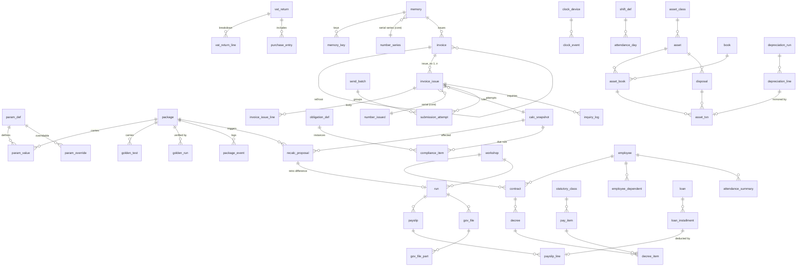

# 07 — انطباق قانونی: موتور قواعد نسخه‌دار، مالیات و سامانهٔ مؤدیان، حقوق و دستمزد و بیمه، دارایی ثابت، گزارش‌های قانونی

> **وضعیت:** طراحی مرحلهٔ ۲؛ ۲۶ آبان ۱۴۰۵ (2026-11-17).
> **SQL:** [`sql/50_compliance.sql`](sql/50_compliance.sql) — آزمون: [`sql/tests/50_compliance_test.sql`](sql/tests/50_compliance_test.sql) با بردارهای مشترک [`sql/tests/moadian_taxid_vectors_v1.json`](sql/tests/moadian_taxid_vectors_v1.json).
> **پیش‌نیاز SQL:** `00_foundation` → `10_core` → `20_ledger` → `25_masterdata` → این فایل. آزمون این بخش روی پایگاه یکپارچه (`00→…→80` به‌اضافهٔ `99_cross_fk`) هم سبز است (`INTEGRATED_TESTS=1`؛ RV-CMP-27): کارگاه‌ها پیش از جایگزین کارگاهی ساخته می‌شوند، برای شناسه‌های فاکتور فروش در حضور `sales` پیش‌نویس واقعی ساخته می‌شود، و نهان پرداخت فیش در حضور `treasury` با قلم باز سنجیده می‌شود.
> **اسکیماهای مالک:** `rules`، `tax`، `payroll`، `assets`. دو جدول مرجع تازه در `ref` (`sstid_vat_rate`، `ssi_job_code`) و جدول‌های بستهٔ صنفی پیشنهادی بخش ۰۵ (CR-C01) هم این‌جا ساخته شده‌اند.
> **قاعدهٔ بنیادی این سند:** هیچ رقم، نرخ، سقف، مهلت یا قالب فایل قانونی در کد یا SQL نیست. SQL فقط «تعریف» کلیدها را دارد. مقدارها فقط از بستهٔ امضاشدهٔ `.hkrules` می‌آیند. هر رقمی که در این سند یا آزمون‌ها می‌بینید «ساختگی» (TEST-ONLY) یا مثال پژوهش با برچسب اطمینان است.

## ۱. خلاصه

این بخش لایهٔ انطباق قانونی حساب‌کتاب را می‌سازد: موتور قواعد تاریخ‌دار و نسخه‌دار، ماشین‌حساب ارزش افزوده و زنجیرهٔ کامل سامانهٔ مؤدیان، حقوق و دستمزد و بیمه با فایل‌های دولتی، دارایی ثابت با دو دفتر، گزارش‌های قانونی دوره‌ای و تقویم انطباق.

**تصمیم‌های کلیدی:**

- **موتور قواعد داده‌محور و امضاشده.** تعریف هر کلید قانونی (نوع، واحد، qualifier، سیاست جایگزینی) کاتالوگ کدی است (`rules.param_def`، ۸۰ کلید). مقدارها فقط در «بسته»‌های امضاشده می‌آیند (`rules.package` و `rules.param_value`). هر بسته برای یک «کد» (`ir.tax`، `ir.payroll`، `ir.assets`، `ir.calendar`، `ir.formats`، `ir.general`) یک snapshot کامل است. هر مقدار بازهٔ اعتبار `[effective_from, effective_to)`، تاریخ تصویب، منبع (شمارهٔ بخشنامه)، سطح اطمینان و پرچم «تطبیق با متن رسمی» دارد. جدول‌های سراسری را فقط نصب‌کننده با نقش migrator می‌نویسد و `hk_app` فقط می‌خواند.
- **دروازهٔ آزمون طلایی در خود پایگاه داده.** بسته فقط وقتی `active` می‌شود که اجرای موفق «همهٔ» آزمون‌های طلایی‌اش روی **همان نسخهٔ موتور** (`core.deployment_info.app_version`) ثبت شده باشد. نسخهٔ قدیمی‌تر هرگز روی نسخهٔ جدیدتر فعال نمی‌شود. فعال شدن، نسخهٔ قبلی را خودکار `superseded` می‌کند. تأیید دونفره (نویسنده ≠ تأییدکننده) CHECK است.
- **snapshot قواعد مصرف‌شده** (`rules.calc_snapshot`) محتوامحور و با hash یکتا است، پس میلیون‌ها فاکتور یک ردیف را می‌خوانند. محتوای آن را خود پایگاه داده از ردیف‌های ارجاع‌شده می‌سازد (`rules.snapshot_content`) یا با آن برابر می‌کند، و هر کلید باید همهٔ روزهای دورهٔ snapshot را دقیقاً یک بار بپوشاند؛ پس snapshot نمی‌تواند به جدول واقعی ارجاع بدهد و جدول دیگری با خود ببرد (RV-CMP-04). هر snapshot کمینهٔ اطمینان مقدارهایش را دارد. حقوقی که با پارامتر «کم‌اطمینان» حساب شده بدون پذیرش صریح تأیید نمی‌شود.
- **تغییر عطف به ماسبق ← پیشنهاد بازمحاسبه.** با فعال شدن بستهٔ تازه، پویشگر هر ماژول محاسبه‌های متأثر را پیدا می‌کند و `rules.recalc_proposal` می‌سازد. حل آن اجرای «مابه‌التفاوت» حقوق، بازپیش‌بینی استهلاک یا اصلاح اظهارنامه است. سند گذشته هرگز بی‌صدا عوض نمی‌شود.
- **مؤدیان با دو لایه: سند مالیاتی منطقی و نسخهٔ صادرشده.** `tax.invoice` یکی برای هر (سند فروش، موضوع) است. `tax.invoice_issue` taxid، سریال، payload تغییرناپذیر و وضعیت ارسال را دارد. پس از رد شدن (`FAILED`)، صدور دوباره با **سریال و taxid تازه** در همان سند منطقی انجام می‌شود.
- **taxid در پایگاه داده اعتبارسنجی می‌شود** با جدول Verhoeff **رسمی SDK** (سطرهای ۴ و ۷ با جدول درسی فرق دارند). CHECKها تضمین می‌کنند taxid = حافظه + روز UTC همان `indatim` + سریال + رقم کنترلی درست. آزمون منفی اجباری نشان می‌دهد Verhoeff درسی رقم غلط می‌دهد و آن رقم رد می‌شود.
- **سریال هر حافظه یک سری `core.number_series`** با `doc_type='tax.moadian_serial'` است. ارسال از سرور، حافظهٔ اختصاصی دستگاه، یا بازهٔ رزروشده برای صندوق آفلاین هر سه با همان سازوکار هسته کار می‌کنند. سریال‌های منتقل‌شده از نرم‌افزار قبلی زیر `start_value` (= بیشینهٔ قبلی + ۱) می‌مانند.
- **ماشین حالت ارسال مبتنی بر شاهد.** هر گذار وضعیت نسخه باید با آخرین ردیف بایگانی تغییرناپذیر (تلاش ارسال یا استعلام) بخواند. پس از خطای شبکه وضعیت `unknown` است و ارسال دوباره **پیش از استعلام** در پایگاه داده رد می‌شود. taxid ثبت‌شده هرگز دوباره فرستاده نمی‌شود. اندازهٔ دسته snapshot پارامتر سقف API است.
- **امانت کلید، هر دو گزینهٔ Q-C:** `server_kms` (رمزنگاری پاکتی با KeyManager، قرارداد مسئولیت ثبت‌شده در CHECK) یا `device_agent` (کلید روی دستگاه مشتری؛ امضا با `RemoteDeviceSigner`، ارسال فقط وقتی دستگاه آنلاین است). `tsp_held` برای حالت «شرکت معتمد با کلید خودش».
- **نرخ هر قلم = f(نرخ ثبت‌شدهٔ `sstid` در stuffid، وضعیت فراخوان فروشنده، الگو)**، با قطع ارقام (truncate) و تخفیف سطری. فرمول سطر عین دستورالعمل در CHECK است.
- **مرز ماژول مالیات (L4) با فروش و خرید (L5) فشاری است:** فروش و خرید snapshot سند خود را به سرویس‌های tax می‌دهند (`TaxDocumentService.create_for_sales`، `TaxRegisterService.record_purchase`). tax هرگز جدول‌های فروش و خرید را نمی‌خواند. پس اظهارنامهٔ فصلی، فهرست ماده ۱۶۹ و اعتبار مالیاتی خرید فقط از دفترهای خود tax ساخته می‌شوند.
- **حقوق با محاسبهٔ قابل‌راستی‌آزمایی در پایگاه داده:** نرخ‌های بیمه و قاعدهٔ گرد کردن همان snapshot اجرا؛ سقف = ضریب × حداقل مزد **رسمی** × روز؛ حداقل مبنای کسر حق بیمه از قاعدهٔ تاریخ‌دار؛ `DSW_MAH = DSW_ROOZ × DSW_DD`؛ مبنای مالیات از سطرها (پلکانی − معافیت تا سقف اقلام معاف − سهم کسرشدنی بیمه با کسر snapshot)؛ **مالیات پلکانی از جدول snapshot همان اجرا**؛ خالص ≥ ۰ و جمع سطرها، همه در CHECK یا تریگر deferred بررسی می‌شوند (RV-CMP-04، RV-CMP-14). سقف معافیت‌های سالانه (عیدی، غیرنقدی) چندفیشی است و DB فقط کران بالای آن را می‌سنجد. تأیید اجرا این‌ها را لازم دارد: تأییدکنندهٔ متفاوت (یا دلیل ثبت‌شده)، کارکرد تأییدشده و قفل‌شده، آزمون طلایی موفق روی موتور محاسبه‌کننده، و پذیرش صریح پارامترهای کم‌اطمینان.
- **کف قانونی مزد در خود پایگاه داده:** تأیید حکم کارگزینی با مقدار مؤثر `payroll.wage.min_daily` سنجیده می‌شود؛ تبدیل پاره‌وقت و ساعتی با ساعت هفتگی و مقسوم‌علیه **رسمی** (جایگزین نمی‌تواند کف ساعتی را پایین بیاورد). کف «در زمان ارزیابی» با بستهٔ فعال همان روز اعمال می‌شود، پس سیاست قدیمی شرکت پس از بالا رفتن کف برنده نمی‌ماند؛ واحد پول مقدار (IRR، IRT، IRR_NEW) پیش از مقایسه به ریال نرمال می‌شود و هرگز از کنترل نمی‌پرد (RV-CMP-01..03). کمتر از کف فقط با «پیمان دسته‌جمعی» ثبت‌شده **در سطح کارگاه** و تأییدکنندهٔ دوم ممکن است؛ هر جایگزین کلید کف/سقف تأییدکنندهٔ دوم می‌خواهد (RV-CMP-12).
- **فایل‌های دولتی** (DBF لیست بیمه با پروفایل ListDisk 2.7 و 6، فایل‌های WP/WH و WK اختیاری) نسخه‌دارند. کدپیج و پهنای `DSW_ID1` و `DSK_RATE` پارامتر کارگاه‌اند. مقادیر کنترلی فایل در پایگاه داده با فیش‌های اجرای تأییدشده برابر می‌شوند؛ فرمول `DSK_TKOSO` و `DSK_BIC` (Σ ردیف‌ها یا نرخ × `DSK_TMASH`) پارامتر تاریخ‌دار پروفایل لیست است و `DSK_BIMH` هم سنجیده می‌شود (RV-CMP-13). بارگذاری فقط دستی است (Q-D).
- **دارایی ثابت با دو دفتر** (حسابداری، مالیاتی یا ترکیبی)، جدول ماده ۱۴۹ فقط به‌صورت دادهٔ نسخه‌دار (هیچ نرخی در کد نیست؛ ردیف طبقه باید در همان نسخهٔ جدول باشد و عمر/نرخ از آن تندتر نباشد)، قاعدهٔ شروع استهلاک و قاعدهٔ «بلااستفاده» (حتی مقایسه‌گر `>` یا `>=`) پارامتری. رویدادهای مالی هر دارایی فقط‌افزودنی‌اند و هویت دفتر در استفاده ثابت است. زیردفتر از راه قرارداد `ledger.subledger_source` با دفتر کل تطبیق می‌خورد. این تطبیق در آزمون با `ledger.check_control_accounts` روی سندهای واقعی سنجیده شد. استهلاک هم‌دوره در دو اجرای هم‌زمان با قفل ردیف دفتر دارایی رد می‌شود (RV-CMP-07).
- **بدون هیچ تابع `SECURITY DEFINER`.** فقط‌افزودنی بودن با دو لایه اجرا می‌شود: نداشتن GRANT و تریگر `core.forbid_mutation` (که برای مالک هم فعال است).

**اندازه:** ۷۱ جدول (rules ۱۷، tax ۱۶، payroll ۲۵، assets ۱۱، ref ۲؛ ۵۸ جدول مستأجری)، ۶ ویو `security_invoker`، ۷۳ تابع، ۹۵ تریگر، ۸۹ تعریف کلید قانونی (از جمله ۳ نشانگر snapshot مرجع)، ۴۴ مجوز. ۸۶ ناوردای شماره‌دار (INV-RUL ۱۷، INV-TAX ۲۵، INV-PAY ۲۰، INV-AST ۱۴، INV-CMP ۱۰). آزمون پایگاه داده‌ای ۲٬۹۸۱ خط و حدود ۵۴۰ ادعا دارد (از جمله آزمون دو نشستی dblink برای سه مسابقه) و روی PostgreSQL 18.7 سبز است.

## ۲. دامنه

### ۲-۱. در دامنهٔ این بخش

| حوزه | محتوا |
|---|---|
| **موتور قواعد** (`rules`) | تعریف کلیدها؛ بسته‌های امضاشده و چرخهٔ نصب، فعال‌سازی، جایگزینی و کنارگذاری؛ آزمون طلایی و اجرای آن؛ ارزیابی «مقدار در تاریخ»؛ جایگزینی مجاز مستأجر، شرکت و کارگاه؛ snapshot محاسبه؛ پیشنهاد بازمحاسبه؛ تقویم انطباق و تمدیدها؛ کاتالوگ طبقهٔ مالیاتی؛ جدول‌های بستهٔ صنفی (CR-C01 بخش ۰۵) |
| **مالیات و مؤدیان** (`tax`) | پروفایل مؤدی؛ وضعیت فراخوان ارزش افزوده؛ حافظهٔ مالیاتی و کلید؛ ماشین‌حساب ارزش افزوده؛ نگاشت سند فروش به صورتحساب (نوع، الگو، موضوع)؛ taxid؛ سریال؛ صف و دستهٔ ارسال؛ استعلام؛ بایگانی؛ مهلت ۷ روزه؛ حد ماده ۶ و سقف ماده ۱۴ مکرر؛ دفتر مالیات خرید و اعتبار مالیاتی؛ واکنش خریدار؛ اظهارنامهٔ فصلی ارزش افزوده؛ فهرست ماده ۱۶۹؛ چارچوب خروجی قانونی نسخه‌دار |
| **حقوق و دستمزد** (`payroll`) | کارگاه بیمه؛ کارمند (شخص با نقش employee)؛ افراد تحت تکفل؛ قرارداد؛ حکم کارگزینی؛ تعریف اقلام و طبقهٔ قانونی؛ کارکرد ماهانه (دستی و Excel)؛ تردد خام، شیفت و کارکرد روزانه؛ اجرای حقوق؛ فیش؛ وام و مساعده؛ ذخیرهٔ عیدی و سنوات؛ دفتر مرخصی؛ بیمه با سقف ۷ برابر (پارامتری)؛ مالیات پلکانی؛ مابه‌التفاوت؛ فایل‌های DBF و WP/WH/WK؛ ثبت GL |
| **دارایی ثابت** (`assets`) | طبقه؛ دفترها؛ ثبت دارایی و پلاک؛ دفتر هر دارایی؛ روش مستقیم و نزولی؛ قاعدهٔ شروع؛ دورهٔ بلااستفاده؛ اجرای استهلاک و ثبت GL؛ واگذاری (فروش، اسقاط، اهدا، مفقودی)؛ جابه‌جایی؛ زیردفتر و تطبیق؛ تفاوت دفتری و مالیاتی |
| **ref** | `ref.sstid_vat_rate` (نرخ ثبت‌شدهٔ هر شناسهٔ کالا)، `ref.ssi_job_code` (کدهای شغلی تأمین اجتماعی) |

### ۲-۲. بیرون از دامنه (و مالک)

| موضوع | مالک |
|---|---|
| صدور، ویرایش و ابطال فاکتور فروش؛ حساب سطر فروش (CHECKهای `sales.invoice_line`)؛ انتخاب سطرهای برگشت | بخش ۰۵ (بازرگانی). این بخش فقط سرویس ماشین‌حساب و سند مالیاتی را می‌دهد |
| صندوق ورودی Excel کارپوشه (`purchase.moadian_inbox_*`) و تطبیق با فاکتور خرید | بخش ۰۵. قالب Excel پارامتر `tax.moadian.portal_purchase_excel.format` همین بخش است و نتیجهٔ تطبیق با `TaxRegisterService` به tax می‌رسد |
| ساخت taxid روی دستگاه آفلاین، صف فرمان صندوق، اعلان «همگام‌نشده» | بخش ۰۶ (صندوق). سریال و حافظه و `TaxOfflineService` مال این بخش است |
| سند پرداخت حقوق، تخصیص به اقلام باز و زیردفتر `payroll.salary_payable` | بخش ۰۶ (خزانه) مالک سند پرداخت و تخصیص است. payroll مالک **فرمان** پرداخت است: `PayrollPaymentService.pay(run_id)` در یک UoW `MoneyDocumentService.create_and_post(direction='payment', origin='payroll', origin_ref=run_id)` را با یک سطر طرف `party` (نقش `employee`، `allocate_to` = قلم باز خالص هر فیش) صدا می‌زند و سپس نهان `payslip.payment_status/payment_doc_ref` را می‌نویسد (RV-X2-08). منبع حقیقت قلم باز treasury است؛ DB نهان را فقط پس از ثبت اجرا می‌پذیرد و در حضور treasury با قلم باز می‌سنجد (INV-PAY-19). فایل پرداخت گروهی بانک (پایا/ساتنا) v2 و مال ۰۶ است |
| خروجی «دفاتر تجاری الکترونیکی» (`ledger.eledger_export`) | بخش ۰۳. قالب آن پارامتر `tax.eledger.format` همین بخش است |
| `PostingRequest`، کدینگ، ابعاد، زیردفتر و تطبیق | بخش ۰۳ |
| `KeyManager`، `Signer`، `RemoteDeviceSigner`، HKSB، `MoadianTransport` بی‌حالت | بخش ۰۱ (`kernel` و `integrations`) |
| شماره‌گذاری، outbox، job، اعلان، پیوست، ممیزی، تنظیمات | بخش ۰۲ |
| صفحهٔ تألیف، بازبینی و انتشار بستهٔ قواعد در پنل مالک (پایگاه داده `platform`) | بخش پلتفرم مالک. این سند الزامات آن را تعیین می‌کند (§۵-۳، CR-CMP-11) |
| ورود دادهٔ حقوق، دارایی و تاریخچهٔ مؤدیان از نرم‌افزار قبلی | بخش ۰۸ (مهاجرت) با سرویس‌های import این بخش |
| دستیار هوشمند | بخش ۱۰. این بخش فقط پرس‌وجوی فقط‌خواندنی و سرویس پیش‌نویس می‌دهد (§۵-۱۸) |
| اظهارنامهٔ عملکرد (مالیات بر درآمد)، کسر تکلیفی ماده ۱۰۴، الگوهای طلا، ارز، پیمانکاری و صادرات کامل | v2 یا بستهٔ صنفی (§۱۰). جدول سند و نسخه آماده است، ولی CHECKهای حساب سطر (`line_adis`، `line_vam`) فرمول الگوی ۱ را دارند و ستون‌های ویژهٔ الگوها (`tcpbs`، `consfee`، `spro`، `bros`، `cfee`، `exr`، …) نیستند؛ پس هر الگوی تازه یک migration طرح‌واره لازم دارد (RV-CMP-29) |

## ۳. تصمیم‌های طراحی

### D-CMP-01 — تعریف کلید کدی، مقدار فقط از بستهٔ امضاشده
- **تصمیم:** `rules.param_def` کاتالوگ کدی است و با migration هر نسخهٔ برنامه پر می‌شود. هر کلید این‌ها را دارد: نوع (`money`، `decimal`، `integer`، `percent`، `ratio`، `boolean`، `text`، `enum`، `date`، `table`، `json`)، واحد، `qualifier_kind`، «کد بستهٔ مالک» (`package_code`)، سیاست جایگزینی (`none`، `any`، `floor`، `ceiling`) و سطح‌های مجاز. مقدار فقط در `rules.param_value` و درون یک بسته می‌آید. FK تضمین می‌کند بسته کلید ناشناخته نیاورد. تریگر هم شکل JSON را با نوع می‌سنجد (پول همیشه رشتهٔ اعشاری به‌علاوهٔ واحد صریح `IRR`، `IRT` یا `IRR_NEW` است و هرگز عدد شناور JSON نیست). نوع، واحد و مالک کلید پس از تعریف تغییر نمی‌کند (کلید تازه بسازید).
- **دلیل:** موتور محاسبه برای کلیدهای مشخص و با نوع مشخص نوشته می‌شود. اگر بسته بتواند کلید یا نوع تازه بیاورد، کد و داده از هم جدا می‌افتند. گزارش ۰۴ نشان داد ریال و تومان بزرگ‌ترین منبع خطای ارقام منابع است، پس واحد هر مبلغ صریح است.
- **رد شده:** جدول کلید-مقدار آزاد بدون تعریف؛ ذخیرهٔ مقدار در `core.setting_value` (تنظیم مستأجر است، نه قانون)؛ YAML درون مخزن کد (تغییر قانون نباید به انتشار کد نیاز داشته باشد).
- **پژوهش:** [۰۴ §۴.۱](../research/04-iran-payroll-and-insurance.md#۴۱-اصل-اول-هیچ-رقم-یا-نرخ-قانونی-در-کد-نیست)، [۰۴ §۲ یادداشت ریال/تومان](../research/04-iran-payroll-and-insurance.md#۲-جدول-ارقام-کلیدی-۱۴۰۵-در-برابر-۱۴۰۴-همهٔ-مبالغ-به-ریال)، [جمع‌بندی §۴](../research/README.md#۴-چکلیست-الزامات-قانونی-با-یادداشت-نسخهبندی).

### D-CMP-02 — بسته = snapshot کامل یک «کد»، با چرخهٔ حالت و دروازهٔ طلایی در پایگاه داده
- **تصمیم:** هر بسته (`rules.package`) برای یک کد است (`ir.payroll`، …) و `seq` یکنوا دارد. **کامل** است، یعنی همهٔ مقدارهای کلیدهای آن کد را برای همهٔ بازه‌ها دارد و دلتا نیست. چرخه: `installing → installed → active → superseded`، و `withdrawn` یا `rejected` که پایانی‌اند. در `installing` محتوا درج می‌شود و پس از آن مهر می‌شود. گذار به `installed` دست‌کم یک مقدار و یک آزمون طلایی لازم دارد و همهٔ کلیدها باید مال همان کد باشند. گذار به `active` این‌ها را لازم دارد: موتور ≥ `min_engine_version`؛ اجرای طلایی با `outcome='passed'` و `total` برابر تعداد آزمون‌ها روی **همان** `app_version` جاری؛ `seq` بزرگ‌تر از هر بستهٔ قبلاً فعال‌شدهٔ همان کد. فعال شدن، بستهٔ فعال قبلی را در همان دستور `superseded` می‌کند (ایندکس «یک فعال برای هر کد»). تأیید دونفره (`authored_by ∉ approved_by` و `approved_by ≠ ∅`) CHECK است. رویدادها در `rules.package_event` (فقط‌افزودنی) ثبت می‌شوند.
- **دلیل:** دلتا ارزیابی را به ترتیب اعمال وابسته می‌کند و بازتولید محاسبهٔ گذشته را سخت. snapshot کامل یعنی «مقدار در تاریخ d طبق بستهٔ v» یک پرس‌وجوی ساده است. آزمون طلایی روی همان نسخهٔ موتور لازم است، چون درستی حاصل «کد و داده» است. ارتقای برنامه بدون اجرای دوبارهٔ آزمون‌ها می‌تواند نتیجه را بی‌صدا عوض کند (پس از هر ارتقا job `rules.golden.rerun` اجرا می‌شود؛ §۵-۳).
- **رد شده:** بستهٔ دلتا؛ فعال‌سازی بی‌آزمون با اتکا به CI صفحهٔ کنترل (On-prem با نسخه‌های مختلف موتور، آزمونی را که در CI گذشته دوباره نمی‌گذراند)؛ اجازهٔ برگرداندن نسخهٔ قدیمی (به‌جایش بستهٔ اصلاحی با `seq` بالاتر منتشر می‌شود).
- **پژوهش:** [۰۴ §۴.۴](../research/04-iran-payroll-and-insurance.md#۴۴-پنل-مدیریت-پلتفرم-برای-صاحب-پلتفرم)، [۰۴ §۴.۸](../research/04-iran-payroll-and-insurance.md#۴۸-آزمون-پاسخ-به-الزام-کد-بینقص)، [۰۳ §۳-۵](../research/03-iran-tax-and-legal.md#۳-۵-پنل-صاحب-پلتفرم-موارد-مالیاتی).

### D-CMP-03 — ارزیابی لایه‌ای: کارگاه > شرکت > مستأجر > رسمی؛ کف و سقف قانونی در پایگاه داده
- **تصمیم:** `RuleEvaluator.value(key, on, qualifier, scope)` اول جایگزین فعال `rules.param_override` را به ترتیب کارگاه، شرکت، مستأجر می‌خواند و سپس مقدار رسمی بستهٔ فعال را. جایگزینی فقط برای کلیدهایی ممکن است که تعریف آن‌ها اجازه دارد، و فقط در سطح مجاز. برای کلید کف یا سقف:
  - **در زمان ارزیابی** (نه فقط هنگام درج) مقدار جایگزین با مقدار رسمی همان روز مقایسه می‌شود: کف ← `greatest(جایگزین، رسمی)`، سقف ← `least`. تنها استثنای کف، پیمان دسته‌جمعی ثبت‌شده **در سطح کارگاه** است (`rules.effective_value` و `RuleEvaluator` هم‌معنا؛ RV-CMP-01، RV-CMP-12). پس بستهٔ تازه‌ای که کف را بالا می‌برد، سیاست قدیمی شرکت را بی‌اثر می‌کند و `rules.retro_scan` این جایگزین‌های کهنه را برای بازبینی اعلان می‌کند.
  - مقایسه پس از نرمال‌سازی واحد پول به ریال است: `IRT` × ۱۰ و `IRR_NEW` × `currency.redenomination.factor` همان تاریخ. نبود ضریب خطای صریح است و هیچ کنترلی بی‌صدا رد نمی‌شود (RV-CMP-03).
  - درج: هر جایگزین کلید کف/سقف تأییدکنندهٔ دوم می‌خواهد (`HK_RULES_OVERRIDE_SOD`)؛ کمتر از کف فقط `collective_agreement` در سطح کارگاه؛ سقف بالاتر را رد می‌کند. سنجش زمان درج فقط هشدار زودهنگام است.
  - مقسوم‌علیه ساعتی (`payroll.time.hourly_divisor`) سیاست `ceiling` دارد (فقط مزد ساعتی سخاوتمندانه‌تر) و کف مزد ساعتی و پاره‌وقت همیشه با ساعت و مقسوم‌علیه **رسمی** حساب می‌شود (RV-CMP-02). مبلغ‌های مشتق قانونی (سقف بیمه، حداقل مبنا، حق اولاد) همیشه از حداقل مزد رسمی‌اند، نه از جایگزین سیاست شرکت.
  - جایگزین تغییر نمی‌کند و فقط «لغو» می‌شود.
- **دلیل:** گزارش ۰۴ مصوبهٔ شورای عالی کار برای «پیمان دسته‌جمعی» واحدهای آسیب‌دیده را نشان داد. یعنی استثنای کارگاه‌به‌کارگاه واقعی است، ولی نباید درِ پرداخت کمتر از قانون را باز کند.
- **رد شده:** جایگزینی آزاد هر کلید (کف قانونی بی‌معنا می‌شد)؛ ذخیرهٔ جایگزین در جدول هر ماژول (ارزیاب یکپارچه از دست می‌رفت).
- **پژوهش:** [۰۴ §۳.۱](../research/04-iran-payroll-and-insurance.md#۳۱-حداقل-مزد-سایر-سطوح-و-تغییرات-میانسال)، [۰۴ §۴.۲ کف‌های قانونی](../research/04-iran-payroll-and-insurance.md#۴۲-مدل-دادهٔ-پیشنهادی-postgresql).

### D-CMP-04 — snapshot محتوامحور و کمینهٔ اطمینان
- **تصمیم:** هر محاسبه‌ای که به قاعده وابسته است (اجرای حقوق، نسخهٔ صورتحساب، اجرای استهلاک، تصمیم اعتبار خرید، پایش سقف، سررسید تکلیف، گزارش قانونی) یک `rules.calc_snapshot` دارد. snapshot شامل این‌هاست: بسته‌ها، شناسهٔ مقدارها و جایگزین‌های مصرف‌شده، محتوای حل‌شده، نسخهٔ موتور و `min_confidence`. پایگاه داده hash محتوا را خودش می‌سازد و `(tenant_id, content_sha256)` یکتا است، پس ردیف تکراری ساخته نمی‌شود (`INSERT … ON CONFLICT DO NOTHING RETURNING`). تریگر بررسی می‌کند:
  - snapshot تازه فقط بستهٔ `active` را به کار ببرد؛ هر مقدار مال یکی از بسته‌ها باشد؛ جایگزین فعال و مال همان مستأجر باشد؛ `min_confidence` دقیقاً کمینهٔ اطمینان مقدارها باشد؛
  - **پوشش:** مقدارهای هر (کلید، qualifier) همهٔ روزهای `[as_of_from, as_of_to]` را پیوسته و دقیقاً یک بار بپوشانند (`HK_RULES_SNAPSHOT_COVERAGE`)؛
  - **محتوا = محتوای متعارف** `rules.snapshot_content(value_ids, override_ids)`: `{key: {qualifier|"_": value}}`؛ اگر مقدار در دوره عوض می‌شود `{"@ranges": [{from, to, value}]}`؛ و جایگزین‌ها در `"@overrides"`. محتوای `'{}'` یعنی «پایگاه داده بسازد»؛ محتوای دیگر باید برابر باشد (`HK_RULES_SNAPSHOT_CONTENT`؛ RV-CMP-04). مصرف‌کنندهٔ DB (فیش، فایل دولتی، گزارش قانونی) مقدار را با `rules.snapshot_value(content, key, q, on)` می‌خواند. Python همان تابع متعارف را دارد و بردار مشترک آزمون طلایی برابری را می‌سنجد.
- **دلیل:** فیش و صورتحساب باید «با قانون همان روز» بازتولیدپذیر بمانند. میلیون‌ها فاکتور صندوق با یک نسخهٔ قاعده نباید میلیون‌ها ردیف snapshot بسازند. پرچم اطمینان پارامترهای «⚠» پژوهش (مثلاً نرخ ۱۰٪ ارزش افزوده با اطمینان متوسط) را تا لحظهٔ تأیید سند همراه می‌برد.
- **رد شده:** کپی پارامترها درون هر سند (حجم و ناسازگاری)؛ ارجاع فقط به شمارهٔ بسته (بازتولید جایگزین‌ها ممکن نبود).
- **پژوهش:** [۰۴ §۴.۳](../research/04-iran-payroll-and-insurance.md#۴۳-اجرای-حقوق-snapshot-و-مابهالتفاوت)، [جمع‌بندی §۲ یافتهٔ ۱۷](../research/README.md#ج-انطباق-قانونی).

### D-CMP-05 — عطف به ماسبق با «پیشنهاد بازمحاسبه»، نه بازنویسی
- **تصمیم:** رویداد `rules.package.activated` همراه با کلیدهای تغییرکرده و بازه‌ها به مشترک `rules.retro_scan` می‌رسد. هر ماژول یک `RetroImpactScanner` ثبت می‌کند (حقوق: اجراهای تأییدشده‌ای که snapshot آن‌ها نسخهٔ قدیمی‌تر همان کد را مصرف کرده و بازه‌شان با بازهٔ تغییر هم‌پوشان است). خروجی `rules.recalc_proposal` است: `open → accepted → applied` یا `dismissed` (دلیل ≥ ۱۰ نویسه) یا `superseded`. پایگاه داده بررسی می‌کند snapshot هدف واقعاً نسخهٔ قدیمی‌تر همان کد را مصرف کرده باشد. حل پیشنهاد در حقوق یک اجرای `retro_difference` است که با FK به پیشنهاد و اجرای پایه گره می‌خورد (CHECK). سطرهای آن `source='retro'` و `retro_of_payslip_id` دارند و در WH به ستون «معوق» می‌روند.
- **دلیل:** حق مسکن ۱۴۰۵ در اردیبهشت با اثر از فروردین تصویب شد. بخشنامهٔ مزد با تأخیر رسید. سند تأییدشده و فایل ارسال‌شده نباید بی‌صدا عوض شوند. کاربر باید اثر را ببیند و تصمیم بگیرد.
- **رد شده:** بازمحاسبهٔ خودکار اجراهای گذشته؛ پیشنهاد جداگانه در هر ماژول (داشبورد یکپارچهٔ «اثر تغییر قانون» از دست می‌رفت).
- **پژوهش:** [۰۴ §۴.۳](../research/04-iran-payroll-and-insurance.md#۴۳-اجرای-حقوق-snapshot-و-مابهالتفاوت)، [۰۴ §۳.۲](../research/04-iran-payroll-and-insurance.md#۳۲-مزایای-قانونی-ماهانه).

### D-CMP-06 — تقویم انطباق داده‌محور با تمدیدهای تاریخ‌دار
- **تصمیم:** `rules.obligation_def` کاتالوگ کدی تکلیف‌هاست (اظهارنامهٔ فصلی ارزش افزوده، فهرست ۱۶۹، دفاتر الکترونیکی، اظهارنامهٔ عملکرد، لیست ماهانهٔ بیمه، واریز مالیات حقوق، تمدید گواهی حافظه، و تکلیف احتمالی سامانهٔ جامع تجارت که با `enabled_rule_key` بولی سطح شرکت غیرفعال می‌ماند تا تأیید شود؛ نگهبان `rules.obligation_def_guard` با `HK_RULES_OBLIGATION_GATE`). قاعدهٔ سررسید هر تکلیف مقدار `calendar.due_rule` با qualifier = کد تکلیف است. شکل آن `{anchor: period_end|payment_date|fiscal_year_end|issue_date, offset_days|offset_months, align}` است. تمدیدهای اعلام‌شده مقدار `calendar.extension` با qualifier = `<کد>:<دوره>` هستند. نمونهٔ هر دوره `rules.compliance_item` است، با `base_due_date` و `due_date`. تمدید فقط به جلو می‌رود (CHECK و تریگر) و پایان کار شاهد دارد (`evidence_module/ref`). مهلت مالیات حقوق نسبی است («۳۰ روز از پرداخت»، ماده ۸۶)، پس نمونه با رویداد `payroll.run.posted` و `anchor=payment_date` ساخته می‌شود. **دورهٔ متغیر قانونی** ثابت کاتالوگ نیست: تکلیف دفاتر الکترونیکی `frequency='per_rule'` با `frequency_rule_key='tax.eledger.period'` دارد (CHECK) و `ComplianceCalendarService.materialize` دوره را از مقدار تاریخ‌دار همان کلید در **تاریخ آغاز سال مالی شرکت** می‌خواند: سال آغازشده در ۱۴۰۴ شش‌ماهه و از ۱۴۰۵ فصلی (⚠ بخشنامهٔ 200/1405/40؛ RV-X3-07). بخش ۰۸ همین کلید را برای توصیهٔ تاریخ تبدیل می‌خواند.
- **دلیل:** مهلت‌ها «عملاً هر فصل تمدید» می‌شوند و مالک پلتفرم تمدید را یک بار منتشر می‌کند تا به همهٔ مستأجرها برسد. مهلت بیمه («پایان ماه بعد») و مالیات حقوق («۳۰ روز از پرداخت») از یک نوع نیستند.
- **پژوهش:** [۰۳ §۲-۱۱](../research/03-iran-tax-and-legal.md#۲-۱۱-مالیات-بر-ارزش-افزوده)، [۰۴ §۳.۷ مهلت](../research/04-iran-payroll-and-insurance.md#۳۷-مالیات-حقوق)، [۰۴ §۳.۶ مهلت بیمه](../research/04-iran-payroll-and-insurance.md#۳۶-بیمهٔ-تأمین-اجتماعی).

### D-CMP-07 — مرز tax (L4) با فروش و خرید (L5): مدل فشاری و دفترهای خود tax
- **تصمیم:** tax در DAG زیر sales و purchase است و هرگز آن‌ها را import نمی‌کند یا نمی‌خواند. فروش هنگام ثبت فاکتور، در همان UoW، `TaxCalculator.compute` و سپس `TaxDocumentService.create_for_sales(SalesTaxSnapshot)` را صدا می‌زند. snapshot همهٔ فیلدهای لازم صورتحساب را دارد. tax سند منطقی و نسخه را می‌سازد و شناسهٔ `tax.invoice` را برمی‌گرداند (`sales.invoice.tax_document_id`). خرید هنگام ثبت و ابطال فاکتور خرید و هنگام تطبیق صندوق ورودی کارپوشه `TaxRegisterService.record_purchase / update_moadian_match` را صدا می‌زند و `tax.purchase_entry` (دفتر مالیات خرید) را می‌سازد. اظهارنامه، فهرست ۱۶۹ و اعتبار مالیاتی فقط از `tax.invoice_issue` و `tax.purchase_entry` و ماندهٔ GL (از راه `BalanceQuery` دفتر کل) ساخته می‌شوند.
- **دلیل:** DAG بخش ۰۱ (tax در L4) و قاعدهٔ «هیچ ماژولی جدول ماژول دیگر را نمی‌نویسد». دفتر خرید مستقل یعنی گزارش مالیاتی به ساختار سند خرید وابسته نیست، و ماژول‌های آینده (هزینه از خزانه، خرید دارایی) هم می‌توانند ثبت کنند.
- **رد شده:** خواندن ویوی منتشرشدهٔ purchase در tax (شکستن DAG)؛ گزارش‌های قانونی در `reports` (L7)، که منطق قانونی را از tax جدا می‌کرد و در On-prem بی‌مالک می‌ماند.
- **پژوهش:** [۰۳ §۳-۴](../research/03-iran-tax-and-legal.md#۳-۴-گزارشها-و-تکالیف-دورهای)؛ DAG بخش [۰۱ §۵-۱](01-architecture.md).

### D-CMP-08 — سند مالیاتی منطقی و نسخهٔ صادرشده
- **تصمیم:** `tax.invoice` = «صورتحساب الکترونیکی‌ای که باید ثبت شود»: موضوع (`ins`)، نوع (`inty`)، الگو (`inp`)، مرجع (`ref_invoice_id` سرِ زنجیره و `root_invoice_id` اصل)، حافظه، و وضعیت `pending → in_progress → registered | rejected → in_progress … | withdrawn`؛ و `in_progress → pending` وقتی تنها نسخهٔ باز بدون withdraw کنار گذاشته شده است (پیش از امضا یا پس از `not_received`)، تا `reissue()` با `issue_no + 1` و سریال تازه ممکن باشد (RV-CMP-22). **زنجیرهٔ مرجع خطی است:** هر نسخه حداکثر یک جانشین زنده دارد، چه اصلاحی، چه ابطالی، چه **برگشت از فروش** (`invoice_one_live_successor` روی `ins ∈ {2,3,4}`)، و سند تازه فقط به سرِ زنجیره اشاره می‌کند (`HK_TAX_REF_NOT_HEAD`). پس برگشت دوم به برگشت ثبت‌شدهٔ قبلی اشاره می‌کند و با سطرهای آن سنجیده می‌شود؛ مقدار برگشتی تجمعی هرگز از مقدار فروش بیشتر نمی‌شود و برگشت‌های هم‌زمان پشت ایندکس یکتا صف می‌شوند (RV-CMP-05). سند `withdrawn` هرگز ثبت نشده، پس فاکتور فروش می‌تواند سند تازهٔ همان موضوع بگیرد (`invoice_one_live_per_sales_subject`). **پیوند دوطرفه با فروش:** `UNIQUE (tenant_id, company_id, id, sales_invoice_id)` هدف FK چهارستونی `sales.invoice (tenant_id, company_id, tax_document_id, id)` در 99 است، پس فاکتور فروش A نمی‌تواند به سند مالیاتی فاکتور B اشاره کند (RV-IT-SALESTAX). `tax.invoice_issue` = یک taxid مشخص با سریال، `indatim`، payload JSON کامل (`header`، `body`، `payments`)، جمع‌ها، خریدار، snapshot قاعده، مهلت ارسال، امضا و وضعیت ارسال. حداکثر یک نسخهٔ در جریان و یک نسخهٔ موفق برای هر سند وجود دارد (ایندکس‌های جزئی). `issue_no` پیوسته است. سند فروش ابطال‌شده: اگر ثبت شده بود ← سند تازه با `ins=3` و `source_kind='sales_cancellation'`؛ اگر هنوز ثبت نشده بود ← `withdrawn` (فقط وقتی هیچ نسخه‌ای در وضعیت `sent`، `unknown` یا `success` نیست؛ نسخه‌های باز خودکار `abandoned` می‌شوند). برگشت کامل (همهٔ اقلام) `ins=3` است، نه `ins=4`.
- **دلیل:** پس از `FAILED`، ارسال دوبارهٔ همان taxid تأیید رسمی ندارد (پرسش باز ۶ پژوهش ۰۳)، پس صدور دوباره با سریال تازه امن‌تر است. ولی سند فروش و ارجاع‌های بعدی (اصلاحی، برگشت) باید به یک شناسهٔ پایدار اشاره کنند. `sales.invoice.tax_document_id` پس از ثبت فاکتور فروش تغییرناپذیر است (نگهبان بخش ۰۵)، پس به سند منطقی اشاره می‌کند.
- **رد شده:** یک جدول با «نسخهٔ جاری» قابل‌ویرایش (بایگانی تغییرناپذیر شکسته می‌شد)؛ ارسال دوبارهٔ taxid رد شده.
- **پژوهش:** [۰۳ §۲-۵](../research/03-iran-tax-and-legal.md#۲-۵-ساختار-صورتحساب-الگوها-موضوعات-و-قواعد-کلیدی-s2)، [۰۳ §۳-۱ بند ۳](../research/03-iran-tax-and-legal.md#۳-۱-معماری-ماژول-مالیات-tax--compliance)، [۰۳ §۴ پرسش ۶](../research/03-iran-tax-and-legal.md#۴-پرسشهای-باز).

### D-CMP-09 — taxid و رقم کنترلی Verhoeff رسمی، اعتبارسنجی در پایگاه داده
- **تصمیم:** `tax.verhoeff_check_digit` جدول `p` رسمی SDK را دارد (سطر ۴ = `9,4,5,3,1,2,6,8,7,0` و سطر ۷ = `7,0,4,6,9,1,3,2,5,8`). `tax.taxid_build(memory, day, serial)` و `tax.taxid_valid(text)` در CHECK `tax.invoice_issue` به کار می‌روند. رشتهٔ کنترلی مانند `str.zfill` پایتون فقط کوتاه‌تر را صفر جلو می‌گیرد و هرگز رقم نمی‌بُرد (`tax.zfill`)؛ پس روز تا `0xFFFFF` (۷ رقم دهدهی) و سریال تا `0xFFFFFFFFFF` (۱۳ رقم) درست حساب می‌شوند و `tax.taxid_valid` با `migration.taxid_is_valid` برابر است. ورودی بیرون از قالب ۲۲ نویسه‌ای taxid نمی‌سازد (NULL) و `taxid_valid` هرگز NULL نمی‌دهد (RV-IT-12، CR-MG22). CHECKهای جدا تضمین می‌کنند پیشوند = `memory_id`، روز = `indatim_ms ÷ 86400000` (روز UTC، همان مقدار epoch) و سریال = `serial` به Hex ده‌رقمی. `inno` = `taxid[12..21]` در payload. همتای Python و TypeScript همان بردارهای `moadian_taxid_vectors_v1.json` را می‌خوانند. آزمون منفی اجباری Verhoeff درسی را پیاده می‌کند، رقم «غلط» استاندارد را بازتولید می‌کند و رد شدن آن را می‌سنجد.
- **دلیل:** حدود ۸۷٪ رقم‌های کنترلی با کتابخانهٔ عمومی غلط درمی‌آیند و `moadian-full` دقیقاً همین خطا را دارد. اعتبارسنجی در پایگاه داده یعنی هیچ مسیری (مهاجرت، صندوق آفلاین، API) نمی‌تواند taxid نامعتبر بایگانی کند.
- **رد شده:** `python-stdnum` یا هر Verhoeff عمومی؛ اعتبارسنجی فقط در Python.
- **پژوهش:** [۰۳ §۲-۶](../research/03-iran-tax-and-legal.md#۲-۶-الگوریتم-شمارهٔ-منحصربهفرد-مالیاتی-taxid--با-آزمون-s3)، [۰۳ §۳-۷](../research/03-iran-tax-and-legal.md#۳-۷-راهبرد-آزمون).

### D-CMP-10 — سریال حافظه = سری شماره‌گذاری هسته
- **تصمیم:** هر `tax.memory` دقیقاً یک `core.number_series` با `doc_type='tax.moadian_serial'`، `reset_policy='never'`، `period_key='all'`، `pattern='{seq}'` و `is_default=false` دارد (چند حافظه در یک شرکت، پس پیش‌فرض نیستند). نگاشت تخصیص: `allocation='server'` ↔ سری `server` (`core.number_next` با قفل ردیف شمارنده)؛ `'device'` ↔ سری دستگاه (حافظهٔ اختصاصی صندوق آفلاین)؛ `'device_ranges'` ↔ سری `reserved_ranges` (`core.number_reserve_range` با EXCLUDE). تریگر نسخه بررسی می‌کند `number_issued` همان سری، همان مقدار، `status='used'` و `doc_id` = همین نسخه باشد. پس سریال یکتا و صعودی است و یک‌بار مصرف می‌شود. سریال سوختهٔ آفلاین `core.number_void` می‌شود (رویداد `tax.serial_voided` بخش ۰۶). در مهاجرت، `start_value` = بیشینهٔ سریال قبلی + ۱ و تاریخچهٔ منتقل‌شده با `allocation='migration'`، بدون `number_issued`، و سریال < `start_value` (تریگر) ثبت می‌شود. سقف سریال `16^10 − 1` CHECK است.
- **دلیل:** هستهٔ شماره‌گذاری از قبل قفل، رزرو بازه، ثبت شمارهٔ دستگاه و اثبات بی‌فاصلگی را دارد. ساختن شمارندهٔ جدا دوباره‌کاری بود و با `tax_serial_series_id` صندوق (بخش ۰۶) ناسازگار می‌شد.
- **رد شده:** sequence پایگاه داده (همراه بستهٔ مستأجر منتقل نمی‌شود و بازگشت‌ناپذیر است)؛ ستون `next_serial` روی جدول حافظه (قفل ردیف پیکربندی و نبود ردپای مصرف).
- **پژوهش:** [۰۳ §۳-۱ بند ۴](../research/03-iran-tax-and-legal.md#۳-۱-معماری-ماژول-مالیات-tax--compliance)، [۰۳ §۳-۶](../research/03-iran-tax-and-legal.md#۳-۶-مهاجرت-از-نرمافزار-قبلی-جنبههای-مالیاتی)، [جمع‌بندی §۲ یافتهٔ ۶](../research/README.md#الف-پلتفرم-و-زیرساخت).

### D-CMP-11 — ماشین حالت ارسال مبتنی بر شاهد و «اول استعلام»
- **تصمیم:** وضعیت‌های نسخه این‌هاست: `prepared → signed → sent | unknown | not_received`؛ `sent | unknown → success | failed | not_received | sent`؛ `not_received → sent | unknown`؛ و `prepared | signed | not_received → abandoned`. هر ارسال یک ردیف `tax.submission_attempt` است (فقط‌افزودنی) با `request_trace_id` یکتا، نتیجهٔ انتقال (`accepted`، `rejected_sync`، `network_error`، `http_error`)، hash و پیوست درخواست، و پاسخ. هر استعلام یک ردیف `tax.inquiry_log` است (فقط‌افزودنی). تریگر AFTER این دو وضعیت نسخه را جابه‌جا می‌کند. نگهبان نسخه هر گذار را فقط وقتی می‌پذیرد که **آخرین** تلاش یا استعلام با آن بخواند. موفقیت به شمارهٔ مرجع و JWS امضای سازمان برابر نیاز دارد. نگهبان تلاش، ارسال را در وضعیت `unknown` یا `sent` رد می‌کند (`HK_TAX_INQUIRE_FIRST`)، و پس از `success` همیشه (`HK_TAX_ALREADY_REGISTERED`). ظرفیت دسته = snapshot پارامتر `tax.moadian.api.max_invoices_per_request` (حد بهداشتی ۱۰٬۰۰۰ در CHECK).
- **دلیل:** پردازش مؤدیان ناهمگام است و پس از خطای شبکه معلوم نیست درخواست رسیده یا نه. ارسال دوبارهٔ کور می‌تواند taxid تکراری بسازد (خطای 0300101). شاهد بایگانی‌شده یعنی وضعیت «موفق» هرگز بدون پاسخ امضاشدهٔ سازمان ثبت نمی‌شود.
- **پژوهش:** [۰۳ §۲-۳](../research/03-iran-tax-and-legal.md#۲-۳-api-نسخهٔ-۲-requestsmanager--جزئیات-رسمی-s1)، [۰۳ §۲-۷](../research/03-iran-tax-and-legal.md#۲-۷-کدهای-خطا-s1s7)، [۰۳ §۳-۱ بندهای ۲، ۳ و ۷](../research/03-iran-tax-and-legal.md#۳-۱-معماری-ماژول-مالیات-tax--compliance).

### D-CMP-12 — درگاه `MoadianGateway` و آداپتر برای هر حافظه
- **تصمیم:** پروتکل `MoadianGateway` (§۵-۸) پنج پیاده‌سازی دارد: `DirectV2Cert` (JWS RS256 با `x5c` و `sigT`/`crit`، سپس JWE `RSA-OAEP-256`+`A256GCM` با `kid` سرور، nonce و توکن یک‌بارمصرف برای هر درخواست)، `DirectV1SelfTsp` (امضای PKCS1v1.5-SHA256 روی دادهٔ نرمال‌شده، بدون گواهی)، `TspAdapter` (برای هر شرکت معتمد طرف قرارداد، با `tsp_code`)، `Mock` (درون‌حافظه‌ای، قطعی، با سناریوهای خطا) و `Sandbox` (پروتکل مستقیم روی نشانی آزمایشی). انتخاب برای هر `tax.memory` است و CHECKها سازگاری حالت ارسال کارپوشه، آداپتر، محیط و امانت را تضمین می‌کنند. نشانی‌ها (`tax.moadian.endpoints`)، سوئیچ سراسری v1 (`tax.moadian.v1_api_enabled`) و نسخهٔ دستورالعمل (`tax.moadian.instruction_version`) پارامترهای قواعدند. لایهٔ انتقال (`integrations.MoadianTransport`) بی‌حالت است و پیکربندی و لاگ در tax است (C-10 بخش ۰۱). JWS/JWE با `cryptography` (Apache/BSD) پیاده می‌شود. هیچ SDK با مجوز GPL استفاده نمی‌شود.
- **دلیل:** API نسخهٔ ۱ «تا اطلاع ثانوی» است. گواهی برای کسب‌وکار کوچک دشوار است. شرکت‌های معتمد API ناهمسان دارند. انتخاب در کارپوشه برای هر حافظه انجام می‌شود.
- **پژوهش:** [۰۳ §۲-۲](../research/03-iran-tax-and-legal.md#۲-۲-روشهای-اتصال-مستقیم-یا-شرکت-معتمد)، [۰۳ §۲-۴](../research/03-iran-tax-and-legal.md#۲-۴-api-نسخهٔ-۱-بدون-گواهی-self-tsp--tsp)، [۰۳ §۲-۹](../research/03-iran-tax-and-legal.md#۲-۹-sdkها-و-پیادهسازیهای-متنباز)، [۰۳ §۳-۸](../research/03-iran-tax-and-legal.md#۳-۸-مجوز-نرمافزار).

### D-CMP-13 — امانت کلید (Q-C: انتخاب مشتری؛ هر دو مسیر در v1)
- **تصمیم:** `tax.memory.key_custody ∈ {server_kms, device_agent, tsp_held}` و `tax.memory_key.custody` باید با آن بخواند. در `server_kms`، کلید خصوصی یا `private_key_sealed` است (SealedBlob با AAD = مستأجر/جدول/ردیف/ستون) یا `kms_key_ref` (کلید واردشده در OpenBao Transit)، دقیقاً یکی. قرارداد مسئولیت (`custody_contract_version/accepted_by/at`) CHECK اجباری است. در `device_agent` کلید خصوصی هرگز به سرور نمی‌رسد: ستون‌های رمزینه NULL‌اند و `device_id` = دستگاه امضاکنندهٔ حافظه است. امضا با `RemoteDeviceSigner` (کار `tax.moadian.sign` روی SSE و long-poll) انجام می‌شود. اگر دستگاه آفلاین باشد، نسخه در `prepared` می‌ماند و هشدار مهلت به کار می‌افتد. در `tsp_held` شرکت معتمد امضا می‌کند و کلیدی نزد ما نیست. API v2 گواهی لازم دارد (تریگر)، گواهی منقضی فعال نمی‌شود، کلید فعال یکتاست و مادهٔ کلید تغییرناپذیر است (چرخش = کلید تازه). `hk_readonly` ستون رمزینه را نمی‌بیند (GRANT ستونی). ورود به‌جای کاربر و دستیار به `tax.key.manage` دسترسی ندارند.
- **دلیل:** پاسخ Q-C. مسئولیت حقوقی نگهداری کلید باید در خود داده ثبت شود. گزینهٔ دستگاه برای مشتری حساس است.
- **پژوهش:** [۰۳ §۳-۱ بند ۶](../research/03-iran-tax-and-legal.md#۳-۱-معماری-ماژول-مالیات-tax--compliance)؛ [۰۱ §۵-۲۱](01-architecture.md) (`KmsSigner`، `RemoteDeviceSigner`).

### D-CMP-14 — ماشین‌حساب ارزش افزوده: نرخ از سه ورودی، قطع ارقام، تخفیف سطری
- **تصمیم:** `TaxCalculator.compute(TaxInput) → TaxResult` با این ترتیب: (۱) اگر وضعیت فراخوان فروشنده در تاریخ صورتحساب `not_called_in` باشد و پارامتر `tax.vat.not_called_in_zero_rate` درست باشد ← `vra=0` با `rate_source='not_called_in_zero'`؛ (۲) اگر الگو در `tax.vat.zero_rate_patterns` باشد ← صفر (`pattern_zero`)؛ (۳) وگرنه نرخ ثبت‌شدهٔ `ref.sstid_vat_rate` در تاریخ (`sstid_catalog`). اگر نرخ sstid نباشد: برای سند مشمول مؤدیان خطای `HK_TAX_SSTID_RATE_UNKNOWN` (ارسال با نرخ ناهمخوان به 0304401 می‌انجامد)، و برای سند غیرمؤدیان نرخ طبقه `tax.vat.category_rate[tax_category_code]` با `category_fallback`. سایر مالیات‌ها و عوارض (`odt/olt`) از `tax.other_levy.rate` می‌آیند. همهٔ سهم‌ها با `trunc(base × rate / 100, scale)` حساب می‌شوند: ریال صحیح، و ارز تا ۴ رقم. تخفیف «کل سطر» است. CHECKهای `tax.invoice_issue_line` و `sales.invoice_line` همین فرمول‌ها را دارند. `TaxResult` برای فروش `moadian_required/type/pattern` را هم تعیین می‌کند (§۵-۶).
- **دلیل:** قاعدهٔ ۷ جدول ۴۳ دستورالعمل V7.8 (فراخوان‌نشده = صفر) برای کافه و مغازه حیاتی است. گرد کردن رو به بالا خطای 0204501 می‌دهد.
- **رد شده:** جدول نرخ دستی کالا در مستأجر (با stuffid ناهمخوان می‌شد)؛ گرد کردن بانکی.
- **پژوهش:** [۰۳ §۱ بند ۷](../research/03-iran-tax-and-legal.md#۱-خلاصهٔ-مدیریتی)، [۰۳ §۲-۱۰](../research/03-iran-tax-and-legal.md#۲-۱۰-شناسهٔ-کالاخدمت-و-واحدها)، [۰۳ §۳-۱ بند ۸](../research/03-iran-tax-and-legal.md#۳-۱-معماری-ماژول-مالیات-tax--compliance).

### D-CMP-15 — پایش حد ماده ۶ و سقف معافیت ماده ۱۴ مکرر
- **تصمیم:** `tax.threshold_monitor` برای هر (شرکت، سال جلالی، نوع) سقف (`limit_amount` با `limit_basis`: فروش سال قبل محاسبه‌شده، اعلامی یا از API)، snapshot قاعده (`tax.moadian.art6.multiplier`، `tax.moadian.art14m.exemption_ceiling`، `tax.moadian.threshold.warn_ratio`)، دو جمع یکنوا (`gross_registered` فروش ثبت‌شده و `cancelled_registered` ابطال و برگشت ثبت‌شده) و جمع خالص `cumulative_amount = gross − cancelled` (CHECK) را نگه می‌دارد. وضعیت (`ok`، `warning`، `exceeded`) تابع CHECK جمع خالص است. هیچ‌کدام از دو جمع کم نمی‌شود، مستقل از تغییر سقف (`HK_TAX_THRESHOLD_BACKWARD`؛ RV-CMP-24). تاریخ نخستین عبور یک‌بار ثبت می‌شود و با ابطال بعدی پاک نمی‌شود؛ `consequence_from` (مثلاً آغاز فصل بعد برای پایان معافیت ۱۴ مکرر) هم ثابت است. این‌که ابطال پس از عبور پیامد قانونی عبور را برمی‌گرداند یا نه پرسش باز Q-CMP-15 است؛ تا پاسخ، سامانه پیامد را نگه می‌دارد و اعلان می‌دهد. مشترک `tax.threshold_track` روی `tax.invoice.registered` جمع را به‌روز می‌کند: `ins=1` به `gross_registered`، `ins=3` (ابطال) کل مبلغ مرجع و `ins=4` (برگشت) کاهش نسبت به نسخهٔ مرجع به `cancelled_registered`، `ins=2` فقط اختلاف نسبت به مرجع. API `article6Status` هم در `portal_status` ثبت می‌شود. عبور از سقف اعلان اجباری `tax.threshold` و برای ۱۴ مکرر تغییر `art14m_policy` پیشنهادی می‌سازد.
- **پژوهش:** [۰۳ §۲-۱](../research/03-iran-tax-and-legal.md#۲-۱-چارچوب-قانونی-سامانهٔ-مؤدیان-و-وضعیت-اجرا-در-۱۴۰۵)، [جمع‌بندی §۴-الف](../research/README.md#الف-سامانهٔ-مؤدیان-و-صورتحساب-الکترونیکی).

### D-CMP-16 — صورتحساب خرید: صندوق ورودی در بازرگانی، اعتبار مالیاتی در tax
- **تصمیم:** API دریافت صورتحساب خرید پیدا نشد. پس فایل Excel کارپوشه در `purchase.moadian_inbox_*` (بخش ۰۵) وارد و تطبیق می‌شود. پارسر نسخهٔ قالب را از `tax.moadian.portal_purchase_excel.format` می‌گیرد. نتیجهٔ تطبیق با `TaxRegisterService.update_moadian_match(entry, taxid, inv_type, portal_status)` روی `tax.purchase_entry` نشسته می‌شود. «واجد اعتبار» برای ثبت مثبت فقط وقتی است که صورتحساب نوع ۱ ثبت‌شده و تأییدشده (صریح یا سیستمی) باشد (CHECK). **برگشت و ابطال خرید** (`sign = -1`) به ثبت اصلی اشاره می‌کنند (`reverses_entry_id`؛ جز تاریخچهٔ منتقل‌شده)، شمارش در اعتبار را از اصل به ارث می‌برند و جمعشان از مالیات اصل بیشتر نیست (قید deferred `tax.purchase_entry_verify`، `HK_TAX_PURCHASE_REVERSAL`)؛ پس برگشتِ اعتبارِ گرفته‌شده هرگز به‌خاطر تأییدنشدن صورتحساب برگشتی از ورودی جا نمی‌ماند و در فصل خودش با علامت منفی شمرده می‌شود (RV-CMP-15). «مهلت کاغذی» تابع قاعدهٔ تاریخ‌دار `tax.vat.input_credit_rule` است (`paper_grace`). هر تصمیم دلیل و snapshot دارد. واکنش خریدار به صورتحساب‌های **فروش** ما با `inquiry-invoice-status` پایش می‌شود (`tax.inquiry_log` با `kind='reaction'`). واکنش ما به صورتحساب‌های **خرید** دستی در کارپوشه انجام می‌شود و تقویم یادآور آن پارامتر `tax.moadian.reaction_deadline_days` (⚠ ناشناخته) است.
- **پژوهش:** [۰۳ §۲-۱۱](../research/03-iran-tax-and-legal.md#۲-۱۱-مالیات-بر-ارزش-افزوده)، [۰۳ §۳-۳ بند ۵](../research/03-iran-tax-and-legal.md#۳-۳-جریانهای-کاربری-کلیدی)؛ D-C22 بخش ۰۵.

### D-CMP-17 — اظهارنامهٔ فصلی: تطبیق سه‌طرفه و اصلاحیهٔ نسخه‌دار
- **تصمیم:** `tax.vat_return` برای هر (شرکت، فصل، نسخه) این‌ها را دارد: خروجی ثبت‌شده (Σ `tvam` نسخه‌های موفق با علامت موضوع)، خروجی ثبت‌نشده (ریسک)، گردش GL کلیدهای `tax.vat_payable/receivable` (از `BalanceQuery`)، ورودی واجد و ناواجد، و ارقام دستی «خلاصه عملکرد» کارپوشه. `payable = output_vat_registered − input_vat_eligible` CHECK است. وضعیت‌ها `draft ⇄ computed → filed → superseded` هستند. پس از تسلیم همه‌چیز (سطرها، اقلام دفتر خرید متصل) قفل می‌شود: ثبت خرید فقط به اظهارنامهٔ `draft` یا `computed` همان شرکت و فصل می‌پیوندد، چه با درج و چه با به‌روزرسانی (`HK_TAX_PURCHASE_LOCKED`، `HK_TAX_PURCHASE_PERIOD`)، و تسلیم وقتی پذیرفته است که `input_vat_eligible` = Σ علامت × مالیات ثبت‌های پیوندخوردهٔ شمرده‌شده در اعتبار باشد (`HK_TAX_RETURN_INPUT_MISMATCH`؛ RV-CMP-06). اصلاحیه نسخهٔ تازه است و فقط پس از نسخهٔ تسلیم‌شدهٔ قبلی ساخته می‌شود. تسلیم سند اختیاری تسویه (`tax.vat_settlement`) را با `PostingRequest` می‌سازد.
- **پژوهش:** [۰۳ §۳-۴](../research/03-iran-tax-and-legal.md#۳-۴-گزارشها-و-تکالیف-دورهای).

### D-CMP-18 — خروجی‌های قانونی با «قالب نسخه‌دار» از موتور قواعد
- **تصمیم:** هر خروجی (`tax.legal_report`: فهرست ماده ۱۶۹، خلاصهٔ ارزش افزوده، دفتر فروش و خرید؛ `payroll.gov_file`: لیست بیمه و فایل مالیات حقوق؛ و `ledger.eledger_export` بخش ۰۳) `format_key` (کلید `rules.param_def`) و `format_version` (qualifier پروفایل) دارد. کلید قالب همان نوع گزارش است (CHECK `legal_report_format_kind` و `gov_file`) و نسخهٔ قالب باید پروفایل همان کلید در snapshot تولید باشد (`HK_TAX_REPORT_FORMAT`؛ RV-CMP-18)؛ پس فرادادهٔ فایل دقیقاً می‌گوید کدام چیدمان نسخه‌دار آن را ساخت. مشخصات ستون‌ها، ترتیب، عنوان، کدپیج، قالب تاریخ و نام فایل در مقدار JSON همان کلید است. پیاده‌سازی Python برای هر «خانوادهٔ» قالب یک `FormatAdapter` است (§۵-۱۰). نسخهٔ تازه با بستهٔ `ir.formats` می‌رسد، نه با انتشار کد، مگر ساختار کاملاً تازه باشد. محتوای فایل پس از تولید تغییرناپذیر است (hash و پیوست) و فقط وضعیت ارسال و رسید تغییر می‌کند.
- **پژوهش:** [۰۳ §۲-۱۲](../research/03-iran-tax-and-legal.md#۲-۱۲-گزارش-فصلی-معاملات-ماده-۱۶۹)، [۰۳ §۲-۱۳](../research/03-iran-tax-and-legal.md#۲-۱۳-دفاتر-قانونی-و-دفاتر-تجاری-الکترونیکی-ماده-۹۵)، [۰۴ §۴.۵](../research/04-iran-payroll-and-insurance.md#۴۵-خروجیهای-قانونی).

### D-CMP-19 — مدل حقوق: کارگاه، کارمند = شخص، قرارداد، حکم؛ رفتار قانونی اقلام از قواعد
- **تصمیم:** کارگاه (`payroll.workshop`) واحد لیست بیمه است: کد ۱۰ رقمی، ردیف پیمان، پروفایل ListDisk، کدپیج، پهنای `DSW_ID1`، `DSK_RATE` و قالب فایل مالیات. یک شرکت چند کارگاه دارد. کارمند به `parties.party` (نقش `employee`، شخص حقیقی شناخته‌شده، کد ملی برای ایرانی) گره می‌خورد و ماندهٔ شخصی (حقوق پرداختنی، وام) روی بُعد `party` دفتر کل است (پذیرش CR-05 بخش ۰۴). در هر زمان یک قرارداد مؤثر هست (EXCLUDE). نوع استخدام `full_time`، `part_time` (با ساعت هفتگی) یا `hourly` است (Q-D). حکم کارگزینی مزد روزانه یا ساعتی و اقلام ثابت را از تاریخ اثر دارد. حکم تأییدشده تغییرناپذیر است و اصلاح با حکم تازه انجام می‌شود. هر قلم تعریف‌شدهٔ شرکت (`payroll.pay_item`) یک «طبقهٔ قانونی» (`payroll.statutory_class`) دارد. رفتار تاریخ‌دار هر طبقه (مشمول بیمه، رفتار مالیاتی `progressive|flat|exempt|exempt_up_to|exempt_within_customary_limit`، مستمر و نقدی، ستون WH، سطل DSKWOR) مقدار `payroll.item_class.treatment` با qualifier = طبقه است و روی هر سطر فیش snapshot می‌شود.
- **دلیل:** رفتار مالیاتی مزایای رفاهی در ۱۴۰۵ سه بار عوض شد. اقلام سفارشی مستأجر باید بدون کد تازه رفتار قانونی درست بگیرند.
- **رد شده:** پرچم ثابت «مشمول مالیات» روی قلم؛ بُعد جدای `employee` در دفتر کل (دو کارت برای کسی که هم مشتری و هم کارمند است؛ CR-05).
- **پژوهش:** [۰۴ §۱ بندهای ۷ و ۱۱](../research/04-iran-payroll-and-insurance.md#۱-خلاصهٔ-اجرایی)، [۰۴ §۳.۷](../research/04-iran-payroll-and-insurance.md#۳۷-مالیات-حقوق)، [۰۴ §۴.۲](../research/04-iran-payroll-and-insurance.md#۴۲-مدل-دادهٔ-پیشنهادی-postgresql).

### D-CMP-20 — اجرای حقوق قابل‌راستی‌آزمایی و دروازه‌های تأیید
- **تصمیم:** `payroll.run` برای (کارگاه، ماه جلالی) با نوع‌های `regular` (یکی برای هر کارگاه و ماه)، `retro_difference`، `eidi`، `settlement` و `off_cycle`. وضعیت‌ها `draft ⇄ calculated → approved → posted → cancelled` هستند. فیش (`payroll.payslip`) ستون‌های لیست بیمه را با نام معادل دارد (`daily_wage`=DSW_ROOZ، `insurance_days`=DSW_DD، `monthly_wage`=DSW_MAH، `insurable_benefits`=DSW_MAZ، `ssi_base`=DSW_MASH، `total_paid_all`=DSW_TOTL)، به‌همراه نرخ‌ها و قاعدهٔ گرد کردن snapshot‌شده. CHECKها این روابط را تضمین می‌کنند: `DSW_MAH = DSW_ROOZ × DSW_DD`؛ `MAZ = insurable_raw − MAH` (`insurable_raw` = MAH + MAZ، پس مزایا دوبار شمرده نمی‌شوند؛ RV-CMP-26)؛ `MASH = max(min(insurable_raw, cap), min_base)` با `min_base ≤ cap`؛ هر سهم = `round_amount(MASH × rate, 0, mode)`؛ `taxable = max(0, tax_progressive_gross − tax_exempt_amount − ssi_tax_deduction)`؛ `net = gross − ssi_employee − tax − other_deductions ≥ 0`. تریگر deferred (`payroll.payslip_verify`) همه را به snapshot همان اجرا (`rules.snapshot_value`) و سطرها می‌بندد:
  - جمع سطرها؛ نوع سطر با طبقه؛ قسط وام = سطر کسر وام فعال **همان کارمند**، و هر قسط حداکثر یک کسر در اجرای زنده؛
  - نرخ کارگر، کارفرما، بیکاری و سخت و زیان‌آور (فقط قرارداد سخت) و قاعدهٔ گرد کردن = snapshot (`HK_PAYROLL_SSI_RATES`)؛
  - `ssi_cap_amount = trunc(cap_multiplier × حداقل مزد رسمی × insurance_days)` (`HK_PAYROLL_SSI_CAP`)؛
  - `ssi_min_base_amount` از قاعدهٔ تاریخ‌دار `payroll.ssi.min_base_rule` (`applies_to`، `multiplier`، `part_time = none|by_hours`، `exempt_job_codes`؛ پژوهش ۰۴ §۳.۶؛ `HK_PAYROLL_SSI_MIN_BASE`؛ RV-CMP-14)؛ اگر بستهٔ snapshot این قاعده را دارد، snapshot باید آن را بیاورد؛
  - `tax_progressive_gross` = Σ سطرهای earning با رفتار `progressive|exempt_up_to|exempt_within_customary_limit`؛ `tax_exempt_amount` ≤ Σ اقلام معاف تا سقف؛ `ssi_tax_deduction = round(ssi_employee × payroll.tax.employee_ssi_deductible_fraction, tax.rounding)` (`HK_PAYROLL_TAXABLE_INCOME`)؛
  - `salary_tax = round(bracket_tax(taxable, rows of snapshot)) + flat_tax`.
  هر کلید لازم که در snapshot نیست `HK_PAYROLL_SNAPSHOT_INCOMPLETE` می‌دهد. سقف چندفیشی معافیت عیدی و غیرنقدی (جمع سالانه) را سرویس حساب می‌کند و DB فقط کران بالای هر فیش را. تأیید این‌ها را لازم دارد: جمع اجرا = Σ فیش‌ها؛ تأییدکننده ≠ محاسبه‌گر یا `self_approval_reason` ثبت‌شده؛ کارکرد تأییدشدهٔ همهٔ فیش‌های اجرای عادی، با قفل اشتراکی ردیف‌های کارکرد پیش از سنجش تا ویرایش هم‌زمان کارکرد پشت تأیید صف شود و پس از آن رد شود (RV-CMP-11)؛ `engine_version` اجرا = نسخهٔ snapshot؛ اجرای طلایی موفق همهٔ بسته‌های snapshot روی همان موتور؛ و `low_confidence_ack_by` اگر کمینهٔ اطمینان `low` یا `unverified` باشد. پس از تأیید، فیش و سطرها تغییرناپذیرند (جز وضعیت پرداخت)، کارکرد مصرف‌شده قفل است، و لغو اجرایی که فایلش بارگذاری شده ممنوع است (لیست اصلاحی بسازید).
- **دلیل:** الزام «بی‌نقص» و اختلاف ریالی پرهزینه با تأمین اجتماعی. جدول مالیات، نرخ‌ها، سقف و حداقل مبنا از snapshot خود اجرا خوانده می‌شوند و snapshot خودش با ردیف‌های بسته برابر است، پس پایگاه داده مستقل از کد Python درستی بیمه و مالیات هر فیش را اثبات می‌کند (جز سقف سالانهٔ معافیت‌ها). قرارداد امضاشده هم شرایطش ثابت است (`payroll.contract_guard`؛ نوع استخدام، ساعت، سختی کار، کارگاه، شروع؛ پایان فقط به جلو و نه پیش از حکم تأییدشده یا فیش زنده؛ RV-CMP-16)، پس کف حکم تأییدشده بعداً بی‌اعتبار نمی‌شود.
- **پژوهش:** [۰۴ §۳.۶](../research/04-iran-payroll-and-insurance.md#۳۶-بیمهٔ-تأمین-اجتماعی)، [۰۴ §۳.۷](../research/04-iran-payroll-and-insurance.md#۳۷-مالیات-حقوق)، [۰۴ §۴.۳](../research/04-iran-payroll-and-insurance.md#۴۳-اجرای-حقوق-snapshot-و-مابهالتفاوت)، [۰۴ §۴.۸](../research/04-iran-payroll-and-insurance.md#۴۸-آزمون-پاسخ-به-الزام-کد-بینقص).

### D-CMP-21 — حضور و غیاب v1: کارکرد ماهانه و تردد خام با موتور شیفت
- **تصمیم:** دو ورودی v1 دارد. (الف) کارکرد ماهانهٔ خلاصه (`payroll.attendance_summary`)، دستی یا با Excel (`payroll.attendance_import` با پروفایل نگاشت ستون، موتور مترادف سرستون بخش ۰۸). (ب) تردد خام فایل دستگاه (`payroll.clock_event`، فقط‌افزودنی و یکتا برای هر دستگاه، کاربر دستگاه و زمان) با نگاشت کاربر دستگاه به کارمند (`clock_user_map`، EXCLUDE). موتور شیفت (`shift_def`، `shift_assignment` با الگوی چرخه‌ای) کارکرد روزانه (`attendance_day`) می‌سازد که کاربر بازبینی می‌کند، و سپس تجمیع ماهانه. پنجرهٔ شب‌کاری پارامتر `payroll.time.night_window` و تعطیلات `calendar.official_holidays` است. اتصال مستقیم دستگاه (ADMS push برای SaaS و عامل محلی pull) v2 است (`ingest_mode`). کارکرد پس از مصرف در اجرای تأییدشده قفل است.
- **پژوهش:** [۰۴ §۳.۱۰](../research/04-iran-payroll-and-insurance.md#۳۱۰-ورود-دادهٔ-حضور-و-غیاب)، [۰۴ §۴.۶](../research/04-iran-payroll-and-insurance.md#۴۶-حضور-و-غیاب-در-حسابکتاب).

### D-CMP-22 — فایل‌های دولتی نسخه‌دار با مقادیر کنترلی برابر فیش‌ها؛ فقط بارگذاری دستی
- **تصمیم:** `payroll.gov_file` (و `gov_file_part` برای هر فایل: `DSKKAR00.DBF`، `DSKWOR00.DBF`، `WPyyyymm.txt`، `WHyyyymm.txt`، `WKyyyymm.txt` یا ZIP) فقط از اجرای تأییدشدهٔ **همان کارگاه** ساخته می‌شود. مقادیر کنترلی در تریگر با فیش‌ها برابر می‌شوند: `DSK_NUM`، `DSK_TDD`، `DSK_TMASH`، `DSK_TBIME` و `DSK_BIMH` (Σ سخت و زیان‌آور) جمع ردیف‌ها؛ `DSK_TKOSO` و `DSK_BIC` طبق پارامتر تاریخ‌دار `payroll.ssi.list_control_totals[پروفایل]`: `sum_of_rows` (Σ سهم گردشدهٔ ردیف‌ها) یا `rate_on_total` (`round(نرخ × DSK_TMASH)` با همان قاعدهٔ گرد کردن؛ پژوهش ۰۴ §۳.۸ ⚠)؛ و برای مالیات `tax_total` و `employees` (RV-CMP-13). فرمول با فایل نمونهٔ ListDisk (Q-CMP-03) پین می‌شود. اختلاف گرد کردن `rate_on_total` با Σ فیش‌ها (حداکثر N/2 ریال) هنگام ثبت بارگذاری فایل با سند تعدیل `payroll.employer_insurance_expense` ↔ `payroll.insurance_payable` به GL می‌رود. نویسندهٔ DBF هدر `0x03` و LDID پروفایل (‏`0x7E` برای cp1256) را می‌نویسد، `ی→ي` و ارقام فارسی و عربی → ASCII را نگاشت می‌کند، و `" ' < > &` را حذف می‌کند. قالب ستون‌ها از `payroll.format.ssi_list` (پروفایل `listdisk_2_7` یا `listdisk_6`) می‌آید. آزمون بایت‌به‌بایت هدر با قالب نصب‌کنندهٔ رسمی ListDisk پین می‌شود. WK پرچم کارگاه است (`include_wk_file`). ارسال خودکار به es.tamin.ir و my.tax.gov.ir وجود ندارد (Q-D): فقط فایل و راهنما.
- **پژوهش:** [۰۴ §۳.۸](../research/04-iran-payroll-and-insurance.md#۳۸-فایلهای-لیست-بیمه-dskkar00dbf-و-dskwor00dbf)، [۰۴ §۳.۹](../research/04-iran-payroll-and-insurance.md#۳۹-فایلهای-لیست-مالیات-حقوق-wp--wh--wk)، [۰۴ §۴.۵](../research/04-iran-payroll-and-insurance.md#۴۵-خروجیهای-قانونی).

### D-CMP-23 — ذخایر و مرخصی به‌صورت دفتر فقط‌افزودنی
- **تصمیم:** `payroll.accrual_entry` برای عیدی و سنوات با `work_year` (سال کارکرد، نه سال پرداخت؛ دام رایج منابع) است. ذخیره و افتتاحیه مثبت‌اند و پرداخت و برگشت منفی. هر ذخیره snapshot قاعده دارد. `payroll.leave_entry` با `leave_year` است: انباشت و افتتاحیه مثبت، و مصرف، سقوط مازاد ذخیره (`payroll.leave.carryover_max_days`) و بازخرید منفی. تعدیل دستی دلیل لازم دارد. مانده‌ها ویو (`v_accrual_balance`، `v_leave_balance`) هستند. سند GL ذخایر بخشی از سند اجرای حقوق است (`payroll.eidi_expense/provision`، `payroll.severance_expense/provision`).
- **پژوهش:** [۰۴ §۳.۳](../research/04-iran-payroll-and-insurance.md#۳۳-عیدی-و-پاداش-سنوات-مزایای-پایان-کار)، [۰۴ §۳.۵](../research/04-iran-payroll-and-insurance.md#۳۵-مرخصی).

### D-CMP-24 — وام و مساعده با جدول اقساط تغییرناپذیر
- **تصمیم:** `payroll.loan` (مساعده = یک قسط) و `payroll.loan_installment`. پس از فعال شدن (تأیید لازم) جمع **همهٔ** اقساط (هر وضعیتی) = اصل (deferred) است و فقط وضعیت قسط تغییر می‌کند، با ماشین حالت (RV-CMP-17): `scheduled ↔ deferred`؛ `scheduled|deferred → waived` با `waived_by` غیر از ایجادکنندهٔ وام، زمان و دلیل ≥ ۱۰ نویسه؛ `deducted` فقط از همگام‌ساز اجرا: تأیید اجرا اقساط سطرهای خودش را `deducted` می‌کند (اگر قسط کسرشده یا بخشوده باشد تأیید رد می‌شود) و لغو اجرای تأییدشده/ثبت‌شده آن‌ها را به `scheduled` برمی‌گرداند (`payroll.run_after`). کسر فقط با سطر فیش `source='loan'` و برابر مبلغ قسط وام فعال همان کارمند انجام می‌شود و هر قسط حداکثر یک کسر در اجرای زنده دارد (اجرای لغوشده مانع کسر دوباره نیست). پرداخت وام از خزانه است (`disbursement_ref` → `treasury.money_document`، §۱۲). اگر خالص منفی شود، موتور قسط را `deferred` می‌کند (خالص ≥ ۰ در CHECK).

### D-CMP-25 — دارایی ثابت: دو دفتر، جدول ماده ۱۴۹ فقط داده
- **تصمیم:** `assets.book` با نوع `accounting`، `tax` یا `combined` است. فقط یک دفتر فعال ثبت GL دارد و فقط یک دفتر نقش مالیاتی (ترکیبی برای SMEها، یعنی یک دفتر برای هر دو). دفتر `tax` هرگز سند GL ندارد (CHECK و تریگر). روش هر (دارایی، دفتر) در `assets.asset_book` است: مستقیم با عمر بر حسب ماه، نزولی با درصد سالانه روی ارزش دفتری ابتدای سال، یا `none` برای زمین. دفتر مالیاتی کلاس جدول را به یک `rules.param_value` از کلید `assets.art149.classes` (نسخهٔ جدول، معتبر در تاریخ شروع) گره می‌زند؛ ردیف همان کد طبقه باید در آن نسخه باشد، روش در `methods` ردیف باشد، و عمر مستقیم ≥ `straight_years × 12` یا نرخ نزولی ≤ `declining_rate` ردیف (`HK_ASSETS_TAX_CLASS_UNKNOWN`، `HK_ASSETS_TAX_METHOD`، `HK_ASSETS_TAX_RATE`؛ RV-CMP-19). **هیچ نرخی در SQL، کد یا این سند نیست.** تاریخ شروع حاصل قاعدهٔ پارامتری `assets.depreciation.start_rule` (`available_date` یا `first_day_next_month`) است و snapshot می‌شود. شروع پیش از آماده‌به‌کار ممنوع است. قاعدهٔ «بلااستفاده» سه پارامتر دارد: آستانهٔ ماه، مقایسه‌گر `gt` یا `gte` (مرز تأییدنشدهٔ «بیش از ۶ ماه» یا «۶ ماه متوالی») و ضریب. دوره‌ها در `assets.idle_period` (EXCLUDE) هستند. سهم ماه ناقص با `assets.depreciation.partial_period` تعیین می‌شود. تجدید ارزیابی و کاهش ارزش v2 هستند (تریگر رد می‌کند).
- **رد شده:** نرخ‌های گزارش ۰۶ در کد (صریحاً ممنوع در جمع‌بندی)؛ یک دفتر با «تعدیل مالیاتی» دستی.
- **پژوهش:** [۰۶ §۶-۱](../research/06-feature-benchmark.md#۶-۱-آنچه-با-اطمینان-متوسط-میدانیم)، [۰۶ §۶-۲](../research/06-feature-benchmark.md#۶-۲-طراحی-پیشنهادی-v1)، [جمع‌بندی §۲ یافتهٔ ۱۳](../research/README.md#ب-هستهٔ-حسابداری-و-عملیات).

### D-CMP-26 — زیردفتر دارایی فقط‌افزودنی و تطبیق با دفتر کل
- **تصمیم:** هر رویداد مالی (تحصیل، بهبود، افتتاحیه، استهلاک، واگذاری، برگشت) یک ردیف `assets.asset_txn` برای یک (دارایی، دفتر) است، با `cost_delta` و `accum_delta`، حساب‌های حل‌شدهٔ بها و استهلاک انباشته، و سند GL برای دفتر ثبت‌کننده. ردیف استهلاک آینهٔ دقیق سطر اجرا است (مبلغ، دفتر، پایان دوره). اصلاح = ردیف `reversal` قرینه. تریگر deferred این‌ها را تضمین می‌کند: بها ≥ ۰، ۰ ≤ انباشته ≤ بها − اسقاط، و پس از واگذاری هر دو صفر. تابع `assets.ledger_subledger_fixed_assets(company, as_of)` طبق قرارداد §۵-۱۴ بخش ۰۳ در `ledger.subledger_source` (`fixed_asset`، `dim_slot=1`) ثبت شده است و `ledger.check_control_accounts` مغایرت را صفر می‌بیند (در آزمون روی سند واقعی سنجیده شد). خرید دارایی به حساب واسط `assets.acquisition_clearing` ثبت می‌شود، چون حساب‌های دارایی کدینگ «فقط زیردفتر» با منبع `assets` هستند. سرمایه‌ای کردن، واسط را به حساب بها می‌برد. فروش دارایی **صورتحساب فروش** (و مؤدیان) لازم دارد (CHECK `sales_invoice_id`) و درآمد آن با قاعدهٔ نگاشت به `assets.disposal_clearing` می‌رود. هویت دفتر (نوع، `posts_to_gl`، شرکت، کد) پس از نخستین دفتر دارایی، رویداد یا اجرا ثابت است و فقط نام و فعال بودن عوض می‌شود (`assets.book_guard`؛ RV-CMP-20)، چون زیردفتر رویدادها را بر پایهٔ `posts_to_gl` برمی‌گزیند. هم‌پوشانی استهلاک یک دفتر دارایی پس از قفل ردیف همان دفتر دارایی سنجیده می‌شود، پس اجرای ماهانه و سالانهٔ هم‌زمان (`period_key` متفاوت) دوباره مستهلک نمی‌کنند (RV-CMP-07). کاربرگ تفاوت دفتری و مالیاتی (`v_book_tax_difference`) به تفکیک سال مالی شرکت (`ledger.fiscal_year`) و فقط برای استهلاک و برگشت استهلاک است (RV-CMP-21).
- **پژوهش:** قرارداد زیردفتر [۰۳ §۵-۱۴](03-ledger.md)؛ [۰۶ §۴-و](../research/06-feature-benchmark.md#۴-و-دارایی-ثابت-و-استهلاک).

### D-CMP-27 — جدول‌های بستهٔ صنفی در `rules` (پذیرش CR-C01)
- **تصمیم:** DDL پیشنهادی بخش ۰۵ (`rules.industry_pack`، `industry_pack_version`، `tenant_pack`، `tenant_pack_event`، `pack_artifact`) بدون تغییر معنایی در این فایل ساخته شد. فقط `trg_touch` و GRANTها افزوده شدند. سازوکار نصب (`PackService` و `PackApplier`) مال بخش ۰۵ است.

### D-CMP-28 — بدون definer؛ فقط‌افزودنی با GRANT و trigger
- **تصمیم:** هیچ تابع `SECURITY DEFINER` در این بخش نیست. جدول‌های فقط‌افزودنی (`param_value`، `golden_test`، `golden_run`، `package_event`، `calc_snapshot`، `invoice_issue_line`، `submission_attempt`، `inquiry_log`، `clock_event`، `accrual_entry`، `leave_entry`، `gov_file_part`، `asset_txn`، `asset_movement`، `tenant_pack_event`) برای `hk_app` فقط `SELECT, INSERT` دارند و تریگر `forbid_mutation` آن‌ها را برای مالک و migrator هم می‌بندد. جدول‌های «قابل‌گذار» (`tax.invoice_issue`، `payroll.run`، …) نگهبان «فقط این ستون‌ها» دارند. همه‌چیز در `core.security_lint()` بی‌یافته است.

### D-CMP-29 — دستیار هوشمند (Q-F): فقط خواندن و پیش‌نویس
- **تصمیم:** دستیار فقط از پرس‌وجوهای منتشرشده می‌خواند (§۵-۱۸) و فقط این پیش‌نویس‌ها را می‌سازد: `VatReturnService.create_draft`، `PayrollRunService.create_draft`، `AssetService.create_draft`، `DepreciationRunService.preview`. هرگز ارسال به مؤدیان، تأیید یا ثبت اجرا، تولید فایل دولتی، عملیات کلید، جایگزینی پارامتر یا تصمیم پیشنهاد بازمحاسبه انجام نمی‌دهد (مجوزها در قالب نقش دستیار نیستند؛ C-L17 بخش ۰۳). خاموشی دستیار هیچ اثری بر این بخش ندارد.

## ۴. مدل داده

همهٔ اشیا در [`sql/50_compliance.sql`](sql/50_compliance.sql) هستند. قواعد مشترک: `id uuid DEFAULT uuidv7()`؛ جدول مستأجری با `tenant_id NOT NULL`، `UNIQUE (tenant_id, id)` (و برای جدول‌های شرکتی `UNIQUE (tenant_id, company_id, id)`)، FK ترکیبی و `core.enable_tenant_rls`؛ ستون‌های `created_at/updated_at/row_version` با `core.touch_row` برای جدول‌های قابل‌ویرایش؛ مبلغ `core.amount`، مقدار `core.qty` یا `numeric(26,8)` (مقدار صورتحساب تا ۸ رقم)، نرخ `core.rate` یا `numeric(7,4)` (درصد مؤدیان)؛ تاریخ کسب‌وکار `date`، زمان `timestamptz`؛ دورهٔ جلالی با کلید متنی (`jm:1405-01`، `jq:1405Q1`، `jy:1405`) که در Python/TypeScript محاسبه می‌شود (پایگاه داده تقویم جلالی ندارد؛ بخش ۰۲).

### ۴-۱. نمای ER



### ۴-۲. `rules` — سراسری (بدون `tenant_id`؛ `hk_app` فقط SELECT؛ نویسنده: نصب‌کنندهٔ بسته با نقش migrator)

| جدول | توضیح |
|---|---|
| `param_def` | تعریف کلید قانونی (کاتالوگ کدی، ۸۹ کلید v1؛ §۴-۸؛ حوزهٔ `ref` فقط برای نشانگر snapshot مرجع با CHECK `param_def_ref_marker`). پیشوند کلید = `domain`؛ `package_code` مالک مقدارها؛ نوع و واحد (پول همیشه `IRR` در تعریف و واحد صریح در مقدار)؛ `enum_values`؛ `qualifier_kind` (`none`، `code`، `class`، `period`، `profile`، `obligation_period`، `year`)؛ `override_policy` و `override_levels`. نگهبان: نوع، واحد، qualifier و مالک تغییرناپذیرند؛ enum فقط گسترش می‌یابد؛ حذف ممنوع (منسوخ با `deprecated_at`) |
| `package` | بستهٔ نصب‌شده: شناسهٔ پایدار صفحهٔ کنترل، `code`، `version` (‏`1405.3`)، `seq` یکنوا، بازهٔ پوشش، وضعیت، `min_engine_version`، hash بار و HKSB، `signer_kid`، نویسنده و تأییدکنندگان (CHECK دونفره)، `review_due_on` (نقطهٔ بازبینی اجباری، مثلاً پایان اعتبار نوع ۳ در ۱۴۰۶/۰۱/۰۱)، یادداشت تغییرات فارسی، مسیر نصب (`desired_state`، `offline_file`، `migration`، `test_fixture`)، و زمان‌های فعال‌سازی، جایگزینی و پایان. ایندکس «یک فعال برای هر code» |
| `param_value` | مقدار: بسته، کلید، qualifier، `[effective_from, effective_to)`، مقدار JSON، `approved_on` (تاریخ تصویب؛ اگر بعد از `effective_from` باشد یعنی عطف به ماسبق)، منبع (شمارهٔ بخشنامه)، نشانی، hash سند رسمی، اطمینان (`high`، `medium`، `low`، `unverified`) و `verified_official`. EXCLUDE بر هم‌پوشانی بازه در (بسته، کلید، qualifier). فقط‌افزودنی |
| `golden_test` | آزمون طلایی همراه بسته: کد، ماشین‌حساب (`payroll.payslip`، `payroll.salary_tax`، `tax.vat_line`، `tax.taxid`، `assets.depreciation_schedule`، `calendar.due_date`، …)، تاریخ، ورودی، خروجی مورد انتظار و امضاکنندهٔ حسابدار. فقط‌افزودنی |
| `golden_run` | اجرای آزمون‌ها روی یک نسخهٔ موتور: `total = passed + failed`، `outcome='passed' ⇔ failed=0 ∧ total>0`، و `total` = تعداد آزمون‌های بسته (تریگر). فقط‌افزودنی |
| `package_event` | ردپای خودکار گذارهای وضعیت بسته (تریگر AFTER). فقط‌افزودنی |
| `obligation_def` | کاتالوگ کدی تکلیف‌های دوره‌ای و دامنهٔ آن‌ها (شرکت، کارگاه، حافظه)؛ `frequency_rule_key` برای دورهٔ تاریخ‌دار (`per_rule`) و `enabled_rule_key` بولی سطح شرکت برای تکلیف احتمالی تأییدنشده |
| `tax_category` | کاتالوگ کدی طبقهٔ مالیاتی (پاسخ CR-08 بخش ۰۴): `standard`، `exempt`، `zero_rated`، `not_subject`، `gold_wage`، `harmful`، `municipal`. نرخ ندارد |
| `industry_pack`، `industry_pack_version` | کاتالوگ بسته‌های صنفی منتشرشده (CR-C01؛ مانیفست `hkpack/1`) |

### ۴-۳. `rules` — مستأجری

| جدول | توضیح |
|---|---|
| `param_override` | جایگزین مجاز در سطح مستأجر، شرکت یا کارگاه (`workshop_ref` → `payroll.workshop`، FK در §۱۲): مقدار، بازه، مبنای حقوقی (`company_policy`، `collective_agreement`، `tax_ruling`، `court_ruling`، `advisor_opinion`) و شمارهٔ آن، پیوست، ایجادکننده و تأییدکننده (برای پیمان دسته‌جمعی متفاوت؛ CHECK)، و لغو. EXCLUDE بر هم‌پوشانی جایگزین‌های فعال. نگهبان: اجازهٔ تعریف، نوع مقدار، و کف و سقف نسبت به مقدار رسمی هم‌پوشان؛ فقط لغو مجاز است |
| `calc_snapshot` | snapshot قواعد مصرف‌شدهٔ یک محاسبه (D-CMP-04): ماشین‌حساب، نسخهٔ موتور، بازهٔ ارزیابی، آرایهٔ بسته‌ها، مقدارها و جایگزین‌ها، محتوای حل‌شده، `min_confidence` و `content_sha256` (ساخته در تریگر؛ یکتا برای هر مستأجر). فقط‌افزودنی |
| `recalc_proposal` | پیشنهاد بازمحاسبه (D-CMP-05): بستهٔ محرک، مصرف‌کننده (`payroll.run`، `assets.depreciation_run`، `tax.vat_return`، `tax.threshold`، `rules.compliance_item`)، هدف (ارجاع نرم چندریختی)، snapshot هدف (FK)، کلیدهای تغییرکرده، بازهٔ اثر، برآورد اثر، و وضعیت با تصمیم‌گیرنده، دلیل و `resolution_ref` |
| `compliance_item` | نمونهٔ تکلیف برای دوره: کد تکلیف، موضوع (کارگاه یا حافظه؛ نرم)، کلید دوره، بازه، سررسید پایه و نهایی، snapshot قاعده، وضعیت (`open`، `done`، `not_applicable`)، شاهد انجام و آخرین یادآوری. یکتا برای هر (شرکت، تکلیف، موضوع، دوره) |
| `tenant_pack`، `tenant_pack_event`، `pack_artifact` | نصب بستهٔ صنفی در مستأجر، رویدادها (فقط‌افزودنی) و ردپای مصنوع‌ها (CR-C01) |

### ۴-۴. `ref` — دادهٔ مرجع خارجی تازه

| جدول | توضیح |
|---|---|
| `ref.sstid_vat_rate` | نرخ ثبت‌شدهٔ ارزش افزودهٔ هر `ref.sstid` با بازهٔ اعتبار (EXCLUDE) و نسخهٔ snapshot همگام‌سازی stuffid. فقط از راه بستهٔ امضاشدهٔ نوع «reference snapshot» با migrator به‌روز می‌شود (C-05 بخش ۰۱) |
| `ref.ssi_job_code` | فهرست کدهای شغلی تأمین اجتماعی (حدود ۸۷ هزار کد؛ `DSW_JOB`) با نسخهٔ فهرست. FK از `payroll.employee.ssi_job_code` |

### ۴-۵. `tax`

| جدول | توضیح |
|---|---|
| `taxpayer_profile` | یک ردیف برای هر شرکت: فعال بودن مؤدیان، کد شعبهٔ فروشندهٔ پیش‌فرض (`sbc`؛ فقط برای شرکت بی‌شعبهٔ ثبت‌شده)، سیاست ماده ۱۴ مکرر (`auto` یا `always_issue`)، نوع پیش‌فرض، پذیرش رسید کارتخوان به‌عنوان نوع ۳ (تابع قاعدهٔ تاریخ‌دار `tax.moadian.type3_allowed`)، فروش سال قبل اعلامی برای حد ماده ۶ (مبلغ، واحد، سال؛ هر سه با هم)، و ارسال خودکار |
| `taxpayer_branch` | شعبه‌های ثبت‌شدهٔ فروشنده در مؤدیان (RV-X3-09): شعبهٔ هسته (FK سه‌ستونی `core.branch`)، کد چهاررقمی `sbc`، بازهٔ اعتبار و شمارهٔ ثبت؛ EXCLUDE یک کد برای هر شعبه و یک شعبه برای هر کد در هر زمان. نسخهٔ صورتحساب شرکتی که شعبهٔ ثبت‌شده دارد شعبهٔ هسته (`invoice_issue.branch_id`) و `seller_branch_code` همان شعبه را دارد (`HK_TAX_BRANCH_CODE`) |
| `vat_registration` | وضعیت فراخوان فروشنده در ارزش افزوده با بازهٔ اعتبار (EXCLUDE) و مبنا (شمارهٔ ابلاغ یا «اعلام کارپوشه»)، با پیوست. فقط بستن بازهٔ باز مجاز است |
| `memory` | شناسهٔ حافظهٔ مالیاتی: `memory_id` با الفبای مجاز (`1-9` و `ADEFGHKMNOPRTWXYZ`؛ ‏`0 I J L Q V` ممنوع و `B C S U` رزرو)، حالت ارسال کارپوشه، آداپتر، `tsp_code`، محیط، امانت کلید و دستگاه امضاکننده، تخصیص (`server`، `device`، `device_ranges`) و دستگاه اختصاصی، سری سریال (یکتا)، وضعیت (`setup → active ⇄ suspended → retired`) و آخرین پاسخ `fiscal-information`. نگهبان: سازگاری سری (نوع سند، بازنشانی، شرکت، تخصیص)، کلید فعال برای فعال‌سازی، و ثابت ماندن هویت پس از فعال‌سازی |
| `memory_key` | کلید یا گواهی امضا: نوع، امانت، کلید عمومی SPKI، اندازه (۲۰۴۸، ۳۰۷۲، ۴۰۹۶)، اثرانگشت (یکتا)، `private_key_sealed` یا `kms_key_ref` (دقیقاً یکی برای امانت سرور)، `device_id` (امانت دستگاه)، گواهی DER و `SERIALNUMBER` و بازهٔ اعتبار، وضعیت (`pending_registration → active → rotated\|revoked`)، تأیید بارگذاری در کارپوشه، قرارداد مسئولیت. یک کلید فعال برای هر حافظه. `hk_readonly` ستون رمزینه را نمی‌بیند |
| `invoice` | سند مالیاتی منطقی (D-CMP-08): حافظه، منبع (`sales_invoice`، `sales_cancellation`، `migration`)، `sales_invoice_id` (FK در §۱۲)، موضوع، نوع، الگو، مرجع و ریشه، نسخهٔ دستورالعمل (`RC_IITP.IS-7.8`)، وضعیت و نسخهٔ ثبت‌شده، و دلیل withdraw. CHECK نوع/الگو (نوع ۲ فقط الگوهای ۱، ۳، ۹ و ۱۳؛ نوع ۳ فقط الگوی ۱)، و ممنوعیت برگشت برای الگوهای ۷، ۸ و ۱۱. یکتا برای هر (سند فروش، موضوع) میان سندهای withdraw‌نشده؛ یک جانشین زنده (اصلاحی، ابطالی یا برگشت) برای هر نسخه؛ و `UNIQUE (tenant_id, company_id, id, sales_invoice_id)` هدف FK دوطرفهٔ فروش |
| `invoice_issue` | نسخهٔ صادرشده: `issue_no`، حافظه و `memory_id`، سریال و `number_issued_id`، تخصیص و دستگاه، `indatim_ms`، تاریخ محلی، `taxid` و `irtaxid` (CHECK اعتبار و اجزا)، موضوع، نوع، الگو و `setm`، `amount_scale`، جمع‌های سرآمد (`tprdis … tbill`، با CHECK `tadis = tprdis − tdis` و `tbill = tadis + tvam + todam + tolam`)، `cap/insp` (CHECK فرمول نقد و نسیه)، فروشنده و خریدار (CHECK قواعد خریدار نوع ۱)، payload (JSON کامل) و hash آن، snapshot قاعده، مهلت ارسال، امضا (hash و پیوست JWS)، شمارهٔ مرجع، رسید امضاشدهٔ سازمان، کدهای خطا، دلیل کنارگذاری و واکنش خریدار. محتوا پس از درج تغییرناپذیر است |
| `invoice_issue_line` | اقلام `body`: `sstid`، `sstt`، `mu` (FK `ref.moadian_unit`)، `am`، `fee`، `prdis`، `dis`، `adis`، `vra`، `vam`، `odt/odr/odam`، `olt/olr/olam`، `tsstam`، منبع نرخ و `source_line_id` (FK به `sales.invoice_line` در §۱۲). CHECKهای فرمول با قطع ارقام. فقط‌افزودنی و فقط در `prepared` |
| `send_batch` | دستهٔ یک درخواست HTTP: حافظه، آداپتر، محیط، ظرفیت (`item_count ≤ max_items`) |
| `submission_attempt` | تلاش ارسال (فقط‌افزودنی): شمارهٔ تلاش پیوسته، `request_trace_id` یکتا، نتیجهٔ انتقال، وضعیت HTTP، شمارهٔ مرجع (فقط در `accepted`)، کدهای خطا، hash و پیوست درخواست، و پاسخ |
| `inquiry_log` | استعلام (فقط‌افزودنی): نوع (`status` یا `reaction`)، کلید (`uid`، `reference`، `taxid`)، نتیجه (‏SUCCESS، FAILED، IN_PROGRESS، NOT_FOUND، TIMEOUT و وضعیت‌های واکنش)، شمارهٔ مرجع، خطاها، هشدارها، `sign` امضاشدهٔ سازمان و پاسخ خام |
| `purchase_entry` | دفتر مالیات خرید (D-CMP-07، D-CMP-16): منبع (ماژول، نوع، شناسه، شماره)، نوع ورود (`invoice`، `return`، `cancellation` با علامت)، ثبت اصلیِ برگشت/ابطال (`reverses_entry_id`)، تأمین‌کننده، تاریخ، فصل، مبالغ، taxid، نوع و وضعیت کارپوشه، واجد بودن اعتبار با دلیل و snapshot، و اظهارنامهٔ دربرگیرنده (فقط پیش‌نویس/محاسبه‌شده؛ پس از تسلیم قفل) |
| `threshold_monitor` | پایش سقف ماده ۶ و ۱۴ مکرر (D-CMP-15): فروش ثبت‌شده و ابطال ثبت‌شده (هر دو یکنوا)، جمع خالص، وضعیت، تاریخ نخستین عبور |
| `vat_return`، `vat_return_line` | اظهارنامهٔ فصلی و تفکیک آن (بخش، طبقه، پایه، مالیات، تعداد) (D-CMP-17) |
| `legal_report` | خروجی قانونی: نوع (`art169_quarterly`، `vat_summary`، `sales_register`، `purchase_register`)، دوره، `format_key` (همان نوع؛ CHECK) و `format_version` (پروفایل موجود در snapshot)، snapshot، تعداد و جمع‌ها، پیوست و hash فایل، و وضعیت (`generated → submitted → superseded`) با کد رهگیری |
| ویو `v_sales_moadian_status` | وضعیت مؤدیان هر سند فروش (آخرین نسخه) برای فروش، صندوق، گزارش و دستیار |
| ویو `v_send_deadline_queue` | نسخه‌های ثبت‌نشده به ترتیب مهلت (پایش ۷ روزه) |

### ۴-۶. `payroll`

| جدول | توضیح |
|---|---|
| `statutory_class` | کاتالوگ کدی طبقه‌های قانونی اقلام (۳۰ طبقه: مزد پایه، ساعتی، پایهٔ سنوات، مسکن، بن، تأهل، اولاد، اضافه‌کار، شب‌کاری، نوبت‌کاری، جمعه‌کاری، تعطیل‌کاری، سختی کار، تعدیل کسر کار، مأموریت، سفر، پورسانت، انعام، پاداش موردی، رفاهی و انگیزشی، غیرنقدی، عیدی، بازخرید مرخصی، سنوات، دو مابه‌التفاوت، کسرهای وام و مساعده و سایر، اطلاعاتی) با نوع و اجازهٔ منفی |
| `workshop` | کارگاه بیمه (D-CMP-19). یکتا برای هر (شرکت، کد، ردیف پیمان) |
| `employee` | کارمند: شخص (FK، یکتا در شرکت)، شمارهٔ پرسنلی، شمارهٔ بیمه، کد شغل (FK)، کدهای WP (تحصیل، معافیت، رسته)، سابقهٔ بیمهٔ پیشین (شرط حق اولاد)، حساب بانکی حقوق (FK به حساب همان شخص؛ تریگر)، استخدام و پایان کار. نگهبان: شخص حقیقی شناخته‌شده و ادغام‌نشده، کد ملی برای ایرانی، نقش فعال `employee`؛ و `parties.child_party_guard` (CR-06) |
| `employee_dependent` | همسر و فرزند با بازهٔ تکفل (EXCLUDE یک همسر در هر زمان)، تاریخ تولد فرزند، محصل یا ناتوان بودن |
| `contract` | قرارداد: کارگاه، شماره، نوع (`indefinite`، `fixed_term`، `project`، `probation`)، نوع استخدام، ساعت هفتگی (برای پاره‌وقت)، سخت و زیان‌آور، نوبت‌کار، بازه (EXCLUDE یک قرارداد مؤثر برای هر کارمند)، وضعیت و تاریخ امضا. نگهبان `contract_guard`: پس از امضا شرایط ثابت، `draft → active → ended` و `draft → cancelled`، پایان نه پیش از حکم تأییدشده یا فیش زنده |
| `pay_item` | قلم شرکت: کد، نام، طبقهٔ قانونی، روش محاسبه (`decree_daily`، `decree_monthly`، `decree_hourly`، `attendance_rate`، `statutory`، `formula`، `manual_input`، `loan`، `accrual`)، فرمول DSL امن (فقط با `formula`)، و بستهٔ صنفی سازنده |
| `decree`، `decree_item` | حکم کارگزینی و اقلام ثابت آن (D-CMP-19). یک حکم تأییدشده برای هر (کارمند، تاریخ اثر)؛ تأیید با کف قانونی (D-CMP-03) |
| `attendance_import` | ورود فایل کارکرد یا تردد (یکتا با sha256)، پروفایل نگاشت، تعداد و خطاها |
| `clock_device`، `clock_user_map`، `clock_event` | دستگاه حضور و غیاب، نگاشت کاربر دستگاه به کارمند (EXCLUDE)، و تردد خام (فقط‌افزودنی و یکتا) |
| `shift_def`، `shift_assignment`، `attendance_day` | تعریف شیفت (ساعت، استراحت، تلورانس، گرد کردن، نوع چرخه)، الگوی شیفت کارمند (EXCLUDE)، و خروجی روزانهٔ موتور شیفت با ناهنجاری‌ها و ویرایشگر |
| `attendance_summary` | کارکرد ماهانه (D-CMP-21) با CHECK جمع روزها ≤ روزهای ماه و `calendar_days` = طول دوره؛ قفل پس از مصرف در اجرای تأییدشده |
| `run`، `payslip`، `payslip_line` | اجرای حقوق، فیش و سطرها (D-CMP-20). فیش این‌ها را هم دارد: `ssi_min_base_amount`، `tax_progressive_gross`، `ssi_tax_deduction`، و نهان پرداخت `payment_status` (`unpaid`، `partial`، `paid`) با `payment_doc_ref` (RV-X2-08). ایندکس `(tenant_id, employee_id)` برای قفل کارکرد و اقساط |
| `loan`، `loan_installment` | وام و مساعده (D-CMP-24): ایجادکنندهٔ وام؛ قسط با ماشین حالت و بخشودن با تأییدکننده، زمان و دلیل |
| `accrual_entry`، `leave_entry` | ذخایر و مرخصی (D-CMP-23)؛ ویوهای `v_accrual_balance` و `v_leave_balance` |
| `gov_file`، `gov_file_part` | فایل‌های دولتی (D-CMP-22). یک فایل بارگذاری‌شده یا پذیرفته‌شده برای هر (اجرا، نوع) |

### ۴-۷. `assets`

| جدول | توضیح |
|---|---|
| `asset_class` | طبقه: زمین بودن (روش `none`)، روش و عمر یا نرخ پیش‌فرض، کلاس جدول مالیاتی، و گروه ثبت (`attr:asset_group` در قواعد GL) |
| `book` | دفتر (D-CMP-25)؛ هویت در استفاده ثابت (`book_guard`) |
| `asset` | دارایی: شعبه، طبقه، پلاک جاری (یکتا در شرکت)، شرح، سریال، محل، زمین بودن (= طبقه؛ تریگر)، تاریخ تحصیل و آماده‌به‌کار، بهای تحصیل، تأمین‌کننده و تحویل‌گیرنده (شخص)، منبع، مقدار بُعد `fixed_asset`، کد قدیمی، و وضعیت (`draft → active → disposed`، یا `cancelled`) |
| `asset_tag` | تاریخچهٔ پلاک (یک پلاک فعال برای هر دارایی و یکتا در شرکت) |
| `asset_book` | روش هر (دارایی، دفتر) (D-CMP-25)؛ پس از نخستین استهلاک، شروع و ارزش اسقاط ثابت‌اند؛ دفتر مالیاتی: ردیف طبقه در نسخهٔ جدول و روش/عمر/نرخ نه تندتر از آن |
| `idle_period` | دوره‌های بلااستفاده (EXCLUDE) |
| `depreciation_run`، `depreciation_line` | اجرای استهلاک یک دفتر برای ماه یا سال (یکی زنده برای هر (دفتر، دوره))؛ سطر با پایه، ماه‌ها، ضریب بلااستفاده، مبلغ و ارزش دفتری قبل و بعد (CHECK)، داخل دورهٔ اجرا، بدون هم‌پوشانی با دورهٔ دیگری از همان دفتر دارایی (پس از قفل ردیف دفتر دارایی؛ ایندکس `(tenant_id, asset_book_id, period_start)`) |
| `disposal` | واگذاری (فروش با صورتحساب فروش؛ اسقاط، اهدا و مفقودی بدون عواید)، سود یا زیان، سند GL. یکی ثبت‌شده برای هر دارایی |
| `asset_movement` | جابه‌جایی شعبه، تحویل‌گیرنده یا محل (فقط‌افزودنی) |
| `asset_txn` | رویداد مالی (D-CMP-26) |
| تابع `ledger_subledger_fixed_assets` | قرارداد زیردفتر |
| ویوهای `v_asset_book_balance`، `v_book_tax_difference` | مانده و ارزش دفتری؛ تفاوت استهلاک دفتری و مالیاتی به تفکیک سال مالی شرکت (`fiscal_year_id`، `fiscal_year_code`، `year_start` = آغاز سال مالی؛ کاربرگ اظهارنامه) |

### ۴-۸. کلیدهای قانونی تعریف‌شده (بدون مقدار)

| بسته | کلیدها |
|---|---|
| `ir.tax` | `tax.vat.general_rate`، `tax.vat.category_rate[class]`، `tax.vat.not_called_in_zero_rate`، `tax.vat.zero_rate_patterns`، `tax.vat.input_credit_rule`، `tax.other_levy.rate[code]`، `tax.moadian.instruction_version`، `tax.moadian.send_deadline_days`، `tax.moadian.deadline_warn_days`، `tax.moadian.api.max_invoices_per_request`، `tax.moadian.api.max_inquiry_days`، `tax.moadian.api.nonce_ttl_seconds`، `tax.moadian.future_tolerance_seconds`، `tax.moadian.v1_api_enabled`، `tax.moadian.endpoints[profile]`، `tax.moadian.type3_allowed`، `tax.moadian.art14m.exemption_ceiling`، `tax.moadian.art6.multiplier`، `tax.moadian.threshold.warn_ratio`، `tax.moadian.reaction_deadline_days`، `tax.moadian.error_catalog` (جدول کد خطا با توضیح فارسی و اقدام)، `tax.art169.exclude_moadian_registered`، `tax.income.legal_entity_rate`، `tax.trade_system.reporting_required` (بولی، جایگزین شرکت؛ بی‌مقدار تا Q-CMP-14) |
| `ir.formats` | `tax.eledger.format[profile]` (برای بخش ۰۳)، `tax.art169.format`، `tax.vat_summary.format`، `tax.sales_register.format`، `tax.purchase_register.format`، `tax.moadian.portal_purchase_excel.format`، `payroll.format.ssi_list[listdisk_2_7\|listdisk_6]`، `payroll.format.salary_tax[version]`، `payroll.format.attendance_excel` |
| `ir.payroll` | `payroll.wage.min_daily` (کف، کارگاه)، `payroll.wage.other_levels`، `payroll.allowance.{housing,grocery,marriage}_monthly` (کف)، `payroll.allowance.child_daily_multiplier`، `…child_min_ssi_days`، `…child_max_age`، `payroll.seniority.base_daily`، `payroll.eidi.min_days`، `…cap_days_of_min_wage`، `payroll.severance.days_per_year`، `payroll.time.{weekly_hours,hourly_divisor (سقف),night_window}`، `payroll.rate.{overtime,night,shift[code],friday,holiday}`، `payroll.leave.{annual_days,carryover_max_days,hours_per_day}`، `payroll.ssi.{employee_rate,employer_rate,unemployment_rate,hard_job_rate,cap_multiplier,rounding,small_workshop_exemption,min_base_rule}`، `payroll.ssi.list_control_totals[profile]` (`sum_of_rows|rate_on_total`)، `payroll.tax.{brackets_monthly,annual_exemption,eidi_exemption_fraction,noncash_exemption_fraction,employee_ssi_deductible_fraction,remit_days_after_payment,rounding}`، `payroll.item_class.treatment[class]`، `payroll.part_time.allowance_proration` |
| `ir.assets` | `assets.art149.classes`، `assets.depreciation.start_rule`، `assets.art149.idle_threshold_months`، `assets.art149.idle_comparator`، `assets.art149.idle_rate_factor`، `assets.depreciation.partial_period` |
| `ir.calendar` | `calendar.due_rule[obligation]`، `calendar.extension[obligation:period]`، `calendar.official_holidays[year]`، `tax.eledger.period` (`semiannual|quarterly`، در تاریخ آغاز سال مالی؛ RV-X3-07) |
| `ir.general` | `currency.redenomination.factor` (C-L10 بخش ۰۳)، `retention.accounting_records.years` (بخش ۰۲) |
| `ir.ref.sstid`، `ir.ref.ssi_job`، `ir.ref.bank` | نشانگرهای snapshot مرجع `ref.sstid_vat_rate.snapshot`، `ref.ssi_job_code.snapshot`، `ref.iran_bank.snapshot` (`{snapshot_version, rows_sha256, row_count}`؛ پاسخ CR-PLT-09) |

### ۴-۹. ثبت در کاتالوگ‌های ماژول‌های پایه

- **`ledger.posting_key`** (مالک کلیدها: همین بخش): `tax.vat_settlement`، `tax.other_tax_payable`، `tax.levy_payable`، `tax.vat_input_nondeductible`؛ `payroll.unemployment_insurance_expense`، `payroll.eidi_expense/provision`، `payroll.severance_expense/provision`، `payroll.leave_expense/provision`، `payroll.employee_loan`، `payroll.employee_advance`، `payroll.other_deduction_payable`؛ `assets.acquisition_clearing`، `assets.disposal_clearing`، `assets.disposal_gain`، `assets.disposal_loss`. کلیدهای `tax.vat_payable/receivable`، `payroll.*` پایه و `assets.cost/accumulated_depreciation/depreciation_expense` را بخش ۰۳ از قبل دارد.
- **`ledger.subledger_source`:** `('fixed_asset', 'assets', 'assets.ledger_subledger_fixed_assets', 1, false)`.
- **`core.permission`:** ۴۳ مجوز (§۶)، با قالب‌های `payroll_officer` (بدون تأیید و لغو اجرا، تأیید حکم و مدیریت کارگاه)، `accountant` (بدون کلید، حافظه، پروفایل، تسلیم اظهارنامه، withdraw، جایگزینی، نصب بسته و دفتر دارایی)، `auditor`، `admin`، `cashier` و `sales_clerk` (خواندن وضعیت مؤدیان).
- **`core.field_guard`:** `tax.memory_key.private_key_sealed` (secret)، مزد حکم و خالص فیش.
- **`core.setting_def`:** `tax.moadian.warn_before_deadline_hours`، `tax.moadian.max_resend_attempts`، `tax.moadian.inquiry_backoff_seconds`، `payroll.run.require_distinct_approver`، `payroll.payslip.publish_channel`، `assets.depreciation.frequency`، `rules.calendar.remind_days_before`. تنظیم ترجیح مستأجر است، نه قانون.
- **`core.event_subscriber/subscription`:** `rules.retro_scan` و `rules.calendar_sync` ← `rules.package.activated` (رونوشت مستأجری از `rules.package_fanout`)؛ `tax.threshold_track` ← `tax.invoice.registered`؛ `tax|payroll|assets.party_merge` ← `parties.party.merged` (CR-06)؛ `tax.party_identity_sync` ← `parties.party.identity_changed` و `tax.item_sync` ← `catalog.item.updated` (مصرف‌کننده‌های اعلام‌شدهٔ 04 §۶)؛ `assets.year_close` ← `ledger.fiscal_year.closed` و `ledger.fiscal_year.reopened` (نام رویداد تولیدکننده در 03؛ RV-LEDGER-11، RV-X1-02). اشتراک نادرست پیشین `ledger.year.closed` در اعمال دوباره پاک می‌شود. وضعیت توزیع سلولی بسته‌ها مشترک uplink مستأجری نیست (§۵-۱۶).
- **`core.notification_category`:** `tax.moadian_deadline` (اجباری)، `tax.moadian_rejected` (اجباری)، `tax.threshold` (اجباری)، `tax.key_expiry` (اجباری)، `rules.package_activated`، `rules.compliance_due`، `payroll.run_approval`.
- **`core.export_table_registry`:** همهٔ ۵۸ جدول مستأجری (ترتیب ۸۰۰ تا ۹۴۰؛ `tax.taxpayer_branch` با ۸۲۱). `tax.memory_key.private_key_sealed` ستون secret است (درون‌ریز با KeyManager مقصد دوباره مهر می‌کند). `calc_snapshot` به شناسهٔ بسته‌های سراسری ارجاع می‌دهد، پس درون‌ریز باید اول همان بسته‌ها را در سلول مقصد داشته باشد (CR-CMP-20).

### ۴-۱۰. نقش‌ها و GRANTها

- سراسری (`rules.param_def`، `package`، `param_value`، `golden_test`، `golden_run`، `package_event`، `obligation_def`، `tax_category`، `industry_pack*`، `ref.sstid_vat_rate`، `ref.ssi_job_code`، `payroll.statutory_class`): `hk_app` و `hk_readonly` فقط `SELECT`. نویسنده نقش migrator است (CR-CMP-01).
- فقط‌افزودنی: `SELECT, INSERT`.
- قابل‌گذار: `SELECT, INSERT, UPDATE` با نگهبان ستونی. `DELETE` فقط برای پیش‌نویس‌ها (حافظهٔ `setup`، اظهارنامهٔ پیش‌نویس، حکم، اجرا، فیش، اجرای استهلاک و واگذاری پیش‌نویس) و نگهبان وضعیت آن را محدود می‌کند.
- `hk_readonly`: `SELECT` روی همه، جز ستون `tax.memory_key.private_key_sealed` (GRANT ستونی؛ پیشنهاد بخش ۰۲ برای پرهیز از SELECT سراسری روی رازها).

## ۵. منطق دامنه و سرویس‌ها

### ۵-۱. ساختار ماژول‌ها

```
backend/hesabketab/
  rules/      api.py (RulesService, RuleEvaluator, CalcSnapshotService, RetroImpactService, ComplianceCalendarService, PackQuery)
              domain/{values.py, evaluator.py, due_dates.py (جلالی), retro.py}  installer/{hkrules.py, golden.py}
  tax/        api.py (TaxCalculator, TaxDocumentService, TaxOfflineService, MemoryService, KeyService, TaxRegisterService,
                      ThresholdService, VatReturnService, LegalReportService, TaxQuery)
              domain/{rates.py, moadian_math.py, taxid.py (Verhoeff رسمی), mapping.py, rules_v78.py}
              moadian/{gateway.py, direct_v2.py, direct_v1.py, tsp.py, mock.py, sandbox.py, jose.py, normalize_v1.py}
              workers/{outbox.py, inquiry.py, reaction.py, deadline.py, sstid_sync.py}  formats/{art169.py, vat_summary.py, portal_excel.py}
  payroll/    api.py (EmployeeService, ContractService, DecreeService, AttendanceService, PayrollEngine, PayrollRunService,
                      LoanService, AccrualService, GovFileService, PayrollQuery)
              engine/{pipeline.py, wage.py, allowances.py, overtime.py, ssi.py, salary_tax.py, eidi.py, severance.py, leave.py, retro.py}
              shifts/{engine.py, parsers/{zk_attlog.py, csv_profile.py}}  files/{dbf.py, listdisk.py, wp_wh_wk.py, codepage.py}
  assets/     api.py (AssetService, DepreciationEngine, DepreciationRunService, DisposalService, AssetQuery)
              engine/{straight_line.py, declining.py, start_rule.py, idle.py, partial.py}
```

لایه‌ها طبق DAG بخش ۰۱: `rules` (L1) فقط `core` و `ref` را import می‌کند؛ `tax` و `assets` (L4) `rules`، `parties`، `catalog`، `ledger` و `integrations` را؛ `payroll` (L5) `rules`، `parties`، `ledger`، `treasury` و `integrations` را. پویشگر عطف به ماسبق هر ماژول (`RetroImpactScanner`) با ثبت در `rules` (وارونگی وابستگی؛ پروتکل در `contracts`) وصل می‌شود.

### ۵-۲. DTOهای کلیدی

```python
from decimal import Decimal
from datetime import date, datetime
from typing import Literal, Annotated
from uuid import UUID
from pydantic import BaseModel, Field, model_validator

Amount = Annotated[Decimal, Field(max_digits=24, decimal_places=4)]
Rate = Annotated[Decimal, Field(max_digits=28, decimal_places=12)]
Confidence = Literal["high", "medium", "low", "unverified"]

class RuleValue(BaseModel, frozen=True):
    key: str; qualifier: str = ""; value: dict; value_id: UUID | None   # None = جایگزین
    package_id: UUID | None; override_id: UUID | None
    effective_from: date; effective_to: date | None; confidence: Confidence; source_ref: str

class RuleScope(BaseModel, frozen=True):
    company_id: UUID | None = None
    workshop_id: UUID | None = None

class SnapshotRef(BaseModel, frozen=True):
    snapshot_id: UUID; engine_version: str; min_confidence: Confidence

# ---------- مالیات ----------
class TaxLineIn(BaseModel, frozen=True):
    line_no: int; sstid: str = Field(pattern=r"^[0-9]{13}$"); title: str = Field(max_length=400)
    moadian_unit: str; qty: Annotated[Decimal, Field(decimal_places=8)]; unit_price: Rate
    discount: Amount = Decimal(0)                 # تخفیف کل سطر (dis)، نه هر واحد
    tax_category_code: str = "standard"; other_tax_category_code: str | None = None
    source_line_id: UUID | None = None

class BuyerIn(BaseModel, frozen=True):
    person_type: Literal["natural", "legal", "civil_partnership", "foreign_natural", "foreign_legal"] | None
    national_id: str | None = None; economic_code: str | None = None
    postal_code: str | None = None; branch_code: str | None = None; passport_no: str | None = None

class TaxInput(BaseModel, frozen=True):
    company_id: UUID; issue_date: date; doc_kind: Literal["invoice", "return", "correction"]
    pattern_hint: int | None = None               # الگوی ویژه (طلا، صادرات…) از بستهٔ صنفی؛ پیش‌فرض ۱
    channel: Literal["invoice", "pos", "online", "migration"]
    paid_by_card_only: bool = False               # شرط نوع ۳
    buyer: BuyerIn; currency: str = "IRR"; amount_scale: Literal[0, 4] = 0
    lines: tuple[TaxLineIn, ...]
    original_tax_invoice_id: UUID | None = None   # برای برگشت/اصلاحی

class TaxLineOut(BaseModel, frozen=True):
    line_no: int; vra: Decimal; vam: Amount; odt: str | None; odr: Decimal; odam: Amount
    olt: str | None; olr: Decimal; olam: Amount
    rate_source: Literal["sstid_catalog", "not_called_in_zero", "pattern_zero", "category_fallback"]
    tax_rounding: Literal["truncate"] = "truncate"

class TaxResult(BaseModel, frozen=True):
    moadian_required: bool; inv_type: Literal[1, 2, 3] | None; pattern: int | None
    subject_for_return: Literal[3, 4] | None       # برگشت کامل ⇒ ۳
    lines: tuple[TaxLineOut, ...]; snapshot: SnapshotRef
    warnings: tuple[str, ...]                       # مثلاً 'type3_review_due', 'art14m_near_ceiling'

class SalesTaxSnapshot(BaseModel, frozen=True):    # قرارداد فروش → مالیات (CR-C09)
    company_id: UUID; sales_invoice_id: UUID; doc_no: str; doc_kind: Literal["invoice", "return", "correction"]
    issued_at: datetime                             # منبع indatim (همان epoch برای taxid)
    issue_date: date; branch_id: UUID; device_id: UUID | None
    seller_branch_code: str | None; buyer: BuyerIn
    settlement: Literal["cash", "credit", "mixed"]; cash_amount: Amount | None; credit_amount: Amount | None
    payments: tuple["PaymentIn", ...] = ()
    lines: tuple["SalesLineSnapshot", ...]          # همان مقادیر sales.invoice_line (prdis…tsstam)
    tax_result: TaxResult
    original_sales_invoice_id: UUID | None = None; supersedes_sales_invoice_id: UUID | None = None
    device_taxid: str | None = None; device_indatim_ms: int | None = None; device_serial: int | None = None

class PurchaseTaxEntryIn(BaseModel, frozen=True):  # قرارداد خرید → مالیات
    company_id: UUID; source_module: Literal["purchase", "treasury", "assets", "migration"]
    source_doc_type: str; source_doc_id: UUID; source_doc_no: str | None
    entry_kind: Literal["invoice", "return", "cancellation"]; supplier_party_id: UUID; supplier_tin: str | None
    doc_date: date; net_amount: Amount; vat_amount: Amount; other_tax_amount: Amount = Decimal(0)
    moadian_taxid: str | None = None; amount_unit: Literal["IRR", "IRT", "IRR_NEW"]

# ---------- حقوق ----------
class PayLineOut(BaseModel, frozen=True):
    pay_item_id: UUID | None; statutory_class: str; kind: Literal["earning", "deduction", "info"]
    quantity: Decimal | None; rate: Rate | None; amount: Amount
    ssi_insurable: bool; tax_treatment: str; is_continuous: bool; is_cash: bool
    wh_column: str | None; dsk_bucket: str; source: str; loan_installment_id: UUID | None = None
    retro_of_payslip_id: UUID | None = None

class PayslipOut(BaseModel, frozen=True):
    employee_id: UUID; contract_id: UUID; decree_id: UUID
    calendar_days: int; paid_days: Decimal; insurance_days: int; daily_wage: Amount; monthly_wage: Amount
    gross_earnings: Amount; insurable_raw: Amount; insurable_benefits: Amount; ssi_cap_amount: Amount; ssi_base: Amount
    ssi_rounding: str; ssi_employee_rate: Rate; ssi_employee: Amount; ssi_employer_rate: Rate; ssi_employer: Amount
    unemployment_rate: Rate; unemployment: Amount; hard_job_rate: Rate; hard_job_ssi: Amount
    total_paid_all: Amount; taxable_income: Amount; tax_exempt_amount: Amount; flat_tax_amount: Amount
    salary_tax: Amount; other_deductions: Amount; net_pay: Amount; lines: tuple[PayLineOut, ...]
    accruals: tuple["AccrualOut", ...]; leave: tuple["LeaveOut", ...]

# ---------- دارایی ----------
class DepreciationLineOut(BaseModel, frozen=True):
    asset_book_id: UUID; asset_id: UUID; period_start: date; period_end: date
    method: Literal["straight_line", "declining_balance"]; basis_amount: Amount; months: Decimal
    idle_factor: Decimal; amount: Amount; nbv_before: Amount; nbv_after: Amount
```

### ۵-۳. موتور قواعد

```python
class RuleEvaluator(Protocol):
    def value(self, key: str, on: date, *, qualifier: str = "", scope: RuleScope = RuleScope()) -> RuleValue: ...
    def values(self, keys: Iterable[str], on_from: date, on_to: date, *, scope: RuleScope) -> list[RuleValue]: ...  # همهٔ بازه‌های هم‌پوشان
    def money(self, key: str, on: date, *, scope: RuleScope = RuleScope()) -> Amount: ...   # تبدیل صریح IRT/IRR_NEW به ارز پایه
    def table(self, key: str, on: date, **kw) -> list[dict]: ...

class RulesService:
    async def evaluator(self, uow) -> RuleEvaluator: ...                     # کش درون تراکنش؛ فقط بسته‌های active
    async def snapshot(self, uow, calc: str, used: list[RuleValue], *, company_id: UUID | None,
                       on_from: date, on_to: date) -> SnapshotRef: ...        # INSERT … ON CONFLICT (tenant, sha) DO NOTHING
    async def overrides(self, uow, *, scope: RuleScope) -> list[OverrideOut]: ...
    async def create_override(self, uow, cmd: OverrideCreate) -> OverrideOut: ...   # مجوز rules.override.manage؛ تأیید دوم برای پیمان
    async def revoke_override(self, uow, override_id: UUID, reason: str) -> None: ...

class RulePackageInstaller:          # فقط در فرایند migrate (نقش hk_migrator)؛ SaaS: job همگام‌سازی وضعیت مطلوب؛ On-prem: hkctl rules apply
    def verify(self, hksb: bytes) -> HkrulesPayload: ...       # HKSB v1: keyring ۲-از-۳، نوع 'rules'، hash بار
    async def install(self, conn, payload: HkrulesPayload) -> UUID: ...   # installing → درج مقدارها/آزمون‌ها → installed
    async def run_golden(self, conn, package_id: UUID, runner: str) -> GoldenRunOut: ...  # اجرای ماشین‌حساب‌های واقعی
    async def activate(self, conn, package_id: UUID) -> None: ...        # دروازه در تریگر؛ رویداد rules.package.activated
    async def withdraw(self, conn, package_id: UUID, reason: str) -> None: ...
```

**قالب بار `.hkrules`** (درون HKSB v1، C-07 بخش ۰۱؛ نوع `rules`):

```json
{"format": "hkrules/1", "package_id": "…uuid…", "code": "ir.payroll", "version": "1405.3", "seq": 7,
 "jurisdiction": "IR", "covers_from": "2026-03-21", "covers_to": null, "min_engine_version": "2026.11.0",
 "authored_by": "staff:…", "approved_by": ["staff:…"], "review_due_on": null, "changelog_fa": "…",
 "values": [{"key": "payroll.wage.min_daily", "qualifier": "", "effective_from": "2026-03-21", "effective_to": null,
             "value": {"amount": "…", "unit": "IRR"}, "approved_on": "…", "source_ref": "بخشنامهٔ …",
             "source_url": "…", "source_doc_sha256": "…", "confidence": "high", "verified_official": true}],
 "golden_tests": [{"code": "min-single-31", "calculator": "payroll.payslip", "as_of": "…", "input": {…},
                   "expected": {…}, "signed_by": "…"}],
 "reference_snapshots": [{"table": "ref.sstid_vat_rate", "snapshot_version": "…", "rows_sha256": "…", "rows": "…"}]}
```

**الگوریتم نصب:** ۱) `verify` (امضا، keyring و نسخهٔ keyring یکنوا؛ `code` و `seq` بالاتر از بیشینهٔ نصب‌شده یا برابر برای نصب دوباره و idempotent با `payload_sha256`)؛ ۲) کلیدها همه در `param_def` موجودند، وگرنه رد با «موتور قدیمی است، اول ارتقا دهید»؛ ۳) درج در یک تراکنش؛ ۴) `installed`؛ ۵) `run_golden` با همان کد موتور (اگر ناموفق ← `rejected` با گزارش)؛ ۶) `activate` (فوری، یا در `activate_at` اعلام‌شده در وضعیت مطلوب)؛ تراکنش فعال‌سازی ردیف سراسری `rules.package_event` (`to_status='active'`) را می‌نویسد که «outbox سلولی» است؛ ۷) پس از commit، `RulePackageInstaller.fan_out` تابع `rules.package_fanout(package_event_id, 500)` را با نقش `hk_migrator` تا بازگشت ۰ تکرار می‌کند: برای هر مستأجر زنده (`active`، `read_only`، `suspended`) یک رویداد `rules.package.activated` با شناسهٔ قطعی `md5(tenant:event)` در outbox همان مستأجر؛ اجرای دوباره رونوشت دوم نمی‌سازد و تراکنش فعال‌سازی هزاران قفل advisory نمی‌گیرد (RV-X1-12). مشترک‌ها `rules.retro_scan` و `rules.calendar_sync` (هر دو idempotent). **uplink** وضعیت توزیع را سلولی می‌فرستد، نه مستأجری: عامل uplink از `rules.package_event` و `rules.golden_run` رویدادهای `rules.package.installed|activated|rejected|superseded|withdrawn|golden_verified` را با `tenant_id = NULL` و idempotent بر شناسهٔ رویداد می‌فرستد و صفحهٔ کنترل `rules_distribution` را با آن به‌روز می‌کند (`installed`، `active`، `rejected`، `golden_ok`). پس از هر ارتقای برنامه، job سیستمی `rules.golden.rerun` همهٔ بسته‌های فعال را روی موتور تازه اجرا می‌کند. اگر شکست بخورد: هشدار سلامت به uplink، اعلان به مالک مستأجر، و تأیید اجراهای حقوق تازه در پایگاه داده مسدود می‌شود (INV-PAY-13)، چون `snapshot_golden_ok` روی موتور تازه نادرست است.

**الزامات صفحهٔ کنترل** (پیاده‌سازی در بخش پلتفرم؛ CR-CMP-11): ساخت پیش‌نویس با کپی از نسخهٔ قبلی؛ ویرایش هر مقدار با منبع، پیوست PDF رسمی و اطمینان؛ diff با نسخهٔ قبلی و هشدار نسبت ≈۱۰× یا ≈۰٫۱× (دام ریال و تومان)؛ اجرای آزمون طلایی در CI روی همهٔ نسخه‌های موتورِ مستقر؛ تأیید دونفره (نویسنده ≠ تأییدکننده، تأییدکننده با نقش «کارشناس حقوق و دستمزد» یا «کارشناس مالیات»)؛ امضای HKSB با کلید `rules`؛ انتشار به وضعیت مطلوب سلول‌ها و دریافت فایل برای On-prem؛ و داشبورد «اثر انتشار» (تعداد پیشنهادهای بازمحاسبه از uplink بدون دادهٔ مستأجر).

**ارزیابی مؤثر** (همتای `rules.effective_value` در SQL):

```
value(key, on, q, scope):
  d ← param_def[key] ; اگر deprecated ← خطا
  o ← نخستین override فعال با بازهٔ شامل on به ترتیب (workshop, company, tenant)   # فقط سطح‌های مجاز تعریف
  statutory():
     p ← بستهٔ active با code = d.package_code ; اگر نیست ← HK_RULES_NO_ACTIVE_PACKAGE (هرگز بازگشت بی‌صدا به نسخهٔ قدیمی)
     v ← param_value(p, key, q) با effective_from ≤ on < effective_to ; اگر نیست ← HK_RULES_NO_VALUE
  if o is None: return statutory()
  if d.override_policy not in (floor, ceiling): return o
  s ← statutory() ; vo, vs ← num_irr(o, on), num_irr(s, on)   # IRT×10، IRR_NEW×factor(on)؛ نامعلوم ← HK_RULES_UNIT_UNSUPPORTED
  if floor   and vo < vs and not (o.basis = collective_agreement and o.level = workshop): return s   # RV-CMP-01
  if ceiling and vo > vs: return s
  return o
```
`statutory_value(key, on, q)` (= `rules.value_at`) جدا هم هست و همهٔ مبلغ‌های مشتق قانونی (سقف و حداقل مبنای بیمه، حق اولاد، کف ساعتی و پاره‌وقت) فقط از آن می‌خوانند.

**جایگزین‌های کهنه:** پویشگر عطف به ماسبق برای هر کلید کف/سقف تغییرکرده، جایگزین‌های فعال مستأجر را که با مقدار رسمی تازه دیگر برنده نیستند فهرست و با اعلان `rules.package_activated` به مدیر شرکت گزارش می‌کند (ارزیاب از همان لحظه مقدار رسمی را برمی‌گرداند؛ RV-CMP-01).

**پویشگر عطف به ماسبق (حقوق):** برای هر مقدار تغییرکرده `(key, q, [f,t))` بین بستهٔ تازه و نسخهٔ جایگزین‌شده (مقایسهٔ مقدار به مقدار)، اجراهای `approved|posted` را پیدا می‌کند که snapshot آن‌ها بستهٔ قدیمی را مصرف کرده و بازه‌شان با `[f,t)` هم‌پوشان است. برای هر اجرا، موتور حقوق را در حالت «شبیه‌سازی» با snapshot تازه اجرا می‌کند و تفاوت ریالی را در `estimated_delta` می‌نویسد. اگر تفاوت صفر باشد، پیشنهادی ساخته نمی‌شود.

### ۵-۴. تقویم انطباق

```python
class ComplianceCalendarService:
    async def materialize(self, uow, *, company_id: UUID, horizon_months: int = 6) -> int: ...   # job روزانه
    async def on_event(self, uow, event) -> None: ...      # payroll.run.posted ⇒ واریز مالیات حقوق (anchor=payment_date)
    async def complete(self, uow, item_id: UUID, *, evidence_module: str, evidence_ref: UUID) -> None: ...
    async def not_applicable(self, uow, item_id: UUID, reason: str) -> None: ...

def due_date(rule: dict, period: JalaliPeriod, anchor_date: date | None) -> date:
    base = {"period_end": period.end, "payment_date": anchor_date, "fiscal_year_end": period.fy_end,
            "issue_date": anchor_date}[rule["anchor"]]
    d = add_jalali_months(base, rule.get("offset_months", 0)) + timedelta(days=rule.get("offset_days", 0))
    return jalali_month_end(d) if rule.get("align") == "end_of_month" else d
# تمدید: max(base_due, extension[obligation:period]) ؛ کاهش هرگز
# فعال بودن: اگر obligation_def.enabled_rule_key ← فقط وقتی evaluator.value(enabled_rule_key, company) = true (نبود مقدار = غیرفعال؛
#   تکلیف‌های احتمالی تأییدنشده مثل tax.trade_system.reporting؛ RV-X3-12، Q-CMP-14)
# دوره: obligation_def.frequency؛ اگر 'per_rule' ← evaluator.value(frequency_rule_key, on=company.fiscal_year.start_date)
#   (دفاتر الکترونیکی: 'semiannual' برای سال آغازشده در ۱۴۰۴، 'quarterly' از ۱۴۰۵ ⚠؛ RV-X3-07)
```

### ۵-۵. حافظه، کلید و راه‌اندازی اتصال (ویزارد)

```python
class MemoryService:
    async def create(self, uow, cmd: MemoryCreate) -> MemoryOut: ...    # سری سریال را هم می‌سازد (start_value از migration یا ۱)
    async def test_connection(self, uow, memory_id: UUID) -> ConnectionReport: ...
        # server-information → توکن → fiscal-information(memoryId) ؛ نتیجه: ACTIVE + کد اقتصادی = کد شرکت
    async def activate(self, uow, memory_id: UUID) -> None: ...
    async def suspend(self, uow, memory_id: UUID, reason: str) -> None: ...

class KeyService:
    async def generate_server_key(self, uow, memory_id: UUID, *, bits: int = 2048, contract_version: str) -> KeyOut: ...
        # RSA در حافظهٔ فرایند؛ SealedBlob با KeyManager(AAD: tenant, 'tax.memory_key', row, 'private_key_sealed')؛
        # فقط کلید عمومی PEM برای بارگذاری در کارپوشه برمی‌گردد؛ کلید خصوصی هرگز در لاگ، ایمیل، پاسخ API یا پشتیبانی نیست
    async def register_device_key(self, uow, memory_id: UUID, *, device_id: UUID, public_key_spki: bytes) -> KeyOut: ...
    async def import_certificate(self, uow, memory_id: UUID, cert_der: bytes, key: SealedOrDevice) -> KeyOut: ...
    async def confirm_registered(self, uow, key_id: UUID) -> None: ...   # پس از آزمون اتصال موفق → active
    async def rotate(self, uow, memory_id: UUID, new_key_id: UUID) -> None: ...
```

### ۵-۶. ماشین‌حساب و نگاشت صورتحساب

```
TaxCalculator.compute(inp):
  prof ← taxpayer_profile(company) ; mo ← moadian_enabled ∧ memory فعال
  call ← vat_registration در issue_date (نبود ⇒ 'called_in' با هشدار «وضعیت فراخوان ثبت نشده»)
  ex14 ← threshold(art14m, سال) ; type3 ← evaluator.value('tax.moadian.type3_allowed', issue_date)
  pattern ← inp.pattern_hint ?? 1
  # نوع صورتحساب (inty)
  if inp.doc_kind ≠ 'invoice': inty ← نوع سند مرجع (قاعدهٔ «اصلاحی و برگشت نوع/الگو را عوض نمی‌کنند»)
  elif buyer کامل برای نوع ۱ (حقوقی: tin؛ حقیقی/اتباع: tin یا (کد ملی ∧ کد پستی)) ∧ settlement دلخواه: inty ← 1
  elif channel='pos' ∧ paid_by_card_only ∧ type3 ∧ prof.pos_type3_enabled ∧ همهٔ سطرها هم‌نرخ: inty ← 3
  else: inty ← 2 (و settlement باید cash باشد؛ وگرنه خطای HK_TAX_TYPE2_CASH_ONLY)
  moadian_required ← mo ∧ ¬(ex14.status ∈ {ok,warning} ∧ inty ∈ {1,2} ∧ prof.art14m_policy='auto' ∧ مشمول معافیت)
  for line:
     if call='not_called_in' ∧ value('tax.vat.not_called_in_zero_rate'): vra ← 0 (not_called_in_zero)
     elif pattern ∈ value('tax.vat.zero_rate_patterns'): vra ← 0 (pattern_zero)
     elif r ← ref.sstid_vat_rate(sstid, issue_date): vra ← r (sstid_catalog)
     elif moadian_required: خطا HK_TAX_SSTID_RATE_UNKNOWN
     else: vra ← value('tax.vat.category_rate', q=line.tax_category_code) (category_fallback)
     odr/olr ← value('tax.other_levy.rate', q=line.other_tax_category_code) یا ۰
     prdis ← trunc(qty×fee, s) ; adis ← prdis − dis ; vam ← trunc(adis×vra/100, s) ; odam، olam مشابه
  برگشت: اگر Σ مقدار برگشتی (با برگشت‌های قبلی) = Σ مقدار مرجع ⇒ subject_for_return ← 3
  snapshot ← RulesService.snapshot('tax.moadian_invoice', مقدارهای مصرف‌شده)
```

**نگاشت به JSON دستورالعمل** (`mapping.py`، نسخه‌دار با `instruction_version`): سرآمد = `taxid`، `indatim` (= epoch-ms `issued_at`، همان مقدار taxid)، `inty`، `inno` (= `taxid[11:21]`، همیشه ۱۰ نویسهٔ Hex)، `irtaxid`، `inp`، `ins`، `tins` (کد اقتصادی شرکت)، `tob`، `bid`، `tinb`، `sbc`، `bpc`، `bbc`، `tprdis`، `tdis`، `tadis`، `tvam`، `todam`، `tbill`، `setm`، `cap`، `insp`؛ بدنه = سطرها؛ `payments` برای نوع ۱ نسیه با `pmt`. فیلدهای تازهٔ V7.9 (`insr`، `nti1`، `nti2`) فقط وقتی `instruction_version` آن‌ها را بخواهد. در صورتحساب ارجاعی (`ins=2/3/4`)، `inty` و `inp` از مرجع کپی می‌شوند (هشدارهای 14004 و 14007). `ins=3` اقلام را از مرجع تکرار می‌کند. `ins=4` = «اقلام فروخته‌شده منهای برگشتی» با همان `fee` و `vra`. همهٔ این قواعد هم در `rules_v78.py` (پیش از ساخت) و هم در تریگر deferred `tax.issue_verify` (پس از ساخت) بررسی می‌شوند.

### ۵-۷. سند مالیاتی و صدور

```python
class TaxDocumentService:
    async def create_for_sales(self, uow, snap: SalesTaxSnapshot) -> UUID: ...
        # همان UoW ثبت فاکتور فروش؛ برمی‌گرداند tax.invoice.id (برای sales.invoice.tax_document_id)
    async def request_cancel(self, uow, *, sales_invoice_id: UUID) -> UUID | None: ...
        # ثبت‌شده ⇒ سند ins=3 (sales_cancellation)؛ ثبت‌نشده و بی‌ارسال ⇒ withdraw؛ ارسال‌شده یا نامعلوم ⇒ HK_TAX_WITHDRAW_IN_FLIGHT (صبر برای استعلام)
    async def reissue(self, uow, tax_invoice_id: UUID, fix: ReissueFix) -> UUID: ...     # پس از rejected یا pending (نسخهٔ کنارگذاشته)؛ سریال و taxid تازه؛ مجوز tax.invoice.reissue
    async def abandon_issue(self, uow, issue_id: UUID, reason: str) -> None: ...          # prepared|signed|not_received ⇒ abandoned؛ سند ⇒ pending (RV-CMP-22)
    async def withdraw(self, uow, tax_invoice_id: UUID, reason: str) -> None: ...         # مجوز tax.invoice.withdraw
    async def materialize_pending(self, uow, tax_invoice_id: UUID) -> UUID | None: ...    # job: سند pending وقتی مرجع ثبت شد

class TaxOfflineService:     # قرارداد بخش ۰۶ (CR-T09)
    async def ensure_series(self, uow, memory_id: UUID, *, device_id: UUID) -> UUID: ...  # reserved_ranges یا سری دستگاه
    async def reserve(self, uow, memory_id: UUID, *, device_id: UUID, size: int) -> RangeOut: ...  # core.number_reserve_range
    async def accept_device_issue(self, uow, snap: SalesTaxSnapshot) -> UUID: ...
        # taxid/indatim/serial ساخت دستگاه: core.number_record_external + همان درج نسخه؛ CHECKها رقم کنترلی و اجزا را می‌سنجند
    async def void_serial(self, uow, memory_id: UUID, serial: int, reason: str) -> None: ...   # core.number_void

create_for_sales(snap):
  doc ← INSERT tax.invoice(subject = {invoice:1, correction:2, return: tax_result.subject_for_return ?? 4},
                           ref = سرِ زنجیرهٔ سند مالیاتی مرجع (آخرین اصلاحی/برگشت زنده؛ RV-CMP-05), root,
                           memory = حافظهٔ شعبه/دستگاه, status pending)
  if subject≠1 ∧ مرجع هنوز registered نیست: return doc.id   # pending؛ materialize_pending پس از ثبت مرجع
  serial ← snap.device_serial ? number_record_external(...) : number_next(series(memory), 'all', '{seq}', 'tax.moadian_serial', issue_id)
  indatim ← snap.device_indatim_ms ?? epoch_ms(snap.issued_at) ; day ← indatim // 86_400_000
  taxid ← snap.device_taxid ?? taxid_build(memory_id, day, serial)
  payload ← mapping.build(...) ; rules_v78.validate(payload) (پیش از درج)
  sbc ← taxpayer_branch(company, snap.branch_id, issue_date).sbc ?? (شرکت بی‌شعبهٔ ثبت‌شده ? profile.seller_branch_code : HK_TAX_BRANCH_CODE)
  INSERT invoice_issue(branch_id = snap.branch_id, seller_branch_code = sbc, status prepared,
                       send_deadline_at = to_ts(indatim) + value('tax.moadian.send_deadline_days') days)
  INSERT invoice_issue_line × n ; (deferred verify در commit)
  if memory.key_custody = 'server_kms' ∧ profile.auto_send: سپردن کار tax.moadian.sign (صف moadian)
  return doc.id
```

### ۵-۸. درگاه مؤدیان و workerها

```python
class MoadianGateway(Protocol):
    async def server_information(self) -> ServerInfo: ...
    async def fiscal_information(self, memory_id: str) -> FiscalInfo: ...
    async def taxpayer(self, economic_code: str) -> TaxpayerInfo: ...
    async def send(self, batch: list[SignedInvoice]) -> list[SendResult]: ...          # ≤ snapshot سقف دسته
    async def inquiry_by_uid(self, uids: list[UUID], memory_id: str, start: datetime, end: datetime) -> list[InquiryResult]: ...
    async def inquiry_by_reference(self, refs: list[str]) -> list[InquiryResult]: ...
    async def invoice_status(self, taxids: list[str]) -> list[ReactionResult]: ...       # واکنش خریدار، article6Status
    async def register_payment(self, p: InvoicePayment) -> PaymentResult: ...           # v2

class Signer(Protocol):     # بخش ۰۱ §۵-۲۱
    async def sign(self, key_ref: str, message: bytes, alg: Literal["RS256"]) -> bytes: ...
# KmsSigner (server_kms)، RemoteDeviceSigner (device_agent)، TspSigner (tsp_held؛ امضا در آداپتر TSP)
```

**worker ارسال** (صف `moadian`، `concurrency_key = memory_id` تا ترتیب سریال در هر حافظه حفظ شود):

```
loop:
  issues ← نسخه‌های signed یا not_received همین حافظه، به ترتیب serial، حداکثر max_items (snapshot پارامتر) FOR UPDATE SKIP LOCKED
  batch ← INSERT send_batch(item_count = len(issues), max_items)
  for i in issues: trace ← uuidv7 (یکتا) ; request ← jose.build(i.payload, signer, kid سرور)
  try   results ← gateway.send(...)
  except Network/Timeout/5xx:  برای هر i: INSERT submission_attempt(outcome=network_error|http_error)  ⇒ unknown ; زمان‌بندی استعلام
  except 4xx همگام (4141/4143/4146/4162/4163/401…): attempt(rejected_sync, error_codes) ⇒ not_received ; اگر خطای پیکربندی (کلید ثبت‌نشده 4132، حافظهٔ غیرفعال 4110): memory.suspend + اعلان
  else  attempt(accepted, reference_number) ⇒ sent
```

**worker استعلام:** هر نسخهٔ `sent` یا `unknown` با backoff نمایی (تنظیم فنی `tax.moadian.inquiry_backoff_seconds` در `core.setting_def`، نه قاعدهٔ قانونی؛ سقف بازهٔ استعلام = پارامتر `tax.moadian.api.max_inquiry_days`). `inquiry_by_uid(trace)`: نتیجهٔ SUCCESS ← درج `inquiry_log(SUCCESS, reference, sign)` ⇒ `success` و سند `registered` و رویداد `tax.invoice.registered`. FAILED ← `failed` و سند `rejected`، رویداد `tax.invoice.rejected` و اعلان اجباری با توضیح فارسی از `tax.moadian.error_catalog`. NOT_FOUND یا TIMEOUT ← `not_received` (ارسال دوباره با **همان** taxid مجاز است، چون ثبت نشده). IN_PROGRESS ← ادامه. برای `unknown` فقط استعلام مجاز است. امضای `sign` با کلید عمومی `server-information` راستی‌آزمایی و در بایگانی نگه داشته می‌شود.

**worker مهلت** (ساعتی): از `v_send_deadline_queue`، برای نسخه‌هایی که `send_deadline_at − now < warn` است (پارامتر قانونی `tax.moadian.deadline_warn_days` یا تنظیم مستأجر `tax.moadian.warn_before_deadline_hours`، هر کدام زودتر)، اعلان اجباری `tax.moadian_deadline` به مالک و حسابدار و نمایش در داشبورد مالک (بدون دادهٔ مستأجر؛ فقط تعداد).

**همگام‌سازی stuffid:** job سراسری صفحهٔ کنترل فهرست شناسه‌ها و نرخ‌ها را می‌گیرد (`getServiceStuffList`؛ از مسیر خروجی داخل ایران) و آن را به‌صورت `reference_snapshot` در بستهٔ امضاشده توزیع می‌کند. هیچ سلولی مستقیم ref را از اینترنت به‌روز نمی‌کند (C-05).

### ۵-۹. دفتر خرید، پایش سقف‌ها، اظهارنامه

```python
class TaxRegisterService:
    async def record_purchase(self, uow, e: PurchaseTaxEntryIn) -> UUID: ...           # idempotent روی (منبع، نوع ورود)؛ برگشت/ابطال با reverses_entry_id و شمارش اصل
    async def update_moadian_match(self, uow, entry_id: UUID, *, taxid: str, inv_type: int, portal_status: str) -> None: ...
    async def decide_eligibility(self, uow, entry_id: UUID) -> Literal["eligible", "ineligible", "paper_grace", "pending"]: ...
        # rule = value('tax.vat.input_credit_rule', doc_date) ⇒ {requires_registered_from, type1_requires_buyer_approval, ...}

class ThresholdService:
    async def ensure_year(self, uow, company_id: UUID, tax_year: int) -> None: ...  # سقف از قواعد × فروش سال قبل (یا اعلامی)
    async def on_registered(self, uow, event) -> None: ...                          # ins=1 ⇒ gross؛ ins=3/4 ⇒ cancelled؛ وضعیت + اعلان عبور (RV-CMP-24)

class VatReturnService:
    async def create_draft(self, uow, company_id: UUID, period_key: str) -> UUID: ...
    async def compute(self, uow, return_id: UUID) -> VatReturnOut: ...
        # خروجی: Σ tvam نسخه‌های success با issue_date در فصل (ins=1,2 +؛ ins=3,4 −)؛ ثبت‌نشده‌ها جدا
        # GL: BalanceQuery.turnover(company, key='tax.vat_payable'|'tax.vat_receivable', from, to)
        # ورودی: Σ purchase_entry.vat × sign با eligibility ∈ {eligible, paper_grace} (برگشت‌ها شمارش اصل را دارند؛ RV-CMP-15)
        # فقط ثبت‌های فصل به اظهارنامهٔ draft/computed همان فصل پیوند می‌خورند؛ تسلیم این جمع را دوباره می‌سنجد (RV-CMP-06)
    async def file(self, uow, return_id: UUID, *, portal_output: Amount, portal_input: Amount, tracking_no: str,
                   post_settlement: bool) -> None: ...                               # قفل؛ سند tax.vat_settlement اختیاری
    async def amend(self, uow, return_id: UUID) -> UUID: ...
```

### ۵-۱۰. گزارش‌های قانونی

```python
class FormatAdapter(Protocol):
    family: str                                   # 'art169', 'vat_summary', 'portal_purchase_excel', 'ssi_list', 'salary_tax', 'eledger'
    def supports(self, spec: dict) -> bool: ...    # spec = مقدار قاعدهٔ قالب (ستون‌ها، ترتیب، عنوان، تاریخ، کدپیج، نام فایل)
    def render(self, spec: dict, rows: Iterable[dict]) -> list[RenderedFile]: ...
    def parse(self, spec: dict, data: bytes) -> Iterable[dict]: ...   # جهت ورود (کارپوشه، مهاجرت)

class LegalReportService:
    async def generate(self, uow, *, company_id: UUID, kind: str, period_key: str, format_version: str) -> UUID: ...
        # ۱۶۹: تجمیع خرید و فروش هر طرف‌حساب در فصل از tax.invoice_issue و tax.purchase_entry؛
        #      حذف موارد ثبت‌شده در مؤدیان فقط اگر value('tax.art169.exclude_moadian_registered') درست باشد (⚠ پرسش باز)
    async def mark_submitted(self, uow, report_id: UUID, submission_ref: str) -> None: ...
```

### ۵-۱۱. موتور حقوق

```python
class PayrollEngine:
    def compute(self, ctx: RunContext, emp: EmployeeContext, att: AttendanceSummary, ev: RuleEvaluator) -> PayslipOut: ...

class PayrollRunService:
    async def create_draft(self, uow, cmd: RunCreate) -> UUID: ...
    async def calculate(self, uow, run_id: UUID, row_version: int) -> RunOut: ...     # draft → calculated
    async def recalculate(self, uow, run_id: UUID, row_version: int) -> RunOut: ...   # calculated → draft → calculated
    async def approve(self, uow, run_id: UUID, row_version: int, *, ack_low_confidence: bool = False,
                      self_approval_reason: str | None = None) -> RunOut: ...
    async def post(self, uow, run_id: UUID) -> RunOut: ...                            # PostingRequest؛ اقلام باز treasury؛ ذخایر
    async def cancel(self, uow, run_id: UUID, reason: str) -> RunOut: ...             # reverse_by_source اگر posted
    async def create_retro_run(self, uow, proposal_id: UUID) -> UUID: ...
```

**خط لولهٔ محاسبهٔ هر کارمند** (ترتیب پژوهش ۰۴ §۴.۳؛ هر گام Decimal؛ گرد کردن فقط در نقاط مشخص):

```
1  روزها: calendar_days ماه جلالی؛ paid_days = کارکرد + مرخصی با حقوق ؛ insurance_days = روزهای تقویمی بین شروع و پایان کار در ماه − بدون حقوق − غیبت − استعلاجی
2  مزد: daily_wage از حکم مؤثر هر روز (چند حکم در ماه ⇒ تفکیک روزانه) ؛ ساعتی: hours_worked × hourly_wage ؛ پاره‌وقت: مزد حکم
   base_wage line = Σ_days daily_wage ؛ monthly_wage(DSW_MAH) = daily_wage × insurance_days (حکم پایان ماه)
3  مزایای ثابت: housing/grocery/marriage از قواعد (کف) یا حکم (بیشتر) × (paid_days/calendar_days) ؛ پاره‌وقت × proration
   (value('payroll.part_time.allowance_proration')) ؛ child = Σ فرزندان واجد (سن < child_max_age یا محصل یا ناتوان،
   سابقهٔ بیمه ≥ child_min_ssi_days) × child_daily_multiplier × statutory(min_wage_daily) × (paid_days/30) ؛ seniority = bases × base_daily × days
4  متغیر: overtime = hours × (daily_wage / hourly_divisor) × (1 + rate.overtime) ؛ night = hours × hourly × rate.night (غیرنوبتی)
   (hourly_divisor مؤثر با سیاست سقف؛ کف مزد ساعتی حکم همیشه با مقسوم‌علیه رسمی، §D-CMP-03)
   shift = rate.shift[pattern] × base ؛ friday/holiday مشابه ؛ shortage_adjustment = − hours × hourly
5  هر سطر ← treatment ← value('payroll.item_class.treatment', q=class, on=period_end)
6  insurable_raw = Σ earning ∧ ssi_insurable (= DSW_MAH + DSW_MAZ؛ مزایا یک بار) ;
   cap = trunc(cap_multiplier × statutory(min_wage_daily) × insurance_days)
   min_base = rule('payroll.ssi.min_base_rule') اعمال‌شدنی؟ trunc(statutory(min_wage_daily) × multiplier × insurance_days
              [× weekly_hours/statutory(weekly_hours) برای پاره‌وقت اگر part_time = by_hours]) : 0     # RV-CMP-14
   ssi_base = max(min(raw, cap), min_base)
   سهم‌ها = round_amount(ssi_base × rate, 0, value('payroll.ssi.rounding')) ؛ hard_job_rate فقط قرارداد سخت
7  مالیات: tax_progressive_gross = Σ earning با treatment ∈ {progressive, exempt_up_to, exempt_within_customary_limit} ;
   tax_exempt_amount = Σ معافیت‌ها (exempt_up_to: eidi ≤ fraction×annual_exemption «جمعاً» با پاداش آخر سال؛ noncash ≤ 2/12؛ …)
                       ≤ Σ همان اقلام ;
   ssi_tax_deduction = round_amount(employee_ssi × employee_ssi_deductible_fraction, 0, tax.rounding) ;
   taxable = max(0, tax_progressive_gross − tax_exempt_amount − ssi_tax_deduction) ; flat items جدا ;
   salary_tax = round_amount(bracket_tax(taxable, brackets_monthly), 0, tax.rounding) + flat_tax
8  کسورات: اقساط وام سررسید ماه (به ترتیب سررسید؛ اگر خالص منفی شود ⇒ قسط deferred) + سایر ؛ تأیید اجرا اقساط را deducted می‌کند
9  net = gross − ssi_employee − salary_tax − other_deductions (≥ ۰)
10 ذخایر: eidi = min(eidi_min_days × last_wage, cap_days × min_wage_daily) × (کارکرد/سال)/12 ؛ severance = days_per_year × last_wage / 12 ؛
   leave accrual = annual_days / 12 ؛ همه با work_year
11 snapshot همهٔ مقدارهای خوانده‌شده (یک snapshot برای اجرا)
```

`bracket_tax` (همتای `payroll.bracket_tax` در SQL): `Σ max(0, min(x, to) − from) × rate` روی ردیف‌های جدول. ویژگی‌ها: یکنوا، پیوسته و با شیب ≤ بیشینهٔ نرخ (آزمون hypothesis).

**ثبت GL** (`PostingRequest`، `source_module='payroll'`، `source_doc_type='payroll.run'`): بد `payroll.salary_expense` (به تفکیک مرکز هزینه از شعبهٔ کارگاه) Σ اقلام earning؛ بد `payroll.employer_insurance_expense` Σ سهم کارفرما و سخت؛ بد `payroll.unemployment_insurance_expense`؛ بس `payroll.salary_payable` (بُعد `party` هر کارمند) Σ خالص؛ بس `payroll.insurance_payable` Σ (سهم کارگر + کارفرما + بیکاری + سخت)؛ بس `payroll.tax_payable` Σ مالیات؛ بس `payroll.employee_loan|employee_advance` Σ اقساط؛ بس `payroll.other_deduction_payable`؛ بد/بس ذخایر عیدی، سنوات و مرخصی. سپس `OpenItemService.register` برای هر خالص (CR-T08).

### ۵-۱۲. حضور و غیاب

```python
class AttendanceService:
    async def import_monthly_excel(self, uow, *, company_id: UUID, attachment_id: UUID, profile: dict, period_key: str) -> UUID: ...
    async def import_clock_file(self, uow, *, device_id: UUID, attachment_id: UUID, profile: dict) -> int: ...  # درج یکتا
    async def run_shift_engine(self, uow, *, company_id: UUID, date_from: date, date_to: date) -> int: ...
    async def summarize(self, uow, *, employee_id: UUID, period_key: str) -> UUID: ...
    async def confirm(self, uow, summary_ids: list[UUID]) -> None: ...                # مجوز payroll.attendance.confirm
```

موتور شیفت برای هر روز: شیفت مؤثر از الگوی چرخه (`(date − cycle_anchor) mod len(pattern)`)؛ نخستین ورود و آخرین خروج پس از گرد کردن و تلورانس؛ پنجرهٔ عبور از نیمه‌شب؛ دقیقهٔ شب با `payroll.time.night_window`؛ اضافه‌کار = کارکرد − طول شیفت (با تلورانس)؛ تأخیر و تعجیل؛ نوع روز با `calendar.official_holidays` و جمعه. ناهنجاری‌ها (تردد تک، ورود بی‌خروج، دو شیفت) در `anomalies` هستند و کاربر روز را ویرایش (`edited`) و تأیید می‌کند.

### ۵-۱۳. فایل‌های دولتی

```python
class GovFileService:
    async def generate_ssi_list(self, uow, run_id: UUID, *, list_no: str = "1") -> UUID: ...
    async def generate_salary_tax(self, uow, run_id: UUID) -> UUID: ...
    async def mark_uploaded(self, uow, file_id: UUID, portal_ref: str) -> None: ...
    async def mark_result(self, uow, file_id: UUID, accepted: bool) -> None: ...

# DBF (dbf.py — پیاده‌سازی داخلی، بدون کتابخانهٔ GPL):
header = 0x03 | YY MM DD | n_records(uint32 LE) | header_len | record_len | 20 bytes (LDID at offset 29 = profile.ldid)
fields: [name(11, NUL-padded), type('C'|'N'), 4×0, length, decimals, 14×0] ... 0x0D ; records: ' ' + values ; EOF 0x1A
text: NFC → ی(U+06CC)→ي(U+064A)، ك/ي عربی ثابت، ارقام فارسی/عربی→ASCII، حذف " ' < > & و فاصلهٔ ابتدا/انتها، کدگذاری profile.code_page
numbers: راست‌چین، بدون جداکننده؛ تاریخ: YYYYMMDD جلالی؛ DSW_SEX: «مرد»|«زن»؛ DSK_KIND=0؛ DSK_YY = سال % 100
پیش از نوشتن: جمع‌های DSKKAR = Σ DSKWOR (TKOSO و BIC طبق payroll.ssi.list_control_totals[profile]؛ BIMH = Σ سخت و زیان‌آور)؛
  کد ملی؛ کد شغل در ref.ssi_job_code؛ DSW_DD ≤ روزهای ماه؛ حداقل مبنا ≤ MASH ≤ سقف؛ پیام فارسی با نام نفر و فیلد
```

WP و WH و WK: متن CSV با کاما، بدون فاصلهٔ اضافه، کد عددی برای enumها، تاریخ جلالی بدون جداکننده، مبالغ ریال گرد، UTF-8. ZIP برای هر حوزهٔ مالیاتی (`workshop.tax_office_code`). WP فقط برای نفرات جدید یا تغییرکرده. ستون‌های WH از `payroll.format.salary_tax[version]` و `wh_column` سطرها می‌آیند (ستون‌های تازهٔ «رفاهی و انگیزشی» با نسخهٔ تازهٔ قالب). Excel «کاربرگ بازبینی» هم برای حسابدار ساخته می‌شود.

### ۵-۱۴. دارایی ثابت

```python
class DepreciationEngine:
    def schedule(self, ab: AssetBookCtx, *, period_from: date, period_to: date, ev: RuleEvaluator,
                 idle: list[IdlePeriod]) -> list[DepreciationLineOut]: ...

class DepreciationRunService:
    async def preview(self, uow, *, book_id: UUID, period_key: str) -> list[DepreciationLineOut]: ...   # «تختهٔ استهلاک» پیش از ثبت
    async def create(self, uow, *, book_id: UUID, period_key: str) -> UUID: ...
    async def post(self, uow, run_id: UUID) -> None: ...      # GL book: یک PostingRequest (بد `assets.depreciation_expense`، بس `assets.accumulated_depreciation` با بُعد `fixed_asset`)
    async def cancel(self, uow, run_id: UUID, reason: str) -> None: ...   # reverse_by_source + txn reversal

class AssetService:
    async def create_draft(self, uow, cmd: AssetCreate) -> UUID: ...
    async def capitalize(self, uow, asset_id: UUID, *, clearing_amount: Amount, date_: date) -> None: ...
        # active؛ بُعد fixed_asset (DimensionService.ensure_value)؛ asset_book برای هر دفتر فعال با start_rule از قواعد؛
        # GL: بد assets.cost / بس assets.acquisition_clearing ؛ txn acquisition برای همهٔ دفترها
    async def improve(self, uow, asset_id: UUID, amount: Amount, date_: date) -> None: ...
    async def transfer(self, uow, asset_id: UUID, *, to_branch: UUID | None, to_custodian: UUID | None, reason: str) -> None: ...
class DisposalService:
    async def post(self, uow, disposal_id: UUID) -> None: ...
        # استهلاک تا تاریخ واگذاری (طبق قاعدهٔ ماه ناقص)؛ GL: بد assets.accumulated_depreciation، بد assets.disposal_clearing (عواید از فاکتور فروش)،
        # بس assets.cost، سود/زیان به disposal_gain|loss ؛ txn disposal برای همهٔ دفترها ؛ asset → disposed
```

```
schedule(ab, from, to):
  start ← ab.depreciation_start ; end ← min(to, asset.disposed_on ?? to)
  for each month m in [max(from,start), end]:              # ماه جلالی
     months ← partial(m) (value('assets.depreciation.partial_period'): monthly_twelfth ⇒ 1 یا 0؛ daily ⇒ روز/روزهای ماه)
     if straight_line: base ← cost − salvage ; amount ← base / useful_life_months × months
     if declining: nbv_y ← ارزش دفتری ابتدای سال ؛ amount ← nbv_y × rate/100 / 12 × months
     idle ← طول دورهٔ بلااستفادهٔ پیوستهٔ شامل m ؛ factor ← cmp(idle, threshold) ? idle_rate_factor : 1
         (cmp = '>' یا '>=' از value('assets.art149.idle_comparator'))
     amount ← min(round_amount(amount × factor, minor, 'half_up'), nbv − salvage)   # هرگز بیش از پایهٔ مستهلک‌شدنی
  دفتر مالیاتی: روش/نرخ/عمر از ردیف tax_class_code جدول assets.art149.classes (نسخهٔ tax_table_value_id)
```

### ۵-۱۵. ماشین‌های حالت

| موجودیت | حالت‌ها و گذارهای مجاز | اثر جانبی |
|---|---|---|
| `rules.package` | `installing→installed→active→superseded`؛ `installing\|installed→rejected`؛ `active\|superseded→withdrawn` | فعال‌سازی: جایگزینی خودکار؛ `package_event`؛ پس از commit رونوشت مستأجری `rules.package.activated` با `rules.package_fanout` |
| `rules.recalc_proposal` | `open→accepted→applied`؛ `open→dismissed`؛ `open\|accepted→superseded` | applied: `resolution_ref` |
| `rules.compliance_item` | `open→done\|not_applicable` | سررسید فقط جلو؛ پس از بستن ثابت |
| `tax.memory` | `setup→active⇄suspended→retired`؛ `setup→retired` | فعال‌سازی: کلید فعال لازم |
| `tax.memory_key` | `pending_registration→active→rotated\|revoked`؛ `pending_registration→revoked` | فعال‌سازی: تأیید بارگذاری؛ گواهی معتبر |
| `tax.invoice` | `pending→in_progress→registered\|rejected`؛ `rejected→in_progress`؛ `in_progress→pending` (هیچ نسخهٔ باز یا موفقی نمانده)؛ `pending\|rejected\|in_progress→withdrawn` (بی‌ارسال) | withdrawn: نسخه‌های باز ← abandoned؛ registered: رویداد |
| `tax.invoice_issue` | `prepared→signed→sent\|unknown\|not_received`؛ `sent\|unknown→success\|failed\|not_received\|sent`؛ `not_received→sent\|unknown\|not_received`؛ `prepared\|signed\|not_received→abandoned` | هر گذار با شاهد آخرین تلاش یا استعلام؛ success: سند registered؛ failed: سند rejected؛ abandoned بدون withdraw: سند pending (صدور دوباره؛ RV-CMP-22) |
| `tax.vat_return` | `draft⇄computed→filed→superseded` | filed: قفل دفتر خرید؛ سند تسویه |
| `tax.legal_report` | `generated→submitted→superseded`؛ `generated→superseded` | — |
| `payroll.contract` | `draft→active→ended`؛ `draft→cancelled` | پس از امضا شرایط ثابت؛ پایان نه پیش از حکم تأییدشده یا فیش زنده |
| `payroll.decree` | `draft→approved→superseded`؛ `draft→cancelled` | تأیید: قرارداد فعال و کف قانونی مزد |
| `payroll.run` | `draft⇄calculated→approved→posted→cancelled`؛ `calculated\|approved→cancelled` | تأیید: دروازه‌ها، قفل کارکرد، اقساط ← deducted؛ posted: GL، اقلام باز، ذخایر، تقویم واریز مالیات، سپس نهان پرداخت؛ cancelled: GL معکوس، اقساط ← scheduled |
| `payroll.loan` | `draft→active→settled`؛ `draft\|active→cancelled` | فعال: جمع همهٔ اقساط = اصل |
| `payroll.loan_installment` | `scheduled⇄deferred`؛ `scheduled\|deferred→waived` (تأییدکننده ≠ ایجادکنندهٔ وام، دلیل)؛ `scheduled\|deferred⇄deducted` فقط با تأیید/لغو اجرا | — |
| `payroll.gov_file` | `generated→uploaded→accepted\|rejected`؛ `generated\|uploaded\|rejected→superseded` | uploaded: لغو اجرا ممنوع |
| `assets.asset` | `draft→active→disposed`؛ `draft→cancelled` | disposed: فقط با واگذاری ثبت‌شده |
| `tax.threshold_monitor` | `ok⇄warning⇄exceeded` (تابع جمع خالص) | فروش و ابطال ثبت‌شده فقط بالا؛ تاریخ نخستین عبور ثابت |
| `assets.depreciation_run` | `draft→posted→cancelled`؛ `draft→cancelled` | posted: GL + txn؛ cancelled: معکوس |
| `assets.disposal` | `draft→posted`؛ `draft→cancelled` (ابطال posted: v2) | posted: txn و دارایی disposed |

### ۵-۱۶. رویدادهای دامنه (`contracts.events.*`، نسخهٔ ۱)

| نوع | payload |
|---|---|
| `rules.package.activated` | package_id، code، version، seq، package_event_id، activated_at (رونوشت مستأجری `rules.package_fanout`؛ کلیدهای تغییرکرده را پویشگر از دو بسته می‌خواند) |
| `rules.package.installed\|activated\|rejected\|superseded\|withdrawn\|golden_verified` (سلولی، uplink) | package_id، code، version، status، engine_version، golden_ok — از `rules.package_event` و `rules.golden_run` با `tenant_id = NULL`، به `rules_distribution` بخش ۰۹ |
| `rules.proposal.created` | proposal_id، consumer، target_id، changed_keys، estimated_delta |
| `tax.invoice.registered` | tax_invoice_id، issue_id، taxid، sales_invoice_id، subject، tbill، tvam، issue_date |
| `tax.invoice.rejected` | tax_invoice_id، issue_id، error_codes |
| `tax.invoice.deadline_near` | issue_id، memory_id، send_deadline_at |
| `tax.threshold.crossed` | company_id، kind، tax_year، crossed_on، consequence_from |
| `tax.vat_return.filed` | return_id، period_key، payable_amount |
| `payroll.run.approved` / `payroll.run.posted` / `payroll.run.cancelled` | run_id، workshop_id، period_key، payment_date، totals |
| `assets.asset.activated` / `assets.depreciation.posted` / `assets.asset.disposed` | asset_id یا run_id، book، amounts |

### ۵-۱۷. نگاشت خطا به API (نمونه؛ کامل در `errors.yaml` هر ماژول)

| کد پایگاه داده | HTTP | کد API |
|---|---|---|
| `HK_RULES_NO_ACTIVE_PACKAGE`، `HK_RULES_NO_VALUE` | 409 | `rules.parameter.unavailable` |
| `HK_RULES_OVERRIDE_BELOW_FLOOR` | 422 | `rules.override.below_statutory_floor` |
| `HK_RULES_SNAPSHOT_*` | 409 | `rules.snapshot.stale` (بازمحاسبه) |
| `HK_TAX_MEMORY_NOT_ACTIVE`، `HK_TAX_MEMORY_NO_KEY` | 409 | `tax.memory.not_ready` |
| `HK_TAX_INQUIRE_FIRST` | 409 | `tax.moadian.inquiry_pending` |
| `HK_TAX_ALREADY_REGISTERED` | 409 | `tax.moadian.already_registered` |
| `HK_TAX_REF_NOT_REGISTERED`، `HK_TAX_REF_NOT_HEAD`، `HK_TAX_IRTAXID` | 409 | `tax.moadian.reference_invalid` |
| `HK_TAX_CORRECTIVE_*`، `HK_TAX_RETURN_ITEMS`، `HK_TAX_RETURN_NOTHING` | 422 | `tax.moadian.reference_rule_violated` |
| `HK_TAX_RETURN_AMEND`، `HK_TAX_RETURN_TRANSITION`، `HK_TAX_RETURN_IMMUTABLE` (اظهارنامه) | 409 | `tax.vat_return.locked` |
| `HK_TAX_WITHDRAW_IN_FLIGHT` | 409 | `tax.moadian.in_flight` |
| `HK_TAX_SSTID_RATE_UNKNOWN` (سرویس) | 422 | `tax.sstid.rate_unknown` |
| `HK_PAYROLL_BELOW_MIN_WAGE` | 422 | `payroll.decree.below_min_wage` |
| `HK_PAYROLL_LOW_CONFIDENCE` | 409 | `payroll.run.low_confidence_ack_required` |
| `HK_PAYROLL_GOLDEN_NOT_PASSED` | 409 | `payroll.run.rules_unverified_on_engine` |
| `HK_PAYROLL_ATTENDANCE_UNCONFIRMED` | 409 | `payroll.run.attendance_unconfirmed` |
| `HK_PAYROLL_RUN_FILED` | 409 | `payroll.run.files_uploaded` |
| `HK_ASSETS_OVER_DEPRECIATED`، `HK_ASSETS_DOUBLE_DEPRECIATION` | 409 | `assets.depreciation.invalid` |
| `HK_RULES_OVERRIDE_SOD`، `HK_PAYROLL_LOAN_SOD` | 403 | `rules.override.second_approver_required`، `payroll.loan.second_approver_required` |
| `HK_RULES_UNIT_UNSUPPORTED` | 422 | `rules.value.unit_unsupported` |
| `HK_PAYROLL_SSI_*`، `HK_PAYROLL_TAXABLE_INCOME`، `HK_PAYROLL_SNAPSHOT_INCOMPLETE` | 500 | `payroll.internal.calculation_mismatch` (اختلاف موتور و DB یعنی باگ؛ Sev-2) |
| `HK_PAYROLL_CONTRACT_IMMUTABLE`، `HK_PAYROLL_CONTRACT_END`، `HK_PAYROLL_CONTRACT_TRANSITION` | 409 | `payroll.contract.terms_fixed` |
| `HK_PAYROLL_LOAN_TRANSITION`، `HK_PAYROLL_LOAN_LINE` | 409 | `payroll.loan.installment_state_invalid` |
| `HK_TAX_REPORT_FORMAT` | 422 | `tax.legal_report.format_invalid` |
| `HK_RULES_FANOUT_EVENT` | 500 | `rules.internal.fanout_invalid` (فقط نصب‌کننده) |
| `HK_PAYROLL_PAYMENT_STATE`، `HK_PAYROLL_PAYMENT_DOC` | 409 | `payroll.payslip.payment_state_invalid` |
| `HK_TAX_PURCHASE_LOCKED`، `HK_TAX_PURCHASE_REVERSAL`، `HK_TAX_RETURN_INPUT_MISMATCH` | 409 | `tax.purchase.register_locked`، `tax.purchase.reversal_invalid`، `tax.vat_return.input_mismatch` |
| `HK_TAX_BRANCH_CODE` | 422 | `tax.moadian.branch_code_invalid` |
| `HK_ASSETS_TAX_CLASS_UNKNOWN`، `HK_ASSETS_TAX_METHOD`، `HK_ASSETS_TAX_RATE`، `HK_ASSETS_BOOK_IN_USE` | 422/409 | `assets.book.tax_class_invalid`، `assets.book.in_use` |
| `23514`، `23P01`، `23505` با نام قید | 422/409 | `*.constraint.<name>` (نقشهٔ قید به کد در `errors.yaml`) |

### ۵-۱۸. پرس‌وجوهای منتشرشده (برای reports، pos، دستیار) و مرز دستیار

`TaxQuery.sales_status(sales_invoice_id)` (ویوی `v_sales_moadian_status`)، `TaxQuery.deadline_queue(company)`، `TaxQuery.threshold(company, year)`، `TaxQuery.vat_return(company, period)`؛ `PayrollQuery.payslip(employee, period)` (با `field_guard` مزد)، `PayrollQuery.leave_balance(employee)`، `PayrollQuery.run_summary(run)` (بدون اطلاعات فردی برای نقش بی‌مجوز)، `PayrollQuery.cost_summary(company, period, group_by ∈ {month, workshop, cost_center})` با مجوز `payroll.report.read` (sensitive؛ فقط جمع‌ها، بدون هیچ دادهٔ فردی؛ پاسخ C-AS-08)؛ `rules.PackQuery.active_packs(tenant_id, company_id) -> list[(code, installed_version)]` (از `rules.tenant_pack` با `status='active'`) و `rules.PackQuery.manifest_section(pack, version, section) -> dict | None` (فقط‌خواندنی؛ پاسخ C-AS-19؛ بخش `assistant` مانیفست را اعتبارسنج ماژول assistant می‌سنجد و Applier مستأجری ندارد)؛ `AssetQuery.register(company, as_of)`، `AssetQuery.book_balance(asset)`، `AssetQuery.book_tax_difference(company, year)`؛ `RulesQuery.value(key, on)` (خواندن فقط مقادیر قانونی)، `ComplianceQuery.upcoming(company)`. دستیار فقط این‌ها و پیش‌نویس‌های D-CMP-29 را دارد. پیش‌نویس ساخت دستیار `created_via='assistant'` می‌گیرد و گذار بعدی آن تأیید انسانی می‌خواهد.

### ۵-۱۹. مهاجرت، صدور و درون‌ریزی

- **از نرم‌افزار قبلی** (بخش ۰۸): حافظه‌ها و آخرین سریال Hex ← `tax.memory` با `start_value = max + 1`؛ taxidهای سال جاری با اقلام کامل (شیت T15) ← `tax.invoice(source_kind='migration')` و نسخه با `allocation='migration'`، `status='success'` و بدون `number_issued` (برای ارجاع اصلاحی و برگشت)؛ کلید و گواهی هرگز از Excel نمی‌آیند. پرسنل از آخرین `DSKWOR00.DBF` (`FormatAdapter.parse` با پروفایل ListDisk و نگاشت `ي→ی`)؛ «آخرین مزد روزانهٔ سال قبل»، پایه‌های سنوات، ماندهٔ مرخصی، ذخیرهٔ سنوات و وام‌ها از قالب Excel ← `decree.last_prev_year_daily_wage`، `leave_entry(opening)`، `accrual_entry(opening)`، `loan`. دارایی‌ها با بها، انباشته تا تاریخ تبدیل، روش و تاریخ بهره‌برداری ← `asset_txn(kind='opening')` با سند افتتاحیه.
- **سرویس‌های درون‌ریزی این بخش برای مهاجرت (پاسخ CR-MG11..13؛ امضاها همان بخش ۰۸ §۵):** `TaxImportService.set_continuity(company, memory_id, last_inno_hex, last_taxid, connection_mode)` (سریال بعدی > `last_inno` در همان حافظه)، `import_invoice_history(company, rows)` (اقلام کامل، taxid و وضعیت؛ هرگز ارسال نمی‌شود) و `revert_continuity(company, memory_id)` (فقط پیش از نخستین صدور تازه با آن حافظه)؛ `PayrollImportService.import_employees(company, rows)` (از `DSKWOR00.DBF` یا T16) و `import_ytd(company, year_label, rows, amount_unit)`؛ `AssetImportService.import_existing(company, rows, amount_unit, as_of, gl_effect='none')` (انباشته تا تاریخ تبدیل؛ اثر GL را افتتاحیهٔ بخش ۰۸ می‌دهد) و `cancel_existing(asset_id, reason)`. هر سه idempotent با کلید مبدأ `migration/<staged_record_id>` و فقط با نقش مهاجرت.
- **`.hkx`:** همهٔ جدول‌های مستأجری در registry. `calc_snapshot` به بسته‌های سراسری ارجاع دارد و درون‌ریز پیش از COPY وجود همان `package_id`ها در سلول مقصد را بررسی می‌کند (اگر نبود، اول بسته‌ها با `.hkrules` نصب می‌شوند). `memory_key.private_key_sealed` با KeyManager مقصد دوباره مهر می‌شود. پس از درون‌ریزی، قلاب ماژول `ledger.check_control_accounts` را برای `fixed_asset` اجرا می‌کند.

### ۵-۲۰. همروندی و کارایی

- سریال: قفل ردیف `core.number_counter` در تراکنش ثبت فروش (همان الگوی شماره‌گذاری). صندوق‌های پرترافیک با بازهٔ رزرو یا حافظهٔ جدا کار می‌کنند تا رقابت نباشد.
- ارسال: `concurrency_key = memory_id` و `FOR UPDATE SKIP LOCKED`، پس یک worker برای هر حافظه است و ترتیب سریال حفظ می‌شود.
- snapshot: dedupe با hash، پس فاکتورهای پیاپی با قاعدهٔ یکسان یک ردیف می‌خوانند (درج با `ON CONFLICT DO NOTHING`).
- تریگرهای deferred نسخه و فیش فقط یک ردیف را می‌خوانند (ایندکس `(tenant_id, issue_id, line_no)` و `(tenant_id, payslip_id, line_no)`).
- اجرای حقوق ۵۰۰ نفره: محاسبه در Python، درج دسته‌ای فیش‌ها و سطرها (COPY درون UoW)، و یک snapshot برای کل اجرا.
- **مسابقه‌های بسته‌شده با قفل یا ایندکس یکتا (همه با آزمون دو نشستی dblink در T22):** تأیید اجرای عادی ردیف‌های کارکرد را `FOR SHARE` می‌کند (RV-CMP-11)؛ سطر استهلاک ردیف `asset_book` را `FOR UPDATE` می‌کند پیش از سنجش هم‌پوشانی (RV-CMP-07)؛ برگشت‌های هم‌زمان یک سرِ زنجیره پشت `invoice_one_live_successor` صف می‌شوند (RV-CMP-05)؛ تأیید اجرا ردیف قسط را با به‌روزرسانی قفل می‌کند و قسطِ کسرشده را دوباره نمی‌پذیرد.
- **ایندکس مسیر داغ نگهبان‌ها (RV-CMP-25):** `depreciation_line (tenant_id, asset_book_id, period_start)` برای سنجش هم‌پوشانی هر درج، `payslip (tenant_id, employee_id)` برای قفل کارکرد، و `payslip_line (tenant_id, loan_installment_id)` جزئی برای یکتایی کسر قسط.

## ۶. API

قواعد مشترک (بخش ۰۱ §۵-۸ و بخش ۰۲):

- **قالب:** همهٔ مسیرها زیر `/api/v1`، JSON و snake_case هستند. خطاها problem+json با کدهای §۵-۱۷‌اند.
- **صفحه‌بندی و همروندی:** صفحه‌بندی cursor است. هر PATCH و هر تغییر وضعیت `If-Match: "<row_version>"` لازم دارد. نبودش `428` و ناهمخوانی‌اش `412` می‌دهد.
- **مبلغ:** مبلغ رشتهٔ دهدهی است. در API عمومی و مهاجرت، `unit` (`IRR`، `IRT` یا `IRR_NEW`) اجباری است.
- **Idempotency:** هر درخواستی که سند قطعی، ارسال به سامانه، ثبت GL یا فایل دولتی می‌سازد، `Idempotency-Key` **اجباری** دارد (نبودش `428`). در جدول «اجباری» یعنی همین. «توصیه» برای ساخت پیش‌نویس است. «ذاتی» یعنی تکرار درخواست به‌خاطر کلید طبیعی یکتا (مثلاً `(company, period_key)`) خودبه‌خود بی‌اثر است.
- **مجوز:** ستون «مجوز» کد `core.permission` است. دامنه (شرکت یا شعبه) از مسیر یا بدنه حل می‌شود. اقدام‌های `critical` نشست با MFA تازه می‌خواهند و `sensitive` و `critical` ممیزی کامل دارند. داده‌های مزد (مبلغ حکم، فیش، خالص) جز با `payroll.salary.read` یا `payroll.payslip.read` با `field_guard` پوشانده می‌شوند.
- **قواعد:** هیچ endpointی برای نوشتن مقدار قانونی سراسری نیست. بسته‌ها فقط از مسیر نصب (migrator) می‌آیند و API فقط می‌خواند.

### ۶-۱. موتور قواعد و تقویم

| روش | مسیر | هدف | مجوز | Idempotency |
|---|---|---|---|---|
| GET | `/rules/packages` | بسته‌های نصب‌شده، وضعیت، نسخهٔ موتور، نتیجهٔ آزمون طلایی | `rules.package.read` | — |
| GET | `/rules/packages/{id}/diff?against={id}` | تفاوت مقدار به مقدار با نسخهٔ قبلی | `rules.package.read` | — |
| GET | `/rules/values?key=&on=&qualifier=&company_id=&workshop_id=` | مقدار مؤثر با منبع، اطمینان و لایهٔ جایگزین | `rules.package.read` | — |
| GET | `/rules/defs` | کاتالوگ کلیدها (نوع، واحد، سیاست جایگزینی) | `rules.package.read` | — |
| GET | `/rules/overrides?company_id=` | جایگزین‌های فعال و باطل‌شده | `rules.package.read` | — |
| POST | `/rules/overrides` | جایگزین تازه (سیاست شرکت، پیمان دسته‌جمعی با تأییدکنندهٔ دوم) | `rules.override.manage` | اجباری |
| POST | `/rules/overrides/{id}/revoke` | باطل کردن (`reason` اجباری) | `rules.override.manage` | اجباری |
| GET | `/rules/snapshots/{id}` | محتوای snapshot و مقدارهای مصرف‌شده (برای «چرا این رقم؟») | `rules.package.read` | — |
| GET | `/rules/proposals?company_id=&status=` | پیشنهادهای بازمحاسبه | `rules.proposal.read` | — |
| POST | `/rules/proposals/{id}/accept` | پذیرش (ساخت اجرای مابه‌التفاوت یا اصلاحیه در مرحلهٔ بعد) | `rules.proposal.decide` | اجباری |
| POST | `/rules/proposals/{id}/dismiss` | رد با دلیل | `rules.proposal.decide` | اجباری |
| GET | `/rules/calendar?company_id=&from=&to=` | تکالیف و سررسیدها (با تمدیدها) | `rules.calendar.read` | — |
| POST | `/rules/calendar/{item_id}/complete` | بستن با شاهد (`evidence_module`، `evidence_ref`) | `rules.calendar.manage` | اجباری |
| POST | `/rules/calendar/{item_id}/not-applicable` | «مشمول نیست» با دلیل | `rules.calendar.manage` | اجباری |
| GET | `/rules/industry-packs` و `/rules/tenant-packs` | بسته‌های صنفی موجود و نصب‌شده (CR-C01) | `rules.package.read` | — |
| POST | `/rules/tenant-packs` | نصب یا ارتقای بستهٔ صنفی (برنامهٔ اعمال، سپس اجرا) | `rules.pack.manage` | اجباری |

### ۶-۲. مالیات: پروفایل، حافظه و کلید

| روش | مسیر | هدف | مجوز | Idempotency |
|---|---|---|---|---|
| GET/PUT | `/tax/profile?company_id=` | پروفایل مؤدی (نوع پیش‌فرض، سیاست ماده ۱۴ مکرر، فروش سال قبل) | `tax.memory.read` / `tax.profile.manage` | PUT: ذاتی |
| POST | `/tax/vat-registrations` | ثبت وضعیت فراخوان از تاریخ (بستن بازهٔ باز قبلی) | `tax.profile.manage` | اجباری |
| GET/POST | `/tax/taxpayer-branches?company_id=` | شعبه‌های ثبت‌شدهٔ فروشنده در کارپوشه: شعبهٔ هسته ← `sbc` با بازهٔ اعتبار (RV-X3-09) | `tax.memory.read` / `tax.profile.manage` | POST: اجباری |
| GET | `/tax/memories?company_id=` | حافظه‌ها، حالت ارسال، امانت کلید، وضعیت | `tax.memory.read` | — |
| POST | `/tax/memories` | حافظهٔ تازه + سری سریال (start_value اختیاری برای ادامهٔ سریال قبلی) | `tax.memory.manage` | اجباری |
| POST | `/tax/memories/{id}/test-connection` | server-information ← توکن ← fiscal-information | `tax.memory.manage` | — (بی‌اثر جانبی) |
| POST | `/tax/memories/{id}/activate` · `/suspend` · `/retire` | گذار وضعیت | `tax.memory.manage` | اجباری |
| POST | `/tax/memories/{id}/keys:generate` | تولید جفت‌کلید سرور (پذیرش قرارداد مسئولیت، نسخهٔ قرارداد) | `tax.key.manage` | اجباری |
| POST | `/tax/memories/{id}/keys:register-device` | ثبت کلید عمومی دستگاه امضاکننده | `tax.key.manage` | اجباری |
| POST | `/tax/memories/{id}/keys:import-certificate` | گواهی V2 (DER) و کلید (مهرشده یا دستگاهی) | `tax.key.manage` | اجباری |
| POST | `/tax/keys/{id}/confirm-registered` · `/revoke` | تأیید بارگذاری در کارپوشه (پس از آزمون اتصال) یا ابطال | `tax.key.manage` | اجباری |
| GET | `/tax/keys/{id}/public.pem` | کلید عمومی برای بارگذاری در کارپوشه (کلید خصوصی هیچ‌جا) | `tax.memory.read` | — |
| POST | `/tax/memories/{id}/reserve-range` | رزرو بازهٔ سریال برای صندوق آفلاین (داخلی؛ از بخش ۰۶) | `tax.memory.manage` | اجباری |

### ۶-۳. مالیات: صورتحساب‌ها و ارسال

| روش | مسیر | هدف | مجوز | Idempotency |
|---|---|---|---|---|
| POST | `/tax/calculate` | پیش‌نمایش ماشین‌حساب (نرخ هر سطر، نوع، الگو، `moadian_required`) بدون ثبت | `tax.invoice.read` | — |
| GET | `/tax/invoices?company_id=&status=&from=&to=` | سندهای مالیاتی با آخرین نسخه و وضعیت | `tax.invoice.read` | — |
| GET | `/tax/invoices/{id}` | سند، زنجیرهٔ ارجاع، نسخه‌ها، تلاش‌ها، استعلام‌ها، خطاهای فارسی | `tax.invoice.read` | — |
| GET | `/tax/sales-status/{sales_invoice_id}` | وضعیت منتشرشده برای صفحهٔ فاکتور فروش | `tax.invoice.read` | — |
| POST | `/tax/invoices/{id}/send` | ارسال یا ارسال دوباره (فقط `signed` یا `not_received`؛ `unknown` ⇒ `409 tax.moadian.inquiry_pending`) | `tax.invoice.send` | اجباری |
| POST | `/tax/invoices/{id}/inquire` | استعلام فوری | `tax.invoice.send` | — (بی‌اثر جانبی جز لاگ) |
| POST | `/tax/invoices/{id}/reissue` | صدور دوباره پس از رد با اصلاح (سریال تازه) | `tax.invoice.reissue` | اجباری |
| POST | `/tax/invoices/{id}/withdraw` | کنار گذاشتن سندِ هرگز ثبت‌نشده با دلیل | `tax.invoice.withdraw` | اجباری |
| POST | `/tax/send-batches` | ارسال دسته‌ای دستی همهٔ آماده‌های یک حافظه | `tax.invoice.send` | اجباری |
| GET | `/tax/deadline-queue?company_id=` | صف مهلت ارسال | `tax.invoice.read` | — |
| GET | `/tax/memories/{id}/sign-requests` | (دستگاه امضاکننده؛ توکن دستگاه) کارهای امضای منتظر | توکن دستگاه | — |
| POST | `/tax/memories/{id}/sign-requests/{issue_id}` | (دستگاه) بازگرداندن امضا؛ تریگر شکل JWS را می‌سنجد | توکن دستگاه | ذاتی (`jws_sha256` ثابت) |

### ۶-۴. مالیات: خرید، سقف‌ها، اظهارنامه، گزارش

| روش | مسیر | هدف | مجوز | Idempotency |
|---|---|---|---|---|
| GET | `/tax/purchase-register?company_id=&period_key=` | دفتر مالیات خرید با وضعیت اعتبار | `tax.purchase.read` | — |
| POST | `/tax/purchase-register/{id}/decide` | تصمیم یا بازنگری اعتبار (با snapshot قاعده) | `tax.purchase.manage` | اجباری |
| GET | `/tax/thresholds?company_id=&year=` | حد ماده ۶ و سقف ماده ۱۴ مکرر، جمع تجمعی و پیش‌بینی | `tax.threshold.read` | — |
| POST | `/tax/vat-returns` | پیش‌نویس فصل (`period_key`) | `tax.vat_return.prepare` | ذاتی |
| POST | `/tax/vat-returns/{id}/compute` | محاسبه و تطبیق سه‌طرفه | `tax.vat_return.prepare` | اجباری |
| POST | `/tax/vat-returns/{id}/file` | ثبت ارقام درگاه، شمارهٔ رهگیری، سند تسویه (اختیاری) | `tax.vat_return.file` | اجباری |
| POST | `/tax/vat-returns/{id}/amend` | اصلاحیه (نسخهٔ تازه) | `tax.vat_return.prepare` | اجباری |
| GET | `/tax/vat-returns/{id}` | ارقام، سطرهای تطبیق، تفاوت‌ها | `tax.vat_return.read` | — |
| POST | `/tax/legal-reports` | ساخت گزارش (`report_kind`، `period_key`، `format_version`) | `tax.report.generate` | اجباری |
| POST | `/tax/legal-reports/{id}/submitted` | ثبت ارسال و شمارهٔ پیگیری | `tax.report.generate` | اجباری |
| GET | `/tax/legal-reports/{id}/download` | فایل (پیوست) | `tax.report.generate` | — |

### ۶-۵. حقوق و دستمزد

| روش | مسیر | هدف | مجوز | Idempotency |
|---|---|---|---|---|
| GET/POST/PATCH | `/payroll/workshops` | کارگاه (کد ۱۰ رقمی، ردیف پیمان، پروفایل فایل، کدپیج) | `payroll.employee.read` / `payroll.workshop.manage` | POST: توصیه |
| GET/POST/PATCH | `/payroll/employees` | کارمند (شخص + نقش employee)، تحت تکفل | `payroll.employee.read` / `payroll.employee.manage` | POST: توصیه |
| POST | `/payroll/employees/{id}/terminate` | خاتمهٔ کار با تاریخ و دلیل | `payroll.employee.manage` | اجباری |
| GET/POST | `/payroll/contracts` | قرارداد (تمام‌وقت، پاره‌وقت، ساعتی؛ ساعت هفتگی) | `payroll.employee.read` / `payroll.employee.manage` | POST: توصیه |
| GET/POST/PATCH | `/payroll/decrees` | حکم کارگزینی پیش‌نویس با اقلام | `payroll.salary.read` / `payroll.decree.manage` | POST: توصیه |
| POST | `/payroll/decrees/{id}/approve` | تأیید حکم (کف قانونی در پایگاه داده) | `payroll.decree.approve` | اجباری |
| POST | `/payroll/decrees:bulk-annual` | پیش‌نویس احکام سال تازه برای همه با قواعد سال | `payroll.decree.manage` | اجباری |
| GET/POST/PATCH | `/payroll/pay-items` | تعریف اقلام شرکت (طبقهٔ قانونی از کاتالوگ) | `payroll.employee.read` / `payroll.workshop.manage` | POST: توصیه |
| POST | `/payroll/attendance/imports` | ورود Excel کارکرد یا فایل تردد (پیوست + پروفایل) | `payroll.attendance.manage` | ذاتی (`file_sha256`) |
| GET/PATCH | `/payroll/attendance/days` · `/summaries` | کارکرد روزانه و ماهانه، ویرایش با ثبت ویرایشگر | `payroll.attendance.manage` | — |
| POST | `/payroll/attendance/summaries:confirm` | تأیید کارکرد ماه | `payroll.attendance.confirm` | اجباری |
| GET/POST | `/payroll/shifts` · `/shift-assignments` · `/clock-devices` | تعریف شیفت و دستگاه | `payroll.attendance.manage` | POST: توصیه |
| POST | `/payroll/runs` | اجرای پیش‌نویس (کارگاه، ماه، نوع) | `payroll.run.calculate` | ذاتی |
| POST | `/payroll/runs/{id}/calculate` | محاسبه یا بازمحاسبه | `payroll.run.calculate` | اجباری |
| POST | `/payroll/runs/{id}/approve` | تأیید (`ack_low_confidence`، `self_approval_reason`) | `payroll.run.approve` | اجباری |
| POST | `/payroll/runs/{id}/post` | ثبت GL، اقلام باز، ذخایر | `payroll.run.post` | اجباری |
| POST | `/payroll/runs/{id}/pay` | پرداخت خالص‌ها: سند پرداخت treasury با `origin='payroll'` و تخصیص به اقلام باز، سپس نهان وضعیت فیش (RV-X2-08) | `payroll.run.post` + `treasury.document.create` و `treasury.document.post` (مجوزهای سند خزانهٔ بخش ۰۶) | اجباری (پولی) |
| POST | `/payroll/runs/{id}/cancel` | لغو با دلیل (پس از بارگذاری فایل ممنوع) | `payroll.run.cancel` | اجباری |
| GET | `/payroll/runs/{id}` · `/payslips?run_id=` | خلاصه و فیش‌ها (مبلغ‌ها با field_guard) | `payroll.payslip.read` | — |
| GET | `/payroll/payslips/{id}/pdf` | فیش PDF فارسی (برای کارمند: v1.1 پورتال) | `payroll.payslip.read` | — |
| GET | `/payroll/reports/cost-summary?company_id=&period=&group_by=` | هزینهٔ حقوق تجمیعی (ماه، کارگاه یا مرکز هزینه) بدون دادهٔ فردی؛ ابزار دستیار `payroll.cost_summary` (C-AS-08) | `payroll.report.read` | — |
| POST | `/payroll/runs/{id}/files` | ساخت لیست بیمه و فایل مالیات حقوق (`kind`، `list_no`) | `payroll.file.generate` | اجباری |
| POST | `/payroll/files/{id}/uploaded` · `/result` | ثبت بارگذاری دستی و نتیجه | `payroll.file.generate` | اجباری |
| GET | `/payroll/files/{id}/download` | ZIP یا DBF | `payroll.file.generate` | — |
| GET/POST | `/payroll/loans` · `POST /payroll/loans/{id}/activate` | وام و مساعده با جدول اقساط | `payroll.loan.manage` | اجباری |
| POST | `/payroll/loan-installments/{id}/defer` · `/waive` | تعویق قسط؛ بخشودن با دلیل (تأییدکننده ≠ ایجادکنندهٔ وام؛ RV-CMP-17) | `payroll.loan.manage` | اجباری |
| POST | `/payroll/contracts/{id}/end` | پایان قرارداد با تاریخ و دلیل (شرایط امضاشده تغییر نمی‌کند؛ تغییر شرایط = قرارداد تازه) | `payroll.employee.manage` | اجباری |
| GET | `/payroll/employees/{id}/leave-balance` · `/accruals` | ماندهٔ مرخصی و ذخایر | `payroll.salary.read` | — |

### ۶-۶. دارایی ثابت

| روش | مسیر | هدف | مجوز | Idempotency |
|---|---|---|---|---|
| GET/POST/PATCH | `/assets/classes` · `/assets/books` | طبقه‌ها (ردیف جدول ۱۴۹) و دفترها | `assets.asset.read` / `assets.book.manage` | POST: توصیه |
| GET | `/assets?company_id=&status=&branch_id=` | فهرست اموال با ارزش دفتری هر دفتر | `assets.asset.read` | — |
| POST/PATCH | `/assets` | پیش‌نویس دارایی | `assets.asset.manage` | POST: توصیه |
| POST | `/assets/{id}/capitalize` | فعال‌سازی، دفترها، سند خرید | `assets.asset.manage` | اجباری |
| POST | `/assets/{id}/improve` · `/transfer` · `/idle-periods` | بهبود، جابه‌جایی، دورهٔ بلااستفاده | `assets.asset.manage` | اجباری |
| POST | `/assets/{id}/tags` | پلاک و بارکد | `assets.asset.manage` | توصیه |
| GET | `/assets/depreciation/preview?book_id=&period_key=` | تختهٔ استهلاک پیش از ثبت | `assets.depreciation.run` | — |
| POST | `/assets/depreciation-runs` | اجرای دوره (پیش‌نویس) | `assets.depreciation.run` | ذاتی |
| POST | `/assets/depreciation-runs/{id}/post` · `/cancel` | ثبت یا ابطال | `assets.depreciation.post` | اجباری |
| POST | `/assets/disposals` · `/assets/disposals/{id}/post` | واگذاری (فروش با فاکتور فروش؛ اسقاط؛ اهدا؛ مفقودی) | `assets.disposal.post` | اجباری |
| GET | `/assets/register?as_of=` · `/assets/book-tax-difference?year=` | دفتر اموال و تفاوت دفتری و مالیاتی | `assets.asset.read` | — |

## ۷. ناوردایی‌ها

نام آزمون‌ها: برچسب ادعای داخل [`sql/tests/50_compliance_test.sql`](sql/tests/50_compliance_test.sql) است که با شناسهٔ ناوردا شروع می‌شود (مثلاً «`INV-TAX-09 inquire before resending`»)، همراه بلوک آن (`G` = بخش ۱ با مالک، `T00..T21` = بلوک‌های hk_app و hk_readonly، `P3` = بخش ۳). موارد سرویسی pytest‌اند (§۹). ستون «اجرا» می‌گوید سد کجاست: CHECK، UNIQUE یا EXCLUDE، تریگر (نام تابع و کد خطا)، قید deferred، GRANT، یا سرویس.

### ۷-۱. موتور قواعد (RUL)

| شناسه | گزاره | اجرا | آزمون |
|---|---|---|---|
| **INV-RUL-01** | تعریف کلید: پیشوند کلید = حوزه؛ کلید money واحد `IRR` دارد؛ نوع، مالک (`package_code`) و qualifier پس از ثبت تغییر نمی‌کنند؛ فهرست enum فقط بزرگ می‌شود؛ تعریف حذف نمی‌شود (فقط `deprecated_in`) | CHECK `param_def_check*`؛ تریگر `rules.param_def_guard` (`HK_RULES_DEF_IMMUTABLE`)؛ بدون DELETE | G: `INV-RUL-01 key prefix = domain`، `money needs IRR unit`، `def type immutable`، `def owner immutable`، `enum shrink`، `def no delete` |
| **INV-RUL-02** | بسته با `installing` شروع می‌شود؛ محتوا (مقدارها و آزمون‌های طلایی) پس از `installing` مهر می‌شود؛ ستون‌های محتوایی بسته تغییرناپذیرند؛ `rejected` پایانی است؛ رد و کنارگذاری دلیل می‌خواهند؛ بسته، مقدار و آزمون حذف نمی‌شوند؛ `superseded` فقط به `withdrawn` می‌رود | CHECK `package_check*`؛ تریگرهای `rules.package_guard` (`HK_RULES_PACKAGE_TRANSITION`، `_IMMUTABLE`، `HK_RULES_REASON_REQUIRED`) و `rules.package_content_guard` (`HK_RULES_PACKAGE_SEALED`)؛ `core.forbid_mutation` | G: `INV-RUL-02 install as active`، `incomplete package`، `sealed content`، `sealed golden tests`، `value immutable`، `value no delete`، `package no delete`، `package content columns immutable`، `reject needs reason`، `rejected stamped`، `rejected is terminal`، `withdraw needs reason`، `superseded only toward withdrawn` |
| **INV-RUL-03** | تأیید دونفره: `installed` و بالاتر `approved_by` و `approved_at` دارد و `approved_by ≠ authored_by` | CHECK `package_check` | G: `INV-RUL-03 approval required`، `two-person approval` |
| **INV-RUL-04** | هر مقدار با تعریف کلیدش جور است: نوع، واحد، عضویت enum، وجود یا نبود qualifier، money و ratio به‌صورت رشتهٔ دهدهی (نه float)، تاریخ معتبر؛ `verified_official` ⇒ اطمینان `high` | تابع `rules.value_valid()` در `rules.package_content_guard` (`HK_RULES_VALUE_INVALID`، `HK_RULES_QUALIFIER`)؛ CHECK `param_value_check*` | G: `INV-RUL-04 money without unit`، `money as number`، `ratio as float number`، `enum outside list`، `invalid date`، `qualifier required`، `qualifier forbidden`، `verified needs confidence` |
| **INV-RUL-05** | در یک بسته، بازه‌های اعتبار یک (کلید، qualifier) هم‌پوشانی ندارند | EXCLUDE `param_value_package_id_key_qualifier_daterange_excl` | G: `INV-RUL-05 overlapping ranges` |
| **INV-RUL-06** | بسته فقط کلیدهایی را دارد که `package_code` تعریفشان همان `code` بسته است | تریگر `rules.package_guard` (`HK_RULES_KEY_NOT_OWNED`) | G: `INV-RUL-06 key owned by another package code` |
| **INV-RUL-07** | `active` فقط با اجرای طلایی موفقِ **کامل** (همهٔ آزمون‌ها، بدون شکست) روی **همان** `core.deployment_info.app_version`؛ نتیجهٔ اجرا با شمارش‌ها سازگار است؛ اجرای طلایی تغییرناپذیر است و برای بستهٔ کنارگذاشته ثبت نمی‌شود | `rules.package_guard` (`HK_RULES_GOLDEN_NOT_PASSED`، `HK_RULES_ENGINE_VERSION_UNKNOWN`)؛ `rules.golden_run_guard` (`HK_RULES_GOLDEN_RUN_PARTIAL`، `_STATE`)؛ CHECK `golden_run_check*`؛ `core.forbid_mutation` | G: `INV-RUL-07 activation without golden run`، `failed golden run blocks`، `partial golden run`، `golden run of another engine version`، `outcome consistent with counts`، `golden run immutable`، `no golden run for a withdrawn package`، `three packages active` |
| **INV-RUL-08** | هر گذار چرخهٔ عمر بسته در `rules.package_event` ثبت می‌شود و این دفتر تغییرناپذیر است | تریگر `rules.package_log`؛ `core.forbid_mutation` | G: `INV-RUL-08 lifecycle events logged (installing, installed, active)`، `supersession logged`، `package events immutable` |
| **INV-RUL-09** | ارزیابی هرگز بی‌صدا به نسخهٔ قدیمی یا کنارگذاشته برنمی‌گردد: کلید ناشناخته، نبود بستهٔ فعال یا نبود مقدار در تاریخ ⇒ خطا | توابع `rules.value_at` و `rules.effective_value` (`HK_RULES_KEY_UNKNOWN`، `HK_RULES_NO_ACTIVE_PACKAGE`، `HK_RULES_NO_VALUE`) | G: `INV-RUL-09 value_at`، `value_at qualifier`، `unknown key`، `no value before range`، `no active package`؛ P3: `retroactive value now effective`، `withdrawn package leaves no silent fallback` |
| **INV-RUL-10** | حداکثر یک بستهٔ `active` برای هر کد؛ فعال شدن نسخهٔ تازه، قبلی را خودکار `superseded` می‌کند؛ `seq` کوچک‌تر از بیشینهٔ فعال‌شده فعال نمی‌شود؛ `min_engine_version ≤ app_version` | UNIQUE جزئی `package_one_active`؛ `rules.package_guard` (`HK_RULES_PACKAGE_OUTDATED`، `HK_RULES_ENGINE_TOO_OLD`) | G: `INV-RUL-10 one active package per code`، `one active per code (direct supersede forbidden)`، `older seq cannot be activated`، `engine too old`؛ P3: `activation supersedes the previous version` |
| **INV-RUL-11** | `hk_app` جدول‌های سراسری `rules` و `ref` را فقط می‌خواند (بسته، مقدار، آزمون، اجرای طلایی، طبقهٔ مالیاتی، نرخ stuffid) | GRANT فقط SELECT | T00: `INV-RUL-11 app cannot install packages`، `app cannot write values`، `app cannot activate`، `app cannot record golden runs`، `app cannot change ref data`، `app cannot add tax categories`، `app reads definitions`، `app reads tax categories` |
| **INV-RUL-12** | جایگزین فقط برای کلید و سطح مجاز است؛ شکل دامنه با سطح می‌خواند؛ مقدار با نوع جور است؛ جایگزین کلید کف/سقف تأییدکنندهٔ دوم می‌خواهد؛ زیر کف فقط با `collective_agreement` **در سطح کارگاه**؛ بالای سقف هرگز (مقسوم‌علیه ساعتی سقف است)؛ مقایسه در ریال پس از نرمال‌سازی واحد (`IRT`، `IRR_NEW`)؛ **کف و سقف در زمان ارزیابی** با مقدار رسمی همان روز دوباره اعمال می‌شوند، پس جایگزین کهنه پس از بستهٔ تازه برنده نیست؛ جایگزین‌های فعالِ هم‌دامنه هم‌پوشانی ندارند؛ جایگزین جز باطل شدن تغییر نمی‌کند و حذف نمی‌شود؛ تقدم کارگاه > شرکت > مستأجر > رسمی | تریگر `rules.param_override_guard` (`HK_RULES_OVERRIDE_NOT_ALLOWED`، `_BELOW_FLOOR`، `_ABOVE_CEILING`، `_SOD`، `_NO_STATUTORY`، `_IMMUTABLE`، `HK_RULES_VALUE_INVALID`)؛ CHECK `override_agreement_sod` و شکل دامنه؛ EXCLUDE؛ `rules.effective_value` و `rules.value_numeric_on` (`HK_RULES_UNIT_UNSUPPORTED`)؛ بدون DELETE | T01: `INV-RUL-12 level not allowed`، `key not overridable`، `below floor without collective agreement`، `statutory floor key override needs a second approver`، `company policy on a floor key also needs a second approver`، `collective agreement needs a second approver (any key)`، `below floor only by a workshop-level collective agreement`، `below floor is compared in IRR whatever the unit`، `hourly divisor may only be lowered`، `money values normalise to IRR`، `IRR_NEW without an active ir.general package is an explicit error`، `override value type`، `scope shape`، `overlapping active overrides`، `workshop agreement wins`، `workshop policy wins`، `workshop policy above the floor wins`، `statutory otherwise`، `override immutable`، `override no delete`، `revoked override ignored`؛ T19: `a stale floor override loses to the newer statutory floor`، `a workshop collective agreement still applies below the floor`؛ P3: `override never deleted (trigger)` |
| **INV-RUL-13** | snapshot: hash را پایگاه داده حساب می‌کند؛ محتوای یکسان یک ردیف است؛ فقط مقدار بسته‌های `active` و جایگزین‌های فعال؛ `min_confidence` = کمینهٔ واقعی؛ مقدارهای هر (کلید، qualifier) همهٔ روزهای دوره را دقیقاً یک بار می‌پوشانند؛ **محتوا = محتوای متعارف ساخته‌شده از ردیف‌های ارجاع‌شده** (`'{}'` ⇒ پایگاه داده می‌سازد)؛ تغییرناپذیر حتی برای مالک؛ حذف نمی‌شود؛ ارجاع از مستأجر دیگر ممکن نیست | تریگر `rules.calc_snapshot_guard` (`HK_RULES_SNAPSHOT_PACKAGE`، `_VALUE`، `_OVERRIDE`، `_CONFIDENCE`، `_COVERAGE`، `_CONTENT`)؛ `rules.snapshot_content`، `rules.snapshot_value`؛ UNIQUE `(tenant_id, content_sha256)`؛ `core.forbid_mutation`؛ FK مرکب | T02: `INV-RUL-13 hash computed by the database`، `content must equal the cited values (no 0% table behind a real value id)`، `cited values cover the whole snapshot period`، `content is derived from the cited values`، `inactive package`، `value outside packages`، `confidence must be the minimum`، `revoked override`، `identical content deduplicated`، `snapshot immutable`، `snapshot no delete`؛ T19: `new snapshots use active packages only`؛ P3: `snapshot immutable for the owner too` |
| **INV-RUL-14** | تقویم: یک قلم برای هر (تکلیف، دوره، موضوع)؛ کلید دوره معتبر؛ سررسید ≥ سررسید پایه و هرگز عقب نمی‌رود؛ `done` شاهد و `not_applicable` دلیل می‌خواهد؛ قلم بسته‌شده ثابت و ماندگار است؛ تکلیف با دورهٔ متغیر قانونی (`per_rule`) کلید قاعدهٔ تاریخ‌دارش را دارد (دفاتر الکترونیکی ← `tax.eledger.period` در تاریخ آغاز سال مالی)؛ تکلیف احتمالی تأییدنشده با کلید بولی سطح شرکت فعال می‌شود و بی‌مقدار غیرفعال است | CHECK `compliance_item_check*` و `obligation_def` (`per_rule` ⇔ `frequency_rule_key`)؛ UNIQUE؛ تریگر `rules.compliance_item_guard` (`HK_RULES_COMPLIANCE_DUE_BACKWARD`، `_IMMUTABLE`)؛ `rules.obligation_def_guard` (`HK_RULES_OBLIGATION_GATE`) | T03: `INV-RUL-14 one item per obligation and period`، `invalid period key`، `due before base due`، `due date never moves backward`، `done needs evidence`، `n/a needs reason`، `done item frozen`، `done item kept`؛ G12: `e-ledger period is read at the fiscal-year start (1404 semiannual, 1405 quarterly)`، `the e-ledger obligation takes its period from the dated rule`، `a per-rule obligation names its rule key`، `the unverified trade-system duty is data, gated by a company-level boolean rule with no statutory value yet`، `an obligation gate must be a boolean key overridable at company level`، `an obligation gate must be overridable by the company` |
| **INV-RUL-15** | پیشنهاد بازمحاسبه فقط برای بستهٔ `active` و فقط برای هدفی که نسخهٔ قدیمی‌ترِ همان کد را مصرف کرده؛ یکی برای هر (بسته، مصرف‌کننده، هدف)؛ با `open` شروع می‌شود؛ `open→accepted→applied`؛ رد دلیل می‌خواهد؛ واقعیت‌ها تغییرناپذیر؛ حذف نمی‌شود؛ «اعمال‌شده» با اجرای مابه‌التفاوت | تریگر `rules.recalc_proposal_guard` (`HK_RULES_PROPOSAL_PACKAGE`، `_IRRELEVANT`، `_TRANSITION`، `_IMMUTABLE`)؛ UNIQUE؛ CHECK | T19: `INV-RUL-15 proposals only for the active package`، `target used an older version of the same package`، `one proposal per package and target`، `proposals start open`، `open cannot jump to applied`، `dismissal needs a reason`، `proposal facts immutable`، `proposals never deleted`، `proposal applied by a difference run` |
| **INV-RUL-16** | بستهٔ صنفی (CR-C01): هر artifact متعلق به ماژول نوع موجودیتش است و یک مالک دارد؛ رویدادهای نصب فقط‌افزودنی‌اند | CHECK `pack_artifact_check`؛ UNIQUE `pack_artifact_one_owner`؛ GRANT + `core.forbid_mutation` | T19: `INV-RUL-16 artifact entity belongs to its module`، `pack events append-only` |
| **INV-RUL-17** | فعال شدن بسته (سراسری) برای هر مستأجر زنده دقیقاً یک رویداد `rules.package.activated` در outbox همان مستأجر می‌سازد؛ دسته‌ای و idempotent (شناسهٔ قطعی)؛ فقط از رویداد `active`؛ فقط نقش نصب‌کننده؛ وضعیت توزیع سلولی از uplink سلولی است نه مستأجری (RV-X1-12) | تابع `rules.package_fanout` (`HK_RULES_FANOUT_EVENT`)؛ GRANT EXECUTE فقط `hk_migrator` | P3: `INV-RUL-17 activation is fanned out once per live tenant, in batches, idempotently`، `each tenant copy reaches retro_scan and calendar_sync`، `only activation events are fanned out`؛ T00: `app cannot fan out package events` |

### ۷-۲. مالیات و مؤدیان (TAX)

| شناسه | گزاره | اجرا | آزمون |
|---|---|---|---|
| **INV-TAX-01** | taxid = شناسهٔ حافظه (۶) + Hex روز UTC همان `indatim` (۵) + Hex سریال (۱۰) + رقم کنترلی Verhoeff **رسمی SDK**؛ حروف بزرگ؛ رقم درسی رد می‌شود؛ رشتهٔ کنترلی با zfill (روز ۷ رقمی و سریال ۱۳ رقمی بی‌برش)؛ ورودی بیرون از قالب taxid نمی‌سازد؛ `taxid_valid` هرگز NULL نیست | توابع `tax.taxid_build`، `tax.taxid_valid`، `tax.taxid_control_string`، `tax.zfill`، `tax.verhoeff_check_digit`؛ CHECK روی `tax.invoice_issue` (اجزا با حافظه، روز و سریال) | T04: `INV-TAX-01 official vector …`، `official vector valid …`، `control string …`، `accepted taxid …`، `invalid taxid …`، `textbook Verhoeff reproduces the wrong digit …`، `textbook Verhoeff digit must be rejected …`، `non-digit input`، `boundary vectors present`، `boundary control string is not truncated …`، `boundary build …`، `boundary taxid valid …`، `out-of-format input builds no taxid: …`، `taxid_valid never returns NULL`؛ T06: `memory part must equal the memory`، `day part must equal the UTC day of indatim`، `serial part must equal the serial`، `wrong check digit`، `taxid built from memory/UTC day/serial` |
| **INV-TAX-02** | حافظه: شناسهٔ ۶ نویسه از الفبای مجاز (`0`، `I`، `J`، `L`، `Q` و `V` ممنوع؛ `B`، `C`، `S` و `U` رزرو)؛ آداپتر، حالت ارسال و محیط سازگار (mock فقط در محیط mock؛ TSP با آداپتر TSP)؛ یک حافظه برای هر سری سریال از نوع `tax.moadian_serial`؛ هویت پس از فعال‌سازی ثابت؛ حافظهٔ فعال حذف نمی‌شود؛ صدور فقط روی حافظهٔ `active`؛ سریال باید در `core.number_issued` برای همین نسخه صادر شده باشد و در بازهٔ تخصیص باشد | CHECK `memory_*`؛ UNIQUE `memory_tenant_id_serial_series_id_key`؛ تریگرهای `tax.memory_guard` (`HK_TAX_MEMORY_SERIES`، `_TRANSITION`، `_IMMUTABLE`) و `tax.issue_guard` (`HK_TAX_MEMORY_NOT_ACTIVE`، `HK_TAX_SERIAL_NOT_ISSUED`، `HK_TAX_SERIAL_ALLOCATION`) | T05: `INV-TAX-02 forbidden letter I`، `reserved letter B`، `mock adapter only in mock environment`، `TSP mode needs TSP adapter`، `one memory per serial series`، `serial series must be a Moadian serial series`، `setup cannot be suspended`، `identity fixed after activation`، `active memory never deleted`؛ T06: `memory must be active`، `serial must be issued for this issue`، `allocation must fit the series` |
| **INV-TAX-03** | حساب سطر عین دستورالعمل با **قطع** (نه گرد): `prdis = trunc(am×fee)`، `adis = prdis − dis ≥ 0`، `vam = trunc(adis×vra/100)`، `odam` و `olam` مشابه، `tsstam = adis+vam+odam+olam`؛ منبع نرخ صفر ⇒ `vra = 0`؛ جمع سرآمد = Σ سطرها؛ دست‌کم یک سطر | CHECK `line_prdis`، `line_adis`، `line_vam`، `line_odam`، `line_olam`، `line_total`، `line_zero_rate_source`؛ تریگر deferred `tax.issue_verify` (`HK_TAX_ISSUE_TOTALS`، `HK_TAX_ISSUE_NO_LINES`) | T06: `INV-TAX-03 prdis …`، `vam …` (بردارهای `line_math`)، `vam is truncated, never rounded`، `discount cannot exceed the line amount`، `zero-rate source implies zero rate`، `header totals equal the sum of lines`، `at least one line` |
| **INV-TAX-04** | سند مالیاتی: یکی برای هر (سند فروش، موضوع) میان سندهای withdraw‌نشده؛ اشارهٔ فاکتور فروش به سند مالیاتی و اشارهٔ سند به فاکتور یکی‌اند (کلید چهارستونی هدف FK 99)؛ با `pending` شروع؛ بازگشت به `pending` فقط بی‌نسخهٔ باز یا موفق؛ هویت تغییرناپذیر؛ حذف نمی‌شود؛ `registered` فقط با نسخهٔ `success`؛ شمارهٔ نسخه‌ها پیاپی؛ حداکثر یک نسخهٔ باز و یک نسخهٔ موفق؛ سند مهاجرت سند فروش ندارد | UNIQUE `invoice_one_live_per_sales_subject`، `invoice_sales_link_key`، `issue_one_open`، `issue_one_success`؛ CHECK `invoice_registered`، `invoice_source_shape`؛ تریگرهای `tax.invoice_guard` (`HK_TAX_INVOICE_EVIDENCE`، `_IMMUTABLE`، `_TRANSITION`)، `tax.issue_guard` (`HK_TAX_ISSUE_NO`)، `tax.issue_after`؛ بدون DELETE + تریگر | T06: `INV-TAX-04 one tax document per sales document and subject`، `documents start pending`، `document identity immutable`، `issue numbers are consecutive`، `one open issue per document`، `issuing moves the document in progress`، `registered needs a successful issue`، `documents are never deleted`؛ T07: `document registered`، `document rejected`، `published status view`؛ T08: `migration has no sales document`؛ T08b: `a document with an open issue does not return to pending`، `one live tax document per sales invoice and subject`؛ P3: `document never deleted (trigger)`، `a sales invoice cannot point at the tax document of another sales invoice (RV-IT-SALESTAX)` |
| **INV-TAX-05** | نوع و الگو: نوع ۱ خریدار حقوقی شناسهٔ مالیاتی، و خریدار حقیقی شناسهٔ مالیاتی یا (کد ملی + کد پستی) می‌خواهد؛ نوع ۲ فقط نقدی و نه برای الگوی صادرات؛ نوع ۳ فقط الگوی فروش؛ صورتحساب اصلی ارجاع ندارد؛ برگشت از الگوی صادرات نیست | CHECK `invoice_type_pattern`، `invoice_ref_shape`، `invoice_return_pattern`، `issue_type1_buyer`، `issue_cash_types`، `issue_settlement` | T06/T08: `INV-TAX-05 type 1 legal buyer needs TIN`، `type 1 natural buyer needs TIN or national id + postal code`، `type 2 is cash only`، `type 2 not allowed for export pattern`، `type 3 only for sales pattern`، `original has no reference`، `no return from sale for export`؛ T19c: `credit settlement (setm=3) carries cash and credit parts` |
| **INV-TAX-06** | پس از ساخت نسخه، payload، سریال و taxid ثابت‌اند؛ امضا یک‌بار نوشته می‌شود؛ سرآمد payload با ستون‌های ذخیره‌شده برابر است؛ سطر فقط در `prepared` درج می‌شود و بعد تغییرناپذیر است؛ تلاش‌ها، استعلام‌ها و سطرها فقط‌افزودنی‌اند؛ نسخه حذف نمی‌شود | تریگرهای `tax.issue_guard` (`HK_TAX_ISSUE_IMMUTABLE`، `HK_TAX_ISSUE_HEADER`)، `tax.issue_line_guard`، deferred `tax.issue_verify` (`HK_TAX_PAYLOAD_MISMATCH`)؛ GRANT + `core.forbid_mutation` | T06: `INV-TAX-06 payload immutable`، `serial immutable`، `signature fixed once stored`، `payload must match the stored columns`، `lines are append-only`؛ T07: `attempts append-only`، `inquiries append-only`، `issues are never deleted`؛ T19b: `lines only while prepared`؛ P3: `attempts immutable (trigger)`، `inquiries immutable (trigger)`، `lines immutable (trigger)`، `issue never deleted (trigger)`؛ T19c: `attempt numbers are consecutive` |
| **INV-TAX-07** | هر گذار وضعیت نسخه با آخرین شاهد بایگانی می‌خواند: `sent` ⇐ تلاش پذیرفته‌شده؛ `success` ⇐ استعلام SUCCESS با رسید امضاشده؛ `failed` ⇐ استعلام FAILED با کد خطا؛ استعلام پیش از ارسال و پس از موفقیت ممنوع؛ `prepared` مستقیم `sent` نمی‌شود؛ نسخهٔ امضانشده ارسال نمی‌شود | تابع `tax.issue_evidence_ok` در `tax.issue_guard` (`HK_TAX_ISSUE_EVIDENCE`، `HK_TAX_ISSUE_TRANSITION`)؛ `tax.attempt_guard`، `tax.inquiry_guard` (`HK_TAX_ISSUE_STATE`)؛ تریگرهای `attempt_after` و `inquiry_after`؛ CHECK `inquiry_log_check*` | T07: `INV-TAX-07 unsigned issue is not sent`، `prepared cannot jump to sent`، `sent needs an archived attempt`، `accepted ⇒ sent`، `no inquiry before sending`، `in progress stays sent`، `success needs an archived SUCCESS inquiry`، `success archived with signed receipt`، `failed with codes`، `no status inquiry after success`؛ T08b: `abandoning the only open issue returns the document to pending`، `reissue after an abandoned issue uses a new serial and taxid` |
| **INV-TAX-08** | اندازهٔ دسته ≤ `max_items` (snapshot پارامتر سقف API) ≤ سقف عقلانی پایگاه داده؛ دسته از ظرفیتش پر نمی‌شود | CHECK `send_batch_check*`؛ `tax.attempt_guard` (`HK_TAX_BATCH_FULL`، `HK_TAX_BATCH_MISMATCH`) | T07: `INV-TAX-08 batch above the API limit`، `batch capacity`؛ T19c: `attempt uses the batch memory, adapter and environment` |
| **INV-TAX-09** | پس از نتیجهٔ نامعلوم (`unknown`) ارسال دوباره پیش از استعلام ممنوع است؛ taxid ثبت‌شده هرگز دوباره فرستاده نمی‌شود؛ `failed` پایانی است و صدور دوباره سریال و taxid تازه دارد؛ شناسهٔ رهگیری یکتاست | `tax.attempt_guard` (`HK_TAX_INQUIRE_FIRST`، `HK_TAX_ALREADY_REGISTERED`)؛ UNIQUE `request_trace_id` و `taxid`؛ `tax.issue_guard` | T07: `INV-TAX-09 network error ⇒ unknown`، `unknown outcome blocks resend`، `inquire before resending`، `not found ⇒ not received`، `sync rejection ⇒ not received`، `a registered taxid is never resent`، `reusing a trace on a registered issue`، `failed issue is terminal`، `reissue uses a new serial and taxid` |
| **INV-TAX-10** | واکنش خریدار فقط روی نسخهٔ `success` ثبت می‌شود و از استعلام بایگانی‌شده می‌آید | CHECK `issue_reaction`؛ `tax.issue_guard`؛ `tax.inquiry_after` | T07: `INV-TAX-10 buyer reaction tracked`؛ T19c: `buyer reaction inquiry only for registered invoices` |
| **INV-TAX-11** | کنار گذاشتن سند دلیل می‌خواهد و تا وقتی نسخه‌ای `sent` یا `unknown` است ممنوع است؛ با آن نسخهٔ باز `abandoned` می‌شود | CHECK `invoice_withdrawn`؛ `tax.invoice_guard` (`HK_TAX_WITHDRAW_IN_FLIGHT`)؛ `tax.invoice_after` | T07/T08: `INV-TAX-11 withdraw needs a reason`، `no withdraw while in flight`، `open issue abandoned` |
| **INV-TAX-12** | امانت کلید سازگار است: امانت کلید = امانت حافظه؛ `device_agent` دستگاه امضاکننده دارد؛ حافظهٔ فعال کلید فعال دارد | CHECK `memory_custody`، `key_device_custody`؛ `tax.memory_guard` (`HK_TAX_MEMORY_NO_KEY`)؛ `tax.memory_key_guard` (`HK_TAX_KEY_CUSTODY`) | T05: `INV-TAX-12 key custody must match memory custody`، `device custody needs a signer device`، `activation needs an active key` |
| **INV-TAX-13** | کلید با `pending_registration` شروع می‌شود؛ `active` تأیید ثبت در کارپوشه دارد؛ یک کلید فعال برای هر حافظه؛ رمزینهٔ مهرشده XOR ارجاع KMS؛ امانت سرور قرارداد مسئولیت (نسخه و زمان پذیرش) دارد؛ آداپتر V2 گواهی دارد و گواهی منقضی فعال نمی‌شود؛ مادهٔ کلید تغییرناپذیر است؛ بازنشستگی دلیل دارد؛ کلید استفاده‌شده حذف نمی‌شود | CHECK `key_active`، `key_server_custody`، `key_contract`، `key_certificate`، `key_cert_dates`، `key_retired`؛ UNIQUE `memory_key_one_active`؛ `tax.memory_key_guard` (`HK_TAX_KEY_CERT_REQUIRED`، `_CERT_EXPIRED`، `_TRANSITION`، `_IMMUTABLE`)؛ بدون DELETE + تریگر | T05: `INV-TAX-13 keys start pending`، `active key needs registration confirmation`، `one active key per memory`، `sealed blob xor KMS reference`، `server custody needs the liability contract`، `v2 adapter needs a certificate`، `expired certificate cannot be activated`، `key material immutable`، `retire needs reason`، `used key never deleted`؛ P3: `used key never deleted (trigger)` |
| **INV-TAX-14** | زنجیرهٔ ارجاع: مرجع باید پیش‌تر ثبت شده باشد؛ `irtaxid` = taxid ثبت‌شدهٔ مرجع؛ ارجاع فقط به آخرین نسخهٔ زنجیره (سر)؛ **اصلاحی، ابطالی و برگشت هر سه جانشین‌اند** و هر نسخه حداکثر یک جانشین زنده دارد؛ `root` = سند اصلی زنجیره؛ نوع و الگو حفظ می‌شود؛ تاریخ پس از مرجع؛ اصلاحی خریدار را عوض نمی‌کند و شناسهٔ کالا و نرخ را نگه می‌دارد | `tax.invoice_guard` (`HK_TAX_REF_NOT_HEAD`، `HK_TAX_REF_ROOT`، `HK_TAX_REF_CHANGES_TYPE`، `HK_TAX_REF_CANCELLED`، `HK_TAX_REF_NOT_REGISTERABLE`)؛ `tax.issue_guard` (`HK_TAX_REF_NOT_REGISTERED`، `HK_TAX_IRTAXID`، `HK_TAX_REF_DATE`)؛ deferred `tax.issue_verify` (`HK_TAX_CORRECTIVE_BUYER`، `HK_TAX_CORRECTIVE_ITEMS`)؛ UNIQUE `invoice_one_live_successor` (`ins ∈ {2,3,4}`) | T08: `INV-TAX-14 reference must be registered first`، `irtaxid is the registered taxid of the reference`، `refer to the latest version`، `root is the chain original`، `reference keeps type and pattern`، `issued after the reference`، `corrective cannot change the buyer`، `corrective keeps item ids and rates`؛ T08b: `a return is a chain successor: a second return must reference the latest version`، `a cancellation after a return must reference the return` |
| **INV-TAX-15** | برگشت از فروش: مقدار برگشتی تجمعی ≤ مقدار فروخته (هر برگشت با سطرهای سرِ زنجیره، یعنی آخرین برگشت ثبت‌شده، سنجیده می‌شود)؛ همان `fee` و `vra`؛ برگشت کامل باید ابطالی (`ins=3`) باشد؛ برگشت‌های هم‌زمان یک سر پشت هم صف و دومی رد می‌شود | deferred `tax.issue_verify` (`HK_TAX_RETURN_ITEMS`، `HK_TAX_RETURN_NOTHING`)؛ UNIQUE `invoice_one_live_successor` | T08: `INV-TAX-15 return cannot exceed the sold quantity`، `return keeps unit price and rate`، `full return must be a cancellation`؛ T22: `a concurrent return on the same head waits for the first`، `the second concurrent return is refused` |
| **INV-TAX-16** | تاریخچهٔ منتقل‌شده: فقط `allocation='migration'` نسخهٔ `success` مستقیم درج می‌کند؛ سریال منتقل‌شده < `start_value` سری؛ سند منتقل‌شده `registered` است | CHECK `invoice_issue_allocation_check`؛ `tax.issue_guard` (`HK_TAX_MIGRATION_SERIAL`) | T08: `INV-TAX-16 only migration inserts success`، `migrated serial below the series start`، `migrated history registered` |
| **INV-TAX-17** | دفتر خرید: یک ورودی برای هر (منبع، نوع ورود) و هر taxid فروشنده؛ برگشت منفی است و به ثبت اصلی اشاره دارد، شمارش در اعتبار را از اصل به ارث می‌برد و جمع برگشت‌ها ≤ مالیات اصل؛ اعتبار فقط برای صورتحساب الکترونیکی واجد (قاعدهٔ snapshot‌شده؛ نوع ۱ تأییدشده)؛ تصمیم دلیل و snapshot دارد؛ وضعیت «ثبت‌شده» taxid دارد؛ ورودی فقط به اظهارنامهٔ `draft`/`computed` فصل خودش می‌پیوندد (درج یا به‌روزرسانی)؛ پس از ثبت اظهارنامه قفل؛ مبلغ‌ها تغییرناپذیر؛ حذف نمی‌شود | CHECK `purchase_entry_sign`، `_reversal`، `_eligible`، `_decided`، `_registered`، `_taxid`؛ UNIQUE `purchase_entry_taxid_uq` و منبع؛ `tax.purchase_entry_guard` (`HK_TAX_PURCHASE_LOCKED`، `_IMMUTABLE`، `_PERIOD`)؛ deferred `tax.purchase_entry_verify` (`HK_TAX_PURCHASE_REVERSAL`)؛ بدون DELETE + تریگر | T09: `INV-TAX-17 one entry per supplier taxid`، `returns are negative`، `a purchase return names the entry it reverses`، `the reversal of a credited purchase is counted too`، `reversals never exceed the original VAT`، `the original cannot drop out of credit while its reversal stays counted`، `credit only for approved type-1 e-invoices`، `decision needs reason and rule snapshot`، `registered status needs the taxid`، `amounts immutable`، `entries are never deleted`؛ T11: `entry joins only the VAT return of its own quarter`، `register locked after filing`، `no new entry is inserted into a filed return`، `an unlinked entry cannot be attached to a filed return`، `an entry of a filed return does not move to the amendment`؛ P3: `register entry never deleted (trigger)` |
| **INV-TAX-18** | پایش سقف: یکی برای هر (نوع، سال)؛ فروش ثبت‌شده و ابطال ثبت‌شده هیچ‌کدام کم نمی‌شوند (مستقل از تغییر سقف)؛ جمع خالص = تفاضل آن‌ها؛ تاریخ نخستین عبور یک‌بار و ثابت؛ `exceeded` تاریخ عبور دارد؛ پیامد پس از عبور است؛ وضعیت با جمع خالص می‌خواند | CHECK `threshold_status`، `threshold_net`، `threshold_crossed`، `threshold_consequence`؛ UNIQUE؛ `tax.threshold_guard` (`HK_TAX_THRESHOLD_BACKWARD`، `_IMMUTABLE`) | T10: `INV-TAX-18 one monitor per kind and year`، `status follows the amounts`، `cumulative = registered − registered cancellations`، `exceeded needs the crossing date`، `consequence follows the crossing`، `registered sales never decrease (independent of the limit)`، `registered cancellations reduce the cumulative amount; the first crossing date stays`، `registered cancellations never decrease`، `crossing date fixed` |
| **INV-TAX-19** | اظهارنامه: با `draft`؛ یک پیش‌نویس باز و یک نسخهٔ `filed` برای هر فصل؛ `computed` همهٔ ارقام را دارد؛ `payable = output_registered − input_eligible`؛ ثبت ارقام درگاه و رهگیری می‌خواهد؛ اعتبار ورودی تسلیم‌شده = Σ ثبت‌های پیوندخوردهٔ شمرده‌شده؛ نسخهٔ ثبت‌شده و سطرهایش تغییرناپذیر؛ اصلاحیه فقط پس از نسخهٔ ثبت‌شده؛ `superseded` پایانی | CHECK `vat_return_computed`، `_payable`، `_filed`، `_superseded`؛ UNIQUE `vat_return_one_open`، `vat_return_one_filed`؛ `tax.vat_return_guard` (`HK_TAX_RETURN_AMEND`، `_TRANSITION`، `_IMMUTABLE`، `HK_TAX_RETURN_INPUT_MISMATCH`)؛ `tax.vat_return_line_guard` | T11: `INV-TAX-19 returns start draft`، `filed input VAT equals the linked eligible purchase entries`، `one open draft per period`، `computed needs all figures`، `payable = registered output − eligible input`، `filing needs the portal figures`، `filed return immutable`، `filed return lines immutable`، `amendment follows a filed version`، `superseded is terminal` |
| **INV-TAX-20** | نرخ ثبت‌شدهٔ هر `sstid` در هر تاریخ یکتاست | EXCLUDE روی `ref.sstid_vat_rate` | G: `INV-TAX-20 sstid rate overlap` |
| **INV-TAX-21** | گزارش قانونی: محتوا (hash، تعداد، قالب) تغییرناپذیر؛ `format_key` همان کلید قالبِ نوع گزارش است؛ `format_version` پروفایل همان کلید در snapshot تولید است؛ ارسال شمارهٔ پیگیری می‌خواهد؛ `submitted` برنمی‌گردد؛ یک `submitted` برای هر (نوع، دوره) | CHECK `legal_report_format_kind`، `legal_report_check*`؛ UNIQUE `legal_report_one_submitted`؛ `tax.legal_report_guard` (`HK_TAX_REPORT_IMMUTABLE`، `_TRANSITION`)؛ AFTER `tax.legal_report_format_check` (`HK_TAX_REPORT_FORMAT`) | T12: `INV-TAX-21 format key from the tax domain`، `format key matches the report kind (a rate key is not a format)`، `format key matches the report kind (another report layout)`، `format version is a profile of the snapshot`، `content immutable`، `submission needs the tracking reference`، `submitted cannot go back` |
| **INV-TAX-22** | پروفایل مؤدی یکی برای هر شرکت؛ فروش اعلامی سال قبل واحد و سال دارد؛ بازه‌های وضعیت فراخوان هم‌پوشان نیستند؛ بازهٔ بسته‌شده باز نمی‌شود و ردیف وضعیت ویرایش نمی‌شود | UNIQUE؛ CHECK `taxpayer_profile_check`؛ EXCLUDE `vat_registration_..._excl`؛ `tax.vat_registration_guard` (`HK_TAX_REGISTRATION_IMMUTABLE`) | T19b: `INV-TAX-22 one profile per company`، `declared prior-year sales carry unit and year`، `call-in status ranges do not overlap`، `status rows are not edited`، `a closed range stays closed` |
| **INV-TAX-23** | نرخ هر سطر تابع قطعی (نرخ `sstid` در تاریخ صدور، وضعیت فراخوان، الگو) است و `rate_source` آن را ثبت می‌کند؛ اگر سامانه لازم باشد و نرخ `sstid` معلوم نباشد صدور رد می‌شود (هرگز نرخ پیش‌فرض بی‌صدا) | سرویس `TaxCalculator`؛ DB فقط `line_zero_rate_source` | `tests/unit/tax/test_calculator.py::test_rate_resolution_matrix`، `::test_unknown_sstid_blocks_when_moadian_required`؛ hypothesis `test_line_math_matches_db_checks` |
| **INV-TAX-25** | صورتحساب شرکتی که شعبهٔ ثبت‌شده در مؤدیان دارد، شعبهٔ هستهٔ صادرکننده و کد `sbc` ثبت‌شدهٔ همان شعبه در تاریخ صدور را دارد؛ هر شعبه در هر زمان یک کد و هر کد یک شعبه | `tax.issue_guard` (`HK_TAX_BRANCH_CODE`)؛ EXCLUDE `taxpayer_branch_one_code`، `taxpayer_branch_one_branch`؛ FK سه‌ستونی `core.branch` | T08b: `INV-TAX-25 one registered code per branch at a time`، `an issue of a company with registered branches names its branch`، `the seller branch code is the registered code of that branch` |
| **INV-TAX-24** | هر فاکتور فروش ثبت‌شده‌ای که `moadian_required` است در همان UoW سند مالیاتی دارد؛ لغو فاکتور ثبت‌شده سند ابطالی می‌سازد و هرگز سند ثبت‌شده را پاک نمی‌کند | سرویس (`TaxDocumentService.create_for_sales` در UoW ثبت فروش)؛ کار شبانهٔ تطبیق پوشش (فروش ثبت‌شده بدون `tax_document_id`) با اعلان | `tests/integration/tax/test_sales_tax_coverage.py::test_post_creates_tax_document_in_same_uow`، `::test_cancel_registered_creates_ins3` |

### ۷-۳. حقوق و دستمزد (PAY)

| شناسه | گزاره | اجرا | آزمون |
|---|---|---|---|
| **INV-PAY-01** | کارمند شخص حقیقی با نقش `employee` است؛ ایرانی کد ملی معتبر دارد؛ یک رکورد برای هر (شخص، شرکت)؛ خاتمه تاریخ و دلیل دارد؛ کد کارگاه ۱۰ رقم؛ یک همسر در هر زمان؛ فرزند تاریخ تولد دارد | `payroll.employee_guard` (`HK_PAYROLL_EMPLOYEE_PERSON`، `_ROLE`، `_NATIONAL_ID`)؛ `parties.child_party_guard`؛ UNIQUE؛ CHECK `employee_check*`، `workshop_code_check`؛ EXCLUDE `employee_dependent_..._excl` | T13: `INV-PAY-01 employee is a natural person`، `employee role required`، `Iranian employee needs a national code`، `one employee record per person and company`، `termination needs date and reason`، `workshop code is 10 digits`، `one spouse at a time`، `child needs birth date` |
| **INV-PAY-02** | یک قرارداد مؤثر در هر زمان؛ موقت تاریخ پایان دارد؛ پاره‌وقت ساعت توافقی دارد؛ قرارداد فعال امضا شده است | EXCLUDE `contract_..._excl`؛ CHECK `contract_check*` | T13: `INV-PAY-02 one effective contract at a time`، `fixed-term needs an end`، `part-time needs agreed hours`، `active contract is signed` |
| **INV-PAY-03** | حکم با `draft` شروع؛ درون بازهٔ قرارداد و برای همان کارمند؛ مبنای ساعتی با قرارداد می‌خواند؛ یک حکم تأییدشده برای هر تاریخ اجرا؛ تأیید، تأییدکننده و snapshot دارد؛ حکم تأییدشده و اقلامش ثابت و حذف‌نشدنی؛ جایگزینی فقط با پیش‌نویس همان کارمند | `payroll.decree_guard` (`HK_PAYROLL_DECREE_CONTRACT`، `_BASIS`، `_TRANSITION`، `_IMMUTABLE`)؛ `payroll.decree_item_guard`؛ UNIQUE `decree_one_approved`؛ CHECK `decree_check*` | T13: `INV-PAY-03 decrees start draft`، `decree inside the contract`، `decree of another employee contract`، `hourly basis follows the contract`، `one approved decree per effective date`، `approval needs approver and snapshot`، `approved decree immutable`، `items of an approved decree are frozen`، `approved decree is never deleted`، `superseded only by a draft of the same employee` |
| **INV-PAY-04** | مزد حکم تأییدشده ≥ کف مؤثر `payroll.wage.min_daily` در تاریخ اجرا (پاره‌وقت به نسبت ساعت قرارداد امضاشده؛ ساعتی با مقسوم‌علیه **قانونی** `payroll.time.hourly_divisor`، نه override کارگاه)، مگر پیمان دسته‌جمعی ثبت‌شده **در سطح کارگاه** با تأییدکنندهٔ دوم؛ مقایسه در IRR (IRT ×۱۰؛ IRR_NEW با ضریب تاریخ‌دار)؛ کف از بستهٔ فعالِ همان لحظه خوانده می‌شود و override کهنه آن را پایین نمی‌آورد؛ حکم فقط روی قرارداد فعال تأیید می‌شود | `payroll.decree_guard` (`HK_PAYROLL_BELOW_MIN_WAGE`، `HK_PAYROLL_DECREE_CONTRACT`، `HK_RULES_UNIT_UNSUPPORTED`) با `rules.effective_value` و `rules.value_numeric_on` | T13: `INV-PAY-04 full-time wage below the statutory floor`، `part-time floor pro-rated by hours`، `hourly wage below floor / hourly divisor`، `collective agreement floor still binds`، `the hourly floor uses the statutory divisor, never a workshop override`؛ T19: `floor follows the newly active package`؛ T19c: `decrees are approved only on an active contract` |
| **INV-PAY-05** | هر قلم حقوق طبقهٔ قانونی شناخته‌شده دارد؛ قلم فرمولی فرمول دارد | FK به `payroll.statutory_class`؛ CHECK `pay_item_check*` | T13: `INV-PAY-05 unknown statutory class`، `formula items carry a formula` |
| **INV-PAY-06** | کارکرد: روزها ≤ روزهای ماه و روزهای تقویمی = طول دوره؛ اضافه‌کار ≤ کارکرد؛ ویرایش روز ویرایشگر دارد؛ تأیید تأییدکننده دارد؛ پس از تأیید اجرا قفل؛ تردد خام فقط‌افزودنی و ورود دوباره بی‌اثر؛ کاربر دستگاه در هر زمان یک کارمند؛ یک الگوی شیفت در هر زمان؛ سطرهای Excel به ورود خود ارجاع دارند | CHECK `attendance_*`؛ UNIQUE `clock_event_..._punched_at_key`؛ EXCLUDE `clock_user_map_..._excl`، `shift_assignment_..._excl`؛ `payroll.attendance_guard` (`HK_PAYROLL_ATTENDANCE_LOCKED`)؛ `payroll.run_guard` در تأیید کارکرد فیش‌ها را `FOR SHARE` قفل می‌کند؛ GRANT + `core.forbid_mutation` | T14: `INV-PAY-06 days cannot exceed the month`، `calendar days equal the period length`، `overtime within worked time`، `edited day records the editor`، `confirmation needs confirmer`، `raw punches are append-only`، `re-importing a punch is a no-op (unique)`، `device user maps to one employee at a time`، `one shift pattern at a time`، `Excel rows reference their import`؛ T15: `attendance locked by an approved run`؛ T22 (دو نشست dblink): `a concurrent attendance edit waits for the approving transaction (RV-CMP-11)`، `the waiting edit is refused once the run is approved`، `attendance behind an approved run stays as approved`؛ P3: `raw punches immutable (trigger)` |
| **INV-PAY-07** | وام: جمع همهٔ اقساط (هر وضعیت) = اصل؛ فعال‌سازی تأیید می‌خواهد؛ جدول وام فعال ثابت و قسط تازه نمی‌پذیرد؛ مساعده یک قسط است؛ کسر وام در فیش = مبلغ قسط وام فعال **همان کارمند**؛ هر قسط حداکثر در یک اجرای زنده کسر می‌شود؛ ماشین حالت قسط: `scheduled ↔ deferred`، `→ waived` فقط با تأییدکنندهٔ غیر از ایجادکنندهٔ وام، زمان و دلیل (پایانی)، `↔ deducted` فقط با تأیید یا لغو اجرای حقوقی که سطرش را دارد | deferred `payroll.loan_verify` (`HK_PAYROLL_LOAN_SCHEDULE`)؛ `payroll.loan_installment_guard` (`HK_PAYROLL_LOAN_IMMUTABLE`، `HK_PAYROLL_LOAN_TRANSITION`، `HK_PAYROLL_LOAN_SOD`)؛ `payroll.payslip_verify` (`HK_PAYROLL_LOAN_LINE`)؛ AFTER `payroll.run_after`؛ CHECK `loan_check*`، `installment_waived` | T15: `INV-PAY-07 installments sum to the principal`، `activation needs approval`، `active schedule frozen`، `no new installment on an active loan`، `an advance is one installment`، `loan deduction equals the installment`، `run approval marks its installments deducted`، `installments are deducted only through a payroll run`، `a deducted installment is never waived or rescheduled by hand`، `a waiver records approver, time and reason`، `the loan creator cannot waive its installment`، `a waived installment is final`؛ T19c: `a payslip deducts only installments of its own employee`، `an installment is deducted in one live run only (RV-CMP-17)` |
| **INV-PAY-08** | اجرا با `draft`؛ یک اجرای عادی برای هر (کارگاه، ماه)؛ پس از تأیید، اجرا و فیش‌ها و سطرها ثابت؛ اجرای تأییدشده یا ثبت‌شده حذف نمی‌شود؛ `posted` سند GL دارد؛ لغو دلیل دارد و پایانی است | UNIQUE `run_one_regular`؛ CHECK `run_approved`، `run_posted`، `run_cancelled`؛ `payroll.run_guard` (`HK_PAYROLL_RUN_TRANSITION`، `_IMMUTABLE`، `HK_PAYROLL_REASON_REQUIRED`)؛ `payroll.payslip_content_guard` | T15: `INV-PAY-08 runs start draft`، `one regular run per workshop and month`، `approved run immutable`، `approved payslip immutable`، `no new lines after approval`، `approved/posted runs are never deleted`، `posted run references its journal`، `cancellation needs a reason`؛ T19b: `cancelled run is terminal` |
| **INV-PAY-09** | فیش: `monthly_wage = daily_wage × insurance_days`؛ `insurable_benefits = insurable_raw − monthly_wage` (`insurable_raw` خودش مزد + مزایای بیمه‌پذیر است و دوباره جمع نمی‌شود)؛ `ssi_base = max(min(insurable_raw, ssi_cap_amount), ssi_min_base_amount)` و `ssi_min_base_amount ≤ ssi_cap_amount`؛ سقف = `trunc(ضریب سقف × حداقل مزد × روزها)` و حداقل مبنا از قاعدهٔ snapshot `payroll.ssi.min_base_rule`؛ نرخ‌ها (با سخت‌وزیان) و گرد کردن از snapshot؛ هر سهم = `round_amount(ssi_base × rate, 0, ssi_rounding)`؛ `total_paid_all ≥ insurable_raw`؛ خالص ≥ ۰ | CHECK `payslip_monthly_wage`، `payslip_benefits`، `payslip_ssi_base`، `payslip_ssi_amounts`، `payslip_total_paid`، `payslip_net`، `payslip_days`؛ deferred `payroll.payslip_verify` (`HK_PAYROLL_SSI_RATES`، `HK_PAYROLL_SSI_CAP`، `HK_PAYROLL_SSI_MIN_BASE`، `HK_PAYROLL_SNAPSHOT_INCOMPLETE`) | T15: `INV-PAY-09 monthly wage = daily wage × insurance days`، `insurance base is capped`، `SSI base is never below the minimum base (RV-CMP-14)`، `contributions follow rate and rounding`، `net pay never negative`، `SSI rates come from the run snapshot`، `SSI rounding comes from the run snapshot`، `SSI cap = multiplier × statutory minimum wage × days`، `SSI minimum base follows the snapshot rule (RV-CMP-14)`؛ T19c: `insurable benefits = insurable raw − monthly wage (DSW_MAZ)`، `total paid (DSW_TOTL) covers the insurable amount`، `a run snapshot cites the minimum-base rule its package defines` |
| **INV-PAY-10** | جمع‌های فیش = جمع سطرها (به تفکیک نوع و بیمه‌پذیری)؛ نوع سطر با طبقهٔ قانونی می‌خواند؛ سطر بیمه‌پذیر در یک ستون بیمه است | deferred `payroll.payslip_verify` (`HK_PAYROLL_PAYSLIP_TOTALS`، `HK_PAYROLL_LINE_CLASS`)؛ CHECK `payslip_line_check*` | T15: `INV-PAY-10 payslip totals equal its lines`، `line kind follows its statutory class`، `insurable line must land in an insurance bucket` |
| **INV-PAY-11** | `taxable_income = max(0, tax_progressive_gross − tax_exempt_amount − ssi_tax_deduction)`؛ `tax_progressive_gross` و معافیت از سطرها (معافیت ≤ سطرهای معاف‌شدنی)؛ `ssi_tax_deduction = round(ssi_employee × کسر قابل‌کسر snapshot)`؛ `salary_tax = round_amount(bracket_tax(taxable_income, جدول snapshot همان اجرا), 0, قاعدهٔ گرد کردن) + flat_tax_amount` | CHECK `payslip_taxable`؛ deferred `payroll.payslip_verify` (`HK_PAYROLL_TAX_MISMATCH`، `HK_PAYROLL_TAXABLE_INCOME`، `HK_PAYROLL_SNAPSHOT_INCOMPLETE`) با `payroll.bracket_tax` | T15: `INV-PAY-11 salary tax equals the snapshot brackets`، `taxable income = progressive − exemption − deductible SSI (RV-CMP-04)`، `taxable income is derived from the lines`، `deductible SSI uses the snapshot fraction`، `exemption cannot exceed exemptible lines` |
| **INV-PAY-12** | جمع‌های اجرا = جمع فیش‌ها | `payroll.run_guard` (`HK_PAYROLL_RUN_TOTALS`) در گذار به `calculated` | T15: `INV-PAY-12 run totals equal its payslips` |
| **INV-PAY-13** | تأیید اجرا: تأییدکننده ≠ محاسبه‌کننده یا دلیل ثبت‌شده؛ کارکرد همه تأیید شده؛ نسخهٔ موتور اجرا = نسخهٔ snapshot؛ `rules.snapshot_golden_ok` روی همان موتور؛ پارامتر کم‌اطمینان ⇒ پذیرش صریح | CHECK `run_sod`؛ `payroll.run_guard` (`HK_PAYROLL_ATTENDANCE_UNCONFIRMED`، `HK_PAYROLL_ENGINE_MISMATCH`، `HK_PAYROLL_GOLDEN_NOT_PASSED`، `HK_PAYROLL_LOW_CONFIDENCE`) | T15/T16: `INV-PAY-13 approver differs from calculator (or a recorded reason)`، `attendance confirmed before approval`، `run engine equals snapshot engine`، `golden tests must pass on the computing engine`، `low-confidence parameters need explicit acknowledgment` |
| **INV-PAY-14** | فایل دولتی فقط از اجرای تأییدشده؛ `format_key` با نوع فایل؛ مقادیر کنترلی = جمع فیش‌های تأییدشده (از جمله `DSK_BIMH` سخت‌وزیان) با فرمول تاریخ‌دار پروفایل لیست (`payroll.ssi.list_control_totals`: `sum_of_rows` یا `rate_on_total`) از snapshot همان فایل؛ فایل فقط از اجرای همان کارگاه؛ نام اجزا رسمی؛ محتوا و اجزا تغییرناپذیر؛ بارگذاری زمان دارد؛ `accepted` نهایی؛ فایل بارگذاری‌شده لغو اجرا را می‌بندد | `payroll.gov_file_guard` (`HK_PAYROLL_FILE_RUN`، `_TOTALS`، `_TRANSITION`، `_IMMUTABLE`، `HK_PAYROLL_SNAPSHOT_INCOMPLETE`)؛ CHECK `gov_file_check*`؛ UNIQUE `gov_file_one_uploaded`؛ `payroll.run_guard` (`HK_PAYROLL_RUN_FILED`)؛ `core.forbid_mutation` | T15: `INV-PAY-14 files only from approved runs`، `format key follows file kind`، `list totals equal the approved payslips`، `hard-job contribution total (DSK_BIMH) is checked too (RV-CMP-13)`، `the control-total formula is a dated rule of the list profile (RV-CMP-13)`، `rate_on_total profile: TKOSO = employer rate × TMASH`؛ T19c: `files come from a run of the same workshop`، `salary tax file total equals the approved payslips`، `rate_on_total profile rejects the sum of rounded rows`، `sum_of_rows profile takes the sum of rounded rows`؛ T15: `file part names are the official ones`، `file content immutable`، `upload needs a timestamp`، `uploaded files block cancellation`؛ T19b: `accepted file is final`؛ P3: `file parts immutable (trigger)` |
| **INV-PAY-15** | ذخایر و مرخصی دفتر فقط‌افزودنی‌اند؛ ذخیره مثبت است و snapshot قاعده دارد؛ مصرف مانده را کم می‌کند؛ اصلاح دستی دلیل دارد؛ ماندهٔ ویو = جمع دفتر | CHECK `accrual_entry_check*`، `leave_entry_check*`؛ GRANT + `core.forbid_mutation`؛ ویوهای `v_accrual_balance` و `v_leave_balance` | T17: `INV-PAY-15 provision is positive`، `provision snapshots its rules`، `usage reduces the balance`، `manual adjustment needs a reason`، `accruals append-only`، `accrual balance view`، `leave balance view`؛ P3: `accruals immutable (trigger)` |
| **INV-PAY-16** | اجرای مابه‌التفاوت به پیشنهاد بازمحاسبه و اجرای پایه ارجاع دارد | CHECK `run_retro`؛ FK مرکب | T19: `INV-PAY-16 difference run references the proposal and base run` |
| **INV-PAY-17** | سند GL اجرای حقوق تراز است و هر کلید ثبت با جمع فیش‌ها برابر است (هزینهٔ حقوق = Σ earning، حقوق پرداختنی = Σ خالص، بیمهٔ پرداختنی = Σ سهم‌ها، مالیات = Σ مالیات)؛ برای هر خالص یک قلم باز treasury (`source_module='payroll'`، `source_doc_type='payroll.payslip'`، `source_doc_id` = فیش) با `OpenItemService` بخش ۰۶ ثبت می‌شود | سرویس `PayrollRunService.post`؛ DB: تراز سند (بخش ۰۳) و `run_posted` | `tests/integration/payroll/test_run_posting.py::test_posting_equals_payslip_totals`، `::test_open_item_per_employee` |
| **INV-PAY-18** | فایل‌های دولتی بایت‌به‌بایت قطعی‌اند و با پروفایل نسخه‌دار می‌خوانند (سرآمد DBF، LDID، پهنا، کدپیج، `ي`، CSV بدون فاصله)؛ ساخت دوباره از همان اجرا همان sha256 را می‌دهد | سرویس `GovFileService` و `dbf.py`؛ DB: sha256 اجزا ثابت (INV-PAY-14) | `tests/unit/payroll/test_dbf_writer.py::test_byte_exact_listdisk_profiles`، `::test_codepage_mapping`، `tests/unit/payroll/test_wh_writer.py::test_deterministic` |
| **INV-PAY-19** | پرداخت حقوق مالک بخش ۰۶ است (`MoneyDocumentService.create_and_post` با `origin='payroll'` و تسویهٔ قلم باز همان فیش)؛ ستون‌های `payment_status`/`payment_doc_ref` فیش فقط کش وضعیت همان قلم باز‌اند: فقط پس از `posted` اجرا، `unpaid` ⇔ بدون سند، و (وقتی `treasury.open_item` نصب است) سند و وضعیت با قلم باز فیش می‌خوانند | CHECK `payslip_paid`؛ `payroll.payslip_content_guard` (`HK_PAYROLL_PAYMENT_STATE`، `HK_PAYROLL_PAYMENT_DOC`) | T15: `INV-PAY-19 salary is paid only after posting (open items exist from posting)`، `a payment status needs its payment document`، `payment status mirrors the treasury open item of the net` |
| **INV-PAY-20** | قرارداد امضاشده: نوع، نوع استخدام، ساعت توافقی، سخت‌وزیان، کارمند و کارگاه ثابت (کف پاره‌وقت و نرخ سخت‌وزیان به آن تکیه دارند)؛ قرارداد امضاشده به پیش‌نویس برنمی‌گردد؛ تاریخ پایان پیش از حکم تأییدشده یا فیش زنده نمی‌آید | `payroll.contract_guard` (`HK_PAYROLL_CONTRACT_IMMUTABLE`، `HK_PAYROLL_CONTRACT_TRANSITION`، `HK_PAYROLL_CONTRACT_END`) | T15: `INV-PAY-20 signed contract hours are fixed (part-time floor relies on them)`، `signed contract employment type is fixed`، `signed contract hard-job flag and workshop are fixed`، `end date cannot precede an approved decree`، `end date cannot precede a live payslip`، `a signed contract never returns to draft` |

### ۷-۴. دارایی ثابت (AST)

| شناسه | گزاره | اجرا | آزمون |
|---|---|---|---|
| **INV-AST-01** | زمین هرگز مستهلک نمی‌شود (پرچم طبقه به دارایی و دفتر می‌رسد) | CHECK `asset_class_check*`؛ `assets.asset_book_guard` و `assets.asset_txn_guard` (`HK_ASSETS_LAND_NOT_DEPRECIABLE`)؛ `assets.asset_guard` (`HK_ASSETS_CLASS_MISMATCH`) | T18: `INV-AST-01 land is never depreciated (class)`، `land is never depreciated (book)`، `land flag follows the class` |
| **INV-AST-02** | روش مستقیم عمر مفید دارد؛ نزولی نرخ دارد؛ دفتر غیرمستهلک تاریخ شروع ندارد | CHECK `asset_book_method`، `asset_book_start` | T18: `INV-AST-02 straight line needs a useful life`، `declining balance needs a rate`، `non-depreciable book has no start` |
| **INV-AST-03** | حداکثر یک دفتر GL و یک دفتر مالیاتی فعال برای هر شرکت؛ دفتر `tax` هرگز به GL ثبت نمی‌کند | UNIQUE `book_one_gl`، `book_one_tax`؛ CHECK `book_check` | T18: `INV-AST-03 one GL book per company`، `tax book never posts to the GL` |
| **INV-AST-04** | دارایی با `draft`؛ هویت مالی پس از فعال‌سازی ثابت؛ دارایی فعال حذف نمی‌شود؛ پلاک در شرکت یکتا و یک پلاک فعال برای هر دارایی؛ جابه‌جایی مقصد دارد و تغییرناپذیر است | `assets.asset_guard` (`HK_ASSETS_TRANSITION`، `_IMMUTABLE`)؛ UNIQUE `asset_tag_active_uq`، `asset_tag_one_active`؛ CHECK `asset_movement_check`؛ GRANT + `core.forbid_mutation` | T18: `INV-AST-04 assets start as draft`، `financial identity fixed after activation`، `active asset is never deleted`، `tag unique per company`، `one active tag per asset`، `movement names a destination`؛ P3: `movements immutable (trigger)` |
| **INV-AST-05** | شروع استهلاک ≥ تاریخ آمادهٔ بهره‌برداری؛ استهلاک پیش از شروع نیست؛ تاریخ شروع پس از نخستین استهلاک ثابت است | `assets.asset_book_guard` (`HK_ASSETS_START_BEFORE_AVAILABLE`، `HK_ASSETS_BOOK_LOCKED`)؛ `assets.asset_txn_guard` (`HK_ASSETS_DEPRECIATION_BEFORE_START`) | T18: `INV-AST-05 no depreciation before available for use`، `no depreciation before the start date`، `start fixed after first depreciation` |
| **INV-AST-06** | دفتر مالیاتی ردیف طبقهٔ ماده ۱۴۹ و ارجاع به مقدار نسخه‌دار جدول (`tax_table_value_id`) دارد؛ ردیف در آن مقدار وجود دارد، مقدار جدول در تاریخ شروع مؤثر است، روش در روش‌های مجاز ردیف است و عمر/نرخ از حد جدول تندتر نیست | `assets.asset_book_guard` (`HK_ASSETS_TAX_CLASS_REQUIRED`، `HK_ASSETS_TAX_CLASS_UNKNOWN`، `HK_ASSETS_TAX_METHOD`، `HK_ASSETS_TAX_RATE`) | T18: `INV-AST-06 tax book needs the table value`، `tax book uses a versioned Article 149 table value`؛ T18b: `tax class must be a row of the cited table`، `tax life cannot be shorter than the table`، `tax method must be allowed by the table row` |
| **INV-AST-07** | تراکنش و اجرای دفتر GL سند و حساب دارند؛ دفتر مالیاتی هرگز سند GL ندارد | CHECK `asset_txn_links`؛ `assets.asset_txn_guard` و `assets.depreciation_run_guard` (`HK_ASSETS_GL_REQUIRED`، `HK_ASSETS_GL_FORBIDDEN`) | T18: `INV-AST-07 GL-book transaction needs journal and accounts`، `tax book never posts`، `GL run posts with its journal`، `tax run never posts to the GL` |
| **INV-AST-08** | زیردفتر `asset_txn` فقط‌افزودنی است؛ شکل هر نوع مشخص؛ دفتر تراکنش = دفتر دارایی؛ برگشت دقیقاً قرینه؛ تجدید ارزیابی v2 | CHECK `asset_txn_shape`؛ UNIQUE `asset_txn_tenant_id_reverses_txn_id_key`؛ `assets.asset_txn_guard` (`HK_ASSETS_TXN_BOOK`، `HK_ASSETS_REVERSAL`، `HK_ASSETS_NOT_IN_V1`)؛ GRANT + `core.forbid_mutation` | T18: `INV-AST-08 transaction shape by kind`، `transaction book matches the asset book`، `reversal mirrors exactly`، `revaluation is v2`، `transactions append-only`؛ P3: `asset transactions immutable (trigger)` |
| **INV-AST-09** | سطر استهلاک درون دورهٔ اجرا و برای دفتر همان اجراست؛ `nbv_after = nbv_before − amount`؛ جمع اجرا = Σ سطرها؛ تراکنش استهلاک قرینهٔ سطرش است؛ اجرا و سطرهای ثبت‌شده ثابت | CHECK `depreciation_line_check*`؛ `assets.depreciation_line_guard` (`HK_ASSETS_LINE_PERIOD`، `HK_ASSETS_RUN_IMMUTABLE`)؛ `assets.depreciation_run_guard` (`HK_ASSETS_RUN_TOTALS`)؛ `assets.asset_txn_guard` (`HK_ASSETS_TXN_LINE`) | T18: `INV-AST-09 line inside the run period`، `line book belongs to the run book`، `net book value arithmetic`، `run totals equal its lines`، `depreciation transaction mirrors its line`، `posted run immutable`، `posted lines immutable` |
| **INV-AST-10** | یک استهلاک برای هر (دفتر، دوره) و هر (اجرا، دفتر دارایی)؛ استهلاک پس از واگذاری نیست؛ دارایی فقط با واگذاری ثبت‌شده `disposed` می‌شود؛ فروش فاکتور فروش دارد (مؤدیان)؛ اسقاط عواید ندارد؛ واگذاری کل بها و انباشته را حذف می‌کند؛ واگذاری ثبت‌شده ویرایش نمی‌شود و ابطالش v2 است | UNIQUE `depreciation_run_one_live`، `depreciation_line_..._key`، `disposal_one_posted`؛ CHECK `disposal_check*`؛ `assets.depreciation_line_guard` (`HK_ASSETS_DOUBLE_DEPRECIATION`؛ دفتر دارایی `FOR UPDATE` و ایندکس `depreciation_line_book_period`)؛ `assets.asset_txn_guard` (`HK_ASSETS_DEPRECIATION_AFTER_DISPOSAL`)؛ `assets.asset_guard` (`HK_ASSETS_DISPOSAL_REQUIRED`)؛ `assets.disposal_guard`؛ deferred `assets.asset_book_verify` (`HK_ASSETS_DISPOSAL_INCOMPLETE`) | T18: `INV-AST-10 one depreciation per period and book`، `no depreciation after disposal`، `asset disposed only by a posted disposal`، `sale needs a sales invoice (Moadian)`، `scrap has no proceeds`، `disposal removes the full cost and accumulation`، `disposal posts with its journal`؛ T19b: `posted disposal is not edited`، `posted disposal reversal is v2`؛ T22 (دو نشست dblink): `a concurrent depreciation line of another run waits for the first (RV-CMP-07)`، `the second run cannot depreciate the same month again` |
| **INV-AST-11** | انباشته هرگز از پایهٔ مستهلک‌شدنی (بها − ارزش اسقاط) بیشتر نمی‌شود و مانده‌ها منفی نمی‌شوند؛ دوره‌های بلااستفاده هم‌پوشان نیستند | deferred `assets.asset_book_verify` (`HK_ASSETS_OVER_DEPRECIATED`، `HK_ASSETS_NEGATIVE_BALANCE`)؛ EXCLUDE `idle_period_..._excl` | T18: `INV-AST-11 accumulated depreciation never exceeds the depreciable base`، `idle periods do not overlap` |
| **INV-AST-12** | زیردفتر دارایی با دفتر کل تطبیق می‌خورد: `assets.ledger_subledger_fixed_assets` (ثبت‌شده در `ledger.subledger_source`) به تفکیک حساب و مقدار بُعد، و `ledger.check_control_accounts` روی سندهای واقعی صفر اختلاف می‌دهد | تابع subledger؛ قرارداد بخش ۰۳؛ ویوی `assets.v_book_tax_difference` به تفکیک سال مالی شرکت (`ledger.fiscal_year`) | T18: `INV-AST-12 subledger balances by account and dimension`، `fixed-asset subledger reconciles to the GL`، `book balance view`؛ T18b: `book-tax difference worksheet groups by the company fiscal year` |
| **INV-AST-13** | جدول استهلاک قطعی است: جمع اقساط در عمر = پایهٔ مستهلک‌شدنی (دورهٔ آخر گرد کردن را جذب می‌کند)؛ ماه ناقص، قاعدهٔ شروع و ضریب بلااستفاده (با مقایسه‌گر پارامتری) فقط از قواعد | سرویس `DepreciationEngine` | `tests/unit/assets/test_depreciation.py::test_total_equals_base`، `::test_idle_comparator_boundary`، `::test_partial_month_rules` (hypothesis) |
| **INV-AST-14** | هویت دفتر (`kind`، `posts_to_gl`، شرکت) پس از استفاده در دفتر دارایی ثابت است؛ فقط نام و فعال‌بودن ویرایش می‌شود؛ دفتر در حال استفاده حذف نمی‌شود | `assets.book_guard` (`HK_ASSETS_BOOK_IN_USE`) | T18b: `INV-AST-14 a GL book in use cannot become a memo book`، `a tax book in use cannot start posting to the GL` |

### ۷-۵. سراسری (CMP)

| شناسه | گزاره | اجرا | آزمون |
|---|---|---|---|
| **INV-CMP-01** | جداسازی مستأجر: RLS روی همهٔ ۵۸ جدول مستأجری؛ FK مرکب ارجاع میان‌مستأجری را می‌بندد؛ بدون زمینهٔ مستأجر چیزی دیده نمی‌شود؛ ویوها `security_invoker`؛ تابع زیردفتر دادهٔ مستأجر دیگر را نمی‌بیند؛ قواعد سراسری برای همه خواندنی | `core.enable_tenant_rls`؛ FKهای `(tenant_id, …)`؛ `security_invoker` | T20: `INV-CMP-01 tenant B sees none of tenant A rows (tables and security_invoker views)`، `RLS rejects rows of another tenant`، `updates cannot reach another tenant`، `composite FK blocks cross-tenant references`، `another tenant snapshot cannot be referenced`، `subledger function sees no other tenant data`، `global rules visible to all tenants`، `no tenant context sees nothing` |
| **INV-CMP-02** | `hk_readonly` فقط می‌خواند؛ فرادادهٔ کلید را می‌بیند ولی `private_key_sealed` را هرگز | GRANT ستونی | T21: `INV-CMP-02 readonly reads compliance data`، `readonly reads key metadata`، `readonly never reads sealed private keys`، `readonly cannot write` |
| **INV-CMP-03** | هیچ نرخ، سقف، مهلت یا قالب قانونی در کد نیست؛ همه از `RuleEvaluator` | CI: lint `hk-lint no-legal-literals` (فهرست سیاه عددی در `tax/`، `payroll/`، `assets/` و الگوی «کلید ثابت بدون evaluator»)؛ آزمون معماری | `tests/arch/test_no_legal_literals.py`، `tests/arch/test_rules_access_only_via_evaluator.py` |
| **INV-CMP-04** | هر محاسبهٔ قانونی snapshot قاعدهٔ مصرف‌شده‌اش را دارد (نسخهٔ صادرشده، اجرای حقوق از `calculated`، حکم تأییدشده، تصمیم اعتبار خرید، اجرای استهلاک، فایل دولتی، گزارش، پایش سقف، قلم تقویم) | DB: `NOT NULL` یا CHECK وضعیت‌محور روی ستون‌های `rule_snapshot_id`؛ سرویس `RulesService.snapshot` | T06، T13، T09، T15 (برچسب‌های `approval needs approver and snapshot`، `decision needs reason and rule snapshot`، `provision snapshots its rules`)؛ `tests/arch/test_snapshot_on_every_calc.py` |
| **INV-CMP-05** | کلید خصوصی جز در KeyManager یا دستگاه مشتری وجود ندارد: نه در لاگ، نه در پاسخ API، نه در پشتیبانی؛ در `.hkx` با KeyManager مقصد دوباره مهر می‌شود | DB: GRANT ستونی (INV-CMP-02)؛ سرویس: redaction لاگ، DTO بدون فیلد، پنجرهٔ پشتیبانی بدون دسترسی | `tests/unit/tax/test_key_redaction.py`، `tests/integration/tax/test_hkx_reseal.py` |
| **INV-CMP-06** | تماس با سامانهٔ مؤدیان فقط از workerهای صف `moadian` با `concurrency_key = memory_id` و مسیر خروجی داخل ایران است؛ هرگز در UoW درخواست کاربر | سرویس و آزمون معماری (هیچ import از `tax.moadian.*` در لایهٔ `api`) | `tests/arch/test_moadian_calls_only_in_workers.py` |
| **INV-CMP-07** | دستیار هوشمند فقط پرس‌وجوهای منتشرشده (§۵-۱۸) و پیش‌نویس دارد؛ هیچ تأیید، ثبت، ارسال یا فایل دولتی نمی‌سازد | مجوزهای نقش سرویسی دستیار؛ `created_via='assistant'` ⇒ گذار بعدی انسانی | `tests/integration/assistant/test_compliance_tools_readonly.py` |
| **INV-CMP-08** | پس از هر ارتقای برنامه، آزمون طلایی همهٔ بسته‌های فعال روی موتور تازه اجرا می‌شود؛ شکست هشدار سلامت می‌دهد و تأیید حقوق را در DB می‌بندد (INV-PAY-13) | job `rules.golden.rerun`؛ DB `rules.snapshot_golden_ok` | `tests/integration/rules/test_golden_rerun_after_upgrade.py`؛ T16: `INV-PAY-13 golden tests must pass on the computing engine` |
| **INV-CMP-09** | قرارداد رویداد با تولیدکننده: هر اشتراک 07 به رویدادی است که مالکش منتشر می‌کند (`ledger.fiscal_year.closed`/`reopened` بخش ۰۳، `parties.party.identity_changed` و `catalog.item.updated` بخش ۰۴)؛ رویداد بستهٔ قواعد سراسری با fan-out به هر مستأجر زنده تحویل می‌شود (INV-RUL-17) | ردیف‌های `core.event_subscription`؛ مشترک‌های `tax.party_identity_sync`، `tax.item_sync`، `assets.year_close` | G10: `INV-CMP-09 no subscription to an event type nobody publishes (ledger.year.closed)`، `ledger.fiscal_year.closed fans out to assets.year_close`، `ledger.fiscal_year.reopened fans out to assets.year_close`، `tax subscribes to the masterdata events 04 lists it for` |
| **INV-CMP-10** | جست‌وجوهای نگهبان‌ها ایندکس دارند (هم‌پوشانی استهلاک بر دفتر و دوره، فیش بر کارمند، سطر فیش بر قسط) | `depreciation_line_book_period`، `payslip_employee_idx`، `payslip_line_installment_idx` | G10: `INV-CMP-10 guard lookups are indexed (depreciation overlap, payslip by employee)` |

## ۸. سناریوهای مرزی و خطا

### ۸-۱. مؤدیان

| سناریو | رفتار | سد |
|---|---|---|
| خطای شبکه یا timeout پس از ارسال | نسخه `unknown` می‌شود. ارسال دوباره رد می‌شود تا استعلام با `uid` نتیجه بدهد: SUCCESS ← ثبت؛ NOT_FOUND ← `not_received` و ارسال دوباره با **همان** taxid | `HK_TAX_INQUIRE_FIRST` (INV-TAX-09) |
| پاسخ همگام 4xx (امضا، کلید ثبت‌نشده، حافظهٔ غیرفعال) | `not_received` با کدها. اگر خطای پیکربندی باشد (کلید یا حافظه)، حافظه `suspended` می‌شود و اعلان اجباری می‌رود. ارسال‌های دیگر همان حافظه متوقف می‌شوند | worker + `tax.memory_guard` |
| FAILED در استعلام (مثلاً نرخ ناهمخوان 0304401) | نسخه `failed` (پایانی) و سند `rejected`. اعلان با توضیح فارسی. صدور دوباره با سریال و taxid تازه پس از اصلاح؛ taxid ردشده هرگز دوباره فرستاده نمی‌شود | INV-TAX-09 |
| صندوق آفلاین بیش از مهلت ارسال (پارامتر `tax.moadian.send_deadline_days`) | سریال و taxid روی دستگاه ساخته شده‌اند و معتبرند. ارسال پس از مهلت هم انجام می‌شود (جریمه با مؤدی). صف مهلت از `warn` پیش‌تر هشدار داده است | `v_send_deadline_queue`؛ بخش ۰۶ |
| مرز روز UTC: فاکتور بین ۰۰:۰۰ و ۰۳:۳۰ به وقت تهران | بخش روز taxid روز UTC **قبلی** است، ولی تاریخ جلالی فاکتور روز بعد است. این درست است و CHECK آن را با `indatim_ms` می‌سنجد (نه با تاریخ جلالی) | INV-TAX-01 |
| ساعت دستگاه جلوتر از سرور | `indatim` بیش از `tax.moadian.future_tolerance_seconds` در آینده ← پذیرش push رد و هشدار ساعت به صندوق | سرویس `accept_device_issue` |
| دو دستگاه با یک حافظه | هر دستگاه بازهٔ رزرو (`device_ranges`) یا حافظهٔ جدا دارد. UNIQUE `(memory_ref, serial)` و EXCLUDE بازه‌های هسته تکرار را می‌بندند. پرسش «سریال باید در زمان صعودی باشد؟» باز است (Q-CMP-06)، پس پیش‌فرض یک حافظه برای هر صندوق آفلاین است | INV-TAX-02 |
| اصلاحی یا برگشت برای فاکتوری که هنوز ثبت نشده | سند مالیاتی `pending` ساخته می‌شود، بدون نسخه. پس از ثبت مرجع، `materialize_pending` نسخه می‌سازد. اگر مرجع رد شود، کاربر باید اول مرجع را دوباره صادر کند | `HK_TAX_REF_NOT_REGISTERED` (INV-TAX-14) |
| برگشت کامل (همهٔ اقلام) | `subject_for_return=3` ← ابطالی (`ins=3`). برگشت بیش از فروخته رد می‌شود | INV-TAX-15 |
| دو برگشت هم‌زمان روی یک فاکتور | برگشت جانشین زنجیره است؛ دومی پشت ایندکس یکتای `invoice_one_live_successor` می‌ماند و پس از commit اولی رد می‌شود؛ برگشت بعدی باید به آخرین برگشت ثبت‌شده ارجاع دهد و مقدار باقی‌مانده را بسنجد | INV-TAX-14، INV-TAX-15 (T22) |
| سند مالیاتی کنار گذاشته شد (`withdrawn`) و فاکتور دوباره صادر می‌شود | ایندکس یکتا فقط سندهای زنده را می‌شمارد، پس سند تازه برای همان (فاکتور، موضوع) ساخته می‌شود و فروش ارجاع خود را به آن می‌برد (CR به بخش ۰۵) | INV-TAX-04 |
| کنار گذاشتن تنها نسخهٔ باز پیش از ارسال | سند به `pending` برمی‌گردد و صدور دوباره با سریال و taxid تازه | INV-TAX-07 |
| شرکت با چند شعبهٔ ثبت‌شده در مؤدیان | هر نسخه شعبهٔ هسته و کد `sbc` ثبت‌شدهٔ همان شعبه را می‌برد؛ نبود یا ناهمخوانی رد می‌شود | INV-TAX-25 |
| ابطال فاکتورهای ثبت‌شده پس از عبور از سقف | فروش ثبت‌شده و ابطال ثبت‌شده جدا و صعودی‌اند؛ جمع خالص کم می‌شود ولی تاریخ نخستین عبور ثابت می‌ماند (رفتار قانونی پس از ابطال: Q-CMP-15) | INV-TAX-18 |
| برگشت خرید پس از ثبت اظهارنامه | برگشت ورودی منفی با ارجاع به ثبت اصلی است و به اظهارنامهٔ `draft` فصل خودش (یا اصلاحیه) می‌رود؛ اظهارنامهٔ ثبت‌شده ورودی تازه نمی‌پذیرد | INV-TAX-17 |
| لغو فاکتور فروش ثبت‌شده | سند ابطالی `ins=3`. اگر فاکتور هنوز ارسال نشده، سند `withdrawn` و نسخهٔ باز `abandoned`. اگر در جریان است، صبر برای استعلام | INV-TAX-11 |
| اصلاحی روی اصلاحی | ارجاع همیشه به **سرِ** زنجیره؛ `root` = اصل. ارجاع به میانهٔ زنجیره رد می‌شود | `HK_TAX_REF_NOT_HEAD` |
| خریدار نوع ۱ بدون شناسه | ماشین‌حساب به نوع ۲ می‌رود، اگر تسویه نقدی باشد. نسیه بدون شناسهٔ خریدار ← خطای `HK_TAX_TYPE2_CASH_ONLY` و CHECK | INV-TAX-05 |
| `sstid` در کاتالوگ نیست | اگر سامانه لازم است ← خطای `tax.sstid.rate_unknown` (نه نرخ پیش‌فرض)؛ وگرنه نرخ طبقه | INV-TAX-23 |
| فروشندهٔ فراخوان‌نشده در ارزش افزوده (کافه) | `vra = 0` با `rate_source='not_called_in_zero'` اگر پارامتر روشن باشد. نبود ردیف فراخوان ← «فراخوان‌شده» با هشدار در داشبورد | D-CMP-14 |
| عبور از سقف ماده ۱۴ مکرر در میانهٔ سال | `exceeded` با تاریخ عبور و `consequence_from` (از پارامتر). صدور از `consequence_from` اجباری می‌شود. اعلان مالک | INV-TAX-18 |
| انقضای گواهی V2 | قلم تقویم `tax.moadian.cert_renewal` پیش از انقضا. گواهی منقضی فعال نمی‌شود. ارسال با گواهی منقضی ← 4xx پیکربندی ← حافظه `suspended` | INV-TAX-13 |
| دستگاه امضاکننده (`device_agent`) خاموش | نسخه‌ها `prepared` می‌مانند و صف مهلت هشدار می‌دهد. سرور هیچ کلیدی ندارد که جایگزین کند. تغییر امانت = کلید تازه + ثبت در کارپوشه | INV-TAX-12 |
| سامانه چند روز در دسترس نیست | صف نگه می‌دارد و استعلام‌ها با backoff ادامه دارند. ثبت فروش هرگز منتظر سامانه نیست (C-05) | INV-CMP-06 |
| ارجاع به صورتحساب سال قبل که در نرم‌افزار قبلی صادر شده | تاریخچهٔ منتقل‌شده (`allocation='migration'`، `success`) مرجع قرار می‌گیرد | INV-TAX-16 |
| تغییر نسخهٔ دستورالعمل (V7.8 به V7.9) | `instruction_version` روی سند؛ نگاشت نسخه‌دار. سند قدیمی با نسخهٔ خودش اصلاح می‌شود | `mapping.py` |
| اصلاحیهٔ اظهارنامه پس از ثبت اصلاحی در فصل گذشته | پیشنهاد بازمحاسبه برای `vat_return` و نسخهٔ تازهٔ اظهارنامه با `amends_id` | INV-TAX-19 |

### ۸-۲. حقوق

| سناریو | رفتار | سد |
|---|---|---|
| حداقل مزد اردیبهشت اعلام و از فروردین اجرا می‌شود | بستهٔ تازه با بازهٔ عطف به ماسبق ← پیشنهاد بازمحاسبه برای اجراهای فروردین ← اجرای `retro_difference` با فیش تفاوت. احکام تأییدشدهٔ قبلی دست نمی‌خورند؛ احکام تازه با کف تازه | INV-RUL-15، INV-PAY-04، INV-PAY-16 |
| استخدام ۱۵ام ماه ۳۱ روزه | `insurance_days = 17`، `monthly_wage = daily × 17`؛ `DSW_DD ≤ روزهای ماه` | INV-PAY-09 |
| خاتمهٔ کار میانهٔ ماه | `settlement` با عیدی و سنوات کارکرد (`work_year`)، بازخرید مرخصی؛ قرارداد `terminated` | INV-PAY-01، INV-PAY-15 |
| خالص منفی (کسور زیاد) | قسط وام `deferred` و ثبت در فیش بعد؛ CHECK خالص ≥ ۰ | INV-PAY-09، D-CMP-24 |
| دو حکم در یک ماه (افزایش میانهٔ ماه) | مزد روزانه به تفکیک روز؛ `DSW_ROOZ` لیست = حکم پایان ماه طبق پروفایل؛ `DSW_MAH` همان ضرب | INV-PAY-09 |
| پاره‌وقت زیر کف | کف = `min_daily × weekly_hours / payroll.time.weekly_hours` | INV-PAY-04 |
| کارگر ساعتی | کف ساعتی = `min_daily / hourly_divisor` قانونی؛ جایگزین کارگاه فقط می‌تواند مقسوم‌علیه را کم کند (`ceiling`) و هرگز کف را پایین نمی‌آورد | INV-PAY-04، INV-RUL-12 |
| کارکرد هم‌زمان با تأیید اجرا ویرایش می‌شود | تأیید کارکرد فیش‌ها را `FOR SHARE` قفل می‌کند؛ ویرایش منتظر می‌ماند و پس از commit تأیید با `HK_PAYROLL_ATTENDANCE_LOCKED` رد می‌شود | INV-PAY-06 (T22) |
| کارکرد کم و مبنای بیمه زیر حداقل مبنا | `ssi_base = max(min(raw, cap), min_base)` با قاعدهٔ تاریخ‌دار `payroll.ssi.min_base_rule` (پاره‌وقت به نسبت ساعت، کد شغلی معاف) | INV-PAY-09 |
| قسط وام دو بار در دو اجرا | فیش دوم با `HK_PAYROLL_LOAN_LINE` رد می‌شود؛ لغو اجرای تأییدشده قسط را به `scheduled` برمی‌گرداند؛ بخشودگی فقط با تأییدکنندهٔ دوم و دلیل | INV-PAY-07 |
| پرداخت حقوق | فقط پس از `posted` با سند پرداخت بخش ۰۶ و تسویهٔ قلم باز فیش؛ وضعیت فیش کش همان قلم باز است | INV-PAY-19 |
| تغییر ساعت یا نوع قرارداد امضاشده | رد؛ قرارداد تازه یا الحاقیه (قرارداد بعدی) لازم است | INV-PAY-20 |
| پیمان دسته‌جمعی بالاتر از کف | جایگزین `collective_agreement` در سطح کارگاه با تأییدکنندهٔ دوم؛ کف قانونی همچنان در DB | INV-RUL-12 |
| پارامتر کم‌اطمینان (مثلاً رفتار مالیاتی مزایای رفاهی ⚠) | محاسبه انجام می‌شود ولی تأیید بدون `ack_low_confidence` رد می‌شود؛ فیش برچسب «رقم تأییدنشده» دارد | INV-PAY-13 |
| شکست آزمون طلایی پس از ارتقا | تأیید حقوق در DB بسته؛ هشدار سلامت؛ رفع با نسخهٔ اصلاح‌شدهٔ موتور یا بستهٔ تازه | INV-CMP-08 |
| دستگاه حضور و غیاب کاربر را به نفر دیگر می‌دهد | نگاشت تاریخ‌دار با EXCLUDE؛ تردد قبل و بعد به نفر درست می‌رود | INV-PAY-06 |
| فایل تردد دوباره وارد شود | UNIQUE ← بی‌اثر؛ گزارش «تکراری» | INV-PAY-06 |
| عدم قطعیت کدپیج ListDisk یا پهنای `DSW_ID1` | پارامتر کارگاه (`ssi_code_page`، `dsw_id1_width`) و پروفایل؛ پیش‌نمایش Excel کنترلی؛ آزمون بایت‌به‌بایت با فایل نمونهٔ واقعی | INV-PAY-18، Q-CMP-03 |
| رد لیست بیمه در پرتال | `rejected` ← اصلاح در اجرای تازه (`off_cycle` یا لغو اجرا اگر بارگذاری‌نشده)؛ فایل بارگذاری‌شده لغو را می‌بندد | INV-PAY-14 |
| مالیات حقوق با گرد کردن | `round_amount(bracket_tax, 0, payroll.tax.rounding)`؛ اختلاف یک ریال با پرتال ← تغییر پارامتر rounding در بستهٔ تازه، نه کد | INV-PAY-11 |

### ۸-۳. دارایی

| سناریو | رفتار | سد |
|---|---|---|
| دورهٔ بلااستفاده دقیقاً برابر آستانه (مثلاً ۶ ماه) | مقایسه‌گر `>` یا `>=` از `assets.art149.idle_comparator` | INV-AST-13 |
| خرید ۲۰ام ماه | قاعدهٔ شروع از `assets.depreciation.start_rule` (ماه بعد، همان ماه یا روزانه) | INV-AST-05 |
| فروش دارایی میانهٔ ماه | استهلاک تا تاریخ واگذاری طبق `partial_period`؛ واگذاری کل بها و انباشته را برمی‌دارد؛ فاکتور فروش (مؤدیان) لازم | INV-AST-10 |
| تغییر جدول ماده ۱۴۹ | دفتر مالیاتی به مقدار نسخه‌دار قبلی اشاره دارد؛ پیشنهاد بازمحاسبه برای `asset_book`؛ تغییر روش فقط با پذیرش | INV-AST-06 |
| اجرای استهلاک تکراری برای همان دوره | UNIQUE `depreciation_run_one_live` | INV-AST-10 |
| اجرای ماهانه و سالانهٔ هم‌زمان برای یک دارایی | سطر استهلاک ردیف دفتر دارایی را `FOR UPDATE` قفل می‌کند؛ دومی منتظر می‌ماند و با `HK_ASSETS_DOUBLE_DEPRECIATION` رد می‌شود | INV-AST-10 (T22) |
| تغییر نوع دفتر یا ثبت به GL پس از استفاده | رد با `HK_ASSETS_BOOK_IN_USE`؛ دفتر تازه بسازید | INV-AST-14 |
| ابطال اجرای ثبت‌شده | `cancelled` با سند معکوس و تراکنش‌های `reversal` قرینه | INV-AST-08 |
| انتقال زمین به کلاس استهلاک‌پذیر | هویت مالی پس از فعال‌سازی ثابت ← واگذاری و ثبت دوباره | INV-AST-04 |

### ۸-۴. سراسری

| سناریو | رفتار | سد |
|---|---|---|
| حذف ریال (`IRR_NEW`) | مقدارهای money قواعد با واحد `IRR`، `IRT` (×۱۰) یا `IRR_NEW` (× ضریب تاریخ‌دار `currency.redenomination.factor`) به IRR تبدیل می‌شوند (`rules.value_numeric_on`)؛ نبود ضریب خطای صریح است، نه پرش بی‌صدا از سنجش. کف مزد در DB برای شرکتِ با ارز پایهٔ غیر IRR با `HK_RULES_UNIT_UNSUPPORTED` رد می‌شود تا تبدیل ارز پایه طراحی شود (CR-CMP-15) | INV-RUL-12، INV-PAY-04 |
| بستهٔ تازه کف قانونی را بالا می‌برد ولی جایگزین قدیمی شرکت هنوز فعال است | کف و سقف در زمان ارزیابی اعمال می‌شوند: مقدار مؤثر = کف قانونی تازه مگر پیمان دسته‌جمعی کارگاه | INV-RUL-12 |
| دو بستهٔ یک کد در یک روز | فقط `seq` بالاتر فعال می‌شود؛ فعال‌سازی نسخهٔ قدیمی‌تر رد | INV-RUL-10 |
| کنارگذاری بستهٔ فعال (اشتباه منتشرشده) | هیچ بازگشت بی‌صدا نیست: تا بستهٔ تازه فعال شود، محاسبهٔ وابسته خطای `rules.parameter.unavailable` می‌دهد. پروتکل انتشار: بستهٔ اصلاحی با `seq` بالاتر، نه withdraw تنها | INV-RUL-09 |
| انتقال مستأجر (`.hkx`) به سلولی بدون همان بسته‌ها | درون‌ریزی پیش از COPY متوقف می‌شود تا `.hkrules` همان بسته‌ها نصب شوند | CR-CMP-20 |
| ساعت سرور و منطقهٔ زمانی | همه‌چیز `timestamptz`؛ روز taxid UTC؛ دوره‌ها جلالی تهران؛ سررسید تقویم با تقویم رسمی (`calendar.official_holidays`) | — |

## ۹. برنامهٔ آزمون

### ۹-۱. آزمون پایگاه داده (این تحویل)

[`sql/tests/50_compliance_test.sql`](sql/tests/50_compliance_test.sql): ۲٬۹۸۱ خط و حدود ۵۴۰ ادعا (۴۱۶ `cp_expect_error`، ۳۰ `cp_expect_error_deferred`، ۹۴ `cp_assert`). هر ردیف §۷ که سد پایگاه داده‌ای دارد برچسب آزمونش را نام می‌برد؛ ادعای «پوشش همهٔ ناورداها» به‌تنهایی معیار نیست و معیار، **آزمون جهش** است: هر نگهبان یا CHECK تازه با جهش رشته‌ای فایل SQL (حذف شرط، وارونه‌کردن مقایسه، حذف ستون از فهرست ثابت) سنجیده می‌شود و آزمون باید هر جهش را بکشد. در این دور ۶۴ جهش (۱۹ بازماندهٔ بازبینی و ۴۵ جهش روی اصلاح‌های تازه) اجرا شد و همه کشته شدند؛ CI همین اجرا را روی فهرست نگهبان‌ها تکرار می‌کند (R-QUALITY). آزمون‌های منفی کد خطای دقیق یا نام قید (`chk:<name>`) را می‌سنجند، نه فقط شکست. ساختار: بخش ۱ fixture و آزمون‌های سراسری `G01..G12` با مالک (G10 قرارداد رویداد و ایندکس‌ها، G11 کلید چهارستونی SALESTAX، G12 دورهٔ دفاتر الکترونیکی)؛ بخش ۲ `T00..T18b` با `hk_app`؛ بخش ۳ فعال‌سازی بستهٔ عطف به ماسبق، fan-out رویداد بسته و آزمون تریگرهای فقط‌افزودنی با مالک؛ بخش ۴ `T19`، `T19b`، `T19c` (کد دقیق نگهبان‌هایی که جهش نشان داد) و `T20` با `hk_app`؛ بخش ۵ `T21` با `hk_readonly`؛ بخش ۶ `T22` همروندی واقعی با دو نشست dblink (C1 کارکرد و تأیید اجرا، C2 استهلاک هم‌زمان، C3 برگشت هم‌زمان). فایل هم روی پایگاه مستقل (زنجیرهٔ 00، 10، 20، 25، 50) و هم روی پایگاه یکپارچه (همهٔ فایل‌ها + 99) سبز است؛ در حالت یکپارچه فاکتورهای پیش‌نویس فروش fixture ساخته می‌شوند تا FK 99 برقرار باشد. همهٔ ارقام قانونی آزمون ساختگی‌اند (`TEST-ONLY`). بردارهای taxid و حساب سطر از [`moadian_taxid_vectors_v1.json`](sql/tests/moadian_taxid_vectors_v1.json) (با بردارهای مرزی روز و سریال بیشینه) می‌آیند که Python و TypeScript هم می‌خوانند. اجرا: سرآیند همان فایل و §۱۲.

### ۹-۲. واحد (pytest)

| فایل | محتوا |
|---|---|
| `tests/unit/rules/test_evaluator.py` | تقدم لایه‌ها، کف و سقف، بازه‌های نیمه‌باز، qualifier، خطای نبود بسته (بدون بازگشت بی‌صدا)، تبدیل `IRT`/`IRR_NEW` |
| `tests/unit/rules/test_hkrules_installer.py` | امضای HKSB (keyring ۲-از-۳)، کلید ناشناخته ← «موتور قدیمی»، نصب idempotent با `payload_sha256`، `seq` نزولی |
| `tests/unit/rules/test_due_dates.py` | سررسید جلالی (پایان ماه ۲۹/۳۰/۳۱، کبیسه)، تمدید فقط جلو، تعطیل رسمی |
| `tests/unit/tax/test_taxid.py` | بردارهای مشترک؛ **`test_textbook_verhoeff_rejected`** (اجباری)؛ مرز روز UTC؛ سریال ۱۰ رقمی Hex؛ `inno` |
| `tests/unit/tax/test_calculator.py` | ماتریس نرخ (فراخوان × الگو × کاتالوگ)، نوع ۱/۲/۳، `moadian_required` با ماده ۱۴ مکرر، برگشت کامل ← ۳ |
| `tests/unit/tax/test_mapping_v78.py` و `test_rules_v78.py` | JSON دقیق دستورالعمل برای هر موضوع و الگو؛ قواعد جدول ۴۳ و ۴۴ (کپی `inty`/`inp` در ارجاعی، تخفیف سطری، `tins` = کد اقتصادی) |
| `tests/unit/tax/test_jose.py` | JWS RS256 با `x5c` و `sigT`/`crit`، JWE `RSA-OAEP-256`+`A256GCM` با fixture کلید آزمایشی؛ نرمال‌سازی v1 |
| `tests/unit/tax/test_error_catalog.py` | نگاشت کدهای خطا (همگام و استعلام) به رفتار worker و پیام فارسی |
| `tests/unit/tax/test_key_redaction.py` | کلید خصوصی در لاگ، DTO و خطا نمی‌آید |
| `tests/unit/payroll/test_pipeline.py` | سناریوهای طلایی: مجرد، متأهل با دو فرزند، پاره‌وقت، ساعتی، استخدام میانهٔ ماه، خاتمه با عیدی و سنوات، اضافه‌کار و شب‌کاری و نوبت‌کاری، چند حکم در ماه، وام با خالص منفی |
| `tests/unit/payroll/test_bracket_tax.py` | هم‌ارزی با `payroll.bracket_tax` SQL روی بردارهای مشترک |
| `tests/unit/payroll/test_dbf_writer.py` | **بایت‌به‌بایت** با فایل نمونهٔ ListDisk (از مالک؛ Q-CMP-03)؛ هدر، LDID، `ي`، ارقام، طول فیلدها، EOF |
| `tests/unit/payroll/test_wh_writer.py` | WP/WH/WK قطعی؛ ستون‌ها از نسخهٔ قالب |
| `tests/unit/payroll/test_shift_engine.py` | عبور از نیمه‌شب، تلورانس، گرد کردن، تردد تک، تعطیل رسمی |
| `tests/unit/assets/test_depreciation.py` | مستقیم و نزولی، قاعدهٔ شروع، ماه ناقص، بلااستفاده با هر دو مقایسه‌گر، جذب گرد کردن در دورهٔ آخر |

### ۹-۳. ویژگی (hypothesis)

- `tbill = Σ tsstam` و `0 ≤ (adis×vra/100) − vam < 10^-scale` (قطع)، برای هر `am` و `fee` و `dis` مجاز.
- `bracket_tax` یکنوا، پیوسته و با شیب ≤ بیشینهٔ نرخ؛ `bracket_tax(0) = 0`.
- `ssi_base = max(min(insurable_raw, cap), min_base)` با `min_base ≤ cap` (پس `ssi_base ≤ cap` همیشه، و `ssi_base ≥ min_base` حتی وقتی کارکرد کم است)؛ `insurable_benefits = insurable_raw − monthly_wage`؛ خالص ≥ ۰ پس از تعویق اقساط؛ `taxable_income ≥ 0`.
- جمع استهلاک در عمر = بها − اسقاط؛ `nbv` هرگز زیر اسقاط نیست.
- `taxid_valid(taxid_build(m, d, s))` برای همهٔ ورودی‌های مجاز (از جمله روز ≥ ۱۰^۶ و سریال ≥ ۱۰^۱۲ که رشتهٔ کنترلی را بلندتر از پهنای zfill می‌کنند)، هر جهش یک‌نویسه‌ای رد می‌شود، و `taxid_build` بیرون از قالب NULL می‌دهد.
- هم‌ارزی Python و SQL: نمونه‌های تصادفی در هر دو اجرا و مقایسه می‌شوند (pytest با PostgreSQL واقعی).

### ۹-۴. یکپارچگی (PostgreSQL 18 واقعی + برنامه)

- `tests/integration/tax/test_sales_tax_coverage.py` (INV-TAX-24)، `test_outbox_worker.py` با `MockGateway` و تزریق خطا (timeout، 5xx، 4xx همگام، دستهٔ نیمه‌پذیرفته، NOT_FOUND، FAILED)، `test_inquire_first.py`، `test_device_signer.py` (امضای دستگاهی و دستگاه خاموش)، `test_hkx_reseal.py`.
- `tests/integration/payroll/test_run_posting.py` (INV-PAY-17)، `test_retro_difference.py` (بستهٔ تازه ← پیشنهاد ← اجرای تفاوت ← فایل تکمیلی)، `test_gov_file_totals.py`.
- `tests/integration/assets/test_subledger_reconcile.py` (همان `check_control_accounts` با سندهای واقعی ledger).
- `tests/integration/rules/test_golden_rerun_after_upgrade.py` (INV-CMP-08)، `test_package_activation_event_fanout.py`.
- معماری: `tests/arch/test_no_legal_literals.py`، `test_rules_access_only_via_evaluator.py`، `test_moadian_calls_only_in_workers.py`، `test_snapshot_on_every_calc.py`، و import-linter برای DAG (tax و payroll هرگز `sales.*` یا `purchase.*` را import نمی‌کنند).

### ۹-۵. آزمون طلایی بسته‌های قواعد

هر بسته آزمون‌های طلایی امضاشدهٔ خودش را دارد (`calculator ∈ {payroll.payslip, payroll.salary_tax, tax.moadian_invoice, tax.vat_line, assets.depreciation, calendar.due_date}`). CI صفحهٔ کنترل آن‌ها را روی **همهٔ نسخه‌های موتور مستقر** اجرا می‌کند و نتیجه پیش‌شرط امضا است. در سلول، نصب‌کننده و job پس از ارتقا همان‌ها را دوباره اجرا می‌کنند (دروازهٔ DB). نمونه‌های حداقلی هر بستهٔ `ir.payroll`: حداقل مزد مجرد ۳۰ و ۳۱ روزه، سقف بیمه، هر پلهٔ مالیات، عیدی سقف‌خورده، پاره‌وقت و ساعتی. برای `ir.tax`: نمونهٔ RC_TICS، قطع ارقام، فراخوان‌نشده، برگشت کامل و جزئی.

### ۹-۶. قرارداد با سندباکس و پیش از انتشار

pipeline شبانه از مسیر خروجی داخل ایران روی سندباکس مؤدیان این زنجیره را اجرا می‌کند: `server-information`، توکن، `fiscal-information`، ارسال نوع ۱ و ۲، استعلام، اصلاحی، ابطالی و برگشت، با حافظهٔ آزمایشی. پاسخ‌ها پس از پاک‌سازی fixture آزمون واحد می‌شوند. شکست ← انتشار متوقف. آداپتر هر TSP هم آزمون قرارداد جدا دارد.

### ۹-۷. E2E (Playwright، RTL)

ویزارد حافظه (تولید کلید، دانلود کلید عمومی، آزمون اتصال، فعال‌سازی)؛ فروش ← نشان «ثبت‌شده در سامانه» (با Mock)؛ رد و صدور دوباره؛ ماه حقوق (Excel کارکرد ← محاسبه ← تأیید ← فایل‌ها ← «بارگذاری شد»)؛ اجرای استهلاک؛ اظهارنامهٔ فصلی؛ تقویم انطباق. بدون کلید: همهٔ مسیرها با صفحه‌کلید و صفحه‌خوان آزموده می‌شوند.

### ۹-۸. کارایی

- اجرای حقوق ۵۰۰ نفره: محاسبه و درج کمتر از ۲۰ ثانیه روی سخت‌افزار مرجع بخش ۰۱.
- ۱۰٬۰۰۰ فاکتور در ساعت برای یک حافظه با دستهٔ کامل، بدون رقابت قفل شمارنده (بازه یا حافظهٔ جدا برای صندوق).
- تریگرهای deferred نسخه و فیش: هزینهٔ commit در فاکتور ۲۰۰ سطری کمتر از ۵۰ میلی‌ثانیه.

## ۱۰. فازبندی

| قابلیت | فاز |
|---|---|
| موتور قواعد: کاتالوگ کلید، بستهٔ امضاشده، دروازهٔ طلایی در DB، تأیید دونفره، جایگزینی مستأجر/شرکت/کارگاه با کف و سقف، snapshot، پیشنهاد بازمحاسبه، تقویم انطباق با تمدید | v1 |
| بسته‌های `ir.tax`، `ir.payroll`، `ir.assets`، `ir.calendar`، `ir.formats`، `ir.general` برای ۱۴۰۵ با آزمون طلایی؛ کاتالوگ طبقهٔ مالیاتی؛ جدول‌های بستهٔ صنفی (CR-C01) | v1 |
| صفحهٔ تألیف و انتشار بسته در پنل مالک (diff، پیوست منبع، CI طلایی، امضا) | v1 (بخش پلتفرم) |
| پروفایل مؤدی، وضعیت فراخوان، ماشین‌حساب ارزش افزوده (قطع ارقام، سه منبع نرخ)، نوع ۱ و ۲، نوع ۳ برای صندوق پشت پرچم پارامتر | v1 |
| الگوی ۱ (فروش) با موضوع‌های اصلی، اصلاحی، ابطالی و برگشت؛ تاریخچهٔ منتقل‌شده | v1 |
| حافظه، سریال هسته، بازهٔ رزرو صندوق آفلاین، taxid با Verhoeff رسمی در DB | v1 |
| آداپترهای `DirectV1SelfTsp`، `DirectV2Cert`، `Mock`، `Sandbox`؛ صف ارسال، استعلام، «اول استعلام»، صدور دوباره، صف مهلت | v1 |
| امانت کلید `server_kms` (با قرارداد مسئولیت) و `device_agent` (Q-C) | v1 |
| یک `TspAdapter` برای نخستین شرکت معتمد طرف قرارداد | v1.1 (پس از انتخاب شرکت؛ Q-CMP-09) |
| دفتر مالیات خرید با تطبیق Excel کارپوشه، پایش ماده ۶ و ۱۴ مکرر، اظهارنامهٔ فصلی با تطبیق سه‌طرفه، فهرست ماده ۱۶۹، خلاصهٔ ارزش افزوده | v1 |
| واکنش خریدار (استعلام وضعیت)، ثبت پرداخت صورتحساب نسیه از API | v1.1 |
| الگوهای طلا، صادرات، پیمانکاری، بلیت، قبوض، فروش ارز | v2 یا بستهٔ صنفی؛ ستون‌ها و CHECK الگو در v1 فقط الگوی ۱ و ۲ را دارند، پس هر الگوی تازه **migration طرح‌واره** (ستون‌های خاص الگو، باز کردن CHECK `invoice_type_pattern`/`invoice_return_pattern` و نگاشت `mapping.py`) با آزمون DB خودش می‌خواهد، نه فقط بستهٔ داده (RV-CMP-29) |
| شعب مؤدی (`tax.taxpayer_branch`) و کد `sbc` روی هر نسخه | v1 (RV-X3-09) |
| دورهٔ دفاتر الکترونیکی تاریخ‌دار (`tax.eledger.period`: شش‌ماهه برای سال آغازشده در ۱۴۰۴، فصلی از ۱۴۰۵) | v1 (RV-X3-07) |
| کد رهگیری/سامانهٔ تجارت برای کالای برق و الزامات انبار سامانه‌ای | پیش از عرضه به صنف برق، پس از پاسخ Q-CMP-14. در v1 فقط داده: تکلیف `tax.trade_system.reporting` با کلید فعال‌سازی بولی سطح شرکت `tax.trade_system.reporting_required` (بی‌مقدار قانونی تا تأیید، پس غیرفعال)؛ شناسهٔ رهگیری کالا ویژگی اختیاری کاتالوگ بخش ۰۴ (RV-X3-12) |
| اظهارنامهٔ عملکرد، کسر تکلیفی ماده ۱۰۴، حساب مالیات بر درآمد | v2 |
| حقوق Q-D: کارگاه، کارمند، قرارداد تمام‌وقت/پاره‌وقت/ساعتی، حکم با کف قانونی، اقلام با طبقهٔ قانونی، اجرا و فیش، بیمه با سقف، مالیات پلکانی، وام و مساعده، عیدی و سنوات و مرخصی، مابه‌التفاوت، ثبت GL و اقلام باز | v1 |
| فایل‌های DBF (پروفایل ListDisk 2.7 و 6) و WP/WH (WK اختیاری)؛ فقط بارگذاری دستی | v1 |
| کارکرد ماهانه (دستی و Excel)، فایل تردد دستگاه با موتور شیفت | v1 |
| فیش PDF؛ انتشار فیش در برنامه | v1؛ پورتال کارمند v1.1 (تصمیم این بخش؛ مستقل از پرتال نمایندگان Q-E) |
| پرداخت حقوق: سند پرداخت بخش ۰۶ و کش وضعیت پرداخت فیش | v1 (RV-X2-08) |
| اتصال مستقیم دستگاه حضور و غیاب (push یا SDK) | v1.1 |
| معافیت کارگاه‌های کوچک (محاسبهٔ سهم دولت)، بیمهٔ مدیران، قراردادی‌ها با مالیات تکلیفی، کارکنان دولت | v2 |
| ارسال خودکار به پرتال تأمین اجتماعی یا مالیات | خارج از برنامه (ریسک حقوقی و امنیتی؛ Q-D) |
| دارایی ثابت: طبقه، دو دفتر (یا ترکیبی)، روش مستقیم و نزولی، قاعدهٔ شروع، بلااستفاده، اجرای ماهانه، واگذاری با فاکتور فروش، جابه‌جایی، پلاک، تطبیق زیردفتر | v1 |
| تجدید ارزیابی، ابطال واگذاری ثبت‌شده، تقسیم و ادغام دارایی، اجاره (IFRS 16) | v2 |
| دستیار: پرس‌وجوهای فقط‌خواندنی و پیش‌نویس (D-CMP-29) | v1 (بخش ۱۰) |

## ۱۱. وابستگی‌ها و تصمیم‌های باز

### ۱۱-۱. وابستگی‌ها

| ماژول | آنچه این بخش استفاده می‌کند |
|---|---|
| `kernel` و `integrations` (بخش ۰۱) | `KeyManager` و `SealedBlob`، `Signer` (`KmsSigner`، `RemoteDeviceSigner`)، HKSB v1 و keyring، `MoadianTransport` بی‌حالت، مسیر خروجی داخل ایران |
| `core` (بخش ۰۲) | `core.amount`، `core.round_amount`، `number_series`/`number_next`/`number_reserve_range`/`number_record_external`/`number_void` و `number_issued`، `deployment_info.app_version`، `device`، `attachment`، outbox، job و صف، اعلان، `setting_def`، `permission` و قالب نقش، `field_guard`، `export_table_registry`، `forbid_mutation`، `touch_row`، `enable_tenant_rls`، `retention_class` |
| `ref` | `currency`، `moadian_unit`، `iran_bank`؛ دو جدول تازهٔ این بخش |
| `ledger` (بخش ۰۳) | رویدادهای `ledger.fiscal_year.closed`/`reopened` (§۵-۱۶)؛ `ledger.fiscal_year` برای کاربرگ تفاوت دفتر و مالیات؛ `LedgerPostingService.post/reverse_by_source`، `posting_key` (کلیدهای تازه)، بُعد `party` و `fixed_asset`، `DimensionService.ensure_value`، `subledger_source` و `check_control_accounts`، `BalanceQuery.turnover`، `FiscalYearQuery` |
| `parties` (بخش ۰۴) | `party` (شخص حقیقی، کد ملی، `party_role='employee'`، `child_party_guard`)، `party_bank_account` (شبای حقوق)، `PartyQuery.moadian_profile`، رویداد `parties.party.identity_changed` (مشترک `tax.party_identity_sync`) |
| `catalog` (بخش ۰۴) | `sstid`، `moadian_unit`، `tax_category_code` (FK به `rules.tax_category`، §۱۲)، رویداد `catalog.item.updated` (مشترک `tax.item_sync`) |
| `core.branch` (بخش ۰۲) | شعبهٔ هسته برای `tax.taxpayer_branch` و `invoice_issue.branch_id` (FK سه‌ستونی) |
| `sales` و `purchase` (بخش ۰۵؛ مصرف‌کننده) | صدا زدن `TaxCalculator.compute`، `TaxDocumentService.create_for_sales/request_cancel`، `TaxRegisterService.record_purchase/update_moadian_match`؛ FK از `sales.invoice.tax_document_id`؛ `PackService` روی جدول‌های بستهٔ صنفی |
| `treasury` و `pos` (بخش ۰۶) | `OpenItemService.register` (قلم باز خالص هر فیش با `source_module='payroll'`، `source_doc_type='payroll.payslip'`، `source_doc_id` = فیش، و پرداخت وام)؛ پرداخت با `MoneyDocumentService.create_and_post` (`origin='payroll'`، `origin_ref` = اجرا) — سرویسی به نام `PaymentService` وجود ندارد (RV-X2-08)؛ `money_document` (FK §۱۲)؛ صندوق از `TaxOfflineService` و `tax.memory` استفاده می‌کند |
| `migration` (بخش ۰۸) | سرویس‌های import این بخش (حافظه و تاریخچهٔ مؤدیان، پرسنل از DBF، مانده‌ها، دارایی با افتتاحیه) |
| پلتفرم مالک (بخش ۰۹) | تألیف و امضای بسته، CI طلایی، وضعیت مطلوب سلول، همگام‌سازی stuffid، uplink سلامت؛ `rules_distribution` وضعیت بسته را از رویدادهای سطح سلول `rules.package.*` (`tenant_id` NULL، از جمله `golden_verified`) می‌خواند، نه از نسخه‌های fan-out هر مستأجر (RV-X1-12) |

### ۱۱-۲. تصمیم‌های صاحب محصول که این بخش بر آن‌ها تکیه دارد

| پرسش | پاسخ | اثر در این بخش |
|---|---|---|
| Q-A دامنهٔ صنفی v1 | کافه و رستوران، کفش و پوشاک، کالای برق، کسب‌وکار عمومی کوچک و متوسط؛ صنف‌های دیگر بعداً به‌شکل بستهٔ صنفی | نوع ۳ صندوق برای کافه پشت پارامتر؛ فراخوان‌نشده ← نرخ صفر؛ حقوق ساعتی و پاره‌وقت در v1؛ بستهٔ صنفی کافه در آزمون |
| Q-B سیستم‌عامل On-prem | در v1 فقط Linux (بستهٔ Docker)؛ Windows Server در صورت نیاز بعداً | امضای دستگاهی با عامل Linux یا صندوق؛ نصب بسته با `hkctl rules apply` |
| Q-C امانت کلید | انتخاب مشتری: پیش‌فرض روی سرور ما با رمزنگاری لایه‌ای و قرارداد مسئولیت؛ مشتری حساس کلید را روی دستگاه خودش نگه می‌دارد | D-CMP-13؛ `key_custody` و CHECK قرارداد؛ `RemoteDeviceSigner` |
| Q-D دامنهٔ حقوق v1 | کارکنان مشمول قانون کار + ساعتی و پاره‌وقت؛ فیش، بیمه و مالیات حقوق؛ تولید فایل لیست بیمه و مالیات برای بارگذاری دستی | §۱۰؛ بدون اتوماسیون پرتال |
| Q-E شبکهٔ نمایندگی | مدل داده در v1؛ پرتال کامل نمایندگان (کمیسیون، فروش، تسویه) در نخستین به‌روزرسانی پس از عرضه | این بخش به آن وابسته نیست؛ پورتال کارمند جدا و v1.1 (§۱۰) |
| Q-F دستیار هوشمند | در محصول هست، اختیاری و با ارائه‌دهندهٔ مدل قابل تنظیم؛ خاموش یا قطع بودنش اثری بر حسابداری ندارد؛ عملیات مالی را فقط پیشنهاد می‌دهد و کاربر تأیید می‌کند | D-CMP-29، INV-CMP-07: فقط پرس‌وجوی منتشرشده و پیش‌نویس؛ هیچ محاسبهٔ قانونی به دستیار وابسته نیست |
| Q-G آداپترهای مهاجرت | هلو، سپیدار، حسابفا و Excel در v1؛ دادهٔ نمونه را مالک با رضایت کتبی مشتریان تهیه می‌کند | §۵-۱۹؛ فایل DBF نمونه برای آزمون بایت‌به‌بایت |
| Q-H قیمت‌گذاری | مبنای قیمت‌گذاری پیکربندی‌پذیر می‌ماند | حقوق و دارایی می‌توانند پشت حق اشتراک باشند؛ مؤدیان هرگز (الزام قانونی) |

### ۱۱-۳. تصمیم‌ها و حقایق باز

| شناسه | پرسش | پیشنهاد و رفتار فعلی | چه کسی |
|---|---|---|---|
| Q-CMP-01 | ارقام ⚠ پژوهش (نرخ ۱۰٪ و آستانه‌های ۱۴۰۵، پلکان مالیات حقوق، رفتار مزایای رفاهی، کسر ۲/۷ یا ۷/۷ بیمه از مبنای مالیات) | همه با `confidence < high` در بسته؛ حقوق بدون پذیرش صریح تأیید نمی‌شود (INV-PAY-13). [۰۳ §۴](../research/03-iran-tax-and-legal.md#۴-پرسشهای-باز) بندهای ۱، ۲، ۱۴-الف؛ [۰۴ §۵](../research/04-iran-payroll-and-insurance.md#۵-پرسشهای-باز-برای-صاحب-محصول-پرسش-روشنکننده) بند ۱۰ | مشاور مالیاتی و حقوق‌ودستمزد طرف قرارداد |
| Q-CMP-02 | چه کسی بستهٔ سالانه را تأیید می‌کند ([۰۴ §۵](../research/04-iran-payroll-and-insurance.md#۵-پرسشهای-باز-برای-صاحب-محصول-پرسش-روشنکننده) بند ۷) | تأیید دونفره اجباری؛ تأییدکننده نقش «کارشناس» دارد؛ پیشنهاد: مشاور طرف قرارداد + مالک | صاحب محصول |
| Q-CMP-03 | کدپیج ListDisk، پهنای `DSW_ID1`، مقدار `DSK_RATE`، چیدمان دقیق WK | پارامتر کارگاه و پروفایل قالب؛ آزمون بایت‌به‌بایت با فایل نمونهٔ واقعی (Q-G) | مالک (نمونه فایل)، مشاور بیمه |
| Q-CMP-04 | مهلت روزشمار واکنش خریدار و قاعدهٔ «تأیید سیستمی» | پارامتر `tax.moadian.reaction_deadline_days` با اطمینان پایین؛ اعتبار خرید فقط با وضعیت درگاه | سندباکس + مشاور |
| Q-CMP-05 | حذف معاملات ثبت‌شده در مؤدیان از فهرست ۱۶۹ | پارامتر `tax.art169.exclude_moadian_registered`؛ پیش‌فرض «حذف نشود» تا تأیید | مشاور مالیاتی |
| Q-CMP-06 | سریال باید در زمان صعودی باشد یا فقط یکتا (چند دستگاه با یک حافظه) | پیش‌فرض یک حافظه برای هر صندوق آفلاین؛ بازهٔ رزرو فقط پس از آزمون سندباکس | آزمون سندباکس |
| Q-CMP-07 | مقایسه‌گر «بلااستفاده بیش از ۶ ماه» (`>` یا `>=`) و ضریب | پارامتر `assets.art149.idle_comparator`؛ مقدار v1 با اطمینان متوسط | مشاور مالیاتی |
| Q-CMP-08 | قالب رسمی جاری فایل ۱۶۹ و دفاتر الکترونیکی | کلید قالب نسخه‌دار در `ir.formats`؛ تا تأیید، خروجی Excel بازبینی | مشاور + نمونهٔ فایل |
| Q-CMP-09 | نخستین شرکت معتمد (TSP) طرف قرارداد | `TspAdapter` در v1.1 | صاحب محصول |
| Q-CMP-10 | سقف نرخ درخواست API و ارسال دوبارهٔ taxid پس از FAILED | سقف دسته پارامتر؛ صدور دوباره همیشه با taxid تازه (امن‌ترین) | آزمون سندباکس |
| Q-CMP-11 | شمول و نرخ «عوارض» و مالیات‌های دیگر (`odt`/`olt`) برای کافه | طبقهٔ `municipal` و `harmful` با نرخ از قواعد | مشاور مالیاتی |
| Q-CMP-12 | انعام و پورسانت در کافه و پوشاک ([۰۴ §۵](../research/04-iran-payroll-and-insurance.md#۵-پرسشهای-باز-برای-صاحب-محصول-پرسش-روشنکننده) بند ۳) | طبقهٔ قانونی جدا (`tips`، `commission`) با رفتار از قواعد؛ پیش‌فرض «مشمول بیمه و مالیات» تا نظر مشاور | حسابدار مشاور |
| Q-CMP-13 | مدت قانونی نگهداری اسناد | کلید `retention.accounting_records.years` (پاسخ بخش ۰۲) | مشاور حقوقی |
| Q-CMP-14 | الزام کد رهگیری/شناسهٔ کالا در سامانهٔ جامع تجارت و انبار سامانه‌ای برای فروشگاه کالای برق (یکی از صنف‌های v1) و اثرش بر صورتحساب مؤدیان (RV-X3-12) | به‌صورت داده مدل شده: `rules.obligation_def` `tax.trade_system.reporting` با `enabled_rule_key = tax.trade_system.reporting_required` (بولی، جایگزین سطح شرکت، بدون مقدار قانونی در بسته ⇒ غیرفعال)؛ دوره و سررسید پس از تأیید با `calendar.due_rule` همین کد؛ شناسهٔ رهگیری کالا ویژگی اختیاری کاتالوگ (درخواست به بخش ۰۴)؛ هیچ فرض قانونی در کد نیست؛ **پیش از عرضه به صنف برق** باید پاسخ داده و در صورت لزوم با بستهٔ قواعد و جایگزین شرکت فعال شود | مشاور مالیاتی و بازرگانی |
| Q-CMP-15 | پس از ابطال صورتحساب‌های ثبت‌شده، آیا عبور از سقف ماده ۱۴ مکرر برمی‌گردد؟ | جمع خالص کم می‌شود ولی تاریخ نخستین عبور و پیامد ثابت می‌مانند (محافظه‌کارانه)؛ تغییر فقط با پاسخ مشاور و پارامتر | مشاور مالیاتی |

## ۱۲. کلیدهای خارجی بین‌ماژولی

همهٔ ستون‌های زیر در `50_compliance.sql` نوع `uuid` (یا `text` برای کد طبقه) بدون FK دارند، چون مقصد بیرون از فایل‌های وابستگی این بخش (`00`، `10`، `20`، `25`) است. **منبع یکتای این FKها [`sql/99_cross_fk.sql`](sql/99_cross_fk.sql) است** (نام‌گذاری R-XFK: `fk_<جدول مبدأ>__<schema>_<جدول مقصد>`؛ سه‌ستونی هم‌شرکت برای جدول مستأجری، تک‌ستونی برای جدول سراسری؛ جهت خلاف DAG با برچسب دلیل). جدول زیر همان نام‌ها و ستون‌های 99 را تکرار می‌کند تا خوانندهٔ این بخش بداند کدام ستون به کجا بسته است؛ دستور اجرا `PREFIX=<p> bash docs/design/sql/run_all.sh` است (پایگاه یکپارچهٔ `00..80` + `99` و همهٔ آزمون‌ها). دستور `cross_fk.sql` جداگانه‌ای که نسخهٔ قبلی این بخش داشت حذف شد.

**از جدول‌های این بخش به ماژول‌های دیگر:**

| نام قید در 99 | مبدأ (ستون‌ها) | مقصد (ستون‌ها) | جهت DAG |
|---|---|---|---|
| `fk_invoice__sales_invoice` | `tax.invoice (tenant_id, company_id, sales_invoice_id)` | `sales.invoice (tenant_id, company_id, id)` | L4→L5، برچسب‌دار (مدل فشاری: tax شناسه را از `SalesTaxSnapshot` می‌گیرد و sales را نمی‌خواند) |
| `fk_invoice_issue_line__sales_invoice_line` | `tax.invoice_issue_line (tenant_id, source_line_id)` | `sales.invoice_line (tenant_id, id)` | L4→L5، برچسب‌دار؛ برای نسخهٔ مهاجرت NULL |
| `fk_disposal__sales_invoice` | `assets.disposal (tenant_id, company_id, sales_invoice_id)` | `sales.invoice (tenant_id, company_id, id)` | L4→L5، برچسب‌دار |
| `fk_payslip__treasury_money_document` | `payroll.payslip (tenant_id, company_id, payment_doc_ref)` | `treasury.money_document (tenant_id, company_id, id)` | هم‌جهت |
| `fk_loan__treasury_money_document` | `payroll.loan (tenant_id, company_id, disbursement_ref)` | `treasury.money_document (tenant_id, company_id, id)` | هم‌جهت |
| `fk_param_override__payroll_workshop` | `rules.param_override (tenant_id, company_id, workshop_ref)` | `payroll.workshop (tenant_id, company_id, id)` | L1→L5، برچسب‌دار (CR-CMP-08) |

**از ماژول‌های دیگر به جدول‌های این بخش:**

| نام قید در 99 | مبدأ (ستون‌ها) | مقصد (ستون‌ها) | یادداشت |
|---|---|---|---|
| `fk_invoice__tax_invoice` | `sales.invoice (tenant_id, company_id, tax_document_id)` | `tax.invoice (tenant_id, company_id, id)` امروز؛ **درخواست:** `sales.invoice (tenant_id, company_id, tax_document_id, id)` → `tax.invoice (tenant_id, company_id, id, sales_invoice_id)` | کلید یکتای چهارستونی `invoice_sales_link_key` در 50 ساخته شد (RV-IT-SALESTAX) تا فاکتور فروش فقط به سند مالیاتی **خودش** اشاره کند؛ تعویض FK و حذف TODO در 99 با integrator است (§۱۳-۳) |
| `fk_terminal__tax_memory` | `pos.terminal (tenant_id, company_id, tax_memory_ref)` | `tax.memory (tenant_id, company_id, id)` | — |
| `fk_ticket__tax_memory` | `pos.ticket (tenant_id, company_id, tax_memory_ref)` | `tax.memory (tenant_id, company_id, id)` | — |
| `fk_ticket__tax_invoice` | `pos.ticket (tenant_id, company_id, tax_doc_id)` | `tax.invoice (tenant_id, company_id, id)` | — |
| `fk_item__rules_tax_category` | `catalog.item (tax_category_code)` | `rules.tax_category (code)` | سراسری، تک‌ستونی (R-XFK-2) |
| `fk_item__rules_tax_category_other` | `catalog.item (other_tax_category_code)` | `rules.tax_category (code)` | سراسری، تک‌ستونی |
| `fk_item_category__rules_tax_category` | `catalog.item_category (default_tax_category_code)` | `rules.tax_category (code)` | سراسری، تک‌ستونی |

FKهای درون همین فایل به `core` (مانند `tax.taxpayer_branch` و `tax.invoice_issue.branch_id` → `core.branch (tenant_id, company_id, id)`) و به `ledger.fiscal_year` در ویوی کاربرگ، چون مقصد در وابستگی‌های 50 است، مستقیم در `50_compliance.sql` هستند و در 99 تکرار نمی‌شوند.

**ارجاع نرم (عمداً بدون FK):**

- `tax.purchase_entry.(source_module, source_doc_type, source_doc_id)` ← فاکتور خرید، سند خزانه یا دارایی: چندریختی؛ UNIQUE روی سه‌تایی و idempotent در `record_purchase`.
- `rules.recalc_proposal.(consumer, target_id)` ← اجرای حقوق، `asset_book`، اظهارنامه: چندریختی؛ `target_snapshot_id` FK واقعی دارد.
- `rules.compliance_item.(subject_ref, evidence_module, evidence_ref)` ← کارگاه، اظهارنامه، فایل دولتی، گزارش: چندریختی و اختیاری.
- `assets.asset.(source_module, source_doc_id)` ← فاکتور خرید یا سند مهاجرت.
- `tax.invoice_issue_line.(source_line_id)` برای سند مهاجرت NULL است؛ FK بالا فقط برای مقدار غیر NULL است.
- ستون‌های snapshot `tax_category_code` در `sales.invoice_line` و `pos.ticket_line`: snapshot متن‌اند و FK نمی‌گیرند (طبقهٔ منسوخ نباید سند گذشته را بشکند).

## ۱۳. تعارض‌ها و درخواست تغییر

### ۱۳-۱. درخواست‌های این بخش

| شناسه | مخاطب | موضوع | درخواست | رأی ([change-requests.md](change-requests.md)) و وضعیت |
|---|---|---|---|---|
| **CR-CMP-01** | foundation (`00`)، بخش ۰۱ | نقش migrator | بخش ۰۱ نقش `hk_migrator` (مالک اشیاء، نصب‌کنندهٔ بسته) را تعریف کرده، ولی `00_foundation.sql` آن را نمی‌سازد. آزمون این بخش نوشتن جدول‌های سراسری `rules` و `ref` را با `postgres` انجام می‌دهد. foundation این نقش را بسازد تا GRANTهای «فقط migrator» صریح شوند | پذیرفته (R-ROLE)؛ انجام‌شده (یکپارچه‌ساز) |
| **CR-CMP-02** | ref (بخش ۰۱/۰۲) | جدول‌های مرجع تازه | `ref.sstid_vat_rate` و `ref.ssi_job_code` در این فایل ساخته شده‌اند (مانند CR-02 بخش ۰۴). مالک ref آن‌ها را به فهرست رسمی ref و سازوکار `reference_snapshot` بستهٔ امضاشده بیفزاید | پذیرفته (R-REF)؛ نشانگر `ref.<جدول>.snapshot` این‌جا ساخته شد (CR-PLT-09)؛ سازوکار `reference_snapshot` باز (۰۹) |
| **CR-CMP-03** | ledger (بخش ۰۳) | بُعد کارمند و حساب‌ها | (۱) پذیرش CR-05 بخش ۰۴: حساب‌های الگوی کدینگ `3205` (حقوق پرداختنی) و `4102` (وام کارکنان) بُعد `party` بگیرند و نوع بُعد `employee` بازنشسته شود. (۲) ۱۸ کلید ثبت تازهٔ این بخش (`tax.vat_settlement`، `tax.other_tax_payable`، `tax.levy_payable`، `tax.vat_input_nondeductible`، کلیدهای ذخایر و وام حقوق، `assets.acquisition_clearing`، `assets.disposal_*`) در قالب کدینگ پیش‌فرض و قاعدهٔ ثبت پیش‌فرض حساب بگیرند | پذیرفته (همراه 04:CR-05 و CR-T02)؛ باز (۰۳) |
| **CR-CMP-04** | commerce (بخش ۰۵) | قرارداد فروش و خرید با tax (پاسخ CR-C09) | **پذیرفته:** `TaxCalculator.compute` و `TaxDocumentService.create_for_sales(SalesTaxSnapshot)` در همان UoW پیش از `posted`؛ برگشت کامل ← `ins=3` در tax (فروش فقط سطرها را می‌دهد)؛ لغو ← `request_cancel`؛ کلیدهای `tax.other_tax_payable` و `tax.levy_payable` ساخته شدند. درخواست: `tax_snapshot` فاکتور شناسهٔ `calc_snapshot` را نگه دارد؛ تطبیق صندوق ورودی خرید `TaxRegisterService.update_moadian_match` را صدا بزند؛ فروش دارایی سطرش را به کلید `assets.disposal_clearing` ببرد | پذیرفته؛ باز (۰۵) |
| **CR-CMP-05** | pos (بخش ۰۶، پاسخ CR-T09) | نام‌ها و پارامتر مهلت | `tax.memory`، `tax.invoice` و `TaxOfflineService.ensure_series/void_serial` با همین نام‌ها تعریف شدند (به‌علاوهٔ `reserve` و `accept_device_issue`). **تعارض:** پارامتر مهلت `tax.moadian.send_deadline_days` است (یک کلید برای سرور و صندوق)، نه `tax.moadian.offline_submit_deadline_days`؛ متن بخش ۰۶ اصلاح شود. FKها سه‌ستونی (`tenant, company, id`) هستند | پذیرفته (R-XFK بند ۱)؛ انجام‌شده (99) |
| **CR-CMP-06** | core (بخش ۰۲) | شماره‌گذاری سریال مؤدیان | سری حافظه `is_default=false` است (چند حافظه در شرکت). `doc_type='tax.moadian_serial'` در رجیستری نوع سند ثبت شود. `number_record_external` و `number_void` برای سریال دستگاه قرارداد منتشرشده بمانند و `number_issued` قرارداد خواندن تریگر deferred (مانند CR-C07) | پذیرفته؛ باز (۰۲) |
| **CR-CMP-07** | core (بخش ۰۲) | GRANT ستونی برای `hk_readonly` | قرارداد «ستون‌های secret در export_registry برای readonly پنهان‌اند» عمومی شود. این بخش روی `tax.memory_key` GRANT ستونی بدون `private_key_sealed` داده است | پذیرفته (R-GRANT)؛ انجام‌شده |
| **CR-CMP-08** | معماری (بخش ۰۱) | DAG | FK `rules.param_override → payroll.workshop` جهت L1→L5 دارد و فقط در `99_cross_fk.sql` است؛ در کد، rules هرگز payroll را import نمی‌کند (شناسه ارجاع نرم است). جهت «فشاری» فروش/خرید ← tax ثبت شود (tax هرگز sales و purchase را نمی‌خواند) | پذیرفته (R-XFK بند ۵)؛ انجام‌شده در 99؛ متن INV-ARCH-09 باز (۰۱) |
| **CR-CMP-09** | معماری | محدودیت‌های فنی API در قواعد | سقف دسته و بازهٔ استعلام پارامتر قواعد‌اند (`tax.moadian.api.*`) چون سازمان بی‌اعلام عوضشان می‌کند. DB فقط سقف عقلانی ثابت دارد. پذیرش این الگو برای سایر یکپارچگی‌ها پیشنهاد می‌شود | پذیرفته؛ انجام‌شده (۰۷) |
| **CR-CMP-10** | core و `migrate` | `core.deployment_info.app_version` | دروازهٔ طلایی و `snapshot_golden_ok` به این مقدار تکیه دارند. `hk migrate` آن را در هر ارتقا به‌روز کند و job `rules.golden.rerun` را پس از آن صف کند | پذیرفته؛ باز (۰۱/۰۲) |
| **CR-CMP-11** | پلتفرم مالک (بخش ۰۹) | تألیف بسته | الزامات §۵-۳: پیش‌نویس از نسخهٔ قبل، پیوست منبع رسمی، diff و هشدار ۱۰×، CI طلایی روی همهٔ نسخه‌های موتور، تأیید دونفره با نقش کارشناس، امضای HKSB نوع `rules`، قالب بار `hkrules/1`، توزیع `reference_snapshot` (stuffid، کد شغل) | پذیرفته؛ باز (۰۹، تأیید پوشش) |
| **CR-CMP-12** | treasury (بخش ۰۶، پاسخ CR-T08) | اقلام باز حقوق | **پذیرفته:** `PayrollRunService.post` برای هر خالص `OpenItemService.register` و لغو اجرا `cancel_by_source` را صدا می‌زند؛ پرداخت با `MoneyDocumentService.create_and_post` (`origin='payroll'`) و `payslip.payment_doc_ref` به‌عنوان کش وضعیت قلم باز (INV-PAY-19) | پذیرفته؛ انجام‌شده (پرداخت با `MoneyDocumentService`؛ RV-X2-08) |
| **CR-CMP-13** | masterdata (بخش ۰۴، پاسخ CR-08) | کاتالوگ طبقهٔ مالیاتی | `rules.tax_category(code, kind, title_key, introduced_in, deprecated_at)` سراسری ساخته شد و FKهای catalog در §۱۲ آزموده شدند. **تفاوت با درخواست:** ستون‌های `valid_from/valid_to/source/confidence` روی کاتالوگ نیستند، چون اعتبار و منبع مال **مقدار** نرخ‌اند (`tax.vat.category_rate` با qualifier = کد طبقه، در بستهٔ امضاشده) | پذیرفته؛ انجام‌شده |
| **CR-CMP-14** | brief مرحلهٔ ۳ | تقسیم دامنه | صندوق ورودی Excel کارپوشه در بخش ۰۵ ماند (D-C22) و این بخش فقط پارامتر قالب و دفتر اعتبار را دارد | پذیرفته؛ انجام‌شده |
| **CR-CMP-15** | ledger (C-L10)، ref | حذف چهار صفر | مقدارهای money قواعد با واحد `IRR` می‌مانند؛ ضریب `currency.redenomination.factor` در این بخش تعریف شد. مقدارهای `IRT` و `IRR_NEW` در DB با `rules.value_numeric_on` (×۱۰ یا × ضریب تاریخ‌دار) به IRR برده می‌شوند؛ کف مزد برای شرکت با ارز پایهٔ غیر IRR تا افزودن ردیف ارز تازه در ref با `HK_RULES_UNIT_UNSUPPORTED` رد می‌شود (نه پرش بی‌صدا) | پذیرفته؛ انجام‌شده (۰۷)؛ ردیف ارز تازه در ref به تعویق (03:C-L10) |
| **CR-CMP-16** | ledger (بخش ۰۳) | قالب دفاتر الکترونیکی | کلید `tax.eledger.format` و تکلیف تقویم `tax.eledger.periodic` این‌جا تعریف شدند. `ledger.eledger_export` باید `format_key/format_version` را مانند `tax.legal_report` ذخیره کند | پذیرفته؛ انجام‌شده (۰۳) |
| **CR-CMP-17** | core (بخش ۰۲) | نگهداری قانونی | کلید `retention.accounting_records.years` که `core.retention_class` به آن ارجاع می‌دهد در این بخش تعریف شد (مقدار با اطمینان پایین تا Q-CMP-13) | پذیرفته؛ انجام‌شده |
| **CR-CMP-18** | ledger (C-L17)، بخش ۱۰ | دستیار | مجوزهای `critical` و `sensitive` این بخش (ارسال، تأیید، فایل، کلید، جایگزینی) در قالب `ai_assistant` نباشند؛ تشخیص principal دستیار مطابق C-L17 | پذیرفته (R-AI-PRINCIPAL)؛ باز (۰۲/۱۰) |
| **CR-CMP-19** | commerce (پاسخ CR-C01) | جدول‌های بستهٔ صنفی | **پذیرفته و ساخته شد** (D-CMP-27) با `trg_touch`، RLS، GRANT و رجیستری صدور؛ آزمون INV-RUL-16 | پذیرفته؛ انجام‌شده |
| **CR-CMP-20** | core (`.hkx`) | snapshot و بسته‌های سراسری | درون‌ریز پیش از COPY وجود `package_id`های ارجاع‌شده در `calc_snapshot` را در سلول مقصد بسنجد و در نبودشان نصب `.hkrules` را بخواهد؛ `private_key_sealed` با KeyManager مقصد دوباره مهر شود؛ قلاب `check_control_accounts` برای `fixed_asset` | پذیرفته (R-IMPORT)؛ باز (۰۲) |
| **CR-CMP-21** | پلتفرم مالک | یکتایی شناسهٔ حافظه | `UNIQUE (tenant_id, memory_id)` فقط درون مستأجر است (RLS). استفادهٔ یک حافظه در دو مستأجر (یک سلول یا سلول‌های جدا) با uplink سلامت (hash شناسه، نه خود شناسه) به مالک هشدار داده شود | پذیرفته؛ باز (۰۹/۰۲) |

### ۱۳-۲. تعارض‌های شناخته‌شده با متن بخش‌های دیگر

- **بخش ۰۶ §۵ (مهلت صندوق):** نام پارامتر `tax.moadian.offline_submit_deadline_days` با کلید تعریف‌شده (`tax.moadian.send_deadline_days`) فرق دارد (CR-CMP-05). FKهای §۱۲ بخش ۰۶ بدون تغییر اعمال شدند.
- **بخش ۰۴ CR-08:** شکل جدول درخواستی با شکل ساخته‌شده فرق دارد (CR-CMP-13)؛ FKها همان‌اند.
- **بخش ۰۳ (کاتالوگ ابعاد):** تا اعمال CR-05/CR-CMP-03، الگوی کدینگ هنوز بُعد `employee` را برای حساب‌های حقوق دارد؛ این بخش فقط `party` را می‌نویسد.
- هیچ فایل SQL بخش دیگری ویرایش نشد. همهٔ ثبت‌ها در کاتالوگ‌های پایه (`posting_key`، `subledger_source`، `permission`، `setting_def`، `export_table_registry`، `field_guard`، اعلان و رویداد) با `INSERT … ON CONFLICT DO NOTHING` درون `50_compliance.sql` هستند.

### ۱۳-۳. درخواست‌های پذیرفته‌شدهٔ بخش‌های دیگر که مالکشان این بخش است

| شناسه | رأی | آنچه این بخش انجام داد | وضعیت |
|---|---|---|---|
| 04:CR-08 | پذیرفته | `rules.tax_category` و سه FK در 99 | انجام‌شده |
| 05:CR-C01، 05:CR-C09 | پذیرفته | جدول‌های بستهٔ صنفی؛ قرارداد `TaxCalculator`/`TaxDocumentService` | انجام‌شده |
| 08:CR-MG11، CR-MG12، CR-MG13 | پذیرفته | `TaxImportService`، `PayrollImportService`، `AssetImportService(gl_effect='none')` با همان امضای بخش ۰۸ در §۵-۱۹ | انجام‌شده در طراحی؛ پیاده‌سازی Python با فاز مهاجرت |
| 08:CR-MG22 | پذیرفته | `tax.zfill` به‌جای `lpad` در رشتهٔ کنترلی، بردارهای مرزی در فایل مشترک (RV-IT-12) | انجام‌شده |
| 09:CR-PLT-09 | پذیرفته | حوزهٔ `ref` در `rules.param_def` فقط برای نشانگر `ref.<جدول>.snapshot` بسته‌های `ir.ref.*` (CHECK `param_def_ref_marker`) و سه نشانگر stuffid، کد شغل و بانک | انجام‌شده |
| 10:C-AS-08 | پذیرفته | مجوز `payroll.report.read` (sensitive) و `PayrollQuery.cost_summary` تجمیعی (§۵-۱۸، §۶) | انجام‌شده |
| 10:C-AS-19 | پذیرفته | `rules.PackQuery.active_packs` و `manifest_section` فقط‌خواندنی (§۵-۱۸)؛ پذیرش بخش `assistant` در `hkpack/1` با بخش ۰۵ | انجام‌شده (سهم ۰۷) |
| RV-IT-SALESTAX | پذیرفته | `invoice_sales_link_key UNIQUE (tenant_id, company_id, id, sales_invoice_id)` و یکتایی فقط میان سندهای زنده | انجام‌شده در 50؛ FK چهارستونی با یکپارچه‌ساز (CR-CMP-22) |
| 03:C-L10 | به تعویق | ضریب حذف صفر فقط پارامتر است تا کد ISO قطعی شود | رفتار DB: `HK_RULES_UNIT_UNSUPPORTED` برای ارز پایهٔ غیر IRR |

هیچ درخواستی از این بخش رد نشد.

### ۱۳-۴. درخواست‌های تازهٔ این دور

| شناسه | مخاطب | درخواست |
|---|---|---|
| **CR-CMP-22** | یکپارچه‌ساز (`99_cross_fk.sql`) | `fk_invoice__tax_invoice` را چهارستونی کند: `sales.invoice (tenant_id, company_id, tax_document_id, id)` → `tax.invoice (tenant_id, company_id, id, sales_invoice_id)` (کلید `invoice_sales_link_key`) و TODO(RV-IT-SALESTAX) را بردارد. آزمون G11 همین شکل را روی طرح‌وارهٔ ساختگی می‌سنجد |
| **CR-CMP-23** | treasury (بخش ۰۶ §۲-۲ و §۵) | پرداخت حقوق: `MoneyDocumentService.create_and_post` با `origin='payroll'` و `origin_ref` = اجرا، تخصیص به اقلام باز با `source_module='payroll'`، `source_doc_type='payroll.payslip'`، `source_doc_id` = فیش. سرویسی به نام `PaymentService` در قرارداد نیست (RV-X2-08) |
| **CR-CMP-24** | پلتفرم (بخش ۰۹) | `rules_distribution` وضعیت بسته را از رویدادهای سطح سلول `rules.package.*` با `tenant_id` NULL (از جمله `golden_verified`) بخواند؛ نسخه‌های fan-out هر مستأجر فقط برای `rules.retro_scan` و `rules.calendar_sync` است و اشتراک uplink مستأجری ندارد (RV-X1-12) |
| **CR-CMP-25** | commerce (بخش ۰۵) | `SalesTaxSnapshot.branch_id` برای کد `sbc` شعبه (INV-TAX-25)؛ `sales.invoice.tax_document_id` همیشه به سندی با همان `sales_invoice_id` اشاره کند و پس از `withdrawn` شدن سند، به سند تازه منتقل شود (RV-X3-09، RV-IT-SALESTAX) |
| **CR-CMP-26** | masterdata (بخش ۰۴) | ویژگی اختیاری «شناسهٔ رهگیری کالا» روی `catalog.item` (بدون قاعدهٔ اجباری) تا Q-CMP-14 پاسخ بگیرد (RV-X3-12). مشترک‌های رویدادهای `parties.party.identity_changed` و `catalog.item.updated` ثبت شدند؛ تغییری در 25 لازم نیست |
| **CR-CMP-27** | migration (بخش ۰۸) | یادداشت `lpad` بخش ۰۸ بسته شد (CR-MG22)؛ بردارهای مرزی در `moadian_taxid_vectors_v1.json` ادغام شدند؛ کلید `tax.eledger.period` در بستهٔ `ir.calendar` هست و توصیهٔ تاریخ تبدیل می‌تواند آن را بخواند |

