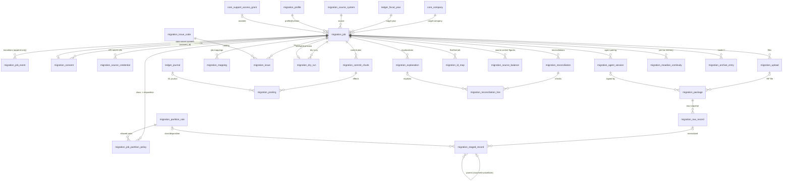

# 08 — انتقال داده از نرم‌افزار قبلی (ماژول `migration`، بستهٔ HIF و عامل ویندوزی)

> **وضعیت:** طراحی مرحلهٔ ۲. **SQL:** [`sql/60_migration.sql`](sql/60_migration.sql) (پس از `00 → 10 → 20 → 25`). **آزمون پایگاه داده:** [`sql/tests/60_migration_test.sql`](sql/tests/60_migration_test.sql) با بردارهای مشترک [`mig_header_norm_v1.json`](sql/tests/mig_header_norm_v1.json) و [`mig_taxid_v1.json`](sql/tests/mig_taxid_v1.json).
> **اصطلاحات یکسان‌شده:** بستهٔ تبادل میانی = **HIF** (Hesabketab Interchange Format؛ همان «CMM» پژوهش ۰۲)؛ کار مهاجرت = **`migration.job`** (همان `import_run` پژوهش ۰۱ و `mig_job` پژوهش ۰۲)؛ داده‌های مرحله‌ای در **جدول‌های مشترک با `tenant_id` و RLS**، نه اسکیمای جدا برای هر اجرا.
> **پاسخ‌های صاحب محصول که این سند را شکل داده‌اند:** Q-G (آداپتور هلو، سپیدار، حسابفا و اکسل در v1)، Q-G2 (نمونهٔ واقعی با رضایت کتبی می‌رسد)، Q-B (On-prem فقط لینوکس)، Q-C، Q-D، Q-E، Q-F و Q-H (بخش ۱۱).

---

## ۱. خلاصه

ماژول `migration` (لایهٔ L7 در DAG؛ بخش ۰۱ §۵-۱) دادهٔ کسب‌وکار را از نرم‌افزار قبلی به حساب‌کتاب می‌آورد. اصل حاکم این است که **صحت مهاجرت با ساختار تضمین می‌شود، نه با دقت اپراتور**: هر قاعدهٔ «قرارداد صحت» پژوهش یا یک قید/تریگر پایگاه داده است، یا یک گیت سرویس با آزمون نام‌دار.

**معماری در یک نگاه:**

```
 منابع ─► آداپتور ─► بستهٔ HIF امضاشده و رمزشده ─► staging (raw_record → staged_record، tenant_id + RLS)
   ─► Normalize ─► Map ─► Validate/Dedup ─► Dry-run (TX + ROLLBACK) ─► Preview (پذیرش انسانی)
   ─► Commit (تکه‌ای، ادامه‌پذیر، فقط از سرویس‌های دامنه) ─► Reconcile (اختلاف توضیح‌داده‌نشده = ۰)
   ─► Go-live Gate (تأیید حسابدار) ─► Lock            ← Rollback جبرانی تا پیش از Lock
```

- **چهار کانال ورودی، یک خط لوله:**
  - **A (API ابری):** حسابفا با API کامل؛ نرخ ≤ ۱ درخواست در ثانیه و قابل تنظیم.
  - **B1 (عامل ویندوزی):** فایل اجرایی کوچک، امضاشده و فقط‌خواندنی که روی شبکهٔ مشتری به SQL Server هلو یا سپیدار وصل می‌شود و فقط بستهٔ HIF رمزشده آپلود می‌کند.
  - **B2 (آپلود بکاپ):** بازیابی `.bak` در کانتینر ایزولهٔ SQL Server 2025 Express، بی‌شبکه و تک‌مصرف؛ فقط SaaS و پشت پرچم تا تأیید حقوقی.
  - **C (فایل):** قالب جامع ۱۹ شیتی (T00..T17 به‌اضافهٔ T11b)، تراز آزمایشی و گزارش‌های Excel «گزارش‌شکل»، فایل دفاتر تجاری الکترونیکی (هر دو نسخهٔ قالب)، `DSKWOR00.DBF` و صورتحساب بانک.
- **سه حالت:** A (افتتاحیه در `D`)، B (سال مالی جاری کامل، قفل‌شده)، C (آرشیو فقط‌خواندنی). تاریخ تبدیل `D` ترجیحاً ابتدای سال، بعد ابتدای فصل، بعد ابتدای ماه است.
- **مدل منبع GL یکتا:** مانده‌های تبدیل و اسناد تاریخی را فقط خود `migration` و فقط از راه `LedgerPostingService.post` ثبت می‌کند. زیردفترها (اقلام باز، چک، موجودی، دارایی) «موقعیت بدون سند» می‌گیرند. تطبیق، برابری این دو را اثبات می‌کند. اسناد مشتق از فاکتور و دریافت/پرداخت با پارتیشن انحصاری یا از ماژول تخصصی بازسازی می‌شوند یا سند GL مبدأ می‌مانند، و هرگز هر دو.
- **پذیرش = تطبیق:** تراز آزمایشی، حساب‌های کنترل، زیردفترهای اشخاص/بانک/صندوق/چک، مقدار و ارزش موجودی، دارایی، شمار اسناد، حساب واسط افتتاحیه و تداوم مؤدیان؛ همه با «اختلاف توضیح‌داده‌نشدهٔ صفر». هر توضیح دسته‌بندی‌شده، تأییدشده و دقیقاً برابر اختلاف است.

**اندازهٔ تحویل:**

| مورد | مقدار |
|---|---|
| جدول | ۲۸ (۶ کاتالوگ سراسری + ۲۲ مستأجری) |
| ویو | ۴ (همه `security_invoker`) |
| تابع | ۳۰ (۲۱ تابع تریگر، ۵ تابع خالص و ۴ کمکی گیت) |
| تریگر | ۴۲ (از جمله یک constraint trigger تأخیری) |
| کد مشکل اعتبارسنجی | ۶۴ |
| ستون قالب جامع v1 | ۱۷۲ |
| مترادف seed سرستون | ۷۸ |
| ناوردایی | ۳۸ (`INV-MIG-01..38`) |
| آزمون پایگاه داده | T01..T30 و T21b (حدود ۲۷۰ ادعا) |
| آزمون جهش | ۱۱۵ از ۱۱۷ محل خطا کشته شد؛ دو بازمانده با اثبات دسترس‌ناپذیری (§۹-۷) |

---

## ۲. دامنه

### ۲-۱. در دامنهٔ این بخش

| موضوع | جزئیات |
|---|---|
| اسکیمای `migration` | کار، رضایت، اعتبارنامهٔ API، نشست عامل، فایل، بستهٔ HIF، snapshot خام، رکورد مرحله‌ای، نگاشت شناسه، نگاشت ستون/مقدار/حساب و حافظهٔ مستأجر، مشکل، dry-run، تکهٔ ثبت، دفتر اثرها، ارقام مبدأ، توضیح اختلاف، تطبیق، تداوم مؤدیان، آرشیو و کاتالوگ‌ها |
| قالب HIF v1 | چیدمان، manifest، فایل موجودیت‌ها، snapshot خام، ارقام کنترلی، امضا، رمزنگاری و checksum |
| خط لوله | Probe، Extract، Normalize، Map، Validate/Dedup، Dry-run، Preview، Commit، Reconcile، Go-live، Lock و Rollback |
| آداپتورها | قالب جامع، تراز آزمایشی و Report Parser، دفاتر الکترونیکی، DBF بیمه، حسابفا (API)، هلو و سپیدار (عامل یا بکاپ یا اکسل)، محک و پارمیس (probe) |
| عامل ویندوزی (`agent/`) | فناوری، جفت‌سازی، فقط‌خواندنی بودن، درایورها، سازگاری، رمزنگاری و آپلود |
| sandbox بکاپ (B2) | ایمیج، ایزوله‌سازی، مراحل RESTORE و نابودی |
| نگاشت | خودکار ستون (شش لایه + دستیار اختیاری)، فرهنگ مترادف، نگاشت مقدار، نگاشت کدینگ بر پایهٔ نقش، تفصیلی به بُعد، پیوند اشخاص و کالا، تکراری‌ها |
| اعتبارسنجی | ساختاری، ارجاعی، checksum (کد ملی، شناسهٔ ملی، شبا، کارت، taxid با Verhoeff)، قواعد تجاری و پارتیشن |
| ثبت | برنامهٔ ثبت، ترتیب وابستگی، فراخوانی سرویس‌های import ماژول‌ها و lineage |
| تطبیق و پذیرش | گزارش قابل امضا، دروازهٔ زنده شدن و قفل |
| تداوم مؤدیان | حافظه، آخرین `inno` به Hex و taxidهای سال جاری با اقلام کامل |
| امنیت و حقوق | فایل خصمانه، ایزوله‌سازی پارس، رضایت، مهاجرت همراه‌با‌کارشناس و حذف زمان‌بندی‌شده |
| ویزارد ۱۰ مرحله‌ای | UX و قرارداد API آن |
| نیازهای «مرکز مهاجرت» پنل مالک | رویدادهای uplink و قرارداد انتشار فرهنگ و پروفایل |

### ۲-۲. بیرون از دامنه (و مالک آن)

| موضوع | مالک |
|---|---|
| ثبت سند دفتر کل، قواعد تراز، قفل دوره، شماره‌گذاری | ledger (بخش ۰۳). migration فقط `PostingRequest` می‌فرستد |
| ساخت اشخاص، کالا، واحد، بارکد، قیمت | parties و catalog (بخش ۰۴) با `MasterdataImportService` |
| انبار و افتتاحیهٔ موجودی، فاکتورهای تاریخی | inventory، sales و purchase (بخش ۰۵). قرارداد import در §۵-۱۵ |
| چک، اقلام باز، صندوق، بانک، اقلام تطبیق‌نشده | treasury (بخش ۰۶) |
| حافظهٔ مالیاتی، سریال `inno`، ارسال به مؤدیان | tax (بخش ۰۷). migration فقط تداوم را تحویل می‌دهد |
| پرسنل، کارکرد سال جاری، فایل بیمه | payroll (بخش ۰۷) |
| دارایی ثابت | assets (بخش ۰۷) |
| جدول‌های صفحهٔ کنترل «مرکز مهاجرت» و صورتحساب خدمت | platform (بخش پلتفرم مالک). این سند فقط قرارداد رویداد و نیاز را می‌دهد (§۵-۱۸ و §۱۳) |
| دستیار هوشمند | بخش ۱۰. این سند فقط سطح پیشنهاد نگاشت را می‌دهد (§۵-۱۹) |
| بستهٔ صادراتی `.hkx` (جابه‌جایی بین SaaS و On-prem) | core (بخش ۰۲). مهاجرت از نرم‌افزار قبلی چیز دیگری است و از `.hkx` استفاده نمی‌کند |
| کلید خصوصی و گواهی مؤدیان | tax و KeyManager. هرگز از Excel یا HIF وارد نمی‌شود |

---

## ۳. تصمیم‌های طراحی

### D-MG01 — یک ماژول، یک قالب میانی (HIF)، یک خط لوله
- **تصمیم:**
  - هر آداپتور فقط HIF تولید می‌کند. موتور واردکننده یکی است و در SaaS و On-prem همان کد است.
  - staging در جدول‌های مشترک `migration.raw_record` و `migration.staged_record` است، با `tenant_id`، `job_id`، RLS اجباری و FK ترکیبی.
  - «کار» (`migration.job`) واحد ردیابی و قفل است. هر اثر نوشتنی `job_id` و lineage دارد.
- **دلیل:**
  - آداپتور جدید فقط ترجمه به HIF است، نه خط لولهٔ جدید.
  - بسته می‌تواند آفلاین منتقل شود (عامل روی شبکهٔ بسته، USB، قطعی اینترنت).
  - آزمون با بستهٔ مصنوعی ساده می‌شود.
  - جدول مشترک با `core.enable_tenant_rls` و `core.security_lint` هم‌خوان است و migration Alembic جدا برای هر اجرا نمی‌خواهد.
- **ردشده:**
  - اسکیمای جدا برای هر `import_run` (پژوهش ۰۱): lint و RLS سراسری را دور می‌زند، با PgBouncer و Alembic تک‌زنجیره ناسازگار است و پاک‌سازی‌اش DDL می‌خواهد.
  - آداپتور مستقیم به جدول‌های مقصد: قرارداد «ثبت فقط از سرویس‌های دامنه» را می‌شکند.
- **مرجع:** [README §۳-۲](../research/README.md#۳-۲-معماری-چند-کانال-ورودی-یک-قالب-میانی-یک-خط-لوله)، [README §۲-و](../research/README.md#و-ناسازگاریهای-بین-گزارشها-که-تیم-فنی-باید-پیش-از-شروع-ببندد)، [۰۱ §۵.۲](../research/01-migration-popular-apps.md#۵۲-معماری-سه-کانال-ورودی-و-یک-قالب-میانی)، [۰۲ §۶.۳](../research/02-migration-enterprise-and-generic.md#۶۳-معماری)

### D-MG02 — قرارداد صحت به‌صورت ساختار، نه دستورالعمل
- **تصمیم:** هر بند قرارداد صحت پژوهش یک یا چند ناوردایی با محل اجبار مشخص است:

| بند قرارداد | ناوردایی | اجبار |
|---|---|---|
| فقط‌خواندنی روی مبدأ | INV-MIG-37 | عامل (allowlist امضاشده، بررسی نقش SQL)، sandbox بی‌شبکه |
| رد کردن بهتر از حدس زدن | INV-MIG-09، 10، 12 | CHECK نگاشت قطعی، تریگر سند مسدود |
| هر سند مبدأ حداکثر یک‌بار | INV-MIG-03، 07، 08 | ایندکس یکتای جزئی `posting`، یکتایی `id_map`، پارتیشن انحصاری |
| سند نامتوازن منتقل نمی‌شود | INV-MIG-15 | تریگر `staged_record_guard` |
| ثبت فقط از سرویس‌های دامنه | INV-MIG-35 | DAG و شنوندهٔ نوشتن بین‌ماژولی بخش ۰۱ (INV-ARCH-08) |
| بهای نامعلوم نامعلوم است | INV-MIG-11 | CHECKهای `cost_status` |
| پذیرش = تطبیق | INV-MIG-19، 23 | constraint trigger تطبیق، گیت `reconciled`/`live` |
| rollback تا قفل | INV-MIG-20 | ماشین حالت، جبران فقط در `rolling_back` |
| واحد مبلغ صریح | INV-MIG-02 | CHECK، گیت تأیید واحد |
| رضایت مالک داده | INV-MIG-01 | گیت همهٔ گذارهای رو به جلو و همهٔ درج‌های ورودی |

- **دلیل:** قرارداد صاحب محصول «بی‌نقص» است و پژوهش نشان داد هر کدام از این بندها در یک مهاجرت واقعی شکسته شده است (۵۳۸ فاکتور دوبل هلو، تخصیص به «اولین بانک»، تکرار افتتاحیهٔ انبار سپیدار).
- **ردشده:** فهرست بررسی دستی برای اپراتور؛ اعتبارسنجی فقط در پایتون.
- **مرجع:** [README §۳-۱](../research/README.md#۳-۱-قرارداد-صحت-انتقال-غیرقابل-مذاکره)، [۰۱ §۵.۱](../research/01-migration-popular-apps.md#۵۱-اصول-غیرقابل-مذاکره-قرارداد-صحت-انتقال)

### D-MG03 — ماشین حالت چهارده‌وضعیتی با گیت‌های پایگاه داده
- **تصمیم:**
  - وضعیت‌ها: `draft → awaiting_source → staged → mapping → validated → previewed → committing → committed → reconciled → live`، به‌اضافهٔ `rolling_back → rolled_back`، `cancelled` و `failed`.
  - گذارهای مجاز در `migration.job_transition_allowed`.
  - پیش‌شرط هر گذار رو به جلو در تریگر `migration.job_guard` است: رضایت فعال، بستهٔ تأییدشده، بی‌مشکل باز، dry-run معتبر روی همان ورودی، همهٔ تکه‌ها تمام، تطبیق متوازن و تأیید حسابدار.
  - در هر شرکت حداکثر یک کار ثبت‌کننده (غیرآرشیو) فعال است (ایندکس یکتای جزئی).
  - هر گذار در `migration.job_event` (فقط‌افزودنی) با کنشگر ثبت می‌شود.
- **دلیل:**
  - گیت در پایگاه داده یعنی هیچ مسیر کد (API، job، اسکریپت پشتیبان) نمی‌تواند گام را دور بزند.
  - کار هم‌زمان روی یک شرکت شماره‌ها و افتتاحیه را درهم می‌کند. در پژوهش ۰۲ با قفل advisory پیشنهاد شده بود، که با PgBouncer در حالت transaction سازگار نیست.
- **ردشده:** قفل advisory سطح نشست؛ وضعیت آزاد بدون جدول گذار.
- **مرجع:** [۰۱ §۵.۴](../research/01-migration-popular-apps.md#۵۴-خط-لولهٔ-مرحلهای-state-machine)، [۰۲ §۶.۱۴](../research/02-migration-enterprise-and-generic.md#۶۱۴-راهبرد-تست) (بند ۹)

### D-MG04 — HIF v1: چیدمان HKSB، اعتماد به کلید نشست، رمزنگاری به کلید کار
- **تصمیم:**
  - HIF یک zip با **همان چیدمان HKSB v1** است: `manifest.json`، `manifest.sig` و `payload/...` (بخش ۰۱ D-13 و C-07).
  - **لنگر اعتماد** آن keyring ریشهٔ آفلاین نیست:
    - بستهٔ عامل با کلید Ed25519 نشست جفت‌شده (`migration.agent_session.agent_public_key`) امضا می‌شود.
    - بستهٔ سرور (بکاپ، API، فایل) با کلید سرویس migration سلول امضا می‌شود.
  - payload با AES-256-GCM و کلید دادهٔ تصادفی رمز می‌شود. کلید داده با X25519 + HKDF-SHA256 برای **کلید عمومی کار** (در جفت‌سازی صادر می‌شود؛ کلید خصوصی در KeyManager) پیچیده می‌شود.
  - manifest رمز نمی‌شود، ولی دادهٔ شخصی ندارد (نام جدول، شمار، hash).
  - شمار ردیف هر فایل و sha256 متن ساده و رمزشده در manifest است. پایگاه داده برابری شمار ردیف‌های بارگذاری‌شده با manifest را هنگام `verified` اجبار می‌کند (INV-MIG-04).
- **دلیل:**
  - یک قالب و یک کد بازکنندهٔ zip امن، مطابق C-07.
  - عامل روی ماشین مشتری کلید ریشهٔ ما را ندارد و نباید داشته باشد. امضا با کلید نشست تضمین می‌کند بسته از همان عامل جفت‌شده آمده است.
  - رمزنگاری به کلید کار حمل با USB یا ایمیل را هم امن می‌کند. حذف کلید خصوصی کار پس از پاک‌سازی، هر کپی جامانده را بی‌اثر می‌کند (crypto-shredding).
- **ردشده:**
  - امضای عامل با کلید ریشهٔ توزیع‌شده (نشت کلید).
  - HIF بدون امضا با تکیه بر TLS (حمل آفلاین را نمی‌پوشاند).
  - رمز عبور کاربر برای رمزنگاری (ضعیف، فراموش‌شدنی).
- **مرجع:** [۰۱ §۵.۲](../research/01-migration-popular-apps.md#۵۲-معماری-سه-کانال-ورودی-و-یک-قالب-میانی)، بخش ۰۱ D-13، بخش ۰۲ §۵.۱۵

### D-MG05 — کانال‌ها و اولویت آداپتورها (با پاسخ Q-G)

| مرحله | آداپتور | کانال |
|---|---|---|
| **v1** | قالب جامع T00..T17 + T11b و ویزارد | C |
| **v1** | تراز آزمایشی عمومی (۲/۴/۶/۸ ستونی) و Report Parser | C |
| **v1** | دفاتر تجاری الکترونیکی، هر دو نسخهٔ قالب | C |
| **v1** | `DSKWOR00.DBF` (ساخت پرسنل) و T16 | C |
| **v1** | صورتحساب بانک (از پروفایل‌های treasury) | C |
| **v1** | حسابفا | A |
| **v1** | هلو: پروفایل SQL با عامل B1، و پروفایل‌های خروجی Excel | B1، C |
| **v1** | سپیدار: پروفایل SQL با B1، و قالب‌های «ارسال و دریافت» `.xls` | B1، C |
| **v1 (مشروط)** | بکاپ هلو و سپیدار در sandbox. مشروط به تأیید حقوقی مجوز Express در SaaS؛ پرچم `migration.backup_sandbox` | B2 |
| **v2** | محک و پارمیس پس از probe روی دیتابیس واقعی با رضایت؛ دشت؛ راهکاران و تدبیر (Report Parser و XML)؛ وب‌سرویس سپیدار؛ Sync محک | B1، C، A |
| **بعداً** | رافع، میزان، نوین، پیوست | C |

- **دلیل:**
  - صاحب محصول هلو، سپیدار، حسابفا و اکسل را برای v1 خواسته و نمونهٔ واقعی را با رضایت کتبی تأمین می‌کند (Q-G، Q-G2).
  - پژوهش ۰۱ SQL را برای هلو و سپیدار تنها مسیر کامل می‌داند: API سپیدار دفتر کل ندارد و TncHoloo فهرست اسناد ندارد.
  - B1 را به v1 آوردیم، چون B2 دو مجهول دارد که فقط با نمونهٔ واقعی روشن می‌شوند: محتوای ZIP پشتیبان هلو و قالب پشتیبان رمزدار سپیدار. B2 مجهول حقوقی هم دارد. B1 هیچ‌کدام را ندارد.
- **ردشده:** کانکتور SQL در «فاز ۴» پژوهش ۰۲. با پاسخ Q-G، هلو و سپیدار بدون آن عملاً فقط با Excel ممکن‌اند، که دفتر کل کامل را نمی‌دهد.
- **مرجع:** [README §۳-۶](../research/README.md#۳-۶-اولویت-آداپتورها-پیشنهاد-این-جمعبندی)، [۰۱ §۵.۱۱](../research/01-migration-popular-apps.md#۵۱۱-اولویت-پیادهسازی-پیشنهاد)، [۰۲ §۶.۱۶](../research/02-migration-enterprise-and-generic.md#۶۱۶-نقشهٔ-راه-پیشنهادی)

### D-MG06 — فناوری عامل ویندوزی: Python 3.13 + PyInstaller، با درایور زنجیره‌ای
- **تصمیم:**
  - `hk-migrate-agent.exe`: یک فایل PyInstaller، x64، بدون نصب و بدون دسترسی Administrator، مطابق بخش ۰۱ D-31.
  - **میزبان:** Windows 10/11 یا Server 2016 به بعد. عامل لازم نیست روی خود سرور SQL اجرا شود: هر رایانهٔ همان شبکه کافی است.
  - **SQL مقصد:** SQL Server 2008 R2 تا 2025، شامل سطح سازگاری 100.
  - **زنجیرهٔ درایور:** ODBC Driver 18 اگر نصب باشد؛ وگرنه ODBC Driver 17؛ وگرنه کلاینت TDS پایتونی `python-tds` (pytds، MIT) که در بسته هست و نصب نمی‌خواهد. pytds مسیر پیش‌فرض برای 2008 R2 و ماشین‌های بدون درایور است.
  - `TrustServerCertificate=yes` فقط برای نشانی loopback، RFC 1918 و link-local، و با تأیید صریح کاربر.
  - اتصال رمزنشده (برای 2008 R2 بدون وصلهٔ TLS 1.2) فقط روی همان نشانی‌های خصوصی و با تأیید دوم کاربر مجاز است و در manifest ثبت می‌شود.
  - منطق استخراج (اجرای کوئری‌های پروفایل و نوشتن HIF) در بستهٔ مشترک `hesabketab_extract` است، که هم عامل و هم استخراج‌گر sandbox (B2) از آن استفاده می‌کنند.
- **دلیل:**
  - یک زبان و یک کد استخراج برای B1 و B2.
  - آزمون‌های پروفایل یک بار نوشته می‌شوند.
  - pytds مشکل «Driver 18 فقط SQL 2017 به بعد را تست کرده» و «نصب درایور Admin می‌خواهد» را حل می‌کند.
- **ردشده:**
  - **.NET Framework 4.8 با `System.Data.SqlClient`:** روی Windows 7 هم اجرا می‌شود و درایور نمی‌خواهد. ولی زبان چهارم سمت مشتری است و نوشتن HIF و اجرای پروفایل دوبار پیاده می‌شود. اگر داده‌های پایلوت نشان دهد میزبان Windows 7 تنها گزینهٔ رایج است، این گزینه دوباره بررسی می‌شود (§۱۱).
  - **Rust با tiberius:** هدف Windows 7 در Rust ردهٔ ۳ است.
  - **اجرای عامل روی Windows 7:** Python ≥ 3.9 از Windows 7 پشتیبانی نمی‌کند. برای آن مشتریان مسیرها این‌هاست: اجرای عامل از رایانهٔ دیگر شبکه، لپ‌تاپ کارشناس در خدمت همراه، B2 یا Excel.
- **ریسک:** نبود گواهی Authenticode زیر تحریم (بخش ۰۱ R-03) و قرنطینهٔ PyInstaller توسط آنتی‌ویروس. کاهش ریسک: امضای HKSB، انتشار hash در ویزارد، ارسال نمونه به آنتی‌ویروس‌های داخلی و راهنمای استثنا.
- **مرجع:** [۰۱ §۵.۲](../research/01-migration-popular-apps.md#۵۲-معماری-سه-کانال-ورودی-و-یک-قالب-میانی)، [۰۱ راستی‌آزمایی بند ۵](../research/01-migration-popular-apps.md#گزارش-راستیآزمایی)، بخش ۰۱ D-31

### D-MG07 — فقط‌خواندنی بودن با چهار لایه، نه با `ApplicationIntent`
- **تصمیم:**
  1. **allowlist امضاشده:** عامل فقط کوئری‌هایی را اجرا می‌کند که در `spec` پروفایل منتشرشده آمده‌اند. پروفایل HKSB-امضاشده با keyring ریشه است و عامل امضا را با کلیدهای عمومی ریشهٔ درون خودش می‌سنجد.
  2. **نگهبان محلی:** هر دستور باید با `SELECT` یا `WITH` شروع شود و یک دستور باشد. `INTO`، `EXEC`، `xp_`، `sp_`، `OPENROWSET`، `OPENQUERY`، `;`، `DECLARE` و `UPDATE|INSERT|DELETE|MERGE|ALTER|CREATE|DROP|TRUNCATE|GRANT|BACKUP|RESTORE` رد می‌شوند.
  3. **بررسی نقش:** عامل `IS_SRVROLEMEMBER('sysadmin')` و `IS_MEMBER('db_owner')` را می‌خواند. اگر ورود ممتاز باشد، هشدار `MIG_SOURCE_LOGIN_PRIVILEGED` می‌دهد و اسکریپت ساخت کاربر `hk_reader` را نشان می‌دهد (`db_datareader` و `DENY INSERT, UPDATE, DELETE, EXECUTE`) تا DBA اجرا کند. خود عامل هرگز DDL اجرا نمی‌کند.
  4. **تنظیم نشست:** `SET LOCK_TIMEOUT 5000; SET DEADLOCK_PRIORITY LOW;`، ایزولاسیون `READ COMMITTED`، بدون جدول موقت.

  **سازگاری snapshot:** شمار ردیف‌ها و checksum جدول‌های کلیدی پیش و پس از استخراج گرفته می‌شود. اگر فرق کنند، manifest با `consistency.equal=false` بسته می‌شود و ویزارد اجرای دوباره را در ساعت تعطیل می‌خواهد (`MIG_SOURCE_CHANGED_DURING_EXTRACT`، §۵-۸).
- **دلیل:** `ApplicationIntent=ReadOnly` روی سرور مستقل جلوی نوشتن را نمی‌گیرد. `NOLOCK` خواندن کثیف می‌دهد. `SNAPSHOT` تغییر تنظیم دیتابیس مشتری را می‌خواهد که ممنوع است.
- **ردشده:** اعتماد به اعلام نیت در رشتهٔ اتصال؛ ساخت کاربر فقط‌خواندنی توسط عامل (DDL روی سیستم مشتری).
- **مرجع:** [۰۱ §۵.۱](../research/01-migration-popular-apps.md#۵۱-اصول-غیرقابل-مذاکره-قرارداد-صحت-انتقال)، [۰۱ راستی‌آزمایی بند ۴](../research/01-migration-popular-apps.md#گزارش-راستیآزمایی)

### D-MG08 — sandbox بکاپ (B2): SQL Server 2025 Express، بی‌شبکه، تک‌مصرف، فقط SaaS
- **تصمیم:**
  - ایمیج `mssql/server:2025` از رجیستری داخلی (Harbor) با digest پین‌شده و `MSSQL_PID=Express`.
  - Pod دوکانتینری (sandbox و `hk-extract`) در namespace شبکهٔ بسته (`network=none`، بدون egress)، کاربر غیر root، و volume موقت با سهمیهٔ ۶۰ GiB.
  - هر کانتینر فقط یک بکاپ را پردازش می‌کند و پس از تولید HIF همراه volume نابود می‌شود.
  - فایل هرگز بی‌بررسی RESTORE نمی‌شود:
    1. سرآیند فایل sniff می‌شود: MTF `TAPE` برای `.bak`؛ `PK\x03\x04` برای ZIP که فهرست ورودی‌هایش بی‌استخراج بررسی می‌شود. قالب ناشناخته هرگز پذیرفته نمی‌شود (CHECK در INV-MIG-30).
    2. سپس `RESTORE HEADERONLY`، `FILELISTONLY` (سقف ۵۰ GB؛ بیشتر از آن یعنی `MIG_BACKUP_TOO_LARGE` و پیشنهاد B1)، `VERIFYONLY` و در آخر `RESTORE ... WITH MOVE`.
  - کوئری‌ها همان allowlist عامل‌اند و با سطح سازگاری 100 کار می‌کنند (بدون `TRY_CONVERT`).
  - در v1 فقط SaaS، و پشت پرچم پلتفرم `migration.backup_sandbox` تا تأیید حقوقی EULA و مجوز Express در استفادهٔ میزبانی‌شده. در On-prem لینوکس (Q-B) B2 در v1 نیست.
- **دلیل:**
  - پشتیبان نسخهٔ جدیدتر روی نسخهٔ قدیمی‌تر بازیابی نمی‌شود، پس مقصد همیشه 2025 است.
  - سقف Express 2025 پنجاه گیگابایت است.
  - Developer برای تولید مجاز نیست.
  - رمز پشتیبان را مالک وارد می‌کند و ما رمز را نمی‌شکنیم.
- **ردشده:** کانتینر بلندعمر مشترک بین مستأجرها (نشت داده)؛ Developer Edition؛ بازیابی روی سرور ویندوز تیم پشتیبانی.
- **مرجع:** [۰۱ §۵.۲](../research/01-migration-popular-apps.md#۵۲-معماری-سه-کانال-ورودی-و-یک-قالب-میانی)، [۰۱ §۳.۲](../research/01-migration-popular-apps.md#۳۲-سپیدار-sepidar-system-نصبی)، [۰۲ §۴.۱](../research/02-migration-enterprise-and-generic.md#۴۱-غلبهٔ-sql-server-و-کانکتور-استخراج-on-prem)

### D-MG09 — API ابری: سرورِ اینترنتی در سرور، سرویسِ شبکهٔ مشتری در عامل
- **تصمیم:**
  - **حسابفا (سمت سرور):**
    - `POST https://api.hesabfa.com/v1/{module}/{method}` با `apiKey` و `loginToken` که خود مشتری می‌سازد.
    - کلید فقط در KeyManager است (`migration.source_credential.secret_ref`) و پس از حداکثر ۳۰ روز پاک می‌شود.
    - نرخ پیش‌فرض ۱ درخواست در ثانیه برای هر کسب‌وکار است. تنظیم مستأجر `migration.api.hesabfa.max_rps` فقط می‌تواند آن را پایین بیاورد. سقف پلتفرم پارامتر قاعدهٔ تاریخ‌دار `migration.hesabfa.max_rps` است.
    - با `ErrorCode=101` دست‌کم ۱۰ ثانیه صبر و backoff نمایی با jitter.
    - دامنهٔ جایگزین `api.hesabfa.ir` فقط اگر در allowlist خروجی پلتفرم باشد.
    - همهٔ مبالغ با `Decimal` پارس می‌شوند.
  - **TncHoloo:** سرویس HTTP روی شبکهٔ مشتری است، پس فقط از عامل خوانده می‌شود. کاربردش کنترل دوم مانده (`Report/GetSarfasl`) است. مقدارهای علمی مثل `"3.25787252E8"` با `Decimal` پارس و عیناً در `source_balance.raw_text` نگه داشته می‌شوند.
  - **وب‌سرویس سپیدار** (`localhost:7373`) و **Sync محک:** v2، فقط برای اطلاعات پایه.
- **دلیل:** سرور ابری نمی‌تواند به شبکهٔ محلی مشتری وصل شود و نباید بخواهد. حسابفا سرویس داخلی است و فراخوانی آن «وابستگی به سرویس خارجی» نیست، ولی از allowlist خروجی (بخش ۰۱) می‌گذرد.
- **ردشده:** نرخ hardcode شده (پژوهش دو عدد متناقض داشت)؛ پارس float مبالغ.
- **مرجع:** [۰۱ §۳.۴](../research/01-migration-popular-apps.md#۳۴-حسابفا-hesabfa-ابری)، [۰۱ §۳.۱](../research/01-migration-popular-apps.md#۳۱-هلو-holoo-شرکت-مهندسی-نرمافزار-هلو--گروه-طرفهنگار)، [۰۱ راستی‌آزمایی بندهای ۷، ۸ و ۱۰](../research/01-migration-popular-apps.md#گزارش-راستیآزمایی)

### D-MG10 — حالت‌ها، تاریخ تبدیل `D` و «منبع GL یکتا»
- **تصمیم:** در همهٔ حالت‌ها، مانده‌های دفتر کل در `D-1` فقط از سندهایی می‌آیند که `migration` ثبت می‌کند. زیردفترها در `D` موقعیت بدون سند می‌گیرند و تطبیق برابری را اثبات می‌کند.

| حالت | `D` | اسناد دفتر کل که migration ثبت می‌کند | موقعیت زیردفترها (`gl_effect='none'`) |
|---|---|---|---|
| A — افتتاحیه | ابتدای سال (توصیه) | یک `opening_import` در `fy.start_date` از تراز `D-1`. حساب‌های کنترل از جمع موقعیت‌ها ساخته و با تراز سنجیده می‌شوند. همه در برابر `OPENING_BALANCE_CLEARING` | اقلام باز، چک، موجودی و دارایی در `D` |
| A — افتتاحیه | وسط سال | `opening_import` در `fy.start_date` از ماندهٔ ابتدای سال (ستون‌های ابتدای تراز ۶ یا ۸ ستونی)، و یک `history_import` «خلاصهٔ گردش» برای هر دورهٔ پیش از `D` از تراز دوره‌ای. اگر فقط تراز تجمعی باشد، یک سند در `D-1` | همان |
| B — سال جاری | وسط سال (توصیه) | `opening_import` ابتدای سال (سند افتتاحیهٔ مبدأ یا تراز پایان سال قبل)، و برای هر سند مبدأ تا `D-1` طبق پارتیشن (D-MG11) یکی از: `history_import`، سند بازسازی‌شدهٔ ماژول تخصصی، یا کنار گذاشته | همان (اقلام باز در حالت بازسازی از خود فاکتورها؛ §۵-۱۰) |
| C — آرشیو | — | هیچ سندی (`archive_entry`، بدون اثر بر مانده) | — |

  **قواعد `D`:**
  - بهترین گزینه ابتدای سال مالی است. بعد ابتدای دوره‌ای که قاعدهٔ تاریخ‌دار `tax.eledger.period` می‌گوید (برای سال ۱۴۰۵ فصلی ⚠). بعد ابتدای ماه.
  - ویزارد برای وسط فصل و وسط ماه هشدار می‌دهد.
  - تراکنش‌های `< D` مال نرم‌افزار قبلی‌اند و `≥ D` مال حساب‌کتاب.
- **دلیل:**
  - ledger افتتاحیه را فقط در روز اول سالِ اول می‌پذیرد (D-L21).
  - treasury چک واردشده را بدون سند می‌سازد (D-T12).
  - اقلام باز treasury اثر GL ندارند (D-T01).
  - با یک قاعده برای همه، «دو بار شمردن» (درس ERPNext و Odoo) ساختاراً ناممکن است و تطبیق دو منبع مستقل را با هم مقایسه می‌کند.
  - حالت A وسط سال با سندهای خلاصهٔ دوره‌ای سود و زیان سال را درست نگه می‌دارد. ولی دفاتر الکترونیکی آن دوره‌ها ردیف خلاصه دارند، پس ویزارد حالت B را برای وسط سال توصیه می‌کند.
- **ردشده:**
  - ثبت GL افتتاحیهٔ هر زیردفتر توسط مالکش: با سه بخش هم‌زمان ناسازگار است و ledger هم `OpeningBalanceService` را برای حساب کنترل رد می‌کند.
  - سال مالی کوتاه از `D`: سال مالی قانونی است.
  - ثبت تراز `D-1` با تاریخ `D-1` در نوع `opening`: ledger نمی‌پذیرد.
- **مرجع:** [README §۳-۳](../research/README.md#۳-۳-حالتها-و-تاریخ-تبدیل-d)، [۰۲ §۶.۲](../research/02-migration-enterprise-and-generic.md#۶۲-حالتهای-مهاجرت-و-تاریخ-تبدیل)، [۰۲ §۵.۱](../research/02-migration-enterprise-and-generic.md#۵۱-erpnext-frappe)، [۰۲ §۵.۲](../research/02-migration-enterprise-and-generic.md#۵۲-odoo)، بخش ۰۳ D-L21

### D-MG11 — پارتیشن انحصاری اسناد مبدأ
- **تصمیم:**
  - هر سند مبدأ دقیقاً یک **کلاس** می‌گیرد: `OPENING`، `SKIP_CONTROL`، `CLOSING`، `CHEQUE`، `INVOICE`، `RECEIPT_PAYMENT`، `EXPENSE_INCOME`، `MANUAL` یا `UNCLASSIFIED`.
  - برای هر کلاس در هر کار دقیقاً یک **وضعیت** هست: `opening_gl`، `history_gl`، `regenerate`، `skip`، `archive` یا `blocked`. جدول کاتالوگ `partition_rule` جفت‌های مجاز را تعیین می‌کند.
  - پایگاه داده اجبار می‌کند:
    - یکتایی `(job, class)`؛
    - برابری وضعیت سند با سیاست کلاس؛
    - `UNCLASSIFIED` فقط `blocked` (یا کنارگذاشته با دلیل)؛
    - و مهم‌تر، سندی که `regenerate`، `skip` یا `archive` است هرگز به `ledger.journal` ثبت نمی‌شود (`posting_guard`، INV-MIG-08).
  - **قواعد کلاس داده‌اند، در `spec` پروفایل** (§۵-۹). مثلاً هلو:
    - `Sanad_Type IN (13,14)`، یا `Sanad_Type = 0 AND SaveFromFacture = 1`، یا ارجاع از `FACTURE` حذف‌نشده ← `INVOICE`؛
    - `Sanad_Type = 5` یا ارجاع از `[Check]` ← `CHEQUE`؛
    - `Sanad_Type = 20` ← `RECEIPT_PAYMENT`؛
    - سند ۱ ← `OPENING`؛
    - فقط `005`/`006` ← `SKIP_CONTROL`.
  - **پیش‌فرض v1:**
    - `INVOICE` و `RECEIPT_PAYMENT` ← `regenerate`، فقط برای مبدأ با موجودی ادواری؛ مبدأ دائمی ← `history_gl` (§۵-۱۰).
    - `CHEQUE` ← `history_gl`. بازسازی تاریخچهٔ چک در v2 است، چون treasury هنوز «بازپخش رویداد چک» ندارد (§۱۳).
- **دلیل:** نقطهٔ اصلی خطای مهاجرت‌های واقعی ثبت دوبل بوده است. یکتایی ساختاری جلوی «هم فاکتور و هم سند فاکتور» را می‌گیرد.
- **ردشده:** تشخیص دوبل با مقایسهٔ مبلغ پس از ثبت؛ اجازهٔ وضعیت جدا برای هر سند (ناسازگاری درون یک کلاس).
- **مرجع:** [۰۱ §۵.۶](../research/01-migration-popular-apps.md#۵۶-جلوگیری-از-ثبت-دوبل-پارتیشن-انحصاری-اسناد)، [۰۱ §۳.۱](../research/01-migration-popular-apps.md#۳۱-هلو-holoo-شرکت-مهندسی-نرمافزار-هلو--گروه-طرفهنگار)، [۰۱ راستی‌آزمایی بند ۱۳](../research/01-migration-popular-apps.md#گزارش-راستیآزمایی)

### D-MG12 — نگاشت کدینگ بر پایهٔ نقش در دقیق‌ترین سطح؛ تفصیلی به بُعد؛ دو حالت کدینگ
- **تصمیم:**
  - **ترتیب حل کلید هر آرتیکل:** تفصیلی، بعد معین، بعد کل.
    - **لایهٔ A (زیردفتر):** صندوق، بانک یا شخص به بُعد `party`، `bank_account` یا `cash_box`، به‌اضافهٔ حساب نقش‌دار. جهت AR یا AP از ماهیت خالص مانده تعیین می‌شود.
    - **لایهٔ B (حساب استاندارد):** هم‌نقشی با قالب کدینگ، مثل `901` هلو به نقش `SALES`.
    - **لایهٔ C (حساب اختصاصی):** حساب جدید زیر والد هم‌نوع. فقط با تأیید در پیش‌نمایش.
  - **دو حالت (انتخاب مشتری در T00 یا ویزارد):**
    - `standard`: نگاشت به قالب کدینگ صنفی ledger، پیش‌فرض.
    - `keep_legacy`: درخت مبدأ عیناً ساخته می‌شود (`code_mode='free'`) و هر گره یک `role` می‌گیرد.
    - در هر دو حالت `ledger.account.legacy_code/legacy_path/legacy_system` پر می‌شود.
  - **ممنوع (INV-MIG-09):** تطبیق `Contains` روی نام، حساب پیش‌فرض برای «ناشناس» و «اولین بانک». نگاشت حساب، بانک، صندوق، انبار، بُعد و پیوند شخص یا کالا فقط با کلید قالب، پروفایل یا شناسهٔ دقیق (شمارهٔ حساب، شبا، کد ملی) یا با تأیید انسان قطعی می‌شود.
  - **تله‌ها:**
    - وام زیر `401` هلو هشدار `MIG_LOAN_IN_PAYABLES` و تفکیک پیشنهادی دارد.
    - `005`/`006` به `OPENING_BALANCE_CLEARING` یا `CONTROL_SKIP` می‌رود.
    - `105` (موجودی پایان دورهٔ کنترلی) نشانهٔ موجودی ادواری است.
- **دلیل:** ledger کدینگ درختی، شش جایگاه بُعد و `role` دارد (D-L01، D-L02). نقش مبنای نگاشت خودکار است و قاعدهٔ ledger هم «حساب پیش‌فرض بی‌صدا» ندارد (D-L14).
- **ردشده:** تفصیلی به‌عنوان سطح چهارم درخت؛ نگاشت فقط با کد.
- **مرجع:** [۰۱ §۵.۵](../research/01-migration-popular-apps.md#۵۵-نگاشت-کدینگ-حساب-کل--معین--تفصیلی)، [۰۲ §۴.۶](../research/02-migration-enterprise-and-generic.md#۴۶-ساختار-کدینگ-چندسطحی-و-تفصیلی-شناور)، بخش ۰۳ D-L01 و D-L14

### D-MG13 — نگاشت خودکار ستون در شش لایه (+ دستیار اختیاری)، فرهنگ مترادف به‌صورت داده
- **تصمیم:**
  - **ترتیب لایه‌ها:**
    1. کلید مخفی قالب خودمان؛
    2. حافظهٔ همان مستأجر (`migration.mapping` با `job_id IS NULL`)؛
    3. پروفایل نرم‌افزار مبدأ؛
    4. مترادف دقیق پس از `migration.norm_header`؛
    5. fuzzy (`rapidfuzz.token_set_ratio`: ≥ ۸۸ پیشنهاد، ۷۵ تا ۸۸ «نیاز به تأیید»)؛
    6. تشخیص از محتوا روی نمونهٔ ۲۰۰ ردیفی، **در سطح ستون**. مثلاً درصد عبور از Luhn: کارت نزدیک ۱۰۰٪، صیاد نزدیک ۱۰٪.
  - هر پیشنهاد `method`، `confidence` و `reason` دارد. fuzzy، محتوا و دستیار هرگز بی‌تأیید انسان قطعی نمی‌شوند (INV-MIG-10).
  - فرهنگ مترادف جدول سراسری `migration.header_synonym` است: یک مترادف فعال در هر (موجودیت، مبدأ) فقط یک فیلد دارد (INV-MIG-25).
  - **ارتقا به سراسری:** نگاشت‌های تأییدشدهٔ پرتکرار (دست‌کم ۳ مستأجر متمایز) از uplink به صف پنل مالک می‌روند و پس از تأیید کارمند در بستهٔ امضاشده منتشر می‌شوند.
  - `norm_header` در SQL و پایتون دوقلو است و بردار مشترک دارد.
- **دلیل:** الگوی OneSchema و تدبیر مؤدیان. حافظه، کار تکراری مشتری را حذف می‌کند و انتشار انسانی جلوی آلودگی فرهنگ را می‌گیرد.
- **ردشده:** نگاشت تنها با fuzzy؛ یادگیری خودکار سراسری بی‌بازبینی.
- **مرجع:** [۰۲ §۶.۵](../research/02-migration-enterprise-and-generic.md#۶۵-فرهنگ-مترادف-سرستونها-و-الگوریتم-auto-mapping)، [۰۲ §۵.۵](../research/02-migration-enterprise-and-generic.md#۵۵-ایمپورترهای-تخصصی-ux)

### D-MG14 — نرمال‌سازی و اعتبارسنجی با توابع دوقلو و مقدار خام همیشه محفوظ
- **تصمیم:**
  - **متن:** `core.fa_normalize_text`، `fa_normalize_ident` و `fa_search_key` (fa-norm-v1). مقدار خام در `raw_record.payload` می‌ماند و هر تغییر در `staged_record.normalization_log` و مشکل `MIG_NORMALIZED` (info) ثبت می‌شود.
  - **تاریخ:** تشخیص قالب در سطح ستون. شکل‌ها: `YYYY/MM/DD`، `YY/MM/DD`، `YYYYMMDD`، `DD/MM/YYYY`، شمارهٔ سریال Excel، رشتهٔ میلادی و `datetime` SQL. روز ماه جلالی و کبیسه اعتبارسنجی می‌شود و بازهٔ سال مالی کنترل می‌شود.
  - **کدگذاری:** BOM، UTF-16 و `charset-normalizer` با اولویت UTF-8 و Windows-1256. DBF با cp1256.
  - **اعتبارسنج‌ها:** همان `kernel.validators.iran` بخش ۰۴ با بردار مشترک `iran_id_vectors_v1.json`. taxid با Verhoeff رسمی در SQL (`migration.taxid_is_valid`) و پایتون، با بردار مشترک `mig_taxid_v1.json` (سه مثال سند رسمی RC_DCPS.SN V1.3، سه taxid پذیرفته‌شدهٔ واقعی و جهش‌ها). اعتبارسنج سخت‌گیر است و فقط شکل متعارف با حروف بزرگ را می‌پذیرد، هم‌معنا با `tax.taxid_valid`. نرمال‌ساز پیش از آن trim و upper می‌کند.
  - **شدت:** checksum کد ملی، شناسهٔ ملی و شبا Error قابل override با مجوز `migration.issue.override` و دلیل ≥ ۱۰ نویسه است (INV-MIG-16). کد اقتصادی، کارت و کد پستی هشدارند.
- **دلیل:** حدود ۱٪ دادهٔ واقعی خطای تایپی دارد. رد مطلق مهاجرت را متوقف می‌کند و پذیرش بی‌صدا دادهٔ بد می‌سازد.
- **ردشده:** checksum فقط هشدار (پیشنهاد قبلی پژوهش ۰۲)؛ الگوریتم parsitext برای شناسهٔ ملی (۵۲ از ۳۱۱).
- **مرجع:** [۰۲ §۶.۶](../research/02-migration-enterprise-and-generic.md#۶۶-نرمالسازی-مقادیر)، [۰۲ §۶.۷](../research/02-migration-enterprise-and-generic.md#۶۷-اعتبارسنجی)، [۰۲ §۴.۴](../research/02-migration-enterprise-and-generic.md#۴۴-سامانهٔ-مؤدیان-دادههایی-که-باید-حتماً-منتقل-شوند)

### D-MG15 — واحد مبلغ صریح و تأییدشده؛ هرگز ضرب بی‌صدا
- **تصمیم:**
  - `migration.job.amount_unit` اجباری است (`IRR`، `IRT` یا `IRR_NEW`).
  - فایل یا بسته با واحد متفاوت آن را صریح اعلام می‌کند. همهٔ ردیف‌های پولی `amount_unit` دارند (CHECK، INV-MIG-02).
  - گذار `validated` تأیید صریح واحد را می‌خواهد. تغییر واحد، تأیید قبلی را باطل می‌کند (تریگر).
  - ابزار «تشخیص بزرگی» (مقایسهٔ جمع تراز با عدد اعلامی کاربر یا TncHoloo) فقط پیشنهاد می‌دهد: `MIG_UNIT_MAGNITUDE_SUSPECT`.
  - تبدیل فقط در `AmountUnitConverter` ledger انجام می‌شود. ضریب ریال جدید پارامتر قاعدهٔ `currency.redenomination.factor` است و در `request_hash` سند ثبت می‌شود.
  - برچسب «ریال» در سرستون هرگز به‌تنهایی واحد را تعیین نمی‌کند.
- **دلیل:** پس از قانون حذف چهار صفر، «ریال» مبهم است و خطای ۱۰٬۰۰۰ برابری ممکن است.
- **مرجع:** [۰۲ §۴.۷](../research/02-migration-enterprise-and-generic.md#۴۷-کاراکتر-رقم-تاریخ-و-واحد-پول)، بخش ۰۳ D-L18

### D-MG16 — Dry-run واقعی با ROLLBACK و «ورودی منجمد»
- **تصمیم:**
  - **حالت `full_tx`:** کل برنامهٔ ثبت با همان سرویس‌ها در یک تراکنش اجرا و سپس `ROLLBACK` می‌شود. شمارنده‌های core جدولی‌اند و برمی‌گردند، پس شکافی نمی‌ماند.
  - **حالت `validate_only`:** وقتی تعداد سطرها از `migration.dry_run.max_lines_full_tx` (پیش‌فرض ۳۰۰٬۰۰۰) بیشتر باشد. در این حالت `LedgerPostingService.validate` برای هر سند و شبیه‌سازی تراز در پایتون اجرا می‌شود، بی‌نوشتن.
  - گزارش dry-run در `migration.dry_run` فقط‌افزودنی است و `inputs_hash` دارد.
  - **`inputs_hash`** = sha256 روی رکوردهای مرحله‌ای، نگاشت‌ها، سیاست پارتیشن، تنظیمات کار و نسخهٔ پروفایل.
  - `previewed` آخرین dry-run موفق روی همین hash را می‌خواهد. پس از `validated` ورودی‌ها منجمدند (INV-MIG-13). هر اصلاح یعنی بازگشت به `mapping` و dry-run دوباره.
  - dry-run با `full_tx` قفل شمارنده‌های شرکت را تا پایان نگه می‌دارد. پس در شرکتی که سند زنده دارد، در پنجرهٔ کم‌کار یا با `validate_only` اجرا می‌شود.
- **دلیل:** پیش‌نمایش باید دقیقاً همان چیزی باشد که ثبت می‌شود.
- **ردشده:** پیش‌نمایش با منطق جدا از ثبت (دو منبع حقیقت)؛ sequence برای شماره (با rollback برنمی‌گردد).
- **مرجع:** [۰۲ §۶.۹](../research/02-migration-enterprise-and-generic.md#۶۹-dry-run)

### D-MG17 — Commit تکه‌ای و ادامه‌پذیر: هر تکه یک job، اثر و checkpoint در یک تراکنش
- **تصمیم:**
  - برنامهٔ ثبت به تکه‌های `migration.commit_chunk` تقسیم می‌شود. اندازهٔ تکه `migration.commit.chunk_size` است (پیش‌فرض ۲۰۰۰ واحد ثبت).
  - **ترتیب ثابت مرحله‌ها:** `masterdata → coa → dimensions → funds → opening_gl → history_gl → regenerated_docs → subledger_positions → tax_continuity → payroll` (و برای حالت C: `archive`).
  - هر تکه یک `core.job` در صف `migration` با `concurrency_key='mig:<job_id>'` است. تکمیل تکه، ردیف‌های `posting`، `id_map`، `staged_record.status='committed'` و اثرهای دامنه در **همان تراکنش** commit می‌شوند (D-07 بخش ۰۱).
  - پایگاه داده اجرای تکهٔ n پیش از done شدن همهٔ تکه‌های قبلی را رد می‌کند (INV-MIG-18).
  - شکست یعنی `failed` و ادامه از همان تکه. idempotency هم با `id_map` و ایندکس یکتای `posting` تضمین است.
- **دلیل:** commit یکجا برای ۱۰۰ هزار سند تراکنش چندساعته و rollback پرهزینه می‌سازد. تکهٔ اتمی با تکمیل هم‌تراکنش «دقیقاً یک بار» را بی‌دردسر می‌دهد.
- **ردشده:** checkpoint در فایل یا Valkey؛ commit موازی تکه‌ها (ترتیب وابستگی و قفل شمارنده).
- **مرجع:** [۰۲ §۶.۱۰](../research/02-migration-enterprise-and-generic.md#۶۱۰-commit-rollback-و-قفل)، بخش ۰۱ D-07

### D-MG18 — Rollback پیش از قفل با جبران از سرویس مالک، نه حذف
- **تصمیم:**
  - `rolling_back` فقط از `committing`، `committed` یا `reconciled` ممکن است. پس از `live` ناممکن است (جدول گذار، INV-MIG-20).
  - هر ردیف زندهٔ `migration.posting` به ترتیب معکوس با سرویس مالک جبران می‌شود:
    - سند migration: `LedgerPostingService.void`؛
    - فاکتور بازسازی‌شده: `cancel`؛
    - چک: `cancel`؛
    - قلم باز: `cancel_by_source`؛
    - افتتاحیهٔ انبار: `cancel_opening`.
  - هر جبران `compensation_doc_id` می‌گیرد. `rolled_back` فقط وقتی مجاز است که هیچ ثبت زنده‌ای نمانده باشد.
  - اگر کاربر پس از مهاجرت سند جدیدی روی دادهٔ مهاجرت ساخته باشد (تخصیص به قلم باز، فروش از موجودی افتتاحیه، صورتحساب با حافظهٔ منتقل‌شده)، سرویس مالک جبران را رد می‌کند و ویزارد فهرست وابستگی‌ها را نشان می‌دهد.
  - دادهٔ پایه (شخص، کالا، حساب) حذف نمی‌شود. اگر جای دیگری استفاده نشده باشد غیرفعال می‌شود و `id_map` می‌ماند تا اجرای بعدی همان رکورد را دوباره به کار ببرد.
  - پس از ابطال افتتاحیه، `fy.opening_state` به `pending` برمی‌گردد (ledger پیش از finalize اجازه می‌دهد).
  - **تمرین بی‌اثر:** کار `is_rehearsal` روی «شرکت تمرینی» اجرا می‌شود، هرگز زنده نمی‌شود (CHECK، INV-MIG-22) و پس از بررسی rollback یا رها می‌شود.
- **دلیل:**
  - اسناد ثبت‌شده و سطرهای دفتر کل تغییرناپذیرند (قرارداد مشترک). حذف فیزیکی آن را می‌شکند.
  - ابطال سند موقت قانونی است، چون فقط سند «دائم» نهایی است (C-L02).
  - جفت باطل در گزارش‌ها پنهان است.
- **ردشده:**
  - حذف همهٔ رکوردهای `import_job_id` (پژوهش ۰۲): خلاف تغییرناپذیری.
  - بی‌undo مثل Odoo.
  - حذف شرکت با `session_replication_role=replica`: نقش migrator می‌خواهد و در زمان اجرا مجاز نیست.
- **مرجع:** [۰۲ §۶.۱۰](../research/02-migration-enterprise-and-generic.md#۶۱۰-commit-rollback-و-قفل)، [۰۲ §۵.۶](../research/02-migration-enterprise-and-generic.md#۵۶-جمعبندی-الگوهای-مشترک-و-نگاشت-به-حسابکتاب)، بخش ۰۳ D-L04 و C-L02

### D-MG19 — پذیرش = تطبیق با «اختلاف توضیح‌داده‌نشدهٔ صفر»
- **تصمیم:**
  - **`migration.reconciliation` و سطرهایش فقط‌افزودنی‌اند.** `difference = target − source` و `line_status` (`match`، `explained` یا `unexplained`) ستون تولیدی‌اند.
  - **بررسی‌ها:**
    - `trial_balance`: در سطح حساب مبدأ نگاشت‌شده، برای هر سال و دوره؛
    - `control_account`: `ledger.check_control_accounts`؛
    - `party`، `bank`، `cash`، `petty_cash` و `cheque`؛
    - `stock_qty`، و `stock_value` فقط برای بهای معلوم؛
    - `asset`؛
    - `doc_count`: منتقل‌شده + کنارگذاشته با دلیل = شمار مبدأ؛
    - `clearing`: حساب واسط صفر؛
    - `moadian_continuity`؛
    - `source_cross_check`: مثلاً SQL در برابر TncHoloo.
  - **منبع سمت مبدأ** در `migration.source_balance` (فقط‌افزودنی) با `origin` و `raw_text` است: کوئری مستقیم SQL، TncHoloo، `report/trialbalance` حسابفا، تراز آپلودی کاربر یا فایل دفاتر الکترونیکی.
  - **توضیح** باید:
    - تأییدشده باشد؛
    - برای همان (بررسی، کلید) باشد؛
    - **دقیقاً برابر اختلاف** باشد (تریگر)؛
    - دسته‌اش برای آن بررسی مجاز باشد (CHECK؛ مثلاً تراز آزمایشی با «بهای نامعلوم» توضیح‌پذیر نیست).
  - constraint trigger تأخیری سازگاری سرآیند با سطرها را می‌سنجد و برای کار غیرآرشیو بررسی تراز آزمایشی را اجباری می‌کند.
  - **خروجی:** گزارش پذیرش PDF و Excel قابل امضا با `report_sha256`، که پیوست کار است.
- **دلیل:** «جمع کل برابر» ثابت نمی‌کند حساب‌های کنترل درست‌اند (ERPNext). اختلاف واقعی سپیدار (۷۳ قلم `ItemStockSummary`) باید سند جدا و ردیابی‌پذیر داشته باشد، نه اصلاح بی‌صدا.
- **ردشده:** تلورانس غیرصفر؛ توضیح آزاد بدون مبلغ.
- **مرجع:** [۰۱ §۵.۷](../research/01-migration-popular-apps.md#۵۷-تطبیق-و-پذیرش)، [۰۲ §۵.۱](../research/02-migration-enterprise-and-generic.md#۵۱-erpnext-frappe)، [۰۱ §۳.۲](../research/01-migration-popular-apps.md#۳۲-سپیدار-sepidar-system-نصبی)

### D-MG20 — دروازهٔ زنده شدن و قفل
- **تصمیم:**
  - گذار `reconciled → live` این‌ها را می‌خواهد:
    - آخرین تطبیق متوازن؛
    - `golive_approved_by`، `golive_approved_at` و IP، که فقط در همان گذار ثبت‌شدنی‌اند (INV-MIG-24)؛
    - مجوز `migration.job.golive`، که `allow_impersonation_write=false` دارد. پس کارشناس پشتیبانی حتی با رضایت نوشتنی نمی‌تواند به‌جای حسابدار مشتری تأیید کند.
  - **قفل در همان تراکنش:**
    1. `locked_at`؛
    2. `ledger.period_module_lock` برای همهٔ ماژول‌ها روی دوره‌های کاملاً پیش از `D`؛
    3. اختیاری و به انتخاب کاربر: `FinalizationService.finalize_through(D-1)` تا اسناد مهاجرت دائم شوند.
  - پس از قفل، اصلاح فقط با سند اصلاحی (`adjustment` یا `prior_period_adjustment`) است. سرویس migration ابطال سندهای خودش را رد می‌کند.
- **دلیل:** ERPNext «دورهٔ قبل از تبدیل را فریز کن» و «هرگز دیتابیس را مستقیم اصلاح نکن» را می‌گوید. تأیید باید از مسئول دفاتر مشتری باشد.
- **مرجع:** [۰۲ §۶.۱۰](../research/02-migration-enterprise-and-generic.md#۶۱۰-commit-rollback-و-قفل)، [۰۲ §۵.۱](../research/02-migration-enterprise-and-generic.md#۵۱-erpnext-frappe)

### D-MG21 — تداوم سامانهٔ مؤدیان بدون ارسال دوباره
- **تصمیم:**
  - برای هر حافظهٔ مالیاتی یک ردیف `migration.moadian_continuity` ثبت می‌شود: `memory_id` (۶ نویسه)، `last_inno` (۱۰ نویسهٔ Hex)، `last_taxid` و حالت اتصال.
  - CHECK اجبار می‌کند:
    - Verhoeff رسمی taxid درست باشد؛
    - `substr(taxid,1,6) = memory_id`؛
    - `substr(taxid,12,10) = last_inno` (INV-MIG-17).
  - صورتحساب‌های سال جاری با **اقلام کامل** (sstid، مقدار، فی، تخفیف، نرخ VAT و اقلام خریدار)، taxid و وضعیت از T15 یا SQL مبدأ به `TaxImportService.import_invoice_history` می‌روند. هرگز دوباره ارسال نمی‌شوند. فقط ارجاعی‌های بعدی (اصلاحی، ابطالی، برگشتی) از حساب‌کتاب صادر می‌شوند.
  - کلید خصوصی و گواهی هرگز در Excel یا HIF نیستند. با جریان کلید بخش tax (Q-C) بارگذاری یا روی دستگاه مشتری نگه داشته می‌شوند.
- **دلیل:** `inno` رشتهٔ Hex است و در هر حافظه صعودی و بی‌تکرار. ارجاعی‌ها اقلام کامل مرجع را می‌خواهند. ارسال دوباره صورتحساب تکراری می‌سازد.
- **مرجع:** [۰۲ §۴.۴](../research/02-migration-enterprise-and-generic.md#۴۴-سامانهٔ-مؤدیان-دادههایی-که-باید-حتماً-منتقل-شوند)، [README §۳-۴](../research/README.md#۳-۴-محتوای-پیشفرض-انتقال)

### D-MG22 — فایل خصمانه، پارس ایزوله، حذف زمان‌بندی‌شده
- **تصمیم:**
  - **ذخیره:** فایل‌ها در `migration.upload` با فضای نام `t/<tenant>/migration/<job>/<upload>` (CHECK، INV-MIG-29)، رمزشده با DEK مستأجر و سقف سخت ۶۴ GiB. سقف ۱ GiB پیوست core برای بکاپ کافی نیست (§۱۳).
  - **بررسی پیش از پارس:** sniff قالب، ضدویروس، zip-slip (مسیر مطلق یا `..`)، zip bomb (نسبت ≤ ۱۰۰ و سقف کل ۴ برابر اندازهٔ اعلامی)، zip تودرتو ≤ ۲، XXE (پارسر XML با `resolve_entities=False` و `no_network`).
  - **محیط پارس:** worker جدا (`role=migration-parser`) با seccomp، بدون شبکه، rlimit حافظه ۲ GiB، زمان ۱۵ دقیقه و سیستم فایل فقط‌خواندنی به‌جز tmp.
  - **فرمول CSV و Excel:** پیشوند `= + - @` در هر خروجی دانلودی (فایل خطا، گزارش) با `'` خنثی می‌شود. در ورودی فرمول اجرا نمی‌شود و فقط مقدار کش‌شده خوانده می‌شود.
  - **حذف زمان‌بندی‌شده:**
    - فایل‌ها پس از `migration.upload.retention_days` (پیش‌فرض ۳۰، کلاس `migration_upload`) پاک می‌شوند.
    - snapshot خام و رکورد مرحله‌ای پس از پایان کار و `migration.raw.retention_days` (پیش‌فرض ۹۰، کلاس `migration_raw`) با GUC تراکنشی `hk.migration_purge` پاک می‌شوند. ترتیب: اول رکورد مرحله‌ای، بعد خام (INV-MIG-33).
    - شواهد پذیرش (رضایت، تطبیق، lineage) کلاس `migration_evidence` دارند و تا مدت نگهداری دفاتر می‌مانند.
- **مرجع:** [۰۱ §۵.۹](../research/01-migration-popular-apps.md#۵۹-امنیت-فایلها-و-داده)، [README §۳-۵](../research/README.md#۳-۵-اعتبارسنجی-نرمالسازی-و-امنیت)

### D-MG23 — رضایت و قیود حقوقی به‌صورت داده
- **تصمیم:**
  - **`migration.consent`** فقط‌افزودنی است و فقط یک بار، با دلیل، لغوشدنی است. هر رضایت این‌ها را دارد: نوع، کد و نسخهٔ متن، sha256 متن دقیق نمایش‌داده‌شده، امضاکننده (همان کاربر جاری؛ تریگر)، سمت (`owner`، `legal_representative` یا `authorized_accountant`)، اعتبار ≤ ۳۶۶ روز و فرم کتبی اسکن‌شده برای خدمت حضوری.
  - **انواع:** `data_owner_migration` (همیشه)، `backup_processing` (B2)، `third_party_api` (A)، `agent_execution` (B1)، `assisted_access` (کارشناس)، `ai_mapping_suggestions` و `raw_retention_extended`.
  - **گیت:** هر گذار رو به جلو رضایت فعال لازم را می‌خواهد (INV-MIG-01). هیچ فایل، اعتبارنامه یا جفت‌سازی عامل پیش از `awaiting_source` پذیرفته نمی‌شود.
  - **قیود:**
    - رمز پشتیبان، رمز `sa`، قفل یا رمزنگاری فروشنده را نمی‌شکنیم و ابزارش را نمی‌سازیم. رمز را مالک وارد می‌کند؛ اگر نباشد، `MIG_BACKUP_ENCRYPTED` و مسیر دیگر.
    - کد، SP و اسکریپت فروشنده و کد GPL (Holoo2Hesabix، حسابیکس) کپی نمی‌شود.
    - EULA هر فروشنده پیش از انتشار پروفایل بررسی می‌شود.
    - نوشتن در دیتابیس فروشنده در v1 ممنوع است.
- **مرجع:** [۰۱ §۶](../research/01-migration-popular-apps.md#۶-قیود-حقوقی-و-اخلاقی)، [README §۲-ه](../research/README.md#ه-مجوز-و-حقوق-مالکیت)

### D-MG24 — مهاجرت همراه‌با‌کارشناس با سازوکار پشتیبانی core
- **تصمیم:**
  - کار `assisted=true` فقط با `core.support_access_grant` معتبر (رضایت پشتیبانی مستأجر با حالت `read_write`) و رضایت `assisted_access` ساخته و پیش برده می‌شود (CHECK و گیت).
  - کارشناس، چه کارمند پلتفرم و چه نماینده (`grantee_kind='reseller'`، Q-E)، با نشست ورود به‌جای کاربر core کار می‌کند. شرایط core برقرار است: دلیل، تیکت، سقف زمان و تأییدکنندهٔ دوم برای نوشتن.
  - مجوزهای عملیاتی migration `allow_impersonation_write=true` دارند. سه مجوز `allow_impersonation_write=false` دارند و همیشه کار خود کاربران مستأجرند: امضای رضایت، تأیید توضیح اختلاف و زنده کردن.
- **دلیل:** از سازوکار ممیزی‌شدهٔ موجود استفاده می‌شود، نه دسترسی موازی تازه. پذیرش نهایی باید از مشتری باشد.
- **مرجع:** [۰۲ §۶.۱۳](../research/02-migration-enterprise-and-generic.md#۶۱۳-پنل-مدیریت-مالک-پلتفرم-مرکز-مهاجرت)، بخش ۰۲ §۴.۶

### D-MG25 — پروفایل فروشنده به‌صورت دادهٔ نسخه‌دار با دیتاست طلایی و آزمون واقعی
- **تصمیم:**
  - `migration.profile(code, version)` این‌ها را دارد: `fingerprint` (قواعد تشخیص و امتیاز)، `spec` (کوئری‌های allowlist، نگاشت ستون به HIF، قواعد پارتیشن، جدول نقش کل‌های ثابت، تله‌ها) و `spec_sha256`.
  - **چرخهٔ عمر:** `draft → beta → published → retired`.
    - `published` منجمد است (تریگر).
    - `published` دیتاست طلایی، `real_sample_verified_at` (آزمون روی دست‌کم یک دیتابیس واقعی با رضایت کتبی؛ Q-G2) و اطمینان غیر «پایین» می‌خواهد (CHECK، INV-MIG-28).
  - انتشار با بستهٔ امضاشدهٔ پنل مالک است. On-prem پروفایل‌ها را با بستهٔ به‌روزرسانی می‌گیرد.
  - نسخه‌مداری: پروفایل `holoo_classic` و `holoo_apex` جدا هستند؛ تشخیص از `fingerprint`.
- **دلیل:** اسکیمای فروشنده با نسخه عوض می‌شود. داده بودن پروفایل یعنی اصلاح بدون انتشار کد و بازبینی‌پذیری.
- **مرجع:** [۰۲ §۶.۱۲](../research/02-migration-enterprise-and-generic.md#۶۱۲-آداپتورها-و-پروفایلهای-مبدأ)، [۰۱ §۵.۱۰](../research/01-migration-popular-apps.md#۵۱۰-آزمون-برای-رسیدن-به-خروجی-مطمئن)

### D-MG26 — دستیار هوشمند فقط پیشنهاد نگاشت می‌دهد (Q-F)
- **تصمیم:**
  - `MappingSuggestionService.propose` ردیف‌های `mapping` با `method='ai_suggestion'` و `status='suggested'` می‌سازد.
  - **پیش‌شرط‌ها:** تنظیم `migration.ai_suggestions.enabled`، رضایت `ai_mapping_suggestions` و روشن بودن دستیار در پلتفرم و مستأجر.
  - **داده‌ای که به مدل می‌رود:** فقط سرستون‌ها و نمونهٔ ماسک‌شده. ارقام شناسه به `#` تبدیل می‌شوند و نام اشخاص حذف می‌شود.
  - دستیار هرگز تأیید نمی‌کند (CHECK و تریگر).
  - نبود یا خطای مدل هیچ گامی را مسدود نمی‌کند، چون لایه‌های ۱ تا ۶ مستقل‌اند.
- **مرجع:** [۰۲ §۶.۵](../research/02-migration-enterprise-and-generic.md#۶۵-فرهنگ-مترادف-سرستونها-و-الگوریتم-auto-mapping) (بند ۸)، تصمیم Q-F

---
## ۴. مدل داده

همهٔ DDL در [`sql/60_migration.sql`](sql/60_migration.sql) است. قواعد مشترک:
- کلید `id uuid DEFAULT uuidv7()`.
- هر جدول مستأجری `tenant_id NOT NULL`، `UNIQUE (tenant_id, id)` و `core.enable_tenant_rls` دارد. ارجاع بین جدول‌های مستأجری FK ترکیبی است.
- ارجاع درون یک کار سه‌ستونی است: `(tenant_id, job_id, x_id)`. پس رکورد یک کار هرگز به رکورد کار دیگر وصل نمی‌شود.
- ستون‌های کنشگر به `core.tenant_membership(tenant_id, user_id)` اشاره می‌کنند (C-L08).
- جدول تغییرپذیر `updated_at`، `row_version` و تریگر `core.touch_row` دارد.
- جدول فقط‌افزودنی هم `core.forbid_mutation` دارد و هم grant فقط `SELECT, INSERT`.
- کاتالوگ‌ها `tenant_id` ندارند و برای `hk_app` و `hk_readonly` فقط `SELECT` دارند.
- خطاها `HK_MIG_<CODE>: …` با ERRCODE `P0001` هستند (نگاشت در §۵-۱۴).

### ۴-۱. نمای ER



### ۴-۲. کاتالوگ‌های سراسری

| جدول | محتوا و قیدها |
|---|---|
| `migration.source_system` | نرم‌افزار یا منبع مبدأ. ستون‌ها: کد، نام فارسی و انگلیسی، نوع (`vendor`، `generic`، `government`، `bank`)، کانال‌های مجاز (`api`، `agent`، `backup`، `file`)، وضعیت پشتیبانی و فاز. seed شامل ۱۶ منبع است. تریگر کار، کانالی را که منبع ندارد رد می‌کند (مثلاً حسابفا با عامل) |
| `migration.profile` | پروفایل نسخه‌دار `(code, version)`: منبع، کانال، بازهٔ نسخهٔ مبدأ، `fingerprint`، `spec`، `spec_sha256`، وضعیت، اطمینان، دیتاست طلایی، `real_sample_verified_at` و `published_at`. CHECK: `published` دیتاست طلایی، آزمون واقعی و اطمینان غیر «پایین» می‌خواهد؛ `beta` دیتاست طلایی می‌خواهد. تریگر `profile_guard`: منتشرشده منجمد است، گذارها محدودند و فقط پیش‌نویس حذف می‌شود |
| `migration.header_synonym` | فرهنگ مترادف: `field_key`، موجودیت (NULL = همه)، مبدأ (NULL = همه)، `synonym_norm` (CHECK: برابر `norm_header` خودش)، نسخهٔ فرهنگ، منشأ (`seed` یا `promoted`) و وضعیت. ایندکس یکتای `NULLS NOT DISTINCT` روی (موجودیت، مبدأ، مترادف) برای فعال‌ها. ۷۸ مترادف seed |
| `migration.template_column` | قالب جامع: نسخه، شیت (`T00..T17`، `T11b`)، موجودیت، کلید انگلیسی ستون (ردیف مخفی)، ترتیب، اجباری بودن، نوع (`amount`، `qty`، `rate`، `date`، `enum`، …)، مقادیر enum و کلید i18n عنوان. نسخهٔ ۱: ۱۹ شیت و ۱۷۲ ستون |
| `migration.issue_code` | کاتالوگ مشکل: کد `MIG_*`، دسته، شدت پیش‌فرض، قابلیت override و مجوز آن. CHECK: کد قابل override مجوز دارد و `info` قابل override نیست. ۶۴ کد |
| `migration.partition_rule` | جفت مجاز (کلاس، وضعیت) با یک پیش‌فرض برای هر کلاس (ایندکس یکتای جزئی) و فاز. CHECK: `UNCLASSIFIED` فقط `blocked` (یا `archive`) |

### ۴-۳. کار، رضایت و ورودی

| جدول | محتوا و قیدها |
|---|---|
| `migration.job` | کار مهاجرت. **ستون‌های ثابت:** شرکت، منبع، کانال، حالت و `is_rehearsal`. **ستون‌های منجمد پس از پیش‌نمایش:** `cutover_date`، `fiscal_year_id` (FK سه‌ستونی به سال همان شرکت)، `amount_unit` و تأییدش، `coding_mode`، قالب کدینگ، پروفایل و `inputs_hash`. **پیش‌نمایش:** `preview_dry_run_id` (FK سه‌ستونی به dry-run همان کار) و `preview_accepted_*`. **تطبیق:** `reconciliation_id`. **زنده شدن:** `golive_*`، `locked_at`. **سایر:** `consent_id` (FK به رضایت همان کار)، `assisted` و `support_grant_id` (CHECK برابری)، `rolled_back_at`، `cancelled_at`، `failure_*` و `raw_retain_until`. **ایندکس یکتای جزئی:** یک کار ثبت‌کنندهٔ فعال در هر شرکت. **تریگرها:** `job_guard` (گذار، گیت‌ها، انجماد، پایانی‌ها، حذف ممنوع) و `job_log_event` |
| `migration.job_event` | گذار وضعیت فقط‌افزودنی: از، به، کنشگر (عضو)، زمان و یادداشت (کد شکست) |
| `migration.consent` | رضایت (D-MG23). FK به عضویت امضاکننده و فرم کتبی (`core.attachment`). CHECK اعتبار ≤ ۳۶۶ روز و دلیل لغو ≥ ۱۰ نویسه. تریگر `consent_guard`: امضاکننده = کاربر جاری، درج بی‌لغو، فقط یک لغو، حذف ممنوع، و درج فقط پیش از `committing` |
| `migration.job_partition_policy` | سیاست کلاس در کار: یکتا `(job, class)` و FK به جفت مجاز. تریگر: تغییر فقط تا `mapping`، کلید ثابت، و تغییر یا حذف وقتی سند غیر `pending` آن کلاس هست ممنوع |
| `migration.source_credential` | ارجاع راز API (`secret://…`) با `kind`، نشانی پایه (`https` برای منابع اینترنتی) و `purge_after` (≤ ۳۰ روز). تریگر: درج فقط پس از رضایت؛ ارجاع ثابت؛ `purged` و `revoked` پایانی. `hk_readonly` ستون `secret_ref` را نمی‌بیند |
| `migration.agent_session` | جفت‌سازی عامل: hash کد یک‌بارمصرف، پنجرهٔ ≤ ۲۴ ساعت، کلید عمومی Ed25519 (۳۲ بایت؛ یک بار)، نسخه و hash بیلد، سیستم‌عامل، نسخه و سطح سازگاری SQL، درایور، `trust_server_certificate`، ممتاز بودن ورود، و hash توکن با انقضای ≤ ۱ ساعت. تریگر: گذارها، انقضای کد و TTL توکن. `hk_readonly` hashها را نمی‌بیند |
| `migration.upload` | فایل: نوع، نام نرمال بدون `/`، اندازه (≤ ۶۴ GiB)، sha256، قالب sniff‌شده، واحد مبلغ فایل، پشتوانهٔ ذخیره، کلید شیء (CHECK فضای نام)، DEK، وضعیت (`pending_upload → uploaded → scanning → accepted|rejected → purged`) و `reject_code`. CHECK بکاپ پذیرفته‌شده فقط MTF یا ZIP، و HIF پذیرفته‌شده فقط `hif` |
| `migration.package` | بستهٔ HIF: سازنده (`agent`، `server_backup`، `server_api`، `server_file`)، نشست عامل (برای `agent` اجباری و جفت‌شده)، نسخهٔ قالب `hif/1[.n]`، manifest و hash آن، کلید امضا و زمان راستی‌آزمایی، lineage منبع، استخراج‌گر، پروفایل، واحد مبلغ، حالت تاریخ، زمان استخراج و شمار ردیف. ایندکس یکتا: یک بستهٔ فعال در هر کار. تریگر: manifest ثابت؛ `received → verified|rejected`؛ `verified → superseded`؛ `verified` فقط با برابری شمار ردیف خام |
| `migration.raw_record` | snapshot خام: lineage (`source_system`، `source_db`، `source_table`، `source_key`)، شمارهٔ ردیف، `payload` (شیء JSON عیناً)، `content_hash` و `source_deleted` (`[Delete]` هلو و `IsDeleted` سپیدار). یکتا `(package, table, key)`. تریگر: درج فقط وقتی بسته `received` است، بی‌ویرایش، و حذف فقط با پاک‌سازی (`hk.migration_purge`)، پس از پایان کار و مهلت، و پس از حذف رکوردهای مرحله‌ای وابسته |

### ۴-۴. پردازش، ثبت و پذیرش

| جدول | محتوا و قیدها |
|---|---|
| `migration.staged_record` | رکورد مدل میانی (CMM) در کار. ستون‌ها: موجودیت (۳۳ نوع)، lineage (یکتا در کار و موجودیت؛ ثابت)، `legacy_code`، شمارهٔ سطر، والد (فقط سطر سند به سند، سطر فاکتور به فاکتور، سطر BOM به BOM)، `normalized`، `normalization_log`، `mapped`، ستون‌های تایپ‌شدهٔ قیدپذیر (`debit`، `credit`، `amount`، `amount_unit`، `qty`، `unit_cost`، `total_value`، `cost_status`، `doc_date`)، کلاس و وضعیت پارتیشن، وضعیت (`pending → valid|warning|blocked|excluded → committed → rolled_back`)، دلیل کنار گذاشتن، مقصد و شمارهٔ تکهٔ ثبت. **CHECKها:** واحد برای موجودیت‌های پولی؛ سطر سند و تراز دقیقاً یک طرف مثبت؛ قواعد `cost_status`؛ پارتیشن فقط برای سند و سند غیر `pending` کلاس‌دار. **تریگرها:** `staged_record_guard` (گذارها، انجماد، پارتیشن، سند مسدود و نامتوازن) و `staged_child_cascade` (سطر مسدود ← سند مسدود؛ تغییر سطر ← سند `pending`) |
| `migration.id_map` | نگاشت پایدار مبدأ به مقصد، بین کارها: lineage + `target_kind` (یکتا) ← `target_id` (ثابت)، روش پیوند (`created`، `linked_existing`، `linked_by_identifier`، `merged`)، `content_hash` برای تشخیص تغییر مبدأ در اجرای دوباره، و کار اول و آخر. حذف ممنوع |
| `migration.mapping` | نگاشت ستون، مقدار (واحد، نرخ مالیات، نوع شخص، وضعیت چک، بولی)، حساب، بُعد، پیوند شخص و کالا، بانک، صندوق، انبار و ارز؛ در کار یا حافظهٔ مستأجر (`job_id IS NULL`). ستون‌ها: مقدار خام و نرمال، مقصد (متن یا uuid، دقیقاً یکی)، روش، اطمینان، دلیل، وضعیت، تأییدکننده و شمار استفاده. ایندکس یکتای فعال `(tenant, job, kind, scope, value_norm)`. CHECKهای INV-MIG-09 و ۱۰. تریگر: تغییر نگاشت کار فقط در `staged` و `mapping`؛ کلید ثابت؛ کلید ستون باید `norm_header` مقدار باشد |
| `migration.issue` | مشکل: رکورد مرحله‌ای، خام یا فایل، کد (کاتالوگ)، شدت (= پیش‌فرض کاتالوگ)، فیلد، پارامترها، وضعیت (`open → resolved|overridden`؛ پایانی)، دلیل و کنشگر override. حذف ممنوع |
| `migration.dry_run` | اجرای آزمایشی فقط‌افزودنی: شمارهٔ بی‌فاصله، حالت، `inputs_hash`، زمان‌ها، نتیجه، گزارش و hash آن، کد خطا. درج فقط وقتی کار `validated` است |
| `migration.commit_chunk` | تکهٔ برنامهٔ ثبت: شماره (یکتا در کار)، مرحله، تعداد و انجام‌شده، تلاش‌ها، زمان‌ها و آخرین خطا. CHECK: `done` یعنی همه انجام شده. تریگر: برنامه ثابت؛ گذارها؛ اجرا فقط در `committing` و پس از done شدن تکه‌های قبلی |
| `migration.posting` | دفتر اثرهای مهاجرت: تکه، رکورد مرحله‌ای، lineage (باید با رکورد برابر باشد)، ماژول و نوع و شناسهٔ سند مقصد، سند دفتر کل (FK به `ledger.journal`)، `gl_effect`، مبلغ پایه و وضعیت (`live → compensated`) با سند جبران. ایندکس یکتای جزئی: یک ثبت زنده برای هر (lineage، نوع سند مقصد). تریگر: درج فقط در تکهٔ در حال اجرا؛ سند `regenerate`/`skip`/`archive` به GL نمی‌رود؛ جبران فقط در `rolling_back` |
| `migration.source_balance` | رقم کنترلی مبدأ فقط‌افزودنی: منشأ، تاریخ، نوع کلید (حساب، حساب+بُعد، شخص، بانک، صندوق، تنخواه، چک باز، مقدار یا ارزش کالا در انبار، بها و استهلاک دارایی، شمار سند، جمع تراز)، کلید، بدهکار، بستانکار یا مقدار، متن خام و واحد (برای مبالغ اجباری) |
| `migration.explanation` | توضیح اختلاف: بررسی، کلید، دسته، مبلغ (≠ ۰)، شرح (≥ ۱۰ نویسه)، شواهد، وضعیت (`proposed → approved|withdrawn`؛ `approved → withdrawn`) و تأییدکننده. CHECK: دسته‌های مجاز برای تراز، شمار و حساب واسط؛ `unknown_cost` فقط برای ارزش موجودی و حساب کنترل. تریگر: درج از `validated` تا `reconciled`؛ ثابت جز وضعیت؛ پس‌گرفتن در `reconciled` و پس از آن ممنوع |
| `migration.reconciliation` | سرآیند تطبیق فقط‌افزودنی: شمارهٔ بی‌فاصله، تاریخ، وضعیت (CHECK: `balanced` ⇔ صفر توضیح‌داده‌نشده)، شمار سطر و توضیح‌داده‌نشده، و hash گزارش. constraint trigger تأخیری: شمارها با سطرها برابر و بررسی تراز آزمایشی برای کار غیرآرشیو موجود |
| `migration.reconciliation_line` | سطر بررسی فقط‌افزودنی: نوع بررسی (۱۴ نوع)، کلید (یکتا در تطبیق)، برچسب، مقدار مبدأ و مقصد، `difference` و `line_status` تولیدی، و توضیح. تریگر: توضیح تأییدشده، هم‌کلید و برابر اختلاف |
| `migration.moadian_continuity` | یک ردیف برای هر حافظه: شرکت (FK سه‌ستونی با کار)، `memory_id`، `last_inno`، `last_taxid`، حالت اتصال، منشأ و وضعیت (`staged → committed → rolled_back`). CHECKهای INV-MIG-17 |
| `migration.archive_entry` | آرشیو حالت C فقط‌افزودنی: شرکت، برچسب سال، نوع سند، شماره، تاریخ، نام طرف، مبلغ و واحد، شرح، payload کامل، lineage، و `search_key` تولیدی (`core.fa_search_key`) با ایندکس trigram. درج فقط توسط کار آرشیو در `committing` |

### ۴-۵. ویوها و توابع منتشرشده

| شیء | کاربرد |
|---|---|
| `migration.v_job_blockers` | برای هر کار: خطا و هشدار باز، رکورد مسدود و `pending`، و تأییدنشدن واحد. دکمه‌های ویزارد و داشبورد مرکز مهاجرت از آن تغذیه می‌شوند |
| `migration.v_job_progress` | تکه‌ها و اقلام کل، انجام‌شده و شکست‌خورده (نوار پیشرفت و SSE) |
| `migration.v_reconciliation_latest` | آخرین تطبیق هر کار |
| `migration.v_journal_lineage` | سند دفتر کل ← رکورد مبدأ، کد قدیمی، کلاس و وضعیت پارتیشن. drill-down «این سند از کجا آمد» در ledger و reports |
| `migration.norm_header(text)` | نرمال‌سازی سرستون؛ IMMUTABLE؛ دوقلوی پایتون با بردار مشترک |
| `migration.verhoeff_digit(text)`، `migration.hex_to_bigint(text)`، `migration.taxid_is_valid(text)` | اعتبارسنجی taxid؛ IMMUTABLE؛ دوقلوی پایتون با بردار مشترک |
| `migration.job_transition_allowed(from, to)` | جدول گذار (منبع واحد برای تریگر و آزمون) |
| `migration.job_status_of`، `migration.assert_job_status`، `migration.consent_is_active` | کمکی گیت‌ها (INVOKER؛ زیر RLS) |

**نکتهٔ دسترسی‌ها:**
- `hk_app` روی جدول‌های فقط‌افزودنی `UPDATE` و `DELETE` ندارد: `job_event`، `dry_run`، `source_balance`، `reconciliation`، `reconciliation_line` و `archive_entry`.
- روی `raw_record` فقط `SELECT, INSERT, DELETE` دارد. حذف با تریگر و GUC پاک‌سازی محافظت می‌شود.
- `DELETE` روی `job`، `consent`، `upload`، `package`، `issue`، `posting`، `id_map`، `commit_chunk` و `explanation` grant نشده است. تریگر هم حتی برای مالک جدول‌ها حذف را رد می‌کند (دو لایه؛ T29).
- **رجیستری صدور core:** ۱۵ جدول `rows` و ۷ جدول `skip` با دلیل. ورودی‌های `skip`: `issue`، `staged_record`، `raw_record`، `package`، `upload`، `agent_session` و `source_credential`، چون حالت کاری‌اند، دادهٔ شخصی خام دارند یا راز دارند. `core.security_lint()` برای این اسکیما خالی است (T30).

---
## ۵. منطق دامنه و سرویس‌ها

### ۵-۱. ساختار ماژول و سطح عمومی

```
backend/src/hesabketab/migration/
├── __init__.py            # SPEC: ModuleSpec(name="migration", schema="migration", layer=7, depends_on={همهٔ L0..L6 از راه api})
├── api/services.py        # MigrationJobService, ConsentService, IntakeService, AgentGateway, MappingService,
│                          # ValidationService, DryRunService, CommitService, ReconcileService, GoLiveService,
│                          # MappingSuggestionService (دستیار)
├── api/queries.py         # MigrationQuery, LineageQuery, ArchiveQuery, MigrationControlTotals
├── api/dto.py             # JobCreate, JobOut, ConsentSign, HifManifest, CmmRecord, ...
├── api/errors.yaml        # migration.* (§۵-۱۴)
├── domain/
│   ├── states.py          # ماشین حالت (آینهٔ migration.job_transition_allowed)
│   ├── headers.py         # norm_header (دوقلوی SQL)، فرهنگ، fuzzy، content sniffing
│   ├── normalize.py       # متن، عدد، تاریخ، تلفن، شناسه، بولی، کدگذاری
│   ├── partition.py       # موتور قواعد پارتیشن (spec پروفایل)
│   ├── coa_mapping.py     # لایه‌های A/B/C نقش
│   ├── plan.py            # برنامهٔ ثبت و منبع GL یکتا
│   └── reconcile.py       # بررسی‌ها و قواعد توضیح
├── adapters/              # template, generic_tb, report_parser, eledger, dbf_insurance, hesabfa_api,
│                          # holoo, sepidar, mahak(v2), parmis(v2) — هر کدام فقط HIF/CMM تولید می‌کند
├── infra/                 # SQLAlchemy، COPY به staging، کلاینت ObjectStore، sandbox runner (B2)
├── parser_worker/         # فرایند ایزولهٔ پارس فایل (role=migration-parser)
└── jobs.py                # handlerها (§۵-۱۷)
packages/hesabketab_extract/   # مشترک بین agent/ و sandbox: اجرای spec امضاشده، نوشتن HIF
agent/                         # hk-migrate-agent (PyInstaller)
```

```python
from datetime import date, datetime
from decimal import Decimal
from typing import Annotated, Literal
from uuid import UUID
from pydantic import BaseModel, Field, model_validator

AmountUnit = Literal["IRR", "IRT", "IRR_NEW"]
Channel = Literal["api", "agent", "backup", "file"]
Mode = Literal["opening", "current_fy", "archive"]
JobStatus = Literal["draft", "awaiting_source", "staged", "mapping", "validated", "previewed", "committing",
                    "committed", "reconciled", "live", "rolling_back", "rolled_back", "cancelled", "failed"]

class JobCreate(BaseModel, frozen=True):
    company_id: UUID
    title: str = Field(min_length=1, max_length=200)
    source_system: str = Field(pattern=r"^[a-z][a-z0-9_]{1,30}$")
    source_version: str | None = None
    source_scope: str = Field(default="", max_length=120)          # Holoo1، Sepidar01/1405، شناسهٔ کسب‌وکار حسابفا
    channel: Channel
    mode: Mode
    cutover_date: date
    amount_unit: AmountUnit                                          # اجباری؛ تأیید جدا (confirm_unit)
    coding_mode: Literal["standard", "keep_legacy"] = "standard"
    coa_template: tuple[str, int] | None = None                      # ('ir.general', 1)
    is_rehearsal: bool = False
    support_grant_id: UUID | None = None                             # مهاجرت همراه‌با‌کارشناس

class ConsentSign(BaseModel, frozen=True):
    kind: Literal["data_owner_migration", "backup_processing", "third_party_api", "agent_execution",
                  "assisted_access", "ai_mapping_suggestions", "raw_retention_extended"]
    statement_code: str
    statement_version: int
    statement_sha256: str = Field(pattern=r"^[0-9a-f]{64}$")        # کلاینت hash همان متن نمایش‌داده‌شده را می‌فرستد
    signer_full_name: str = Field(min_length=3, max_length=200)
    signer_capacity: Literal["owner", "legal_representative", "authorized_accountant"]
    written_form_attachment_id: UUID | None = None
    scope: dict[str, str | list[str]] = {}

class MigrationJobService:
    async def create(self, uow, cmd: JobCreate) -> "JobOut": ...
    async def update_settings(self, uow, job_id: UUID, cmd: "JobSettings", row_version: int) -> "JobOut": ...
    async def confirm_unit(self, uow, job_id: UUID, unit: AmountUnit, row_version: int) -> "JobOut": ...
    async def open(self, uow, job_id: UUID) -> "JobOut": ...                      # draft → awaiting_source
    async def back_to_mapping(self, uow, job_id: UUID, reason: str) -> "JobOut": ...
    async def cancel(self, uow, job_id: UUID, reason: str) -> "JobOut": ...

class ConsentService:
    async def sign(self, uow, job_id: UUID, cmd: ConsentSign, client: "ClientInfo") -> UUID: ...
    async def revoke(self, uow, consent_id: UUID, reason: str) -> None: ...     # کار پیش از commit ← cancelled

class IntakeService:
    async def init_upload(self, uow, job_id: UUID, cmd: "UploadInit") -> "UploadTicket": ...  # چندبخشی، ≤ ۶۴ GiB
    async def complete_upload(self, uow, upload_id: UUID, sha256: str) -> None: ...          # ← job migration.intake.scan
    async def create_pairing(self, uow, job_id: UUID) -> "PairingCode": ...                  # کد ۱۰ نویسه‌ای base32، ۳۰ دقیقه
    async def store_credential(self, uow, job_id: UUID, cmd: "CredentialIn") -> UUID: ...    # KeyManager.seal؛ secret_ref
    async def start_extraction(self, uow, job_id: UUID) -> "JobRef": ...                     # api یا backup ← job

class AgentGateway:                       # مسیرهای /migration/agent/*؛ احراز با امضای کلید نشست
    async def pair(self, uow, cmd: "AgentPair") -> "AgentPairResult": ...                   # کد + کلید عمومی ← کلید X25519 کار + پروفایل‌ها
    async def token(self, uow, cmd: "AgentChallengeResponse") -> "AgentToken": ...          # ≤ ۱ ساعت
    async def upload_part(self, uow, session_id: UUID, part: int, data: bytes, sha256: str) -> None: ...
    async def finish(self, uow, session_id: UUID, manifest: bytes, signature: bytes) -> UUID: ...  # package received

class MappingService:
    async def auto_map(self, uow, job_id: UUID) -> "AutoMapReport": ...                     # §۵-۷
    async def set_mapping(self, uow, job_id: UUID, cmd: "MappingDecision", row_version: int | None) -> UUID: ...
    async def bulk_confirm(self, uow, job_id: UUID, ids: list[UUID]) -> int: ...
    async def propose_coa(self, uow, job_id: UUID) -> "CoaProposal": ...
    async def resolve_duplicates(self, uow, job_id: UUID, decisions: list["DuplicateDecision"]) -> int: ...
    async def set_partition_policy(self, uow, job_id: UUID, policy: dict[str, str]) -> None: ...

class ValidationService:
    async def validate(self, uow, job_id: UUID) -> "ValidationSummary": ...                  # job migration.validate
    async def override(self, uow, issue_id: UUID, reason: str) -> None: ...

class DryRunService:
    async def run(self, uow, job_id: UUID) -> "JobRef": ...                                  # §۵-۱۱
class CommitService:
    async def accept_preview(self, uow, job_id: UUID, row_version: int) -> "JobOut": ...
    async def start(self, uow, job_id: UUID) -> "JobRef": ...                                # plan + تکه‌ها + committing
    async def run_chunk(self, uow, job_id: UUID, chunk_no: int) -> None: ...                 # handler job
    async def resume(self, uow, job_id: UUID) -> "JobRef": ...
class ReconcileService:
    async def run(self, uow, job_id: UUID) -> "JobRef": ...
    async def explain(self, uow, job_id: UUID, cmd: "ExplanationIn") -> UUID: ...
    async def approve_explanation(self, uow, explanation_id: UUID) -> None: ...              # مجوز critical
class GoLiveService:
    async def go_live(self, uow, job_id: UUID, cmd: "GoLiveIn", client: "ClientInfo") -> "JobOut": ...
    async def rollback(self, uow, job_id: UUID, reason: str) -> "JobRef": ...                # §۵-۱۲-۲

class MigrationQuery:
    async def job(self, uow, job_id: UUID) -> "JobDetail": ...
    async def records(self, uow, job_id: UUID, f: "RecordFilter", page: "Cursor") -> "Page[StagedRow]": ...
    async def issues(self, uow, job_id: UUID, f: "IssueFilter", page: "Cursor") -> "Page[IssueRow]": ...
    async def blockers(self, uow, job_id: UUID) -> "Blockers": ...                          # v_job_blockers
class LineageQuery:
    async def for_journal(self, uow, journal_id: UUID) -> "Lineage | None": ...             # v_journal_lineage
    async def for_entity(self, uow, target_kind: str, target_id: UUID) -> list["Lineage"]: ...
class ArchiveQuery:
    async def search(self, uow, company_id: UUID, q: str, f: "ArchiveFilter", page: "Cursor") -> "Page[ArchiveRow]": ...
```

### ۵-۲. قالب HIF v1

**چیدمان** (zip، ZIP64؛ ورودی‌ها بدون فشرده‌سازی zip، و هر فایل payload خودش zstd و سپس AES-256-GCM است):

```
<job_id>-<package_id>.hif
├── manifest.json                 # بدون داده شخصی؛ رمز نمی‌شود
├── manifest.sig                  # Ed25519 روی بایت‌های دقیق manifest.json
└── payload/
    ├── probe.json.zst.enc        # اثرانگشت: نسخه، collation، سطح سازگاری، جدول‌ها و ستون‌ها، شمار ردیف
    ├── raw/<source_table>.jsonl.zst.enc      # هر خط: {"k": source_key, "n": row_no, "d": deleted, "p": {...}, "h": sha256(p)}
    ├── entities/<entity>.jsonl.zst.enc       # اختیاری: رکورد CMM (آداپتورهای سمت سرور می‌سازند)
    └── control/<name>.jsonl.zst.enc          # ارقام کنترلی مبدأ (تراز، شمار اسناد، مانده‌ها)
```

**manifest:**

```json
{
  "format": "hif/1",
  "package_id": "<uuid>", "job_id": "<uuid>",
  "producer": "agent",
  "extractor": {"name": "hk-migrate-agent", "version": "2027.1.0", "build_sha256": "<hex>"},
  "source": {"system": "holoo", "version": "classic", "db": "Holoo1", "server_version": "10.50.6000",
             "compat_level": 100, "collation": "Persian_100_CI_AS", "fingerprint_sha256": "<hex>"},
  "profile": {"code": "holoo_classic", "version": 3, "spec_sha256": "<hex>"},
  "amount_unit": "IRR",
  "date_mode": "gregorian_datetime",
  "fiscal_years": [{"label": "1405", "start": "2026-03-21", "end": "2027-03-20"}],
  "extracted_at": "2026-11-17T21:04:00Z",
  "consistency": {"before": {"SANAD": 4559, "SND_LIST": 13879}, "after": {"SANAD": 4559, "SND_LIST": 13879}, "equal": true},
  "connection": {"driver": "pytds", "encrypt": true, "trust_server_certificate": true, "login_privileged": false},
  "files": [{"path": "payload/raw/SANAD.jsonl.zst.enc", "kind": "raw", "table": "SANAD", "rows": 4559,
             "sha256_plain": "<hex>", "sha256_cipher": "<hex>", "bytes": 912300}],
  "row_count_total": 136242,
  "encryption": {"alg": "X25519-HKDF-SHA256-AES256GCM", "recipient_key_id": "mig-job-<uuid>", "wrapped_key": "<b64>"},
  "signature": {"alg": "Ed25519", "key_id": "agent:<agent_session_id>"}
}
```

**قواعد پذیرش بسته** (`migration.package.ingest`):
1. **امنیت zip:** مسیر نسبی، بدون `..`، فقط پوشه‌های مجاز، نسبت فشرده‌سازی و سقف اندازه.
2. **امضا:** با کلید نشست عامل یا کلید سرویس سلول.
3. **sha256 هر فایل،** متن ساده و رمزشده.
4. **سازگاری:** `format` پشتیبانی‌شده باشد. `profile.spec_sha256` برابر پروفایل منتشرشده باشد، وگرنه `MIG_PROFILE_UNKNOWN`.
5. **بارگذاری:** هر فایل raw با `COPY` به `migration.raw_record` می‌رود (بسته `received`).
6. **تأیید:** برابری شمار ردیف با manifest در تریگر (INV-MIG-04)، و سپس `verified` و گذار کار به `staged`.
7. **مقایسهٔ probe:** اگر probe پیش و پس برابر نیست (`consistency.equal=false`)، مشکل `MIG_SOURCE_CHANGED_DURING_EXTRACT` (خطا) ثبت می‌شود.

**قالب هر رکورد موجودیت** (یک خط JSON). lineage، کد قدیمی و ارجاع به ردیف خام اجباری‌اند. مبلغ همیشه رشتهٔ دهدهی است و واحدش صریح است:

```json
{"entity": "voucher_line",
 "lineage": {"system": "holoo", "db": "Holoo1", "table": "SND_LIST", "key": "4512:3"},
 "parent": {"table": "SANAD", "key": "4512"},
 "legacy_code": "102-0001-0007",
 "raw_ref": {"table": "SND_LIST", "key": "4512:3", "h": "<sha256>"},
 "amount_unit": "IRR",
 "fields": {"line_no": 3, "account_path": ["102", "0001", "0007"], "debit": "12500000", "credit": null,
            "description": "واریز به حساب ملت", "fx": null}}
```

**موجودیت‌های CMM** (`staged_record.entity` و `payload/entities`):

| موجودیت | فیلدهای کلیدی (`normalized`) | مقصد |
|---|---|---|
| `fiscal_year` | label، start، end، closed | ledger (فقط مقایسه؛ سال مقصد از پیش ساخته شده است) |
| `currency` | code، rate_mode | ref و ledger |
| `account` | code، title، parent_code، level، kind، nature، role، dl_rules، legacy_path | `ledger.account` |
| `dimension_type` / `dimension_value` | type، code، title، parent، linked_party | `ledger.dimension_*` (مرکز هزینه، پروژه، ابعاد کاربر) |
| `party` / `party_group` | person_type، names، national ids، economic_code، contacts، roles، group، credit_limit | `MasterdataImportService.upsert_parties` |
| `item` / `item_variant` / `item_category` / `uom` / `price` / `bom` / `bom_line` | code، name، type، units، barcodes، sstid، variant axes، prices، recipe | `upsert_items`، `upsert_prices`، `BomService` |
| `warehouse` | code، name، branch | inventory |
| `bank_account` / `cash_box` / `petty_cash` / `card_terminal` | bank، account_no، sheba، card، gl_account، balance_at_cutover | treasury `FundService` |
| `opening_balance_line` | account، dims، side، amount، currency، fx | سند `opening_import` migration |
| `open_document` | doc_kind، legacy_no، party، dates، total، outstanding، taxid | treasury `OpenItemService` (بی‌GL) |
| `cheque` | direction، sayad_id، serial، bank، party، amount، due، status، holder، deposit_account | treasury `ChequeImportService` (IMP_*، بی‌سند) |
| `bank_unreconciled_item` | account، date، amount، ref | treasury |
| `stock_opening` | item، warehouse، qty، uom، unit_cost یا total، `cost_status`، layer_date، batch، expiry، serial | inventory `opening` (بی‌GL) |
| `fixed_asset` | code، class، tax_dep_class، dates، cost، accumulated_dep، method، life/rate | assets (بی‌GL) |
| `voucher` / `voucher_line` | no، date، type، legacy permanent no؛ line: account، dims، side، amount، fx، description | `history_import` یا `opening_import` |
| `invoice_history` / `invoice_line_history` | kind، legacy_no، date، party، totals، taxid، inno، status؛ line: item، sstid، qty، price، discount، vat_rate | sales/purchase (بازسازی یا تاریخچه)، tax |
| `receipt_payment` | direction، date، party، instruments، allocations | treasury `MoneyDocumentService` (بازسازی) |
| `employee` / `payroll_ytd` | personnel_no، national_code، insurance_no، employment_kind، last daily wage، YTD | payroll |
| `tax_continuity` | memory_id، last_inno، last_taxid، connection_mode | `migration.moadian_continuity` ← tax |

### ۵-۳. ماشین حالت کار

| از | به | محرک | گیت پایگاه داده (`job_guard`) | اثر جانبی |
|---|---|---|---|---|
| — | `draft` | `create` | — | `job_event` |
| `draft` | `awaiting_source` | `open` | رضایت `data_owner_migration` فعال + رضایت کانال (`agent_execution`، `backup_processing` یا `third_party_api`) + `assisted_access` اگر همراه است | پذیرش فایل، جفت‌سازی و اعتبارنامه باز می‌شود |
| `awaiting_source` | `staged` | پایان ingest | بستهٔ `verified` | `migration.normalize_map` در صف |
| `staged`، `mapping` | `awaiting_source` | استخراج دوباره | — | بستهٔ قبلی `superseded`؛ رکوردهای مرحله‌ای پاک می‌شوند |
| `staged` | `mapping` | پایان نرمال‌سازی و نگاشت خودکار | رضایت | — |
| `mapping` | `validated` | `validate` | واحد تأییدشده؛ سال مالی (جز آرشیو)؛ صفر خطای باز؛ صفر رکورد `pending` یا `blocked`؛ سیاست برای هر کلاس | ورودی‌ها منجمد |
| `validated`، `previewed` | `mapping` | اصلاح | — | پیش‌نمایش پاک می‌شود |
| `validated` | `previewed` | پایان dry-run | آخرین dry-run موفق با `inputs_hash` برابر | گزارش پیش‌نمایش |
| `previewed` | `committing` | `commit` | پیش‌نمایش پذیرفته‌شده؛ dry-run همان ورودی | برنامهٔ تکه‌ها؛ jobها |
| `committing` | `committed` | تکهٔ آخر | همهٔ تکه‌ها done | `migration.reconcile` در صف |
| `committed` | `reconciled` | تطبیق متوازن | `reconciliation_id` = آخرین و `balanced` | گزارش پذیرش |
| `reconciled` | `committed` | تطبیق تازه با اختلاف یا پس‌گرفتن توضیح | — | — |
| `reconciled` | `live` | `go_live` | تأیید ثبت‌شده در همین گذار؛ آخرین تطبیق متوازن؛ غیرتمرینی (CHECK) | `locked_at`، قفل دوره‌ها، رویداد `migration.job.live` |
| `committing`، `committed`، `reconciled` | `rolling_back` | `rollback` | — | jobهای جبران |
| `rolling_back` | `rolled_back` | پایان جبران | صفر ثبت `live` | `rolled_back_at` |
| `draft` تا `previewed` | `cancelled` | `cancel` یا لغو رضایت | — | پاک‌سازی زمان‌بندی‌شده |
| `awaiting_source` تا `validated` | `failed` | خطای غیرقابل‌تکرار job | `failure_code` | اعلان |
| `failed` | `awaiting_source`، `staged`، `mapping`، `validated`، `cancelled` | تلاش دوباره | گیت مقصد | — |

`live`، `rolled_back` و `cancelled` پایانی‌اند. فقط `raw_retain_until` در آن‌ها تغییر می‌کند.

### ۵-۴. کانال‌ها

#### ۵-۴-۱. کانال A: حسابفا (سمت سرور)

```
extract_hesabfa(job):                                     # job migration.extract.api، صف migration
  cred ← KeyManager.unseal(job.credential.secret_ref)    # فقط در حافظه
  rps ← min(rules('migration.hesabfa.max_rps', on=today), setting('migration.api.hesabfa.max_rps'))
  limiter ← TokenBucket(rate=rps, burst=1)
  for (module, method, paging) in PROFILE['hesabfa'].calls:   # setting/GetFiscalYears، GetAccounts، GetBanks، GetCashes،
                                                              # GetPettyCashes، GetWarehouses، GetCurrency، GetProjects؛
                                                              # contact/getcontacts، item/getitems، invoice/getinvoices،
                                                              # receipt/getReceipts، document/getdocuments؛
                                                              # report/trialbalance (برای D-1)، report/debtorscreditors
    skip ← 0
    loop:
      await limiter.acquire()
      r ← POST https://{allowlisted_host}/v1/{module}/{method} {apiKey, loginToken, queryInfo{SortBy:"Id", Take:500, Skip:skip}}
      if r.ErrorCode == 101: sleep(max(10s, backoff(attempt))) ; continue      # TooManyRequests
      if r.ErrorCode in {105,106,107,108,113}: fail(job, 'migration.source.api_rejected', r.ErrorCode)   # بدون تکرار
      if not r.Success: retry با backoff نمایی و jitter تا ۸ بار، سپس failed
      write raw rows (key = Id) ؛ skip += len(rows) ؛ break if len(rows) < 500
  control: report/trialbalance(D-1) → control/trial_balance ؛ report/debtorscreditors → control/parties
  ← HIF (producer=server_api، امضای سلول) ← ingest
```

- آرتیکل سند حسابفا `AccountPath` متنی دارد (مثلاً «بدهی‌ها : بدهی‌های جاری : …»). نگاشت با شکستن مسیر روی « : » و تطبیق با درخت `GetAccounts` انجام می‌شود. اشخاص، بانک‌ها و کالاها زیرحساب سیستمی‌اند و به بُعد می‌روند.
- کلید API پس از `committed` یا لغو، یا در `purge_after`، از KeyManager حذف می‌شود.

#### ۵-۴-۲. کانال B1: عامل ویندوزی

**جریان کاربر:**
1. ویزارد فایل `hk-migrate-agent.exe` را می‌دهد، همراه sha256، امضای HKSB و دستور PowerShell بررسی hash.
2. کاربر رشتهٔ جفت‌سازی `hkpair:<host>:<code>` را در عامل وارد می‌کند.
3. عامل instanceها را از رجیستری محلی و SQL Browser (UDP 1434 فقط روی LAN) کشف می‌کند. کاربر سرور و دیتابیس را انتخاب و نوع ورود را تعیین می‌کند. رمز فقط در حافظه است و هرگز به سرور نمی‌رود.
4. probe اجرا می‌شود و محصول با `fingerprint` تشخیص داده می‌شود (مثلاً امتیاز ≥ ۴ از ۸ جدول کلیدی هلو).
5. عامل پیش‌نمایش «چه چیزی خوانده می‌شود» را نشان می‌دهد و پس از تأیید استخراج می‌کند.
6. آپلود ادامه‌پذیر انجام می‌شود، یا در حالت آفلاین فایل `.hif` برای انتقال دستی ذخیره می‌شود.

**پروتکل:**

```
agent: kp ← Ed25519.generate() (فقط حافظه)
agent → POST /api/v1/migration/agent/pair {code, public_key, agent_version, build_sha256, host_os, host_fingerprint}
server: agent_session(pending, expires_at) را پیدا می‌کند ← کد درست و منقضی‌نشده ← paired، کلید را یک بار می‌بندد
        ← پاسخ: {session_id, job_id, recipient_x25519_pub, min_agent_version, profiles:[HKSB-signed spec]}
agent: امضای پروفایل‌ها را با کلید ریشهٔ درون خود می‌سنجد؛ نسخهٔ کمینه را بررسی می‌کند
agent → POST /agent/token {session_id, nonce, ts, sig=Ed25519(kp, nonce||ts||session_id)} ← توکن ≤ ۱ ساعت
agent → PUT /agent/sessions/{id}/parts/{n} (۸ MiB، sha256 هر بخش) ... → POST /agent/sessions/{id}/finish {manifest, manifest_sig}
server: upload (kind=hif) + package(received, producer=agent) ← job migration.package.ingest
```

**اجرای کوئری:**

```
run_profile(conn, spec):
  check_privileges(conn) → اگر sysadmin یا db_owner: هشدار + اسکریپت hk_reader؛ ادامه فقط با تأیید
  counts_before ← probe_counts(spec.consistency_tables)
  برای هر q در spec.queries (به ترتیب):
     assert guard(q.sql)                                  # §D-MG07؛ متن باید عیناً از spec امضاشده باشد
     cursor.execute(q.sql, q.params) با fetchmany(5000)
     هر ردیف: key ← q.key_columns ؛ p ← {col: to_json(value)}   # datetime ← ISO، Decimal ← رشته، bytes ← base64
              نوشتن در raw/<q.table>.jsonl (رمز جریانی)
  counts_after ← probe_counts(...) ؛ consistency.equal ← (before == after)
  control figures ← spec.control_queries (تراز کل/معین/تفصیلی تا D-1 و ...)
```

- `spec` مقدار پارامتری فقط از فهرست مجاز می‌گیرد: سال، تاریخ و شمارهٔ شرکت. هیچ رشتهٔ SQL از سرور یا کاربر ساخته نمی‌شود.
- کوئری‌ها با سطح سازگاری 100 نوشته می‌شوند: بدون `TRY_CONVERT` و `FORMAT`، و `CONVERT` با سبک صریح.
- **لاگ:** فایل محلی بدون رمز و بدون مقدار ردیف. نسخه، زمان‌ها، شمارها و کد خطا را دارد.

#### ۵-۴-۳. کانال B2: sandbox بکاپ (فقط SaaS، پشت پرچم)

```
restore_and_extract(upload):                               # job migration.extract.backup، صف heavy، یکی در هر سلول
  h ← read_header(object, 64 KiB)
  if h startswith b'TAPE': fmt='mtf'
  elif h startswith b'PK\x03\x04': entries ← zip_listing (بدون استخراج)؛ نسخهٔ رمزدار ← از کاربر رمز بخواه یا MIG_BACKUP_ENCRYPTED
                                    فقط یک .bak با سرآیند TAPE پس از استخراج امن؛ وگرنه MIG_BACKUP_FORMAT_UNKNOWN
  else: reject MIG_BACKUP_FORMAT_UNKNOWN                    # CHECK پایگاه داده هم accepted را رد می‌کند
  pod ← start(sandbox: mssql 2025 Express @digest, network=none, mem=4Gi, cpu=2, volume=ephemeral 60Gi, user=non-root;
              extractor: hk-extract @digest، همان namespace شبکه)
  RESTORE HEADERONLY → نسخه ≤ 2025، collation، compat ؛ RESTORE FILELISTONLY → Σsize ≤ 50 GB وگرنه MIG_BACKUP_TOO_LARGE
  RESTORE VERIFYONLY ؛ RESTORE DATABASE src FROM DISK=… WITH MOVE …, RECOVERY ؛ ALTER DATABASE src SET READ_ONLY
  extractor: run_profile(conn, spec) (همان کد عامل) → HIF (producer=server_backup، امضای سلول)
  finally: destroy(pod, volume) ؛ upload.status ← purged بلافاصله پس از ingest (فایل بکاپ نگه داشته نمی‌شود)
```

اگر نسخهٔ لینوکسی 2025 در بازیابی بکاپ‌های 2016 crash کند (گزارش پژوهش ۰۲ §۴.۱)، راه جایگزین B1 است: بازیابی روی سرور خود مشتری و اجرای عامل.

#### ۵-۴-۴. کانال C: فایل‌ها

| آداپتور | تشخیص | خروجی |
|---|---|---|
| `template` | ردیف مخفی کلید ستون‌ها و نام شیت `T00..T17`، `T11b`. T00 واحد، سال، `D` و مبدأ را می‌دهد | همهٔ موجودیت‌ها با اطمینان ۱٫۰ |
| `generic_tb` | سرستون‌های بدهکار، بستانکار و مانده؛ ۲، ۴، ۶ یا ۸ ستونی | `opening_balance_line`، و برای ۶ و ۸ ستونی دو مجموعه (ابتدای دوره و گردش) + `control/trial_balance` |
| `report_parser` | خروجی گزارش‌شکل | §الگوریتم پایین |
| `eledger` | ۹ ستون، یک شیت. نسخهٔ `1403-11-turnover` (با تفصیلی، گردش روزانه) یا `1404-02-document` (شماره و شرح سند، بی‌تفصیلی)؛ تشخیص از سرستون‌ها. مشخصات از قاعدهٔ تاریخ‌دار `tax.eledger.format` | `voucher` و `voucher_line` (ردیف صفر = افتتاحیه ← `OPENING`؛ بقیه `MANUAL`، چون کلاس منشأ معلوم نیست) + `control/trial_balance` |
| `dbf_insurance` | `DSKWOR00.DBF` (cp1256، `dbfread`) | `employee` (+ کارگاه) |
| `bank_statement` | پروفایل‌های treasury (`StatementImportService`) | `bank_unreconciled_item` و مانده |
| `holoo_excel`، `sepidar_xls` | پروفایل خروجی Excel فروشنده (`.xls` 97-2003 با `xlrd`) | اشخاص، کالا، چک، تراز و مانده اشخاص |

**Report Parser:**

```
parse_report(sheet, profile?):
  rows ← cells (فقط مقدار کش‌شده؛ فرمول اجرا نمی‌شود)
  header_row ← argmax_r score(r) = Σ_c match(norm_header(cell), synonyms ∪ profile.headers)   # ۲۰ ردیف اول
  اگر سرستون دوردیفی/ادغام‌شده: header[c] ← norm(parent) + ' ' + norm(child)
  forward-fill ستون‌های گروه (کد کل/معین که فقط در ردیف اول گروه آمده)
  حذف ردیف‌های «جمع»، «جمع کل»، «نقل از»، «مانده نقل»، خالی و تکراری سرستون (صفحه‌بندی)
  ستون علامت (ماهیت/تشخیص/بد/بس) ← طرف؛ «(123)» یا «123-» ← منفی
  کنترل جمع: Σ ردیف‌ها == ردیف «جمع کل» خود گزارش (اگر هست) وگرنه MIG_REPORT_TOTAL_MISMATCH (خطا)
```

**قالب جامع:** فایل `hesabketab-migration-template-v1.xlsx` از `migration.template_column` و i18n ساخته می‌شود و این‌ها را دارد: ردیف مخفی کلیدها، Data Validation برای enumها، رنگ ستون‌های اجباری، ردیف نمونه، شیت راهنما، و دانلود جداگانهٔ هر شیت به CSV (UTF-8 با BOM).

**قواعد قالب:**
- مبالغ مثبت‌اند و هر ردیف تراز یک طرف دارد.
- اقلام باز (T09)، چک‌ها (T10)، موجودی (T12) و دارایی‌ها (T13) در T08 نمی‌آیند. حساب‌های کنترل T08 فقط برای سنجش جمع‌اند (§۵-۱۰). اگر کاربر آن‌ها را در T08 آورده باشد، ویزارد همان مبلغ را با جمع زیردفتر مقایسه می‌کند.

### ۵-۵. پروفایل‌های فروشنده (خلاصهٔ `spec`؛ متن کامل دادهٔ نسخه‌دار است)

**هلو کلاسیک (`holoo_classic`):**
- **تشخیص:** جدول‌های `CUSTOMER`، `ARTICLE`، `FACTURE`، `FACTART`، `SARFASL`، `SANAD`، `TYPE_ANB` و `NEWBANK`. امتیاز ≥ ۴ از ۸. شکست `TRY_CONVERT` یعنی سطح سازگاری 100 و پیام `MIG_COMPAT_LEVEL` (info).
- **کدینگ:** `Col(3) | Moien(4) | Tafzili` با جدول نقش کل‌های ثابت:

  | کد | نقش |
  |---|---|
  | `101` | صندوق |
  | `102` | بانک |
  | `103` | بدهکاران |
  | `104` | اسناد دریافتنی؛ `104.0002` در جریان وصول |
  | `105` | موجودی پایان دوره (کنترلی) ← موجودی ادواری |
  | `106` | موجودی کالا |
  | `401` | بستانکاران (+ هشدار وام) |
  | `402` | اسناد پرداختنی |
  | `501`/`506` | سرمایه |
  | `502` | سود و زیان انباشته |
  | `601` | هزینه‌ها |
  | `702` | درآمدها |
  | `801..803` | خرید |
  | `901..905` | فروش |
  | `005`/`006` | تراز افتتاحیه و اختتامیه ← `OPENING_BALANCE_CLEARING` یا `CONTROL_SKIP` |

  اشخاص از `CustomerSarfasl` و بانک‌ها از `ACOUND_N` به تفصیلی وصل‌اند.
- **حذف نرم:** ستون `[Delete]` ← `source_deleted`. شمار حذف‌شده‌ها در گزارش می‌آید (`MIG_DELETED_IN_SOURCE`).
- **تله‌ها:**
  - ۵۳۸ فاکتور با `SaveFromFacture=0` که به سند ۱۳ یا ۱۴ وصل‌اند: ارجاع `FACTURE.Sanad_Code` ← `INVOICE`.
  - ۱۲ بانک و ۲ صندوق: نگاشت فقط با شمارهٔ حساب یا شبا.
  - موجودی اول دوره: ریال از `106` و مقدار از `First_exist`، و هر دو با هم به GL نمی‌روند. موقعیت انبار بی‌GL است.
  - `ARTICLE.Sel_Price` در برابر `ArticlePrice`: هشدار `MIG_PRICE_SOURCES_DIFFER` و انتخاب منبع قیمت توسط کاربر.
  - تاریخ‌ها `datetime` میلادی‌اند.
- **کنترل دوم:** اختیاری، TncHoloo `GetSarfasl` از عامل.

**سپیدار (`sepidar`):**
- **تشخیص:** اسکیماهای `ACC`، `GNR`، `INV`، `SLS`، `RPA` و `FMK`.
- **چند سال مالی در یک دیتابیس:** `FMK.FiscalYear` و `FiscalYearRef`. انتخاب صریح سال در ویزارد.
- **کدینگ:** `ACC.Account` (گروه، کل، معین) و `ACC.DL` شناور. آرتیکل `AccountSLRef + DLRef` دارد.
- **کلاس سند:** از `IssuerEntityName/Ref` (فاکتور، دریافت/پرداخت، چک).
- **تله‌ها:**
  - `NetPrice` اضافات را دارد و دوباره جمع نمی‌شود.
  - تکرار ماندهٔ انبار در افتتاحیهٔ سال بعد: فقط سال پایه، و یکتایی افتتاحیهٔ inventory.
  - اختلاف `ItemStockSummary` با جمع گردش: سند جدا و توضیح `source_summary_drift`.
  - بهای نامعلوم ۶٬۱۲۶ ردیف: `cost_status='unknown'`.
  - تخصیص دریافت فقط از `PartyAccountSettlementItem`.
  - کامل بودن سال: شمار اسناد هر ماه با `GLVoucher` سنجیده می‌شود و ماه خالی خطای `MIG_YEAR_INCOMPLETE` است.
  - دریافت‌ها فقط از SQL (`RPA.*`)، چون وب‌سرویس GET ندارد.

**حسابفا (`hesabfa`):** §۵-۴-۱. مرجع تطبیق: `report/trialbalance` و `debtorscreditors`.

**محک و پارمیس (v2):** فقط `probe_only`. عامل probe را اجرا می‌کند و `probe.json` با رضایت برای ساخت پروفایل به تیم می‌رسد. دادهٔ ردیفی فرستاده نمی‌شود.

### ۵-۶. نرمال‌سازی

| نوع | قاعده |
|---|---|
| متن | `core.fa_normalize_text`. نسخهٔ جست‌وجو `fa_search_key`. کد و شناسه `fa_normalize_ident` (ارقام ASCII، صفر ابتدا حفظ) |
| سرستون | `migration.norm_header`: NFKC، ی/ک/ه/ا/و عربی، ارقام، حذف اعراب و کشیده، ZWNJ به فاصله، حذف LRM/RLM، نشانه‌ها به فاصله، حروف کوچک. **ترتیب تبدیل ارقام پیش از حذف اعراب مهم است** (بازهٔ U+064B..U+0670 ارقام عربی-هندی را هم دارد) |
| عدد | ارقام فارسی و عربی به ASCII؛ حذف «٬ ، ,» هزارگان؛ «٫» اعشار؛ `(x)` و `x-` منفی؛ نماد علمی (`3.25787252E8`) با `Decimal`؛ هرگز float |
| تاریخ | تشخیص روی کل ستون (≥ ۹۵٪ ردیف‌ها یک شکل). جلالی با `jdatetime`؛ کبیسه و روز ماه کنترل می‌شود؛ بازهٔ سال مالی کنترل می‌شود؛ سریال Excel از مبدأ 1899-12-30 |
| تلفن | `+98` و `0098` به `0`؛ موبایل `^09\d{9}$` |
| شناسه | فقط رقم؛ کد ملی کوتاه‌تر از ۱۰ رقم با padding و هشدار (Excel صفر ابتدا را می‌خورد) |
| بولی | بله، خیر، دارد، ندارد، ✓، 1، 0، true، false |
| کدگذاری | BOM ← UTF-8 یا UTF-16؛ سپس `charset-normalizer` با اولویت UTF-8 و Windows-1256؛ DBF ← cp1256 |
| مبلغ | `Decimal` در واحد اعلامی؛ تبدیل فقط در ledger (D-MG15) |

### ۵-۷. نگاشت

**ستون** (هر ستون ← پیشنهاد، اطمینان و دلیل):

```
auto_map_columns(sheet, entity, job):
  for col in sheet.columns:
    h ← norm_header(col.header)
    1 if col.hidden_key in TEMPLATE[entity]: propose(col.hidden_key, 1.0, 'template_key'); continue
    2 m ← mapping(tenant, job=NULL, kind='column', scope=entity, value_norm=h, status='confirmed') → (1.0, 'tenant_memory')
    3 m ← profile[job.profile].columns[entity].get(h) → (0.98, 'profile')
    4 m ← header_synonym(entity|NULL, source|NULL, h) → (0.95, 'synonym')
    5 f ← rapidfuzz.extractOne(h, synonyms(entity), scorer=token_set_ratio)
         f.score ≥ 88 → (f/100, 'fuzzy', suggested) ؛ 75 ≤ f < 88 → (f/100, 'fuzzy', needs_confirmation)
    6 s ← sniff(sample(col, 200)) در سطح ستون:
         ≥ 95٪ کد ملی معتبر → national_code ؛ شناسهٔ ملی ؛ IR+24 و mod97 → sheba
         ۱۶ رقمی: Luhn ≥ 95٪ یا BIN شناخته‌شده → card_no ؛ Luhn ≈ 10٪ در شیت چک → sayad_id
         الگوی taxid معتبر → moadian_taxid ؛ ^09\d{9}$ → mobile ؛ تاریخ جلالی ؛ جفت ستون یکی‌از‌دو‌پر → debit/credit
    7 (اختیاری) دستیار: فقط اگر هیچ لایه‌ای > 0.75 نداد (D-MG26)
  هر ستون حداکثر یک فیلد؛ هر فیلد حداکثر یک ستون (تعارض ← هر دو needs_confirmation)
```

**مقادیر:** واحدها (`عدد`، `Pcs` و `کارتن` ← `catalog.uom`)، نرخ مالیات، نوع شخص، وضعیت چک (هلو: `Export_Date`، `Receive_Date` و `Attain_Date` ← `IMP_*`) و بولی. حافظهٔ مستأجر با `job_id IS NULL`.

**کدینگ:**

```
propose_coa(job):
  if job.coding_mode == 'keep_legacy': ساخت درخت مبدأ (code_mode='free')؛ برای هر برگ role ← لایه‌های زیر؛ legacy_* پر
  for leaf in source_accounts_with_balance_or_turnover (دقیق‌ترین سطح: تفصیلی > معین > کل):
     A زیردفتر: اگر نقش مبدأ ∈ {CASH, BANK, PETTY_CASH, AR, AP, ...}:
          بُعد ← party/bank_account/cash_box (پیوند با شناسهٔ دقیق) ؛ حساب ← قاعدهٔ نقش در قالب
          AR/AP ← از ماهیت خالص ماندهٔ همان تفصیلی (نه فقط کد)
     B استاندارد: role(leaf) از جدول نقش پروفایل یا فرهنگ نام‌ها ← حساب قالب هم‌نقش (پیشنهاد؛ تأیید در پیش‌نمایش)
     C اختصاصی: حساب تازه زیر والد هم‌نوع (kind/account_type مبدأ) با legacy_code ← فقط با تأیید
     هرگز: Contains روی نام، «اولین بانک/صندوق»، حساب معلق برای ناشناس
  کنترل ماهیت پس از نگاشت: Σ گروه مبدأ = Σ گروه مقصد (فروش: 901−902−903±904 هلو = SALES*؛ همین برای خرید، بها، اشخاص، بانک)
     اختلاف ← MIG_CONTROL_SUM_MISMATCH
```

**تفصیلی به بُعد:**
- شخص با `DimensionService.ensure_value('party', 'parties', party_id, code=party.code)` و بانک و صندوق از طریق treasury.
- مرکز هزینه و پروژه با `create_value`.
- ابعاد کاربر (جایگاه ۴ تا ۶) با تأیید.
- قاعدهٔ بُعد حساب (`required`، `optional` یا `forbidden`) از `HasDL` سپیدار یا `dl_required` قالب می‌آید.

**پیوند شخص و کالا و تکراری‌ها:**
- همان الگوریتم `upsert_parties` و `upsert_items` بخش ۰۴ §۵-۶-۱۰ به این ترتیب:
  1. legacy code؛
  2. شناسهٔ قانونی دقیق ← `linked_by_identifier`؛
  3. شباهت ≥ ۹۲ روی نام نرمال‌شده بدون پیشوند (شرکت، فروشگاه، آقای، خانم، سهامی خاص)، یا موبایل یا شبا ← کارت «تکراری محتمل» (`MIG_DUPLICATE_CANDIDATE`) و تصمیم کاربر؛
  4. درج.
- قواعد بقا در ادغام: مقدار غیرخالی، جدیدتر، و دارای checksum معتبر.
- ادغام پس از مهاجرت با `PartyMergeService`؛ دفتر کل دست نمی‌خورد (D-L03).

### ۵-۸. اعتبارسنجی

| دسته | قاعده (کد) | شدت |
|---|---|---|
| ساختاری | اجباری (`MIG_REQUIRED_MISSING`)، نوع، طول، enum؛ تاریخ پارس‌نشدنی؛ شمار ردیف؛ تغییر مبدأ حین استخراج | خطا |
| ارجاعی | حساب بی‌نگاشت یا غیربرگ؛ بُعد اجباری؛ شخص، بانک، صندوق، کالا یا انبار حل‌نشده؛ مرجع ناموجود | خطا |
| checksum | کد ملی، شناسهٔ ملی، شبا | خطای قابل override |
| checksum | کد اقتصادی، کارت، کد پستی، sstid | هشدار |
| checksum | taxid (Verhoeff)، `inno` غیر Hex، صیاد غیر ۱۶ رقم | خطا |
| تجاری | سند نامتوازن (تلورانس ۰)؛ تاریخ خارج از سال؛ تاریخ ≥ `D` (جز سررسید)؛ مبلغ منفی در جای ممنوع؛ مبلغ باز > کل؛ سریال با مقدار ≠ ۱؛ افتتاحیهٔ تکراری انبار | خطا |
| تجاری | موجودی منفی؛ کالای بی‌واحد؛ بهای نامعلوم؛ وام زیر بستانکاران؛ تفاوت منابع قیمت؛ `D` وسط فصل | هشدار |
| جمع کنترلی | AR و AP در T08 = Σ T09 به تفکیک شخص؛ اسناد دریافتنی و پرداختنی = Σ T10؛ موجودی = Σ(qty × cost) در T12 برای بهای معلوم؛ دارایی و استهلاک = Σ T13؛ بانک = T11 = صورتحساب ± T11b | خطا (`MIG_CONTROL_SUM_MISMATCH`) |
| تکراری | کد تکراری در نوع؛ taxid، شمارهٔ چک یا صیاد تکراری؛ شمارهٔ سند تکراری | خطا |
| پارتیشن | سند ناشناس؛ منبع GL دوگانه (§۵-۱۰) | خطا |
| امنیت | فایل ناامن؛ بکاپ ناشناخته، رمزدار یا بزرگ؛ امضا یا checksum بسته | خطا |
| امنیت | ورود ممتاز SQL | هشدار |

اعتبارسنجی در job `migration.validate` با دسته‌های ۵۰۰۰ ردیفی اجرا می‌شود. مشکل‌های قبلی همان رکورد `auto_resolved` نمی‌شوند: `resolved` می‌شوند و مشکل تازه درج می‌شود، چون مشکل پایانی است. پیام به زبان حسابدار است (کلید i18n و پارامتر)، مثل «کد ملی ردیف ۱۲ نامعتبر است: رقم کنترل همخوان نیست». فایل خطا همان Excel مبدأ است با ستون «خطا» (فرمول‌ها خنثی) و پس از اصلاح با `row_key` ادغام می‌شود.

### ۵-۹. پارتیشن اسناد

```
classify(voucher v, idx: SourceIndex, spec):            # spec.partition.rules به ترتیب؛ اولین تطبیق برنده
  هلو (نمونهٔ spec):
    1 v.Sanad_Code == spec.opening_code (1)                                     → OPENING
    2 همهٔ سطرها روی 005/006 یا بی‌مبلغ                                         → SKIP_CONTROL
    3 v.Sanad_Type == 5 OR v.id ∈ idx.check_sanads (Sanad_Code/Sanad_Code2)       → CHEQUE
    4 v.Sanad_Type ∈ (13,14) OR (v.Sanad_Type == 0 AND v.SaveFromFacture == 1)
        OR v.id ∈ idx.live_facture_sanads ([Delete]=0)                            → INVOICE
    5 هزینه/درآمد با طرف شخص/صندوق/بانک (حساب 601/702 + 101/102/103/401)       → EXPENSE_INCOME
    6 v.Sanad_Type == 20                                                         → RECEIPT_PAYMENT
    7 متوازن                                                                     → MANUAL
    8 باقی                                                                       → UNCLASSIFIED (blocked؛ MIG_UNCLASSIFIED_VOUCHER)
  سپیدار: IssuerEntityName ∈ {Invoice, ReturnedInvoice} → INVOICE ؛ {Receipt, Payment} → RECEIPT_PAYMENT ؛
          Cheque* → CHEQUE ؛ OpeningOperation → OPENING ؛ Closing* → CLOSING ؛ بقیه → MANUAL
  e-ledger: ردیف صفر → OPENING ؛ بقیه → MANUAL (کلاس منشأ ناپیدا؛ §۵-۱۰ قاعدهٔ ۴)
```

**شمارش و شفافیت:**
- برای هر کلاس، تعداد و جمع مبلغ در پیش‌نمایش نشان داده می‌شود.
- «مصرف یک `Sanad_Code` در دو ماژول» (مثلاً هم چک و هم فاکتور) خطای `MIG_DOUBLE_SOURCE` است.
- در حالت A پارتیشن فقط برای اعتبارسنجی است و اسناد ثبت نمی‌شوند.

### ۵-۱۰. برنامهٔ ثبت و «منبع GL یکتا»

**قواعد سازگاری (اعتبارسنجی برنامه؛ تخلف = `MIG_GL_SOURCE_CONFLICT`، INV-MIG-38):**

1. برای هر حساب کنترل (`subledger_kind` دارد)، GL در `D-1` دقیقاً از یک منبع می‌آید:
   - سندهای migration (`opening_import` یا `history_import` با `source_module='migration'`؛ قالب‌های ledger `migration` را در `allowed_source_modules` حساب‌های کنترل دارند)؛
   - یا سندهای بازسازی‌شدهٔ ماژول مالک.

   زیردفترها در `D` همیشه موقعیت بی‌GL می‌گیرند.
2. `INVOICE→regenerate` فقط برای مبدأ با **موجودی ادواری** مجاز است (هلو با کل `105`؛ `MIG_PERIODIC_INVENTORY`). فاکتورها با `stock_mode='none'` و `gl_mode='per_document'` بازسازی می‌شوند. مبدأ دائمی (بهای تمام‌شده در سند فاکتور) ← `INVOICE→history_gl`، و فاکتورها با `gl_mode='none'` فقط برای تاریخچه و مؤدیان وارد می‌شوند.
3. اگر `INVOICE` یا `RECEIPT_PAYMENT` بازسازی شوند، اقلام باز اشخاص از خود اسناد بازسازی‌شده و تخصیص‌های مبدأ می‌آیند و T09 فقط مرجع تطبیق است. در غیر این صورت اقلام باز از T09 یا SQL به‌صورت موقعیت ثبت می‌شوند.
4. اگر منبع اسناد فایل دفاتر الکترونیکی باشد (کلاس منشأ ناپیدا)، `regenerate` برای همهٔ کلاس‌ها ممنوع است و T15 فقط با `gl_mode='none'` وارد می‌شود.
5. افتتاحیهٔ ابتدای سال در حالت B: سند `OPENING` مبدأ (هلو سند ۱) یا تراز پایان سال قبل. نه هر دو.

**سال مالی مقصد:**
- برای حالت A و B باید **نخستین سال شرکت** باشد (`previous_year_id IS NULL`) و `opening_state='pending'` داشته باشد، چون ledger افتتاحیه را فقط همین‌جا می‌پذیرد.
- اگر نباشد، ویزارد در گام ۱ با `FiscalCalendarService.create_year` (بازهٔ سال مبدأ و دوره‌های جلالی) آن را می‌سازد.
- شرکتی که پیش‌تر سند یا افتتاحیهٔ ثبت‌شده دارد فقط حالت C یا مهاجرت دادهٔ پایه را می‌پذیرد (§۸ ردیف ۳۹).

**مراحل** (ترتیب تکه‌ها؛ هر مرحله با سرویس مالک؛ هر ثبت یک ردیف `posting` و `id_map`):

| # | مرحله | سرویس مقصد | GL |
|---|---|---|---|
| 1 | `masterdata` | `MasterdataImportService.upsert_parties/items/prices`، `BomService`، گروه‌ها و واحدها | — |
| 2 | `coa` | `AccountService.apply_template` یا `create` (keep_legacy)، `set_dimension_rules` و قواعد نگاشت شرکت (`posting_rule`) برای کلیدهای لازم بازسازی | — |
| 3 | `dimensions` | `DimensionService.ensure_value/create_value` | — |
| 4 | `funds` | `FundService.create_bank_account/cash_box/petty_cash/card_terminal`، انبارها (`InventoryImportService.warehouses`) | — |
| 5 | `opening_gl` | `LedgerPostingService.post(journal_type='opening_import', source_module='migration', source_doc_type='migration.opening', source_doc_id=<staged>, input_amount_unit, journal_date=fy.start_date)`. یک سند برای هر شرکت در برابر `OPENING_BALANCE_CLEARING` (بیش از ۱۰۰٬۰۰۰ سطر ← چند سند هم‌خانواده). پایان مرحله ← `OpeningBalanceService.complete` (`opening_state=posted`، DB حساب واسط صفر را می‌خواهد) | migration |
| 6 | `history_gl` | `post(journal_type='history_import', source_doc_type='migration.voucher', source_doc_id=<staged voucher>, legacy_ref, legacy_permanent_no)` به ترتیب `(date, legacy_permanent_no, source_key)`. حالت A وسط سال: `migration.period_summary` برای هر دوره | migration |
| 7 | `regenerated_docs` | `SalesImportService.history(gl_mode='per_document', stock_mode='none')`، `PurchaseImportService.history(...)`، `TreasuryImportService.money_document_history(...)` با `origin='migration'` | ماژول مالک |
| 8 | `subledger_positions` | `OpenItemService.register(source_module='migration')`، `ChequeImportService.import_open_cheque` (IMP_*)، `InventoryImportService.opening(gl_effect='none')`، `AssetImportService.import_existing(gl_effect='none')`، `TreasuryImportService.unreconciled_items` | — |
| 9 | `tax_continuity` | `TaxImportService.set_continuity` و `import_invoice_history` (اقلام کامل، بدون ارسال) | — |
| 10 | `payroll` | `PayrollImportService.import_employees/import_ytd` | — |
| — | `archive` (حالت C) | `migration.archive_entry` | — |

**ساخت سطرهای کنترل در افتتاحیه:**

```
opening_lines(job):
  tb ← staged opening_balance_line (تراز D-1 یا ابتدای سال، به سطح دقیق‌ترین نگاشت)
  for acct in control_accounts(company):                        # subledger_kind != NULL
     pos ← Σ موقعیت‌های زیردفتر نگاشت‌شده به acct (به تفکیک بُعد مؤثر و ارز)   # برای حالت A در FY start
     src ← Σ tb سطرهای acct (به سطح جزئیات موجود در مبدأ)
     if tb به سطح بُعد است: lines ← tb (و پس از ثبت، تطبیق با pos)
     elif tb فقط به سطح معین/کل: lines ← pos (یک سطر برای هر بُعد) و Σpos باید == src وگرنه MIG_CONTROL_SUM_MISMATCH
  non_control ← بقیهٔ tb
  clearing ← قرینهٔ خالص ← یک سطر OPENING_BALANCE_CLEARING (باید در پایان صفر شود اگر تراز مبدأ متوازن است)
```

### ۵-۱۱. Dry-run

```
dry_run(job):                                         # job migration.dry_run؛ نیاز: job.status = validated
  h ← inputs_hash(job) ؛ UPDATE job.inputs_hash = h (در validated مجاز)
  plan ← build_plan(job) ؛ check_plan(plan)          # §۵-۱۰
  if plan.total_lines ≤ setting('migration.dry_run.max_lines_full_tx'):
     BEGIN (اتصال جدا، همان مستأجر) ; SET LOCAL statement_timeout = '30min'
       for chunk in plan: execute_chunk(chunk, dry=True)   # همان کد commit
       report ← {counts، trial_balance(company, D-1)، aging AR/AP، stock_value_by_wh، assets، clearing_balance،
                 مقایسه با source_balance، نمونهٔ ۲۰ سند، هشدارها}
     ROLLBACK
  else:
     برای هر سند: LedgerPostingService.validate(req) ؛ شبیه‌سازی تراز در پایتون با Decimal
  INSERT migration.dry_run(seq, run_mode, inputs_hash=h, outcome, report, report_sha256)  # در تراکنش job
  if ok: UPDATE job SET preview_dry_run_id, status='previewed'
```

گزارش در وب، PDF و Excel قابل دانلود است و ستون‌های «مبدأ / مقصد / اختلاف» را کنار هم دارد.

### ۵-۱۲. Commit و Rollback

#### ۵-۱۲-۱. Commit

```
start(job):  plan ← build_plan(job) ؛ INSERT commit_chunk(1..n, stage, item_count) ؛ job → committing
             enqueue job migration.commit_chunk(job, 1, concurrency_key='mig:'||job)
run_chunk(job, n):                                     # یک تراکنش؛ تکمیل core.job در همین تراکنش
  UPDATE commit_chunk SET status='running' (تریگر: تکه‌های قبلی done)
  for item in chunk.items (ترتیب پایدار):
     if id_map/posting زنده برای (lineage, doc_type) هست → replay: پرش (idempotent)
     ref ← service_call(item) با Idempotency درون‌فرایندی سرویس مقصد (کلید مبدأ = migration/<staged_id>)
     INSERT posting(lineage, target_doc_type, target_doc_id, journal_id?, gl_effect) ؛ upsert id_map
     UPDATE staged_record SET status='committed', committed_chunk=n, target_*=…
  UPDATE commit_chunk SET done_count=item_count, status='done'
  if n < last: enqueue (n+1) else: UPDATE job → committed ؛ enqueue migration.reconcile
on error: تراکنش rollback ← core.job retry با backoff ؛ پس از max_attempts: commit_chunk.status='failed' (تراکنش جدا) + اعلان
resume(job): enqueue اولین تکهٔ pending/failed
```

**هم‌روندی:**
- در هر کار یک تکه در هر لحظه اجرا می‌شود (`concurrency_key`)، و صف `migration` برای هر مستأجر سقف ۱ دارد.
- قفل‌های شمارندهٔ ledger هر تکه را برای همان شرکت سریالی می‌کنند. پیشنهاد C-L16 (ثبت تجمیعی) با «یک سند برای هر سند مبدأ» در حالت B سازگار نیست، پس برای حجم بالا اندازهٔ تکه کوچک‌تر می‌شود.

#### ۵-۱۲-۲. Rollback (پیش از قفل)

```
rollback(job):                         # job → rolling_back ؛ job migration.rollback (تکه‌ای، معکوس)
  deps ← query_dependencies(job)       # از query service هر ماژول: تخصیص روی اقلام باز migration، حرکت پس از افتتاحیهٔ انبار،
                                       # فاکتور جدید با حافظهٔ منتقل‌شده، سند ledger که سند migration را adjusts کرده ...
  if deps: fail('migration.rollback.dependencies', deps) (کار در rolling_back می‌ماند تا کاربر آن‌ها را لغو کند یا rollback را رها کند)
  for p in posting WHERE state='live' ORDER BY chunk_no DESC, posted_at DESC:
     comp ← compensate(p)              # ledger.void | sales/purchase.cancel_history | treasury.cancel | open_item.cancel_by_source
                                       # | inventory.cancel_opening | assets.cancel_existing | tax.revert_continuity
                                       # | masterdata.deactivate_if_unused
     UPDATE posting SET state='compensated', compensated_at=now(), compensation_doc_id=comp
     UPDATE staged_record SET status='rolled_back' (رکورد مربوط)
  if opening voided: FiscalCalendar.reset_opening(fy) (opening_state ← pending)
  UPDATE job SET status='rolled_back'  (DB: صفر posting زنده)
```

**پس از rollback:**
- `id_map` با `status='active'` می‌ماند، چون شخص یا حساب ساخته‌شده فقط غیرفعال شده است.
- اجرای بعدی همان مقصد را پیدا و دوباره فعال می‌کند. پس تکراری ساخته نمی‌شود.

### ۵-۱۳. تطبیق

```
reconcile(job):                                       # job migration.reconcile؛ نیاز: committed یا reconciled
  as_of ← job.cutover_date − 1
  src ← source_balance (منبع اول: کوئری مبدأ/API/تراز آپلودی؛ منبع دوم اختیاری: TncHoloo)
  tgt ← LedgerQuery.trial_balance(company, fy, to=as_of, level=leaf, group_by=legacy mapping)
  checks:
    trial_balance      : برای هر حساب مبدأ نگاشت‌شده (یا گروه نگاشت N:1): Σ مقصد − Σ مبدأ
    control_account    : ledger.check_control_accounts(company, D) (GL در برابر زیردفتر؛ باید خالی باشد)
    party/bank/cash/petty_cash : مانده هر بُعد در مقصد در برابر مبدأ
    cheque             : شمار و جمع چک‌های باز به تفکیک وضعیت در برابر T10/SQL
    stock_qty          : مقدار هر (کالا، انبار)؛ stock_value فقط ردیف‌های بهای معلوم + سطر جدا «بهای نامعلوم»
    asset              : بها و استهلاک انباشتهٔ هر طبقه
    doc_count          : منتقل‌شده + کنارگذاشته (با دلیل) == مبدأ، برای هر کلاس پارتیشن و هر نوع موجودیت
    clearing           : ماندهٔ OPENING_BALANCE_CLEARING == 0
    moadian_continuity : برای هر حافظه: last_inno مقصد == مبدأ
    source_cross_check : منبع اول در برابر منبع دوم (اختیاری)
  line_status ← match | explained (توضیح تأییدشده و دقیق) | unexplained
  INSERT reconciliation(seq, status, counts, report_sha256) + lines   (constraint trigger: سازگاری)
  if status = balanced: job → reconciled (reconciliation_id) else: job ماند/برگشت به committed
```

**دسته‌های مجاز توضیح** (CHECK):
- **`trial_balance`، `doc_count` و `clearing`:** فقط `source_inconsistency` (مثلاً سند نامتوازن مبدأ که منتقل نشده)، `deleted_in_source`، `excluded_by_user` و `source_rounding`.
- **`stock_value` و `control_account`:** `unknown_cost` هم مجاز است.
- **همه:** `perpetual_vs_periodic`، `fx_rounding` و `source_summary_drift` در صورت تناسب.

**بهای نامعلوم:**
- ویزارد «پیشنهاد بها» می‌دهد: آخرین قیمت خرید مبدأ، قیمت فروش منهای حاشیهٔ اعلامی، یا بهای استاندارد.
- این پیشنهادها **تأیید صریح** برای هر کالا یا گروه می‌خواهند و `cost_status` را `user_provided` می‌کنند.
- ردیف تأییدنشده `unknown` می‌ماند. اختلاف ارزش آن فقط با `unknown_cost` توضیح‌پذیر است و GL آن در inventory با `gl_status='deferred'` می‌ماند تا `resolve_unknown_cost` (بخش ۰۵).

### ۵-۱۴. زنده شدن، قفل و نگاشت خطا

```
go_live(job, approval):                  # مجوز migration.job.golive (critical، MFA تازه، بدون impersonation نوشتنی)
  assert latest reconciliation balanced
  UPDATE job SET golive_approved_by=actor, golive_approved_at=now(), golive_client_ip, status='live'   (تریگر: locked_at)
  for p in fiscal_periods(company) with end_date < D: FiscalCalendarService.lock_module(p, m, 'migration go-live') ∀ m
  if approval.finalize: FinalizationService.finalize_through(fy, D − 1)
  raw_retain_until ← now() + setting('migration.raw.retention_days')
  Outbox: migration.job.live ; اعلان چک‌لیست پس از مهاجرت (تنظیم مؤدیان، کلید، کاربران، سری شماره)
```

**نگاشت خطای پایگاه داده به API** (`errors.yaml` ماژول):

| پیام DB | کد API | HTTP |
|---|---|---|
| `HK_MIG_JOB_TRANSITION`، `HK_MIG_JOB_STATE`، `HK_MIG_JOB_TERMINAL` | `migration.job.invalid_state` | 409 |
| `HK_MIG_JOB_INITIAL`، `HK_MIG_JOB_IMMUTABLE`، `HK_MIG_IMMUTABLE_FIELD` | `migration.field.immutable` | 409 |
| `HK_MIG_JOB_DELETE`، `HK_MIG_NO_DELETE` | `migration.delete.forbidden` | 405 |
| `HK_MIG_CHANNEL` | `migration.source.channel_unsupported` | 422 |
| `HK_MIG_CONSENT_REQUIRED` | `migration.consent.required` | 403 |
| `HK_MIG_CONSENT_SIGNER`، `HK_MIG_CONSENT_IMMUTABLE`، `HK_MIG_CONSENT_FIXED` | `migration.consent.invalid` | 409 |
| `HK_MIG_NO_PACKAGE`، `HK_MIG_PACKAGE_TRANSITION`، `HK_MIG_ROW_COUNT_MISMATCH` | `migration.package.invalid` | 422 |
| `HK_MIG_AGENT_NOT_PAIRED`، `HK_MIG_AGENT_PAIRING_EXPIRED`، `HK_MIG_AGENT_TRANSITION`، `HK_MIG_AGENT_TOKEN_TTL` | `migration.agent.pairing_invalid` | 401 |
| `HK_MIG_UPLOAD_TRANSITION`، `HK_MIG_PURGED` | `migration.upload.invalid_state` | 409 |
| `HK_MIG_RAW_IMMUTABLE`، `HK_MIG_RETENTION` | `migration.raw.immutable` | 409 |
| `HK_MIG_UNIT_UNCONFIRMED` | `migration.unit.unconfirmed` | 422 |
| `HK_MIG_NO_FISCAL_YEAR` | `migration.fiscal_year.required` | 422 |
| `HK_MIG_OPEN_ERRORS`، `HK_MIG_UNRESOLVED_RECORDS` | `migration.validation.blocked` | 422 |
| `HK_MIG_PARTITION_POLICY`، `HK_MIG_UNCLASSIFIED` | `migration.partition.invalid` | 422 |
| `HK_MIG_VOUCHER_BLOCKED` | `migration.record.blocked` | 422 |
| `HK_MIG_VOUCHER_UNBALANCED` | `migration.record.unbalanced` | 422 |
| `HK_MIG_PARENT_KIND`، `HK_MIG_STAGED_TRANSITION`، `HK_MIG_STAGED_FROZEN`، `HK_MIG_INPUTS_FROZEN` | `migration.record.frozen` | 409 |
| `HK_MIG_HEADER_NORM` | `migration.mapping.invalid_key` | 422 |
| `HK_MIG_ISSUE_SEVERITY`، `HK_MIG_ISSUE_TRANSITION`، `HK_MIG_NOT_OVERRIDABLE` | `migration.issue.not_overridable` | 409 |
| `HK_MIG_SEQ`، `HK_MIG_DRY_RUN_REQUIRED`، `HK_MIG_PREVIEW_STATE`، `HK_MIG_PREVIEW_NOT_ACCEPTED` | `migration.preview.required` | 409 |
| `HK_MIG_CHUNK_TRANSITION`، `HK_MIG_CHUNK_ORDER`، `HK_MIG_CHUNK_STATE`، `HK_MIG_CHUNKS_PENDING` | `migration.commit.out_of_order` | 409 |
| `HK_MIG_LINEAGE`، `HK_MIG_POSTING_TRANSITION` | `migration.posting.invalid` | 409 |
| `HK_MIG_DOUBLE_POSTING` | `migration.posting.double_source` | 409 |
| `HK_MIG_EXPLANATION_MISMATCH`، `HK_MIG_EXPLANATION_TRANSITION`، `HK_MIG_RECONCILIATION_TOTALS`، `HK_MIG_RECONCILIATION_SCOPE` | `migration.reconciliation.invalid` | 422 |
| `HK_MIG_NOT_RECONCILED` | `migration.reconciliation.unbalanced` | 409 |
| `HK_MIG_GOLIVE_APPROVAL`، `HK_MIG_GOLIVE_STATE` | `migration.golive.approval_required` | 409 |
| `HK_MIG_ROLLBACK_INCOMPLETE` | `migration.rollback.incomplete` | 409 |
| `HK_MIG_ARCHIVE_ONLY` | `migration.archive.invalid_job` | 409 |
| `HK_MIG_PROFILE_IMMUTABLE` | `migration.profile.immutable` (فقط پنل مالک) | 409 |
| CHECK `23514` / یکتا `23505` / FK `23503` روی جدول‌های migration | `migration.constraint.<constraint_name>` با نگاشت ثابت در `errors.yaml` (مثلاً `job_one_active_per_company` ← `migration.job.active_exists`) | 409 / 422 |

### ۵-۱۵. قراردادهای import که از ماژول‌های دیگر لازم است

```python
# parties + catalog (بخش ۰۴؛ موجود). نام پارامتر run_id ← job_id (CR-MG09)
class MasterdataImportService:
    async def upsert_parties(self, uow, job_id: UUID, source_system: str, source_scope: str, rows: list[PartyImportRow]) -> ImportBatchResult: ...
    async def upsert_items(self, uow, job_id: UUID, source_system: str, source_scope: str, rows: list[ItemImportRow]) -> ImportBatchResult: ...
    async def upsert_prices(self, uow, job_id: UUID, rows: list[PriceImportRow], *, backdate: bool) -> ImportBatchResult: ...
    async def deactivate_if_unused(self, uow, kind: Literal["party","item"], ids: list[UUID]) -> DeactivationReport: ...   # تازه (rollback)

# ledger (بخش ۰۳؛ موجود + درخواست)
#   LedgerPostingService.post(journal_type ∈ {opening_import, history_import}, source_module='migration') روی حساب‌های
#   subledger_only که 'migration' در allowed_source_modules دارند (قالب ir.general همین را دارد)
#   OpeningBalanceService.complete(fy) ؛ LedgerPostingService.void(journal, reason, caller_module='migration')
#   FiscalCalendarService.lock_module ؛ FinalizationService.finalize_through ؛ LedgerQuery.trial_balance
#   FiscalCalendarService.reset_opening(fy) ← تازه: opening_state pending پس از ابطال (CR-MG03)

# inventory (بخش ۰۵؛ درخواست تغییر CR-MG01)
class InventoryImportService:
    async def warehouses(self, uow, company_id: UUID, rows: list[WarehouseImportRow]) -> ImportBatchResult: ...
    async def opening(self, uow, company_id: UUID, as_of: date, rows: list[StockOpeningRow], *, amount_unit: AmountUnit,
                      gl_effect: Literal["none", "post"] = "none", gl_journal_ref: UUID | None = None,
                      source_ref: str) -> UUID: ...       # stock_doc(opening, origin=migration, gl_status=not_required|deferred)
    async def cancel_opening(self, uow, stock_doc_id: UUID, reason: str) -> UUID: ...   # فقط اگر حرکت بعدی ندارد

# sales / purchase (بخش ۰۵)
class SalesImportService:
    async def history(self, uow, company_id: UUID, rows: list[InvoiceHistoryRow], *, amount_unit: AmountUnit,
                      gl_mode: Literal["per_document", "none"], stock_mode: Literal["none"] = "none") -> list[UUID]: ...
    async def cancel_history(self, uow, invoice_id: UUID, reason: str) -> None: ...
class PurchaseImportService: ...   # همان امضاها

# treasury (بخش ۰۶؛ موجود + درخواست CR-MG02)
#   ChequeImportService.import_open_cheque(cmd, amount_unit) (IMP_*، بی‌سند) ؛ ChequeService.cancel
#   OpenItemService.register(OpenItemRegistration(source_module='migration', source_doc_type='migration.open_document',
#                                                  journal_id=None)) ؛ cancel_by_source
class TreasuryImportService:                                   # تازه
    async def unreconciled_items(self, uow, bank_account_id: UUID, rows: list[UnreconciledRow], *, amount_unit: AmountUnit) -> int: ...
    async def money_document_history(self, uow, cmd: MoneyDocumentCreate, *, origin_ref: UUID, amount_unit: AmountUnit) -> UUID: ...
    async def cancel_history(self, uow, doc_id: UUID, reason: str) -> None: ...
    # v2: import_cheque_history(cheque, events[]) برای CHEQUE→regenerate

# assets، payroll، tax (بخش ۰۷؛ درخواست CR-MG11..13)
class AssetImportService:
    async def import_existing(self, uow, company_id: UUID, rows: list[ExistingAssetRow], *, amount_unit: AmountUnit,
                              as_of: date, gl_effect: Literal["none"] = "none") -> list[UUID]: ...
    async def cancel_existing(self, uow, asset_id: UUID, reason: str) -> None: ...
class PayrollImportService:
    async def import_employees(self, uow, company_id: UUID, rows: list[EmployeeImportRow]) -> list[UUID]: ...   # DSKWOR00 یا T16
    async def import_ytd(self, uow, company_id: UUID, year_label: str, rows: list[PayrollYtdRow], *, amount_unit: AmountUnit) -> int: ...
class TaxImportService:
    async def set_continuity(self, uow, company_id: UUID, memory_id: str, last_inno_hex: str, last_taxid: str,
                             connection_mode: Literal["direct", "trusted_company"]) -> None: ...   # inno بعدی > last_inno
    async def import_invoice_history(self, uow, company_id: UUID, rows: list[TaxInvoiceHistoryRow]) -> int: ...  # بدون ارسال
    async def revert_continuity(self, uow, company_id: UUID, memory_id: str) -> None: ...   # فقط اگر صورتحسابی با آن صادر نشده
```

هر سرویس import:
- idempotent است با کلید مبدأ `migration/<staged_record_id>` (یا lineage)؛
- `amount_unit` را اجباری می‌گیرد؛
- `origin`/`channel` را `migration` ثبت می‌کند؛
- در همان UoW تکه اجرا می‌شود.

### ۵-۱۶. رویدادهای دامنه (`contracts.events.migration`، نسخهٔ ۱)

| رویداد | payload | مشترکان |
|---|---|---|
| `migration.job.status_changed` | job_id، company_id، source_system، channel، mode، from، to، counts (raw، staged، blocked، issues_by_code)، durations، size_bytes. **بدون نام یا شناسهٔ شخص** | `uplink` (مرکز مهاجرت)، `core.webhooks` |
| `migration.job.committed` | job_id، postings_by_doc_type، journals | reports (بازسازی کش)، `uplink` |
| `migration.job.live` | job_id، cutover_date، locked_periods، finalized_through | ledger (اطلاع)، اعلان مالک، `uplink` |
| `migration.job.rolled_back` | job_id، compensated_count | `uplink` |
| `migration.mapping.confirmed` | kind ∈ {column، value_*}، scope، source_value_norm، target_value، source_system. **فقط نوع‌های بی‌دادهٔ شخصی** | `uplink` (صف نامزد فرهنگ) |

اشتراک `('migration.job.*', 'uplink')` در `60_migration.sql` ثبت شده است. `migration.mapping.confirmed` را migration بخش پلتفرم ثبت می‌کند.

### ۵-۱۷. jobها

| نوع | صف | نکته |
|---|---|---|
| `migration.intake.scan` | default | ضدویروس، sniff و بررسی zip |
| `migration.extract.api` | migration | حسابفا؛ نرخ و backoff |
| `migration.extract.backup` | heavy (یکی در هر سلول؛ پرچم) | sandbox |
| `migration.parse.file` | migration (worker پارس ایزوله) | قالب، تراز، گزارش، e-ledger، DBF |
| `migration.package.ingest` | migration | §۵-۲ |
| `migration.normalize_map` | migration | نرمال‌سازی، نگاشت خودکار و پارتیشن |
| `migration.validate` | migration | §۵-۸ |
| `migration.dry_run` | migration | §۵-۱۱ |
| `migration.commit_chunk` | migration، `concurrency_key='mig:<job>'` | §۵-۱۲-۱ |
| `migration.reconcile` | migration | §۵-۱۳ |
| `migration.rollback` | migration | §۵-۱۲-۲ |
| `migration.purge` | maintenance، روزانه (زمان‌بندی سیستمی) | فایل‌ها پس از `purge_after`؛ رازها؛ رکورد مرحله‌ای و خام پس از `raw_retain_until` با `hk.migration_purge=on`؛ کلید خصوصی X25519 کار |

هیچ‌کدام `runs_in_read_only_tenant` ندارند. مستأجر فقط‌خواندنی (`read_only`، `suspended` یا `exporting`) کار مهاجرت را پیش نمی‌برد.

### ۵-۱۸. «مرکز مهاجرت» در پنل مالک (قرارداد با بخش پلتفرم)

صفحهٔ کنترل به پایگاه دادهٔ داده وصل نمی‌شود (C-09). همه‌چیز از uplink و دستور «حالت مطلوب» می‌آید.

| نیاز | منبع یا سازوکار |
|---|---|
| فهرست و پایش کارها در همهٔ سلول‌ها: وضعیت، مبدأ، حجم، مدت، کارهای گیرکرده | رویداد `migration.job.status_changed` ← جدول پیشنهادی `platform.migration_job_stat` |
| خطاهای پرتکرار | `issues_by_code` در همان رویداد ← نمودار به تفکیک مبدأ و پروفایل |
| آمار نرم‌افزار مبدأ مشتریان | همان |
| ارتقای نگاشت‌ها به فرهنگ سراسری | `migration.mapping.confirmed` ← `platform.migration_dictionary_candidate` (تجمیع؛ آستانهٔ ≥ ۳ مستأجر متمایز) ← تأیید کارمند (`platform.migration.dictionary.publish`) ← انتشار بستهٔ امضاشده (`rules`، payload `migration_dict`) ← سلول‌ها با `hk_migrator` در `migration.header_synonym` اعمال می‌کنند |
| مدیریت پروفایل‌ها | `platform.migration_profile_release`: draft، beta و published با شرط دیتاست طلایی و آزمون واقعی، در بستهٔ امضاشده |
| خدمت پولی «مهاجرت همراه‌با‌کارشناس» | `platform.assisted_migration_order`: مستأجر، بسته و قیمت از پیکربندی پلن و افزونه (Q-H)، کارشناس (کارمند یا نماینده، Q-E)، SLA و وضعیت. اجرا با رضایت `assisted_access` و `core.support_access_grant` در سلول |
| ممیزی | گزارش ممیزی core در سلول + رویدادها در صفحهٔ کنترل |
| آستانهٔ نرخ API حسابفا، پرچم B2 و آستانه‌های fuzzy | پارامتر قاعدهٔ تاریخ‌دار یا پرچم پلتفرم در «حالت مطلوب» |

### ۵-۱۹. سطح دستیار هوشمند (Q-F)

- **خواندن:** `MigrationQuery.job/blockers/issues` و `LineageQuery`، با همان بررسی مجوز کاربر واگذارنده.
- **پیشنهاد:**
  - `MappingSuggestionService.propose(job_id, columns, masked_samples)` ← `mapping(method='ai_suggestion', status='suggested')`؛
  - `explain_issue(issue_id)` ← متن توضیح بی‌نوشتن.
- **ممنوع:** تأیید نگاشت، override، dry-run، commit، go-live و rollback. مجوزهای این کارها در سقف مجوز دستیار نیستند (C-L17).
- **پیش‌شرط‌ها:** تنظیم `migration.ai_suggestions.enabled`، رضایت `ai_mapping_suggestions` و روشن بودن دستیار. خاموش یا خطا یعنی لایهٔ ۷ حذف می‌شود و چیزی مسدود نمی‌شود.

### ۵-۲۰. ویزارد ۱۰ مرحله‌ای (`apps/web`، مسیر `/migration`)

| گام | صفحه | جزئیات |
|---|---|---|
| ۱ | مبدأ و حالت | انتخاب نرم‌افزار (لوگو و نام از `source_system`، از جمله «سایر یا دفتر دستی» و «فایل دفاتر الکترونیکی»)؛ حالت A، B یا C با توضیح؛ `D` در تقویم جلالی با هشدار وسط فصل و ماه؛ **واحد مبلغ با پرسش صریح** («مبالغ فایل‌های شما به ریال فعلی است، تومان، یا ریال جدید؟»)؛ حالت کدینگ؛ شرکت تمرینی یا اصلی |
| ۲ | رضایت | متن رضایت نسخه‌دار (hash آن ثبت می‌شود)، نام و سمت امضاکننده، و رضایت کانال. برای مهاجرت همراه: رضایت پشتیبانی core |
| ۳ | راهنمای خروجی‌گیری و دریافت | چک‌لیست تصویری هر مبدأ: کدام گزارش با چه فیلتری. دانلود عامل، hash و رشتهٔ جفت‌سازی، یا آپلود بکاپ، یا کلید API، یا دانلود قالب جامع. چک‌لیست آمادگی مشتری (پژوهش ۰۲ §۶.۱۵) |
| ۴ | بارگذاری و تشخیص | چند فایل یا ZIP؛ تشخیص شیت، موجودیت، ردیف سرستون و کدگذاری؛ پیشرفت ingest با SSE |
| ۵ | نگاشت ستون | جدول دوستونه با ۳ نمونه؛ رنگ اطمینان (سبز ≥ ۰٫۹۵، زرد، قرمز)؛ دلیل («از حافظهٔ شما»، «پروفایل سپیدار»، «تشخیص از محتوا: کد ملی معتبر»)؛ «نادیده بگیر»؛ «ذخیره برای دفعات بعد» |
| ۶ | نگاشت مقادیر و کدینگ | واحد، نرخ، نوع شخص و وضعیت چک؛ درخت کدینگ مبدأ در برابر مقصد با نقش پیشنهادی؛ بانک‌ها و صندوق‌ها با شمارهٔ حساب؛ سیاست پارتیشن با تعداد و جمع هر کلاس |
| ۷ | اعتبارسنجی و تکراری‌ها | grid راست‌به‌چپ با فیلتر «فقط خطاها»؛ ویرایش درجا؛ اصلاح دسته‌ای؛ دانلود فایل خطا و بارگذاری دوباره؛ کارت‌های تکراری محتمل؛ override با دلیل |
| ۸ | Dry-run و پیش‌نمایش | داشبورد کنترل‌ها (تراز، AR/AP، موجودی، دارایی، چک، بانک، حساب واسط) سبز و قرمز با drill-down؛ دانلود گزارش؛ «پذیرش پیش‌نمایش» |
| ۹ | ثبت | commit پس‌زمینه با نوار پیشرفت (بستن صفحه مجاز)، ادامه پس از خطا، و اعلان پایان |
| ۱۰ | تطبیق، تأیید و قفل | گزارش پذیرش با «مبدأ / مقصد / اختلاف / توضیح»؛ افزودن و تأیید توضیح؛ امضای حسابدار (MFA تازه)؛ «بازگرداندن کامل» تا پیش از قفل؛ چک‌لیست بعدی |

**UX:**
- پیش‌نویس کار خودکار ذخیره می‌شود.
- اعداد با جداکنندهٔ هزارگان و تاریخ‌ها جلالی نمایش داده می‌شوند.
- رشتهٔ هر متن از i18n می‌آید.
- همهٔ گام‌ها با صفحه‌کلید کار می‌کنند.
- پیام‌ها به زبان حسابدار‌اند.

### ۵-۲۱. نگهداری و پاک‌سازی

| داده | کلاس نگهداری | پیش‌فرض | سازوکار |
|---|---|---|---|
| فایل آپلودی و بکاپ | `migration_upload` (core) | ۳۰ روز پس از بسته شدن کار؛ بکاپ بلافاصله پس از ingest | `upload.status='purged'` + حذف شیء |
| اعتبارنامهٔ API | — | ≤ ۳۰ روز (CHECK) یا پایان کار | KeyManager.delete + `purged` |
| کلید خصوصی X25519 کار | — | همراه پاک‌سازی خام | crypto-shredding نسخه‌های جامانده |
| `raw_record` و `staged_record` | `migration_raw` (تازه) | ۹۰ روز پس از `live`، `rolled_back` یا `cancelled` | `hk.migration_purge=on`؛ اول رکورد مرحله‌ای، بعد خام |
| رضایت، تطبیق، توضیح، lineage (`posting`، `id_map`)، `dry_run`، `job_event` و آرشیو | `migration_evidence` (تازه؛ مدت از قاعدهٔ `retention.accounting_records.years`) | با دفاتر | صادر می‌شوند (`.hkx`)؛ `legal_hold` core هم اعمال می‌شود |

---
## ۶. API

همهٔ مسیرها زیر `/api/v1` هستند. JSON و snake_case است، مبالغ رشتهٔ دهدهی‌اند و در ورودی‌های پولی `unit` صریح دارند. خطاها RFC 9457 با کدهای §۵-۱۴ هستند و صفحه‌بندی cursor است.
- ستون «Idempotency»: **اجباری** یعنی `Idempotency-Key` لازم است (`428` بدون آن)؛ «پشتیبانی» یعنی اختیاری.
- همهٔ PATCHها `If-Match: <row_version>` می‌خواهند.
- عملیات بلند `202 Accepted` با `Location: /api/v1/jobs/{id}` (job هسته) برمی‌گردانند.
- مسیرهای عامل با توکن نشست عامل احراز می‌شوند، نه نشست کاربر.

| متد | مسیر | کار | مجوز | Idempotency |
|---|---|---|---|---|
| GET | `/migration/source-systems` | کاتالوگ مبدأها و کانال‌ها | `migration.job.read` | — |
| GET | `/migration/templates/{version}` | دانلود قالب جامع (`?format=xlsx|csv&sheet=T03`) | `migration.job.read` | — |
| GET | `/migration/agent/download` | فایل عامل + sha256 + امضای HKSB | `migration.agent.pair` | — |
| POST | `/migration/jobs` | ساخت کار (draft) | `migration.job.create` | پشتیبانی |
| GET | `/migration/jobs` | فهرست (فیلتر وضعیت، مبدأ، شرکت) | `migration.job.read` | — |
| GET | `/migration/jobs/{id}` | جزئیات + `blockers` + `progress` | `migration.job.read` | — |
| PATCH | `/migration/jobs/{id}` | تنظیمات (`D`، سال، کدینگ، قالب، پروفایل)؛ فقط تا `mapping` | `migration.job.edit` | — |
| POST | `/migration/jobs/{id}/confirm-unit` | تأیید صریح واحد مبلغ | `migration.job.edit` | پشتیبانی |
| POST | `/migration/jobs/{id}/consents` | امضای رضایت (`ConsentSign`) | `migration.consent.sign` | اجباری |
| POST | `/migration/jobs/{id}/consents/{cid}/revoke` | لغو رضایت (دلیل ≥ ۱۰) | `migration.consent.sign` | اجباری |
| POST | `/migration/jobs/{id}/open` | draft → awaiting_source | `migration.job.create` | پشتیبانی |
| POST | `/migration/jobs/{id}/uploads` | آغاز آپلود چندبخشی (نوع، نام، اندازه، واحد) | `migration.job.create` | اجباری |
| PUT | `/migration/uploads/{uid}/parts/{n}` | بخش ۸ MiB با `Content-SHA256` | `migration.job.create` | ذاتی (شمارهٔ بخش) |
| POST | `/migration/uploads/{uid}/complete` | پایان آپلود ← اسکن | `migration.job.create` | اجباری |
| POST | `/migration/jobs/{id}/agent-sessions` | کد جفت‌سازی | `migration.agent.pair` | اجباری |
| POST | `/migration/agent/pair` | عامل: کد + کلید عمومی | (کد یک‌بارمصرف) | ذاتی |
| POST | `/migration/agent/token` | عامل: پاسخ challenge ← توکن ≤ ۱ ساعت | (امضای کلید نشست) | — |
| PUT | `/migration/agent/sessions/{sid}/parts/{n}` | عامل: بخش HIF | (توکن عامل) | ذاتی |
| POST | `/migration/agent/sessions/{sid}/finish` | عامل: manifest + امضا ← بسته | (توکن عامل) | اجباری |
| POST | `/migration/jobs/{id}/credentials` | کلید API مبدأ (به KeyManager؛ هرگز برگردانده نمی‌شود) | `migration.credential.manage` | اجباری |
| POST | `/migration/jobs/{id}/extract` | آغاز استخراج API یا بکاپ (202) | `migration.job.create` | اجباری |
| GET | `/migration/jobs/{id}/probe` | گزارش probe و تشخیص پروفایل | `migration.job.read` | — |
| GET | `/migration/jobs/{id}/records` | رکوردهای مرحله‌ای (`entity`، `status`، `q`) | `migration.job.read` | — |
| PATCH | `/migration/jobs/{id}/records/{rid}` | ویرایش درجا (`normalized`، `mapped`) | `migration.job.edit` | — |
| POST | `/migration/jobs/{id}/records/bulk` | اصلاح دسته‌ای (فیلتر + مقدار) | `migration.job.edit` | اجباری |
| GET | `/migration/jobs/{id}/mappings` | نگاشت‌ها با اطمینان و دلیل | `migration.job.read` | — |
| PUT | `/migration/jobs/{id}/mappings/{mid}` | تأیید، رد یا تغییر | `migration.job.edit` | — |
| POST | `/migration/jobs/{id}/mappings/bulk-confirm` | تأیید گروهی | `migration.job.edit` | اجباری |
| GET | `/migration/jobs/{id}/coa-proposal` | پیشنهاد درخت کدینگ | `migration.job.read` | — |
| PUT | `/migration/jobs/{id}/partition-policy` | وضعیت هر کلاس | `migration.job.edit` | — |
| GET | `/migration/jobs/{id}/duplicates` | گروه‌های تکراری محتمل | `migration.job.read` | — |
| POST | `/migration/jobs/{id}/duplicates/decisions` | ادغام یا رد | `migration.job.edit` | اجباری |
| POST | `/migration/jobs/{id}/validate` | اعتبارسنجی (202) ← در صورت موفقیت `validated` | `migration.job.edit` | اجباری |
| GET | `/migration/jobs/{id}/issues` | مشکل‌ها (`severity`، `code`، `status`) | `migration.job.read` | — |
| GET | `/migration/jobs/{id}/issues/export` | فایل خطا (Excel با ستون خطا؛ فرمول خنثی) | `migration.job.read` | — |
| POST | `/migration/jobs/{id}/issues/{iid}/override` | override با دلیل | `migration.issue.override` | اجباری |
| POST | `/migration/jobs/{id}/back-to-mapping` | بازگشت برای اصلاح | `migration.job.edit` | پشتیبانی |
| POST | `/migration/jobs/{id}/dry-run` | اجرای آزمایشی (202) | `migration.job.edit` | اجباری |
| GET | `/migration/jobs/{id}/dry-runs/{seq}` | گزارش (`?format=json|pdf|xlsx`) | `migration.job.read` | — |
| POST | `/migration/jobs/{id}/preview/accept` | پذیرش پیش‌نمایش | `migration.job.commit` | اجباری |
| POST | `/migration/jobs/{id}/commit` | ثبت تکه‌ای (202) | `migration.job.commit` | **اجباری** |
| POST | `/migration/jobs/{id}/resume` | ادامه از تکهٔ شکست‌خورده | `migration.job.commit` | اجباری |
| POST | `/migration/jobs/{id}/reconcile` | تطبیق (202) | `migration.job.edit` | اجباری |
| GET | `/migration/jobs/{id}/reconciliations/{seq}` | گزارش پذیرش (`?format=json|pdf|xlsx`) | `migration.job.read` | — |
| POST | `/migration/jobs/{id}/explanations` | توضیح اختلاف | `migration.job.edit` | اجباری |
| POST | `/migration/explanations/{eid}/approve` | تأیید توضیح | `migration.explanation.approve` | اجباری |
| POST | `/migration/explanations/{eid}/withdraw` | پس‌گرفتن | `migration.job.edit` | اجباری |
| POST | `/migration/jobs/{id}/go-live` | تأیید حسابدار و قفل (`finalize` اختیاری) | `migration.job.golive` (critical) | **اجباری** |
| POST | `/migration/jobs/{id}/rollback` | بازگرداندن جبرانی (202) | `migration.job.rollback` (critical) | **اجباری** |
| POST | `/migration/jobs/{id}/cancel` | لغو پیش از commit | `migration.job.edit` | پشتیبانی |
| GET | `/migration/lineage?journal_id=…` | مبدأ یک سند دفتر کل | `migration.job.read` | — |
| GET | `/migration/archive` | جست‌وجوی آرشیو (`company_id`، `q`، بازهٔ تاریخ، نوع) | `migration.archive.read` | — |
| GET، DELETE | `/migration/memory`، `/migration/memory/{mid}` | حافظهٔ نگاشت مستأجر | `migration.memory.manage` | — |
| POST | `/migration/jobs/{id}/ai-suggestions` | پیشنهاد دستیار (فقط `suggested`) | `migration.job.edit` + تنظیم + رضایت | اجباری |
| GET | `/events/stream` | SSE: پیشرفت کار (`migration.job.progress`) | `migration.job.read` | — |

**پنل مالک** (`platform-api`، دامنهٔ جدا؛ مجوزهای `platform.migration.*` کارمندان):

| متد | مسیر | کار |
|---|---|---|
| GET | `/platform/v1/migration/jobs` | آمار و فهرست کارها از uplink |
| GET | `/platform/v1/migration/issues/top` | خطاهای پرتکرار به تفکیک مبدأ و پروفایل |
| GET | `/platform/v1/migration/dictionary/candidates` | نامزدهای فرهنگ |
| POST | `/platform/v1/migration/dictionary/releases` | انتشار نسخهٔ فرهنگ (بستهٔ امضاشده) |
| GET، POST | `/platform/v1/migration/profiles` | مدیریت پروفایل‌ها |
| POST | `/platform/v1/migration/profiles/{code}/{version}/publish` | انتشار پروفایل |
| GET، POST | `/platform/v1/migration/assisted-orders` | سفارش خدمت همراه، قیمت از پلن، تخصیص کارشناس |

---

## ۷. ناوردایی‌ها

مسیر آزمون پایگاه داده `docs/design/sql/tests/60_migration_test.sql::<برچسب>` است. آزمون‌های پایتون زیر `backend/tests/` هستند.

| شناسه | ناوردایی (دقیق) | محل اجبار | آزمون |
|---|---|---|---|
| **INV-MIG-01** | هیچ گذار رو به جلوی کار بدون رضایت فعال `data_owner_migration` و رضایت لازم کانال و همراهی ممکن نیست. هیچ فایل، اعتبارنامه یا نشست عاملی پیش از `awaiting_source` درج نمی‌شود | `job_guard`، `source_intake_guard`، `consent_is_active` | T03 «file job needs the data-owner consent»؛ T04 «no consent → no awaiting_source»، «upload before consent forbidden»، «agent channel needs agent_execution consent»، «revoked agent consent blocks progress»؛ T25 «assisted job needs assisted_access consent» |
| **INV-MIG-02** | هر رکورد پولی واحد مبلغ صریح دارد. `validated` تأیید صریح واحد را می‌خواهد و تغییر واحد تأیید را باطل می‌کند | CHECK `staged_record`، `source_balance`، `package`، `archive_entry`؛ `job_guard` | T08 «monetary rows declare their unit»؛ T13 «unit must be confirmed»، «changing the unit drops the confirmation»؛ T16 «money figures need a unit»؛ `tests/unit/migration/test_amounts.py::test_unit_never_silently_converted` |
| **INV-MIG-03** | هر رکورد مبدأ (lineage) برای هر نوع سند مقصد حداکثر یک ثبت زنده دارد | ایندکس یکتای جزئی `posting_one_live_per_source` | T15 «each source record lives once per target type»؛ `tests/integration/migration/test_idempotency.py::test_second_run_creates_nothing` |
| **INV-MIG-04** | بستهٔ `verified` دقیقاً همان شمار ردیف خامی را دارد که manifest اعلام کرده است | `package_guard` | T07 «row count must match the manifest» |
| **INV-MIG-05** | هر کار حداکثر یک بستهٔ فعال (`received` یا `verified`) دارد. manifest تغییرناپذیر است | ایندکس `package_one_active`، `package_guard` | T07 «one active package per job»، «manifest immutable»، «verified package cannot return to received» |
| **INV-MIG-06** | در یک کار، هر رکورد مبدأ برای هر موجودیت دقیقاً یک رکورد مرحله‌ای دارد و lineage آن ثابت است | UNIQUE + `staged_record_guard` | T08 «lineage unique per entity»، «lineage immutable» |
| **INV-MIG-07** | هر رکورد مبدأ برای هر نوع مقصد حداکثر یک مقصد دارد. مقصد هرگز عوض نمی‌شود و حذف ممنوع است (اجرای دوباره = به‌روزرسانی) | UNIQUE `id_map` + `id_map_guard` + grant | T22 «a source record maps once per target kind»، «target never re-pointed»؛ `tests/property/migration/test_idempotency.py::test_rerun_is_noop` |
| **INV-MIG-08** | پارتیشن انحصاری: هر کلاس در هر کار یک وضعیت از جفت‌های مجاز دارد؛ وضعیت هر سند برابر سیاست کلاس است؛ سند `regenerate`، `skip` یا `archive` هرگز به `ledger.journal` ثبت نمی‌شود | UNIQUE + FK `job_partition_policy`، `staged_record_guard`، `posting_guard` | T09 «one disposition per class per job»، «voucher disposition must equal the job policy»؛ T15 «invoice-derived voucher is never re-posted to the GL»؛ `tests/unit/migration/test_partition_holoo.py::*` |
| **INV-MIG-09** | نگاشت حساب، بانک، صندوق، انبار، بُعد و پیوند شخص یا کالا فقط با کلید قالب، پروفایل یا شناسهٔ دقیق، یا با تأیید انسان قطعی می‌شود («اولین بانک» و `Contains` ممنوع) | CHECK `mapping` | T11 «bank mapping never by synonym alone»، «account mapping by tenant memory still needs confirmation»؛ `tests/integration/migration/test_holoo_golden.py::test_two_banks_same_name_never_guessed` |
| **INV-MIG-10** | پیشنهاد fuzzy، تشخیص از محتوا یا دستیار هرگز بدون تأیید انسان قطعی نمی‌شود. پیشنهاد دستیار فقط در کار است، نه حافظه | CHECK + `mapping_guard` | T11 «fuzzy suggestion needs a human to confirm»، «assistant suggestion confirm without human»، «assistant suggestions are job-scoped» |
| **INV-MIG-11** | بهای نامعلوم NULL می‌ماند. صفر فقط با `user_provided` مجاز است و بهای معلوم مقدار دارد | CHECKهای `cost_status` | T08 «unknown cost cannot carry a cost»، «zero cost is never assumed»، «known cost needs a value» |
| **INV-MIG-12** | سند یا فاکتوری که سطر مسدود دارد خودش مسدود است و معتبر نمی‌شود | `staged_child_cascade`، `staged_record_guard` | T10 «blocked line blocks its voucher»، «voucher with blocked line cannot be valid»، «invoice with a blocked line cannot be valid» |
| **INV-MIG-13** | پس از `validated` رکورد، نگاشت، سیاست پارتیشن و تداوم تغییر نمی‌کنند. پس از `previewed` تنظیمات ورودی کار منجمدند. commit فقط روی dry-run با همان `inputs_hash` | `job_guard`، `staged_record_guard`، `mapping_guard`، `partition_policy_guard`، `moadian_continuity_guard` | T13 «staged rows frozen after validation»، «mappings frozen after validation»؛ T14 «inputs frozen after preview»، «commit refuses a preview whose dry-run is over other inputs»؛ T23 «continuity frozen after validation» |
| **INV-MIG-14** | رکورد ثبت‌شده منجمد است: فقط در `rolling_back` به `rolled_back` می‌رود، حذف نمی‌شود، و فقط مرحلهٔ commit و فقط از `valid` یا `warning` آن را ثبت می‌کند | `staged_record_guard` | T13 «rows are committed only by the commit stage»؛ T15 «committed row is frozen»، «excluded rows are never committed» |
| **INV-MIG-15** | سند نامتوازن (Σبدهکار ≠ Σبستانکار یا صفر) هرگز معتبر یا ثبت‌شده نمی‌شود. سطر سند دقیقاً یک طرف مثبت دارد | `staged_record_guard` + CHECK | T10 «unbalanced voucher never valid»؛ T08 «line has exactly one positive side»؛ `tests/property/migration/test_balance.py::test_random_vouchers_balanced_or_blocked` |
| **INV-MIG-16** | override فقط برای کد قابل override، با دلیل ≥ ۱۰ نویسه و کنشگر. مشکل حل‌شده یا overrideشده پایانی است و شدت از کاتالوگ می‌آید | `issue_guard` + CHECK + کاتالوگ | T12 «non-overridable error cannot be overridden»، «override needs a reason»، «overridden is final»، «severity comes from the catalog» |
| **INV-MIG-17** | تداوم مؤدیان: taxid با Verhoeff رسمی معتبر است، `substr(taxid,1,6) = memory_id` و `substr(taxid,12,10) = last_inno` (Hex). یک ردیف برای هر حافظه | CHECK + UNIQUE + `migration.taxid_is_valid` | T02 «taxid Verhoeff vectors»؛ T23 «taxid check digit»، «taxid belongs to the memory»، «last inno is the taxid serial»، «one row per memory» |
| **INV-MIG-18** | تکه‌های ثبت به ترتیب شماره اجرا می‌شوند، برنامه تغییرناپذیر است، و `committed` یعنی همهٔ تکه‌ها `done` | `commit_chunk_guard`، `job_guard` | T15 «dependency order: chunk 2 waits for chunk 1»، «commit plan immutable»، «committed needs every chunk done»؛ `tests/integration/migration/test_resume.py::test_kill_mid_chunk_then_resume_exactly_once` |
| **INV-MIG-19** | تطبیق: سرآیند با سطرها سازگار است (شمار و توضیح‌داده‌نشده؛ `balanced` ⇔ صفر)؛ کار غیرآرشیو بررسی تراز دارد؛ توضیح تأییدشده، هم‌کلید، دقیقاً برابر اختلاف و از دستهٔ مجاز است | constraint trigger `reconciliation_check`، `reconciliation_line_guard`، CHECK `explanation` | T16 «explanation must equal the exact difference»، «trial-balance gaps cannot be explained as unknown cost»؛ T17 «header claims balanced…»، «ledger job reconciled without trial balance» |
| **INV-MIG-20** | rollback فقط پیش از `live` و با جبران است: ثبت `live → compensated` فقط در `rolling_back`؛ `rolled_back` بدون ثبت زنده؛ هیچ ثبتی حذف نمی‌شود | جدول گذار، `posting_guard`، `job_guard` | T18 «no rollback after go-live»؛ T21 «compensation only while rolling back»، «rolled_back needs every posting compensated»، «compensated is final»؛ `tests/integration/migration/test_rollback.py::test_rollback_restores_balances_and_counts` |
| **INV-MIG-21** | در هر شرکت حداکثر یک کار ثبت‌کنندهٔ فعال (غیرآرشیو) | ایندکس `job_one_active_per_company` | T20 «one active posting job per company» |
| **INV-MIG-22** | کار تمرینی هرگز `live` نمی‌شود | CHECK `job` | T20 «rehearsal job never goes live» |
| **INV-MIG-23** | `reconciled` و `live` آخرین تطبیق متوازن را می‌خواهند. تطبیق تازه با اختلاف، زنده شدن را می‌بندد | `job_guard` | T16 «reconciled needs a balanced reconciliation»؛ T20 «go-live re-checks that the latest reconciliation is balanced»؛ T18 «reconciliation cannot be swapped while reconciled» |
| **INV-MIG-24** | تأیید زنده شدن فقط در گذار `reconciled → live` ثبت می‌شود، با کنشگر عضو. مجوزش با ورود به‌جای کاربرِ نوشتنی قابل استفاده نیست | `job_guard`، FK عضویت، `core.permission.allow_impersonation_write=false` | T18 «go-live needs the accountant approval»، «go-live approval only with the transition»؛ T30 «go-live never by impersonation» |
| **INV-MIG-25** | هر مترادف فعال در هر (موجودیت، مبدأ) فقط به یک فیلد اشاره می‌کند و به شکل نرمال ذخیره می‌شود | ایندکس یکتای `NULLS NOT DISTINCT` + CHECK | T29 «one field per synonym»، «synonym stored normalized» |
| **INV-MIG-26** | کار فقط گذارهای جدول `job_transition_allowed` را می‌پیماید. پایانی‌ها (`live`، `rolled_back`، `cancelled`) جز مهلت نگهداری تغییر نمی‌کنند. هر گذار با کنشگر در `job_event` (فقط‌افزودنی) ثبت می‌شود | `job_guard`، `job_log_event` | T03 «draft cannot skip to staged»؛ T07 «staged cannot jump to validated»؛ T18 «live job is terminal»، «every transition logged»؛ T04 «transition logged with actor» |
| **INV-MIG-27** | dry-run فقط‌افزودنی است، شمارهٔ بی‌فاصله دارد و فقط روی کار `validated` اجرا می‌شود. `previewed` آخرین dry-run موفق روی همان `inputs_hash` را می‌خواهد | `dry_run_guard`، `job_guard`، grant | T14 «dry-run seq gapless»، «failed dry-run cannot be previewed»، «dry-run over other inputs cannot be previewed»، «dry-run only on validated jobs» |
| **INV-MIG-28** | پروفایل منتشرشده دیتاست طلایی، آزمون روی دادهٔ واقعی و اطمینان غیر «پایین» دارد، تغییرناپذیر است و دوباره منتشر نمی‌شود | CHECK + `profile_guard` | T29 «published profile needs golden + real sample»، «published profile immutable»، «retired profile cannot be republished» |
| **INV-MIG-29** | کلید شیء هر فایل دقیقاً `t/<tenant>/migration/<job>/<upload>` است. هویت فایل (نوع، کلید، hash، اندازه) ثابت است و `purged` پایانی است | CHECK + `source_intake_guard` | T05 «object key must be in the tenant/job namespace»، «sha256 immutable»، «purged is final» |
| **INV-MIG-30** | بکاپ فقط با سرآیند MTF یا ZIP پذیرفته می‌شود. RESTORE روی قالب ناشناخته ممکن نیست | CHECK `upload` + sniff در job | T05 «backup with unknown header is never accepted»؛ `tests/security/migration/test_backup_sniff.py` |
| **INV-MIG-31** | اعتبارنامهٔ API فقط ارجاع `secret://` است، نشانی اینترنتی `https` دارد، حداکثر ۳۰ روز می‌ماند، و پاک‌شده یا لغوشده پایانی است | CHECK + `source_intake_guard` + grant ستونی | T06 «credential must be a secret reference»، «credential endpoint https»، «credential purge ≤ 30 days»، «revoked credential is final»؛ T28 «readonly cannot read secret references» |
| **INV-MIG-32** | کد جفت‌سازی عامل یک‌بارمصرف است و ≤ ۲۴ ساعت اعتبار دارد. کلید Ed25519 یک بار بسته می‌شود. توکن عامل ≤ ۱ ساعت است و بستهٔ عامل نشست جفت‌شده می‌خواهد | CHECK + `source_intake_guard` + `package_guard` | T06 «pairing window ≤ 24h»، «expired pairing code cannot pair»، «agent key bound once»، «agent token ≤ 1h»، «pairing code single-use»؛ T07 «agent package needs a paired session» |
| **INV-MIG-33** | snapshot خام تغییرناپذیر است و فقط با پاک‌سازی (`hk.migration_purge`)، پس از پایان کار و مهلت (یا بستهٔ کنارگذاشته)، و پس از حذف رکوردهای مرحله‌ای وابسته حذف می‌شود | `raw_record_guard` + grant | T07 «raw delete only by retention purge»، «purge waits for job end»؛ T19 «raw rows purged after job end and retention»؛ T21b «staged rows are purged before raw rows» |
| **INV-MIG-34** | جداسازی مستأجر: همهٔ جدول‌های مستأجری RLS اجباری دارند، همهٔ FKها ترکیبی‌اند، و ویوها `security_invoker` هستند | `core.enable_tenant_rls`، FK سه‌ستونی، lint | T26 (همهٔ موارد)؛ T30 «core.security_lint clean for schema migration» |
| **INV-MIG-35** | migration هرگز مستقیم در جدول‌های ماژول دیگر نمی‌نویسد. همهٔ اثرها از سرویس‌های import یا `LedgerPostingService` می‌روند | import-linter و شنوندهٔ نوشتن بین‌ماژولی (INV-ARCH-08) | `tests/arch/test_module_writes.py::test_migration_writes_only_its_schema` |
| **INV-MIG-36** | هر سند دفتر کل که migration ثبت کرده lineage دارد: `source_module='migration'`، `source_doc_type ∈ {migration.opening, migration.voucher, migration.period_summary}`، `source_doc_id` = رکورد مرحله‌ای، و یک ردیف `posting` با `journal_id` (FK) | ledger (`source_*` اجباری) + FK `posting.journal_id` + `v_journal_lineage` | T15 «posting journal must exist in the ledger»، «posting lineage equals staged lineage»؛ `tests/integration/migration/test_lineage.py::test_every_migrated_journal_has_lineage` |
| **INV-MIG-37** | عامل و sandbox روی مبدأ فقط `SELECT`های allowlist امضاشده را اجرا می‌کنند، هرگز DDL یا DML، و ورود ممتاز هشدار می‌گیرد | `hesabketab_extract.guard` + امضای پروفایل + sandbox بی‌شبکه | `agent/tests/test_readonly.py::test_only_signed_select_statements_run`، `::test_guard_rejects_dml_ddl_exec`، `::test_privileged_login_warns`؛ `tests/integration/migration/test_sqlserver_matrix.py::test_no_writes_on_source` (Extended Events روی 2022 و 2025) |
| **INV-MIG-38** | منبع GL یکتا: برای هر حساب کنترل، GL در `D-1` یا از سندهای migration است یا از اسناد بازسازی‌شدهٔ ماژول مالک، نه هر دو. زیردفترها موقعیت بی‌GL می‌گیرند. `regenerate` فاکتور فقط برای مبدأ ادواری است و در منبع e-ledger ممنوع است | `domain/plan.py::check_plan` + تطبیق `control_account` | `tests/unit/migration/test_plan.py::test_gl_source_exclusive`، `::test_regenerate_forbidden_for_perpetual_source`، `::test_eledger_source_forbids_regenerate`؛ `tests/integration/migration/test_pipeline_template.py::test_control_accounts_reconcile_zero` |

---

## ۸. سناریوهای مرزی و خطا

| # | سناریو | رفتار |
|---|---|---|
| 1 | سرستون «مبلغ (ریال)» در فایلی که بعد از شروع دورهٔ گذار ساخته شده | واحد از برچسب تعیین نمی‌شود. `MIG_UNIT_AMBIGUOUS` (خطا) تا کاربر واحد را صریح تأیید کند. ابزار بزرگی فقط پیشنهاد می‌دهد |
| 2 | بکاپ هلو یک ZIP با رمز است | رمز را مالک وارد می‌کند. اگر نباشد، `MIG_BACKUP_ENCRYPTED` و پیشنهاد B1 یا Excel. هیچ تلاشی برای شکستن رمز نمی‌شود |
| 3 | پشتیبان سپیدار قالب ناشناخته دارد (بسته‌بندی نرم‌افزار) | sniff ← `unknown` ← رد (CHECK). پیشنهاد: پشتیبان بی‌رمز از خود SQL، یا B1 |
| 4 | بکاپ بیش از ۵۰ GB | `MIG_BACKUP_TOO_LARGE` ← B1 |
| 5 | کاربر حین استخراج عامل در هلو سند ثبت می‌کند | `consistency.equal=false` ← `MIG_SOURCE_CHANGED_DURING_EXTRACT` (خطا) ← اجرای دوباره خارج از ساعت کاری |
| 6 | ورود SQL فقط `sa` است | هشدار `MIG_SOURCE_LOGIN_PRIVILEGED` + اسکریپت `hk_reader` برای DBA. ادامه فقط با تأیید. عامل هرگز DDL اجرا نمی‌کند |
| 7 | SQL Server 2008 R2 بدون TLS 1.2 | درایور pytds. اتصال رمزنشده فقط روی نشانی خصوصی و با تأیید دوم، و ثبت در manifest |
| 8 | ۵۳۸ سند فاکتوری هلو با `SaveFromFacture=0` | ارجاع `FACTURE.Sanad_Code` ← `INVOICE` ← وضعیت کلاس (`regenerate` یا `history_gl`). هرگز هر دو |
| 9 | دو بانک هم‌نام «ملت» | نگاشت فقط با شمارهٔ حساب یا شبا (`exact_identifier`) یا تأیید انسان. «اولین بانک» از نظر ساختاری ممکن نیست (CHECK) |
| 10 | سطری از سند حساب بی‌نگاشت دارد | سطر `blocked` ← کل سند `blocked` ← `validated` ممکن نیست تا نگاشت قطعی یا کنار گذاشتن سند با دلیل. کنار گذاشتن هم در تطبیق `doc_count` با توضیح `excluded_by_user` می‌آید |
| 11 | سند مبدأ نامتوازن است | منتقل نمی‌شود (`MIG_VOUCHER_UNBALANCED`). اختلافش در تطبیق با `source_inconsistency` توضیح داده می‌شود. حساب «اختلاف» ساخته نمی‌شود |
| 12 | تکرار ماندهٔ انبار سپیدار در افتتاحیهٔ سال بعد | فقط سال پایه منتقل می‌شود. یکتایی افتتاحیهٔ inventory (INV-INV-18) و `MIG_OPENING_REPEATED` |
| 13 | ۶٬۱۲۶ ردیف انبار بی‌بها | `cost_status='unknown'`. اختلاف ارزش یا با بهای تأییدشدهٔ کاربر (`user_provided`) بسته می‌شود یا با توضیح `unknown_cost`. GL آن deferred است |
| 14 | `NetPrice` سپیدار با اضافات | پروفایل اضافات را دوباره جمع نمی‌کند. آزمون طلایی «۲۰٬۰۰۰ ریال» |
| 15 | فایل دفاتر الکترونیکی نسخهٔ سندمحور، بی‌تفصیلی | اسناد بی‌بُعد شخص می‌آیند. حساب‌های شخص‌دار بُعد اجباری دارند ← `MIG_DIMENSION_REQUIRED`، مگر سطر از T09 یا گزارش مانده اشخاص تفکیک شود. ویزارد T09 را اجباری نشان می‌دهد |
| 16 | `D` وسط فصل | هشدار `MIG_MIDQUARTER_CUTOVER` و توضیح اثر بر دفاتر الکترونیکی و اظهارنامه. حالت B توصیه می‌شود |
| 17 | حالت A وسط سال، فقط تراز تجمعی `D-1` | یک `history_import` خلاصه در `D-1`. هشدار «دفاتر الکترونیکی دوره‌های پیش از `D` خلاصه‌اند» |
| 18 | شکست تکهٔ ۷ از ۱۲ (خطای شبکهٔ پایگاه داده) | تراکنش تکه rollback و core.job retry. پس از سقف تلاش `failed` و اعلان. `resume` از تکهٔ ۷. تکه‌های ۱ تا ۶ دست نمی‌خورند (idempotent) |
| 19 | worker وسط تکه می‌میرد | lease منقضی ← reaper ← retry. چون اثر و تکمیل هم‌تراکنش‌اند، چیزی نیمه نمی‌ماند |
| 20 | پس از commit و پیش از قفل، کاربر فاکتور فروش روی کالای افتتاحیه و دریافت روی قلم باز مهاجرت ثبت کرده است | rollback فهرست وابستگی‌ها را نشان می‌دهد و تا لغو آن‌ها جبران نمی‌کند. کار در `rolling_back` می‌ماند |
| 21 | rollback پس از `live` | ناممکن (جدول گذار). اصلاح فقط با سند اصلاحی |
| 22 | لغو رضایت وسط `mapping` | گذارهای رو به جلو بسته می‌شوند. سرویس کار را `cancelled` می‌کند و پاک‌سازی زمان‌بندی می‌شود |
| 23 | لغو رضایت پس از `committing` | دادهٔ ثبت‌شده مال کسب‌وکار است و حذف نمی‌شود. فقط ادامه (commit یا تطبیق) تا رضایت تازه بسته است. rollback مجاز است |
| 24 | دو کاربر هم‌زمان commit را می‌زنند | Idempotency-Key و گذار `previewed → committing`: دومی 409 یا بازپخش می‌گیرد. `concurrency_key` اجرای موازی تکه را مانع است |
| 25 | کار دوم ثبت‌کننده برای همان شرکت | 409 `migration.job.active_exists`. کار آرشیو مجاز است |
| 26 | درخواست صدور `.hkx` مستأجر وسط `committing` | صدور تا پایان یا rollback کار رد می‌شود (درخواست CR-MG08) |
| 27 | مستأجر `read_only` یا `suspended` می‌شود | تراکنش‌ها READ ONLY‌اند و jobهای migration شکست قابل‌تکرار می‌خورند. پس از فعال شدن ادامه می‌دهند |
| 28 | پروفایل منتشرشده با نسخهٔ جدید فروشنده نمی‌خواند | امتیاز `fingerprint` کم ← `MIG_PROFILE_UNKNOWN` ← مسیر Excel یا probe برای پروفایل تازه |
| 29 | فایل Excel با فرمول `=HYPERLINK(...)` در سلول | مقدار کش‌شده خوانده می‌شود. در فایل خطا با `'` خنثی می‌شود (`MIG_FILE_FORMULA`، info) |
| 30 | zip با `../../etc/passwd` یا نسبت فشرده‌سازی ۱:۱۰۰۰ | `MIG_FILE_UNSAFE` و رد پیش از هر استخراج |
| 31 | taxid معتبر ولی متعلق به حافظهٔ دیگر | CHECK (INV-MIG-17) |
| 32 | `inno` دهدهی در T17 (مثلاً `12345`) | `MIG_INNO_NOT_HEX`. ویزارد سریال Hex را از `taxid[11:21]` آخرین صورتحساب پیشنهاد می‌دهد |
| 33 | حسابفا `ErrorCode=101` پشت‌سرهم | صبر ≥ ۱۰ ثانیه و backoff تا ۸ بار، سپس `failed` قابل `resume` |
| 34 | حسابفا کسب‌وکار منقضی (`108`) | شکست بی‌تکرار با پیام فارسی |
| 35 | قطعی اینترنت (مثل ۱۴۰۴–۱۴۰۵) | عامل HIF را روی دیسک ذخیره می‌کند و انتقال با USB انجام می‌شود (بسته به کلید کار رمز است). On-prem هم بی‌اینترنت کار می‌کند |
| 36 | شخص در دو دیتابیس مبدأ (`Holoo1` و `Holoo2`) | `source_db` جدا و lineage جدا. پیوند با شناسهٔ قانونی ← یک شخص با دو legacy code |
| 37 | ادغام دو شخص پس از مهاجرت | `PartyMergeService`. `id_map` هر دو مبدأ همچنان به شناسهٔ اصلی خود اشاره دارد و `v_dimension_effective` گزارش را درست می‌کند |
| 38 | تغییر مبدأ بین دو اجرا (اجرای دوم یک ماه بعد) | `content_hash` متفاوت ← رکورد «تغییرکرده» در پیش‌نمایش. دادهٔ پایه به‌روز می‌شود، و سند ثبت‌شده با lineage یکسان ثبت دوباره نمی‌شود (INV-MIG-03) |
| 39 | شرکت مقصد از قبل در حساب‌کتاب سند دارد، یا افتتاحیهٔ سال اولش ثبت شده است | `opening_import` را ledger رد می‌کند (`HK_LEDGER_OPENING_STATE`). پیش‌بررسی برنامه، `validated` را با پیام «شرکت تازه یا سال اول با افتتاحیهٔ ثبت‌نشده لازم است» می‌بندد. گزینه‌ها: شرکت تازه، حالت C، یا فقط دادهٔ پایه (`masterdata`، `coa`، `funds`) بدون مانده |

---
## ۹. برنامهٔ آزمون

### ۹-۱. پایگاه داده (موجود و سبز)

فایل [`sql/tests/60_migration_test.sql`](sql/tests/60_migration_test.sql) دارد:
- **fixture با نقش postgres:** دو مستأجر، چهار شرکت، سه عضو، سال ۱۴۰۵ با ۱۲ دوره و یک رضایت پشتیبانی.
- **ادعاها با `hk_app`:** نه مالک و بدون BYPASSRLS.
- **بخش `hk_readonly`.**
- **بخش postgres:** لایهٔ دوم تریگر، کاتالوگ و lint.

دستور اجرا در سرآیند فایل است.

| گروه | موضوع |
|---|---|
| T01 | کاتالوگ‌ها برای `hk_app` فقط‌خواندنی‌اند؛ قالب ۱۹ شیتی seed شده است |
| T02 | بردارهای مشترک `norm_header` (۲۷) و taxid (۱۹؛ ابرمجموعهٔ بردارهای رسمی و پذیرفته‌شدهٔ بخش ۰۷) با همتای پایتون؛ ارقام مرجع Verhoeff |
| T03 | ساخت کار، حالت آغازین، کانال مجاز، همراهی بی‌رضایت، عضو بودن سازنده، ثابت بودن شرکت، پرش گذار |
| T04 | رضایت: گیت، امضاکننده، اعتبار، نرمال بودن نام، لغو یک‌باره، لاگ گذار |
| T05 | فایل: فضای نام، نام بی‌مسیر، گذارها، بکاپ ناشناخته، هویت ثابت، سقف ۶۴ GiB، `purged` پایانی |
| T06 | عامل (پنجرهٔ جفت‌سازی، انقضا، کلید یک‌باره، TTL توکن) و اعتبارنامه (ارجاع راز، https، ۳۰ روز، پایانی) |
| T07 | بسته و snapshot خام: یکتایی فعال، نشست جفت‌شده، نسخهٔ قالب، شمار ردیف، تغییرناپذیری، پاک‌سازی |
| T08 | رکورد مرحله‌ای: lineage، واحد، والد، طرف سطر، بهای نامعلوم |
| T09 | پارتیشن: سیاست، جفت مجاز، یکتایی، کلید ثابت |
| T10 | سند مسدود و نامتوازن، آبشار والد و فرزند، فاکتور مسدود، انجماد سیاست |
| T11 | نگاشت: تأیید انسانی، نگاشت قطعی بانک و حساب، دستیار، کلید نرمال، یکتایی، حافظه |
| T12 | مشکل: شدت کاتالوگ، override، پایانی، حذف |
| T13 | دروازهٔ `validated` و انجماد ورودی |
| T14 | dry-run، پیش‌نمایش و پذیرش |
| T15 | تکه‌ها، ترتیب، دفتر اثرها، ثبت دوبل، انجماد رکورد ثبت‌شده |
| T16–T17 | ارقام مبدأ، توضیح، تطبیق، constraint trigger تأخیری |
| T18 | `reconciled → live`، تأیید و قفل |
| T19، T21b | پاک‌سازی snapshot خام و ترتیب آن |
| T20 | یک کار فعال در هر شرکت، آرشیو مجاز، تمرینی هرگز زنده، تطبیق تازهٔ نامتوازن |
| T21 | rollback جبرانی |
| T22 | `id_map` |
| T23 | تداوم مؤدیان |
| T24 | آرشیو حالت C |
| T25 | مهاجرت همراه و پایانی بودن لغو |
| T26 | جداسازی مستأجر (RLS، FK ترکیبی، ویو invoker، بدون زمینه) |
| T27 | ویوها |
| T28 | `hk_readonly` (خواندن، ستون‌های راز پنهان، نوشتن ممنوع) |
| T29 | کاتالوگ پروفایل و مترادف، و لایهٔ دوم تریگر برای حذف و ویرایش |
| T30 | `core.security_lint` برای `migration.%` خالی؛ رجیستری صدور کامل؛ مجوزها؛ grantهای فقط‌افزودنی |

### ۹-۲. واحد (`backend/tests/unit/migration`، بی‌پایگاه داده)

| آزمون | چه چیزی |
|---|---|
| `test_headers.py::test_norm_header_vectors` | همان `mig_header_norm_v1.json` در برابر پیاده‌سازی پایتون |
| `test_taxid.py::test_taxid_vectors` | `mig_taxid_v1.json` (سه مثال رسمی، سه taxid واقعی، zfill بی‌کوتاه‌سازی، شکل متعارف، جهش) |
| `test_dates.py::test_jalali_shapes_detected_per_column`، `::test_esfand_30_leap_1403`، `::test_excel_serial`، `::test_mixed_column_is_error` | تاریخ |
| `test_amounts.py::test_persian_digits_and_separators`، `::test_parentheses_negative`، `::test_scientific_decimal_tncholoo`، `::test_unit_never_silently_converted` | عدد و واحد |
| `test_encoding.py::test_cp1256_utf8_utf16_bom` | کدگذاری CSV و DBF |
| `test_sniff.py::test_luhn_column_level_card_vs_sayad`، `::test_national_code_column`، `::test_debit_credit_pair` | تشخیص از محتوا |
| `test_partition_holoo.py::test_type0_savefromfacture_is_invoice`، `::test_13_14_invoice`، `::test_linked_facture_with_savefromfacture0_is_invoice`، `::test_type5_cheque`، `::test_type20_receipt`، `::test_005_006_only_is_skip`، `::test_unbalanced_unclassified_blocked` | قواعد پارتیشن هلو |
| `test_partition_sepidar.py::test_issuer_entity_mapping`، `::test_closing_skipped` | قواعد سپیدار |
| `test_coa_mapping.py::test_most_specific_level_wins`، `::test_ar_ap_by_net_balance`، `::test_no_contains_matching`، `::test_holoo_fixed_general_roles`، `::test_sales_group_control_sum` | کدینگ |
| `test_plan.py::test_gl_source_exclusive`، `::test_regenerate_forbidden_for_perpetual_source`، `::test_eledger_source_forbids_regenerate`، `::test_open_items_from_regenerated_docs_not_t09`، `::test_opening_control_lines_from_positions_when_tb_coarse` | منبع GL یکتا (INV-MIG-38) |
| `test_report_parser.py::test_two_row_headers`، `::test_subtotal_rows_removed`، `::test_forward_fill_groups`، `::test_grand_total_check` | Report Parser |
| `test_eledger.py::test_detect_1403_turnover_vs_1404_document`، `::test_row_zero_is_opening`، `::test_debit_equals_credit` | دفاتر الکترونیکی |
| `test_hesabfa_client.py::test_rate_limit_one_per_second`، `::test_error_101_waits_10s_then_backoff`، `::test_non_retryable_codes`، `::test_decimal_parsing` | کلاینت با ساعت جعلی |
| `test_hif.py::test_roundtrip_manifest_signature_encryption`، `::test_tampered_file_rejected`، `::test_zip_slip_rejected` | HIF |
| `test_validators_shared.py::test_iran_id_vectors` | همان `iran_id_vectors_v1.json` بخش ۰۴ |

### ۹-۳. ویژگی‌محور (Hypothesis؛ پروفایل `ci` و `nightly` ×۱۰)

| ویژگی | استراتژی |
|---|---|
| تراز آزمایشی متوازن تصادفی ← قالب T08 ← import ← `trial_balance` مقصد = ورودی (نگاشت standard و keep_legacy) | `balanced_tb(accounts=coa_trees(depth=1..5), dims=dimension_values(), amounts=decimals(0, 10**15, places=0))` |
| هر سند تصادفی یا متوازن و ثبت‌شدنی است، یا `blocked` یا نامتوازن و ثبت‌نشدنی؛ هرگز بینابین | `vouchers(lines=lists(line(), 1..50), unmapped_prob=0.1)` |
| اجرای دوم همان ورودی: صفر درج تازه، صفر ثبت تازه، شناسه‌ها ثابت | `migration_inputs()` + اجرای دوباره |
| Σ اقلام باز هر شخص = ماندهٔ GL بُعد شخص (پس از commit) | `parties_with_open_items()` |
| rollback پس از commit: ماندهٔ همهٔ حساب‌ها و شمار رکوردهای «زنده» = پیش از commit | `migration_inputs()` + `rollback()` |
| پارتیشن هلو: هر سند دقیقاً یک کلاس دارد و مجموع شمار کلاس‌ها = شمار اسناد | `holoo_db(vouchers, factures, checks, link_patterns)` شامل الگوهای ۰/۱۳/۱۴/۵/۲۰ و `SaveFromFacture` |
| Report Parser: گزارش ساخته‌شده از جدول ← پارس ← همان جدول | `report_shaped(table, merged_headers=bools(), subtotals=bools(), persian_digits=bools(), neg_style=sampled_from(['()','-','بس']))` |
| `norm_header(norm_header(x)) = norm_header(x)` (ایدمپوتنت) و برابری SQL با پایتون | `text(alphabet=persian_arabic_mix + digits + zwnj + punctuation)` |
| `taxid_is_valid` در برابر جهش یک نویسه همیشه false (Verhoeff) | `valid_taxids()` + جهش |

### ۹-۴. یکپارچه (`backend/tests/integration/migration`؛ PostgreSQL 18 + PgBouncer واقعی؛ SQL Server در کانتینر)

**fixtureهای مصنوعی:** اسکیمای تقلیدی کوچک هلو و سپیدار با دادهٔ ساختگی، هرگز دادهٔ واقعی. این تله‌های شناخته‌شده در آن‌ها هست:
- فاکتور نوع ۱۳ با `SaveFromFacture=0`؛
- نوع ۰ با `SaveFromFacture=1`؛
- دو بانک هم‌نام؛
- تخفیف فروش `903`؛
- چک در جریان وصول (`104.0002`)؛
- وام زیر `401`؛
- `NetPrice` با اضافات؛
- تکرار افتتاحیهٔ انبار؛
- ردیف بی‌بها؛
- سند حذف‌شده (`[Delete]`)؛
- سند نامتوازن؛
- دو سال مالی در یک دیتابیس سپیدار؛
- تخصیص دریافت فقط در `PartyAccountSettlementItem`.

| آزمون | معیار |
|---|---|
| `test_pipeline_template.py::test_mode_a_opening_reconciles_zero` | قالب T00..T13 ← live؛ تطبیق صفر؛ `opening_state=posted`؛ حساب واسط صفر |
| `test_pipeline_template.py::test_control_accounts_reconcile_zero` | `ledger.check_control_accounts` خالی پس از commit (اقلام باز، چک، موجودی، دارایی) |
| `test_holoo_golden.py::test_trial_balance_equals_source`، `::test_two_banks_same_name_never_guessed`، `::test_538_trap_no_double_posting`، `::test_opening_stock_not_doubled` | دیتاست طلایی هلو |
| `test_sepidar_golden.py::test_netprice_not_double_counted`، `::test_opening_repeat_bridge`، `::test_unknown_cost_rows_stay_unknown`، `::test_settlement_from_settlement_items_only`، `::test_incomplete_year_detected` | دیتاست طلایی سپیدار |
| `test_hesabfa_api.py::test_full_pull_against_recorded_fixtures` | پاسخ‌های ضبط‌شده (بی‌شبکه)، شامل 101 |
| `test_mode_b.py::test_history_vouchers_locked_and_lineaged`، `::test_regenerated_invoices_gl_equals_source_gl` | حالت B |
| `test_idempotency.py::test_second_run_creates_nothing`، `::test_changed_source_updates_masterdata_only` | اجرای دوباره |
| `test_resume.py::test_kill_mid_chunk_then_resume_exactly_once` | کشتن worker وسط تکه، شمار ثبت‌ها برابر |
| `test_rollback.py::test_rollback_restores_balances_and_counts`، `::test_rollback_blocked_by_dependent_documents`، `::test_rerun_after_rollback_reuses_targets` | rollback |
| `test_golive.py::test_periods_locked_and_finalize_optional`، `::test_golive_refused_under_write_impersonation` | قفل |
| `test_lineage.py::test_every_migrated_journal_has_lineage` | INV-MIG-36 |
| `test_consent.py::test_revocation_cancels_precommit_job` | لغو رضایت |
| `test_uplink.py::test_status_event_has_no_personal_data` | payload رویداد بدون نام، کد ملی یا مبلغ تفکیکی |

### ۹-۵. امنیت (`backend/tests/security/migration`)

| آزمون | معیار |
|---|---|
| `test_hostile_files.py::test_zip_slip`، `::test_zip_bomb_ratio`، `::test_nested_zip_depth`، `::test_xxe_in_xlsx`، `::test_csv_formula_neutralized_in_error_file`، `::test_oversized_rejected` | همه پیش از پارس رد یا خنثی می‌شوند |
| `test_parser_sandbox.py::test_no_network_in_parser_worker`، `::test_memory_limit_enforced` | ایزوله‌سازی worker |
| `test_backup_sniff.py::test_mtf_zip_unknown` | INV-MIG-30 |
| `test_secrets.py::test_api_key_never_returned_or_logged` | INV-MIG-31 |
| `test_agent_auth.py::test_pairing_code_single_use`، `::test_token_signature_required`، `::test_foreign_session_package_rejected` | INV-MIG-32 |
| `tests/arch/test_module_writes.py::test_migration_writes_only_its_schema` | INV-MIG-35 |

### ۹-۶. ماتریس SQL Server و عامل

- **SQL Server:** کانتینر SQL Server 2025 و 2022 در CI (ایمیج‌ها از Harbor). دیتابیس fixture با `COMPATIBILITY_LEVEL = 100`. collationهای `Persian_100_CI_AS` و `Arabic_CI_AS`.
- **آزمون‌ها:**
  - `test_sqlserver_matrix.py::test_profiles_run_on_compat_100`؛
  - `::test_no_writes_on_source` (جلسهٔ Extended Events که هر DML یا DDL را ثبت می‌کند باید خالی بماند)؛
  - `::test_drivers_odbc18_odbc17_pytds_same_hif` (hash موجودیت‌ها برابر).
- **عامل (CI ویندوزی خودمیزبان، nightly):**
  - Windows 10 22H2، 11، Server 2016، 2019 و 2022: اجرای `hk-migrate-agent.exe` در برابر SQL 2008 R2 (VM Server 2008 R2)، 2014، 2017، 2019، 2022 و 2025؛
  - `agent/tests/test_readonly.py::*`؛
  - `test_tls_modes.py::test_trust_cert_only_private_ip`؛
  - `test_offline_hif_save.py`؛
  - بیلد بازتولیدپذیر PyInstaller (hash برابر) و امضای HKSB.

### ۹-۷. جهش (mutation) روی SQL

اسکریپت CI `tools/sql-mutation/run.sh migration` هر `PERFORM migration.raise_error(` را جداگانه بی‌اثر می‌کند و آزمون پایگاه داده را دوباره اجرا می‌کند (پیشنهاد C-L19 بخش ۰۳).

**نتیجهٔ فعلی:** ۱۱۵ از ۱۱۷ کشته شد. دو بازمانده دسترس‌ناپذیرند و به‌عنوان دفاع در عمق نگه داشته شده‌اند:
1. **`job_guard` گیت `validated`، «هر کلاس سیاست دارد»:** سند کلاس‌دار هنگام تعیین کلاس سیاست دارد (`staged_record_guard`). حذف یا تغییر کلید سیاست با سند غیر `pending` آن کلاس ممنوع است (`partition_policy_guard`). گیت `validated` پیش از این بررسی، سند `pending` را رد می‌کند.
2. **`moadian_continuity_guard`، حذف ردیف committed:** حذف فقط در `staged` یا `mapping` مجاز است. ردیف فقط در `committing` به `committed` می‌رود، و جدول گذار از `committing` هرگز به `staged` یا `mapping` برنمی‌گردد.

### ۹-۸. سرتاسری (Playwright، `frontend/e2e/specs/web/migration/`، locale `fa-IR`)

| spec | سناریو |
|---|---|
| `wizard-template-mode-a.spec.ts` | قالب جامع ← نگاشت ستون (پیشنهاد سبز و زرد) ← خطای کد ملی و override ← dry-run ← commit ← تطبیق ← go-live با MFA |
| `wizard-unit-ambiguity.spec.ts` | فایل با «ریال» ← پرسش صریح واحد ← تغییر واحد، تأیید را پاک می‌کند |
| `wizard-error-file-roundtrip.spec.ts` | دانلود فایل خطا، اصلاح و آپلود دوباره با ادغام `row_key` |
| `wizard-rollback.spec.ts` | commit ← rollback ← اجرای دوباره بی‌تکرار |
| `wizard-agent-pairing.spec.ts` | کد جفت‌سازی با عامل شبیه‌سازی‌شده، پیشرفت SSE و HIF آفلاین |
| `wizard-rtl-keyboard.spec.ts` | ناوبری کامل صفحه‌کلید و grid راست‌به‌چپ |
| `admin-migration-center.spec.ts` | پنل مالک: فهرست کارها، نامزد فرهنگ و انتشار |

### ۹-۹. کارایی (`backend/tests/perf/migration`، سخت‌افزار مرجع بخش ۰۱)

| سنجه | هدف |
|---|---|
| ingest یک میلیون ردیف خام (`COPY`) | ≤ ۵ دقیقه |
| نرمال‌سازی و نگاشت خودکار برای ۱۰۰ هزار شخص و کالا | ≤ ۱۰ دقیقه |
| اعتبارسنجی ۱۰۰ هزار سند (≈ ۵۰۰ هزار سطر) | ≤ ۱۰ دقیقه |
| commit ۱۰۰ هزار سند در حالت B | ≤ ۴۵ دقیقه |
| حافظهٔ هر worker | ≤ ۱٫۵ GiB |
| تطبیق | ≤ ۵ دقیقه |
| dry-run `full_tx` برای ۳۰۰ هزار سطر | ≤ ۲۰ دقیقه |

### ۹-۱۰. نمونهٔ واقعی (Q-G2)

- **رسیدن نمونه:** با رضایت کتبی مشتری، در خزانهٔ آزمون رمزشده (دسترسی دونفره)، **هرگز در مخزن**.
- **ناشناس‌سازی پیش از استفاده در CI:**
  - نام‌ها به نام‌های ساختگی؛
  - کد ملی و شبا به مقدار معتبرِ تصادفی با حفظ checksum؛
  - مبالغ با حفظ تراز (ضرب همهٔ مبالغ یک سند در یک ضریب صحیح ثابت).
- **کارکرد:**
  - شرط انتشار پروفایل (`real_sample_verified_at`، INV-MIG-28)؛
  - تکمیل «موارد نیازمند تأیید روی نصب واقعی» پژوهش ۰۱ §۸: محتوای ZIP هلو، APEX، قالب پشتیبان رمزدار سپیدار، ریال یا تومان بودن هلو، و نسخه‌های SQL.

---

## ۱۰. فازبندی

| قابلیت | فاز |
|---|---|
| اسکیمای کامل `migration` (همهٔ جدول‌ها، از جمله آرشیو و تداوم) | v1 |
| ماشین حالت، رضایت، گیت‌ها، lineage، dry-run (`full_tx` و `validate_only`)، commit تکه‌ای، rollback جبرانی، تطبیق، go-live و قفل | v1 |
| قالب جامع T00..T17 + T11b، ویزارد ۱۰ مرحله‌ای، فایل خطا و ادغام | v1 |
| نگاشت خودکار لایه‌های ۱ تا ۶، فرهنگ seed و حافظهٔ مستأجر | v1 |
| تراز آزمایشی عمومی و Report Parser | v1 |
| دفاتر تجاری الکترونیکی (هر دو نسخه) | v1 |
| `DSKWOR00.DBF` و T16 (حقوق، با Q-D: قانون کار + ساعتی و پاره‌وقت) | v1 |
| T15 تاریخچهٔ فاکتور و T17 تداوم مؤدیان | v1 |
| حسابفا با API (A) | v1 |
| عامل ویندوزی B1 با پروفایل هلو کلاسیک و سپیدار | v1 |
| پروفایل‌های Excel هلو و سپیدار | v1 |
| حالت‌های A (ابتدای سال و وسط سال) و B (`INVOICE→history_gl` و `regenerate` برای ادواری؛ `RECEIPT_PAYMENT→regenerate`؛ `CHEQUE→history_gl`) | v1 |
| sandbox بکاپ B2 (SaaS؛ پرچم تا تأیید حقوقی) | v1 مشروط |
| تطبیق دوم با TncHoloo از عامل | v1 |
| شرکت تمرینی (`is_rehearsal`) | v1 (نیازمند CR-MG14) |
| مرکز مهاجرت در پنل مالک: پایش، خطاهای پرتکرار، آمار مبدأ | v1 |
| مرکز مهاجرت: صف ارتقای فرهنگ و انتشار پروفایل | v1 |
| خدمت پولی مهاجرت همراه (سفارش، قیمت از پلن، تخصیص به کارمند) | v1 |
| تخصیص خدمت همراه به نماینده | v1.1 (همراه پرتال نماینده، Q-E) |
| پیشنهاد نگاشت با دستیار (لایهٔ ۷) | v1 (اختیاری، خاموش به‌طور پیش‌فرض، Q-F) |
| حالت C: ذخیرهٔ آرشیو در commit | v1 |
| حالت C: رابط جست‌وجو و نمایش | v2 |
| `CHEQUE→regenerate` (بازپخش رویداد چک) | v2 (CR-MG02) |
| پروفایل هلو APEX | v1 اگر نمونهٔ پایلوت APEX باشد، وگرنه v2 |
| محک و پارمیس (probe سپس پروفایل)، دشت، راهکاران و تدبیر (Report Parser و XML) | v2 |
| وب‌سرویس سپیدار و Sync محک | v2 |
| حالت همراه (اجرای موازی ۱ تا ۲ ماهه و snapshotهای دوره‌ای) | v2 |
| sandbox بکاپ در On-prem | v2 (با تصمیم مجوز) |
| رافع، میزان، نوین و پیوست؛ بازارچهٔ کارشناسان مهاجرت | بعداً |
| عامل .NET Framework برای میزبان Windows 7 | بعداً، فقط اگر دادهٔ پایلوت نشان دهد لازم است |

---

## ۱۱. وابستگی‌ها و تصمیم‌های باز

### ۱۱-۱. تصمیم‌های صاحب محصول

| پرسش | اثر بر این بخش | پاسخ و رفتار |
|---|---|---|
| Q-A (صنف‌ها) | CMM و قالب برای همهٔ صنف‌ها عمومی است: BOM و رسپی (T06)، variant سایز و رنگ (T04)، سریال و بچ (T12). بستهٔ صنفی بعدی فقط پروفایل، مترادف و قالب کدینگ داده‌ای می‌افزاید | v1 کافه، پوشاک، لوازم برقی و SME عمومی. صنف‌های بعدی بدون تغییر اسکیما |
| Q-B (On-prem) | B2 به کانتینر SQL Server روی سرور مشتری و مجوز آن نیاز دارد | v1 فقط لینوکس: On-prem با B1 و C. B2 فقط SaaS. اگر Windows Server بعداً بیاید، عامل روی خود سرور اجرا می‌شود و تغییری لازم نیست |
| Q-C (کلید مؤدیان) | کلید و گواهی هرگز از مهاجرت نمی‌آیند | هر دو گزینه (سرور با KMS، یا دستگاه مشتری): migration فقط تداوم را می‌دهد |
| Q-D (حقوق) | T16 و DBF | v1: کارکنان قانون کار + ساعتی و پاره‌وقت (`employment_kind`)؛ YTD برای مالیات و عیدی؛ ماندهٔ مرخصی و سنوات |
| Q-E (نماینده) | خدمت همراه با `grantee_kind='reseller'` | مدل در v1 (core دارد). تخصیص در پرتال v1.1 |
| Q-F (دستیار) | لایهٔ ۷ پیشنهاد نگاشت | v1، اختیاری، فقط پیشنهاد (D-MG26) |
| Q-G | آداپتورهای v1 | هلو، سپیدار، حسابفا و اکسل در v1 (D-MG05) |
| Q-G2 | آزمون پروفایل | نمونهٔ واقعی شرط انتشار پروفایل است (INV-MIG-28) |
| Q-H (قیمت‌گذاری) | خدمت همراه | قیمت و مبنا از پیکربندی پلن و افزونه در پنل مالک، بدون عدد در کد |

### ۱۱-۲. پرسش‌های باز پژوهش

همه به‌صورت پارامتر یا داده طراحی شده‌اند، نه کد:

| پرسش | وابستگی | رفتار تا پاسخ |
|---|---|---|
| مجاز بودن حقوقی خواندن مستقیم دیتابیس فروشنده با رضایت مشتری (EULA و قانون ۱۳۷۹) | B1، B2 | B1 فقط با رضایت `agent_execution` و پروفایل منتشرشده. بررسی EULA شرط انتشار هر پروفایل است. B2 پشت پرچم |
| مجوز SQL Server Express در SaaS | B2 | پرچم `migration.backup_sandbox` خاموش تا تأیید |
| نسخهٔ جاری قالب دفاتر الکترونیکی (سندمحور یا گردش‌محور) | آداپتور e-ledger | هر دو نسخه با تشخیص از سرستون. مشخصات از قاعدهٔ تاریخ‌دار `tax.eledger.format` ⚠ |
| دورهٔ ارسال دفاتر الکترونیکی (فصلی ۱۴۰۵ ⚠) | توصیهٔ `D` | قاعدهٔ `tax.eledger.period` |
| نرخ مجاز API حسابفا (۶۰ یا ۱۲۰ در دقیقه ⚠) | کلاینت | پیش‌فرض ۱ در ثانیه، پارامتر قاعده |
| محتوای ZIP پشتیبان هلو و الگوریتم رمز آن | B2 | sniff و رد ناشناخته؛ B1 |
| قالب پشتیبان رمزدار سپیدار | B2 | همان |
| تفاوت اسکیمای هلو APEX | پروفایل | پروفایل جدا پس از نمونه |
| ریال یا تومان بودن مبالغ هلو | واحد | تأیید صریح کاربر + مقایسه با TncHoloo |
| مدت قانونی نگهداری دفاتر | کلاس `migration_evidence` | قاعدهٔ `retention.accounting_records.years` (پیش‌فرض محافظه‌کارانهٔ core) |
| Windows 7 به‌عنوان تنها ماشین مشتری | عامل | اجرای عامل از ماشین دیگر شبکه، B2 یا Excel. بازنگری .NET در صورت دادهٔ پایلوت |
| گواهی Authenticode (تحریم) | توزیع عامل | امضای HKSB، hash، ارسال به آنتی‌ویروس‌های داخلی |
| دامنهٔ جایگزین `api.hesabfa.ir` (HTTP ساده) | کلاینت | فقط اگر در allowlist با `https` باشد. HTTP ساده هرگز (CHECK) |

---

## ۱۲. کلیدهای خارجی بین‌ماژولی

**FKهای درون فایل:** FKهای migration به وابستگی‌های اعلام‌شده (`core`، `ledger`، `parties`، `catalog`) مستقیم در `60_migration.sql` ساخته شده‌اند و چیزی برای `99_cross_fk.sql` نمی‌گذارند:

```sql
-- (در 60_migration.sql؛ برای مرجع)
-- migration.job (tenant_id, company_id)                    → core.company (tenant_id, id)
-- migration.job (tenant_id, company_id, fiscal_year_id)    → ledger.fiscal_year (tenant_id, company_id, id)
-- migration.job (tenant_id, support_grant_id)              → core.support_access_grant (tenant_id, id)
-- migration.{job,job_event,consent,...}.(tenant_id, *_by)  → core.tenant_membership (tenant_id, user_id)
-- migration.consent (tenant_id, written_form_attachment_id)→ core.attachment (tenant_id, id)
-- migration.posting (tenant_id, journal_id)                → ledger.journal (tenant_id, id)
```

**ارجاع به ماژول‌های بیرون از وابستگی‌ها:** migration در L7 بالای همهٔ ماژول‌هاست، پس FK از migration به inventory، treasury، sales، purchase، tax، payroll و assets از نظر DAG مجاز است. ولی **عمداً ستون تایپ‌شده نساخته‌ایم:**
- `migration.posting.target_doc_id` و `migration.id_map.target_id` چندریختی‌اند (`target_doc_type` و `target_kind`).
- یک ستون nullable جدا برای هر نوع سند (حدود ۱۵ نوع) جدول را پهن و تکامل را پرهزینه می‌کند و از این‌ها بیشتر محافظت نمی‌کند:
  1. سرویس مقصد سند را در همان تراکنش ساخته و شناسه را برگردانده است؛
  2. بررسی `doc_count` تطبیق وجود هر مقصد را از query service همان ماژول می‌سنجد؛
  3. ثبت‌های GL هم FK واقعی به `ledger.journal` دارند.

اگر یکپارچه‌ساز FK تایپ‌شده بخواهد، الگوی آن این است. پیشنهادی است و در این فایل اجرا نشده، ولی روی پایگاه یکپارچهٔ `00 → 10 → 25 → 20 → 30 → 40 → 50 → 60` در تراکنش rollback‌شده درست اعمال شد:

```sql
-- 99_cross_fk.sql (اختیاری؛ فقط اگر ستون‌های تایپ‌شده افزوده شوند)
ALTER TABLE migration.posting ADD COLUMN IF NOT EXISTS stock_doc_id uuid,
                              ADD COLUMN IF NOT EXISTS cheque_id uuid,
                              ADD COLUMN IF NOT EXISTS open_item_id uuid;
ALTER TABLE migration.posting ADD CONSTRAINT posting_stock_doc_fk
  FOREIGN KEY (tenant_id, stock_doc_id) REFERENCES inventory.stock_doc (tenant_id, id);
ALTER TABLE migration.posting ADD CONSTRAINT posting_cheque_fk
  FOREIGN KEY (tenant_id, cheque_id) REFERENCES treasury.cheque (tenant_id, id);
ALTER TABLE migration.posting ADD CONSTRAINT posting_open_item_fk
  FOREIGN KEY (tenant_id, open_item_id) REFERENCES treasury.open_item (tenant_id, id);
```

**ارجاع‌های معکوس (ماژول‌های پایین‌دست به migration) باید نرم بمانند و هرگز FK نشوند**، چون جهت DAG را می‌شکنند:
- `parties.party_legacy_code.migration_run_id` و `catalog.item_legacy_code.migration_run_id` (بخش ۰۴؛ پیشنهاد تغییر نام به `migration_job_id`)؛
- `inventory.stock_move.origin='migration'` و `source_*`؛
- `treasury.money_document.origin_ref`؛
- `sales.invoice.channel='migration'` و `source_ref`؛
- `ledger.journal.source_doc_id` (برای `source_module='migration'`).

پیوند این‌ها به migration از راه `migration.id_map`، `migration.posting` و `migration.v_journal_lineage` است.

---

## ۱۳. تعارض‌ها و درخواست تغییر

| شناسه | طرف | موضوع | درخواست |
|---|---|---|---|
| CR-MG01 | inventory (بخش ۰۵ D-C12 و §۵-۱۵) | inventory افتتاحیهٔ GL را خودش با `opening_import` ثبت می‌کند، ولی treasury (D-T12) و open items (D-T01) بی‌GL‌اند. ledger هم `OpeningBalanceService` را برای حساب کنترل رد می‌کند. سه مدل ناسازگار است و `opening_import` فقط در روز اول سال مجاز است، پس افتتاحیهٔ انبار وسط سال (حالت B) با GL ناممکن است | `InventoryImportService.opening(…, gl_effect='none'|'post', gl_journal_ref)`؛ `stock_doc.gl_status='not_required'` برای `doc_type='opening'` با `origin='migration'`؛ تابع زیردفتر موجودی این لایه‌ها را روی حساب تعیین‌شده بشمارد. پیش‌فرض migration `none` است (D-MG10، INV-MIG-38). کلید idempotency هم `(run_id, source_key)` نباشد: lineage `(source_system, source_db, source_table, source_key)` در `migration.id_map` باشد |
| CR-MG02 | treasury (بخش ۰۶) | `OpenItemService.register` صدازننده‌های sales، purchase، payroll و treasury را فهرست کرده است. بازپخش رویداد چک و سند دریافت/پرداخت تاریخی ندارد | (۱) `source_module='migration'`، `source_doc_type='migration.open_document'` و `journal_id=NULL` مجاز باشد. (۲) `TreasuryImportService.unreconciled_items`، `money_document_history(origin='migration')` و `cancel_history`. (۳) در v2، `ChequeImportService.import_cheque_history(cheque, events)` برای `CHEQUE→regenerate` |
| CR-MG03 | ledger (بخش ۰۳) | `OpeningBalanceService.import_opening` حساب کنترل را رد می‌کند، در حالی که قالب `ir.general` در `allowed_source_modules` حساب‌های کنترل `migration` را دارد | قرارداد صریح: migration با `LedgerPostingService.post(journal_type ∈ {opening_import, history_import}, source_module='migration')` روی حساب‌های کنترل ثبت می‌کند و تطبیق زیردفتر برابری را اثبات می‌کند. به‌اضافه: `FiscalCalendarService.reset_opening(fy)` (opening_state ← pending پس از ابطال)، و ثبت `source_doc_type`های `migration.opening`، `migration.voucher` و `migration.period_summary` در فهرست مجاز. سند خلاصهٔ دوره‌ای حالت A وسط سال روی حساب کنترل هم پذیرفته شود |
| CR-MG04 | core (بخش ۰۲) | `core.attachment` سقف سخت ۱ GiB دارد و برای بکاپ کافی نیست | migration فایل‌هایش را در `migration.upload` با فضای نام `t/<tenant>/migration/<job>/<upload>` نگه می‌دارد. پاک‌سازی نهایی مستأجر و صدور باید این پیشوند را بشناسند. GUC تراکنشی `hk.migration_purge` در رجیستری GUC (CR-10 بخش ۰۴) ثبت شود. کلاس‌های `migration_raw` و `migration_evidence` با همین فایل به کاتالوگ core افزوده شده‌اند |
| CR-MG05 | core (رجیستری صدور) | جدول‌های migration در رجیستری‌اند (۱۵ `rows` و ۷ `skip`) | `core.export.tenant` وقتی کاری در `committing` یا `rolling_back` است رد شود، تا `.hkx` حالت نیمه نداشته باشد |
| CR-MG06 | معماری (بخش ۰۱ C-07، D-13) | HKSB با keyring ریشهٔ ۲ از ۳ امضا می‌شود، در حالی که HIF عامل روی ماشین مشتری ساخته می‌شود | راستی‌آزمای HKSB «لنگر اعتماد = کلید نشست» را بپذیرد (نوع `hif`؛ همان چیدمان، `signature.key_id='agent:<session>'`). بستهٔ پروفایل (`spec`) و خود عامل با keyring ریشه امضا می‌شوند |
| CR-MG07 | معماری (بخش ۰۱ D-31 و سیاست مجوز) | Python 3.13 روی Windows 7 اجرا نمی‌شود. Driver 18 نصب Admin می‌خواهد و فقط SQL 2017 به بعد را تست کرده است | (۱) میزبان کمینهٔ عامل Windows 10 یا Server 2016 باشد و در `support-matrix.toml` ثبت شود. (۲) `python-tds` (MIT) به allowlist مجوز برای scope `agent` افزوده شود. (۳) CI ویندوزی خودمیزبان برای ماتریس عامل (§۹-۶) |
| CR-MG08 | معماری (صف‌ها) | — | `core.job_queue('migration')` با سقف ۱ برای هر مستأجر کافی است. `migration.extract.backup` در صف `heavy` با سقف «یکی در هر سلول» اجرا شود (پیکربندی worker). جدول `job_queue` سقف سلولی ندارد و درخواست `cell_cap` اختیاری است |
| CR-MG09 | parties و catalog (بخش ۰۴) | امضاها `run_id` دارند و ستون نرم `migration_run_id` است. `source_scope` در بخش ۰۴ همان `source_db` این بخش است | نام‌ها به `job_id` و `migration_job_id` تغییر کنند. `source_scope` و `source_db` یک مفهوم ثبت شوند. `deactivate_if_unused(kind, ids)` برای rollback افزوده شود |
| CR-MG10 | پلتفرم مالک | — | جدول‌های صفحهٔ کنترل: `platform.migration_job_stat`، `platform.migration_dictionary_candidate`، `platform.migration_profile_release`، `platform.assisted_migration_order`؛ مشترک uplink برای `migration.job.*` و `migration.mapping.confirmed`؛ مجوزهای `platform.migration.*`؛ نوع payload `migration_dict` و `migration_profile` در بستهٔ امضاشدهٔ `rules` |
| CR-MG11 | tax (بخش ۰۷) | — | `TaxImportService.set_continuity` (سریال بعدی > `last_inno` به Hex در همان حافظه)، `import_invoice_history` (اقلام کامل، taxid و وضعیت، بدون ارسال) و `revert_continuity` (فقط پیش از صدور صورتحساب تازه با آن حافظه) |
| CR-MG12 | payroll (بخش ۰۷) | — | `PayrollImportService.import_employees` (از `DSKWOR00.DBF` یا T16؛ `employment_kind`) و `import_ytd` با `amount_unit` |
| CR-MG13 | assets (بخش ۰۷) | — | `AssetImportService.import_existing(…, gl_effect='none')` با استهلاک انباشته تا `D`، و `cancel_existing` |
| CR-MG14 | foundation و core (`core.company`) | شرکت تمرینی برای تمرین بی‌اثر مهاجرت لازم است | ستون `core.company.kind IN ('live','rehearsal')`: شرکت تمرینی از صورتحساب پلن، ارسال مؤدیان، دفاتر الکترونیکی و گزارش‌های تجمیعی بیرون است. تا آن زمان سرویس migration برای `is_rehearsal` شرکتی می‌خواهد که در تنظیمات core «تمرینی» علامت خورده باشد |
| CR-MG15 | sales و purchase (بخش ۰۵) | `history` با `gl_mode='none'` تعریف شده است | `gl_mode='per_document'` در دوره‌های گذشتهٔ باز (بازسازی) هم مجاز باشد. `cancel_history` برای rollback افزوده شود. فیلدهای مؤدیان (taxid، inno، وضعیت) بدون صف ارسال ثبت شوند |
| CR-MG16 | قرارداد مشترک (اصطلاحات) | پژوهش‌ها دو نام داشتند | مصوب این بخش: HIF (نه CMM)، `migration.job` (نه `import_run` یا `mig_job`)، staging مشترک با RLS (نه اسکیمای جدا برای هر اجرا). بخش ۰۵ از «`run_id`» و «`migration.id_map` با `(run_id, source_key)`» نام برده است و باید به `job_id` و lineage اصلاح شود |
| CR-MG17 | قرارداد مشترک (تغییرناپذیری) | پژوهش ۰۲ «rollback = حذف همهٔ رکوردهای `import_job_id`» را پیشنهاد کرده بود | رد شد. rollback پیش از قفل فقط جبرانی است (D-MG18). اگر صاحب محصول «بی‌اثر کامل» بخواهد، راهش شرکت تمرینی است (CR-MG14)، نه حذف |
| CR-MG18 | ledger (C-L16) | پیشنهاد «ثبت تجمیعی برای کاهش قفل شمارنده» | با «یک سند برای هر سند مبدأ» در حالت B سازگار نیست. migration تجمیع نمی‌کند و حجم را با اندازهٔ تکه کنترل می‌کند. اگر v2 رزرو بازهٔ شمارهٔ سرور را بیاورد، commit موازی ممکن می‌شود |
| CR-MG19 | foundation (`hk_migrator`) | اعمال انتشار فرهنگ و پروفایل (`migration.header_synonym` و `migration.profile`) با `hk_migrator` انجام می‌شود (C-05 بخش ۰۱)، ولی این نقش هنوز در foundation نیست | همان C-02 بخش ۰۱ |
| CR-MG20 | core (`security_lint`) | — | lint برای `migration.%` خالی است. یادداشت برای یکپارچه‌ساز: ۳۹ جدول بخش ۰۴ هنوز در رجیستری صدور نیستند (همان مشاهدهٔ بخش ۰۳)، که موضوع این بخش نیست |
| CR-MG21 | ledger (C-L18) | FK کنشگر به عضویت | این فایل FK کنشگر را مستقیم به `core.tenant_membership` می‌سازد (core وابستگی است). پس fixtureهای آزمون مشترک باید عضویت بسازند (آزمون این بخش می‌سازد) |
| CR-MG22 | tax (بخش ۰۷، `50_compliance.sql`) | `tax.taxid_control_string` با `lpad(…, 6)` و `lpad(…, 12)` رقم‌های اضافه را **کوتاه می‌کند**، در حالی که مرجع پایتون (`zfill`) کوتاه نمی‌کند. روی پایگاه یکپارچه آزموده شد: `tax.taxid_valid('A1B2C30481FFFFFFFFFFF0')` (سریال `0xFFFFFFFFFF`، ۱۳ رقم دهدهی) و `'ZZZZZZFFFFF00000000010'` (روز ۷ رقمی) false می‌دهند و `migration.taxid_is_valid` true. هر دو تابع روی ۳ مثال رسمی و ۳ taxid پذیرفته‌شده هم‌نظرند | (۱) در tax به‌جای `lpad` از «pad فقط اگر کوتاه‌تر است» استفاده شود. (۲) یک فایل بردار مشترک بماند: `mig_taxid_v1.json` ابرمجموعهٔ `moadian_taxid_vectors_v1.json` است؛ پیشنهاد ادغام در فایل بخش ۰۷ با افزودن دو بردار مرزی. (۳) پس از تثبیت ترتیب فایل‌ها، CHECK `moadian_continuity` می‌تواند `tax.taxid_valid` را صدا بزند (migration در L7 بالای tax است) و نسخهٔ `migration.taxid_is_valid` حذف شود |

