# 09 — پنل مدیریت صاحب پلتفرم، لایسنس On-prem، اشتراک و صورتحساب، عملیات

> **ورودی‌ها:** [`docs/00-decisions.md`](../00-decisions.md)، [`docs/research/README.md`](../research/README.md) (بند ۲-الف-۸)، پژوهش [۰۷](../research/07-saas-onprem-platform.md) (§۲-۳، §۲-۵، §۲-۷، §۲-۹) و [۰۵](../research/05-iran-banking-cheques-payments.md) (§۲-۶، §۲-۷، §۳-۵ تا §۳-۷)، بخش‌های [۰۱](01-architecture.md)، [۰۲](02-core-platform.md)، [۰۳](03-ledger.md)، [۰۴](04-masterdata.md) و قراردادهای بخش‌های [۰۷](07-compliance.md) (CR-CMP-11)، [۰۸](08-migration.md) (CR-MG10) و [۱۰](10-assistant.md) (C-AS-07).
> **SQL:** [`sql/70_platform.sql`](sql/70_platform.sql) — روی پایگاه دادهٔ **جدای** صفحهٔ کنترل اجرا می‌شود (`00_foundation.sql` روی آن اجرا نمی‌شود). **آزمون پایگاه داده:** [`sql/tests/70_platform_test.sql`](sql/tests/70_platform_test.sql).
> **تاریخ:** ۲۶ آبان ۱۴۰۵ (2026-11-17). **وضعیت پاسخ‌های مالک:** Q-A تا Q-H اعمال شده‌اند (جدول دوم `00-decisions.md`)؛ Q-H (مبنای قیمت) عمداً در پنل قابل‌پیکربندی مانده است.

**قرارداد نام‌ها.** «صفحهٔ کنترل» = پایگاه دادهٔ `platform` و فرایندهای `platform-api`، `platform-worker` و `platform-ingest`. «صفحهٔ داده» = پایگاه داده‌های دارای دادهٔ مستأجر (سلول SaaS اشتراکی، سلول اختصاصی، یا پایگاه دادهٔ On-prem). «سلول» = یک خوشهٔ PostgreSQL صفحهٔ داده (بخش ۰۱ D-02). «مستأجر خانه» (`is_house`) = دفاتر خود شرکت صاحب پلتفرم که روی خود حساب‌کتاب نگه داشته می‌شود. «کارمند» = کاربر پنل مالک (`platform.staff`)، نه کاربر مستأجر. «نماینده» = شرکت عضو شبکهٔ فروش (`platform.reseller`).

---

## ۱. خلاصه

این بخش «صفحهٔ کنترل» را طراحی می‌کند: پایگاه داده، سرویس‌ها، API و رابط کاربری پنل مالک. پنل مالک یک برنامهٔ جدا روی دامنهٔ جدا (`admin.{OPS_DOMAIN}`) با احراز هویت جدا است.

- **مرز سخت با دادهٔ مستأجر.** صفحهٔ کنترل هیچ اتصال، اعتبارنامه یا نقشی روی پایگاه دادهٔ صفحهٔ داده ندارد (بخش ۰۱ D-09 و C-09). همهٔ تعامل از چهار مسیر است:
  1. **حالت مطلوب امضاشده** برای هر مستأجر (`hkstate/1`) و هر سلول (`hkcellstate/1`)، با نسخهٔ یکنوا و بی‌فاصله.
  2. **نمای مسیریابی امضاشده** (`hkroute/1`).
  3. **فرمان امضاشدهٔ سلول** (provision، export، import، purge، freeze و …).
  4. **uplink:** دسته‌های idempotent از سلول یا نصب On-prem به صفحهٔ کنترل (مصرف، سلامت، آمار مؤدیان، رویدادهای مهاجرت، رضایت پشتیبانی، لنگر ممیزی).

  نصب On-prem همین اسناد را به‌شکل فایل HKSB می‌گیرد (`.lic`، `.hkrules`، `.hku`) و گزارش خود را به‌شکل فایل امضاشده با کلید نصب برمی‌گرداند.
- **پنج نقش پایگاه داده، هیچ‌کدام مالک یا BYPASSRLS نیست:** `hk_platform_app` (پنل و worker)، `hk_platform_ingest` (کانال کنترل و uplink با mTLS)، `hk_partner_app` (پرتال نماینده با RLS)، `hk_platform_readonly` (BI، بدون ستون راز) و `hk_platform_audit_writer` (NOLOGIN؛ مالک تنها تابع SECURITY DEFINER یعنی `audit_seal`). تابع `platform.security_lint()` این قواعد را در CI بررسی می‌کند.
- **کارکنان:** ورود با Keycloak (OIDC) و ۲FA اجباری (WebAuthn یا TOTP؛ CHECK روی `staff`). نشست حداکثر ۱۲ ساعت است. کار «بحرانی» MFA تازه‌تر از ۱۰ دقیقه می‌خواهد. هفت نقش خواسته‌شده (owner، admin، support، finance، sales، reseller-manager، read-only) به‌اضافهٔ چهار نقش تخصصی تعریف شده‌اند: کارشناس مالیات، کارشناس حقوق، کارشناس مهاجرت و مدیر انتشار.
- **تأیید چهارچشمی در خود پایگاه داده:** کارهای حساس را تریگرها فقط با یک `approval_request` تأییدشده، منقضی‌نشده و مصرف‌نشده انجام می‌دهند. تأییدکننده ≠ درخواست‌دهنده است، مجوز تأییدکننده بررسی می‌شود و MFA تازه لازم است. ۱۹ کنش این‌گونه‌اند، از جمله: پاک‌سازی مستأجر، بازگردانی بایگانی، آزادسازی توقیف قانونی، اعطای نقش ممتاز، انتشار قیمت، ابطال صورتحساب، بازپرداخت، اصلاح کیف پول، دورهٔ هدیه، تسویهٔ نماینده، صدور و ابطال لایسنس، ورود نوشتنی به‌جای کاربر، پیامک انبوه، حذف دادهٔ شخصی، و فعال‌سازی ارائه‌دهندهٔ مدل.
- **ممیزی پلتفرم:** فقط‌افزودنی با زنجیرهٔ hash (`hkpaudit1`)، راستی‌آزمای SQL و همتای مستقل پایتون، checkpoint شبانه و لنگر بیرونی. صفحهٔ کنترل «شاهد بیرونی» زنجیرهٔ ممیزی هر مستأجر هم هست (`tenant_audit_anchor`): انشعاب یا عقب‌گرد زنجیره کشف می‌شود.
- **رجیستری مستأجر:** وضعیت فقط از رویداد فقط‌افزودنی چرخهٔ عمر تغییر می‌کند و هر گذار باید در کاتالوگ گذارها باشد (کنشگر مجاز و تأیید لازم). جای‌گذاری روی سلول اشتراکی، سلول اختصاصی یا On-prem با پروتکل «جابه‌جایی اعلام‌شده» انجام می‌شود. توقیف قانونی، پنجرهٔ خروجی و پیش‌شرط پاک‌سازی در DB اجبار می‌شوند. **داده هرگز قفل یا رمزنگاری نمی‌شود.** خروجی گرفتن همیشه آزاد است.
- **کاتالوگ فروش و Q-H:** محصول (پلن، افزونه، خدمت، بستهٔ اعتبار، لایسنس) ← نسخه ← قیمت (برای هر دوره) ← مؤلفهٔ قیمت (`flat`، `per_unit`، `tiered`، `volume`، `package` روی هر سنجهٔ `limit.*` یا `meter.*`) ← حق استفاده. پس مبنای قیمت (کاربر، شرکت، شعبه، صندوق، ماژول، حجم فاکتور) تماماً **داده** است، نه کد. نسخهٔ منتشرشده منجمد است. مشترک روی نسخهٔ زمان خرید می‌ماند (grandfathering). انتشار قیمت تأیید دونفره می‌خواهد.
- **اشتراک پیش‌پرداخت:** درگاه‌های ایرانی پرداخت تکرارشونده ندارند. پس:
  - دوره‌های اشتراک هم‌پوشانی ندارند (EXCLUDE) و فقط با صورتحساب پرداخت‌شده فعال می‌شوند.
  - `covered_through` ستونی مشتق است.
  - پس از پایان پوشش: `past_due` ← (مهلت `grace_days`) `read_only` ← (`read_only_days`) `cancelled` ← (پنجرهٔ خروجی) `archived`.
  - کیف پول، یادآور ۷، ۳ و ۱ روزه، کوپن و دورهٔ آزمایشی (یک بار برای هر موبایل یا کد ملی، با HMAC) هم هست.
- **صورتحساب:** شماره‌گذاری بی‌فاصله برای هر سال جلالی، داخل همان تراکنش صدور. پس از صدور تغییرناپذیر است. جمع‌ها با سطرها برابرند و مالیات قطع (truncate) می‌شود. نرخ مالیات snapshot قاعدهٔ موتور قواعد است. اصلاح فقط با یادداشت اعتباری انجام می‌شود. ابطال فقط برای صورتحساب پرداخت‌نشده و با تأیید دونفره ممکن است.
  - **صورتحساب الکترونیکی مؤدیان** از دفاتر «مستأجر خانه» صادر می‌شود. این مستأجر عادی روی خود حساب‌کتاب است و `platform-worker` کلاینت API آن است (`house_sync`). یعنی محصول را خودمان مصرف می‌کنیم (dogfooding) و موتور مؤدیان دوم ساخته نمی‌شود.
- **پرداخت:** زرین‌پال درگاه اصلی است و زیبال یا وندار پشتیبان؛ ملت، سامان و سداد اختیاری‌اند.
  - ماشین حالت پژوهش ۰۵ پیاده شده است. `(provider, provider_ref)` یکتاست.
  - مبلغ تأییدشده باید برابر مبلغ درخواستی باشد.
  - **کد ۴۸ ملت هرگز «پرداخت‌شده» نیست** (CHECK).
  - پرداخت دیرهنگام به کیف پول می‌رود. «پول تأییدشده گم نمی‌شود» در DB اجبار شده است.
  - استعلام دوره‌ای و تطبیق شبانه هم هست.
- **کیف پول:** دفتر فقط‌افزودنی با `seq` بی‌فاصله و `balance_after`. مانده ستونی مشتق است. خدمات مصرفی (پیامک خط پلتفرم، استعلام، دستیار) با **رزرو اعتبار** فروخته می‌شوند: سلول فقط تا سقف تجمعی رزروشده مصرف می‌کند و رزرو استفاده‌نشده آزاد می‌شود.
- **پیامک:** هر دو حالت پشتیبانی می‌شود:
  - خط پلتفرم: فروش اعتبار با تعرفه و رزرو.
  - پنل پیامک خود مستأجر (BYO).
  
  حساب‌های سرویس‌دهنده و نگاشت کد الگوی هر سرویس‌دهنده این‌جا نگه داشته و در `hkcellstate/1` توزیع می‌شوند.
- **نمایندگان (Q-E):** مدل دادهٔ کامل در v1 هست: سطح، قلمرو (انحصار با EXCLUDE)، قاعدهٔ کمیسیون بدون هم‌پوشانی، دفتر کمیسیون با برگشت و clawback، تسویه با تأیید دونفره و صورتحساب الکترونیکی نماینده، سهمیهٔ لایسنس پیش‌خرید، و سفارش خدمت (نصب On-prem و مهاجرت همراه).
  - پرتال نماینده v1.1 است، ولی نقش `hk_partner_app` و RLS آن از همین حالا ساخته و آزموده شده‌اند.
- **لایسنس On-prem:** فایل `.lic` با امضای Ed25519 (HKSB نوع `license`، بار `lic/1`). بار امضاشده با CHECK دقیقاً برابر رجیستری است.
  - **پیوند:** اثرانگشت پنج‌مؤلفه‌ای HMAC‌شده (`dmi_uuid`، `machine_id`، `pg_sysid`، `rootfs_uuid`، `primary_mac`) با تحمل تغییر (`min_match` = ۳).
  - **فعال‌سازی آفلاین** با فایل درخواست و پاسخ (`actreq/1`) یا کد کوتاه تلفنی.
  - **مدل فروش:** دائمی با `updates_until`، یا اشتراکی با `valid_until`؛ آزمایشی و NFR هم هست.
  - **مهلت و انقضا:** مهلت پس از انقضا، سپس فقط‌خواندنی. خروجی همیشه آزاد است.
  - **ابطال:** CRL کامل و امضاشده برای نصب‌های آنلاین.
  - **مصرف:** گزارش ماهانهٔ امضاشده با کلید نصب، و کشف عقب‌کشیدن ساعت.
  - **به‌روزرسانی:** فقط نسخه‌هایی که `release_date ≤ updates_until` دارند.
- **انتشار قواعد قانونی:**
  - تألیف بستهٔ نسخه‌دار با کلیدهای کاتالوگ و مقدار تایپ‌دار با واحد صریح، منبع و اطمینان.
  - آزمون طلایی و بازبینی کارشناس واجد شرایط (≠ نویسنده).
  - CI طلایی روی **همهٔ** نسخه‌های موتورِ مستقر پیش از انتشار.
  - امضای HKSB و توزیع به سلول‌ها و به‌شکل فایل `.hkrules`.
- **بستهٔ صنفی، مرکز مهاجرت، پایش و درخواست‌های داده:**
  - انتشار نسخهٔ بستهٔ صنفی با دروازهٔ گزارش.
  - ارتقای نگاشت پرتکرار به فرهنگ سراسری با آستانهٔ مستأجر متمایز.
  - پروفایل مهاجرت با شرط نمونهٔ واقعی و رضایت کتبی (Q-G2).
  - پایش مؤدیان همهٔ مستأجران (نزدیک مهلت ۷ روزه، گواهی رو به انقضا، امضاکنندهٔ آفلاین).
  - وضعیت پشتیبان و تمرین بازیابی هر مستأجر.
  - درخواست صدور یا حذف دادهٔ شخصی با بازبین متمایز و تأیید دونفره.
- **دستیار هوشمند (Q-F، قرارداد C-AS-07):**
  - ارائه‌دهندهٔ مدل سازگار با OpenAI با چرخهٔ عمر `draft → validated → active`. فعال‌سازی ارزیابی قبول‌شدهٔ همان نسخه و تأیید دونفره می‌خواهد.
  - اثرانگشت مقصد داده همان فرمول بخش ۱۰ است و بردار مشترک دارد.
  - قیمت توکن، سیاست هر پلن و استثنای هر مستأجر جدا تعریف می‌شوند. **خاموش‌کردن آنی و بی‌تأیید است؛ روشن‌کردن تأیید می‌خواهد.**
  - کلید قطع سراسری `ff.ai.assistant` از نوع `ops_kill_switch` است: خاموشی هر هدف بر روشنی غالب است.

**اندازه:** ۱۱۳ جدول، ۱۳ ویو (همه `security_invoker`)، ۱۲۱ تابع، ۱۸۱ تریگر و ۲۴ جدول با RLS نماینده. ۱۸۴ ناوردایی شماره‌دار در ۲۰ حوزه (§۷) تعریف شده است. آزمون پایگاه داده در ۳۳ گروه (T01 تا T33) با ۷۱۶ ادعای نام‌دار روی PostgreSQL 18.7 واقعی سبز است. آزمون جهش هر ۳۷۰ نقطهٔ `platform.fail` را کشته است (§۹-۱).

---

## ۲. دامنه

### ۲-۱. در دامنهٔ این بخش

| حوزه | محتوا | اولویت (پژوهش ۰۷ §۲-۷-۲) |
|---|---|---|
| کارکنان و دسترسی | هویت OIDC، ۲FA اجباری، نقش و مجوز، نشست، محدودیت IP، تأیید چهارچشمی، ممیزی پلتفرم | P0 |
| مستأجران | رجیستری، چرخهٔ عمر، جای‌گذاری و جابه‌جایی، offboarding، توقیف قانونی، پاک‌سازی | P0 |
| کانال کنترل | حالت مطلوب مستأجر و سلول، نمای مسیریابی، فرمان سلول، uplink، فهرست ورود | P0 |
| انتشار و عملیات | نسخهٔ سرور و rollout سلول‌ها، نسخهٔ کلاینت‌ها، وضعیت پشتیبان، تمرین بازیابی، وابستگی‌های بیرونی، پایش مؤدیان | P0 / P1 |
| کاتالوگ و حق استفاده | ویژگی، محصول و نسخه، قیمت و مؤلفه (Q-H)، حق استفاده، جایگزین مستأجر، feature flag، تعرفهٔ خدمات مصرفی | P0 / P1 |
| اشتراک و صورتحساب | حساب صورتحساب، اشتراک، دوره، صورتحساب و یادداشت اعتباری، همگام‌سازی مستأجر خانه (مؤدیان)، یادآور، کوپن، آزمایشی | P0 / P1 |
| پرداخت و کیف پول | درگاه، پرداخت، رویداد پرداخت، تطبیق، کیف پول، بازپرداخت، رزرو اعتبار | P0 |
| پیامک | حساب‌های سرویس‌دهندهٔ خط پلتفرم، الگو و کد هر سرویس‌دهنده، فروش اعتبار | P0 |
| نمایندگان | مدل داده (v1)، پرتال (v1.1)، کمیسیون، تسویه، قلمرو، سهمیهٔ لایسنس، سفارش خدمت | P1 (Q-E) |
| لایسنس On-prem | نصب، لایسنس، فعال‌سازی آفلاین، ابطال و CRL، گزارش مصرف، صلاحیت به‌روزرسانی | P1 |
| پشتیبانی | آینهٔ رضایت مستأجر، ورود به‌جای کاربر، تیکت، اطلاعیه | P0 / P1 |
| انتشار قواعد و بستهٔ صنفی | تألیف، بازبینی، CI طلایی، امضا و توزیع | P0 |
| مرکز مهاجرت | آمار کارها، فرهنگ نگاشت، پروفایل، سفارش مهاجرت همراه | P1 |
| درخواست‌های داده | صدور کامل، حذف یا بی‌نام‌سازی دادهٔ شخصی | P1 |
| دستیار (طرف کنترل) | ارائه‌دهنده، ارزیابی، قیمت، سیاست پلن، استثنای مستأجر، کلید قطع، سنجه‌ها | v1 (Q-F) |
| رابط پنل مالک | معماری اطلاعات صفحه‌ها و ویجت‌ها روی زبان طراحی ONE CAFE | P0 |

### ۲-۲. بیرون از دامنه (و مالک آن)

| موضوع | مالک |
|---|---|
| هویت کاربران مستأجر، نشست، RBAC مستأجر، `support_access_grant` و `impersonation_session` (طرف دادهٔ رضایت و نشست) | بخش ۰۲ (core) |
| ساخت و درون‌ریزی `.hkx`، `tenant_export`، نگهداری قانونی و `data_subject_request` در صفحهٔ داده | بخش ۰۲ |
| قالب کانتینر HKSB v1، keyring ریشهٔ آفلاین، `hkctl`، ارتقای On-prem، pgBackRest، ناوگان API و `TenantRouter`، Keycloak و OpenBao، CI و زنجیرهٔ تأمین | بخش ۰۱ |
| طرف دادهٔ قواعد (`rules.package`، نصب، `run_golden`، ارزیابی مؤثر) و موتور مؤدیان | بخش ۰۷ |
| آداپترهای مهاجرت، `migration.job` و رویدادهای uplink آن | بخش ۰۸ |
| رفتار دستیار در صفحهٔ داده، رضایت مستأجر برای دستیار، ارائه‌دهندهٔ خود مستأجر | بخش ۱۰ |
| درگاه پرداخت **مستأجر** برای مشتریانش (لینک پرداخت فاکتور) | بخش ۰۶ (treasury). پول مشتریانِ مستأجر هرگز از درگاه پلتفرم عبور نمی‌کند ([۰۵ §۲-۶-۳](../research/05-iran-banking-cheques-payments.md#۲-۶-۳-درگاه-برای-مستأجران-لینک-پرداخت-فاکتور)) |
| آداپترهای پیامک، درگاه و مؤدیان (کد بی‌حالت) | ماژول `integrations` (C-10 بخش ۰۱). این بخش فقط پیکربندی خط پلتفرم را نگه می‌دارد |
| دفترداری خود شرکت صاحب پلتفرم (فروش، دریافت، پرداخت کمیسیون) | خود حساب‌کتاب در «مستأجر خانه». این بخش فقط اسناد را با `house_sync` به آن می‌فرستد |
| حسابداران مستقل چندمستأجری (پژوهش ۰۷ ردیف ۲۰، P2) | بعدها. هویت چندمستأجری در بخش ۰۲ از قبل هست |

### ۲-۳. وابستگی‌ها

- **SQL:** هیچ فایل دیگری روی پایگاه دادهٔ کنترل اجرا نمی‌شود. `70_platform.sql` نقش‌ها، اسکیما، توابع کمکی (`touch_row`، `forbid_mutation`، `fail`)، `btree_gist` و کاتالوگ‌های کدی خودش را می‌سازد. اگر روی پایگاه داده‌ای اجرا شود که اسکیمای `ledger` دارد، با `HK_PLT_WRONG_DATABASE` متوقف می‌شود.
- **کد:** ماژول پایتون `hesabketab.platform` فقط به `kernel`، `contracts` (DTOهای `hkstate/1`، `hkcellstate/1`، `hkroute/1`، uplink و فرمان) و `integrations` (درگاه، پیامک، کلاینت HTTP مستأجر خانه) وابسته است. هیچ ماژول صفحهٔ داده آن را import نمی‌کند (قرارداد import-linter بخش ۰۱).

---

## ۳. تصمیم‌های طراحی

### D-P01 — پایگاه دادهٔ کنترل جدا، بدون هیچ دسترسی به صفحهٔ داده؛ پنج نقش بدون BYPASSRLS
- **تصمیم:**
  - پایگاه دادهٔ `platform` روی خوشهٔ Patroni جدا با پشتیبان pgBackRest جدا قرار دارد.
  - صفحهٔ کنترل DSN یا راز هیچ سلولی را ندارد. `cell.dsn_ref` فقط ارجاع OpenBao است که ناوگان API صفحهٔ داده resolve می‌کند (CHECK `^openbao://`).
  - نقش‌ها: `hk_platform_app`، `hk_platform_ingest`، `hk_partner_app`، `hk_platform_readonly` و `hk_platform_audit_writer`.
  - کارکنان جدایی مستأجری ندارند: کار پنل ذاتاً بین‌مستأجری است و مجوز در برنامه بررسی می‌شود. **محور جداسازی در این پایگاه داده نماینده است:** سیاست `partner_own` روی ۲۴ جدول با `app.reseller_id`.
- **دلیل:** اگر صفحهٔ کنترل نفوذ شود، دادهٔ مالی مستأجران نشت نمی‌کند. قطع صفحهٔ کنترل هم کار مستأجران را نمی‌خواباند (آخرین حالت مطلوب و نمای مسیریابی در سلول‌ها می‌ماند). On-prem هم همان سازوکار را دارد.
- **ردشده:**
  - نقش `hk_platform` با BYPASSRLS روی سلول‌ها (پیشنهاد پژوهش ۰۷؛ C-09 بخش ۰۱ رد کرد).
  - RLS مستأجری برای کارکنان: هر کار پنل بین‌مستأجری است و چنین RLSای فقط پیچیدگی می‌افزاید.
  - اسکیمای `platform` داخل پایگاه دادهٔ سلول.
- **مرجع:** [۰۷ §۳-۱](../research/07-saas-onprem-platform.md#۳-۱-نمای-کلی-معماری)، [۰۱ D-02 و D-09](01-architecture.md#d-09--کانال-کنترل-حالت-مطلوب-و-کانال-گزارش-uplink)

### D-P02 — کارکنان: Keycloak + ۲FA اجباری، نشست کوتاه، MFA تازه برای کار بحرانی
- **تصمیم:**
  - ورود با OIDC (Keycloak، realm جدا از مستأجران). `amr` باید یکی از `hwk`، `otp`، `webauthn` یا `totp` باشد (CHECK `staff_session_mfa`).
  - کارمند `active` بدون `oidc_subject` و MFA ثبت‌شده ممکن نیست (CHECK `staff_active_requires_mfa`).
  - نشست توکن کدر است و فقط `sha256` آن ذخیره می‌شود. عمر نشست ≤ ۱۲ ساعت است و تمدیدپذیر نیست (تریگر).
  - هر مجوز سطح خطر دارد (`normal`، `sensitive`، `critical`). تصمیم دربارهٔ تأیید چهارچشمی در DB، MFA تازه‌تر از ۱۰ دقیقه می‌خواهد (`staff_mfa_fresh`). برای بقیهٔ کارهای `critical` همین شرط را middleware اجرا می‌کند.
  - `allowed_cidrs` برای هر کارمند به‌اضافهٔ VPN یا فهرست مجاز دامنه (بخش ۰۱ D-03).
  - هیچ کارمندی به خودش نقش نمی‌دهد. اعطای نقش ممتاز (owner یا admin) تأیید دونفره می‌خواهد. آخرین owner فعال را نمی‌توان لغو کرد.
  - بوت‌استرپ (اولین owner) فقط با نقش مالک پایگاه داده در migration ممکن است.
- **دلیل:** پنل مالک بیشترین اختیار را در کل سامانه دارد. پژوهش ۰۷ (ردیف ۱۹) ۲FA اجباری، محدودیت IP و تأیید دونفره را P0 می‌داند.
- **ردشده:**
  - SMS به‌عنوان تنها عامل دوم (فیشینگ‌پذیر).
  - JWT بلندعمر (لغو فوری ممکن نیست).
  - احراز هویت مشترک با برنامهٔ مستأجر (INV-SEC-06 بخش ۰۱).
- **مرجع:** [۰۷ §۲-۷-۲ ردیف ۱۹](../research/07-saas-onprem-platform.md#۲-۷-۲-فهرست-کامل-ماژولهای-پنل-مالک-پیشنهادی-با-اولویت)، [۰۷ §۲-۱۰](../research/07-saas-onprem-platform.md#۲-۱۰-امنیت-و-انطباق)

### D-P03 — موتور یکتای تأیید چهارچشمی در DB؛ «مصرف» فقط از درون تریگر کنش محافظت‌شده
- **تصمیم:**
  - **درخواست:** `approval_request` شامل `action` از کاتالوگ `approval_action`، `subject_type` و `subject_id`، `payload` با `payload_sha256` که تریگر می‌سازد، دلیل ≥ ۱۰ نویسه، و `expires_at = now() + ttl`.
  - **تصمیم:** تصمیم‌گیرنده ≠ درخواست‌دهنده (CHECK `approval_four_eyes` و تریگر). تصمیم‌گیرنده باید `approver_permission` همان کنش و MFA تازه داشته باشد. `decided_by` = کنشگر جاری.
  - **اجرا:** کنش محافظت‌شده (مثلاً `UPDATE invoice SET status='void'`) در تریگر خود `consume_approval(id, action, subject_type, subject_id, ref)` را صدا می‌زند. این تابع وضعیت را `consumed` می‌کند. مصرف مستقیم ممکن نیست (`is_nested()`).
  - هر تأیید دقیقاً **یک بار و برای همان موضوع** مصرف می‌شود.
- **دلیل:** کنترل فقط در لایهٔ برنامه با یک باگ یا یک API فراموش‌شده دور زده می‌شود. ستون «تأییدکننده» در هر جدول هم الگو را ۱۹ بار تکرار می‌کرد.
- **ردشده:**
  - ستون `approved_by` در هر جدول (تکرار و ناسازگاری).
  - تأیید پس از اجرا (برگشت‌ناپذیرها مثل پاک‌سازی).
  - تأیید بی‌انقضا (تأیید کهنه و مسئولیت مبهم).
- **مرجع:** [۰۷ §۲-۷-۲ ردیف ۱۹](../research/07-saas-onprem-platform.md#۲-۷-۲-فهرست-کامل-ماژولهای-پنل-مالک-پیشنهادی-با-اولویت) («تأیید دونفره برای کارهای خطرناک»)

### D-P04 — ممیزی پلتفرم: زنجیرهٔ hash یکتا، مُهر هنگام درج؛ صفحهٔ کنترل «شاهد» زنجیرهٔ مستأجرها
- **تصمیم:**
  - **ساختار:** `audit_log` فقط‌افزودنی است (تریگر سطر و TRUNCATE، بدون GRANT تغییر). یک سر زنجیره (`audit_chain_head`) دارد.
  - **مُهر:** `audit_seal` (SECURITY DEFINER؛ مالک `hk_platform_audit_writer`) سر زنجیره را قفل می‌کند و `seq`، `recorded_at`، `details_sha256`، `prev_hash` و `row_hash = sha256(prev_hash ‖ canonical)` را می‌نویسد.
  - **قالب متعارف:** `hkpaudit1` با فیلدهای پیشوند طول‌دار. `details` متن JSON است، نه jsonb، تا hash به قالب خروجی PostgreSQL وابسته نباشد (هم‌سو با بخش ۰۲).
  - **کنشگر:** نگهبان `audit_actor_guard` نمی‌گذارد برنامه کنشگر دیگری جا بزند.
  - **راستی‌آزمایی:** با `audit_verify()` و همتای مستقل پایتون. checkpoint شبانه با `anchors` به سه هدف بیرونی می‌رود: یادداشت در مستأجر خانه، چاپ ماهانه و پیامک مالک.
  - **شاهد مستأجرها:** سلول‌ها checkpoint زنجیرهٔ ممیزی هر مستأجر را uplink می‌کنند (`tenant_audit_anchor`). seq عقب‌رونده (`HK_PLT_AUDIT_ROLLBACK`) یا hash دیگر برای همان seq (`HK_PLT_AUDIT_FORK`) نشانهٔ بازنویسی تاریخچه در سلول است و رد و هشدار داده می‌شود.
- **دلیل:** ممیزی پلتفرم باید حتی در برابر DBA قابل‌کشف باشد (آزمون T28 «tamper detected»). شاهد بیرونی بودن برای زنجیرهٔ مستأجر هم ارزان است و قدرت بازدارندگی واقعی دارد.
- **ردشده:**
  - ممیزی در Loki (فقط‌افزودنی نیست).
  - زنجیره برای هر کارمند (ترتیب سراسری از دست می‌رود).
  - ارسال لنگر به سرویس timestamping خارجی (وابستگی خارجی ممنوع است).
- **مرجع:** [۰۷ §۲-۷-۲ ردیف ۱۳](../research/07-saas-onprem-platform.md#۲-۷-۲-فهرست-کامل-ماژولهای-پنل-مالک-پیشنهادی-با-اولویت)، [۰۲ D-11](02-core-platform.md)

### D-P05 — وضعیت مستأجر فقط از رویداد چرخهٔ عمر و کاتالوگ گذار؛ استقرار فقط از جای‌گذاری
- **تصمیم:**
  - `tenant.status` را فقط تریگر درج `tenant_lifecycle_event` (فقط‌افزودنی، `seq` بی‌فاصله برای هر مستأجر) عوض می‌کند. UPDATE مستقیم ستون، `HK_PLT_STATUS_VIA_EVENT` می‌دهد.
  - هر گذار باید در `tenant_lifecycle_transition` باشد، با `actor_kinds` مجاز (`system`، `staff` یا `tenant`) و `approval_action` لازم (مثلاً `archived → purging` با `tenant.purge`).
  - رویداد کارمند دلیل ≥ ۱۰ نویسه دارد.
  - هر رویداد در همان تراکنش job بازسازی حالت مطلوب را صف می‌کند (outbox).
  - **وضعیت‌های صفحهٔ کنترل** (۱۰ وضعیت):
    - `provisioning`، `trial`، `active`، `past_due`، `read_only`، `suspended`، `cancelled`، `archived`، `purging`، `purged`.
    - تابع IMMUTABLE `data_plane_status(status, placement_state)` آن‌ها را به وضعیت‌های `core.tenant.status` نگاشت می‌کند.
    - نگاشت: `trial`، `active` و `past_due` ← `active`. `read_only` و `cancelled` ← `read_only`. جای‌گذاری `moving` یا `frozen` ← `exporting`.
  - `tenant.deployment` را فقط تریگر `tenant_placement` هم‌راستا می‌کند.
- **دلیل:** چرخهٔ عمر مستأجر به پول، دسترسی و نگهداری قانونی گره خورده است. باید هر گذار دلیل و کنشگر داشته باشد و بعداً قابل‌بازسازی باشد (T28: «every status matches the last event»).
- **ردشده:**
  - ستون status آزاد با جدول تاریخچهٔ جدا (ناهمخوانی‌پذیر).
  - ماشین حالت فقط در کد پایتون.
- **مرجع:** [۰۷ §۲-۷-۲ ردیف ۱](../research/07-saas-onprem-platform.md#۲-۷-۲-فهرست-کامل-ماژولهای-پنل-مالک-پیشنهادی-با-اولویت)

### D-P06 — جای‌گذاری و «جابه‌جایی اعلام‌شده»
- **تصمیم:**
  - **جای‌گذاری:** `tenant_placement` شامل `mode` (`pooled`، `dedicated` یا `onprem`)، `cell_id` (NULL فقط برای On-prem) و `state` (`pending → active → moving → active`، یا `frozen`، یا `retired`).
  - **تغییر سلول یا حالت** فقط با پایان یک جابه‌جایی اعلام‌شده ممکن است: `move_target_mode` و `move_target_cell_id` پیش از شروع ثبت می‌شوند و `moving → active` فقط به همان مقصد مجاز است.
  - **پذیرش سلول:** سلول مقصد باید از نوع درست (`pooled` برای pooled، `dedicated` برای بقیه) و `active` یا `provisioning` باشد. سلول اختصاصی فقط مال همان مستأجر است.
  - **SaaS ← On-prem** همان جابه‌جایی است با `move_target_mode='onprem'`:
    1. `tenant.freeze` (فقط‌خواندنی).
    2. `tenant.export` (`.hkx` با مقادیر کنترلی).
    3. صدور لایسنس.
    4. درون‌ریزی در سرور مشتری و برابری مقادیر کنترلی.
    5. `moving → active` با `mode='onprem'`.
    6. نسخهٔ SaaS ۳۰ روز فقط‌خواندنی می‌ماند و بعد بایگانی می‌شود.
- **دلیل:** هیچ حالت میانی‌ای پیش نمی‌آید که در آن مستأجر هم‌زمان در دو سلول قابل‌نوشتن باشد. بسته و مقادیر کنترلی بخش ۰۲ (`.hkx`) تنها ابزار جابه‌جایی‌اند. **نکتهٔ مالیاتی جابه‌جایی:** آخرین سریال هر حافظهٔ مالیاتی و حالت کلید مؤدیان در ویزارد جابه‌جایی گام اجباری‌اند.
- **ردشده:**
  - تکرار منطقی (logical replication) زنده بین سلول‌ها (پیچیدگی، تضمین سخت‌تر).
  - تغییر مستقیم `cell_id`.
- **مرجع:** [۰۷ §۲-۳](../research/07-saas-onprem-platform.md#۲-۳-پشتیبانگیری-بازیابی-هر-مستأجر-و-جابهجایی-saas-و-on-prem)، [۰۷ §۳-۳](../research/07-saas-onprem-platform.md#۳-۳-کاتالوگ-و-جایگذاری-مستأجر)

### D-P07 — کانال کنترل: سند امضاشده با نسخهٔ بی‌فاصله، pull با تلنگر، فرمان امضاشده، uplink idempotent
- **تصمیم:**
  - **اسناد:** `desired_state` (هر مستأجر)، `cell_state` (هر سلول) و `routing_snapshot` (سراسری) فقط‌افزودنی‌اند. نسخه = جاری + ۱ (تریگر؛ `HK_PLT_VERSION_SEQUENCE`). بدنه، `sha256`، امضای Ed25519 و `kid` دارند و شکل سند با CHECK بررسی می‌شود (`format`، `version` و `tenant_id` درون سند برابر ستون‌ها).
  - **مدیریت نسخه:** `tenant_runtime.desired_version` مشتق است. `applied_version` (از ack سلول) هرگز کم نمی‌شود و ≤ `desired_version` می‌ماند.
  - **فرمان:** `cell_command` امضاشده و تغییرناپذیر است، فقط به سلول خود مستأجر (یا مقصد جابه‌جایی برای import) می‌رود و برای هر مستأجر و هر نوع یک فرمان باز دارد. پیش‌شرط‌ها: `tenant.purge` فقط با وضعیت `purging`، و `tenant.provision` فقط با `provisioning`.
  - **uplink:** `uplink_batch` با `batch_id` (UUIDv5 اولین رویداد). تکرار با همان محتوا بی‌اثر است و همان شناسه با محتوای دیگر `HK_PLT_UPLINK_BATCH_CONFLICT` می‌دهد.
  - **On-prem:** همین اسناد داخل فایل‌های HKSB می‌آیند (§۵-۱۴).
- **دلیل:** سلول پشت NAT یا قطع شبکه هم کار می‌کند. سند نسخه‌دار تکرار و ترتیب را امن می‌کند. امضا جلوی سلول یا میانی دست‌کاری‌شده را می‌گیرد.
- **ردشده:**
  - push بدون pull.
  - نوشتن مستقیم در `core.tenant`.
  - پیام‌رسان جدا مثل Kafka یا NATS (قید «فقط PostgreSQL» در On-prem).
- **مرجع:** [۰۱ §۵-۱۱](01-architecture.md#۵-۱۱-صفحهٔ-کنترل-صفحهٔ-داده-و-مسیریابی)، [۰۷ §۲-۵-۳](../research/07-saas-onprem-platform.md#۲-۵-۳-طرح-پیشنهادی-لایسنس-حسابکتاب)

### D-P08 — کاتالوگ فروش نسخه‌دار؛ مبنای قیمت (Q-H) به‌صورت داده
- **تصمیم:**
  - **ساختار:** `product` (`plan`، `addon`، `service`، `credit_pack`، `license`) ← `product_version` (`draft → in_review → published → retired`) ← `price` (هر دوره: `P1M` تا `P2Y` یا `ONCE`) ← `price_component` ← `product_entitlement`.
  - **انجماد:** پس از `draft`، قیمت، مؤلفه، حق استفاده، سیاست دستیار و ستون‌های نسخه منجمدند (`HK_PLT_PRODUCT_FROZEN`).
  - **انتشار:** تأیید دونفرهٔ `price.publish` لازم است.
  - **grandfathering:** اشتراک به `plan_version_id` منتشرشدهٔ زمان خرید اشاره می‌کند. قیمت تازه فقط برای خرید یا تمدید روی نسخهٔ تازه اعمال می‌شود. تغییر پلن مشترکان قدیمی کار عمدی است (`next_plan_version_id`).
  - **مؤلفهٔ قیمت** روی هر ویژگی `limit.*` یا `meter.*` تعریف می‌شود (فلگ ممنوع است: `HK_PLT_PRICE_SHAPE`). نوع‌ها: `flat`، `per_unit`، `tiered` (پلکانی تدریجی)، `volume` (یک نرخ برای کل)، `package` (بستهٔ n تایی)، با `included_qty` و حداقل و حداکثر. پله‌ها صعودی‌اند، فقط آخری باز است و مبلغ رشتهٔ ریال صحیح است (تریگر).
  - **مثال‌های Q-H:**
    - «۵ کاربر رایگان، سپس هر کاربر ۵۰۰ هزار تا ۱۰ و ۳۰۰ هزار بیشتر» = `tiered` روی `limit.users`.
    - «هر شعبه ۲ میلیون» = `per_unit` روی `limit.branches`.
    - «هر صندوق اضافه» = افزونهٔ `add_per_unit`.
    - «ماژول حقوق» = افزونه با `module.payroll`.
    - «حجم فاکتور» = `volume` روی `meter.invoices_issued`.
- **دلیل:** مالک مبنای قیمت را عمداً باز گذاشته است (Q-H). هر مبنایی باید بدون کد تازه ممکن باشد و قیمت‌های گذشته برای صورتحساب‌های صادرشده بازسازی‌پذیر بمانند.
- **ردشده:**
  - Lago (AGPL، پشتهٔ Ruby) و Kill Bill (پشتهٔ جاوا). پژوهش ۰۷ ساخت داخلی را توصیه کرده است.
  - قیمت سخت‌کد در پلن.
  - ویرایش درجای قیمت منتشرشده.
- **مرجع:** [۰۷ §۲-۷-۱](../research/07-saas-onprem-platform.md#۲-۷-۱-الگوها-از-محصولات-بالغ)، [۰۷ §۲-۷-۲ ردیف‌های ۲ و ۷](../research/07-saas-onprem-platform.md#۲-۷-۲-فهرست-کامل-ماژولهای-پنل-مالک-پیشنهادی-با-اولویت)

### D-P09 — حل حق استفاده در یک تابع SQL؛ اجرای سخت یا نرم در صفحهٔ داده
- **تصمیم:** `effective_entitlements(tenant, on)` تنها منبع است. سازندهٔ حالت مطلوب، فایل لایسنس و صفحهٔ «مصرف در برابر سقف» همه همین را صدا می‌زنند. قواعد:
  - **پایه:** حق‌های پلن با `combine='set'`. `limit_value` NULL یعنی نامحدود.
  - **افزوده:** حق‌های افزونه با `add` یا `add_per_unit × quantity`، به‌اضافهٔ «واحد اضافهٔ پلن» (`subscription_item.metric_key`).
  - **جایگزین مستأجر:** `set` پایه را عوض می‌کند و افزوده‌ها همچنان جمع می‌شوند. `add` جمع می‌شود. پرچم = جایگزین `set` اگر باشد، وگرنه OR.
  - **سخت‌گیری:** کمینهٔ `enforcement` (`hard` بر `soft` مقدم است) و بیشینهٔ `overage_pct`.
  - **اجرا در صفحهٔ داده** (بخش ۰۲ و ماژول‌ها):
    - `hard`: ساخت کاربر یا شعبهٔ ششم رد می‌شود.
    - `soft`: تا `limit × (1+overage_pct/100)` مجاز است و مازاد در تمدید بعد صورتحساب می‌شود (الگوی GitLab ۱۰٪).
- **دلیل:** یک قاعده در یک جا. Stripe توصیه می‌کند حق‌ها برای سرعت داخلی کش شوند. در طرح ما کش همان حالت مطلوب امضاشده است و قطع صفحهٔ کنترل اثری ندارد.
- **ردشده:**
  - محاسبه در پایتون و SQL هر دو (دو منبع).
  - پرس‌وجوی هم‌زمان سلول از صفحهٔ کنترل.
- **مرجع:** [۰۷ §۲-۷-۱](../research/07-saas-onprem-platform.md#۲-۷-۱-الگوها-از-محصولات-بالغ)، [۰۷ §۲-۵-۲](../research/07-saas-onprem-platform.md#۲-۵-۲-رویهٔ-مدرن-منابع-اولیه) (مازاد ۱۰٪)

### D-P10 — اشتراک پیش‌پرداخت با «دوره»؛ وصول مطالبات از راه چرخهٔ عمر، نه قفل داده
- **تصمیم:**
  - **دوره:** `subscription_term` (`trial`، `paid` یا `comp`) بازهٔ `[start, end)` است. دوره‌های غیرباطل هم‌پوشانی ندارند (EXCLUDE `term_no_overlap`).
  - **فعال‌سازی دوره:**
    - دورهٔ `paid` فقط وقتی `active` می‌شود که صورتحسابش `paid` باشد (`HK_PLT_PREPAID_ONLY`).
    - دورهٔ `comp` (هدیه) تأیید دونفره می‌خواهد.
    - دورهٔ `trial` یک بار برای هر مستأجر مجاز است و `trial_claim` (HMAC موبایل یا کد ملی، فقط‌افزودنی) آن را برای هر هویت یکتا می‌کند. طولش ≤ `trial_days` نسخهٔ پلن است.
  - **پوشش:** `covered_through` ستونی مشتق است (بیشینهٔ پایان دوره‌های فعال). فعال شدن دورهٔ جاری در همان تراکنش مستأجر را از `trial`، `past_due`، `read_only` یا `cancelled` به `active` برمی‌گرداند.
  - **وصول مطالبات (job روزانه):**
    1. پایان پوشش ← `past_due`.
    2. پس از `grace_days` ← `read_only`.
    3. پس از `read_only_days` ← `cancelled` (هنوز فقط‌خواندنی، پنجرهٔ خروجی `export_window_days`).
    4. ← `archived`.
    
    این سه پارامتر مال نسخهٔ پلن‌اند و پیش‌فرض‌ها ۷، ۳۰ و ۹۰ روز است.
  - **یادآور:** پیامک ۷، ۳ و ۱ روز پیش از پایان، و یادآور شروع مهلت و فقط‌خواندنی (`reminder_once`).
  - **خروجی همیشه آزاد است:** گزارش، Excel، `.hkx` و پشتیبان در `read_only` هم کار می‌کنند (بخش ۰۲).
- **دلیل:** درگاه‌های ایرانی پرداخت تکرارشونده ندارند (پژوهش ۰۵ §۲-۶-۲ بند ۷). داده مال مشتری است و تکلیف قانونی نگهداری دفاتر دارد، پس هرگز قفل یا رمزنگاری نمی‌شود.
- **ردشده:**
  - ذخیرهٔ کارت و charge خودکار (در شاپرک وجود ندارد).
  - تعلیق کامل پس از عدم پرداخت (دسترسی مشتری به دفاتر قانونی‌اش قطع می‌شد).
  - Direct Debit «پیمان» در v1: وجود و شرایطش راستی‌آزمایی نشده است ⚠. برای v2 کانال `auto_renew_from_wallet` و جای درگاه کنار گذاشته شده است.
- **مرجع:** [۰۵ §۲-۶-۲](../research/05-iran-banking-cheques-payments.md#۲-۶-۲-نکات-حیاتی-پیادهسازی-همه-درگاهها)، [۰۵ §۳-۵](../research/05-iran-banking-cheques-payments.md#۳-۵-پرداخت-اشتراک-صاحب-پلتفرم)، [README ۲-الف-۸](../research/README.md#الف-پلتفرم-و-زیرساخت)

### D-P11 — صورتحساب تجاری در صفحهٔ کنترل؛ صورتحساب الکترونیکی مؤدیان از «مستأجر خانه»
- **تصمیم:**
  - **`platform.invoice`** سند تجاری است:
    - پیش‌نویس ← صدور. شماره `INV-<سال جلالی>-NNNNNN` بی‌فاصله و در همان تراکنش صدور است. شمارنده فقط از تریگر جلو می‌رود و rollback شکاف نمی‌سازد.
    - پس از صدور سطرها و سربرگ منجمدند و جمع سربرگ = جمع سطرها.
    - سطر: `amount = trunc(qty × unit)` و `vat = trunc((amount − discount) × rate / 100)` (قطع، هم‌سو با D-CMP-14 بخش ۰۷).
    - `vat_rate_pct` و `vat_rule_ref` snapshot موتور قواعدند (`ir.tax@<نسخه>#tax.vat.standard_rate`).
  - **اصلاح:** فقط با یادداشت اعتباری (`CN-<سال>-…`) که سطرهایش به سطر اصلی ارجاع دارند، از آن بیشتر نمی‌شوند و نرخ مالیات را حفظ می‌کنند. مبلغ یادداشت اعتباری به کیف پول مشتری می‌رود.
  - **ابطال:** فقط صورتحساب پرداخت‌نشده و با تأیید دونفره.
  - **مؤدیان:** صدور در همان تراکنش یک ردیف `house_sync` و job می‌سازد. `platform-worker` با کلید API سرویسی مستأجر خانه (مجوزهای `sales.invoice.create` و `tax.*`)، از **API عمومی صفحهٔ داده**، فاکتور فروش می‌سازد. `Idempotency-Key` همان شناسهٔ سند پلتفرم است.
    - موتور مؤدیان مستأجر خانه صورتحساب الکترونیکی را صادر و ارسال می‌کند. `moadian_taxid` و وضعیت از همان API خوانده و برگردانده می‌شوند.
    - نوع خریدار: `legal` یا `natural` ← نوع اول. `unregistered` ← نوع دوم.
    - `moadian_mode` سه مقدار دارد: `house_tenant` (پیش‌فرض)؛ `export_only` (صاحب پلتفرم دفاترش را جای دیگری نگه می‌دارد: خروجی CSV برای ورود دستی)؛ `not_required` (مثلاً صورتحساب صفر).
  - **دفاتر خود شرکت:** پرداخت، بازپرداخت، تسویهٔ نماینده و کمیسیون هم با `house_sync` به دفاتر مستأجر خانه می‌روند. داشبورد درآمد پلتفرم ماهانه با گزارش فروش مستأجر خانه تطبیق داده می‌شود.
- **دلیل:**
  - صاحب پلتفرم مؤدی است و هر پرداخت اشتراک صورتحساب الکترونیکی می‌خواهد.
  - موتور مؤدیان دوم («آداپتر مالیاتی اختصاصی») تکرار کد پرخطر بود و از به‌روزرسانی‌های قانونی عقب می‌ماند.
  - «خودمان مصرف می‌کنیم» بهترین آزمون محصول است.
  - صفحهٔ کنترل همچنان به پایگاه دادهٔ هیچ سلولی وصل نمی‌شود و فقط کلاینت API است.
- **ردشده:**
  - آداپتر مؤدیان جدا در صفحهٔ کنترل.
  - صدور صورتحساب الکترونیکی فقط در زمان پرداخت (صورتحساب صادرشدهٔ پرداخت‌نشده هم برای مشتری حقوقی سند لازم است).
  - اتصال پایگاه داده‌ای به مستأجر خانه.
- **مرجع:** [README ۲-الف-۸](../research/README.md#الف-پلتفرم-و-زیرساخت)، [۰۷ §۲-۷-۲ ردیف ۳](../research/07-saas-onprem-platform.md#۲-۷-۲-فهرست-کامل-ماژولهای-پنل-مالک-پیشنهادی-با-اولویت)، [۰۵ §۲-۶-۲ بند ۹](../research/05-iran-banking-cheques-payments.md#۲-۶-۲-نکات-حیاتی-پیادهسازی-همه-درگاهها)

### D-P12 — پرداخت: ماشین حالت، کلید یکتای درگاه، تأیید مبلغ، معنای کد ۴۸ ملت، تطبیق شبانه
- **تصمیم:**
  - **مبلغ:** همیشه ریال صحیح (`numeric(24,0)`). `api_amount` و `api_amount_unit` تبدیل در آداپتر را ثبت می‌کنند و CHECK `payment_api_unit` برقرار است: تومان × ۱۰ = ریال.
  - **ماشین حالت:** `created → redirected → callback_received → verified | failed | expired | reversed`، و `verified → partially_refunded → refunded` فقط از مسیر `refund`.
    - `bank_transfer` (واریز بانکی) مستقیم `created → verified` می‌رود، فقط با کارمند دارای `platform.billing.payment.record` و با `bank_ref`.
    - `failed` یا `expired` ← `verified` فقط با `late_verification` ممکن است، وقتی استعلام یا تطبیق موفقیت دیرهنگام را کشف کند.
  - **قواعد تأیید:**
    - `UNIQUE (provider, provider_ref)` جلوی اعتبار دوباره را می‌گیرد.
    - `verified_amount` باید دقیقاً برابر `amount` باشد. مغایرت ← `reverse` در درگاه و `HK_PLT_AMOUNT_MISMATCH`.
    - پاسخ «قبلاً تأیید شده» (زرین‌پال ۱۰۱، ملت ۴۳ و ۴۵) با `duplicate_success` در `payment_event` ثبت و idempotent تطبیق داده می‌شود.
    - **کد ۴۸ ملت = Reverse شده** و هرگز `verified` نیست (CHECK `payment_mellat_48`).
  - **پول تأییدشده گم نمی‌شود:** در همان تراکنش تأیید یا تسویهٔ صورتحساب ساخته می‌شود یا ردیف کیف پول (`topup` یا `overpayment` اگر صورتحساب پیش‌تر پرداخت یا باطل شده باشد). آزمون T28: «verified payments are fully accounted».
  - **کارهای دوره‌ای:**
    - job استعلام هر ۲ دقیقه برای پرداخت‌های معلق تا `expires_at`، سپس با `unVerified` یا `inquiry`.
    - تطبیق شبانه: گزارش تسویهٔ درگاه در برابر پرداخت‌ها و واریزهای حساب بانکی ← `reconciliation_item` با حل دستی.
  - **درگاه‌ها:** زرین‌پال اصلی است. زیبال یا وندار `fallback` هستند (فقط یک `primary` فعال). درگاه بانکی (سامان، ملت، سداد) برای کارمزد کمتر اختیاری است.
- **دلیل:** همهٔ این‌ها یافتهٔ راستی‌آزمایی‌شدهٔ پژوهش ۰۵‌اند: callback قابل‌اعتماد نیست، بازگشت خودکار ۱۵ تا ۳۰ دقیقه‌ای رخ می‌دهد و کد ۴۸ ملت معنای برگشت دارد.
- **ردشده:**
  - تکیه بر callback.
  - ذخیرهٔ مبلغ به تومان.
  - کتابخانه‌های GPL درگاه (فقط ایده از multipay با مجوز MIT).
- **مرجع:** [۰۵ §۲-۶-۲](../research/05-iran-banking-cheques-payments.md#۲-۶-۲-نکات-حیاتی-پیادهسازی-همه-درگاهها)، [۰۵ §۳-۵](../research/05-iran-banking-cheques-payments.md#۳-۵-پرداخت-اشتراک-صاحب-پلتفرم)

### D-P13 — کیف پول: دفتر تک‌طرفهٔ فقط‌افزودنی در پلتفرم؛ دوطرفه در دفاتر مستأجر خانه
- **تصمیم:**
  - **ساختار:** هر مستأجر و هر نماینده یک کیف پول ریالی دارد. `wallet_entry` فقط‌افزودنی است، با `seq` بی‌فاصله، `balance_after`، علامت اجباری بر حسب نوع (`wallet_entry_sign`)، ارجاع اجباری (`wallet_entry_refs`) و `UNIQUE(wallet_id, idempotency_key)`.
  - **مانده:** `balance` و `last_seq` مشتق‌اند. ماندهٔ منفی فقط تا `credit_limit` مستأجر مجاز است. کیف پول نماینده فقط با `commission_reversal` منفی می‌شود (بدهی نماینده).
  - **اصلاح دستی:** نوع `adjustment` تأیید دونفره می‌خواهد.
  - **بازپرداخت** همیشه از کیف پول است. یادداشت اعتباری یا مازاد آن را پر کرده است.
  - **ثبت حسابداری دوطرفه** (پیش‌دریافت مشتری، درآمد، مالیات) در مستأجر خانه با `house_sync` انجام می‌شود.
  - **نکتهٔ مالیاتی (⚠ با مشاور مالیاتی تأیید شود):**
    - شارژ عمومی کیف پول «پیش‌دریافت» است و صورتحساب فروش ندارد. صورتحساب فروش هنگام پرداخت صورتحساب اشتراک از کیف پول صادر شده است.
    - خرید «بستهٔ اعتبار» (`credit_pack`، مثلاً پیامک) فروش است و صورتحساب دارد.
    - این قاعده پارامتر دار است (`billing.wallet_topup_is_sale` در موتور قواعد) تا اگر نظر قانونی فرق کرد، بدون کد عوض شود.
- **دلیل:** دفتر دوطرفهٔ دوم در صفحهٔ کنترل منبع دوم حقیقت می‌شد و قرارداد «دفتر کل تنها منبع گزارش مالی» را نقض می‌کرد. دفتر تک‌طرفه با `balance_after` و `v_wallet_integrity` (باید خالی باشد) برای عملیات کافی و قابل‌راستی‌آزمایی است.
- **ردشده:**
  - مانده بدون دفتر (`UPDATE balance`).
  - دفتر دوطرفه در `platform`.
- **مرجع:** [۰۵ §۳-۵](../research/05-iran-banking-cheques-payments.md#۳-۵-پرداخت-اشتراک-صاحب-پلتفرم) (کیف پول با دفتر کل داخلی؛ در طرح ما دفتر کل = مستأجر خانه)

### D-P14 — خدمات مصرفی با «رزرو اعتبار» و سقف تجمعی در سلول
- **تصمیم:**
  - **رزرو:** `credit_reservation` (فقط‌افزودنی) برای هر سنجهٔ `meter.*` (پیامک خط پلتفرم، استعلام پولی، دستیار) با `units × unit_amount` به نرخ **جاری** تعرفه (`tariff_at`؛ `HK_PLT_TARIFF_MISMATCH`). در همان تراکنش کیف پول را بدهکار می‌کند.
  - **سقف در سلول:** `cumulative_units` در حالت مطلوب می‌رود (`credit.sms_parts`). سلول تا این سقف تجمعی مصرف می‌کند و مصرف را با رویداد idempotent uplink می‌کند.
  - **آزادسازی:** `release` حداکثر به اندازهٔ «رزروشده − مصرف‌شده» مجاز است (`HK_PLT_RELEASE_EXCEEDS`) و کیف پول را بستانکار می‌کند.
  - **شارژ خودکار:** با رسیدن مصرف به ۸۰٪، رزرو تازه از کیف پول ساخته می‌شود (job). اگر موجودی نباشد، یادآور `low_wallet` می‌رود.
- **دلیل:** سلول نباید برای هر پیامک صفحهٔ کنترل را صدا بزند (وابستگی زمان اجرا). سقف تجمعیِ امضاشده بیش‌مصرف را حتی هنگام قطع صفحهٔ کنترل محدود می‌کند.
- **ردشده:**
  - کسر پسینی از کیف پول با uplink (منفی شدن کنترل‌ناپذیر).
  - تماس هم‌زمان با صفحهٔ کنترل.
- **مرجع:** [۰۷ §۲-۷-۲ ردیف ۴](../research/07-saas-onprem-platform.md#۲-۷-۲-فهرست-کامل-ماژولهای-پنل-مالک-پیشنهادی-با-اولویت)، [۰۵ §۳-۶](../research/05-iran-banking-cheques-payments.md#۳-۶-پیامک-و-اعلان)

### D-P15 — پیامک: «خط پلتفرم» و «پنل خود مستأجر» هر دو؛ کاتالوگ الگو و کد سرویس‌دهنده در پلتفرم
- **تصمیم:**
  - **ویژگی‌ها:** `sms.platform_line` و `sms.byo` (flag)، و `meter.sms_parts` (اعتبار رزروشده).
  - **خط پلتفرم:** `sms_provider_account` (کاوه‌نگار، ملی‌پیامک، SMS.ir، IPPanel، قاصدک، مگفا) شامل نقش `primary` (یک فعال) و `fallback`، خط فرستنده، `secret_ref`، و شمار نویسهٔ هر بخش (۷۰ و ۶۷، یا ۶۶ برای سرآیند ۱۶ بیتی؛ قابل‌تنظیم برای هر سرویس‌دهنده).
  - **الگو:** `sms_template` با کلید همان `sms_pattern_code` بخش ۰۲ (مثل `hk-otp`) و متغیرهای `{var}` که با متن برابرند (`HK_PLT_SMS_TEMPLATE_VARS`). `sms_template_code` کد هر الگو نزد هر سرویس‌دهنده را با وضعیت تأیید نگه می‌دارد.
  - **توزیع:** این پیکربندی (بدون راز) در `hkcellstate/1` به سلول‌ها می‌رود. failover در `integrations` اجرا می‌شود.
  - **هشدار سلامت:** `v_sms_template_coverage` باید خالی باشد، یعنی هر الگوی فعال نزد هر حساب فعال کد تأییدشده دارد.
  - **BYO:** اعتبارنامهٔ خود مستأجر در صفحهٔ داده نگه داشته می‌شود (بخش ۰۲) و پلتفرم آن را نمی‌بیند.
- **دلیل:** OTP و پیام تراکنشی باید با الگوی تأییدشده روی خط خدماتی بروند. failover بدون نگاشت از پیش آماده‌شده کار نمی‌کند. کسب‌وکار بزرگ پنل خودش را می‌خواهد.
- **ردشده:**
  - نگه‌داشتن کد الگو در کد برنامه.
  - یک سرویس‌دهنده بدون failover.
- **مرجع:** [۰۵ §۲-۷](../research/05-iran-banking-cheques-payments.md#۲-۷-سامانههای-پیامک-اعلان-و-otp)، [۰۵ §۳-۶ و §۳-۷](../research/05-iran-banking-cheques-payments.md#۳-۷-پنل-مدیریت-صاحب-پلتفرم-موارد-این-حوزه)

### D-P16 — نمایندگان: مدل دادهٔ کامل در v1، پرتال v1.1؛ کمیسیون از سطر صورتحساب پرداخت‌شده
- **تصمیم:**
  - **پروفایل نماینده:** `reseller` شامل نوع‌ها (`sales`، `support`، `onprem_install`، `migration`، `training`)، سطح، قرارداد (فعال بدون قرارداد ممکن نیست)، کد معرف، شبا و `is_taxpayer`.
  - **قلمرو:** انحصار هم‌پوشان برای همان استان یا شهر با EXCLUDE ممنوع است. انحصار کل استان با انحصار یک شهر همان استان را تریگر رد می‌کند. قلمرو فقط برای **ارجاع سرنخ و پشتیبانی سطح ۱** است.
  - **انتساب و کمیسیون:** انتساب مستأجر (`tenant.reseller_id`) فقط با کد معرف، پرتال نماینده، کارمند یا import انجام می‌شود و کمیسیون فقط به انتساب تعلق می‌گیرد.
  - **قاعدهٔ کمیسیون:** برای هر سطح یا هر نماینده، محصول (یا همه) و رویداد (`first_sale`، `renewal`، `addon`، `service`، `license_new`، `license_renewal`)، با بازهٔ اعتبار بدون هم‌پوشانی. قاعده تغییرناپذیر است و فقط از امروز بسته می‌شود.
  - **تقدم قاعده:** قاعدهٔ اختصاصی نماینده بر قاعدهٔ سطح، و قاعدهٔ محصول‌محور بر قاعدهٔ عمومی (`commission_rule_for`).
  - **تعهد کمیسیون:** فقط روی سطر صورتحساب `paid`، با `basis = amount − discount` (بدون مالیات) و `amount = trunc(basis × rate / 100)`، یک بار برای هر سطر. کیف پول نماینده را بستانکار می‌کند.
  - **برگشت:** برگشت (با یادداشت اعتباری) منفی است و جمعش از اصل بیشتر نمی‌شود. اصلاح دستی تأیید دونفره می‌خواهد.
  - **تسویه:** `payout` در `draft → submitted → approved → paid` با تأیید دونفره. مبلغ ≤ موجودی منهای تسویه‌های باز است. نمایندهٔ مؤدی پیش از پرداخت `reseller_invoice_taxid` (صورتحساب الکترونیکی خودش به پلتفرم) می‌خواهد.
  - **سهمیهٔ لایسنس پیش‌خرید:** `reseller_quota_entry` دفتری با مانده ≥ ۰ است. هر لایسنس `reseller_quota` یک واحد مصرف می‌کند.
  - **سفارش خدمت:** `service_order` برای نصب On-prem، مهاجرت همراه، آموزش و تبدیل داده. به نمایندهٔ واجد صلاحیت ارجاع می‌شود و کار روی داده رضایت مستأجر می‌خواهد.
  - **پرتال (v1.1، Q-E):** نقش `hk_partner_app` با RLS روی ۲۴ جدول و چند نوشتن محدود (درخواست تسویه، پیام تیکت، فایل فعال‌سازی، درخواست ورود با رضایت). در v1 همین کارها را کارمند `reseller_manager` انجام می‌دهد.
- **دلیل:** فروش، نصب و تبدیل داده در ایران بر شبکهٔ نمایندگی تکیه دارد. اختلاف کمیسیون اگر از سند پرداخت‌شده مشتق نشود، حل‌نشدنی است.
- **ردشده:**
  - کمیسیون روی صورتحساب صادرشده (پیش از پرداخت).
  - دسترسی پیش‌فرض نماینده به دادهٔ مالی مستأجر (فقط با رضایت مستأجر؛ D-P17).
- **مرجع:** [۰۷ §۲-۷-۳](../research/07-saas-onprem-platform.md#۲-۷-۳-مدیریت-نمایندگان-فروش-نمایندگی)

### D-P17 — دسترسی پشتیبانی: رضایت در سلول (مرجع)، آینه در پلتفرم، ادعای امضاشدهٔ یک‌بارمصرف
- **تصمیم:**
  - **مرجع رضایت** `core.support_access_grant` در سلول است (بخش ۰۲). uplink آن را در `support_consent` آینه می‌کند و آینه همان قاعده را دارد: فقط کوتاه یا لغو می‌شود.
  - **درخواست ورود:** `impersonation_request` با دلیل ≥ ۱۰ نویسه، تیکت، `max_minutes ≤ max_session_minutes` رضایت، و مجوز `platform.support.impersonate`. رضایت باید در لحظهٔ درخواست و صدور فعال باشد. `grantee_kind` با درخواست‌کننده (کارمند یا کاربر نماینده) جور است.
  - **حالت فقط‌خواندنی** خودکار `approved` می‌شود.
  - **حالت نوشتنی** فقط با رضایت `read_write`، کاربر هدف مشخص و تأیید دوم (`impersonation.write`) ممکن است.
  - **صدور ادعا:** JWS با `jti` یکتا و عمر ≤ ۲ دقیقه (CHECK) با کلید `control`. پنل آن را به `POST /internal/v1/impersonation-sessions` سلول می‌دهد. سلول نشست می‌سازد، نوار متمایز نشان می‌دهد، `act_staff_id` را در ممیزی مستأجر می‌نویسد و به مالکان مستأجر اعلان اجباری می‌فرستد.
  - **پایان:** با لغو رضایت در سلول نشست‌ها فوراً بسته می‌شوند. فرمان `support.revoke_sessions` هم از پنل هست.
  - **پوشاندن رازها:** کلید مؤدیان، رمزها، توکن‌ها و شبای کامل در نشست پشتیبانی با field guard بخش ۰۲ پوشانده می‌شوند.
- **دلیل:** این الگوی WorkOS به‌اضافهٔ رضایت مستأجر است (پژوهش ۰۷). مستأجر مرجع رضایت است، پس آینه هرگز نمی‌تواند دسترسی بیشتری بدهد.
- **ردشده:**
  - رضایت در پلتفرم (مستأجر کنترل خود را از دست می‌داد).
  - ورود با رمز کاربر.
  - ادعای بلندعمر.
- **مرجع:** [۰۷ §۲-۷-۱](../research/07-saas-onprem-platform.md#۲-۷-۱-الگوها-از-محصولات-بالغ)، [۰۷ §۲-۷-۲ ردیف ۸](../research/07-saas-onprem-platform.md#۲-۷-۲-فهرست-کامل-ماژولهای-پنل-مالک-پیشنهادی-با-اولویت)، [۰۲ D-07](02-core-platform.md)

### D-P18 — لایسنس On-prem: فایل امضاشده، پیوند تحمل‌پذیر، فعال‌سازی آفلاین، داده هرگز قفل نمی‌شود
- **تصمیم:**
  - **ثبت لایسنس:** `license` در `draft → pending_approval → issued → superseded | revoked | expired`.
  - **بار امضاشده (`lic/1`):** با CHECK `license_payload_matches` دقیقاً برابر ستون‌های رجیستری است (شناسه، نصب، مستأجر، سقف‌ها، مدل، `updates_until`، `valid_until`، binding). فایل `.lic` همان بار درون HKSB نوع `license` است و امضایش با کلید «license» (OpenBao Transit) و زنجیرهٔ keyring بخش ۰۱ انجام می‌شود.
  - **مدل‌ها:**
    - `perpetual`: `valid_until` = NULL و `updates_until` (پشتیبانی سالانه).
    - `subscription`: `valid_until` الزامی.
    - `trial`: ≤ ۶۰ روز.
    - `nfr`: برای نماینده و دمو.
  - **سقف‌ها** از فهرست مجاز می‌آیند: کاربر، شرکت، شعبه، صندوق، انبار، فاکتور در ماه و فضای ذخیره. `overage_pct` ≤ ۵۰ است.
  - **اثرانگشت:** پنج مؤلفهٔ مجاز، هر کدام `HMAC-SHA256(install_secret, attribute)`. مقدار خام هرگز از سرور مشتری بیرون نمی‌رود. لایسنس معتبر است اگر دست‌کم `min_match` مؤلفه (پیش‌فرض ۳ از ۵) برابر باشند.

    | مؤلفه | منبع (لینوکس) | پایداری | چرا |
    |---|---|---|---|
    | `dmi_uuid` | SMBIOS product UUID (`/sys/class/dmi/id/product_uuid`) | با نصب دوبارهٔ سیستم‌عامل ثابت؛ با تعویض مادربرد یا clone ماشین مجازی عوض می‌شود | هویت سخت‌افزار یا VM |
    | `machine_id` | `/etc/machine-id` میزبان (نه کانتینر) | با تعویض سخت‌افزار ثابت؛ با نصب دوبارهٔ OS عوض می‌شود | مکمل `dmi_uuid` |
    | `pg_sysid` | `system_identifier` از `pg_control_system()` | با بازیابی فیزیکی pgBackRest روی سخت‌افزار تازه **ثابت** می‌ماند؛ با `initdb` تازه عوض می‌شود | هویت خود دفاتر |
    | `rootfs_uuid` | UUID فایل‌سیستم volume داده | با دیسک تازه عوض می‌شود | دیسک |
    | `primary_mac` | MAC کارت مسیر پیش‌فرض | با کارت شبکه یا تنظیم hypervisor عوض می‌شود | ضعیف‌ترین، فقط برای رأی |

  - **رأی‌گیری:** با ۳ از ۵، تعویض مادربرد (`dmi_uuid` و `primary_mac`) یا مهاجرت VM با بازیابی پشتیبان (`dmi_uuid`، `machine_id`، `primary_mac`؛ ولی `pg_sysid` و `rootfs_uuid` اگر دیسک منتقل شود) را تحمل می‌کند. اگر کمتر از ۳ مؤلفه برابر بماند:
    - نصب فقط‌خواندنی نمی‌شود. ۳۰ روز هشدار می‌دهد و فایل درخواست «جابه‌جایی» (rehost) می‌سازد.
    - rehost تا ۲ بار در ۳۶۵ روز بدون تأیید دونفره صادر می‌شود و بیشتر از آن تأیید لازم است.
    - لایسنس قبلی هنگام rehost خودکار باطل و در CRL ثبت می‌شود.
  - **فعال‌سازی آفلاین:**
    1. نصب `actreq/1` می‌سازد: install_id، `install_pubkey`، اثرانگشت، nonce و نسخه، امضاشده با کلید نصب.
    2. کارمند یا نماینده آن را بارگذاری می‌کند.
    3. پاسخ `.lic` است.
    - **کد کوتاه تلفنی** برای جای بی‌اینترنت: کارمند یا نماینده کد ۱۲ نویسه‌ای را که نصب از روی درخواست نشان داده تلفنی می‌گیرد (فقط hash آن ذخیره می‌شود). پاسخ هم یک کد کوتاه است که لایسنس آزمایشی ۳۰ روزه را بازمی‌کند تا فایل کامل برسد.
  - **انقضا:**
    - هشدار ۳۰ و ۷ روزه.
    - `grace_days` (پیش‌فرض ۳۰).
    - سپس **فقط‌خواندنی**: گزارش، Excel، `.hkx` و پشتیبان کار می‌کنند و ثبت سند تازه ممکن نیست.
    - **داده هرگز قفل یا رمزنگاری نمی‌شود.**
    - مازاد سقف تا `overage_pct` مجاز است و در تمدید حساب می‌شود.
  - **ابطال:** `license_revocation` (فقط‌افزودنی) به‌اضافهٔ `license_crl`. CRL کامل و امضاشده است: هر ابطال ثبت‌شده در آن هست و فقط ابطال‌ها در آن‌اند. نسخه یکنوا و بی‌فاصله است. نصب‌های آنلاین (`online_checkin`) CRL را می‌کشند. برای `never` ابطال فقط حقوقی است (ریسک پذیرفته).
  - **ساعت:** گزارش مصرف ماهانه `usage/1`، امضاشده با کلید نصب، `max_seen_at` دارد. عقب رفتن آن `HK_PLT_CLOCK_ROLLBACK` می‌دهد و هشدار می‌شود. در سرور مشتری، عقب رفتن ساعت بیش از ۴۸ ساعت ثبت سند با تاریخ غیرعادی را می‌بندد (بخش ۰۱).
  - **فقط لینوکس در v1 (Q-B):** ستون `os_family` برای Windows در آینده آماده است.
- **دلیل:** این طرح پیشنهادی پژوهش ۰۷ است. قفل سخت‌افزاری در Docker و VM دردسر می‌سازد و دورزدنی است. ارزش واقعی در به‌روزرسانی قانونی سالانه است.
- **ردشده:**
  - دانگل USB.
  - اثرانگشت تک‌مؤلفه‌ای.
  - رمزنگاری دیتابیس پس از انقضا.
  - Keygen CE (مجوز FCL).
- **مرجع:** [۰۷ §۲-۵-۲](../research/07-saas-onprem-platform.md#۲-۵-۲-رویهٔ-مدرن-منابع-اولیه)، [۰۷ §۲-۵-۳](../research/07-saas-onprem-platform.md#۲-۵-۳-طرح-پیشنهادی-لایسنس-حسابکتاب)، [README ۲-الف-۷](../research/README.md#الف-پلتفرم-و-زیرساخت)

### D-P19 — صلاحیت کانال به‌روزرسانی: تاریخ انتشار ≤ `updates_until`
- **تصمیم:**
  - **انتشار:** `release` با `release_date` و `channel` (`stable`، `lts`، `beta`).
  - **صلاحیت نصب:** هر نصب فقط نسخه‌ای را نصب می‌کند که `release_date ≤ license.updates_until` باشد و کانال بخواند. لایسنس `stable` نسخهٔ `lts` را هم می‌پذیرد. `hkctl` همین را محلی بررسی می‌کند (INV-OPS-08 بخش ۰۱).
  - **ویوی صلاحیت:** `v_installation_update_eligibility` آخرین نسخهٔ مجاز هر نصب را می‌دهد. پرتال دانلود فقط همین را نشان می‌دهد.
  - **بستهٔ قواعد** با `distribution='support_required'` فقط به نصب‌هایی داده می‌شود که `support_until` آن‌ها از تاریخ انتشار بسته گذشته نباشد. `all_installations` برای اصلاح خطای قانونی است و تصمیمش با صاحب محصول است (§۱۱).
  - نسخه‌های قبلی برای همیشه کار می‌کنند.
- **دلیل:** الگوی JetBrains و GitLab. فروش «پشتیبانی سالانه» بدون قفل داده.
- **مرجع:** [۰۷ §۲-۵-۳](../research/07-saas-onprem-platform.md#۲-۵-۳-طرح-پیشنهادی-لایسنس-حسابکتاب)

### D-P20 — انتشار قواعد قانونی: تألیف تایپ‌دار، بازبینی واجد شرایط، CI طلایی روی همهٔ موتورها
- **تصمیم:**
  - **کاتالوگ کلید:** `rules_param_catalog` (کدی، با migration) نوع، واحد و بستهٔ مالک هر کلید را دارد.
  - **بسته:** `rules_package` (`code`، `version` جلالی مثل `1405.3`، `seq` یکنوا) شناسهٔ پایدارش همان `rules.package.id` در همهٔ سلول‌ها و نصب‌هاست. پیش‌نویس با کپی بستهٔ قبلی (`based_on_package_id`) ساخته می‌شود.
  - **مقدار:** شکل بر حسب نوع است. پول `{"amount":"<رشتهٔ دهدهی>","unit":"IRR|IRT|IRR_NEW"}` است و واحد صریح دارد. منبع ≥ ۳ نویسه، `confidence` و `verified_official` (فقط با hash سند رسمی) الزامی‌اند. بازه‌های یک کلید هم‌پوشانی ندارند. diff با بستهٔ قبل هشدار ۱۰× یا ۰٫۱× می‌دهد (دام ریال و تومان) و تأیید آن در `unit_check_ack_by` ثبت می‌شود.
  - **بازبینی:**
    - ارسال به بازبینی دست‌کم یک مقدار و یک آزمون طلایی می‌خواهد.
    - هر دور بازبینی شماره دارد.
    - بازبین ≠ نویسنده است و نقش `compliance_tax` برای `ir.tax*` و `compliance_payroll` برای `ir.payroll*` و `ir.insurance*` دارد.
    - `approved` دست‌کم یک «تأیید» و هیچ «رد» در دور جاری می‌خواهد.
  - **انتشار:**
    - `rules_golden_ci_run` باید **همهٔ** آزمون‌های طلایی بسته را اجرا کند.
    - انتشار برای **هر** نسخهٔ موتورِ مستقر (`v_supported_engine_version`: سلول‌ها، releaseهای پشتیبانی‌شده و نصب‌های فعال) با `min_engine_version` ≤ آن، یک اجرای قبول‌شده می‌خواهد.
    - ناشر مجوز `platform.rules.publish` دارد.
    - پس از انتشار، بسته منجمد است و فقط `withdrawn` (با دلیل) می‌شود.
  - **توزیع:**
    - SaaS: ارجاع بسته در `hkcellstate/1` و فرمان `cell.rules_apply` (`activate_at` اختیاری).
    - On-prem: فایل `.hkrules` (بار `hkrules/1` بخش ۰۷).
    - وضعیت هر هدف در `rules_distribution` از uplink ثبت می‌شود (`installed`، `active`، `rejected`، `golden_ok`).
  - **snapshot مرجع** (stuffid، کد شغل بیمه، بانک‌ها): بسته‌هایی با کد `ir.ref.*` و مقدار نشانگر `ref.<جدول>.snapshot` (`{snapshot_version, rows_sha256, row_count}`). ردیف‌ها در `reference_snapshots` بار می‌آیند و آزمون طلایی‌شان چند جست‌وجوی نمونه است. job همگام‌سازی stuffid صفحهٔ کنترل پیش‌نویس را خودکار می‌سازد و انسان بازبینی می‌کند.
- **دلیل:** پارامترهای قانونی هرگز سخت‌کد نمی‌شوند. اشتباه ۱۰ برابری (ریال و تومان) یا ناسازگاری با موتور قدیمی‌تر یک نصب، فاجعه است.
- **ردشده:**
  - ویرایش مستقیم `rules.*` در سلول‌ها با `hk_app` (C-05 بخش ۰۱).
  - بازبینی بدون صلاحیت.
  - CI فقط روی آخرین موتور.
- **مرجع:** [۰۷-compliance §۵-۳ و CR-CMP-11](07-compliance.md)، [۰۱ C-05 و C-07](01-architecture.md#۱۳-تعارضها-و-درخواست-تغییر)

### D-P21 — بستهٔ صنفی و «دادهٔ استاندارد»: نسخه، دروازهٔ گزارش، بازبین ≠ نویسنده
- **تصمیم:**
  - **ساختار:** `industry_pack` (`base`، `industry`، `addon`) ← `industry_pack_version` (`draft → in_review → published → retired`). manifest `hkpack/1` با نام و نسخهٔ برابر است.
  - **انتشار:** بازبین ≠ نویسنده، مجوز `platform.pack.review`، `gate_passed` (گزارش `report_coverage` و ردیف‌های کنترلی صورت‌ها؛ C-L11 بخش ۰۳) و `hksb_sha256` لازم است.
  - **نسخه‌های v1 (Q-A):** `general`، `cafe`، `retail_apparel` و `retail_electrical`. صنف‌های بعدی (تولیدی، پخش، پیمانکاری، داروخانه، طلا) فقط نسخهٔ بستهٔ تازه‌اند، بی‌تغییر اسکیما.
  - **اطمینان:** پیش‌فرض `confidence` = `low` است تا بازبینی حسابدار رسمی آن را بالا ببرد.
- **دلیل:** کدینگ و قالب صورت مالی «دادهٔ استاندارد» است. اگر بی‌بازبینی منتشر شود، به گزارش‌های همهٔ مستأجران آسیب می‌زند.
- **مرجع:** [۰۳ C-L11](03-ledger.md)، [۰۵ CR-C01](05-commerce.md)

### D-P22 — مرکز مهاجرت: آمار بی‌دادهٔ شخصی، ارتقا با آستانهٔ مستأجر متمایز، دروازهٔ نمونهٔ واقعی
- **تصمیم:**
  - **آمار:** `migration_job_stat` از رویداد `migration.job.status_changed` ساخته می‌شود و فقط شمار، مدت و کد مشکل دارد. رویداد کهنه‌تر از وضعیت ذخیره‌شده بی‌اثر است.
  - **نامزد فرهنگ:** `migration.mapping.confirmed` ← `migration_dictionary_vote` (یکتا برای هر مستأجر) ← `migration_dictionary_candidate`. شمار مستأجر متمایز مشتق است و نامزد با رسیدن به آستانه (پیش‌فرض ۳) `eligible` می‌شود.
  - **انتشار فرهنگ:** تصمیم با `platform.migration.dictionary.publish`. انتشار `migration_dictionary_release` با سازنده ≠ تأییدکننده و در HKSB انجام می‌شود.
  - **پروفایل:** `migration_profile_release` در `draft → beta` (دیتاست طلایی) ← `published` (نمونهٔ واقعی با `sample_consent_ref`، یعنی رضایت کتبی صاحب داده؛ Q-G2).
  - **مهاجرت همراه:** «مهاجرت همراه کارشناس» یک `service_order` با `kind='assisted_migration'` است (همان `assisted_migration_order` بخش ۰۸).
- **دلیل:** بخش ۰۸ (CR-MG10) این قراردادها را خواسته است. داده‌های مشتریان واقعی فقط با رضایت کتبی در آزمون استفاده می‌شوند.
- **مرجع:** [۰۸ CR-MG10](08-migration.md)، [۰۷ §۲-۷-۲ ردیف ۱۸](../research/07-saas-onprem-platform.md#۲-۷-۲-فهرست-کامل-ماژولهای-پنل-مالک-پیشنهادی-با-اولویت)

### D-P23 — پایش و سلامت بدون دادهٔ مستأجر؛ پنل فقط پیوند به Grafana
- **تصمیم:**
  - **سنجه‌ها:** سلامت فرایندها و پایگاه داده در Prometheus، Grafana، Loki، GlitchTip و Uptime Kuma است (بخش ۰۱ D-15؛ بی‌برچسب مستأجر). پنل فقط پیوند با فیلتر سلول یا سرویس می‌گذارد.
  - **جدول‌های پلتفرم:**
    - `dependency_status`: probe دسترس‌پذیری `tp.tax.gov.ir`، درگاه‌ها، سرویس‌دهندگان پیامک و ارائه‌دهندهٔ مدل.
    - `cell_backup_status` و `backup_drill`: تمرین «موفق» = بازیابی + برابری مقادیر کنترلی (CHECK).
    - `moadian_tenant_stat`: روزانه برای هر مستأجر شامل شمارها، نزدیک مهلت ۷ روزه، معوق، کدهای خطای پرتکرار، انقضای گواهی، حالت امضاکننده (Q-C: `server_kms`، `device_agent`، `tsp_held`) و آنلاین بودن امضاکنندهٔ دستگاهی.
  - **ویوها:** `v_moadian_attention`، `v_tenant_backup_status` و `v_tenant_overview`.
- **دلیل:** مالک باید مستأجران در خطر جریمهٔ مؤدیان را پیش از مشتری ببیند، بی‌آنکه فاکتورها را ببیند.
- **مرجع:** [۰۷ §۲-۷-۲ ردیف‌های ۱۱، ۱۲، ۱۷](../research/07-saas-onprem-platform.md#۲-۷-۲-فهرست-کامل-ماژولهای-پنل-مالک-پیشنهادی-با-اولویت)، [۰۷ §۲-۹](../research/07-saas-onprem-platform.md#۲-۹-پشتهٔ-کاملاً-خودمیزبان-پیشنهادی)

### D-P24 — درخواست‌های داده: بازبین متمایز، حذف با تأیید دونفره، اجرا با فرمان سلول
- **تصمیم:**
  - **چرخه:** `data_request` در `received → in_review → approved → in_progress → completed` (یا `rejected` با دلیل ≥ ۱۰ نویسه).
  - **کنترل‌ها:** بازبین ≠ ثبت‌کننده (CHECK). `personal_data_erasure` تأیید دونفره می‌خواهد. `completed` باید `result_sha256` (گزارش یا بسته) داشته باشد.
  - **اجرا:** با فرمان سلول (`tenant.export` یا ایجاد `core.data_subject_request`). حذف فقط دادهٔ شخصی غیرلازم برای دفاتر قانونی را بی‌نام می‌کند (نگهداری قانونی با `retention_class` بخش ۰۲؛ مدت قانونی ⚠ پارامتر موتور قواعد است).
- **مرجع:** [۰۷ §۲-۷-۲ ردیف ۲۱](../research/07-saas-onprem-platform.md#۲-۷-۲-فهرست-کامل-ماژولهای-پنل-مالک-پیشنهادی-با-اولویت)، [۰۲ D-21 و D-22](02-core-platform.md)

### D-P25 — دستیار (Q-F): ارائه‌دهندهٔ قابل‌پیکربندی با دروازهٔ ارزیابی؛ «خاموش آسان، روشن با تأیید»
- **تصمیم:**
  - **ارائه‌دهنده:** `ai_provider` شامل `code` و `version` (+۱ با هر تغییر محتوا، مشتق)، اپراتور، `data_location` (`iran`، `cell_private`، `other`)، `network` (`public`، `cell_private`)، `base_url` و `fingerprint`.
    - `http` فقط با `cell_private`. شبکهٔ خصوصی ⇔ محل دادهٔ خصوصی. بدون اعتبارنامه یا query در URL. `auth_header='none'` ⇔ بی‌کلید.
    - `fingerprint` ستون تولیدی با همان فرمول `assistant.provider_fingerprint` و بردار مشترک است.
  - **چرخهٔ عمر:**
    - `draft → validated` فقط با probe موفق و `ai_eval_run` قبول‌شدهٔ **همان نسخه**.
    - `validated → active` با تأیید دونفرهٔ `ai_provider.activate`.
    - در `active` مقصد منجمد است. تغییر مقصد در حالت‌های دیگر وضعیت را به `draft` برمی‌گرداند و probe و ارزیابی را پاک می‌کند.
    - پیش‌فرض فقط `active`.
  - **قیمت و سیاست:**
    - `ai_provider_price`: قیمت خرید توکن، بدون هم‌پوشانی و فقط بستنی.
    - `ai_plan_policy` برای هر نسخهٔ پلن یا افزونه: ویژگی‌ها، ارائه‌دهنده و ثانویه‌ها، سهمیهٔ توکن و هزینه، هم‌روندی، سقف دور و ابزار، `allow_tenant_provider`. همراه نسخهٔ محصول منجمد می‌شود و حق `ai.assistant` را لازم دارد.
  - **استثنای مستأجر:** `ai_tenant_override` یک استثنای زنده برای هر مستأجر دارد (EXCLUDE). «خاموش خالص» (`enabled=false` با `kill_reason`) بی‌تأیید و فوری است. هر چیزی که دسترسی یا سقف را باز کند تأیید دونفرهٔ `ai.tenant_override` می‌خواهد.
  - **کلید قطع:** `ff.ai.assistant` از نوع `ops_kill_switch` (`flag_on_for_tenant(..., p_cell)`): خاموشی هر هدف منطبق (سلول، پلن، مستأجر) بر هر روشنی غالب است. پرچم در `hkcellstate/1` (`assistant_policy`) در ۳۰ ثانیه به سلول می‌رسد، بی‌آنکه حالت مطلوب همهٔ مستأجرها دوباره امضا شود.
  - **سنجه‌ها:** `ai.tokens`، `ai.cost` و `ai.runs` از رویداد `assistant.run.metered`.
- **دلیل:** این تنها فراخوانی بیرونی مجاز محصول است و نباید هیچ اثری بر حسابداری داشته باشد. خطای خاموش ماندن ارزان است و خطای روشن ماندن گران.
- **ردشده:**
  - کلید API در پایگاه داده.
  - فعال‌سازی بی‌ارزیابی.
  - کلید قطع فقط در حالت مطلوب مستأجر (کند).
- **مرجع:** [۱۰-assistant §۵-۱۹ و C-AS-07](10-assistant.md)، [00-decisions Q-F](../00-decisions.md)

### D-P26 — پرتال صورتحساب مستأجر: SSO با ادعای امضاشدهٔ سلول؛ On-prem با OTP
- **تصمیم:**
  - **ورود از SaaS:** مستأجر از برنامهٔ خودش (صفحهٔ «اشتراک») به `https://billing.{APP_DOMAIN}` می‌رود. سلول یک ادعای کوتاه‌عمر (≤ ۶۰ ثانیه، `jti` یکتا) با کلید Ed25519 سلول (`cell.control_pubkey`) امضا می‌کند: `tenant_id`، `user_id` و داشتن مجوز `core.billing.manage`.
  - **ورود On-prem:** On-prem و مشتریان نماینده با OTP پیامکی به `billing_mobile` حساب صورتحساب وارد می‌شوند.
  - **اصل:** در ممیزی و idempotency `billing_contact` است.
  - **کارهای پرتال:** دیدن اشتراک و صورتحساب‌ها، پرداخت، شارژ کیف پول، خرید افزونه یا بستهٔ اعتبار، دانلود PDF و تغییر پلن دورهٔ بعد.
  - **بنر در برنامهٔ مستأجر:** خلاصهٔ اشتراک (پلن، `covered_through`، مهلت، تعداد صورتحساب باز) در حالت مطلوب می‌آید، پس برنامهٔ مستأجر بنر می‌سازد بی‌آنکه صفحهٔ کنترل را صدا بزند.
- **دلیل:** هویت کاربر مستأجر در صفحهٔ داده است (بخش ۰۲ D-01)، پس پلتفرم نباید رمز کاربر را ببیند. پرداخت هم باید روی دامنهٔ عمومی باشد چون callback درگاه از بیرون می‌آید، در حالی که پنل مالک پشت VPN است.
- **ردشده:**
  - صفحهٔ پرداخت داخل برنامهٔ مستأجر با فراخوانی هم‌زمان صفحهٔ کنترل.
  - اشتراک کوکی بین دامنه‌ها.

### D-P27 — صف کار پلتفرم همان outbox است؛ شماره و idempotency درون تراکنش
- **تصمیم:**
  - **outbox:** `platform.job` (SKIP LOCKED) با `dedupe_key` یکتا است. هر اثر جانبی (حالت مطلوب، نمای مسیریابی، همگام‌سازی خانه، اعلان، محاسبهٔ کمیسیون، پخش پرچم) در **همان تراکنش** با `enqueue` در تریگر صف می‌شود.
  - **idempotency:** `idempotency_key` شامل اصل، کلید، روش، مسیر و hash درخواست است. ردیف بدون پاسخ commit نمی‌شود (constraint trigger تأخیری) و پس از تکمیل تغییرناپذیر است. RLS برای هر اصل جداست.
  - **شماره:** `number_next` شمارنده را فقط از درون تریگر سند صادرکننده جلو می‌برد (`HK_PLT_NUMBER_DIRECT`). rollback شکاف نمی‌سازد.
- **دلیل:** قرارداد بخش ۰۱ (صف PostgreSQL)، کوچک‌شده برای یک پایگاه داده بدون مستأجر. جدول outbox جدا ارزشی نمی‌افزود.
- **ردشده:**
  - Valkey یا Celery.
  - `SEQUENCE` برای شماره.

### D-P28 — کاتالوگ‌های کدی فقط با migration؛ lint ساختاری
- **تصمیم:**
  - **کاتالوگ‌های کدی:** `staff_role`، `staff_permission`، `staff_role_permission`، `approval_action`، `tenant_lifecycle_transition`، `feature`، `rules_param_catalog` و جغرافیا. با migration (نقش مالک) بذر می‌شوند و `hk_platform_app` فقط می‌خواند.
  - **`security_lint()` خالی بودن این‌ها را بررسی می‌کند:**
    - نقش زمان اجرا superuser، BYPASSRLS، CREATEROLE یا CREATEDB نیست و مالک هیچ شیئی نیست.
    - تنها definer (`audit_seal`) سخت‌شده است.
    - هر ویو `security_invoker` است و materialized view وجود ندارد.
    - جدول فقط‌افزودنی برای هیچ نقشی UPDATE یا DELETE ندارد و هیچ نقشی TRUNCATE ندارد.
    - هر جدول کلید اصلی دارد.
    - نماینده جدولی بی‌RLS اجباری نمی‌خواند (جز کاتالوگ‌های عمومی).
    - readonly ستون راز نمی‌خواند.
    - برنامه کاتالوگ کدی نمی‌نویسد.
- **مرجع:** [۰۱ D-32](01-architecture.md)، [۰۲ security_lint](02-core-platform.md)

### D-P29 — رابط پنل مالک: برنامهٔ `apps/admin` با زبان طراحی ONE CAFE (با اصلاحات C-11)
- **تصمیم:**
  - **برنامه:** `apps/admin` در monorepo فرانت، روی `admin.{OPS_DOMAIN}`، با OIDC (Keycloak) و WebAuthn. هیچ chunk یا کوکی مشترکی با برنامهٔ مستأجر ندارد (INV-SEC-06).
  - **اجزای ONE CAFE:** `HkAppShell` (سایدبار راست، هدر چسبان، کشوی موبایل)، `Panel`، `StatCard` با `RollingNumber`، `Segmented`، `EmptyState`، toast و Modal با ARIA اصلاح‌شده، به‌اضافهٔ `HkDataGrid`.
  - **اصلاحات و قراردادها:** توکن‌های کنتراست ≥ ۴٫۵:۱. مبلغ با `formatAmount` (دهدهی، ریال و تومان دقیق). تاریخ جلالی. همهٔ متن‌ها کلید i18n.
  - **نشان محیط:** نوار رنگی دائمی «تولید» یا «آزمایشی» بالای همهٔ صفحه‌ها.
  - **کار چهارچشمی:** دکمه «درخواست تأیید» است، نه «انجام». نتیجه در صندوق تأیید نفر دوم ظاهر می‌شود.
- **مرجع:** [۰۱ D-23 و §۵-۲۳-۱۱](01-architecture.md)، §۵-۲۳ همین سند

---

## ۴. مدل داده

فایل مرجع: [`sql/70_platform.sql`](sql/70_platform.sql). این فایل روی پایگاه دادهٔ `platform` (در آزمون `ds_platform`) اجرا می‌شود. شمارهٔ بخش‌های فایل (۱ تا ۲۷) در ستون «§SQL» آمده است.

**قراردادهای این پایگاه داده** (تفاوت با صفحهٔ داده در §۱۳):
- کلید اصلی `uuid DEFAULT uuidv7()` است. استثناها: کاتالوگ‌های کدی (کلید متنی)، سندهای نسخه‌دار (`(tenant_id, version)`) و دفترها (`seq`).
- ستون `tenant_id` وجود دارد ولی **RLS مستأجری ندارد** (D-P01). محور RLS نماینده است.
- مبلغ `numeric(24,0)` و ریال صحیح است (`currency = 'IRR'`)، چون قیمت‌های پلتفرم ریال صحیح‌اند و دامنهٔ `core.amount` در این پایگاه داده نیست. حذف چهار صفر با migration ستون `currency` انجام می‌شود (§۱۳).
- `created_at`، `updated_at` و `row_version` (با `platform.touch_row`) روی جدول‌های تغییرپذیر هست.
- «فقط‌افزودنی» = تریگر `trg_immutable` (UPDATE و DELETE) و `trg_no_truncate`، و بدون GRANT تغییر.
- «مشتق» = ستونی که فقط تریگر سطر مالکش عوضش می‌کند (`platform.is_nested()`؛ خطای `HK_PLT_DERIVED_COLUMN`).

### ۴-۱. نمای کلی ER

```mermaid
erDiagram
  staff ||--o{ staff_role_assignment : "has"
  staff_role ||--o{ staff_role_assignment : "granted as"
  staff_role ||--o{ staff_role_permission : ""
  staff_permission ||--o{ staff_role_permission : ""
  staff ||--o{ staff_session : "logs in"
  approval_action ||--o{ approval_request : "kind"
  staff ||--o{ approval_request : "requests / decides"
  audit_chain_head ||--|| audit_log : "seals"

  cell ||--o{ tenant_placement : "hosts"
  tenant ||--|| tenant_placement : "placed"
  tenant ||--|| tenant_runtime : "runtime"
  tenant ||--o{ tenant_lifecycle_event : "status history"
  tenant_lifecycle_transition ||--o{ tenant_lifecycle_event : "allows"
  tenant ||--o| tenant_offboarding : ""
  tenant ||--o{ tenant_legal_hold : ""
  tenant ||--o{ desired_state : "signed versions"
  cell ||--o{ cell_state : "signed versions"
  cell ||--o{ cell_command : "pulls"
  uplink_batch ||--o{ usage_event : "carries"

  product ||--o{ product_version : "versions"
  product_version ||--o{ price : ""
  price ||--o{ price_component : ""
  product_version ||--o{ product_entitlement : ""
  feature ||--o{ product_entitlement : ""
  tenant ||--o{ tenant_entitlement_override : ""

  tenant ||--o| billing_account : ""
  billing_account ||--o{ subscription : ""
  product_version ||--o{ subscription : "plan (grandfathered)"
  subscription ||--o{ subscription_item : "addons / extra units"
  subscription ||--o{ subscription_term : "prepaid periods"
  billing_account ||--o{ invoice : ""
  invoice ||--o{ invoice_line : ""
  invoice ||--o{ invoice_settlement : "paid by"
  invoice ||--o| house_sync : "e-invoice via house tenant"
  payment ||--o{ invoice_settlement : ""
  gateway_account ||--o{ payment : ""
  payment ||--o{ payment_event : ""
  wallet ||--o{ wallet_entry : "ledger"
  wallet ||--o{ refund : "source"
  tenant ||--o{ credit_reservation : ""
  coupon ||--o{ coupon_redemption : ""

  reseller_tier ||--o{ reseller : ""
  reseller ||--o{ reseller_territory : ""
  reseller ||--o{ reseller_user : ""
  reseller ||--o{ commission_rule : ""
  commission_rule ||--o{ commission_entry : "applied"
  invoice_line ||--o| commission_entry : "accrues"
  reseller ||--o{ payout : ""
  reseller ||--o{ reseller_quota_entry : ""
  tenant ||--o{ service_order : ""

  tenant ||--o{ support_consent : "mirror of core grant"
  support_consent ||--o{ impersonation_request : "covers"
  ticket ||--o{ ticket_message : ""

  tenant ||--o{ installation : "on-prem"
  installation ||--o{ license : "binds"
  license ||--o| license_revocation : ""
  installation ||--o{ license_usage_report : ""

  rules_package ||--o{ rules_value : ""
  rules_param_catalog ||--o{ rules_value : "typed key"
  rules_package ||--o{ rules_golden_test : ""
  rules_package ||--o{ rules_review : ""
  rules_package ||--o{ rules_golden_ci_run : ""
  rules_package ||--o{ rules_distribution : ""
  industry_pack ||--o{ industry_pack_version : ""

  migration_dictionary_candidate ||--o{ migration_dictionary_vote : ""
  ai_provider ||--o{ ai_eval_run : ""
  ai_provider ||--o{ ai_provider_price : ""
  product_version ||--o| ai_plan_policy : ""
  tenant ||--o{ ai_tenant_override : ""
  sms_template ||--o{ sms_template_code : ""
  sms_provider_account ||--o{ sms_template_code : ""
```



### ۴-۲. توابع کمکی و جغرافیا (§SQL ۱–۲)

| شیء | توضیح |
|---|---|
| `fail(code, msg)` | `RAISE EXCEPTION '<code>: <msg>'` با SQLSTATE `P0001`. نگاشت کد به problem+json در §۵-۲۰ است |
| `current_staff_id()`، `current_staff_session_id()`، `current_reseller_id()`، `current_reseller_user_id()` | زمینهٔ تراکنش از `set_config('app.*', …, true)` |
| `is_nested()` | `pg_trigger_depth() ≥ 2`؛ پایهٔ «ستون مشتق» و «مصرف تأیید فقط از درون کنش» |
| `touch_row()`، `forbid_mutation()`، `make_append_only(tbl)`، `add_touch(tbl)` | همتای توابع foundation برای این پایگاه داده |
| `calver_key(text)`، `sha256_text(text)` | مقایسهٔ CalVer و hash متن UTF-8 |
| `enable_partner_rls(tbl, using)` | ENABLE و FORCE RLS به‌اضافهٔ دو سیاست: `staff_all` (app، ingest و readonly) و `partner_own` (`hk_partner_app` با عبارت داده‌شده) |
| `geo_province`، `geo_city` | همان کدهای `ref.province` و `ref.city` صفحهٔ داده (بارگذاری با migration). برای قلمرو نماینده، آدرس صورتحساب و فیلتر مستأجران |

### ۴-۳. کارکنان، تأیید و ممیزی (§SQL ۳–۵)

| جدول | نوع | توضیح و قیدهای کلیدی |
|---|---|---|
| `staff_role` | کاتالوگ کدی | ۱۱ نقش. `is_privileged` (اعطا تأیید دونفره می‌خواهد) و `grants_all` (فقط owner؛ CHECK `NOT grants_all OR is_privileged`) |
| `staff_permission` | کاتالوگ کدی | ۶۱ مجوز `platform.<area>.<verb>` با `risk` (`normal`، `sensitive`، `critical`) |
| `staff_role_permission` | کاتالوگ کدی | نگاشت نقش به مجوز (admin همه جز `platform.staff.role.approve`) |
| `staff` | تغییرپذیر | `oidc_subject`، ایمیل کوچک‌حرف یکتا، `status` (`invited`، `active`، `suspended`، `disabled`)، `mfa_methods ⊆ {webauthn, totp}`، `allowed_cidrs`. CHECK `staff_active_requires_mfa` و `staff_non_invited_has_subject` |
| `staff_role_assignment` | تغییرپذیر (فقط لغو یا کوتاه) | `granted_by` ≠ `staff_id` (CHECK)، `approval_id` برای نقش ممتاز، `valid_from`/`valid_to`. یکتای «انتساب زنده» برای هر (کارمند، نقش). تریگرها: `role_assignment_guard` (بدون خوداعطا، بوت‌استرپ فقط مالک DB، تأیید برای نقش ممتاز، هویت تغییرناپذیر) و `last_owner_guard` |
| `staff_session` | تغییرپذیر محدود | `token_hash` (sha256 یکتا)، `amr` با یک روش MFA، `mfa_at` (step-up)، عمر ≤ ۱۲ ساعت، تمدیدناپذیر، لغو نهایی |
| `approval_action` | کاتالوگ کدی | ۱۹ کنش: `subject_type`، `approver_permission`، `ttl` (۵ دقیقه تا ۷ روز)، `require_fresh_mfa` |
| `approval_request` | تغییرپذیر محدود | `pending → approved → consumed`، یا `pending → rejected/cancelled/expired`، یا `approved → expired`. `payload_sha256` تولیدی. محتوا تغییرناپذیر و حذف ممنوع. CHECKهای `approval_four_eyes`، `approval_decision_fields`، `approval_consumed_fields` و `approval_reject_note` |
| `audit_chain_head` | تک‌ردیف | `last_seq`، `last_hash`. فقط ۱+ جلو می‌رود (`HK_PLT_AUDIT_HEAD`) و فقط `hk_platform_audit_writer` می‌نویسد |
| `audit_log` | فقط‌افزودنی | `seq` (PK بی‌فاصله)، زمان رخداد و ثبت، `actor_kind` (`staff`، `reseller_user`، `billing_contact`، `cell`، `installation`، `system`)، `session_id`، `request_id`، IP، `action`، موضوع، `tenant_id`، `reseller_id`، `approval_id`، `outcome`، `reason`، `details` (متن JSON object)، `details_sha256`، `prev_hash`، `row_hash` یکتا. تریگرهای `trg_actor` (نگهبان کنشگر) و `trg_seal` |
| `audit_checkpoint` | فقط‌افزودنی | نتیجهٔ راستی‌آزمایی شبانه: `verified_to_seq`، `head_hash`، `result` (`ok` ⇔ بدون مشکل)، `anchors` |
| `number_counter` | مشتق | `(series, period_key)`، پیشوند و `next_value`. فقط از درون تریگر سند و دقیقاً +۱ جلو می‌رود. حذف ممنوع. سری‌ها: `invoice` و `credit_note` (`jy:YYYY`)، `license`، `ticket` و `service_order` (`all`) |
| `idempotency_key` | تغییرپذیر یک‌بار | PK `(principal_kind, principal_id, key)`، hash درخواست، پاسخ. بدون پاسخ commit نمی‌شود (constraint trigger تأخیری)، پس از تکمیل تغییرناپذیر، انقضا ≤ ۷ روز. RLS برای هر اصل |
| `job` | صف | outbox و صف کار پلتفرم: `kind`، `queue` (`default`، `billing`، `sync`، `notify`، `signing`، `house_sync`، `reports`)، `dedupe_key` یکتا برای هر نوع، `concurrency_key` (یک اجرای هم‌زمان)، `lock_token`، backoff. `enqueue()` از تریگرها |

### ۴-۴. سلول، مستأجر و کانال کنترل (§SQL ۷–۸)

| جدول | نوع | توضیح و قیدهای کلیدی |
|---|---|---|
| `cell` | تغییرپذیر | `id` (`cell-…`)، `kind` (`pooled` یا `dedicated`)، ارائه‌دهنده و منطقه، `status` (`provisioning`، `active`، `draining`، `readonly`، `retired`)، `dsn_ref` و `replica_dsn_ref` (**فقط** `openbao://`)، `app_version`، `schema_head`، `control_pubkey` و `control_kid` (Ed25519 سلول برای امضای uplink و ادعای پرتال صورتحساب؛ برای سلول فعال الزامی)، `dedicated_tenant_id`، `state_applied_version` |
| `tenant` | تغییرپذیر محدود | `id` = `core.tenant.id`، `slug` یکتا، `deployment` (فقط از جای‌گذاری)، `status` (فقط از رویداد)، `industry_codes`، استان و شهر، انتساب نماینده (`reseller_id`، `attribution_source` و زمان؛ همه یا هیچ)، `signup_channel`، `is_internal`، `is_house` (یکتا؛ فقط با migration؛ هرگز On-prem). حذف ممنوع و `purged` منجمد |
| `tenant_lifecycle_transition` | کاتالوگ کدی | ۲۶ گذار مجاز با `actor_kinds` و `approval_action` (جدول §۵-۴) |
| `tenant_lifecycle_event` | فقط‌افزودنی | `seq` بی‌فاصله برای هر مستأجر (تریگر)، `from_status` (تریگر)، `to_status`، کنشگر، `reason_code`، `reason` (≥ ۱۰ برای کارمند)، `approval_id`. رویداد اول فقط از تریگر درج مستأجر. تریگر `trg_apply` وضعیت را اعمال و حالت مطلوب را صف می‌کند |
| `tenant_legal_hold` | تغییرپذیر (فقط آزادسازی) | پرونده، مرجع، دلیل. آزادسازی با تأیید دونفرهٔ `tenant.legal_hold_release`. حذف ممنوع |
| `tenant_offboarding` | تغییرپذیر | درخواست خروج: `requested_via`، `export_window_ends`، `export_id` و `export_sha256` (`core.tenant_export` سلول)، `export_delivered_at`، `written_request_ref` (نامهٔ کتبی برای پاک‌سازی زودتر)، `archive_object_ref` و `archive_sha256` و `archive_verified_at`، `retention_until` (پارامتر قانونی ⚠) |
| `tenant_placement` | تغییرپذیر محدود | `mode`، `cell_id`، `state`، `move_target_*`. CHECKهای `placement_onprem_no_cell`، `placement_moving_target`، `placement_target_cell`. تریگر `placement_guard` (ماشین حالت، پذیرش سلول، جابه‌جایی اعلام‌شده) و `placement_sync_deployment` (هم‌راستایی `deployment` و صف نمای مسیریابی) |
| `tenant_runtime` | مشتق و uplink | `desired_version` (مشتق از `desired_state`)، `applied_version` (کاهش‌ناپذیر، ≤ desired)، آخرین uplink و فعالیت، شمار کاربر، شرکت، شعبه و صندوق، حجم، `data_plane_status` گزارش‌شده |
| `login_directory` | uplink | `(mobile_hmac, tenant_id)`: پاسخ «فضای کاری من کجاست؟» (بخش ۰۱ D-04) بدون نگه‌داشتن شمارهٔ خام |
| `routing_snapshot` | فقط‌افزودنی | `hkroute/1`. نسخه = بیشینه + ۱، و `entries` = تعداد کلیدهای سند |
| `desired_state` | فقط‌افزودنی | `hkstate/1` برای هر مستأجر. نسخه = جاری + ۱ (قفل `tenant_runtime`). `status` درون سند ∈ وضعیت‌های صفحهٔ داده. `cause` (۱۱ مقدار) |
| `cell_state` | فقط‌افزودنی | `hkcellstate/1` برای هر سلول. نسخه = بیشینه + ۱ برای هر سلول |
| `cell_command` | تغییرپذیر محدود | ۱۰ نوع فرمان. امضا و محتوا تغییرناپذیر. `queued → delivered → succeeded/failed/expired` یا `queued → cancelled`. یک فرمان باز برای هر (مستأجر، نوع). مقصد = سلول مستأجر (برای import، سلول مقصد جابه‌جایی) |
| `uplink_batch` | فقط‌افزودنی (جز نتیجهٔ پردازش) | `batch_id` (PK)، منبع (`cell` یا `installation`)، `kind` (۷ نوع)، ≤ ۵۰۰۰ قلم، `payload_sha256` |

### ۴-۵. انتشار، کلاینت و پشتیبان (§SQL ۹)

| جدول | نوع | توضیح |
|---|---|---|
| `release` | تغییرپذیر | CalVer، `channel`، `release_date` (معیار صلاحیت به‌روزرسانی)، `min_from_version ≤ version`، `schema_heads` (صفحهٔ داده و کنترل)، `contract_floor`، manifest و امضا (اجباری برای منتشرشده)، `support_status`، `lts_until` |
| `cell_rollout` | ماشین حالت | `(release, cell)` و حلقهٔ ۰ تا ۲. حالت‌ها: `pending → expanding → expanded → rolling → rolled → verifying → done`، یا `failed`، یا `paused` (با `paused_from`). rolling هیچ سلولی پیش از expand همهٔ سلول‌ها ممکن نیست و حلقه‌های پایین‌تر باید `done` باشند. پایان حلقهٔ ۲ تأیید دستی مدیر انتشار می‌خواهد (بخش ۰۱ §۵-۱۴-۲) |
| `client_release` | تغییرپذیر | نسخهٔ کلاینت‌ها (صندوق، وب، عامل مهاجرت، پل سخت‌افزار) برای هر پلتفرم، flavor و کانال: `min_supported_version`، artifact، sha256، امضا، درصد rollout |
| `cell_backup_status` | uplink | آخرین full، diff و incr، عمر آرشیو WAL، اندازهٔ مخزن، خطا (برای هر سلول و مخزن) |
| `backup_drill` | فقط‌پایان‌پذیر | تمرین بازیابی سلول یا نصب. `succeeded` ⇒ `control_totals_match` (CHECK). تمرین پایان‌یافته تغییرناپذیر است |

### ۴-۶. کاتالوگ فروش، حق استفاده، پرچم، تعرفه، دستیار و پیامک (§SQL ۱۰)

| جدول | نوع | توضیح |
|---|---|---|
| `feature` | کاتالوگ کدی | ۴۰ ویژگی: `flag` (ماژول‌ها، بسته‌های صنفی، `ai.assistant`، `sms.platform_line`، `sms.byo`، …)، `limit` (`limit.users`، `companies`، `branches`، `pos_devices`، `warehouses`، `invoices_per_month`، `storage_gb`، `support_sla_hours`)، `meter` (`meter.sms_parts`، `meter.inquiry_calls`، `meter.invoices_issued`، `meter.moadian_sent`، `ai.tokens`، `ai.cost`، `ai.runs`). `enforcement` (کجا اجرا می‌شود) و `data_plane_key` (کلید در `entitlements` حالت مطلوب) |
| `product` | تغییرپذیر | `kind` (`plan`، `addon`، `service`، `credit_pack`، `license`؛ لایسنس فقط `onprem`)، `deployment`، `sstid` (شناسهٔ خدمت برای سطر صورتحساب مؤدیان) |
| `product_version` | ماشین حالت | `draft → in_review → published → retired`، با `in_review → draft`. شامل `available_from/to`، `trial_days` (فقط پلن)، `grace_days`، `read_only_days`، `export_window_days`، مدل لایسنس و مدت‌ها. پس از draft منجمد. انتشار با تأیید `price.publish`. فقط draft حذف‌شدنی است |
| `price` | فرزند منجمد | یک قیمت برای هر (نسخه، دوره). ارز فقط IRR |
| `price_component` | فرزند منجمد | `flat`، `per_unit`، `tiered`، `volume` یا `package`؛ `metric_key` (limit یا meter، نه flag)، `included_qty`، `unit_amount`، `tiers` (اعتبارسنجی تریگر)، `min/max_qty` |
| `product_entitlement` | فرزند منجمد | `(version, feature)`: `enabled` برای flag و `limit_value` برای limit/meter، `combine` (`set` برای پلن و لایسنس؛ `add` یا `add_per_unit` برای حد افزونه)، `enforcement`، `overage_pct`. خدمت و بستهٔ اعتبار حق ندارند |
| `tenant_entitlement_override` | فقط لغوشدنی | `set` یا `add`، بازهٔ ≤ ۴۰۰ روز، دلیل ≥ ۱۰، `granted_by` = کنشگر. بدون هم‌پوشانی زنده برای هر (مستأجر، ویژگی) |
| `feature_flag`، `feature_flag_target` | تغییرپذیر | `release`، `ops_kill_switch` یا `experiment`؛ `default_on`، `rollout_percent`، `kill_switch`؛ هدف `tenant`، `plan`، `cell`، `reseller` یا `deployment`. هر تغییر `control.flag.propagate` را صف می‌کند. بذر `ff.ai.assistant` |
| `service_tariff` | بازه‌دار | تعرفهٔ هر سنجهٔ مصرفی، بدون هم‌پوشانی (EXCLUDE). `tariff_at()` |
| `ai_provider` | ماشین حالت | ارائه‌دهندهٔ مدل (D-P25). `fingerprint` تولیدی. چرخهٔ `draft → validated → active ⇄ disabled → retired`. `version` مشتق |
| `ai_eval_run` | فقط‌افزودنی | ارزیابی یک نسخهٔ ارائه‌دهنده: `prompt_version`، `toolset_sha256`، suite، موارد و قبولی، `metrics`، `threshold_version`، `passed` |
| `ai_provider_price` | بازه‌دار | قیمت خرید توکن ورودی و خروجی برای هر میلیون، با واحد صریح. فقط بستنی |
| `ai_plan_policy` | فرزند منجمد | سیاست دستیار برای هر نسخهٔ پلن یا افزونه (قرارداد `AssistantQuotas` و پروفایل بخش ۱۰) |
| `ai_tenant_override` | فقط لغوشدنی | استثنای مستأجر. یک زنده در هر لحظه. خاموش خالص بی‌تأیید |
| `sms_provider_account` | تغییرپذیر | حساب خط پلتفرم نزد هر سرویس‌دهنده. یک `primary` فعال. شمار نویسهٔ بخش‌ها. موجودی گزارش‌شده و آستانهٔ هشدار |
| `sms_template`، `sms_template_code` | تغییرپذیر | الگوی سراسری (`hk-…`) با متغیرهای برابر متن، و کد هر سرویس‌دهنده با وضعیت تأیید |

### ۴-۷. صورتحساب، پرداخت و کیف پول (§SQL ۱۱–۱۲)

| جدول | نوع | توضیح |
|---|---|---|
| `billing_account` | تغییرپذیر | مال یک مستأجر یا یک نماینده (CHECK). `buyer_type` (`natural` ۱۰ رقم، `legal` ۱۱ رقم، `unregistered` = صورتحساب نوع ۲)، کد اقتصادی، کد پستی، آدرس، `billing_mobile` |
| `subscription` | ماشین حالت | یک زنده برای هر مستأجر. `plan_version_id` (منتشرشده و در دسترس)، `billing_period`، `status` (`trialing → active → cancelled`)، `covered_through` (مشتق)، `next_plan_version_id` و `next_billing_period` (تغییر از دورهٔ بعد)، `cancel_at_period_end`، `auto_renew_from_wallet`، `reseller_id` (انتساب برای RLS) |
| `subscription_item` | فقط بستنی | افزونه (`addon`) یا «واحد اضافهٔ پلن» (`metric_key` از نوع limit روی همان پلن)، با تعداد و بازه، بدون هم‌پوشانی |
| `subscription_term` | ماشین حالت | `trial`، `paid` (صورتحساب) یا `comp` (تأیید). `pending → active`، یا `pending → void`، یا `active → void` (پس از یادداشت اعتباری). EXCLUDE بدون هم‌پوشانی. پس از هر تغییر `covered_through` و بازگشت دسترسی مستأجر |
| `trial_claim` | فقط‌افزودنی | `(identity_kind, identity_hmac)` یکتا: یک آزمایشی برای هر موبایل یا کد ملی |
| `coupon`، `coupon_redemption` | تغییرپذیر و فقط‌افزودنی | درصدی یا مبلغی، `once`، `repeating` (n دوره) یا `forever`، سقف کل و سقف هر مستأجر، بازهٔ اعتبار، اختصاص به محصول، نماینده یا کمپین، `first_purchase_only`. شمار استفاده مشتق است. شرایط تغییرناپذیرند (فقط غیرفعال یا پایان) |
| `invoice` | ماشین حالت | `kind` (`invoice` یا `credit_note`). `draft → issued → paid`، یا `issued → void` (فقط پرداخت‌نشده، با تأیید). جمع‌ها (CHECK `invoice_totals`)، `paid_amount` مشتق (≤ total)، فیلدهای صدور، snapshot خریدار، `vat_rule_ref`، `moadian_mode`. پس از صدور منجمد |
| `invoice_line` | فرزند منجمد | `line_kind` (۸ نوع)، `sstid`، دوره، مقدار، فی، مبلغ، تخفیف، کوپن، نرخ و مبلغ مالیات. CHECKهای حسابی `invoice_line_amount`، `invoice_line_discount`، `invoice_line_vat`، `invoice_line_total`. سطر یادداشت اعتباری ← سطر اصلی (≤ باقی‌ماندهٔ آن، همان نرخ) |
| `house_sync` | ماشین حالت | `(doc_type, doc_id)` برای فاکتور، یادداشت اعتباری، پرداخت، بازپرداخت، تسویه و کمیسیون. `pending → sent → confirmed`، یا `failed → pending`، یا `not_required`. `house_ref` یک‌بار. `moadian_status` و `moadian_taxid` (۲۲ نویسه) |
| `wallet` | مشتق | یک کیف پول برای هر مستأجر یا نماینده. `balance` و `last_seq` مشتق‌اند. `credit_limit` فقط برای مستأجر. `status` (`active`؛ `frozen` یعنی بدهکار ممنوع؛ `closed`) |
| `wallet_entry` | فقط‌افزودنی | `seq` و `balance_after` (تریگر)، ۱۱ نوع با علامت و ارجاع اجباری، `idempotency_key` یکتا برای هر کیف پول، `adjustment` با تأیید |
| `gateway_account` | تغییرپذیر | درگاه (زرین‌پال، زیبال، وندار، سامان، ملت، سداد)، نقش، اولویت، `merchant_secret_ref` (OpenBao)، `callback_base_url` (https)، `api_amount_unit` |
| `payment` | ماشین حالت | پرداخت‌کننده، هدف (صورتحساب یا شارژ کیف پول)، روش (درگاه یا واریز)، `order_id` یکتا، مبلغ ریالی و مبلغ API، حالت، `provider_ref` و `provider_txn_ref` (یک‌بار)، کارت پوشانده و hash، `verified_amount`، کارمزد، `refunded_amount` (مشتق)، `late_verification`، `next_inquiry_at`. CHECKهای D-P12 |
| `payment_event` | فقط‌افزودنی | هر درخواست، بازگشت، callback، verify، settle، inquiry، reverse و refund با کد پاسخ و نتیجه، بدون راز و PAN کامل |
| `invoice_settlement` | فقط‌افزودنی | تسویهٔ صورتحساب از پرداخت (یکی برای هر پرداخت) یا از ردیف کیف پول (یکی برای هر ردیف). تریگر `paid_amount` و وضعیت را جلو می‌برد و بیش‌پرداخت را رد می‌کند |
| `refund` | ماشین حالت | منبع همیشه کیف پول است. روش `gateway_refund` (با پرداخت تأییدشدهٔ همان صاحب)، `paya` (با شبا) یا `card`. `requested → approved (تأیید دونفره) → completed/failed`، یا لغو. تکمیل کیف پول را بدهکار و پرداخت را `partially_refunded/refunded` می‌کند |
| `reconciliation_item` | تغییرپذیر | یافتهٔ تطبیق شبانه: ۶ نوع، یکتا برای هر (روز، درگاه، نوع، پرداخت یا ref). حل با کارمند و توضیح ≥ ۵ |
| `credit_reservation` | فقط‌افزودنی | رزرو یا آزادسازی اعتبار سنجهٔ مصرفی. `seq` و `cumulative_units` (تریگر). ردیف کیف پول در همان تراکنش |
| `reminder` | تغییرپذیر | یادآور (۱۱ نوع) برای اشتراک، لایسنس، کیف پول یا صورتحساب در کانال پیامک، درون‌برنامه یا ایمیل. یکتا برای هر (موضوع، نوع، تاریخ مرجع، کانال) |

### ۴-۸. نمایندگان (§SQL ۶ و ۱۳)

| جدول | نوع | توضیح |
|---|---|---|
| `reseller_tier` | تغییرپذیر | سطح (طلایی، نقره‌ای، …) با رتبهٔ یکتا |
| `reseller` | تغییرپذیر | §D-P16. شناسهٔ ملی بر حسب حقیقی یا حقوقی (CHECK). فعال ⇒ قرارداد |
| `reseller_territory` | بازه‌دار | استان یا شهر و انحصار. EXCLUDE `reseller_territory_exclusive` و تریگر سلسله‌مراتب استان و شهر |
| `reseller_user` | تغییرپذیر | کاربر پرتال با `reseller_admin` یا `reseller_agent`. فعال ⇒ OIDC + MFA |
| `commission_rule` | بازه‌دار تغییرناپذیر | §D-P16. EXCLUDE `commission_rule_no_overlap`. فقط بستن از امروز. حذف فقط پیش از شروع |
| `commission_entry` | فقط‌افزودنی | تعهد (یکی برای هر سطر)، برگشت (به تعهد همان نماینده؛ مجموع ≤ اصل) یا اصلاح (تأیید + دلیل). مبلغ = `trunc(basis × rate / 100)`. ردیف کیف پول نماینده در همان تراکنش |
| `payout` | ماشین حالت | `draft → submitted → approved → paid`، یا `approved → failed`، یا لغو. مبلغ و شبا پس از ارسال منجمد. ≤ موجودی آزاد. شناسهٔ صورتحساب نماینده برای مؤدی. ردیف کیف پول هنگام پرداخت |
| `reseller_quota_entry` | فقط‌افزودنی | دفتر سهمیهٔ هر محصول لایسنسی: `purchase` (صورتحساب پرداخت‌شدهٔ نماینده)، `issue` (−۱، لایسنس)، `return` یا `adjustment` (تأیید). `balance_after ≥ 0` |
| `service_order` | ماشین حالت | `SO-NNNNNN`. `requested → quoted → accepted → scheduled → in_progress → delivered → completed`، با `delivered → in_progress` (بازکار) و لغو تا پیش از تحویل. واگذاری به کارمند یا نمایندهٔ واجد صلاحیت. کار روی داده ⇒ `consent_ref`. `migration_job_ref` |

### ۴-۹. مصرف، پشتیبانی و اطلاعیه (§SQL ۱۴–۱۵)

| جدول | نوع | توضیح |
|---|---|---|
| `usage_event` | فقط‌افزودنی | `(tenant_id, event_id)` یکتا (همان `core.outbox_event.id`)، سنجه (meter یا limit؛ نه flag)، مقدار، زمان رخداد، روز محلی (≤ ۱ روز فاصله با رخداد)، `batch_id` |
| `usage_daily` | مشتق | `(tenant, metric, day)`. meter جمع می‌شود و limit (gauge) بیشینهٔ روز است. فقط از تریگر `usage_event` |
| `support_consent` | آینهٔ uplink | §D-P17. پنجره ≤ ۷ روز، سقف نشست ۵ تا ۴۸۰ دقیقه. فقط کوتاه یا لغو |
| `impersonation_request` | ماشین حالت | `requested → approved → issued → used/expired`، یا رد، لغو یا انقضا. FK به `(tenant_id, grant_id)` آینه. CHECKهای `impersonation_write_needs_approval`، `impersonation_assertion_fields`، `impersonation_assertion_ttl` |
| `ticket` | تغییرپذیر | `T-NNNNNN`، بازکنندهٔ مستأجر، کارمند، نماینده، سیستم یا مخاطب صورتحساب، ۱۰ دسته، اولویت، SLA (مهلت تغییرناپذیر)، سطح ارجاع (`l1_reseller` ⇔ نمایندهٔ مشخص)، `client_context` (نسخه، صفحه، کد خطا، `request_id`)، `first_response_at` (مشتق از اولین پیام عمومی کارمند). `closed` نهایی |
| `ticket_message` | فقط‌افزودنی | `seq` برای هر تیکت. `visibility` (`public`، `partner`، `internal`؛ مستأجر و نماینده یادداشت داخلی نمی‌نویسند). پیوست‌ها |
| `announcement` | ماشین حالت | بنر، یادداشت انتشار، اطلاعیهٔ قانونی یا نگهداری. هدف‌گیری با کلیدهای مجاز (پلن، استقرار، استان، بازهٔ نسخه، مستأجر، نماینده، سلول). پیامک انبوه با الگو و تأیید دونفره. منتشرشده فقط پس‌گرفتنی یا زودتر تمام‌شدنی است |

### ۴-۱۰. لایسنس On-prem (§SQL ۱۶)

| جدول | نوع | توضیح |
|---|---|---|
| `installation` | ماشین حالت | `id` = `install_id` (`core.deployment_info`)، مستأجر On-prem، نماینده، `install_pubkey` (Ed25519 یکتا)، `fingerprint` (فقط کلیدهای مجاز، هر کدام hex ۶۴ نویسه، شمار ≥ `min_match`)، `os_family`، نسخه، آخرین check-in، پشتیبان، تمرین و `max_seen_at` (کاهش‌ناپذیر). `pending_activation → active` (فقط با صدور لایسنس) `→ replaced/deactivated/revoked` |
| `license` | ماشین حالت | §D-P18. `LIC-NNNNNN`. پس از draft منجمد. یک `issued` برای هر نصب. `issue_seq` یکنوا برای هر نصب. `supersedes_license_id` یکتا. فیلدهای امضا. CHECKهای `license_perpetual_no_expiry`، `license_trial_short`، `license_issued_fields`، `license_payload_matches`، `license_revoked_fields` |
| `license_revocation` | فقط‌افزودنی | دلیل از فهرست (`fraud`، `chargeback`، `rehost`، `contract_terminated`، `key_compromise`، `other`) |
| `license_crl` | فقط‌افزودنی | `hkcrl/1`. نسخه = بیشینه + ۱. سند دقیقاً برابر مجموعهٔ ابطال‌ها |
| `license_activation` | ماشین حالت | فایل درخواست `actreq/1` (یکتا با hash)، کانال دریافت (بارگذاری در پنل، پرتال، آنلاین، تلفن)، `received → verified → issued/rejected`. پاسخ = لایسنس صادرشدهٔ همان نصب |
| `license_usage_report` | فقط‌افزودنی | `usage/1` ماهانه (`jy:YYYY-MM`). یکی برای هر دوره. `signature_ok` باید true باشد. شمارها و `over_limit` |
| ویو `v_installation_update_eligibility` | | آخرین نسخهٔ مجاز هر نصب فعال (D-P19) |

### ۴-۱۱. قواعد، بستهٔ صنفی و مرکز مهاجرت (§SQL ۱۷–۱۹)

| جدول | نوع | توضیح |
|---|---|---|
| `rules_param_catalog` | کاتالوگ کدی | کلید، `value_type` (۱۱ نوع)، واحد، بستهٔ مالک، نوع qualifier، مقادیر enum، نسخهٔ معرفی و منسوخی. همتای `rules.param_def` |
| `rules_package` | ماشین حالت | §D-P20. `draft → in_review → approved → published → withdrawn`، یا `in_review → draft`، یا رهاشده. `seq` اکیداً صعودی برای هر کد. پس از draft منجمد. فیلدهای انتشار |
| `rules_value` | فرزند منجمد | مقدار تایپ‌دار (شکل با تریگر)، بازه، منبع، hash سند رسمی، اطمینان، `unit_check_ack_by`. EXCLUDE بازه |
| `rules_golden_test` | فرزند منجمد | ورودی و خروجی مورد انتظار برای یک ماشین‌حساب در تاریخ معین |
| `rules_review` | فقط‌افزودنی | دور، بازبین واجد شرایط ≠ نویسنده، تصمیم (رد با توضیح ≥ ۱۰) |
| `rules_golden_ci_run` | فقط‌افزودنی | اجرای کامل (total = تعداد آزمون‌های بسته) روی یک نسخهٔ موتور، `passed` ⇔ بدون شکست |
| `rules_distribution` | uplink | وضعیت بسته در هر سلول یا نصب |
| ویو `v_supported_engine_version` | | نسخه‌های موتور مستقر: سلول‌ها، releaseهای پشتیبانی‌شده و نصب‌های فعال |
| `industry_pack`، `industry_pack_version` | کاتالوگ و ماشین حالت | §D-P21 |
| `migration_job_stat` | uplink | §D-P22. به‌روزرسانی کهنه‌تر بی‌اثر است |
| `migration_dictionary_candidate`، `migration_dictionary_vote`، `migration_dictionary_release` | مشتق، فقط‌افزودنی، تغییرپذیر | شمار مستأجر متمایز مشتق است. آستانه. تصمیم با مجوز. انتشار چهارچشمی |
| `migration_profile_release` | ماشین حالت | دروازه‌های beta و published و رضایت نمونهٔ واقعی |

### ۴-۱۲. پایش، لنگر ممیزی و درخواست داده (§SQL ۲۰–۲۱)

| جدول | نوع | توضیح |
|---|---|---|
| `dependency_status` | probe | `moadian.tp`، `gateway.zarinpal`، `sms.kavenegar`، `ai.provider:<code>`، … با وضعیت، تأخیر و آخرین موفقیت |
| `moadian_tenant_stat` | uplink | §D-P23 |
| `tenant_audit_anchor` | فقط‌افزودنی | `(tenant, chain_no, seq)` → hash. انشعاب یا عقب‌گرد رد می‌شود |
| `data_request` | ماشین حالت | §D-P24 |

### ۴-۱۳. ویوها (§SQL ۲۳؛ همه `security_invoker`)

| ویو | کاربرد |
|---|---|
| `v_tenant_overview` | فهرست مستأجران پنل: وضعیت، نگاشت صفحهٔ داده، جای‌گذاری، runtime، اشتراک و پلن |
| `v_tenant_backup_status` | پشتیبان و آخرین تمرین سلول مستأجر (یا نصب On-prem)، و خروجی و بایگانی offboarding |
| `v_invoice_outstanding` | صورتحساب‌های باز با مبلغ باقی و روز تأخیر |
| `v_subscription_mrr` | MRR ماهانه‌شدهٔ ریالی از دورهٔ پرداخت‌شدهٔ جاری (بدون مستأجران داخلی) |
| `v_revenue_daily` | درآمد خالص و مالیات روزانه (یادداشت اعتباری منفی) |
| `v_wallet_integrity` | **باید خالی باشد**: کیف پولی که مانده ≠ جمع دفتر یا `last_seq` ≠ شمار ردیف |
| `v_moadian_attention` | مستأجران نیازمند توجه مؤدیان (آخرین روز) |
| `v_migration_top_issues` | کدهای مشکل پرتکرار مهاجرت در ۳۰ روز، برای هر مبدأ |
| `v_reseller_balance` | ماندهٔ کیف پول نماینده و تسویه‌های باز |
| `v_installation_update_eligibility` | §۴-۱۰ |
| `v_supported_engine_version` | §۴-۱۱ |
| `v_sms_template_coverage` | **باید خالی باشد**: الگوی فعال بدون کد تأییدشده نزد حساب فعال |
| `v_ai_usage_daily` | توکن، هزینه و اجرای روزانهٔ دستیار برای هر مستأجر |

### ۴-۱۴. نقش‌ها و دسترسی (§SQL ۲۶)

| نقش | خواندن | نوشتن |
|---|---|---|
| `hk_platform_app` | همهٔ جدول‌ها | تغییرپذیرها: INSERT و UPDATE. جدول‌هایی که پیش‌نویس حذف‌شدنی دارند (نسخهٔ محصول، قیمت، صورتحساب، مقدار قواعد، …): DELETE هم (تریگر فقط پیش‌نویس را می‌پذیرد). فقط‌افزودنی‌ها: فقط INSERT. کاتالوگ‌های کدی: هیچ |
| `hk_platform_ingest` | فقط جدول‌های کانال کنترل، uplink، نصب و لایسنس (بدون صورتحساب و پرداخت؛ آزمون `T26 ingest cannot read billing`) | INSERT روی uplink، مصرف، لنگر، تمرین، گزارش مصرف، رأی فرهنگ، ممیزی (کنشگر سلول یا نصب)، پیام تیکت، job و درخواست فعال‌سازی. UPDATE ستونی روی `cell`، `cell_command`، `tenant_runtime`، `backup_drill`، `impersonation_request` و `installation` |
| `hk_partner_app` | کاتالوگ عمومی، و ۲۴ جدول با RLS `partner_own` | ممیزی (کنشگر نماینده)، درخواست فعال‌سازی، پیام تیکت، درخواست ورود، job `partner.*`، و تسویه (فقط ارسال یا لغو). همه با نگهبان `restricted_writer_guard` |
| `hk_platform_readonly` | همه، جز `staff_session.token_hash` و `idempotency_key.response_body/headers` (GRANT ستونی) | هیچ |
| `hk_platform_audit_writer` | `audit_chain_head` | UPDATE سر زنجیره (فقط از `audit_seal`) |

---

## ۵. منطق دامنه و سرویس‌ها

### ۵-۱. ساختار ماژول و فرایندها

```
backend/hesabketab/platform/
├── api/            # FastAPI routers: admin (staff)، billing_portal، partner (v1.1)، internal (mTLS)، public callbacks
├── auth/           # OIDC (Keycloak)، StaffSession، step-up MFA، BillingContact SSO، PartnerSession
├── uow.py          # PlatformUnitOfWork: یک تراکنش، set_config، idempotency، ممیزی آخر
├── approvals/      # ApprovalService
├── audit/          # PlatformAuditWriter، verify.py (همتای مستقل audit_verify)، anchors
├── tenants/        # TenantService، PlacementService، OffboardingService، LegalHoldService
├── control/        # DesiredStateBuilder، CellStateBuilder، RoutingSnapshotBuilder، CommandService، UplinkIngestor، Signer
├── catalog/        # CatalogService، PricingEngine، EntitlementQuery، FlagService
├── billing/        # SubscriptionService، RenewalJob، DunningJob، InvoiceService، CouponService، HouseSync
├── payments/       # PaymentService، gateways/{zarinpal,zibal,vandar,sep,mellat,sadad}.py، Reconciliation
├── wallet/         # WalletService، CreditReservationService، RefundService
├── resellers/      # ResellerService، CommissionEngine، PayoutService، QuotaService، ServiceOrderService
├── support/        # ConsentMirror، ImpersonationService، TicketService، AnnouncementService
├── licensing/      # InstallationService، LicenseService، ActivationService، CrlPublisher، UsageReportIngest
├── rules/          # RulesAuthoringService، GoldenCiRunner، RulesPublisher، StuffidSync
├── packs/          # PackService
├── migration_center/
├── monitoring/     # DependencyProbe، MoadianStats، BackupStatus، Health links
├── data_requests/
├── ai/             # AiProviderService، AiEvalRunner، AiPolicyService
├── sms/            # SmsCatalogService (خط پلتفرم)
└── jobs.py         # کاتالوگ jobها و handlerها (§۵-۲۱)
```

**فرایندها** (همان ایمیج بخش ۰۱ D-08 با نقش جدا):

| فرایند | شنونده | نقش DB |
|---|---|---|
| `platform-api` | `admin.{OPS_DOMAIN}` (فقط VPN یا فهرست IP) و `billing.{APP_DOMAIN}` (عمومی: پرتال صورتحساب، callback درگاه) | `hk_platform_app` |
| `platform-partner` (v1.1) | `partner.{APP_DOMAIN}` | `hk_partner_app` |
| `platform-ingest` | شبکهٔ خوشه با mTLS (سلول‌ها)، و `activate.{APP_DOMAIN}` (عمومی؛ check-in نصب‌های آنلاین با امضای کلید نصب) | `hk_platform_ingest` |
| `platform-worker` | — (صف `platform.job`؛ زمان‌بند بی‌رهبر) | `hk_platform_app` |
| کلید امضا | OpenBao Transit: `control` (حالت مطلوب، نمای مسیریابی، فرمان، ادعای ورود)، `license` (.lic و CRL)، `rules` (HKSB قواعد، بسته و فرهنگ) | — |

### ۵-۲. زمینهٔ درخواست و UnitOfWork

```python
class StaffPrincipal(BaseModel, frozen=True):
    kind: Literal["staff"] = "staff"
    staff_id: UUID
    session_id: UUID
    roles: frozenset[str]
    permissions: frozenset[str]          # از staff_has_permission در آغاز درخواست
    mfa_at: datetime
    ip: IPvAnyAddress

class BillingContactPrincipal(BaseModel, frozen=True):
    kind: Literal["billing_contact"] = "billing_contact"
    billing_account_id: UUID
    tenant_id: UUID | None
    via: Literal["cell_sso", "otp"]

class PartnerPrincipal(BaseModel, frozen=True):
    kind: Literal["reseller_user"] = "reseller_user"
    reseller_id: UUID
    reseller_user_id: UUID
    role: Literal["reseller_admin", "reseller_agent"]

Principal = StaffPrincipal | BillingContactPrincipal | PartnerPrincipal | CellPrincipal | InstallationPrincipal

class PlatformUnitOfWork:
    """یک درخواست = یک تراکنش. ترتیب: BEGIN → set_config(app.staff_id|app.reseller_id|...) → idempotency claim →
    دستورها → درج audit_log (آخرین دستور؛ قفل سر زنجیره کوتاه) → پاسخ idempotency → COMMIT."""
    async def __aenter__(self) -> "PlatformUnitOfWork": ...
    async def require(self, permission: str, *, fresh_mfa: bool = False) -> None: ...   # 403 platform.auth.forbidden / 401 platform.auth.mfa_stale
    def audit(self, action: str, *, subject: tuple[str, str] | None, tenant_id: UUID | None = None,
              reason: str | None = None, approval_id: UUID | None = None, details: Mapping[str, Any] = {}) -> None: ...
```

- **فهرست IP:** `middleware` هر درخواست کارمند را با `staff.allowed_cidrs` (اگر تعریف شده) و فهرست سراسری VPN می‌سنجد.
- **MFA تازه:** درخواست‌های مجوزهای `critical` اگر `mfa_at` کهنه‌تر از ۱۰ دقیقه باشد، `401 platform.auth.mfa_stale` با سرآیند `WWW-Authenticate: step-up` می‌گیرند.
- **تأیید چهارچشمی در DB** (`approval_guard`) همین را جدا بررسی می‌کند، پس دورزدن middleware کافی نیست.
- **ممیزی:** هر فرمان نوشتنی دست‌کم یک ردیف ممیزی دارد. خطای دامنه‌ای `denied` یا `failed` هم در **تراکنش جدای کوتاه** ممیزی می‌شود (خطای اصلی rollback شده است).

### ۵-۳. سرویس تأیید چهارچشمی

```python
class ApprovalRequestIn(BaseModel):
    action: str                              # از approval_action
    subject_type: str
    subject_id: UUID
    payload: dict[str, Any] = {}             # هر چیزی که تأییدکننده باید ببیند (مثلاً diff قیمت، مبلغ بازپرداخت)
    reason: constr(min_length=10)
    ticket_ref: str | None = None

class ApprovalService:
    async def request(self, uow, data: ApprovalRequestIn) -> ApprovalOut: ...          # کنشگر = درخواست‌دهنده
    async def decide(self, uow, approval_id: UUID, decision: Literal["approve", "reject"],
                     note: str | None, row_version: int) -> ApprovalOut: ...          # fresh MFA؛ ≠ درخواست‌دهنده
    async def cancel(self, uow, approval_id: UUID) -> None: ...                          # فقط درخواست‌دهنده
    async def inbox(self, uow, staff_id: UUID) -> list[ApprovalOut]: ...                 # pending که کارمند واجد تصمیم است
```

**ماشین حالت `approval_request`:**

| از | به | شرط | اثر |
|---|---|---|---|
| — | `pending` | کنشگر = `requested_by`، `subject_type` = کاتالوگ | `payload_sha256`، `expires_at = now + ttl`، اعلان به واجدان |
| `pending` | `approved`/`rejected` | پیش از انقضا، تصمیم‌گیرنده = کنشگر ≠ درخواست‌دهنده، مجوز `approver_permission`، MFA ≤ ۱۰ دقیقه، رد با توضیح ≥ ۵ | اعلان به درخواست‌دهنده |
| `pending` | `cancelled` | فقط درخواست‌دهنده | — |
| `pending`/`approved` | `expired` | `now ≥ expires_at` (job هر دقیقه) | — |
| `approved` | `consumed` | فقط از درون تریگر کنش (`consume_approval`) برای همان کنش و موضوع | `consumed_ref` = سطر اثر |

**الگوی استفاده:** سرویس کنش، پس از تأیید، فرمان را با `approval_id` اجرا می‌کند. در همان تراکنش تریگر DB تأیید را مصرف می‌کند. رابط کاربری دکمهٔ «اجرا» را فقط برای تأیید `approved` همان موضوع نشان می‌دهد.

### ۵-۴. چرخهٔ عمر مستأجر

**کاتالوگ گذار** (`tenant_lifecycle_transition`؛ «تأیید» یعنی کنش چهارچشمی لازم):

| از | به | کنشگر مجاز | تأیید | علت معمول و اثر جانبی |
|---|---|---|---|---|
| `provisioning` | `trial` | system | — | ack موفق `tenant.provision` با دورهٔ آزمایشی |
| `provisioning` | `active` | system، staff | — | ack موفق با اشتراک پرداخت‌شده یا مستأجر داخلی |
| `provisioning` | `purged` | system، staff | — | ساخت ناموفق یا رهاشده (هیچ داده‌ای نیست) |
| `trial` | `active` | system، staff | — | فعال شدن دورهٔ پرداخت‌شده |
| `trial` | `read_only` | system | — | پایان آزمایشی بدون پرداخت (مهلت ۰) |
| `trial`/`active`/`past_due`/`read_only` | `cancelled` | system، staff، tenant | — | لغو با درخواست مالک مستأجر یا پایان `read_only_days` |
| `trial`/`active`/`past_due`/`read_only` | `suspended` | staff | — | سوءاستفاده یا حکم (فقط کارمند، دلیل ≥ ۱۰) |
| `active` | `past_due` | system | — | `covered_through < امروز` |
| `active` | `read_only` | system، staff | — | مثلاً `required_30d` بدون check-in یا تصمیم کارمند |
| `past_due` | `active` | system، staff | — | پرداخت (تریگر `subscription_term_apply`) |
| `past_due` | `read_only` | system | — | `covered_through + grace_days < امروز` |
| `read_only` | `active` | system، staff | — | پرداخت |
| `suspended` | `active`/`read_only`/`cancelled` | staff | — | رفع تعلیق |
| `cancelled` | `active` | system، staff | — | پرداخت در پنجرهٔ خروجی (بازگشت مشتری) |
| `cancelled` | `archived` | system، staff | — | پایان `export_window_days` یا تحویل خروجی (`HK_PLT_EXPORT_WINDOW_OPEN` اگر پنجره باز و خروجی تحویل‌نشده) |
| `archived` | `active` | staff | `tenant.restore_archive` | بازگردانی از بستهٔ بایگانی (فرمان `tenant.import`) |
| `archived` | `purging` | staff | `tenant.purge` | فقط بدون توقیف قانونی و با «بایگانی راستی‌آزمایی‌شده» یا «خروجی تحویل‌شده + درخواست کتبی» |
| `purging` | `purged` | system | — | ack فرمان `tenant.purge` |

**اثرهای مشترک هر رویداد:** job `control.desired_state.build` با `cause='lifecycle'` (در همان تراکنش)، ممیزی، و اعلان به مخاطبان صورتحساب (یادآور) و مالکان مستأجر (از راه حالت مطلوب).

**ساخت مستأجر (provisioning):**

```
TenantService.create(signup: TenantSignup) -> TenantOut            # از ثبت‌نام عمومی، پرتال نماینده یا کارمند
  1. INSERT tenant (provisioning) → تریگر: lifecycle event seq=1 و tenant_runtime
  2. INSERT tenant_placement (pending, mode, cell = CellPicker.pick(mode, region, capacity_hint))
  3. INSERT billing_account، subscription (trialing؛ trial_claim با HMAC موبایل/کد ملی)، subscription_term(trial)
  4. INSERT desired_state v1 (status=provisioning، entitlements پلن)
  5. INSERT cell_command('tenant.provision', payload={tenant_id, slug, owner: {mobile, name}, company: {...},
                                                      industry_packs, locale, timezone}, expires_at=now+1h)
  -- همه در یک تراکنش؛ سلول فرمان را می‌کشد، core.tenant و مالک اولیه را می‌سازد، بسته‌های صنفی را نصب می‌کند و ack می‌دهد
  6. ack موفق ← placement active، رویداد provisioning→trial، desired_state v2 (status=active)
```

`TenantSignup` شامل `slug` (با بررسی رزرو و الگو)، `display_name`، `mobile` (OTP تأییدشده)، `national_id` اختیاری، `industry_codes ⊆ {general, cafe, retail_apparel, retail_electrical}` (Q-A)، `plan_code`، `billing_period`، `referral_code`، `province_code` و `city_code` است.

### ۵-۵. جای‌گذاری و جابه‌جایی

```python
class MoveRequest(BaseModel):
    tenant_id: UUID
    target_mode: Literal["pooled", "dedicated", "onprem"]
    target_cell_id: str | None               # NULL فقط برای onprem
    reason: constr(min_length=10)
    keep_source_read_only_days: int = 30

class PlacementService:
    async def start_move(self, uow, req: MoveRequest) -> MoveOut: ...
    async def on_export_ready(self, uow, tenant_id: UUID, export_id: UUID, sha256: bytes, control_totals: dict) -> None: ...
    async def on_import_verified(self, uow, tenant_id: UUID, control_totals: dict) -> None: ...
```

**الگوریتم جابه‌جایی SaaS به SaaS** (pooled ← dedicated یا بین سلول‌ها):
1. `placement.state: active → moving` با `move_target_*` (تریگر پذیرش سلول مقصد را بررسی می‌کند). حالت مطلوب با `status=exporting` ساخته می‌شود، یعنی سلول مبدأ فقط‌خواندنی است.
2. فرمان `tenant.export` به سلول مبدأ (`.hkx` با مقادیر کنترلی: تراز آزمایشی هر شرکت و سال، موجودی کالا، شمار ردیف‌ها).
3. فرمان `tenant.import` به سلول مقصد با `export_id` و `sha256`. مقصد مقادیر کنترلی را دوباره حساب می‌کند. اگر نابرابر باشد ← `failed` و مبدأ دست‌نخورده می‌ماند.
4. `moving → active` با `mode` و `cell_id` مقصد (تنها مسیر تغییر سلول). نمای مسیریابی تازه ساخته می‌شود و حالت مطلوب نسخهٔ بعد `status=active` را در مقصد دارد.
5. فرمان `tenant.purge` در مبدأ پس از `keep_source_read_only_days` (مبدأ تا آن زمان `frozen` و فقط‌خواندنی است).

**SaaS به On-prem:**
- گام‌های ۱ و ۲ مثل بالا. سپس `installation` و `license` صادر می‌شوند.
- `.hkx` و `.lic` به مشتری یا نماینده (سفارش `onprem_install`) تحویل می‌شوند.
- `hkctl import` مقادیر کنترلی را می‌سنجد و ack را با فایل `usage/1` نخست یا check-in آنلاین برمی‌گرداند.
- سپس `moving → active` با `mode='onprem'`.
- **گام اجباری ویزارد:** حالت کلید مؤدیان (Q-C؛ کلید سرور ← دستگاه یا سرور مشتری) و آخرین سریال هر حافظه.

**On-prem به SaaS:** برعکس است. `.hkx` بارگذاری‌شده با فرمان `tenant.import` به سلول مقصد می‌رود و لایسنس با دلیل `contract_terminated` باطل می‌شود.

### ۵-۶. کانال کنترل

#### ۵-۶-۱. اسناد امضاشده

```python
class SignedDoc(BaseModel, frozen=True):
    format: str
    version: int
    body: dict[str, Any]
    sha256: bytes          # sha256(canonical_json(body)) — JCS (RFC 8785)
    signature: bytes       # Ed25519(kid)
    kid: str

class TenantDesiredState(BaseModel, frozen=True):          # format = "hkstate/1"
    format: Literal["hkstate/1"]
    version: int
    tenant_id: UUID
    slug: str
    status: Literal["provisioning", "active", "read_only", "suspended", "exporting", "archived", "purge"]
    status_reason: str | None                              # past_due | grace | license_expired | non_payment | move | ...
    placement: PlacementView                               # cell_id، mode، state
    entitlements: dict[str, EntitlementView]               # کلید = feature.data_plane_key (users، modules.pos، ...)
    modules: frozenset[str]
    packs: frozenset[str]
    flags: dict[str, bool]                                 # flag_on_for_tenant(...) برای پرچم‌های غیر ops-kill
    subscription: SubscriptionBanner | None                # plan_code، covered_through، grace_until، open_invoices، portal_url
    credit: dict[str, int]                                 # credit.sms_parts → cumulative_units رزروشده
    support: SupportPolicy                                 # حداکثر مدت رضایت مجاز طبق پلن، grantee_kinds فعال
    announcements: list[AnnouncementRef]
    assistant: AssistantDesiredState | None                # قرارداد بخش ۱۰ §۵-۲
    issued_at: datetime
    effective_at: datetime

class EntitlementView(BaseModel, frozen=True):
    kind: Literal["flag", "limit", "meter"]
    enabled: bool | None
    limit: int | None                                      # None + unlimited=True
    unlimited: bool
    enforcement: Literal["hard", "soft"]
    overage_pct: int

class CellDesiredState(BaseModel, frozen=True):            # format = "hkcellstate/1"
    format: Literal["hkcellstate/1"]
    version: int
    cell_id: str
    rules_packages: list[RulesPackageRef]                  # id، code، seq، sha256 بستهٔ HKSB، url در ذخیره‌ساز، activate_at
    industry_packs: list[PackRef]
    migration_dictionary: DictionaryRef | None
    migration_profiles: list[ProfileRef]
    global_flags: dict[str, GlobalFlagView]                # default، kill، rollout، هدف cell
    assistant_policy: CellAssistantPolicy                  # بخش ۱۰: ops_kill، killed_profiles، reason، max_age
    ai_profiles: dict[str, ProviderProfile]                # code → پروفایل فعال (secret_ref، بدون کلید)
    sms: SmsPlatformLine                                   # حساب‌ها (secret_ref)، اولویت، شمار نویسه، الگو → کد
    login_directory_key_ref: str                           # ارجاع OpenBao کلید HMAC فهرست ورود
    client_releases: list[ClientReleaseRef]
    issued_at: datetime
```

**سازندهٔ حالت مطلوب** (job `control.desired_state.build`؛ `concurrency_key = 'ds:' || tenant_id`):

```
build(tenant_id, cause):
  t ← tenant, p ← placement, s ← subscription زنده
  status ← data_plane_status(t.status, p.state)
  ents ← effective_entitlements(tenant_id, today)                      # تنها منبع (D-P09)
  flags ← {f: flag_on_for_tenant(f, tenant_id, plan_code, p.cell_id) for f in پرچم‌های active غیر ops_kill}
  credit ← {f.data_plane_key: max(cumulative_units) of credit_reservation for each meter}
  assistant ← AiPolicyService.desired(tenant_id)                        # §۵-۱۹
  body ← TenantDesiredState(...) ; اگر canonical(body) == canonical(آخرین سند) بدون issued_at ← هیچ (بی‌تغییر)
  version ← tenant_runtime.desired_version + 1
  sig ← Signer.sign("control", sha256(canonical(body)))
  INSERT desired_state(...)                                            # تریگر نسخه را بی‌فاصله بررسی می‌کند
  nudge(p.cell_id)                                                     # تلنگر HTTP اختیاری؛ pull هر ۳۰ ثانیه کافی است
```

- `RoutingSnapshotBuilder` با هر تغییر جای‌گذاری یا وضعیت `{slug: {tenant_id, cell_id, status}}` را می‌سازد.
- `CellStateBuilder` با هر تغییر قواعد، بسته، فرهنگ، پرچم سراسری، دستیار یا پیامک برای **همهٔ** سلول‌های فعال سند تازه می‌سازد.

#### ۵-۶-۲. فرمان سلول

| نوع | payload | پیش‌شرط DB | ack |
|---|---|---|---|
| `tenant.provision` | slug، مالک، شرکت، بسته‌ها، locale | وضعیت `provisioning` | `{core_tenant_id}` |
| `tenant.export` | `purpose` (`move`، `offboarding`، `data_request`، `archive`)، کلید عمومی گیرنده برای رازها | — | `{export_id, sha256, size, control_totals, object_ref}` |
| `tenant.import` | `export_id`، `sha256`، `object_ref`، `expected_control_totals` | سلول = مقصد جابه‌جایی | `{control_totals, match}` |
| `tenant.purge` | `archive_sha256` | وضعیت `purging` | `{deleted_rows, objects_deleted}` |
| `tenant.freeze` / `tenant.unfreeze` | `reason` | — | — |
| `tenant.rotate_kek` | `kek_ref` | — | — |
| `support.revoke_sessions` | `grant_id` یا همه | — | `{ended_sessions}` |
| `cell.rules_apply` | `package_id`، `activate_at` | — | از راه `rules_distribution` |
| `cell.reference_apply` | `package_id` | — | — |

سلول با `GET /internal/v1/control/commands?cell_id=&after=` می‌کشد. امضا را بررسی می‌کند (`kid` در keyring). `delivered` را با ack ثبت می‌کند و نتیجه را با `POST /internal/v1/control/commands/{id}/result` می‌فرستد. فرمان منقضی (`expires_at`) اجرا نمی‌شود.

#### ۵-۶-۳. uplink

```python
class UplinkBatch(BaseModel):
    batch_id: UUID                     # UUIDv5(namespace, first event id)
    source_kind: Literal["cell", "installation"]
    source_id: str                     # cell id یا install id
    tenant_id: UUID | None
    kind: Literal["events", "usage", "health", "moadian_stats", "login_directory", "ack", "usage_report_file"]
    items: conlist(dict, max_length=5000)
    signature: bytes                   # Ed25519 کلید سلول یا نصب روی sha256(canonical(items))

class UplinkIngestor:
    async def ingest(self, conn, batch: UplinkBatch) -> UplinkResult: ...   # نقش hk_platform_ingest
```

**پردازش:** نخست امضا با `cell.control_pubkey` یا `installation.install_pubkey` بررسی می‌شود. سپس در یک تراکنش:

```
INSERT uplink_batch ON CONFLICT (batch_id) DO NOTHING
  (همان شناسه با hash دیگر ← HK_PLT_UPLINK_BATCH_CONFLICT ← 409 و هشدار امنیتی)
```

بعد بر حسب `kind`:

| kind / رویداد | مقصد |
|---|---|
| `usage` | `usage_event` (idempotent بر `(tenant_id, event_id)`) ← `usage_daily` |
| `health` | `tenant_runtime` (شمارها، `data_plane_status`)، `cell_backup_status`، `backup_drill`، `cell.last_seen_at` |
| `moadian_stats` | upsert روی `moadian_tenant_stat` |
| `login_directory` | upsert یا حذف `login_directory` |
| `ack` | `cell_command.status`، `tenant_runtime.applied_version` (کاهش‌ناپذیر) |
| `events: core.support.grant.changed` | upsert روی `support_consent` (فقط کوتاه یا لغو؛ آینه) |
| `events: core.impersonation.started/ended` | `impersonation_request` (`used`، `session_*`) |
| `events: core.audit.checkpoint` | `tenant_audit_anchor` (انشعاب یا عقب‌گرد ← رد و هشدار) |
| `events: migration.job.*` | `migration_job_stat` (رویداد کهنه بی‌اثر) |
| `events: migration.mapping.confirmed` | `migration_dictionary_candidate` و `vote` |
| `events: rules.package.*` | `rules_distribution` |
| `events: assistant.run.metered` | `usage_event` با سه meter (`ai.tokens`، `ai.cost`، `ai.runs`) |
| `usage_report_file` (On-prem) | `license_usage_report` و `installation.max_seen_at` (عقب‌گرد ← `HK_PLT_CLOCK_ROLLBACK`) |

**قاعدهٔ حریم:** uplink هیچ دادهٔ مالی ریز، نام یا شناسهٔ شخص ندارد. آزمون قرارداد `contracts/test_uplink_no_pii.py` روی schema هر رویداد uplink این را بررسی می‌کند.

### ۵-۷. کاتالوگ، حق استفاده و موتور قیمت

```python
class PriceComponentIn(BaseModel):
    line_no: int
    kind: Literal["flat", "per_unit", "tiered", "volume", "package"]
    metric_key: str | None
    included_qty: int = 0
    unit_amount: AmountIRR | None              # رشتهٔ ریال صحیح
    package_size: int | None
    tiers: list[Tier] | None                   # Tier(up_to: int | None, unit_amount: AmountIRR)
    min_qty: int | None
    max_qty: int | None

class PricingEngine:
    def price_period(self, price: PriceSnapshot, quantities: Mapping[str, int]) -> list[PricedLine]: ...
```

**الگوریتم قیمت یک دوره** (تابع خالص؛ همتای property-based در §۹):

```
for c in components (by line_no):
  if c.kind == flat:     line(qty=1, unit=c.unit_amount)
  q ← max(0, clamp(quantities[c.metric_key], c.min_qty, c.max_qty) − c.included_qty)
  if q == 0: continue
  per_unit: line(q, c.unit_amount)
  package:  line(ceil(q / c.package_size), c.unit_amount)                   # هر بسته
  volume:   t ← اولین پله با q ≤ up_to (یا پلهٔ باز) ; line(q, t.unit_amount)      # یک نرخ برای کل
  tiered:   remaining ← q ; lower ← 0
            for t in tiers: span ← min(remaining, (t.up_to ?? ∞) − lower); if span > 0: line(span, t.unit_amount)
                            remaining −= span ; lower ← t.up_to ; if remaining == 0: break
```

- `quantities` برای حدها از بیشینهٔ `usage_daily` دورهٔ قبل (gauge) یا از سقف خریداری‌شده، و برای meterها از جمع دورهٔ قبل می‌آید.
- هر سطر به `invoice_line` با `amount = trunc(qty × unit)` تبدیل می‌شود.
- مثال‌های Q-H در D-P08 آمده است.

**اجرای حق در صفحهٔ داده:** `EntitlementView` در حالت مطلوب می‌آید. سرویس‌های بخش ۰۲ و ماژول‌ها پیش از ساخت شیء شمارنده‌دار (`users`، `companies`، `branches`، `pos_devices`، `warehouses`) سقف را بررسی می‌کنند:
- `hard`: `403 core.entitlement.limit_reached`.
- `soft`: هشدار تا `limit × (1 + overage_pct/100)` و سپس رد.
- `invoices_per_month`: شمارندهٔ ماه جلالی جاری.

**پرچم ویژگی:** `flag_on_for_tenant(flag, tenant, plan, cell)` قطعی است:
1. kill سراسری.
2. برای `ops_kill_switch`: خاموشی هر هدف منطبق غالب است.
3. هدف tenant.
4. هدف plan.
5. هدف cell.
6. درصد با hash پایدار `sha256(key:tenant)`.
7. پیش‌فرض.

### ۵-۸. اشتراک: ثبت، تمدید، تغییر پلن، وصول مطالبات

```python
class SubscriptionService:
    async def start_trial(self, uow, tenant_id: UUID, plan_version_id: UUID, identity: TrialIdentity) -> SubscriptionOut: ...
    async def subscribe(self, uow, tenant_id: UUID, plan_version_id: UUID, period: BillingPeriod,
                        addons: list[AddonQty], extra_units: dict[str, int], coupon: str | None) -> InvoiceOut: ...
    async def change_plan_now(self, uow, subscription_id: UUID, plan_version_id: UUID) -> InvoiceOut: ...   # ارتقا: صورتحساب تناسبی
    async def schedule_change(self, uow, subscription_id: UUID, next_plan_version_id: UUID | None,
                              next_period: BillingPeriod | None) -> SubscriptionOut: ...                # تنزل: از دورهٔ بعد
    async def cancel(self, uow, subscription_id: UUID, at_period_end: bool, reason: str) -> SubscriptionOut: ...
    async def grant_comp(self, uow, subscription_id: UUID, days: int, approval_id: UUID) -> TermOut: ...
```

**تمدید** (job روزانه `billing.renewal`؛ برای هر اشتراک زنده با `covered_through − today ≤ renewal_lead_days`، پیش‌فرض ۱۰):
1. پلن دورهٔ بعد = `next_plan_version_id` ?? `plan_version_id`. اگر نسخهٔ جاری `retired` باشد و جانشین نداشته باشد، کارمند مطلع می‌شود و تمدید با همان نسخه ادامه می‌یابد (grandfathering).
2. پیش‌نویس صورتحساب شامل `subscription` + افزونه‌ها + `extra_units` + سطرهای `usage` مازاد دورهٔ گذشته (فقط برای `soft` و meterهای قیمت‌دار) + کوپن `repeating` باقی‌مانده.
3. نرخ مالیات از موتور قواعد در تاریخ صدور گرفته و صادر می‌شود.
4. `subscription_term(paid, [covered_through, covered_through + period), pending)`.
5. اگر `auto_renew_from_wallet` روشن باشد و موجودی کافی باشد، `wallet_entry(invoice_payment)` ← تسویه ← فعال شدن دوره.
6. یادآورهای `renewal_7d`، `renewal_3d` و `renewal_1d` (پیامک با الگوی `hk-renewal`، پیوند پرتال).

**ارتقای فوری:** صورتحساب تناسبی `(قیمت_جدید − قیمت_قدیم) × روزهای_باقی / روزهای_دوره` با سطر `adjustment`. پس از پرداخت، job `billing.apply_plan_change` مقدار `plan_version_id` را عوض می‌کند. حالت مطلوب تازه حق‌ها را بالا می‌برد. **تنزل** همیشه از دورهٔ بعد است تا بازپرداخت نخواهد.

**وصول مطالبات** (job روزانه `billing.dunning`، ساعت ۰۲:۱۷ تهران):

```
for each tenant with live subscription s, plan version pv:
  ct ← s.covered_through (یا trial_ends_on)
  if status ∈ {trial, active} and ct < today:                      emit(→ past_due یا ← read_only برای trial)
  if status = past_due and ct + pv.grace_days < today:            emit(→ read_only, reason 'grace_expired')
  if status = read_only and ct + pv.grace_days + pv.read_only_days < today:
                                                                  emit(→ cancelled) ; ensure tenant_offboarding(
                                                                      requested_via='non_payment',
                                                                      export_window_ends = now + pv.export_window_days)
  if status = cancelled and offboarding.export_window_ends < now: emit(→ archived)  # پس از فرمان export بایگانی
```

هر `emit` یک `tenant_lifecycle_event(actor_kind='system')` است. یادآورهای `grace_started`، `read_only` و `cancel_warning` هم ساخته می‌شوند. پرداخت در هر مرحله تا پیش از بایگانی، از تریگر `subscription_term_apply` وضعیت را به `active` برمی‌گرداند.

### ۵-۹. صورتحساب و همگام‌سازی مستأجر خانه

```python
class InvoiceService:
    async def create_draft(self, uow, billing_account_id: UUID, lines: list[InvoiceLineIn], *,
                           tenant_id: UUID | None, reseller_id: UUID | None, due_days: int = 7) -> InvoiceOut: ...
    async def issue(self, uow, invoice_id: UUID, row_version: int) -> InvoiceOut: ...         # Idempotency-Key اجباری
    async def void(self, uow, invoice_id: UUID, reason: str, approval_id: UUID) -> InvoiceOut: ...
    async def credit_note(self, uow, original_id: UUID, lines: list[CreditLineIn], reason: str) -> InvoiceOut: ...
    async def pdf(self, uow, invoice_id: UUID) -> bytes: ...                                   # قالب فارسی، جلالی، QR شمارهٔ مالیاتی

class VatSnapshot(BaseModel, frozen=True):
    rate_pct: Decimal                 # از rules: tax.vat.standard_rate در تاریخ صدور
    rule_ref: str                     # "ir.tax@1405.2#tax.vat.standard_rate"
```

**صدور:**
1. `period_key = 'jy:' + سال جلالی(issue_date)`.
2. سطرها با `VatSnapshot` و قطع ساخته می‌شوند.
3. سربرگ = جمع سطرها.
4. `UPDATE status='issued'`. تریگر شماره، snapshot خریدار، انتساب نماینده، `house_sync(pending)` و job `billing.house_sync` را می‌سازد.
5. صورتحساب صفر (کوپن ۱۰۰٪) مستقیم `paid` می‌شود.

**HouseSync** (job، صف `house_sync`؛ تلاش دوباره با backoff نمایی تا ۷۲ ساعت):

```
sync(doc):
  client ← HouseTenantClient(base_url = https://{house_slug}.{APP_DOMAIN}/api/v1, api_key = OpenBao ref)
  invoice     → POST /sales/invoices (Idempotency-Key = "plt-inv-" + id) ; سطرها با sstid محصول، خریدار از snapshot
                → POST /sales/invoices/{id}/submit ; POST /tax/documents/{id}/send     # موتور مؤدیان مستأجر خانه
  credit_note → سند برگشت از فروش (اصلاحی/ابطالی مؤدیان طبق قواعد بخش ۰۷)
  payment     → POST /treasury/receipts (طرف حساب = مشتری؛ حساب واسط درگاه)
  refund      → POST /treasury/payments
  payout/commission_batch → فاکتور خرید خدمت از نماینده (با reseller_invoice_taxid)
  ثبت house_ref ؛ status = sent ؛ سپس polling وضعیت مؤدیان → confirmed + moadian_taxid، یا failed + last_error
```

خطای دائمی (مثلاً رد مؤدیان به‌خاطر شناسهٔ خریدار) به‌شکل `failed` و تیکت داخلی دستهٔ `billing` درمی‌آید. اصلاح با یادداشت اعتباری و صدور دوباره است، نه ویرایش.

### ۵-۱۰. پرداخت

```python
class PaymentGateway(Protocol):                         # integrations/payments/*؛ بی‌حالت (C-10)
    provider: Literal["zarinpal", "zibal", "vandar", "sep", "mellat", "sadad"]
    async def create(self, *, amount: int, unit: Literal["IRR", "IRT"], order_id: str, callback_url: str,
                     description: str, mobile: str | None) -> CreateResult: ...          # provider_ref، redirect_url
    async def verify(self, *, provider_ref: str, amount: int, unit: str, callback: Mapping[str, str]) -> VerifyResult: ...
    async def inquire(self, *, provider_ref: str | None, order_id: str) -> InquiryResult: ...
    async def reverse(self, *, provider_ref: str, provider_txn_ref: str | None) -> ReverseResult: ...
    async def refund(self, *, provider_txn_ref: str, amount: int, method: Literal["PAYA", "CARD"]) -> RefundResult | None: ...

class VerifyResult(BaseModel):
    outcome: Literal["success", "duplicate_success", "failed", "reversed", "pending", "error"]
    response_code: str
    verified_amount: int | None          # به واحد API؛ آداپتر به ریال برمی‌گرداند
    provider_txn_ref: str | None
    card_masked: str | None
    card_hash: bytes | None              # sha256(pepper ‖ PAN) — PAN کامل هرگز ذخیره نمی‌شود
    fee: int | None

class PaymentService:
    async def start(self, uow, *, purpose: Literal["invoice", "wallet_topup"], target_id: UUID,
                    amount: int | None, payer: BillingContactPrincipal | StaffPrincipal) -> RedirectOut: ...
    async def callback(self, conn, provider: str, params: Mapping[str, str]) -> CallbackOut: ...      # عمومی؛ بدون نشست
    async def inquire_pending(self, conn) -> None: ...                                               # job هر ۲ دقیقه
    async def record_bank_transfer(self, uow, *, invoice_id: UUID | None, wallet_id: UUID | None,
                                   amount: int, bank_ref: str, paid_on: date) -> PaymentOut: ...    # finance
```

**ماشین حالت پرداخت** (تریگر `payment_guard`):

| از | به | محرک | شرط | اثر (`payment_apply`) |
|---|---|---|---|---|
| — | `created` | `start` | هدف صورتحساب `issued` با مبلغ = باقی، یا کیف پول همان پرداخت‌کننده؛ درگاه فعال و هم‌واحد | `order_id` یکتا، `expires_at = now + 20m` |
| `created` | `redirected` | پاسخ `create` | — | `provider_ref` (یک‌بار) |
| `redirected` | `callback_received` | callback | — | `payment_event(callback)` |
| `redirected`/`callback_received` | `verified` | `verify` = success یا duplicate_success | `verified_amount = amount`، `provider_txn_ref` | تسویهٔ صورتحساب یا `topup`، و مازاد ← `overpayment`. همگام‌سازی خانه |
| `redirected`/`callback_received` | `reversed` | `verify` = reversed (ملت ۴۸) یا مغایرت مبلغ ← `reverse()` | — | اعلان «پول برمی‌گردد» |
| `created`/`redirected`/`callback_received` | `failed`/`expired` | خطا یا گذشت `expires_at` بدون موفقیت در استعلام | — | — |
| `failed`/`expired` | `verified` | استعلام یا تطبیق موفقیت دیرهنگام یافت | `late_verification = true` | پول به صورتحساب (اگر هنوز باز است) یا کیف پول |
| `created` | `verified` | `record_bank_transfer` | فقط `bank_transfer`، کارمند با `platform.billing.payment.record`، `bank_ref` | مثل بالا |
| `verified`/`partially_refunded` | `partially_refunded`/`refunded` | تکمیل `refund` (تودرتو) | جمع ≤ `verified_amount` | — |

**callback:**

```
callback(provider, params):
  p ← payment by order_id (FOR UPDATE)؛ نبودِ آن ← 404 و ثبت در payment_event جدا (رصد حمله)
  اگر p.state نهایی است ← همان صفحهٔ نتیجه (idempotent)
  UPDATE state='callback_received'
  r ← gateway.verify(p.provider_ref, p.api_amount, p.api_amount_unit, params)   # هم‌زمان؛ مهلت ۱۵ تا ۳۰ دقیقهٔ برگشت خودکار
  payment_event(verify, r.response_code, r.outcome)
  match r.outcome:
    success | duplicate_success:
      if r.verified_amount (ریال) ≠ p.amount: gateway.reverse(...) ; state='reversed' ; هشدار امنیتی
      else: state='verified', verified_amount, provider_txn_ref, card_*  → تریگر تسویه
    reversed: state='reversed'
    failed:   state='failed'
    pending | error: next_inquiry_at = now + 2m (job استعلام ادامه می‌دهد)
```

**تطبیق شبانه** (`billing.reconcile`، ۰۳:۴۳):
1. برای هر درگاه: فهرست تراکنش‌های تسویه‌شدهٔ دیروز (API یا فایل بارگذاری‌شده).
2. واریزهای حساب بانکی پلتفرم (فایل صورتحساب بانکی با پروفایل‌های بخش ۰۶).
3. تولید `reconciliation_item` برای `pending_unverified`، `amount_mismatch`، `missing_in_gateway`، `missing_in_platform`، `late_success` و `settlement_mismatch`.
4. `late_success` خودکار `verified` با `late_verification` می‌شود. بقیه دستی حل می‌شوند (کارمند + توضیح).

### ۵-۱۱. کیف پول، بازپرداخت، رزرو اعتبار و پیامک

```python
class WalletService:
    async def pay_invoice(self, uow, wallet_id: UUID, invoice_id: UUID, idem: str) -> WalletEntryOut: ...
    async def adjust(self, uow, wallet_id: UUID, amount: int, memo: str, approval_id: UUID, idem: str) -> WalletEntryOut: ...
    async def set_credit_limit(self, uow, wallet_id: UUID, limit: int, reason: str) -> WalletOut: ...   # finance
    async def freeze(self, uow, wallet_id: UUID, reason: str) -> WalletOut: ...

class CreditReservationService:
    async def reserve(self, uow, tenant_id: UUID, service_key: str, units: int) -> ReservationOut: ...  # به تعرفهٔ جاری
    async def release_unused(self, uow, tenant_id: UUID, service_key: str, units: int) -> ReservationOut: ...
    async def auto_topup(self, conn) -> None: ...      # job: مصرف ≥ ۸۰٪ رزرو ← رزرو تازه از کیف پول

class RefundService:
    async def request(self, uow, wallet_id: UUID, amount: int, method: Literal["gateway_refund", "paya", "card"],
                      payment_id: UUID | None, destination_sheba: str | None) -> RefundOut: ...
    async def approve(self, uow, refund_id: UUID, approval_id: UUID) -> RefundOut: ...
    async def complete(self, uow, refund_id: UUID, bank_ref: str) -> RefundOut: ...       # یا fail(reason)
```

- **ترتیب بازپرداخت:** یادداشت اعتباری مبلغ را به کیف پول می‌برد. بازپرداخت از کیف پول درخواست می‌شود. پس از تأیید، درگاه (`refunds.create` زرین‌پال اگر برای پذیرنده فعال است ⚠) یا واریز پایا به شبای مشتری اجرا می‌شود.
- **ثبت تکمیل:** کیف پول بدهکار و پرداخت `partially_refunded` یا `refunded` می‌شود. سند `refund` به مستأجر خانه می‌رود.
- **مصرف پیامک در سلول:** پیام پلتفرم فقط تا `credit.sms_parts` حالت مطلوب ارسال می‌شود. شمار بخش‌ها با `single_part_chars` و `multi_part_chars` حساب‌شده در `hkcellstate/1` است. رسیدن به سقف ← پیام‌های غیرامنیتی صف می‌شوند و اعلان «اعتبار پیامک تمام شده» می‌رود. OTP و پیام امنیتی **هرگز** مسدود نمی‌شوند و از سهمیهٔ اضطراری پلتفرم (هزینهٔ پلتفرم) می‌روند.
- **BYO:** اگر `sms.byo` روشن باشد و مستأجر پنل خودش را وارد کرده باشد، `integrations` آن را جای خط پلتفرم به کار می‌برد و مصرفی uplink نمی‌شود.

### ۵-۱۲. نمایندگان

```python
class CommissionEngine:
    async def accrue_for_invoice(self, conn, invoice_id: UUID) -> list[CommissionEntryOut]: ...   # job پس از paid
    async def reverse_for_credit_note(self, conn, credit_note_id: UUID) -> list[CommissionEntryOut]: ...
    def event_for(self, invoice: InvoiceOut, line: InvoiceLineOut) -> CommissionEvent: ...

class PayoutService:
    async def request(self, uow, reseller_id: UUID, amount: int, sheba: str) -> PayoutOut: ...       # draft → submitted
    async def approve(self, uow, payout_id: UUID, approval_id: UUID) -> PayoutOut: ...
    async def mark_paid(self, uow, payout_id: UUID, bank_ref: str, reseller_invoice_taxid: str | None) -> PayoutOut: ...

class QuotaService:
    async def purchase(self, uow, reseller_id: UUID, product_code: str, qty: int) -> InvoiceOut: ...  # صورتحساب نماینده
    async def issue_license(self, uow, reseller_id: UUID, activation_id: UUID) -> LicenseOut: ...     # v1.1 در پرتال
```

**تعیین رویداد کمیسیون برای یک سطر:**

| سطر | رویداد |
|---|---|
| `subscription`، و اولین صورتحساب پرداخت‌شدهٔ مستأجر | `first_sale` |
| `subscription` در صورتحساب‌های بعدی | `renewal` |
| `addon`، `extra_units` | `addon` |
| `service` | `service` |
| `license` (نخستین برای نصب) | `license_new` |
| `license` (تمدید پشتیبانی) | `license_renewal` |
| `usage`، `credit_pack`، `adjustment` | بدون کمیسیون |

**تعهد:**

```
accrue_for_invoice(i):    # فقط i.status = paid، i.kind = invoice، i.reseller_id NOT NULL، i.tenant_id NOT NULL
  for l in lines(i):
    ev ← event_for(i, l) ; if ev is None: continue
    rule ← commission_rule_for(i.reseller_id, ev, product_code(l), i.issue_date) ; if NULL: continue
    INSERT commission_entry(reseller, ev, invoice, line, rule)    # تریگر: basis = amount − discount، amount = trunc(basis × rate/100)
                                                                  # و ردیف کیف پول نماینده؛ یکتا برای هر سطر
```

- **برگشت:** برای سطر یادداشت اعتباری، `reversal = −trunc(credit_line.amount_net × rate/100)` به تعهد اصلی همان نماینده ثبت می‌شود و جمع برگشت‌ها ≤ اصل است. اگر کمیسیون پیش‌تر تسویه شده باشد، کیف پول نماینده منفی می‌شود (بدهی) و از تسویهٔ بعد کسر می‌شود.
- **گزارش ماهانه:** نماینده (v1.1) یا کارمند صورت‌حساب کمیسیون ماه جلالی را از `commission_entry` می‌سازد (PDF).

**سفارش خدمت:** `requested → quoted (quote_amount) → accepted (صورتحساب خدمت صادر) → scheduled (کارمند یا نمایندهٔ واجد صلاحیت) → in_progress (فقط با consent_ref برای کار روی داده) → delivered → completed`. «بازکار» یعنی `delivered → in_progress`. بستن سفارش مهاجرت همراه وابسته به `migration_job_stat.status = 'live'` همان کار است (سرویس).

### ۵-۱۳. پشتیبانی

**ماشین حالت `impersonation_request`:**

| از | به | شرط | اثر |
|---|---|---|---|
| — | `approved` | فقط‌خواندنی؛ رضایت فعال، grantee و مدت درست، مجوز | — |
| — | `requested` | نوشتنی (رضایت `read_write`) | درخواست تأیید `impersonation.write` با ttl ۳۰ دقیقه |
| `requested` | `approved` | مصرف تأیید دوم؛ `target_user_id` الزامی | — |
| `approved` | `issued` | رضایت هنوز فعال | JWS: `{iss:"hk-platform", aud: cell_id, jti, tenant_id, grant_id, staff_id\|reseller_user_id, mode, target_user_id, reason, ticket_ref, max_minutes, exp ≤ iat+120s}` |
| `issued` | `used`/`expired` | ack سلول (`core.impersonation.started`) یا گذشت ۲ دقیقه | `session_started_at` |
| `requested`/`approved` | `rejected`/`cancelled`/`expired` | — | — |

```python
class ImpersonationService:
    async def request(self, uow, tenant_id: UUID, grant_id: UUID, mode: Literal["read_only", "read_write"],
                      reason: str, ticket_id: UUID | None, ticket_ref: str, max_minutes: int,
                      target_user_id: UUID | None) -> ImpersonationOut: ...
    async def issue(self, uow, request_id: UUID) -> AssertionOut: ...      # برمی‌گرداند URL ورود سلول با assertion
    async def end(self, uow, request_id: UUID) -> None: ...                # POST /internal/v1/impersonation-sessions/{id}/end
```

- **تیکت:**
  - **ثبت:** از داخل برنامهٔ مستأجر از راه uplink `events: core.support.ticket.opened` یا پرتال صورتحساب. `client_context` شامل نسخه، صفحه، `request_id` و کد خطا خودکار ضمیمه می‌شود.
  - **SLA:** `sla_hours` از حق `limit.support_sla_hours` پلن می‌آید.
  - **ارجاع:** سطح ۱ به نمایندهٔ منتسب (`l1_reseller`)، سطح ۲ و ۳ به تیم مرکزی.
  - **اولین پاسخ:** مشتق است.
  - **پاسخ به مستأجر:** با رویداد `platform.ticket.replied` در حالت مطلوب (اعلان درون‌برنامه)، به‌اضافهٔ پیامک الگو.
- **اطلاعیه:**
  - **انتشار:** پیش‌نویس ← منتشر. در حالت مطلوب مستأجران هدف (`announcements`) می‌رود.
  - **پیامک انبوه:** با الگوی تأییدشده و تأیید دونفره. هزینه از سهمیهٔ پلتفرم است و به کیف پول مستأجر نمی‌رود.
  - **اطلاعیهٔ قانونی:** (`legal_notice`) با انتشار بستهٔ قواعد پیوند دارد.

### ۵-۱۴. لایسنس On-prem

**قالب فایل‌ها** (همه JSON کانن JCS درون HKSB v1، C-07 بخش ۰۱):

| فایل | نوع HKSB | امضاکننده | بار |
|---|---|---|---|
| `install-<id>-<nonce>.hkreq` | `state` با `signer.kind = installation` | کلید نصب (Ed25519؛ ساخته‌شده در `hkctl install`) | `actreq/1`: `{format, install_id, install_pubkey, fingerprint{5}, fingerprint_version, app_version, schema_head, tenant_hint, created_at, nonce}` |
| `<license_no>.lic` | `license` | کلید `license` (keyring) | `lic/1`: `{format, license_id, number, install_id, tenant_id, customer{name, national_id}, edition, modules, limits, overage_pct, license_model, not_before, valid_until, updates_until, support_until, grace_days, channel, online_checkin, reseller_id, issue_seq, binding{fingerprint, min_match, install_pubkey}, desired_state (hkstate/1 بدون امضای جدا), issued_at}` |
| `usage-<install>-<jy-mm>.hkusage` | `state` با `signer.kind = installation` | کلید نصب | `usage/1`: `{format, install_id, license_id, period, users_active, companies, branches, pos_devices, invoices, storage_gb, max_seen_at, app_version, schema_head, last_backup_at, last_drill_at, last_drill_ok, over_limit{}, audit_checkpoints[]}` |
| `crl-<version>.hkcrl` | `license` | کلید `license` | `hkcrl/1`: `{format, version, issued_at, revoked:[license_id...]}` |
| `.hkrules`، `.hku` | `rules`، `update` | کلیدهای مربوط | بخش‌های ۰۷ و ۰۱ |

**الگوریتم فعال‌سازی آفلاین:**

```
ActivationService.receive(file, via, actor):
  req ← verify_install_signed(file)                         # امضای خود-امضا با install_pubkey درون بار
  INSERT license_activation(request, sha256 یکتا, received_via)   # تکرار همان فایل ← 409 یکتا (idempotent)
  inst ← installation(id = req.install_id)
  if inst is NULL:  INSERT installation(pending_activation, install_pubkey, fingerprint, tenant)   # tenant از سفارش یا کارمند
  elif inst.install_pubkey ≠ req.install_pubkey: reject('install key changed')                    # نصب دوباره ← install_id تازه
  status ← verified
  draft ← LicenseService.draft_for(inst, product_version, terms)     # از سفارش، تمدید یا سهمیهٔ نماینده
  draft.binding_fingerprint ← req.fingerprint ; (اگر inst.fingerprint ≠ req.fingerprint و لایسنس قبلی هست ← rehost)
  approval لازم؟ (license_guard: معاف = سهمیهٔ نماینده | آزمایشی ≤ ۳۰ روز | تمدید یا rehost با همان شرایط و rehost < ۲ در سال)
  issue ← UPDATE license SET status='issued', payload=lic/1, payload_sha256, signature=Signer.sign('license', ...), file_sha256
  activation.status ← issued ; فایل .lic برای دانلود (پنل یا پرتال) ؛ ممیزی
```

**بررسی در نصب** (`hkctl` و سرویس `licensing` صفحهٔ داده؛ بخش ۰۱):
1. امضا و keyring.
2. `install_id` برابر است.
3. دست‌کم `min_match` مؤلفه از اثرانگشت جاری برابر `binding.fingerprint` است.
4. `issue_seq` ≥ آخرین نصب‌شده (جلوگیری از برگرداندن لایسنس قدیمی‌تر).
5. `not_before ≤ today`.

سپس `desired_state` درون فایل اعمال می‌شود (همان مسیر `apply_desired_state`).
- **انقضا:** `valid_until + grace_days < today` ← `read_only` (`status_reason='license_expired'`).
- **اثرانگشت نابرابر:** کمتر از `min_match` ← ۳۰ روز هشدار، سپس `read_only`. خروجی گرفتن هرگز بسته نمی‌شود.

**rehost:** نصب در حالت اثرانگشت نابرابر یک `actreq/1` تازه با همان `install_id` و `install_pubkey` می‌سازد. لایسنس جانشین (`supersedes_license_id`، `issued_via='rehost'`) صادر می‌شود. تریگر لایسنس قبلی را `revoked` (دلیل `rehost`) می‌کند و در CRL بعدی می‌آید.

**تمدید:** job `licensing.renewal_reminders` یادآورهای `license_expiry_30d/7d` و `support_expiry_30d` را می‌سازد. پرداخت صورتحساب تمدید (سطر `license`) ← `issued_via='renewal_auto'` با همان شرایط و `updates_until` یا `valid_until` تازه (معاف از تأیید). فایل تازه برای مشتری یا نماینده فرستاده می‌شود و نصب آنلاین آن را در check-in بعدی می‌گیرد.

**check-in آنلاین** (`online_checkin ∈ {optional, required_30d}`): نصب هر ۲۴ ساعت `POST https://activate.{APP_DOMAIN}/api/v1/checkin` را با بدنهٔ امضاشده با کلید نصب می‌زند (`usage/1` جزئی و `max_seen_at`). پاسخ امضاشده شامل نسخهٔ CRL، لایسنس جانشین اگر صادر شده، آخرین `release` مجاز، فهرست `.hkrules` مجاز و زمان سرور است. برای `required_30d`، نبودِ check-in موفق به‌مدت ۳۰ روز ← `read_only`.

**ابطال:** `UPDATE license SET status='revoked'` با تأیید دونفره ← `license_revocation` ← job `licensing.crl_publish` (نسخهٔ تازهٔ کامل). نصب آنلاین در check-in بعدی فقط‌خواندنی می‌شود (پیام: «لایسنس باطل شده؛ با پشتیبانی تماس بگیرید»). **داده دست‌نخورده می‌ماند.**

### ۵-۱۵. انتشار قواعد قانونی

```python
class RulesAuthoringService:
    async def draft_from(self, uow, code: str, based_on: UUID | None, version: str, covers_from: date) -> RulesPackageOut: ...
    async def set_value(self, uow, package_id: UUID, v: RulesValueIn) -> RulesValueOut: ...   # شکل با تریگر؛ unit_check
    async def diff(self, uow, package_id: UUID) -> list[ValueDiff]: ...                       # ratio ≈ 10 یا 0.1 ← هشدار
    async def ack_unit_warning(self, uow, value_id: UUID) -> None: ...
    async def add_golden(self, uow, package_id: UUID, t: GoldenTestIn) -> None: ...
    async def submit(self, uow, package_id: UUID) -> RulesPackageOut: ...                     # draft → in_review
    async def review(self, uow, package_id: UUID, decision: Literal["approve", "reject"], comment: str | None,
                     qualification: Literal["compliance_tax", "compliance_payroll"]) -> None: ...
    async def approve(self, uow, package_id: UUID) -> RulesPackageOut: ...                    # in_review → approved

class GoldenCiRunner:                      # job `rules.golden_ci`؛ runner جدا برای هر نسخهٔ موتور (ایمیج همان release)
    async def run(self, package_id: UUID, engine_version: str) -> GoldenCiRunOut: ...

class RulesPublisher:
    async def publish(self, uow, package_id: UUID, activate_at: datetime | None) -> RulesPackageOut: ...
    async def withdraw(self, uow, package_id: UUID, reason: str) -> RulesPackageOut: ...
    async def offline_file(self, uow, package_id: UUID, installation_id: UUID) -> FileOut: ...  # فقط اگر صلاحیت پشتیبانی
```

**خط لوله:**
1. پیش‌نویس از نسخهٔ قبل.
2. مقدارها با منبع، PDF رسمی (hash) و اطمینان.
3. diff و تأیید هشدار واحد.
4. آزمون‌های طلایی.
5. ارسال برای بازبینی.
6. بازبینی کارشناس (≠ نویسنده).
7. `approved`.
8. CI طلایی خودکار روی **هر** `v_supported_engine_version` با `≥ min_engine_version`.
9. انتشار (ناشر با `platform.rules.publish`). امضای HKSB نوع `rules` با بار `hkrules/1`، ذخیره در ذخیره‌ساز شیء، `payload_sha256` و `hksb_sha256`.
10. `CellStateBuilder` برای همهٔ سلول‌ها، و فرمان `cell.rules_apply`.
11. `rules_distribution` از uplink.
12. اطلاعیهٔ قانونی (اختیاری) و داشبورد «اثر انتشار» (شمار پیشنهادهای بازمحاسبه از uplink).

**`StuffidSync`** (job هفتگی؛ خروجی فقط از مسیر داخل ایران): `getServiceStuffList` را می‌خواند و اگر تغییری بود پیش‌نویس `ir.ref.sstid` می‌سازد (snapshot در ذخیره‌ساز، مقدار نشانگر و آزمون جست‌وجوی نمونه). بازبینی انسانی لازم است.

### ۵-۱۶. بستهٔ صنفی و مرکز مهاجرت

- **`PackService`:**
  - پیش‌نویس نسخه با manifest `hkpack/1` (کدینگ، قالب صورت، الگوی سند، پیش‌فرض تنظیمات).
  - `gate_report` با اجرای خودکار `report_coverage` و ردیف‌های کنترلی روی دادهٔ نمونهٔ بسته.
  - بازبینی (≠ نویسنده) ← انتشار (HKSB) ← `hkcellstate/1`.
  - برای On-prem در بستهٔ `.hku` بعدی یا فایل جدا.
- **`MigrationCenterService`:**
  - فهرست کارها از `migration_job_stat`.
  - داشبورد مشکلات پرتکرار (`v_migration_top_issues`).
  - صف نامزدهای `eligible` با دکمهٔ تأیید یا رد.
  - ساخت `migration_dictionary_release` (سازنده ≠ تأییدکننده) ← HKSB ← `hkcellstate/1`.
  - انتشار پروفایل با دروازه‌ها.
  - سفارش‌های مهاجرت همراه.

### ۵-۱۷. پایش، پشتیبان و مؤدیان

- **`DependencyProbe`** (job هر دقیقه، از شبکهٔ صفحهٔ کنترل):
  - HEAD یا health هر وابستگی: `tp.tax.gov.ir`، درگاه‌ها، سرویس‌دهندگان پیامک (همراه موجودی اعتبار)، ارائه‌دهندگان مدل.
  - ثبت در `dependency_status`.
  - گذار `up → down` ← هشدار Alertmanager و بنر وضعیت در پنل.
- **`MoadianStats`:**
  - از uplink روزانه.
  - `v_moadian_attention` برای کارت داشبورد و صف «مستأجران در خطر مهلت ۷ روزه».
  - اقدام کارمند: باز کردن تیکت پیشگیرانه یا (با رضایت) ورود فقط‌خواندنی.
- **`BackupStatus`:**
  - `cell_backup_status` و `backup_drill`.
  - هشدار اگر آخرین full بیش از ۸ روز یا عمر WAL بیش از ۱۵ دقیقه باشد، یا آخرین تمرین ناموفق یا بیش از ۸ روز باشد.
  - On-prem: از گزارش مصرف یا check-in (`last_backup_at`، `last_drill_ok`).
- **لنگر ممیزی مستأجر:**
  - `tenant_audit_anchor` از checkpointهای سلول.
  - کشف انشعاب ← تیکت امنیتی داخلی و توقف خودکار؟ **خیر**: فقط هشدار بحرانی و بررسی انسانی، چون خودکار کردن می‌تواند حمله برای قطع سرویس باشد.

### ۵-۱۸. خروج، بایگانی، پاک‌سازی و درخواست داده

```python
class OffboardingService:
    async def request(self, uow, tenant_id: UUID, via: Literal["tenant_owner", "staff", "non_payment"],
                      reason: str | None) -> OffboardingOut: ...      # export_window_ends = now + pv.export_window_days
    async def deliver_export(self, uow, tenant_id: UUID) -> None: ...  # فرمان tenant.export(purpose=offboarding) + لینک
    async def archive(self, uow, tenant_id: UUID) -> None: ...         # export(purpose=archive) ← archive_object_ref + verify
    async def request_purge(self, uow, tenant_id: UUID, reason: str) -> ApprovalOut: ...
    async def purge(self, uow, tenant_id: UUID, approval_id: UUID) -> None: ...   # lifecycle archived→purging (تأیید) + فرمان
```

- **پیش‌شرط پاک‌سازی:**
  - بدون توقیف قانونی باز (`HK_PLT_LEGAL_HOLD`).
  - `archive_verified_at` (بستهٔ بایگانی که دوباره خوانده و hash آن تطبیق داده شده است)، یا «خروجی تحویل‌شده + `written_request_ref`».
  - تأیید دونفره.
- **نگهداری قانونی:** بستهٔ بایگانی تا `retention_until` (پارامتر `retention.accounting_records.years` ⚠ در موتور قواعد) در ذخیره‌ساز با قفل شیء نگه داشته می‌شود. پس از آن job `tenant.archive_expire` آن را حذف می‌کند و ممیزی می‌شود.
- **رکورد مستأجر `purged`:** در پلتفرم برای ممیزی باقی می‌ماند و منجمد است.

**`DataRequestService`:**
1. ثبت (`received`) ← بازبینی (`in_review`؛ بازبین ≠ ثبت‌کننده).
2. تأیید (حذف ← تأیید دونفره).
3. فرمان سلول (`tenant.export` با `purpose=data_request` یا ساخت `core.data_subject_request`).
4. `completed` با `result_sha256`.
5. مهلت `due_by` در داشبورد.

### ۵-۱۹. دستیار: ارائه‌دهنده، سیاست و استثنا

**ماشین حالت `ai_provider`:**

| از | به | شرط | اثر |
|---|---|---|---|
| — | `draft` (v1) | `created_by` = کنشگر | — |
| `draft` | `validated` | `last_probe_ok` و `last_eval_run_id` قبول‌شدهٔ همان `version` | — |
| `validated` | `draft` | — | — |
| `validated`/`disabled` | `active` | تأیید `ai_provider.activate` | job `control.cell_state.build` |
| `active` | `disabled` | `disabled_reason`؛ اگر پیش‌فرض است اول `is_default=false` | job ساخت حالت سلول؛ پروفایل در `killed_profiles` |
| `draft`/`validated`/`disabled` | `retired` | — | منجمد |
| هر غیر `active` و غیر `retired` | `draft` (خودکار) | تغییر مقصد | `version + 1`، پاک شدن probe و ارزیابی |

```python
class AiProviderService:
    async def probe(self, uow, provider_id: UUID) -> ProbeOut: ...
    # platform-worker از شبکهٔ کنترل؛ برای cell_private فرمان امضاشده به یک سلول. نتیجه: capabilities، تأخیر، خطا
    async def run_eval(self, uow, provider_id: UUID, suite: str) -> AiEvalRunOut: ...   # suite طلایی بخش ۱۰
    async def activate(self, uow, provider_id: UUID, approval_id: UUID) -> AiProviderOut: ...

class AiPolicyService:
    def desired(self, tenant_id: UUID) -> AssistantDesiredState | None: ...
```

**`AiPolicyService.desired`** (ورودی سازندهٔ حالت مطلوب):

```
entitled ← effective_entitlements(tenant)['ai.assistant'].enabled
policy   ← ai_plan_policy افزونهٔ فعال دستیار ?? ai_plan_policy نسخهٔ پلن            # افزونه بر پلن مقدم است
ovr      ← ai_tenant_override زنده (revoked_at IS NULL و expires_at > now)
enabled  ← entitled ∧ (ovr.enabled ?? true) ∧ flag_on_for_tenant('ff.ai.assistant', tenant, plan, cell)
profile  ← active provider (ovr.provider_id ?? policy.provider_id ?? پیش‌فرض) ؛ اگر نبود ← enabled=false، kill_reason='no_provider'
quotas   ← policy با جایگزینی ستون‌های غیر NULL ovr ؛ قیمت ← ai_price_at(profile, now)
return AssistantDesiredState(entitled, enabled, ovr.kill_reason, features, profile, secondary, allow_tenant_provider, quotas)
```

**کلید قطع سراسری:** هدف `ff.ai.assistant` با `is_on=false` برای سلول یا کل (یا `kill_switch=true`) ← `control.flag.propagate` ← `CellStateBuilder` ← `assistant_policy.ops_kill=true` در سند تازهٔ هر سلول (pull ≤ ۳۰ ثانیه). حالت مطلوب مستأجرها در پس‌زمینه با `cause='flag'` به‌روز می‌شود.

### ۵-۲۰. کدهای خطا و نگاشت به problem+json

کدهای DB به‌صورت `HK_PLT_<NAME>: <message>` با SQLSTATE `P0001` هستند. `kernel.errors` آن‌ها را با جدول زیر به کد پایدار API نگاشت می‌کند (کاتالوگ YAML فقط‌افزودنی بخش ۰۱):

| کد DB | کد API | HTTP |
|---|---|---|
| `HK_PLT_INVALID_TRANSITION` | `platform.state.invalid_transition` | 409 |
| `HK_PLT_IMMUTABLE`، `HK_PLT_IMMUTABLE_FIELD`، `HK_PLT_PRODUCT_FROZEN`، `HK_PLT_INVOICE_FROZEN`، `HK_PLT_LICENSE_FROZEN`، `HK_PLT_RULES_FROZEN`، `HK_PLT_PACK_FROZEN`، `HK_PLT_AI_PROVIDER_FROZEN`، `HK_PLT_TENANT_PURGED` | `platform.record.immutable` (با `detail.code`) | 409 |
| `HK_PLT_DERIVED_COLUMN`، `HK_PLT_STATUS_VIA_EVENT`، `HK_PLT_DEPLOYMENT_VIA_PLACEMENT`، `HK_PLT_NUMBER_DIRECT`، `HK_PLT_NUMBER_COUNTER`، `HK_PLT_APPROVAL_CONSUME_DIRECT` | `platform.internal.invariant` (باگ برنامه؛ هشدار) | 500 |
| `HK_PLT_APPROVAL_REQUIRED`، `HK_PLT_APPROVAL_NOT_APPROVED`، `HK_PLT_APPROVAL_EXPIRED`، `HK_PLT_APPROVAL_MISMATCH` | `platform.approval.required` / `.not_approved` / `.expired` / `.mismatch` | 409 |
| `HK_PLT_FOUR_EYES`، `HK_PLT_APPROVER_NOT_ELIGIBLE` | `platform.approval.four_eyes` / `.not_eligible` | 403 |
| `HK_PLT_MFA_STALE` | `platform.auth.mfa_stale` | 401 |
| `HK_PLT_ACTOR_MISMATCH`، `HK_PLT_PERMISSION`، `HK_PLT_PARTNER_SCOPE`، `HK_PLT_AUDIT_ACTOR`، `HK_PLT_BOOTSTRAP_ONLY` | `platform.auth.forbidden` | 403 |
| `HK_PLT_STAFF_NOT_ACTIVE`، `HK_PLT_SESSION_EXTEND`، `HK_PLT_SESSION_REVOKED` | `platform.auth.session_invalid` | 401 |
| `HK_PLT_LAST_OWNER` | `platform.staff.last_owner` | 409 |
| `HK_PLT_VERSION_SEQUENCE`، `HK_PLT_STALE_ACK`، `HK_PLT_DOCUMENT_MISMATCH` | `platform.control.version_conflict` | 409 |
| `HK_PLT_UPLINK_BATCH_CONFLICT` | `platform.uplink.batch_conflict` | 409 |
| `HK_PLT_COMMAND_WRONG_CELL` | `platform.control.wrong_cell` | 422 |
| `HK_PLT_PLACEMENT_CELL_KIND`، `HK_PLT_CELL_NOT_ACCEPTING`، `HK_PLT_PLACEMENT_MOVE` | `platform.placement.invalid` | 422 |
| `HK_PLT_OFFBOARDING_REQUIRED`، `HK_PLT_EXPORT_WINDOW_OPEN`، `HK_PLT_PURGE_PRECONDITION` | `platform.tenant.offboarding_precondition` | 409 |
| `HK_PLT_LEGAL_HOLD` | `platform.tenant.legal_hold` | 409 |
| `HK_PLT_PRODUCT_SHAPE`، `HK_PLT_PRICE_SHAPE`، `HK_PLT_ENTITLEMENT_SHAPE`، `HK_PLT_ITEM_SHAPE` | `platform.catalog.invalid` | 422 |
| `HK_PLT_PLAN_NOT_AVAILABLE` | `platform.catalog.plan_not_available` | 422 |
| `HK_PLT_TRIAL_CLAIM_REQUIRED`، `HK_PLT_TRIAL_USED`، `HK_PLT_TRIAL_TOO_LONG` | `platform.billing.trial_not_allowed` | 409 |
| `HK_PLT_PREPAID_ONLY`، `HK_PLT_TERM_INVOICE`، `HK_PLT_TERM_VOID` | `platform.billing.term_invalid` | 409 |
| `HK_PLT_INVOICE_EMPTY`، `HK_PLT_INVOICE_TOTALS`، `HK_PLT_INVOICE_PERIOD`، `HK_PLT_CREDIT_NOTE_LINE`، `HK_PLT_CREDIT_NOTE_ORIGINAL`، `HK_PLT_CREDIT_EXCEEDS_ORIGINAL`، `HK_PLT_INVOICE_VOID` | `platform.billing.invoice_invalid` | 422 |
| `HK_PLT_BILLING_ACCOUNT_MISMATCH` | `platform.billing.account_mismatch` | 422 |
| `HK_PLT_SETTLEMENT_STATE`، `HK_PLT_OVERPAYMENT` | `platform.billing.settlement_invalid` | 409 |
| `HK_PLT_PAYMENT_TARGET`، `HK_PLT_PAYMENT_AMOUNT`، `HK_PLT_GATEWAY_MISMATCH` | `platform.payment.invalid` | 422 |
| `HK_PLT_AMOUNT_MISMATCH` | `platform.payment.amount_mismatch` | 409 |
| `HK_PLT_INSUFFICIENT_BALANCE`، `HK_PLT_WALLET_NOT_ACTIVE` | `platform.wallet.insufficient` / `.not_active` | 409 |
| `HK_PLT_REFUND_SOURCE`، `HK_PLT_REFUND_EXCEEDS` | `platform.refund.invalid` | 422 |
| `HK_PLT_RESERVATION_SHAPE`، `HK_PLT_TARIFF_MISMATCH`، `HK_PLT_RELEASE_EXCEEDS` | `platform.credit.invalid` | 409 |
| `HK_PLT_COUPON_INVALID`، `HK_PLT_COUPON_EXHAUSTED`، `HK_PLT_COUPON_PER_TENANT` | `platform.coupon.not_applicable` | 422 |
| `HK_PLT_TERRITORY_CONFLICT` | `platform.reseller.territory_conflict` | 409 |
| `HK_PLT_COMMISSION_BASIS`، `HK_PLT_COMMISSION_RULE`، `HK_PLT_COMMISSION_REVERSAL` | `platform.commission.invalid` | 422 |
| `HK_PLT_PAYOUT_WALLET`، `HK_PLT_PAYOUT_TAX_INVOICE` | `platform.payout.invalid` | 422 |
| `HK_PLT_QUOTA_EXHAUSTED`، `HK_PLT_QUOTA_SHAPE` | `platform.license.quota` | 409 |
| `HK_PLT_RESELLER_NOT_QUALIFIED`، `HK_PLT_SERVICE_ORDER_QUOTE` | `platform.service_order.invalid` | 422 |
| `HK_PLT_USAGE_METRIC` | `platform.usage.invalid_metric` | 422 |
| `HK_PLT_CONSENT_INACTIVE`، `HK_PLT_CONSENT_MODE`، `HK_PLT_CONSENT_DURATION`، `HK_PLT_CONSENT_GRANTEE`، `HK_PLT_CONSENT_EXTEND` | `platform.support.consent` | 403 |
| `HK_PLT_TICKET_CLOSED` | `platform.ticket.closed` | 409 |
| `HK_PLT_ANNOUNCEMENT_TARGETING` | `platform.announcement.invalid` | 422 |
| `HK_PLT_NOT_ONPREM`، `HK_PLT_FINGERPRINT_SHAPE`، `HK_PLT_LICENSE_SHAPE`، `HK_PLT_LICENSE_BINDING`، `HK_PLT_LICENSE_SUPERSEDE`، `HK_PLT_LICENSE_REHOST` | `platform.license.invalid` | 422 |
| `HK_PLT_CRL_INCOMPLETE` | `platform.license.crl_incomplete` | 500 |
| `HK_PLT_CLOCK_ROLLBACK` | `platform.license.clock_rollback` | 409 |
| `HK_PLT_RULES_*`، `HK_PLT_GOLDEN_INCOMPLETE`، `HK_PLT_GOLDEN_NOT_PASSED` | `platform.rules.<name>` | 422 / 409 |
| `HK_PLT_AUDIT_FORK`، `HK_PLT_AUDIT_ROLLBACK`، `HK_PLT_AUDIT_HEAD` | `platform.audit.tamper_suspected` | 409 (هشدار بحرانی) |
| `HK_PLT_AI_EVAL_REQUIRED`، `HK_PLT_AI_EVAL_MISMATCH`، `HK_PLT_AI_POLICY_SHAPE` | `platform.ai.invalid` | 422 |
| `HK_PLT_SMS_TEMPLATE_VARS` | `platform.sms.template_invalid` | 422 |
| `HK_PLT_IDEMPOTENCY_COMPLETED`، `HK_PLT_IDEMPOTENCY_INCOMPLETE` | `platform.idempotency.key_reused` / `.in_progress` | 409 |
| نقض CHECK، EXCLUDE یا UNIQUE با نام قید | `platform.constraint.<constraint_name>` | 422 / 409 |

### ۵-۲۱. jobهای پلتفرم (outbox)

| kind | صف | سازنده | کار |
|---|---|---|---|
| `control.desired_state.build` | sync | تریگرهای چرخهٔ عمر، دوره، جایگزین، استثنای دستیار؛ سرویس‌ها | §۵-۶-۱ |
| `control.routing_snapshot.build` | sync | تریگر جای‌گذاری | نمای تازه |
| `control.cell_state.build` | sync | تریگر ارائه‌دهندهٔ مدل؛ انتشار قواعد، بسته، فرهنگ، پیامک | سند همهٔ سلول‌ها |
| `control.flag.propagate` | sync | تریگر پرچم | سند سلول‌ها و حالت مطلوب مستأجران متأثر |
| `billing.renewal`، `billing.dunning`، `billing.reconcile`، `billing.inquiry` | billing | زمان‌بند | §۵-۸ و §۵-۱۰ |
| `billing.house_sync` | house_sync | تریگر صدور صورتحساب و تأیید پرداخت؛ سرویس‌ها | §۵-۹ |
| `billing.apply_plan_change` | billing | پرداخت صورتحساب تناسبی | §۵-۸ |
| `commission.accrue`، `commission.reverse` | billing | پرداخت صورتحساب، صدور یادداشت اعتباری | §۵-۱۲ |
| `notify.reminder`، `notify.sms`، `notify.email` | notify | یادآورها | ارسال با خط پلتفرم |
| `licensing.crl_publish`، `licensing.renewal_reminders`، `licensing.checkin_watch` | signing / default | ابطال، زمان‌بند | §۵-۱۴ |
| `rules.golden_ci`، `rules.publish_sign`، `rules.stuffid_sync` | signing / default | سرویس، زمان‌بند | §۵-۱۵ |
| `audit.verify_nightly` | reports | زمان‌بند | `audit_verify` + همتای پایتون ← `audit_checkpoint` و لنگرها |
| `monitoring.probe`، `monitoring.backup_watch` | default | زمان‌بند | §۵-۱۷ |
| `tenant.archive_expire` | default | زمان‌بند | §۵-۱۸ |
| `partner.*` | default | پرتال نماینده (v1.1) | فقط پیشوند `partner.` (نگهبان) |

### ۵-۲۲. رابط صفحهٔ کنترل و صفحهٔ داده: SaaS در برابر On-prem

| جریان | SaaS (آنلاین) | On-prem (آفلاین) | On-prem با check-in |
|---|---|---|---|
| ساخت مستأجر | فرمان `tenant.provision` | `hkctl install` محلی + فایل `.lic` نخست (فعال‌سازی) | همان |
| حق استفاده و وضعیت | `hkstate/1` با pull هر ۳۰ ثانیه | درون `.lic` (`desired_state`) | `.lic` + پاسخ check-in |
| نمای مسیریابی | `hkroute/1` | ندارد (یک مستأجر) | ندارد |
| قواعد، بستهٔ صنفی، فرهنگ | `hkcellstate/1` + `cell.rules_apply` | فایل `.hkrules` یا `.hku` (بارگذاری مدیر) | فهرست مجاز در پاسخ check-in؛ دانلود |
| پرچم و کلید قطع دستیار | `hkcellstate/1` | درون `.lic`؛ پیش‌فرض دستیار On-prem: فقط ارائه‌دهندهٔ خود مشتری | پاسخ check-in |
| مصرف و سلامت | uplink دسته‌ای (mTLS) | فایل ماهانهٔ `usage/1` (بارگذاری در پنل یا پرتال نماینده) | check-in روزانه |
| لنگر ممیزی | uplink | درون `usage/1` (`audit_checkpoints`) | check-in |
| ابطال | — | فقط حقوقی | CRL در check-in |
| ورود به‌جای کاربر | ادعای امضاشده | ندارد؛ پشتیبانی حضوری یا بستهٔ تشخیصی (`/api/v1/system/diagnostics`) | ندارد (v1) |
| صورتحساب | پرتال با SSO سلول | پرتال با OTP | همان |
| به‌روزرسانی برنامه | rollout سلول‌ها | `.hku` با بررسی `updates_until` | فهرست مجاز در check-in |

### ۵-۲۳. معماری اطلاعات پنل مالک (UI)

برنامهٔ `apps/admin` از `HkAppShell` استفاده می‌کند: سایدبار راست با بخش‌بندی، هدر چسبان با جست‌وجوی سراسری (مستأجر با slug، شماره صورتحساب، شماره لایسنس، تیکت)، نشان محیط و زنگ تأییدهای منتظر. منو از `route.meta.permission` ساخته می‌شود و هر کارمند فقط بخش‌های مجاز خودش را می‌بیند.

| بخش منو | صفحه (route) | ویجت‌های کلیدی |
|---|---|---|
| **داشبورد** | `/` | `StatCard`ها: MRR (`v_subscription_mrr`)، مستأجر فعال و آزمایشی، تبدیل آزمایشی، صورتحساب معوق (`v_invoice_outstanding`)، پرداخت‌های معلق و verifyنشده. کارت‌های «نیازمند توجه»: مؤدیان (`v_moadian_attention`)، پشتیبان و تمرین ناموفق، وابستگی پایین (`dependency_status`)، `v_wallet_integrity` (باید صفر باشد)، `v_sms_template_coverage`، تأییدهای منتظر من |
| **تأییدها** | `/approvals` | صندوق چهارچشمی: کنش، موضوع، درخواست‌دهنده، دلیل، `payload` (diff)، شمارش معکوس انقضا؛ دکمهٔ تأیید یا رد با step-up |
| **مستأجران** | `/tenants`، `/tenants/:id` | `HkDataGrid` روی `v_tenant_overview` با فیلتر پلن، وضعیت، استان و شهر، نماینده، سلول، تاریخ ثبت و آخرین فعالیت. پروفایل با زبانه‌ها: خلاصه (وضعیت، تاریخچهٔ رویداد چرخهٔ عمر، جای‌گذاری، نسخهٔ حالت مطلوب در برابر اعمال‌شده)، اشتراک و صورتحساب، مصرف (نمودار `usage_daily` در برابر سقف)، حق استفاده و جایگزین‌ها، پشتیبانی (رضایت‌ها، درخواست‌های ورود، تیکت‌ها)، مؤدیان، پشتیبان، ممیزی مستأجر (فقط رویدادهای پلتفرم)، خروج و توقیف قانونی. اقدام‌ها: تعلیق، فقط‌خواندنی، جابه‌جایی (ویزارد)، خروج، پاک‌سازی (درخواست تأیید) |
| **اشتراک و صورتحساب** | `/billing/plans`، `/billing/subscriptions`، `/billing/invoices`، `/billing/payments`، `/billing/reconciliation`، `/billing/wallets`، `/billing/coupons`، `/billing/tariffs`، `/billing/house-sync` | ویرایشگر نسخهٔ پلن (قیمت برای هر دوره، مؤلفه‌ها با پیش‌نمایش «قیمت برای n کاربر»، حق‌ها، سیاست دستیار)، diff با نسخهٔ قبل، دکمهٔ «درخواست انتشار». صورتحساب: فهرست، جزئیات با وضعیت مؤدیان (`house_sync`)، یادداشت اعتباری. پرداخت‌ها: وضعیت، رویدادها، «استعلام مجدد». تطبیق: اقلام باز با حل. کیف پول: دفتر، تنظیم سقف اعتبار، اصلاح (تأیید) |
| **نمایندگان** | `/resellers`، `/resellers/:id`، `/payouts`، `/service-orders` | پروفایل، قرارداد، قلمرو (نقشهٔ استان‌ها)، کاربران، قواعد کمیسیون (جدول زمانی)، دفتر کمیسیون، سهمیهٔ لایسنس، KPIها (فروش، تمدید، churn، زمان پاسخ تیکت) |
| **لایسنس On-prem** | `/licenses`، `/installations/:id`، `/activations` | بارگذاری فایل درخواست، کد تلفنی، ویزارد صدور، تاریخچهٔ لایسنس هر نصب، rehost، ابطال، CRL، گزارش‌های مصرف و مازاد سقف، صلاحیت به‌روزرسانی |
| **پشتیبانی** | `/tickets`، `/support/consents`، `/support/sessions`، `/announcements` | صف تیکت با SLA (رنگ بر حسب زمان باقی)، پاسخ عمومی یا داخلی. رضایت‌های فعال و «درخواست ورود» (نوار قرمز ثابت «در حال مشاهدهٔ داده مستأجر» در برنامهٔ مستأجر). ویرایشگر اطلاعیه با پیش‌نمایش هدف‌گیری |
| **انتشار** | `/rules`، `/packs`، `/migration-center`، `/releases`، `/client-releases`، `/flags` | قواعد: پیش‌نویس، مقدار با منبع، diff با هشدار ۱۰×، آزمون طلایی، بازبینی، ماتریس CI (بسته × موتور)، توزیع. بسته‌ها: نسخه‌ها و گزارش دروازه. مرکز مهاجرت: کارها، مشکلات پرتکرار، صف فرهنگ، پروفایل‌ها. rollout: ماتریس حلقه × سلول. پرچم‌ها: هدف‌ها و کلید قطع |
| **عملیات** | `/ops/cells`، `/ops/backups`، `/ops/dependencies`، `/ops/moadian`، `/ops/control` | سلول‌ها (ظرفیت، نسخه، `state_applied_version`)، پشتیبان و تمرین برای هر سلول و مستأجر (`v_tenant_backup_status`)، وابستگی‌ها، پایش مؤدیان، فرمان‌ها و uplink (عقب‌ماندگی). پیوند Grafana با فیلتر |
| **دستیار** | `/ai/providers`، `/ai/policies`، `/ai/overrides`، `/ai/usage` | ارائه‌دهندگان (probe، ارزیابی، فعال‌سازی)، کلید قطع سراسری و سلولی، سهمیهٔ پلن‌ها، استثنا، داشبورد مصرف (`v_ai_usage_daily`؛ هزینه در برابر درآمد افزونه) |
| **پیامک** | `/sms` | حساب‌ها (موجودی، وضعیت)، الگوها و کد هر سرویس‌دهنده، پوشش (`v_sms_template_coverage`) |
| **درخواست‌های داده** | `/data-requests` | صف با مهلت |
| **ممیزی** | `/audit` | جست‌وجو (کنشگر، کنش، مستأجر، بازه)، خروجی، نتیجهٔ آخرین راستی‌آزمایی زنجیره و لنگرها |
| **کارکنان** | `/staff` | دعوت، نقش‌ها (اعطای ممتاز ← تأیید)، نشست‌ها (لغو)، `allowed_cidrs` |

**قواعد UI:**
- **مبالغ:** با `formatAmount`، ریال یا تومان طبق ترجیح کارمند (تومان دقیق).
- **تاریخ:** جلالی با ساعت تهران و راهنمای UTC در tooltip.
- **کنش برگشت‌ناپذیر:** Modal تأیید با تایپ slug مستأجر.
- **کنش چهارچشمی:** دکمه «درخواست …» است و پس از تأیید «اجرا».
- **آزمون‌پذیری:** همهٔ جدول‌ها cursor pagination دارند و همهٔ عناصر تعاملی `data-testid`.

---

## ۶. API

**مبدأها:**
- **پنل مالک:** `https://admin.{OPS_DOMAIN}/api/v1` (فقط VPN یا فهرست IP؛ نشست کارمند).
- **پرتال صورتحساب:** `https://billing.{APP_DOMAIN}/api/v1/portal` (اصل `billing_contact`).
- **پرتال نماینده** (v1.1): `https://partner.{APP_DOMAIN}/api/v1/partner`.
- **عمومی بی‌نشست:** callback درگاه روی `billing.{APP_DOMAIN}`، و check-in و فعال‌سازی آنلاین روی `activate.{APP_DOMAIN}` با امضای کلید نصب.
- **داخلی mTLS** (سلول‌ها): `/internal/v1/...` روی شنوندهٔ `platform-ingest`.

**قواعد مشترک** (بخش ۰۱): JSON با snake_case، مبلغ رشتهٔ دهدهی ریالی، خطا RFC 9457 با کدهای §۵-۲۰، cursor pagination، و `If-Match: <row_version>` برای PATCH.

**ستون Idempotency:**
- «اجباری»: نبودِ `Idempotency-Key` ← `428`. این شامل هر POST پول‌جابه‌جاکن یا صادرکنندهٔ سند امضاشده و هر تصمیم تأیید است.
- «اختیاری»: اگر کلید بیاید رعایت می‌شود.

مجوزها همان `platform.*` در `staff_permission` هستند. «+ تأیید» یعنی اجرای کنش یک `approval_id` تأییدشده هم می‌خواهد.

### ۶-۱. کارکنان، احراز هویت، تأیید و ممیزی

| روش | مسیر | هدف | مجوز | Idempotency |
|---|---|---|---|---|
| GET | `/auth/oidc/login`، `/auth/oidc/callback` | ورود Keycloak؛ ساخت `staff_session` (کوکی `__Host-hk_admin`) | — | — |
| POST | `/auth/step-up` | MFA تازه (WebAuthn یا TOTP) ← `mfa_at` | نشست معتبر | — |
| POST | `/auth/logout` | لغو نشست | نشست | — |
| GET | `/me` | کارمند، نقش‌ها، مجوزها، `mfa_at` | نشست | — |
| GET / POST | `/staff`، `/staff/{id}` | فهرست؛ دعوت | `platform.staff.read` / `.manage` | اختیاری |
| PATCH | `/staff/{id}` | تعلیق، غیرفعال، `allowed_cidrs` | `platform.staff.manage` | اختیاری |
| POST | `/staff/{id}/roles` | انتساب نقش (ممتاز ← `approval_id`) | `platform.staff.manage` + تأیید `staff.grant_privileged_role` | **اجباری** |
| POST | `/staff/{id}/roles/{assignment_id}/revoke` | لغو انتساب (نه آخرین owner) | `platform.staff.manage` | **اجباری** |
| GET / POST | `/staff/{id}/sessions`، `/staff/{id}/sessions/{sid}/revoke` | نشست‌ها | `platform.staff.manage` | اختیاری |
| GET | `/approvals?status=&mine=` | صندوق تأیید | نشست (واجد بودن در DB) | — |
| POST | `/approvals` | درخواست تأیید چهارچشمی | مجوز کنش اصلی | **اجباری** |
| POST | `/approvals/{id}/decision` | تأیید یا رد (`decision`، `note`) | `approver_permission` کنش؛ MFA ≤ ۱۰ دقیقه | **اجباری** |
| POST | `/approvals/{id}/cancel` | لغو (فقط درخواست‌دهنده) | — | اختیاری |
| GET | `/audit?actor=&action=&tenant=&from=&to=` | جست‌وجوی ممیزی پلتفرم | `platform.audit.read` | — |
| GET | `/audit/checkpoints` | نتیجهٔ راستی‌آزمایی شبانه و لنگرها | `platform.audit.read` | — |
| POST | `/audit/verify` | راستی‌آزمایی بازه (job) | `platform.audit.read` | اختیاری |

### ۶-۲. مستأجران، جای‌گذاری و خروج

| روش | مسیر | هدف | مجوز | Idempotency |
|---|---|---|---|---|
| GET | `/tenants` | فهرست (`v_tenant_overview`) با فیلتر | `platform.tenant.read` | — |
| POST | `/tenants` | ساخت مستأجر (ثبت‌نام کارمند) | `platform.tenant.manage` | **اجباری** |
| GET | `/tenants/{id}` | پروفایل کامل | `platform.tenant.read` | — |
| PATCH | `/tenants/{id}` | نام نمایشی، صنف، استان و شهر، انتساب نماینده | `platform.tenant.manage` | اختیاری |
| GET | `/tenants/{id}/lifecycle` | رویدادهای چرخهٔ عمر | `platform.tenant.read` | — |
| POST | `/tenants/{id}/lifecycle` | گذار دستی (`to_status`، `reason_code`، `reason`، `approval_id?`) | `platform.tenant.lifecycle` (+ تأیید برای بازگردانی و پاک‌سازی) | **اجباری** |
| GET | `/tenants/{id}/placement` | جای‌گذاری و نسخهٔ حالت مطلوب در برابر اعمال‌شده | `platform.tenant.read` | — |
| POST | `/tenants/{id}/moves` | شروع جابه‌جایی (`MoveRequest`) | `platform.tenant.placement` | **اجباری** |
| POST | `/tenants/{id}/moves/current/abort` | لغو جابه‌جایی پیش از import (برگشت به `active`) | `platform.tenant.placement` | **اجباری** |
| POST | `/tenants/{id}/offboarding` | ثبت خروج و پنجرهٔ خروجی | `platform.tenant.lifecycle` | **اجباری** |
| POST | `/tenants/{id}/offboarding/deliver-export` | فرمان `tenant.export` و لینک تحویل | `platform.tenant.lifecycle` | **اجباری** |
| POST | `/tenants/{id}/offboarding/archive` | ساخت و راستی‌آزمایی بستهٔ بایگانی | `platform.tenant.lifecycle` | **اجباری** |
| GET / POST | `/tenants/{id}/legal-holds` | فهرست؛ گذاشتن توقیف | `platform.tenant.legal_hold` | **اجباری** (POST) |
| POST | `/tenants/{id}/legal-holds/{hid}/release` | آزادسازی | `platform.tenant.legal_hold` + تأیید `tenant.legal_hold_release` | **اجباری** |
| GET | `/tenants/{id}/entitlements` | حق مؤثر (`effective_entitlements`) و مصرف در برابر سقف | `platform.tenant.read` | — |
| POST | `/tenants/{id}/entitlement-overrides` | جایگزین (`set` یا `add`، بازه، دلیل) | `platform.catalog.manage` | **اجباری** |
| POST | `/tenants/{id}/entitlement-overrides/{oid}/revoke` | لغو | `platform.catalog.manage` | اختیاری |
| POST | `/tenants/{id}/desired-state/rebuild` | بازسازی دستی (`cause='manual'`) | `platform.ops.command` | اختیاری |
| GET | `/tenants/{id}/usage?metric=&from=&to=` | `usage_daily` | `platform.tenant.read` | — |

### ۶-۳. کاتالوگ، پرچم، تعرفه، پیامک و دستیار

| روش | مسیر | هدف | مجوز | Idempotency |
|---|---|---|---|---|
| GET | `/catalog/features` | کاتالوگ ویژگی | `platform.catalog.read` | — |
| GET / POST | `/catalog/products` | فهرست؛ ساخت محصول | `platform.catalog.read` / `.manage` | اختیاری |
| POST | `/catalog/products/{code}/versions` | پیش‌نویس نسخهٔ تازه (کپی از نسخهٔ قبل) | `platform.catalog.manage` | اختیاری |
| PUT | `/catalog/versions/{id}/prices/{period}` | قیمت و مؤلفه‌ها (فقط draft) | `platform.catalog.manage` | اختیاری |
| PUT | `/catalog/versions/{id}/entitlements` | حق‌ها (فقط draft) | `platform.catalog.manage` | اختیاری |
| PUT | `/catalog/versions/{id}/ai-policy` | سیاست دستیار (فقط draft) | `platform.ai.manage` | اختیاری |
| POST | `/catalog/versions/{id}/preview` | قیمت نمونه برای مقدارهای داده‌شده (`PricingEngine`) | `platform.catalog.read` | — |
| POST | `/catalog/versions/{id}/submit`، `/withdraw-review` | `draft ⇄ in_review` | `platform.catalog.manage` | اختیاری |
| POST | `/catalog/versions/{id}/publish` | انتشار | `platform.catalog.manage` + تأیید `price.publish` | **اجباری** |
| POST | `/catalog/versions/{id}/retire` | بازنشستگی (`available_to`) | `platform.catalog.manage` | اختیاری |
| GET / POST / PATCH | `/flags`، `/flags/{key}`، `/flags/{key}/targets` | پرچم‌ها، هدف‌ها، kill switch | `platform.flag.manage` | اختیاری |
| GET / POST | `/tariffs` | تعرفهٔ خدمات مصرفی (بازهٔ تازه) | `platform.catalog.manage` | **اجباری** |
| GET / POST / PATCH | `/sms/accounts`، `/sms/templates`، `/sms/templates/{key}/codes` | خط پلتفرم | `platform.sms.manage` | اختیاری |
| GET | `/sms/coverage` | `v_sms_template_coverage` | `platform.ops.read` | — |
| GET / POST / PATCH | `/ai/providers`، `/ai/providers/{id}` | ارائه‌دهندهٔ مدل (draft و ویرایش) | `platform.ai.manage` | اختیاری |
| POST | `/ai/providers/{id}/probe` | probe (job؛ cell_private با فرمان سلول) | `platform.ai.manage` | اختیاری |
| POST | `/ai/providers/{id}/eval` | اجرای suite ارزیابی (job) | `platform.ai.manage` | **اجباری** |
| POST | `/ai/providers/{id}/validate`، `/activate`، `/disable`، `/retire` | گذارها | `platform.ai.manage` (+ تأیید `ai_provider.activate` برای activate) | **اجباری** |
| POST | `/ai/providers/{id}/prices` | قیمت تازه (بازهٔ بعد) | `platform.ai.manage` | **اجباری** |
| GET / POST | `/ai/overrides`، `/ai/overrides/{id}/revoke` | استثنای مستأجر (روشن‌کردن ← تأیید `ai.tenant_override`) | `platform.ai.manage` | **اجباری** |
| PUT | `/ai/kill-switch` | `{scope: global\|cell\|plan\|tenant, target, on}` روی `ff.ai.assistant` | `platform.flag.manage` | **اجباری** |
| GET | `/ai/usage?from=&to=` | `v_ai_usage_daily` | `platform.analytics.read` | — |

### ۶-۴. اشتراک، صورتحساب، پرداخت، کیف پول و کوپن

| روش | مسیر | هدف | مجوز | Idempotency |
|---|---|---|---|---|
| GET / POST / PATCH | `/billing-accounts`، `/billing-accounts/{id}` | حساب صورتحساب | `platform.billing.read` / `.manage` | اختیاری |
| GET | `/subscriptions?tenant=&status=` | اشتراک‌ها | `platform.billing.read` | — |
| POST | `/subscriptions` | اشتراک تازه + صورتحساب نخست | `platform.billing.manage` | **اجباری** |
| POST | `/subscriptions/{id}/change-plan` | ارتقای فوری (صورتحساب تناسبی) | `platform.billing.manage` | **اجباری** |
| PATCH | `/subscriptions/{id}` | `next_plan_version_id`، `next_billing_period`، `cancel_at_period_end`، `auto_renew_from_wallet` | `platform.billing.manage` | اختیاری |
| POST | `/subscriptions/{id}/items` | افزونه یا واحد اضافه (+ صورتحساب تناسبی) | `platform.billing.manage` | **اجباری** |
| POST | `/subscriptions/{id}/comp-terms` | دورهٔ هدیه | `platform.billing.manage` + تأیید `subscription.comp_term` | **اجباری** |
| POST | `/subscriptions/{id}/cancel` | لغو | `platform.billing.manage` | **اجباری** |
| GET | `/invoices`، `/invoices/{id}`، `/invoices/{id}/pdf` | صورتحساب | `platform.billing.read` | — |
| POST | `/invoices` | پیش‌نویس دستی (خدمت، تعدیل) | `platform.billing.manage` | **اجباری** |
| POST | `/invoices/{id}/issue` | صدور (شماره، مالیات، همگام‌سازی خانه) | `platform.billing.manage` | **اجباری** |
| POST | `/invoices/{id}/void` | ابطال پرداخت‌نشده | `platform.billing.manage` + تأیید `invoice.void` | **اجباری** |
| POST | `/invoices/{id}/credit-notes` | یادداشت اعتباری (سطرهای ارجاعی) | `platform.billing.manage` | **اجباری** |
| POST | `/invoices/{id}/coupons` | اعمال کوپن (فقط draft) | `platform.billing.manage` | **اجباری** |
| GET | `/house-sync?status=` | وضعیت همگام‌سازی و مؤدیان | `platform.billing.read` | — |
| POST | `/house-sync/{doc_type}/{doc_id}/retry` | `failed → pending` | `platform.billing.manage` | اختیاری |
| GET | `/payments`، `/payments/{id}` | پرداخت‌ها و رویدادها | `platform.billing.read` | — |
| POST | `/payments/{id}/inquire` | استعلام فوری | `platform.billing.manage` | اختیاری |
| POST | `/payments/bank-transfers` | ثبت واریز بانکی | `platform.billing.payment.record` | **اجباری** |
| GET | `/reconciliation?date=&status=` | اقلام تطبیق | `platform.billing.read` | — |
| POST | `/reconciliation/{id}/resolve` | حل یا نادیده گرفتن با توضیح | `platform.billing.manage` | اختیاری |
| GET / POST | `/gateways`، `/gateways/{id}` | حساب درگاه (راز فقط ارجاع) | `platform.billing.manage` | اختیاری |
| GET | `/wallets/{id}`، `/wallets/{id}/entries` | کیف پول و دفتر | `platform.billing.read` | — |
| POST | `/wallets/{id}/pay-invoice` | پرداخت صورتحساب از کیف پول | `platform.billing.manage` | **اجباری** |
| POST | `/wallets/{id}/adjustments` | اصلاح دستی | `platform.billing.manage` + تأیید `wallet.manual_adjustment` | **اجباری** |
| PATCH | `/wallets/{id}` | `credit_limit`، `low_balance_threshold`، freeze | `platform.billing.manage` | اختیاری |
| POST | `/wallets/{id}/reservations` | رزرو یا آزادسازی اعتبار | `platform.billing.manage` | **اجباری** |
| POST | `/refunds` | درخواست بازپرداخت | `platform.billing.refund.request` | **اجباری** |
| POST | `/refunds/{id}/approve`، `/complete`، `/fail`، `/cancel` | گذارها | `platform.billing.refund.request` (+ تأیید `refund.execute` برای approve) | **اجباری** |
| GET / POST / PATCH | `/coupons`، `/coupons/{id}` | کوپن (شرایط تغییرناپذیر؛ فقط غیرفعال یا پایان) | `platform.billing.coupon.manage` | اختیاری |
| GET | `/analytics/revenue?from=&to=&by=plan\|reseller\|province` | MRR، ARR، churn، ARPA، تبدیل آزمایشی، cohort، معوق | `platform.analytics.read` | — |
| GET | `/analytics/reconcile-house?month=` | تطبیق درآمد پلتفرم با گزارش فروش مستأجر خانه | `platform.analytics.read` | — |

### ۶-۵. نمایندگان و سفارش خدمت

| روش | مسیر | هدف | مجوز | Idempotency |
|---|---|---|---|---|
| GET / POST / PATCH | `/resellers`، `/resellers/{id}` | پروفایل، سطح، قرارداد، وضعیت | `platform.reseller.read` / `.manage` | اختیاری |
| GET / POST | `/resellers/{id}/territories`، `/resellers/{id}/users` | قلمرو و کاربران پرتال | `platform.reseller.manage` | اختیاری |
| GET / POST | `/commission-rules`؛ POST `/commission-rules/{id}/close` | قاعده و بستن | `platform.reseller.manage` | اختیاری |
| GET | `/resellers/{id}/commissions`، `/resellers/{id}/statement?month=` | دفتر و صورت ماهانه | `platform.reseller.read` | — |
| POST | `/resellers/{id}/commission-adjustments` | اصلاح | `platform.reseller.manage` + تأیید `commission.adjustment` | **اجباری** |
| GET / POST | `/payouts`؛ `/payouts/{id}/approve`، `/mark-paid`، `/fail`، `/cancel` | تسویه | `platform.reseller.read` (+ تأیید `payout.approve`؛ mark-paid با `platform.billing.manage`) | **اجباری** |
| GET / POST | `/resellers/{id}/quota`، `/resellers/{id}/quota/adjustments` | سهمیهٔ لایسنس | `platform.reseller.read` (+ تأیید `reseller.quota_adjustment`) | **اجباری** (POST) |
| GET / POST / PATCH | `/service-orders`، `/service-orders/{id}` | سفارش خدمت و گذارها | `platform.migration.service_order.manage` | **اجباری** (POST) |

### ۶-۶. پشتیبانی، تیکت و اطلاعیه

| روش | مسیر | هدف | مجوز | Idempotency |
|---|---|---|---|---|
| GET | `/support/consents?tenant=` | آینهٔ رضایت‌ها | `platform.support.read` | — |
| POST | `/support/impersonations` | درخواست ورود | `platform.support.impersonate` (+ تأیید `impersonation.write` برای نوشتن) | **اجباری** |
| POST | `/support/impersonations/{id}/issue` | صدور ادعا و هدایت به سلول | `platform.support.impersonate` | **اجباری** |
| POST | `/support/impersonations/{id}/end` | پایان نشست | `platform.support.impersonate` | اختیاری |
| POST | `/support/tenants/{id}/revoke-sessions` | فرمان `support.revoke_sessions` | `platform.support.impersonate` | **اجباری** |
| GET / POST | `/tickets`، `/tickets/{id}` | تیکت | `platform.ticket.manage` | اختیاری |
| POST | `/tickets/{id}/messages` | پاسخ عمومی یا یادداشت داخلی | `platform.ticket.manage` | اختیاری |
| PATCH | `/tickets/{id}` | وضعیت، اولویت، ارجاع | `platform.ticket.manage` | اختیاری |
| GET / POST / PATCH | `/announcements`، `/announcements/{id}` | پیش‌نویس و ویرایش | `platform.announcement.manage` | اختیاری |
| POST | `/announcements/{id}/publish`، `/withdraw` | انتشار (پیامک انبوه ← تأیید `announcement.sms_broadcast`) | `platform.announcement.manage` | **اجباری** |

### ۶-۷. لایسنس On-prem

| روش | مسیر | هدف | مجوز | Idempotency |
|---|---|---|---|---|
| GET | `/installations`، `/installations/{id}` | نصب‌ها، اثرانگشت، آخرین check-in، صلاحیت به‌روزرسانی | `platform.license.read` | — |
| POST | `/activations` | بارگذاری فایل `.hkreq` (multipart) یا کد تلفنی | `platform.license.manage` | **اجباری** |
| GET | `/activations/{id}` | وضعیت | `platform.license.read` | — |
| POST | `/licenses` | پیش‌نویس (نصب، نسخهٔ محصول، شرایط) | `platform.license.manage` | **اجباری** |
| POST | `/licenses/{id}/issue` | امضا و صدور (+ تأیید `license.issue` اگر معاف نیست) | `platform.license.manage` | **اجباری** |
| GET | `/licenses/{id}/file` | دانلود `.lic` | `platform.license.read` | — |
| POST | `/licenses/{id}/renew` | جانشین تمدید | `platform.license.manage` | **اجباری** |
| POST | `/licenses/{id}/rehost` | جانشین rehost از درخواست تازه | `platform.license.manage` | **اجباری** |
| POST | `/licenses/{id}/revoke` | ابطال (+ تأیید `license.revoke`) | `platform.license.manage` | **اجباری** |
| GET | `/crl/latest`، POST `/crl/publish` | CRL | `platform.license.read` / `.manage` | **اجباری** (POST) |
| POST | `/usage-reports` | بارگذاری `.hkusage` | `platform.license.manage` | **اجباری** |
| GET | `/installations/{id}/downloads` | `.hku` و `.hkrules` مجاز (صلاحیت) | `platform.license.read` | — |

### ۶-۸. قواعد، بسته، مرکز مهاجرت، انتشار و عملیات

| روش | مسیر | هدف | مجوز | Idempotency |
|---|---|---|---|---|
| GET | `/rules/catalog` | کلیدهای قواعد | `platform.rules.read` | — |
| GET / POST | `/rules/packages` | فهرست؛ پیش‌نویس از نسخهٔ قبل | `platform.rules.read` / `.author` | اختیاری |
| PUT / DELETE | `/rules/packages/{id}/values/{value_id}` | مقدار (فقط draft) | `platform.rules.author` | اختیاری |
| GET | `/rules/packages/{id}/diff` | diff با هشدار ۱۰× | `platform.rules.read` | — |
| POST | `/rules/packages/{id}/values/{value_id}/ack-unit` | تأیید هشدار واحد | `platform.rules.author` | اختیاری |
| PUT | `/rules/packages/{id}/golden/{code}` | آزمون طلایی | `platform.rules.author` | اختیاری |
| POST | `/rules/packages/{id}/submit`، `/reviews`، `/approve` | بازبینی | `platform.rules.author`؛ بازبین با نقش کارشناسی | **اجباری** |
| POST | `/rules/packages/{id}/ci` | اجرای CI طلایی روی موتورهای مستقر | `platform.rules.author` | اختیاری |
| POST | `/rules/packages/{id}/publish`، `/withdraw` | انتشار یا پس‌گرفتن | `platform.rules.publish` | **اجباری** |
| GET | `/rules/packages/{id}/distribution` | وضعیت در سلول‌ها و نصب‌ها | `platform.rules.read` | — |
| GET / POST | `/packs`، `/packs/{code}/versions`، `/submit`، `/publish`، `/retire` | بستهٔ صنفی | `platform.pack.read` / `.author` / `.review` | **اجباری** (publish) |
| GET | `/migration/jobs`، `/migration/issues` | آمار و مشکلات پرتکرار | `platform.migration.read` | — |
| GET / POST | `/migration/dictionary/candidates`، `/{id}/decision` | صف فرهنگ | `platform.migration.dictionary.publish` | اختیاری |
| POST | `/migration/dictionary/releases`، `/{v}/approve` | انتشار فرهنگ | `platform.migration.dictionary.publish` | **اجباری** |
| GET / POST | `/migration/profiles`، `/{code}/{version}/promote` | پروفایل | `platform.migration.profile.publish` | **اجباری** |
| GET / POST | `/releases`، `/releases/{v}/publish` | انتشار نسخه | `platform.release.manage` | **اجباری** |
| GET / POST | `/releases/{v}/rollouts`، `/rollouts/{v}/{cell}/advance\|pause\|resume\|approve` | rollout | `platform.release.manage` (`approve` حلقهٔ ۲ با `platform.release.approve`) | **اجباری** |
| GET / POST | `/client-releases` | نسخهٔ کلاینت | `platform.release.manage` | **اجباری** |
| GET | `/ops/cells`، `/ops/backups`، `/ops/drills`، `/ops/dependencies`، `/ops/moadian`، `/ops/commands`، `/ops/uplink-lag` | عملیات | `platform.ops.read` | — |
| POST | `/ops/cells/{id}/commands` | فرمان سلولی (`cell.reference_apply` و …) | `platform.ops.command` | **اجباری** |
| GET / POST / PATCH | `/data-requests`، `/data-requests/{id}` | درخواست داده (حذف ← تأیید `data_request.erasure`) | `platform.data_request.manage` | **اجباری** (POST) |

### ۶-۹. پرتال صورتحساب، عمومی، و پرتال نماینده (v1.1)

| روش | مسیر | هدف | مجوز | Idempotency |
|---|---|---|---|---|
| GET | `/portal/sso?assertion=` | ورود با ادعای امضاشدهٔ سلول (≤ ۶۰ ثانیه، `jti` یک‌بار) | ادعای معتبر | — |
| POST | `/portal/otp`، `/portal/otp/verify` | ورود On-prem با OTP | — (محدودیت نرخ) | — |
| GET | `/portal/subscription`، `/portal/invoices`، `/portal/invoices/{id}/pdf`، `/portal/wallet` | دیدن | `billing_contact` | — |
| POST | `/portal/payments` | شروع پرداخت (صورتحساب یا شارژ) ← redirect | `billing_contact` | **اجباری** |
| POST | `/portal/orders` | خرید افزونه، بستهٔ اعتبار یا ارتقا ← صورتحساب | `billing_contact` | **اجباری** |
| PATCH | `/portal/subscription` | پلن یا دورهٔ بعد، لغو در پایان دوره | `billing_contact` | اختیاری |
| GET / POST | `/payments/callback/{provider}` | callback درگاه (عمومی) | — | ذاتاً idempotent (`order_id`) |
| POST | `https://activate.{APP_DOMAIN}/api/v1/checkin` | check-in نصب (امضای کلید نصب) | امضای نصب | ذاتاً idempotent (nonce) |
| POST | `https://activate.{APP_DOMAIN}/api/v1/activation-requests` | فعال‌سازی آنلاین (همان `actreq/1`) | امضای نصب | ذاتاً idempotent (hash) |
| GET | `/partner/tenants`، `/partner/subscriptions`، `/partner/invoices`، `/partner/commissions`، `/partner/wallet` | دیدن (RLS) | `reseller_user` | — |
| POST | `/partner/tenants` | ساخت مستأجر یا آزمایشی برای مشتری (انتساب `reseller_portal`) | `reseller_admin` | **اجباری** |
| POST | `/partner/payouts`، `/partner/payouts/{id}/submit`، `/cancel` | درخواست تسویه | `reseller_admin` | **اجباری** |
| POST | `/partner/activations` | بارگذاری `.hkreq` و صدور از سهمیه | `reseller_admin` | **اجباری** |
| GET / POST | `/partner/tickets`، `/partner/tickets/{id}/messages` | تیکت‌های ارجاع‌شده (سطح ۱) | `reseller_user` | اختیاری |
| POST | `/partner/impersonations` | درخواست ورود با رضایت مستأجر (grantee = reseller) | `reseller_admin` | **اجباری** |
| GET / PATCH | `/partner/service-orders` | سفارش‌های واگذارشده (وضعیت و یادداشت) | `reseller_user` | اختیاری |

### ۶-۱۰. کانال کنترل (داخلی، mTLS، نقش `hk_platform_ingest`)

| روش | مسیر | هدف | احراز | Idempotency |
|---|---|---|---|---|
| GET | `/internal/v1/control/desired-state?cell_id=&after_version_map=` | اسناد `hkstate/1` تازه‌تر برای مستأجران سلول (long-poll ۳۰ ثانیه) | گواهی mTLS سلول | — |
| GET | `/internal/v1/control/cell-state?cell_id=&after=` | سند `hkcellstate/1` | mTLS | — |
| GET | `/internal/v1/control/routing-snapshot?after=` | `hkroute/1` | mTLS (ناوگان API) | — |
| GET | `/internal/v1/control/commands?cell_id=&after=` | فرمان‌های باز | mTLS | — |
| POST | `/internal/v1/control/commands/{id}/result` | نتیجهٔ فرمان | mTLS + امضای سلول | ذاتاً idempotent (`id`) |
| POST | `/internal/v1/uplink/batches` | دستهٔ uplink | mTLS + امضای سلول | ذاتاً idempotent (`batch_id`) |
| GET | `/internal/v1/control/crl?after=` | CRL (برای سلول‌های لبه در v2) | mTLS | — |
| GET | `/internal/v1/directory/lookup?mobile_hmac=` | «فضای کاری من کجاست؟» | mTLS (ناوگان API) | — |

---

## ۷. ناوردایی‌ها

قالب: **شناسه** | گزاره | محل اجرا (قید یا تریگر DB، یا سرویس) | آزمون.

- آزمون‌های DB با برچسب دقیقشان در `sql/tests/70_platform_test.sql` آمده‌اند (`Txx: <label>`). هر ادعای منفی الگوی دقیق کد یا نام قید را بررسی می‌کند.
- آزمون‌های پایتون زیر `backend/tests/platform/` هستند.
- افزون بر آزمون‌های نام‌برده، هر شاخهٔ نگهبان با پیام دقیقش در T33 (و برای مسیرهای فقط‌مالک در T32) پوشش جهش دارد (§۹-۱).

### ۷-۱. کارکنان و نشست (INV-PSTF)

| شناسه | گزاره | اجرا | آزمون |
|---|---|---|---|
| INV-PSTF-01 | کارمند غیر `invited` شناسهٔ OIDC دارد. کارمند `active` دست‌کم یک روش MFA ثبت‌شده دارد | CHECK `staff_active_requires_mfa`، `staff_non_invited_has_subject` | T01: active staff without MFA؛ non-invited staff needs OIDC subject |
| INV-PSTF-02 | نشست فقط برای کارمند فعال، با `amr` شامل MFA، عمر ≤ ۱۲ ساعت، تمدیدناپذیر؛ نشست لغوشده نهایی است | `staff_session_guard`، CHECK `staff_session_mfa`، `staff_session_lifetime` | T01: session for invited staff؛ session longer than 12h؛ session without MFA method؛ session cannot be extended |
| INV-PSTF-03 | هیچ کارمندی به خودش نقش نمی‌دهد. اعطاکننده کنشگر جاری و دارای `platform.staff.manage` است | CHECK `role_assignment_no_self_grant`، `role_assignment_guard` | T02: self grant؛ granted_by must be actor؛ grantor without staff.manage |
| INV-PSTF-04 | نقش ممتاز (owner، admin) فقط با مصرف تأیید `staff.grant_privileged_role` از تأییدکنندهٔ دارای `platform.staff.role.approve` | `role_assignment_guard` → `consume_approval` | T02: privileged role without approval؛ admin cannot approve privileged grant؛ approval consumed؛ approval reuse |
| INV-PSTF-05 | انتساب بدون اعطاکننده فقط با نقش مالک پایگاه داده (بوت‌استرپ در migration) | `role_assignment_guard` (`HK_PLT_BOOTSTRAP_ONLY`) | T02: bootstrap by app role |
| INV-PSTF-06 | آخرین انتساب owner کارمند فعال لغو یا محدود نمی‌شود | `last_owner_guard` | T02: last owner cannot be revoked |
| INV-PSTF-07 | انتساب فقط لغو یا کوتاه می‌شود. هویتش تغییرناپذیر است، لغو نهایی است و حذف ممنوع | `role_assignment_guard`، `trg_no_delete` | T02: revoked assignment is final؛ assignment identity immutable؛ delete assignment |
| INV-PSTF-08 | تصمیم تأیید چهارچشمی MFA تازه‌تر از ۱۰ دقیقه در نشست جاری همان کارمند می‌خواهد. بقیهٔ مجوزهای `critical` هم همین را از middleware دارند | `approval_guard` → `staff_mfa_fresh`؛ `auth/stepup.py` | T03: stale MFA؛ `test_auth.py::test_critical_requires_fresh_mfa` |
| INV-PSTF-09 | درخواست کارمند از IP بیرون از `allowed_cidrs` و فهرست سراسری رد می‌شود (403) | middleware | `test_auth.py::test_staff_ip_allowlist` |

### ۷-۲. تأیید چهارچشمی (INV-P4E)

| شناسه | گزاره | اجرا | آزمون |
|---|---|---|---|
| INV-P4E-01 | تصمیم‌گیرنده ≠ درخواست‌دهنده | CHECK `approval_four_eyes` + `approval_guard` | T03: self approval؛ T28: consumed approvals are decided by someone else |
| INV-P4E-02 | تصمیم‌گیرنده کنشگر جاری است و `approver_permission` کنش را دارد | `approval_guard` | T03: decider without approver permission؛ decided_by must be actor |
| INV-P4E-03 | درخواست‌دهنده کنشگر جاری است، دلیل ≥ ۱۰ نویسه، موضوع مطابق کاتالوگ، و `payload_sha256` تولیدی. محتوا پس از درج تغییرناپذیر است | `approval_guard`، CHECK | T03: requester must be actor؛ reason too short؛ subject type must match action؛ payload hash computed؛ payload immutable |
| INV-P4E-04 | تأیید فقط از درون تریگر کنش محافظت‌شده، فقط یک بار، فقط برای همان کنش و موضوع و پیش از انقضا مصرف می‌شود | `consume_approval`، `approval_guard` (`HK_PLT_APPROVAL_CONSUME_DIRECT`) | T03: direct consume؛ direct consume_approval call؛ T02: approval reuse؛ approval for another subject؛ T33: missing approval names the action؛ unknown approval؛ pending approval cannot be consumed؛ T32: expired request cannot be decided؛ expired approval cannot be consumed |
| INV-P4E-05 | ماشین حالت: رد توضیح ≥ ۵ می‌خواهد. فقط درخواست‌دهنده لغو می‌کند. انقضا فقط پس از `expires_at` است. `approved → pending` ممنوع است | `approval_guard`، CHECK `approval_reject_note` | T03: approved -> pending؛ not yet expired؛ only requester cancels؛ reject needs a note؛ decided_at set |
| INV-P4E-06 | درخواست تأیید حذف نمی‌شود | `trg_no_delete` | T03: delete approval |
| INV-P4E-07 | هیچ‌یک از ۱۹ کنش کاتالوگ بدون تأیید مصرف‌شده‌اش کامل نمی‌شود (پاک‌سازی، بازگردانی، آزادسازی توقیف، نقش ممتاز، انتشار قیمت، ابطال صورتحساب، بازپرداخت، اصلاح کیف پول، دورهٔ هدیه، تسویه، اصلاح کمیسیون، اصلاح سهمیه، صدور و ابطال لایسنس، ورود نوشتنی، پیامک انبوه، حذف دادهٔ شخصی، فعال‌سازی ارائه‌دهندهٔ مدل، استثنای بازکنندهٔ دستیار) | `consume_approval` در تریگر هر کنش | T06b: purge without approval؛ T10: publish without approval؛ T11: comp term needs approval؛ T12: void needs approval؛ T14: adjustment needs approval؛ refund approval required؛ T16: payout approval required؛ adjustment needs approval؛ T19: write approval required؛ SMS broadcast needs approval؛ T20: issue needs four-eyes approval؛ revoke needs approval؛ T25: erasure needs four-eyes approval؛ T29: activation needs four-eyes؛ enabling needs four-eyes |

### ۷-۳. ممیزی پلتفرم (INV-PAUD)

| شناسه | گزاره | اجرا | آزمون |
|---|---|---|---|
| INV-PAUD-01 | `audit_log` فقط‌افزودنی است، حتی برای مالک پایگاه داده (UPDATE، DELETE و TRUNCATE) | `make_append_only`، بدون GRANT | T04: app cannot update audit؛ app cannot truncate audit؛ T28: audit append-only even for owner؛ audit truncate blocked even for owner |
| INV-PAUD-02 | `seq` بی‌فاصله و `row_hash = sha256(prev_hash ‖ hkpaudit1(row))`؛ `prev_hash` = hash ردیف قبل | `audit_seal` (definer) | T04: seq contiguous؛ chain links؛ verify clean؛ T28: audit chain verifies |
| INV-PAUD-03 | سر زنجیره فقط دقیقاً یکی جلو می‌رود و فقط `audit_seal` آن را می‌نویسد | `audit_head_guard`، GRANT فقط به writer | T04: app cannot move the chain head؛ T28: chain head advances by one |
| INV-PAUD-04 | کنشگر ممیزی همان اصل جاری است: کارمند = `current_staff_id`، نماینده = `current_reseller_user_id` و `reseller_id`، ingest = سلول، نصب یا سیستم | `audit_actor_guard` | T04: actor must be acting staff؛ T26: partner audit actor؛ ingest audit actor |
| INV-PAUD-05 | `details` شیء JSON است. کنشگر غیرسیستمی شناسه دارد | CHECK | T04: details must be a JSON object؛ non-system actor needs id |
| INV-PAUD-06 | دستکاری حتی با دور زدن تریگرها با `audit_verify` و همتای پایتون کشف می‌شود | `audit_verify()`، `audit/verify.py` | T28: tamper detected؛ `test_audit.py::test_python_twin_matches_sql` |
| INV-PAUD-07 | `audit_checkpoint.result = 'ok'` ⇔ بدون مشکل | CHECK | T04: checkpoint result consistency |
| INV-PAUD-08 | لنگر ممیزی مستأجر انشعاب (همان seq، hash دیگر) یا عقب‌گرد ندارد | `tenant_audit_anchor_guard` | T24: audit fork detected؛ audit rollback detected |

### ۷-۴. مستأجر و جای‌گذاری (INV-PTNT)

| شناسه | گزاره | اجرا | آزمون |
|---|---|---|---|
| INV-PTNT-01 | مستأجر فقط در `provisioning` ساخته می‌شود، با رویداد ساخت (`seq=1`) و ردیف runtime در همان تراکنش | `tenant_guard`، `tenant_created` | T06: creation event + runtime؛ tenant created active |
| INV-PTNT-02 | `tenant.status` فقط از رویداد چرخهٔ عمر عوض می‌شود و همیشه برابر `to_status` آخرین رویداد است | `tenant_guard` (`HK_PLT_STATUS_VIA_EVENT`)، `lifecycle_event_apply` | T06: status only via lifecycle event؛ T06b: status applied by event؛ T28: every status matches the last event |
| INV-PTNT-03 | `seq` رویدادها برای هر مستأجر بی‌فاصله است و `from_status` = وضعیت جاری (تریگر) | `lifecycle_event_guard` | T06b: event seq and from_status؛ T28: lifecycle seq gapless per tenant |
| INV-PTNT-04 | گذار فقط اگر در کاتالوگ باشد و کنشگر مجاز باشد. رویداد کارمند دلیل ≥ ۱۰ دارد و کنشگرش کارمند جاری است | `lifecycle_event_guard`، CHECK `lifecycle_staff_reason` | T06b: transition not in catalog؛ actor not allowed for transition؛ staff event needs a reason؛ staff event actor must be acting staff |
| INV-PTNT-05 | گذار نیازمند تأیید آن را مصرف می‌کند. گذار بی‌تأیید `approval_id` نمی‌پذیرد. شکست تأیید را مصرف نمی‌کند | `lifecycle_event_guard` | T06b: approval on a transition without approval؛ purge consumed approval؛ failed purge did not consume approval |
| INV-PTNT-06 | بایگانی و پاک‌سازی رکورد خروج می‌خواهند. بایگانی با پنجرهٔ خروجی باز و خروجی تحویل‌نشده رد می‌شود. خروجی تحویل‌شده hash دارد | `lifecycle_event_guard`، CHECK | T06b: archive needs offboarding record؛ archive while export window open؛ delivered export needs its hash |
| INV-PTNT-07 | پاک‌سازی با توقیف قانونی باز ممکن نیست و «بایگانی راستی‌آزمایی‌شده» یا «خروجی تحویل‌شده + درخواست کتبی» می‌خواهد | `lifecycle_event_guard` (`HK_PLT_LEGAL_HOLD`، `HK_PLT_PURGE_PRECONDITION`) | T06b: purge under legal hold؛ purge precondition |
| INV-PTNT-08 | توقیف قانونی: محتوا تغییرناپذیر است، آزادسازی تأیید دونفره می‌خواهد، آزادشده نهایی است و حذف ممنوع | `legal_hold_guard` | T06b: legal hold content immutable؛ legal hold release needs approval؛ legal hold release approval must be approved؛ released hold is final؛ hold never deleted |
| INV-PTNT-09 | رویدادهای چرخهٔ عمر فقط‌افزودنی‌اند (حتی برای مالک). رویداد ساخت فقط از تریگر درج مستأجر | `make_append_only`، `lifecycle_event_guard` | T06b: events are append-only؛ creation event only by trigger؛ T28: lifecycle events append-only even for owner |
| INV-PTNT-10 | مستأجر حذف نمی‌شود. `purged` منجمد است. پرچم «خانه» فقط با migration است، یکتاست و هرگز On-prem نیست | `tenant_guard`، ایندکس `tenant_one_house`، CHECK | T06: tenants are never deleted؛ app cannot create the house tenant؛ T08: purged tenant frozen؛ T32: owner cannot delete tenant؛ T33: house flag not changeable by app |
| INV-PTNT-11 | انتساب نماینده یا کامل است (شناسه، زمان، منبع) یا هیچ | CHECK | T06: reseller attribution complete |
| INV-PTNT-12 | هر رویداد چرخهٔ عمر و هر ساخت مستأجر در همان تراکنش job بازسازی حالت مطلوب را صف می‌کند | `lifecycle_event_apply` → `enqueue` | T06: creation enqueues desired-state build؛ T06b: lifecycle enqueues desired-state build |
| INV-PTNT-13 | `tenant.deployment` فقط از جای‌گذاری عوض می‌شود و همیشه هم‌راستای `mode` است | `tenant_guard`، `placement_sync_deployment` | T06: deployment only via placement؛ deployment mirrors placement mode |
| INV-PTNT-14 | جای‌گذاری `pending` شروع می‌شود و ماشین حالتش اجباری است. On-prem ⇔ بدون سلول، SaaS ⇔ سلول. `slug` برابر مستأجر است و جای‌گذاری حذف نمی‌شود | `placement_guard`، CHECK `placement_onprem_no_cell`، FK `(tenant_id, slug)` | T06: placement starts pending؛ SaaS placement needs a cell؛ onprem placement cannot use a cell؛ slug must match tenant؛ placement never deleted |
| INV-PTNT-15 | سلول یا حالت فقط با پایان جابه‌جایی اعلام‌شده و فقط به همان مقصد عوض می‌شود | `placement_guard` (`HK_PLT_PLACEMENT_MOVE`)، CHECK `placement_moving_target`، `placement_target_cell` | T06: cell change without move؛ moving needs a target؛ complete move to undeclared cell؛ move completed |
| INV-PTNT-16 | سلول مقصد یا جاری از نوع درست، `active` یا `provisioning`، و برای اختصاصی متعلق به همان مستأجر است | `placement_guard` | T06: dedicated mode on pooled cell؛ dedicated cell of another tenant؛ move target must accept tenant |
| INV-PTNT-17 | سلول فقط ارجاع OpenBao به DSN دارد. سلول فعال کلید کنترل دارد | CHECK `cell_dsn_ref_check`، `cell_active_has_key` | T06: raw DSN in cell؛ active cell needs control key |
| INV-PTNT-18 | هر تغییر جای‌گذاری بازسازی نمای مسیریابی را صف می‌کند | `placement_sync_deployment` | T06: placement change enqueues routing snapshot |

### ۷-۵. کانال کنترل (INV-PCTL)

| شناسه | گزاره | اجرا | آزمون |
|---|---|---|---|
| INV-PCTL-01 | نسخهٔ حالت مطلوب هر مستأجر = جاری + ۱ (بی‌فاصله). `tenant_runtime.desired_version` مشتق است | `desired_state_guard`، `desired_state_apply`، `runtime_guard` | T07: runtime follows desired state؛ version gap؛ desired_version is derived |
| INV-PCTL-02 | سند `hkstate/1` همان نسخه و مستأجر ستون‌ها را دارد و `status` آن وضعیت صفحهٔ داده است | CHECK `desired_state_document_shape`، تریگر | T07: document must name the tenant؛ desired status must be a data-plane status |
| INV-PCTL-03 | اسناد امضاشده (حالت مطلوب، حالت سلول، نمای مسیریابی) فقط‌افزودنی‌اند و امضا ۶۴ بایت است | `make_append_only`، CHECK | T07: desired state append-only؛ signature length؛ T28: desired state append-only even for owner |
| INV-PCTL-04 | `applied_version ≤ desired_version` و هرگز کم نمی‌شود | CHECK `runtime_applied_le_desired`، `runtime_guard` | T07: applied <= desired؛ stale ack |
| INV-PCTL-05 | نگاشت وضعیت پلتفرم به صفحهٔ داده تابع کل و ثابت است | `data_plane_status()` IMMUTABLE | T07: data-plane status mapping؛ `test_control.py::test_status_mapping_total` (hypothesis) |
| INV-PCTL-06 | نسخهٔ نمای مسیریابی و حالت سلول بی‌فاصله است. `entries` = شمار کلیدهای سند. سند نام سلول خودش را دارد | `routing_snapshot_guard`، `cell_state_guard`، CHECK | T07: routing version gap؛ routing entry count؛ cell state version gap؛ cell state names its cell |
| INV-PCTL-07 | فرمان مستأجری فقط به سلول آن مستأجر (import: مقصد جابه‌جایی) می‌رود. provision فقط در `provisioning` و purge فقط در `purging` | `cell_command_guard`، CHECK | T08: command must target tenant cell؛ provision only for provisioning tenant؛ purge only for purging tenant؛ tenant command needs tenant |
| INV-PCTL-08 | یک فرمان باز برای هر (مستأجر، نوع). محتوای امضاشده تغییرناپذیر است. ماشین حالت اجباری است، پایان نهایی است و `failed` خطا دارد | ایندکس `cell_command_one_open`، `cell_command_guard` | T08: one open command per tenant/kind؛ signed payload immutable؛ queued -> succeeded؛ finished command final؛ failed needs error؛ command timestamps |
| INV-PCTL-09 | uplink idempotent است: همان `batch_id` و همان محتوا بی‌اثر، همان شناسه با محتوای دیگر رد. ≤ ۵۰۰۰ قلم. هویت دسته تغییرناپذیر | `uplink_batch_guard`، CHECK | T18: duplicate batch is a no-op؛ same batch id with other payload؛ batch size bounded؛ batch identity immutable |
| INV-PCTL-10 | `hk_platform_app` دستهٔ uplink درج نمی‌کند و `usage_daily` نمی‌نویسد. ingest صورتحساب نمی‌خواند و مستأجر نمی‌نویسد | GRANT | T18: app cannot insert uplink batches؛ app cannot write usage_daily؛ T26: ingest cannot read billing؛ ingest cannot write tenants |
| INV-PCTL-11 | هیچ schema رویداد uplink نام، کد ملی، موبایل خام یا مبلغ ریز سند ندارد | آزمون قرارداد روی `contracts/uplink/*` | `contracts/test_uplink_no_pii.py` |
| INV-PCTL-12 | صفحهٔ کنترل هیچ اعتبارنامهٔ پایگاه دادهٔ صفحهٔ داده ندارد و هیچ کد `platform` به اتصال سلول دسترسی ندارد | CHECK `dsn_ref`، import-linter (`platform` ↛ `kernel.db.cell`) | T06: raw DSN in cell؛ `tests/arch/test_platform_isolation.py` |

### ۷-۶. انتشار، کلاینت و پشتیبان (INV-PREL)

| شناسه | گزاره | اجرا | آزمون |
|---|---|---|---|
| INV-PREL-01 | release منتشرشده امضا دارد. `min_from ≤ version`. `lts` تاریخ `lts_until` دارد | CHECK | T09: min_from after version؛ published release must be signed؛ lts needs lts_until |
| INV-PREL-02 | rollout: فقط release منتشرشده، expand همهٔ سلول‌ها پیش از rolling هر سلول، حلقه‌های پایین‌تر `done`، توقف و ادامه به همان حالت، و `done` نهایی | `cell_rollout_guard` | T09: rollout of unpublished release؛ roll before every cell expanded؛ higher ring before lower ring done؛ skip states؛ pause remembers state؛ resume to other state؛ done is final |
| INV-PREL-03 | پایان حلقهٔ ۲ تأیید دستی کنشگر دارای `platform.release.approve` می‌خواهد | `cell_rollout_guard` | T09: ring 2 needs manual approval؛ manual approver must be acting release approver |
| INV-PREL-04 | `min_supported_version ≤ version` و درصد rollout در ۰ تا ۱۰۰ | CHECK | T09: client min_supported after version؛ rollout percent range |
| INV-PREL-05 | تمرین «موفق» برابری مقادیر کنترلی دارد. تمرین پایان‌یافته تغییرناپذیر است | CHECK `drill_success_requires_totals`، `backup_drill_guard` | T09: successful drill needs equal control totals؛ finished drill immutable؛ backup status view |

### ۷-۷. کاتالوگ، حق استفاده و پرچم (INV-PCAT)

| شناسه | گزاره | اجرا | آزمون |
|---|---|---|---|
| INV-PCAT-01 | نسخهٔ محصول `draft` شروع می‌شود. پس از draft، نسخه، قیمت، مؤلفه، حق و سیاست دستیار منجمدند | `product_version_guard`، `product_child_guard` | T10: versions start as draft؛ price frozen in review؛ entitlement frozen in review؛ version content frozen in review؛ published version frozen؛ published price frozen؛ T29: policy of a published version is frozen |
| INV-PCAT-02 | بازبینی دست‌کم یک قیمت، هر قیمت دست‌کم یک مؤلفه، و برای پلن و لایسنس حق استفاده می‌خواهد | `product_version_guard` | T10: review needs a price؛ price needs a component |
| INV-PCAT-03 | انتشار تأیید `price.publish` می‌خواهد و ناشر کنشگر جاری است | `product_version_guard`، CHECK `product_version_published_fields` | T10: publish without approval؛ published_by must be actor؛ published |
| INV-PCAT-04 | فقط پیش‌نویس حذف‌شدنی است. `published → draft` ممنوع | `product_version_guard` | T10: published version not deletable؛ published -> draft |
| INV-PCAT-05 | محصول لایسنسی On-prem است و نسخه‌اش مدل لایسنس دارد. فقط پلن آزمایشی دارد | CHECK، `product_version_guard` | T10: license product must be onprem؛ license version needs license model؛ only plans have trials |
| INV-PCAT-06 | پله‌ها صعودی‌اند، آخرین باز است و مبلغ رشتهٔ ریال صحیح است. سنجهٔ قیمت فلگ نیست | `price_component_shape` | T10: tiers ascending؛ last tier open-ended؛ tier amount is an integer-rial string؛ pricing metric not a flag |
| INV-PCAT-07 | شکل حق: فلگ فقط `enabled`، حد و meter فقط `limit`. پلن و لایسنس `set`. حد افزونه `add`. خدمت و بستهٔ اعتبار بی‌حق | `entitlement_shape` | T10: flag entitlement shape؛ plan entitlements are set؛ addon limits add؛ services carry no entitlements |
| INV-PCAT-08 | حق مؤثر = پایه (`set`) + افزوده‌ها. جایگزین `set` پایه را عوض می‌کند و `add` جمع می‌شود. پرچم جایگزین غالب است. لغوشده نادیده گرفته می‌شود | `effective_entitlements()` | T13: users = plan + extra units؛ pos devices = plan + addon x qty؛ unlimited limit؛ override set replaces base؛ override add accumulates؛ flag override wins؛ revoked override ignored؛ `test_entitlements.py::test_combination_laws` (hypothesis) |
| INV-PCAT-09 | جایگزین: شکل مطابق نوع، `granted_by` = کنشگر، ≤ ۴۰۰ روز، بدون هم‌پوشانی زنده، فقط لغوشدنی، حذف ممنوع | `override_guard`، EXCLUDE `override_no_overlap` | T13: override shape؛ override granted by actor؛ override at most 400 days؛ overrides do not overlap؛ overrides change only by revocation؛ overrides never deleted |
| INV-PCAT-10 | ارزیابی پرچم قطعی است: kill > (ops-kill: خاموشی هر هدف) > مستأجر > پلن > سلول > درصد > پیش‌فرض | `flag_on_for_tenant()` | T13: tenant target wins؛ plan target؛ default؛ rollout 100%؛ kill switch beats targets؛ T29: release flag: cell target beats rollout؛ release flag: tenant target beats cell target |
| INV-PCAT-11 | هر تغییر پرچم یا هدف آن پخش را صف می‌کند | `feature_flag_apply` | T29: flag change queues propagation |
| INV-PCAT-12 | تعرفه‌ها هم‌پوشانی ندارند. رزرو به تعرفهٔ جاری است | EXCLUDE `tariff_no_overlap`، `credit_reservation_guard` | T14: tariffs do not overlap؛ reservation at current tariff |

### ۷-۸. اشتراک و صورتحساب (INV-PBIL)

| شناسه | گزاره | اجرا | آزمون |
|---|---|---|---|
| INV-PBIL-01 | یک اشتراک زنده برای هر مستأجر. پلن منتشرشده و در دسترس است. پلن دورهٔ بعد پلن منتشرشده است | ایندکس `subscription_one_live`، `subscription_guard` | T11: one live subscription per tenant؛ plan not yet available؛ addon is not a plan؛ T31: next plan must be a published plan؛ next plan cannot be an addon |
| INV-PBIL-02 | صاحب اشتراک تغییرناپذیر است. حساب صورتحساب مال همان مستأجر است. `cancelled` نهایی | `subscription_guard` | T11: billing account of another tenant؛ subscription owner immutable |
| INV-PBIL-03 | `covered_through` = بیشینهٔ پایان دوره‌های فعال (مشتق) | `subscription_term_apply`، `subscription_guard` | T11: covered_through is derived؛ trial active and covered |
| INV-PBIL-04 | دوره‌های غیرباطل هم‌پوشانی ندارند. دورهٔ `paid` فقط با صورتحساب `paid` فعال می‌شود. صورتحساب دوره مال همان مستأجر است. دورهٔ فعال پرداخت‌شده فقط پس از یادداشت اعتباری باطل می‌شود | EXCLUDE `term_no_overlap`، `subscription_term_guard` | T12: terms do not overlap؛ prepaid only؛ term invoice of another tenant؛ paid term pending until payment؛ voiding the term recomputes coverage |
| INV-PBIL-05 | آزمایشی: claim لازم، یک بار برای هر هویت و هر مستأجر، ≤ `trial_days` | `trial_claim` PK، `subscription_term_guard` | T11: trial needs a claim؛ one trial per identity؛ trial too long؛ second trial for tenant |
| INV-PBIL-06 | دورهٔ هدیه تأیید دونفره می‌خواهد | `subscription_term_guard` | T11: comp term needs approval |
| INV-PBIL-07 | قلم متریک = واحد اضافهٔ حدِ پلن خودِ اشتراک. قلم غیرمتریک = افزونه. بدون هم‌پوشانی. فقط بستنی | `subscription_item_guard`، EXCLUDE | T11: metric item must be own plan؛ non-metric item must be addon؛ items do not overlap؛ items change only by closing |
| INV-PBIL-08 | صورتحساب پیش‌نویس بی‌شماره شروع می‌شود و حساب صورتحساب مال صاحب آن است | `invoice_guard` | T12: invoices start as drafts؛ invoice billing account must match tenant |
| INV-PBIL-09 | حساب سطر: `amount = trunc(q×u)`، تخفیف ≤ مبلغ، `vat = trunc((amount−discount)×rate/100)`، `total = amount − discount + vat` | CHECK `invoice_line_amount`، `_discount`، `_vat`، `_total` | T12: line amount = trunc(qty x unit)؛ VAT is truncated, never rounded up؛ line total؛ discount at most amount |
| INV-PBIL-10 | صدور: دست‌کم یک سطر، جمع‌های سربرگ = جمع سطرها، حساب سربرگ، دورهٔ جلالی لازم، `issued_by` = کنشگر | `invoice_guard`، CHECK `invoice_totals` | T12: empty invoice؛ header totals equal lines؛ header arithmetic؛ numbering needs period؛ issued_by must be actor؛ issued fields |
| INV-PBIL-11 | شمارهٔ صورتحساب و یادداشت اعتباری برای هر سری و سال جلالی بی‌فاصله است، فقط از درون تریگر صدور. rollback شکاف نمی‌سازد | `number_next`، `number_counter_guard` | T12: direct number draw؛ direct counter move؛ gapless after rollback؛ invoice numbers contiguous؛ T32: counter advances by exactly one even from a trigger |
| INV-PBIL-12 | صورتحساب صادرشده و سطرهایش منجمدند و حذف نمی‌شوند | `invoice_guard`، `invoice_line_guard` | T12: issued line frozen؛ issued header frozen؛ issued invoice not deletable |
| INV-PBIL-13 | `paid_amount` = Σ تسویه‌ها (مشتق). `paid` ⇔ تسویهٔ کامل. تسویه فقط‌افزودنی است و بیش‌پرداخت یا تسویهٔ پیش‌نویس ممکن نیست | `invoice_settlement_apply`، CHECKها | T12: paid_amount derived؛ paid only via settlement؛ settlement over outstanding؛ settlement of a draft؛ settlements append-only؛ partial settlement؛ T28: invoice paid_amount = settlements |
| INV-PBIL-14 | ابطال فقط صورتحساب پرداخت‌نشده و با تأیید | `invoice_guard`، CHECK `invoice_void_fields` | T12: paid invoice cannot be voided؛ partially paid invoice cannot be voided؛ void needs approval |
| INV-PBIL-15 | سطر یادداشت اعتباری به سطر صورتحساب اصلی ارجاع دارد، ≤ باقی‌ماندهٔ آن است و نرخ مالیات را حفظ می‌کند. اصل باید صادرشدهٔ همان حساب باشد. یادداشت شماره می‌گیرد و به کیف پول می‌رود | `invoice_line_guard`، `invoice_guard`، `invoice_apply` | T12: credit line from original invoice؛ credit not above original؛ credit keeps VAT rate؛ invoice lines do not reference originals؛ credit note numbered and credited to wallet؛ credit note of a void invoice |
| INV-PBIL-16 | هر سند صادرشده دقیقاً یک ردیف `house_sync` و یک job دارد. ماشین حالت همگام‌سازی اجباری است، `house_ref` یک‌بار است و ردیف نگه داشته می‌شود | `invoice_apply`، `house_sync_guard` | T12: issue creates house sync + job؛ T15: one house-sync row per issued document؛ pending -> confirmed؛ confirmed needs house ref؛ house ref set once؛ house sync kept |
| INV-PBIL-17 | هر یادآور برای هر (موضوع، نوع، تاریخ مرجع، کانال) حداکثر یک بار | UNIQUE `reminder_once` | T15: reminder at most once |
| INV-PBIL-18 | کوپن: فعال و در بازه، زیر سقف کل و سقف هر مستأجر، نمایندهٔ درست، خرید اول، فقط روی پیش‌نویس همان مستأجر. شمار استفاده مشتق است و شرایط تغییرناپذیرند | `coupon_redemption_guard`، `coupon_guard`، CHECK `coupon_redemption_cap` | T14: coupon shape؛ repeating needs periods؛ redemption counted؛ coupon cap؛ coupon per tenant؛ reseller coupon for other reseller؛ first purchase only؛ coupons apply to drafts؛ redemption count derived؛ coupon terms immutable؛ disabled coupon |
| INV-PBIL-19 | صورتحساب صفر هنگام صدور `paid` می‌شود | `invoice_guard` | T12: zero invoice paid on issue |

### ۷-۹. پرداخت (INV-PPAY)

| شناسه | گزاره | اجرا | آزمون |
|---|---|---|---|
| INV-PPAY-01 | `(provider, provider_ref)` یکتاست (بدون اعتبار دوباره) | UNIQUE `payment_provider_ref_unique` | T12: unique (provider, provider_ref) |
| INV-PPAY-02 | `verified` ⇒ `verified_amount = amount`، زمان تأیید، و شناسهٔ تراکنش (درگاه) | CHECK `payment_verified_fields`، `payment_guard` (`HK_PLT_AMOUNT_MISMATCH`) | T12: verified amount must equal amount؛ verified needs txn ref |
| INV-PPAY-03 | پاسخ ۴۸ ملت هرگز «پرداخت‌شده» نیست | CHECK `payment_mellat_48` | T12: Mellat 48 is never paid |
| INV-PPAY-04 | مبلغ API = مبلغ ریالی (IRR) یا ×۱۰ = ریال (IRT)، و واحد هم‌خوان با حساب درگاه | CHECK `payment_api_unit`، `payment_guard` | T12: toman conversion exact؛ gateway unit mismatch |
| INV-PPAY-05 | هدف پرداخت صورتحساب صادرشدهٔ پرداخت‌کننده با مبلغ = باقی‌مانده است، یا کیف پول خود پرداخت‌کننده | `payment_guard` | T12: payment amount = outstanding؛ payment for draft invoice |
| INV-PPAY-06 | ماشین حالت اجباری است: پرداخت درگاهی بدون verify `verified` نمی‌شود و تأیید دیرهنگام فقط با پرچم ممکن است | `payment_guard` | T12: gateway payment cannot skip verify؛ verified -> redirected؛ late verify needs flag |
| INV-PPAY-07 | هویت و مبلغ پرداخت تغییرناپذیرند. `provider_ref` و `provider_txn_ref` یک‌بار نوشته می‌شوند. `refunded_amount` مشتق است | `payment_guard` | T12: payment amount immutable؛ provider_ref set once؛ T14: refunded_amount derived |
| INV-PPAY-08 | واریز بانکی فقط با کارمند `platform.billing.payment.record` و با `bank_ref` | `payment_guard`، CHECK | T12: bank transfer recorded by finance only؛ bank transfer needs bank ref؛ bank transfer settles |
| INV-PPAY-09 | پول تأییدشده کامل حساب می‌شود: Σ تسویه + Σ (`topup`، `overpayment`) = مبلغ | `payment_apply` | T12: verify settles invoice؛ late money goes to wallet؛ T28: verified payments are fully accounted |
| INV-PPAY-10 | یک درگاه `primary` فعال. راز درگاه فقط ارجاع است | ایندکس `gateway_one_primary`، CHECK | T12: one primary gateway؛ gateway secret is a reference |
| INV-PPAY-11 | رویداد پرداخت فقط‌افزودنی است و راز یا PAN کامل ندارد | `make_append_only`؛ redactor آداپتر | `test_payments.py::test_events_have_no_secrets` |

### ۷-۱۰. کیف پول، بازپرداخت و اعتبار (INV-PWAL)

| شناسه | گزاره | اجرا | آزمون |
|---|---|---|---|
| INV-PWAL-01 | `balance` و `last_seq` از دفتر مشتق‌اند. کیف پول خالی شروع می‌شود. `v_wallet_integrity` خالی است | `wallet_guard`، `wallet_entry_apply` | T14: balance only via entries؛ wallets start empty؛ wallet ledger consistent؛ T28: wallets consistent |
| INV-PWAL-02 | دفتر فقط‌افزودنی است، `seq` بی‌فاصله، علامت و ارجاع بر حسب نوع، و کلید idempotency یکتا برای هر کیف پول | `wallet_entry_guard`، CHECK `wallet_entry_sign`، `wallet_entry_refs`، UNIQUE | T14: entry sign by kind؛ idempotent entry key؛ seq gapless؛ entries append-only |
| INV-PWAL-03 | ماندهٔ مستأجر ≥ −سقف اعتبار. کیف پول نماینده فقط با برگشت کمیسیون منفی می‌شود | CHECK `wallet_credit_limit`، `wallet_entry_guard` | T14: insufficient balance؛ tenant credit limit؛ T16: clawback leaves reseller debt |
| INV-PWAL-04 | کیف پول `frozen` بدهکار نمی‌شود و `closed` هیچ ردیفی نمی‌گیرد | `wallet_entry_guard` | T14: frozen wallet cannot pay out |
| INV-PWAL-05 | اصلاح دستی تأیید دونفره می‌خواهد | `wallet_entry_guard` | T14: adjustment needs approval |
| INV-PWAL-06 | بازپرداخت از کیف پول است. درخواست‌دهنده کنشگر است. بازپرداخت درگاهی ≤ قابل‌بازپرداخت پرداختِ همان صاحب. تأیید لازم است. تکمیل `bank_ref` می‌خواهد، کیف پول را بدهکار و پرداخت را علامت‌گذاری می‌کند و نهایی است | `refund_guard`، `refund_apply` | T14: refund requester is actor؛ paya refund needs sheba؛ gateway refund above refundable؛ refund approval required؛ refund content immutable؛ completed refund needs bank ref؛ refunds debit wallet and mark payment؛ completed refund final |
| INV-PWAL-07 | رزرو فقط برای meter، به تعرفهٔ جاری و بدهکارکنندهٔ کیف پول است. آزادسازی ≤ رزرو استفاده‌نشده. دفتر فقط‌افزودنی و `cumulative_units` مشتق | `credit_reservation_guard` | T14: reservations are for meters؛ reservation debits wallet؛ release at most unused؛ release credits wallet |

### ۷-۱۱. نمایندگان (INV-PRSL)

| شناسه | گزاره | اجرا | آزمون |
|---|---|---|---|
| INV-PRSL-01 | نمایندهٔ فعال قرارداد دارد. کاربر فعال نماینده OIDC و MFA دارد | CHECK | T16: active reseller needs contract؛ reseller user active needs MFA |
| INV-PRSL-02 | قلمروهای انحصاری هم‌پوشان (همان استان یا شهر، یا استان در برابر شهرهایش) ممنوع‌اند | EXCLUDE `reseller_territory_exclusive`، `territory_guard` | T16: exclusive territory overlap؛ province exclusivity vs city exclusivity |
| INV-PRSL-03 | قاعده‌های کمیسیون هم‌پوشانی ندارند و تغییرناپذیرند جز بستن از امروز | EXCLUDE `commission_rule_no_overlap`، `commission_rule_guard` | T16: commission rules do not overlap؛ commission rule immutable؛ close only from today |
| INV-PRSL-04 | قاعدهٔ مؤثر = اختصاصی‌ترین (نماینده > سطح، محصول > عمومی) | `commission_rule_for()` | T16: most specific rule chosen |
| INV-PRSL-05 | تعهد فقط روی سطر صورتحساب `paid` منتسب به همان نماینده، با قاعدهٔ مؤثر و `amount = trunc((amount−discount)×rate/100)`. یک تعهد برای هر سطر | `commission_entry_guard`، CHECK `commission_accrual_shape`، ایندکس `commission_one_accrual_per_line` | T16: accrual must use applicable rule؛ accrual on unpaid invoice؛ accrual for unattributed reseller؛ accrual = trunc(net x rate)؛ one accrual per line؛ addon accrual 10% |
| INV-PRSL-06 | برگشت منفی است، به تعهد همان نماینده اشاره دارد و جمعش ≤ اصل است. اصلاح تأیید و دلیل ≥ ۱۰ می‌خواهد | `commission_entry_guard`، CHECK | T16: reversal above original؛ total reversals bounded؛ reversal must be negative؛ adjustment needs approval |
| INV-PRSL-07 | دفتر کمیسیون فقط‌افزودنی است. ماندهٔ کیف پول نماینده = Σ کمیسیون − Σ تسویه | `make_append_only`، تریگر کیف پول | T16: commission entries append-only؛ accrual credits reseller wallet؛ reseller wallet = net commissions؛ reseller wallet consistent |
| INV-PRSL-08 | تسویه از کیف پول همان نماینده و ≤ موجودی منهای تسویه‌های باز. پس از ارسال منجمد. تأیید لازم. نمایندهٔ مؤدی پیش از پرداخت صورتحساب الکترونیکی می‌دهد. کیف پول یک بار بدهکار می‌شود و `paid` نهایی است | `payout_guard`، CHECK | T16: payout wallet must be reseller؛ payout above balance؛ pending payouts reserve balance؛ submitted payout frozen؛ payout approval required؛ taxpayer reseller e-invoice before paying؛ payout debits wallet once؛ paid payout final |
| INV-PRSL-09 | سهمیه برای هر محصول لایسنسی است. خرید صورتحساب پرداخت‌شدهٔ نماینده می‌خواهد. مانده ≥ ۰. هر لایسنس از سهمیه یک واحد مصرف می‌کند | `quota_entry_guard`، CHECK `quota_non_negative`، `license_guard` | T16: quota purchase needs paid reseller invoice؛ quota per license product؛ quota balance؛ quota never negative؛ T20: quota consumed؛ no quota, no license |
| INV-PRSL-10 | سفارش خدمت شماره دارد و ماشین حالتش اجباری است. مهاجرت همراه مبدأ دارد. نماینده فعال و واجد صلاحیت است. قیمت‌گذاری لازم است. کار روی داده رضایت می‌خواهد. هویت تغییرناپذیر است و حذف ممنوع | `service_order_guard`، CHECK `service_order_consent` | T17: assisted migration names the source؛ service order numbered؛ unqualified reseller؛ skip states؛ quote needs price؛ work needs tenant consent؛ identity immutable؛ never deleted |

### ۷-۱۲. مصرف (INV-PUSG)

| شناسه | گزاره | اجرا | آزمون |
|---|---|---|---|
| INV-PUSG-01 | رویداد مصرف بر `(tenant_id, event_id)` idempotent و فقط‌افزودنی است | PK، `make_append_only` | T18: usage idempotent per event؛ events append-only |
| INV-PUSG-02 | `usage_daily` مشتق است: meter جمع و limit بیشینهٔ روز. فلگ مصرف نیست | `usage_event_apply`، `usage_daily_guard` | T18: meter summed؛ gauge is daily max؛ flags are not usage metrics؛ usage daily derived |
| INV-PUSG-03 | روز محلی ≤ ۱ روز با زمان رخداد فاصله دارد | CHECK | T18: local day near occurrence |

### ۷-۱۳. پشتیبانی (INV-PSUP)

| شناسه | گزاره | اجرا | آزمون |
|---|---|---|---|
| INV-PSUP-01 | آینهٔ رضایت فقط کوتاه یا لغو می‌شود، محتوایش تغییرناپذیر است و پنجره ≤ ۷ روز است | `support_consent_guard`، CHECK | T18: consent cannot be extended؛ consent content immutable؛ consent window at most 7 days |
| INV-PSUP-02 | درخواست ورود: رضایت فعال، grantee مطابق نوع درخواست‌کننده، حالت ≤ حالت رضایت، مدت ≤ رضایت، دلیل ≥ ۱۰، و مجوز `platform.support.impersonate` | `impersonation_guard` | T19: consent must be active؛ consent mode؛ consent duration؛ consent grantee؛ reason at least 10 chars؛ impersonation permission |
| INV-PSUP-03 | فقط‌خواندنی خودکار تأیید می‌شود. نوشتن تأیید دوم و کاربر هدف می‌خواهد و تأییدشده شروع نمی‌شود | `impersonation_guard`، CHECK `impersonation_write_needs_approval` | T19: read-only auto-approved؛ write impersonation cannot start approved؛ write approval required؛ write needs a target user |
| INV-PSUP-04 | ادعا ≤ ۲ دقیقه عمر دارد و یک بار صادر می‌شود. محتوای درخواست تغییرناپذیر است | CHECK `impersonation_assertion_ttl`، `impersonation_guard` | T19: assertion lifetime at most 2 minutes؛ assertion issued once؛ content immutable |
| INV-PSUP-05 | ingest فقط ستون‌های نشست را عوض می‌کند | GRANT ستونی | T19: ingest cannot change request content |
| INV-PSUP-06 | تیکت شماره دارد. مهلت SLA تغییرناپذیر است. سطح ۱ ⇔ نماینده. بسته نهایی است و پیام نمی‌گیرد. اولین پاسخ مشتق از اولین پیام عمومی کارمند است. مستأجر و نماینده یادداشت داخلی نمی‌نویسند | `ticket_guard`، `ticket_message_guard`، CHECK | T19: ticket numbered with SLA؛ SLA deadline immutable؛ L1 tickets name a reseller؛ tenants cannot write internal notes؛ internal note is not a first response؛ first response derived؛ first response not settable؛ closed ticket takes no messages؛ closed is final |
| INV-PSUP-07 | پیام تیکت فقط‌افزودنی است | `make_append_only` | T19: messages append-only |
| INV-PSUP-08 | اطلاعیه: کلیدهای هدف‌گیری از فهرست مجاز. پیامک انبوه تأیید می‌خواهد. منتشرشده فقط پس‌گرفتنی یا زودتر تمام‌شدنی است. پس‌گرفته نهایی | `announcement_guard`، CHECK `announcement_sms_approval` | T19: targeting keys allowlisted؛ SMS broadcast needs approval؛ published announcement immutable؛ published end cannot be extended؛ withdrawn final |

### ۷-۱۴. لایسنس On-prem (INV-PLIC)

| شناسه | گزاره | اجرا | آزمون |
|---|---|---|---|
| INV-PLIC-01 | نصب فقط برای مستأجر On-prem است. اثرانگشت فقط کلیدهای مجاز دارد (hex HMAC ۶۴ نویسه) و شمارش ≥ `min_match` | `installation_guard` | T20: installations are on-prem only؛ fingerprint components allowlisted؛ fingerprint has min_match components |
| INV-PLIC-02 | نصب فقط با صدور نخستین لایسنسش `active` می‌شود | `installation_guard`، `license_guard` | T20: activation only by license؛ issue activates installation |
| INV-PLIC-03 | لایسنس به محصول لایسنسی اشاره دارد. دائمی و NFR بی‌انقضا، اشتراکی و آزمایشی با انقضا. آزمایشی ≤ ۶۰ روز. سقف‌ها از فهرست مجاز. شماره‌دار | CHECK `license_perpetual_no_expiry`، `license_trial_short`، `license_guard` | T20: license product kind؛ perpetual has no expiry؛ trial at most 60 days؛ license limits allowlisted؛ license numbered |
| INV-PLIC-04 | بار امضاشدهٔ لایسنس صادرشده دقیقاً برابر ستون‌های رجیستری است | CHECK `license_payload_matches`، `license_issued_fields` | T20: signed payload equals registry |
| INV-PLIC-05 | binding لایسنس هنگام صدور برابر اثرانگشت و `min_match` نصب است | `license_guard` | T20: binding must equal installation fingerprint |
| INV-PLIC-06 | صدور تأیید دونفره می‌خواهد، جز معاف‌ها: سهمیهٔ نماینده؛ آزمایشی ≤ ۳۰ روز؛ تمدید یا rehost با همان شرایط و rehost کمتر از ۲ بار در ۳۶۵ روز | `license_guard` | T20: issue needs four-eyes approval؛ renewal supersedes؛ rehost revokes predecessor |
| INV-PLIC-07 | یک لایسنس `issued` برای هر نصب. `issue_seq` یکنوا. جانشین فقط لایسنس صادرشدهٔ همان نصب را جایگزین می‌کند | ایندکس‌های `license_one_issued_per_installation` و `license_issue_seq`، `license_guard` | T20: one issued license per installation؛ supersede only by successor |
| INV-PLIC-08 | تغییر binding فقط به‌عنوان rehost اعلام‌شده ممکن است. rehost لایسنس قبلی را باطل و در فهرست ابطال ثبت می‌کند | `license_guard` | T20: binding change must be declared as rehost؛ rehost revokes predecessor |
| INV-PLIC-09 | فایل لایسنس صادرشده تغییرناپذیر است. شرایط پس از draft منجمدند | `license_guard` | T20: issued license file immutable؛ issued license terms frozen؛ terms frozen while pending approval |
| INV-PLIC-10 | ابطال تأیید می‌خواهد و دلیلش از فهرست است. ثبت ابطال فقط‌افزودنی است | `license_guard`، CHECK، `make_append_only` | T20: revoke needs approval؛ revocation reason enum |
| INV-PLIC-11 | CRL کامل و دقیق است (همهٔ ابطال‌ها و فقط آن‌ها) و نسخه‌اش بی‌فاصله | `license_crl_guard` | T20: CRL lists every revocation؛ CRL lists only revocations؛ CRL version sequence |
| INV-PLIC-12 | درخواست فعال‌سازی با hash یکتاست و نصب خودش را نام می‌برد. ماشین حالت اجباری است. پاسخ لایسنس صادرشدهٔ همان نصب است. درخواست تغییرناپذیر است | CHECK `activation_request_shape`، UNIQUE، `license_activation_guard` | T20: activation request names its installation؛ duplicate activation request؛ activation skips verification؛ activation answered with live license of same installation؛ request immutable |
| INV-PLIC-13 | گزارش مصرف یکی برای هر دوره است، امضایش بررسی‌شده و فقط‌افزودنی | UNIQUE، CHECK `usage_report_signed` | T20: usage report must be signature-verified؛ one report per period |
| INV-PLIC-14 | `installation.max_seen_at` هرگز کم نمی‌شود (کشف عقب‌کشیدن ساعت) | `installation_guard` | T20: clock rollback detected |
| INV-PLIC-15 | آخرین نسخهٔ مجاز = بزرگ‌ترین release منتشرشده با `release_date ≤ updates_until` و کانال سازگار | `v_installation_update_eligibility`؛ `hkctl` | T20: update eligibility view؛ `test_licensing.py::test_hkctl_and_view_agree` |
| INV-PLIC-16 | لایسنس حذف نمی‌شود. دائمی منقضی نمی‌شود | `license_guard` | T20: perpetual never expires |

### ۷-۱۵. قواعد قانونی (INV-PRUL)

| شناسه | گزاره | اجرا | آزمون |
|---|---|---|---|
| INV-PRUL-01 | نویسنده مجوز تألیف دارد و کنشگر جاری است. `seq` برای هر کد اکیداً صعودی است | `rules_package_guard` | T21: author needs permission؛ seq strictly increasing |
| INV-PRUL-02 | کلید مقدار مال بستهٔ همان کد است و منسوخ نیست. شکل مقدار با نوع می‌خواند (پول = رشتهٔ دهدهی + واحد صریح) | `rules_content_guard` | T21: key owned by package code؛ percent value is a decimal string؛ money needs explicit unit؛ money amount is a string؛ enum value allowlisted |
| INV-PRUL-03 | `verified_official` hash سند رسمی می‌خواهد. بازه‌های یک کلید هم‌پوشانی ندارند | CHECK، EXCLUDE `rules_value_no_overlap` | T21: official verification needs the document hash؛ value ranges do not overlap |
| INV-PRUL-04 | ارسال به بازبینی مقدار و آزمون طلایی می‌خواهد و دور را یکی جلو می‌برد. محتوا و سربرگ پس از draft منجمدند | `rules_package_guard`، `rules_content_guard` | T21: review needs golden tests؛ review round advanced؛ content frozen in review؛ package header frozen in review |
| INV-PRUL-05 | بازبین ≠ نویسنده و کنشگر جاری است، نقش کارشناسی متناسب با حوزه دارد و فقط در دور جاری بازبینی می‌کند | `rules_review_guard` | T21: author cannot review؛ reviewer must hold the qualification؛ qualification matches domain؛ review of a past round |
| INV-PRUL-06 | `approved` دست‌کم یک «تأیید» و هیچ «رد» در دور جاری می‌خواهد | `rules_package_guard` | T21: approval needs a review |
| INV-PRUL-07 | اجرای CI همهٔ آزمون‌های طلایی بسته را اجرا می‌کند و نتیجه‌اش سازگار است | `golden_ci_guard`، CHECK `golden_ci_outcome` | T21: CI must run every golden test؛ CI outcome consistent |
| INV-PRUL-08 | انتشار برای هر نسخهٔ موتور مستقر ≥ `min_engine_version` یک CI قبول‌شده می‌خواهد و ناشر مجوز انتشار دارد | `rules_package_guard` | T21: golden tests on every supported engine؛ publisher needs permission |
| INV-PRUL-09 | بستهٔ منتشرشده تغییرناپذیر است. پس‌گرفتن دلیل می‌خواهد | `rules_package_guard`، CHECK | T21: published package immutable؛ withdraw needs reason |

### ۷-۱۶. بسته و مرکز مهاجرت (INV-PPKG)

| شناسه | گزاره | اجرا | آزمون |
|---|---|---|---|
| INV-PPKG-01 | manifest بسته با نام و نسخه می‌خواند. پس از draft منجمد. ناشر ≠ نویسنده و دارای مجوز. انتشار دروازهٔ قبول‌شده و HKSB می‌خواهد. منتشرشده تغییرناپذیر و حذف‌ناشدنی | CHECK `pack_reviewer_not_author`، `pack_published_fields`، `pack_version_guard` | T22: manifest matches pack/version؛ pack frozen in review؛ author cannot publish own pack؛ publish needs passed gate؛ published pack immutable؛ published pack not deletable |
| INV-PPKG-02 | فرهنگ: یک رأی برای هر مستأجر. شمار مستأجر مشتق است. `eligible` فقط در آستانه. تصمیم با مجوز. انتشار چهارچشمی | PK رأی، `dictionary_vote_apply`، CHECK `dictionary_threshold`، `dictionary_release_four_eyes` | T22: votes counted؛ one vote per tenant؛ tenant count derived؛ promotion below threshold؛ eligible at threshold؛ decision needs permission؛ dictionary release four eyes |
| INV-PPKG-03 | پروفایل: beta دیتاست طلایی و HKSB می‌خواهد. published نمونهٔ واقعی و ناشر می‌خواهد. نمونهٔ واقعی رضایت کتبی می‌خواهد | CHECK `profile_beta_gate`، `profile_published_gate`، `profile_sample_consent` | T22: profile beta needs golden dataset؛ real sample needs written consent؛ publish needs real sample |
| INV-PPKG-04 | رویداد کهنه‌تر کار مهاجرت وضعیت ذخیره‌شده را عوض نمی‌کند | `migration_job_stat_guard` | T22: stale job event ignored |

### ۷-۱۷. درخواست داده (INV-PDRQ)

| شناسه | گزاره | اجرا | آزمون |
|---|---|---|---|
| INV-PDRQ-01 | درخواست `received` و با کنشگر جاری ثبت می‌شود. ماشین حالت اجباری است. بازبین ≠ ثبت‌کننده. حذف تأیید دونفره می‌خواهد. `completed` hash نتیجه دارد | `data_request_guard`، CHECK `data_request_reviewer_distinct`، `data_request_erasure_approval` | T25: created by acting staff؛ skip review؛ reviewer is not the creator؛ erasure needs four-eyes approval؛ completion needs result hash |

### ۷-۱۸. دستیار (INV-PAI)

| شناسه | گزاره | اجرا | آزمون |
|---|---|---|---|
| INV-PAI-01 | اثرانگشت ارائه‌دهنده = فرمول مشترک `hkllm1` (بردارهای `assistant_fingerprint_v1.json`) | `ai_provider_fingerprint()`، ستون تولیدی | T29: fingerprint vector 1..3؛ generated fingerprint = shared formula |
| INV-PAI-02 | `http` فقط برای `cell_private`. شبکهٔ خصوصی ⇔ محل دادهٔ خصوصی. `none` ⇔ بی‌کلید. URL بی‌اعتبارنامه | CHECK `ai_provider_http_private`، `_private_location`، `_auth_secret`، `ai_provider_base_url_check` | T29: http only inside the cell network؛ cell-private network means cell-private data؛ auth none carries no secret؛ no credentials in URL |
| INV-PAI-03 | ارائه‌دهنده draft نسخهٔ ۱ با کنشگر جاری شروع می‌شود. `validated` probe موفق و ارزیابی قبول‌شدهٔ همان نسخه می‌خواهد. فعال‌سازی تأیید می‌خواهد. draft مستقیم فعال نمی‌شود. بازنشسته منجمد است و حذف ممنوع | `ai_provider_guard`، CHECK `ai_provider_validated_fields` | T29: created by acting staff؛ providers start as drafts؛ validation needs probe and eval؛ failed eval does not validate؛ activation needs four-eyes؛ draft cannot jump to active؛ retired provider frozen؛ providers never deleted |
| INV-PAI-04 | مقصد ارائه‌دهندهٔ فعال منجمد است. تغییر مقصد در حالت‌های دیگر وضعیت را به draft برمی‌گرداند و نسخه را جلو می‌برد. `version` مشتق است | `ai_provider_guard` | T29: active destination frozen؛ version is derived؛ limit change bumps version and stays active؛ destination change resets validation |
| INV-PAI-05 | ارائه‌دهندهٔ پیش‌فرض یکتا و `active` است | ایندکس `ai_provider_one_default`، CHECK `ai_provider_default_active` | T29: the default provider stays active |
| INV-PAI-06 | ارزیابی فقط‌افزودنی است و به نسخهٔ جاری ارائه‌دهنده تعلق دارد | `ai_eval_run_guard`، `make_append_only` | T29: eval belongs to the current version؛ eval runs append-only |
| INV-PAI-07 | قیمت‌ها هم‌پوشانی ندارند، فقط بستنی‌اند و قیمت مؤثر حذف نمی‌شود | EXCLUDE `ai_price_no_overlap`، `ai_price_guard` | T29: prices do not overlap؛ price content immutable؛ effective price not deletable؛ price at now؛ next price after close |
| INV-PAI-08 | سیاست دستیار فقط برای پلن یا افزونه با حق `ai.assistant` است، ویژگی‌ها از فهرست، ثانویه‌ها موجود و متمایز، سهمیهٔ کاربر ≤ مستأجر، و همراه نسخه منجمد | `ai_plan_policy_shape`، `product_child_guard`، CHECK | T29: policy needs the ai.assistant entitlement؛ policy features from the catalog؛ secondary providers exist؛ user quota within tenant quota؛ policies belong to plans or addons |
| INV-PAI-09 | استثنای مستأجر: یک زنده در هر لحظه. `kill_reason` ⇔ `enabled=false`. خاموش خالص بی‌تأیید (و تأیید ناخواسته رد). بقیه با تأیید. فقط لغوشدنی. سازنده دارای `platform.ai.manage` | EXCLUDE `ai_override_one_live`، CHECK `ai_override_kill_reason`، `ai_tenant_override_guard` | T29: one live override per tenant؛ kill needs a reason؛ a pure kill takes no approval؛ enabling needs four-eyes؛ approval consumed by the override؛ override content immutable؛ override creator needs platform.ai.manage؛ overrides never deleted |
| INV-PAI-10 | در `ops_kill_switch` خاموشی هر هدف منطبق بر روشنی غالب است | `flag_on_for_tenant()` | T29: ops kill: an off target wins over an on target؛ ops kill: other cells unaffected؛ assistant kill switch seeded on |
| INV-PAI-11 | فعال یا غیرفعال شدن ارائه‌دهنده و هر استثنا در همان تراکنش بازسازی حالت (سلول یا مستأجر) را صف می‌کند | `ai_provider_apply`، `ai_tenant_override_apply` | T29: activation queues a cell-state build؛ kill queues a desired-state build |

### ۷-۱۹. پیامک (INV-PSMS)

| شناسه | گزاره | اجرا | آزمون |
|---|---|---|---|
| INV-PSMS-01 | یک حساب `primary` فعال. نویسهٔ بخش چندتکه ≤ تک‌بخشی | ایندکس `sms_one_primary`، CHECK | T30: one active primary account؛ multipart part not longer than single |
| INV-PSMS-02 | متغیرهای اعلام‌شدهٔ الگو دقیقاً برابر `{placeholder}`های متن‌اند. کلید و هدف تغییرناپذیرند | `sms_template_guard` | T30: body placeholder must be declared؛ declared variable must appear in the body؛ template purpose immutable |
| INV-PSMS-03 | `v_sms_template_coverage` دقیقاً جفت‌های (الگوی فعال، حساب فعال) بدون کد تأییدشده را نشان می‌دهد | ویو | T30: coverage lists pending and missing codes |

### ۷-۲۰. امنیت ساختاری (INV-PSEC)

| شناسه | گزاره | اجرا | آزمون |
|---|---|---|---|
| INV-PSEC-01 | نقش‌های زمان اجرا superuser، BYPASSRLS، CREATEROLE یا CREATEDB نیستند و مالک هیچ شیئی نیستند. نقش writer ممیزی LOGIN ندارد | `security_lint()` | T28: security lint clean |
| INV-PSEC-02 | تنها SECURITY DEFINER (`audit_seal`) مالکش writer است، `search_path` ثابت دارد و EXECUTE عمومی ندارد | `security_lint()` | T28: security lint clean |
| INV-PSEC-03 | همهٔ ویوها `security_invoker` هستند و materialized view وجود ندارد | `security_lint()` | T28: security lint clean |
| INV-PSEC-04 | هیچ نقش زمان اجرایی روی جدول فقط‌افزودنی UPDATE یا DELETE ندارد و هیچ نقشی TRUNCATE ندارد | GRANT، `security_lint()` | T28: security lint clean؛ T04: app cannot truncate audit |
| INV-PSEC-05 | نماینده فقط جدول‌های با RLS اجباری و سیاست `partner_own` را می‌خواند (جز کاتالوگ‌های عمومی). جداسازی کامل است و بدون زمینه هیچ ردیفی نمی‌بیند | `enable_partner_rls`، `security_lint()` | T26: partner sees own tenants only؛ partner sees own invoices only؛ invoice lines through visible invoices؛ partner sees own wallet only؛ reseller row؛ tier commission rules visible؛ consent visible only for own grants؛ installations and licenses own؛ tickets assigned to reseller؛ partner cannot read staff؛ partner cannot read approvals؛ no context, no rows؛ second reseller isolated |
| INV-PSEC-06 | نوشتن نماینده محدود است: تسویه فقط ارسال یا لغو و از کاربر جاری؛ job فقط `partner.*`؛ پیام تیکت از خودش و غیرداخلی روی تیکت ارجاع‌شده؛ فعال‌سازی از خودش؛ ورود فقط با رضایت grantee نماینده | `restricted_writer_guard`، RLS `WITH CHECK` | T26: payout for another reseller؛ partner update of invisible row is a no-op then RLS on insert؛ payout requested by another user؛ partner cannot approve payouts؛ partner job kinds؛ message on a ticket not assigned to reseller؛ partner cannot write internal notes؛ partner activation by acting user only؛ partner impersonation consent grantee |
| INV-PSEC-07 | نقش readonly ستون‌های راز (`token_hash`، پاسخ‌های idempotency) را نمی‌خواند و نمی‌نویسد | GRANT ستونی | T27: readonly cannot read session token hash؛ readonly cannot read idempotent responses؛ readonly reads safe columns؛ readonly reads registry؛ readonly cannot write |
| INV-PSEC-08 | برنامه کاتالوگ‌های کدی را نمی‌نویسد | GRANT، `security_lint()` | T28: security lint clean |
| INV-PSEC-09 | idempotency: کلید با الگو، انقضا ≤ ۷ روز، پس از تکمیل تغییرناپذیر، بدون پاسخ commit نمی‌شود، و هر اصل فقط کلیدهای خودش را می‌بیند | `idempotency_guard`، `idempotency_completed` (deferred)، RLS | T05: completed record immutable؛ expiry at most 7 days؛ key format؛ T26: idempotency keys isolated؛ partner cannot write keys of others |
| INV-PSEC-10 | هر جدول کلید اصلی دارد | `security_lint()` | T28: security lint clean |
| INV-PSEC-11 | `70_platform.sql` روی پایگاه دادهٔ صفحهٔ داده اجرا نمی‌شود | پیش‌شرط `HK_PLT_WRONG_DATABASE` | `tests/db/test_platform_apply.py::test_refuses_data_plane_db` |

---

## ۸. سناریوهای مرزی و خطا

| # | سناریو | رفتار طراحی‌شده |
|---|---|---|
| E01 | صفحهٔ کنترل چند ساعت از دسترس خارج است | سلول‌ها با آخرین حالت مطلوب و نمای مسیریابی ادامه می‌دهند (نمای کهنه‌تر از ۱۰ دقیقه فقط هشدار می‌دهد). uplink در outbox سلول می‌ماند و بعد idempotent ارسال می‌شود. پرداخت و ثبت‌نام تازه ممکن نیست (صفحهٔ وضعیت). وصول مطالبات بعد از بازگشت از روی تاریخ‌ها عمل می‌کند، نه زمان job |
| E02 | دو کارمند هم‌زمان حالت مطلوب یک مستأجر را می‌سازند | `concurrency_key = 'ds:' \|\| tenant_id` فقط یک اجرا را می‌گذارد. اگر هم‌زمانی رخ دهد، قفل `tenant_runtime FOR UPDATE` و قاعدهٔ «جاری + ۱» دومی را با `HK_PLT_VERSION_SEQUENCE` رد می‌کند و job دوباره می‌سازد |
| E03 | سلول سند قدیمی‌تری از آنچه اعمال کرده دریافت می‌کند (replay) | سلول نسخهٔ ≤ اعمال‌شده را نادیده می‌گیرد. ack کهنه در پلتفرم `HK_PLT_STALE_ACK` می‌دهد |
| E04 | callback درگاه نمی‌آید (کاربر مرورگر را بسته) | job استعلام هر ۲ دقیقه تا `expires_at`، سپس `unVerified` یا `inquiry`. موفقیت دیرهنگام ← `late_verification` ← تسویه یا کیف پول |
| E05 | callback دوبار می‌آید یا مهاجم callback جعلی می‌فرستد | قفل `FOR UPDATE` روی پرداخت. حالت نهایی ← همان نتیجه. verify همیشه سمت سرور با درگاه انجام می‌شود، پس پارامتر callback فقط محرک است. `order_id` ناشناخته در `payment_event` جدا ثبت و rate-limit می‌شود |
| E06 | verify مبلغ دیگری برمی‌گرداند | `reverse()` در درگاه، `state='reversed'`، هشدار امنیتی. CHECK `payment_verified_fields` حتی خطای کد را می‌گیرد |
| E07 | ملت کد ۴۸ می‌دهد | `reversed`. CHECK `payment_mellat_48` هر مسیر دیگر را می‌بندد |
| E08 | مشتری صورتحساب را دو بار از دو درگاه پرداخت می‌کند | اولی تسویه می‌کند. دومی `amount > outstanding(0)` دارد و کل مبلغ `overpayment` به کیف پول می‌رود. بازپرداخت در صورت درخواست انجام می‌شود |
| E09 | صورتحساب باطل شده و سپس پرداخت معلق آن تأیید می‌شود | مبلغ به کیف پول می‌رود (`overpayment`). دوره باطل مانده است |
| E10 | rollback پس از برداشتن شماره صورتحساب | شمارنده در همان تراکنش است، پس شکافی نمی‌ماند (T12: gapless after rollback) |
| E11 | نرخ مالیات وسط سال عوض می‌شود | نرخ از موتور قواعد در تاریخ صدور snapshot می‌شود. صورتحساب‌های صادرشده دست‌نخورده‌اند. یادداشت اعتباری نرخ اصل را حفظ می‌کند |
| E12 | حذف چهار صفر ریال (IRR_NEW) | migration تبدیل ستون‌های `currency` و مبالغ (با پارامتر `currency.redenomination.factor`) با ممیزی و مقادیر کنترلی. صورتحساب‌های پیش از تاریخ با واحد قدیم می‌مانند. CHECK `currency='IRR'` در همان migration گسترش می‌یابد (§۱۳) |
| E13 | مستأجر خانه از دسترس خارج است | `house_sync` با backoff تا ۷۲ ساعت تلاش می‌کند و سپس `failed` و تیکت داخلی می‌سازد. صدور و پرداخت پلتفرم متوقف نمی‌شود. مهلت ارسال مؤدیان (پارامتر قانونی) در `v_moadian_attention` مستأجر خانه هم دیده می‌شود |
| E14 | رد صورتحساب مستأجر خانه در مؤدیان (شناسهٔ خریدار نامعتبر) | `failed` با پیام. اصلاح حساب صورتحساب، سپس یادداشت اعتباری و صدور دوباره. صورتحساب پلتفرم ویرایش نمی‌شود |
| E15 | تعویض مادربرد سرور On-prem | ۳ از ۵ مؤلفه (`machine_id`، `pg_sysid`، `rootfs_uuid`) برابر می‌مانند و لایسنس معتبر است. اگر دیسک هم عوض شده باشد ← هشدار ۳۰ روزه و درخواست rehost |
| E16 | بازیابی کامل روی ماشین مجازی تازه | `pg_sysid` (بازیابی فیزیکی) و شاید `rootfs_uuid` برابرند. معمولاً نصب کمتر از ۳ مؤلفه دارد ← rehost (تا ۲ بار در سال بی‌تأیید) |
| E17 | مشتری On-prem ساعت را عقب می‌کشد تا انقضا را دور بزند | در سرور، `max_seen_at` امضاشده یا HMAC در DB و بیش از ۴۸ ساعت عقب‌گرد ثبت سند را می‌بندد (بخش ۰۱). در پلتفرم، گزارش مصرف با `max_seen_at` کمتر `HK_PLT_CLOCK_ROLLBACK` می‌دهد و هشدار می‌شود |
| E18 | نصب `online_checkin='never'` و لایسنس باطل شده | ابطال فنی به نصب نمی‌رسد و پیگیری حقوقی است. تمدید پشتیبانی و `.hkrules` دیگر داده نمی‌شوند |
| E19 | نماینده فایل درخواست مشتری دیگری را بارگذاری می‌کند | فایل با `install_pubkey` امضا شده و `tenant_id` از سفارش یا انتساب نماینده می‌آید. RLS نماینده نصب‌های دیگران را نمی‌بیند. صدور از سهمیه فقط برای مستأجر منتسب به همان نماینده |
| E20 | دو نسخهٔ موتور در سلول‌ها و نصب‌ها مستقرند و بستهٔ قواعد روی یکی شکست می‌خورد | انتشار با `HK_PLT_GOLDEN_NOT_PASSED` رد می‌شود. راه حل: `min_engine_version` بالاتر (نصب‌های قدیمی بستهٔ قبلی را نگه می‌دارند و اعلان «ارتقا دهید» می‌گیرند) یا اصلاح بسته |
| E21 | بستهٔ قواعد اشتباه منتشر شده | `withdrawn` با دلیل. بستهٔ اصلاحی با `seq` بالاتر منتشر می‌شود. صفحهٔ داده محاسبه‌های گذشته را با snapshot نسخه نگه می‌دارد و پیشنهاد بازمحاسبه می‌دهد (بخش ۰۷) |
| E22 | لغو رضایت مستأجر هنگام نشست ورود | سلول نشست را فوراً می‌بندد (بخش ۰۲). آینه با uplink به‌روز می‌شود. ادعای صادرنشده با `HK_PLT_CONSENT_INACTIVE` رد می‌شود |
| E23 | تأیید چهارچشمی پیش از اجرا منقضی می‌شود | `HK_PLT_APPROVAL_EXPIRED`. درخواست تازه لازم است |
| E24 | تأییدکننده و درخواست‌دهنده یک نفر با دو حساب‌اند | خارج از کنترل فنی. سیاست: هر کارمند یک `oidc_subject`، و Keycloak یکتایی کد ملی کارکنان را اجبار می‌کند. ممیزی IP و دستگاه برای کشف |
| E25 | آخرین owner می‌خواهد برود | ابتدا owner دوم با تأیید دونفره اعطا می‌شود، سپس لغو (`HK_PLT_LAST_OWNER` در غیر این صورت) |
| E26 | مستأجر در پنجرهٔ خروجی دوباره پرداخت می‌کند | `cancelled → active` (کاتالوگ اجازه می‌دهد). رکورد offboarding باقی می‌ماند و job بایگانی از روی وضعیت عمل نمی‌کند |
| E27 | دستور قضایی توقیف پس از شروع پاک‌سازی | پیش از `purging` توقیف آن را می‌بندد. پس از ارسال فرمان، فرمان `tenant.purge` تا `delivered` لغوشدنی است (`queued → cancelled`). اجراشده برگشت‌ناپذیر است، ولی بستهٔ بایگانی تا `retention_until` هست |
| E28 | uplink با `batch_id` تکراری و محتوای متفاوت | `HK_PLT_UPLINK_BATCH_CONFLICT`، ۴۰۹، هشدار امنیتی (نشانهٔ باگ یا دست‌کاری در سلول) |
| E29 | رویداد مهاجرت نامرتب می‌رسد | `source_event_at` کهنه‌تر بی‌اثر است |
| E30 | نمایندهٔ دارای کمیسیون تسویه‌شده و یادداشت اعتباری بعدی | برگشت ← کیف پول منفی (بدهی) ← کسر از تسویهٔ بعد. اگر نماینده `terminated` باشد، پیگیری مالی دستی و گزارش «بدهی نماینده» |
| E31 | نماینده در قلمرو انحصاری دیگری مشتری جذب می‌کند | انتساب با کد معرف معتبر است (کمیسیون به جذب‌کننده). قلمرو فقط ارجاع سرنخ و پشتیبانی است. اختلاف از راه `commission.adjustment` چهارچشمی حل می‌شود |
| E32 | ارائه‌دهندهٔ مدل از کار افتاده است | probe ← `dependency_status=down`. کارمند `disabled` یا کلید قطع می‌زند. سلول تا ۳۰ ثانیه پروفایل را در `killed_profiles` می‌بیند و دستیار «در دسترس نیست» نشان می‌دهد. حسابداری اثری نمی‌بیند |
| E33 | سرویس‌دهندهٔ اصلی پیامک قطع است | failover به `fallback` با کد الگوی از پیش تأییدشده. اگر کدی نباشد، `v_sms_template_coverage` از قبل هشدار داده است. OTP با تماس صوتی (کاوه‌نگار) پشتیبان دارد |
| E34 | اعتبار پیامک مستأجر تمام می‌شود | پیام‌های غیرامنیتی صف می‌شوند و اعلان داده می‌شود. OTP و امنیتی همیشه ارسال می‌شوند (سهمیهٔ اضطراری پلتفرم). شارژ خودکار در ۸۰٪ |
| E35 | بیش‌مصرف حد نرم (۱۲ کاربر روی پلن ۱۰ با ۱۰٪) | کاربر ۱۲ رد می‌شود (سقف ۱۱). کاربر ۱۱ مجاز است و در تمدید یک واحد اضافه صورتحساب می‌شود |
| E36 | تنزل پلن در حالی که مصرف بالای سقف پلن جدید است | `next_plan_version_id` پذیرفته می‌شود، ولی سرویس پیش از تمدید هشدار می‌دهد. پس از تنزل، ساخت تازه رد می‌شود و داده‌های موجود دست‌نخورده‌اند (هیچ کاربری غیرفعال نمی‌شود) |
| E37 | کوپن ۱۰۰٪ | صورتحساب صفر، `paid` هنگام صدور (INV-PBIL-19)، دوره فعال، `house_sync` با `not_required` اگر `moadian_mode` چنین باشد |
| E38 | کلید امضای `control` افشا می‌شود | کلید تازه در keyring (۲ از ۳ ریشهٔ آفلاین، بخش ۰۱)، ابطال `kid` قدیمی در keyring، بازسازی همهٔ اسناد با `cause='manual'`. سلول‌ها سند با `kid` باطل را نمی‌پذیرند |
| E39 | uplink سلول بعد از جابه‌جایی مستأجر (مبدأ قدیم) هنوز رویداد می‌فرستد | رویدادها با `(tenant_id, event_id)` یکتا هستند و از هر منبعی پذیرفته می‌شوند. ack فرمان فقط از سلول هدف فرمان قبول می‌شود |
| E40 | دو ثبت‌نام آزمایشی با یک موبایل | `trial_claim` PK ← دومی بدون آزمایشی (فقط اشتراک پولی) |

---

## ۹. برنامهٔ آزمون

### ۹-۱. سطح پایگاه داده (اجراشده و سبز)

فایل: [`sql/tests/70_platform_test.sql`](sql/tests/70_platform_test.sql). ۷۱۶ ادعای نام‌دار در ۳۳ گروه (۶۸۹ فراخوان؛ حلقهٔ T32 به‌تنهایی ۲۸ ادعا اجرا می‌کند). اجرا با یک نشست psql: fixture با `postgres`، سپس `SET ROLE` به هر نقش.

| گروه | موضوع | نقش |
|---|---|---|
| T01–T05 | کارکنان، نقش، تأیید چهارچشمی، ممیزی، idempotency | app |
| T06، T06b | سلول، مستأجر، جای‌گذاری، چرخهٔ عمر، خروج، توقیف، پاک‌سازی | app |
| T07–T09 | حالت مطلوب، نمای مسیریابی، فرمان سلول، انتشار و rollout، تمرین | app، ingest |
| T10–T15 | کاتالوگ، اشتراک، صورتحساب، پرداخت، حق استفاده، پرچم، کیف پول، بازپرداخت، رزرو، کوپن، همگام‌سازی خانه، یادآور | app |
| T16–T17 | نمایندگان، کمیسیون، تسویه، سهمیه، سفارش خدمت | app |
| T18–T19 | مصرف و uplink، رضایت، ورود به‌جای کاربر، تیکت، اطلاعیه | ingest، app |
| T20 | لایسنس On-prem | app، ingest |
| T21–T22 | قواعد، بستهٔ صنفی، مرکز مهاجرت | app، ingest |
| T24 | لنگر ممیزی مستأجر | ingest |
| T25 | درخواست داده | app |
| T26 | جداسازی نماینده‌ها (همتای «جداسازی بین‌مستأجری») و نوشتن‌های محدود؛ محدودیت ingest | partner، ingest |
| T27 | ستون‌های راز برای readonly | readonly |
| T28 | lint امنیتی، فقط‌افزودنی حتی برای مالک، سازگاری کلی (وضعیت = آخرین رویداد، کیف پول، تسویه، پرداخت)، کشف دستکاری زنجیره با `session_replication_role=replica` | postgres |
| T29 | دستیار: اثرانگشت (بردار مشترک)، چرخهٔ عمر، ارزیابی، قیمت، سیاست، استثنا، کلید قطع | app |
| T30 | پیامک خط پلتفرم | app |
| T31 | پلن دورهٔ بعد | app |
| T32 | حذف ممنوع حتی برای مالک پایگاه داده (۲۸ جدول، پیام دقیق هر نگهبان)؛ شاخه‌های دفاع در عمق که از برنامه دسترس‌پذیر نیستند، با دور زدن آگاهانه و rollback: شمارنده از درون تریگر، رویداد نخست، تأیید منقضی، بازپرداخت بیش از مبلغ (نگهبان هم‌روندی)، لغو رضایت پیش از صدور ادعا | postgres |
| T33 | پوشش جهش: هر شاخهٔ نگهبانی که پیش‌تر فقط با پیشوند کد آزموده می‌شد یا آزمونی نداشت، با **پیام دقیق** | app |

**آزمون جهش (mutation)، هم‌سو با C-L19 بخش ۰۳ — اجراشده:**
- **روش:** هر یک از ۳۷۰ دستور `PERFORM platform.fail(...)` جدا با `NULL;` جایگزین شد. سپس روی پایگاه دادهٔ تازه `70_platform.sql` اعمال و کل فایل آزمون اجرا شد. جهش «کشته» یعنی دست‌کم یک ادعا شکست خورد. اجرا ۴ کارگر موازی داشت و حدود ۳ دقیقه طول کشید.
- **دور اول:** ۲۴۸ کشته، ۱۱۴ زنده، ۸ خطای اعمال کاذب (هم‌زمانی `ALTER ROLE` بین کارگرها؛ با اجرای ترتیبی دوباره کشته شدند). بیشتر زنده‌ها از سه دسته بودند:
  - نگهبان حذفی که GRANT جلویش را می‌گیرد و فقط مالک به آن می‌رسد.
  - شاخه‌ای که آزمونش فقط پیشوند کد را می‌سنجید و شاخهٔ بعدی همان کد را می‌داد.
  - شاخه‌ای که آزمون نداشت.
- **دور دوم** (پس از T32، T33 و دو ادعای T26): **۳۷۰ از ۳۷۰ کشته؛ هیچ جهش زنده‌ای نماند.** شاخه‌های «دسترس‌ناپذیر از برنامه» (شمارنده از درون تریگر، رویداد نخست بدون تریگر ساخت، بازپرداخت هم‌زمان) هم با دور زدن آگاهانه در T32 آزموده شدند، پس استثنای «اثبات دسترس‌ناپذیری» لازم نشد.
- **CI:** اسکریپتی با همین روش (`backend/tests/db/mutation/run_fail_sites.py`؛ تجزیهٔ پرانتز و رشته برای یافتن کل دستور، یک پایگاه دادهٔ تازه برای هر جهش، و `ALTER ROLE` جدا از اعمال جهش) روی هر تغییر `70_platform.sql` اجرا می‌شود و هر جهش زنده build را می‌شکند. جهش CHECKهای نام‌دار (حذف یک‌به‌یک قید) گام بعدی است (v1.1).

### ۹-۲. واحد (`backend/tests/platform/unit`)

| آزمون | محتوا |
|---|---|
| `test_pricing.py` | هر نوع مؤلفه، `included_qty`، min و max، مرز پله‌ها، و مثال‌های Q-H (D-P08) با مبلغ قطعی |
| `test_vat.py` | قطع مالیات برابر CHECK `invoice_line_vat` روی بردارهای مرزی (کسرهای ‎.5 و ‎.9999) |
| `test_proration.py` | ارتقا در روز اول، میانه و آخر دوره؛ دورهٔ جلالی ۲۹، ۳۰ و ۳۱ روزه؛ اسفند کبیسه |
| `test_dunning.py` | جدول زمانی گذارها برای `grace_days`، `read_only_days` و `export_window_days` |
| `test_gateways/*.py` | آداپتر هر درگاه با پاسخ‌های ضبط‌شده (کد ۱۰۰، ۱۰۱، −۹، −۵۱ زرین‌پال؛ ۴۳، ۴۵، ۴۸ ملت؛ خطای ۶− سامان؛ مبلغ نابرابر؛ مهلت) ← `VerifyResult` درست |
| `test_signer.py` | JCS (RFC 8785) کانن و امضای Ed25519 برای `hkstate/1`، `lic/1` و `hkcrl/1`؛ بردارهای ثابت |
| `test_license_file.py` | ساخت `lic/1` از رجیستری = همان بار CHECK؛ رد فایل با `install_id` دیگر؛ تحمل اثرانگشت |
| `test_activation_code.py` | کد تلفنی ۱۲ نویسه‌ای (Crockford Base32 با checksum)؛ رد کد اشتباه تایپی |
| `test_audit_verify.py` | همتای پایتون `hkpaudit1` = SQL روی ۱۰۰۰ ردیف تولیدشده؛ کشف دستکاری هر فیلد |
| `test_flags.py` | ارزیابی پرچم = تابع SQL روی جدول حقیقت |
| `test_ai_policy.py` | `AiPolicyService.desired` برای ترکیب‌های حق، افزونه، استثنا و کلید قطع |
| `test_sms_parts.py` | شمار بخش پیام فارسی (۷۰، ۶۷ و ۶۶) و ASCII |

### ۹-۳. ویژگی‌محور (Hypothesis)

| آزمون | راهبرد | ویژگی |
|---|---|---|
| `test_pricing_props.py::test_tiered_equals_sum_of_spans` | `st.lists(st.integers(1, 10_000), unique=True).map(sorted)` برای پله‌ها؛ `st.integers(0, 50_000)` برای مقدار | جمع پلکانی = Σ (طول بازه × نرخ)؛ یکنوا در مقدار؛ `volume ≤ max_rate × q` |
| `test_entitlements_props.py::test_combination_laws` | `st.builds(Entitlement)` تصادفی برای پایه، افزونه و جایگزین | نتیجهٔ SQL = مرجع پایتون؛ افزودن افزونه هرگز سقف را کم نمی‌کند؛ `set` نامحدود ← نامحدود |
| `test_wallet_props.py::test_ledger_balance` | دنباله‌ای از `st.sampled_from(kinds)` × `st.integers(1, 10**9)` روی DB واقعی | `balance = Σ amount`؛ `seq` بی‌فاصله؛ هیچ مانده‌ای زیر `−credit_limit` نمی‌رود؛ خطاها تغییر نمی‌دهند |
| `test_lifecycle_props.py::test_random_walk` | گام تصادفی روی کاتالوگ گذار (با کنشگر مجاز و نامجاز) | وضعیت همیشه = آخرین رویداد؛ گذار نامجاز همیشه رد می‌شود؛ `purged` جذب‌کننده است |
| `test_payment_props.py::test_money_never_lost` | ترکیب تصادفی پرداخت، دو درگاه، ابطال و تأیید دیرهنگام | Σ تسویه + Σ کیف پول = Σ تأییدشده؛ صورتحساب هرگز بیش از total پرداخت نمی‌شود |
| `test_commission_props.py::test_reversal_bounds` | صورتحساب، یادداشت‌های اعتباری تصادفی، نرخ‌ها | Σ برگشت ≤ تعهد؛ کمیسیون = `trunc` روی خالص |
| `test_fingerprint_props.py::test_tolerance` | `st.sets(st.sampled_from(COMPONENTS))` برای مؤلفه‌های تغییرکرده | معتبر ⇔ تعداد برابر ≥ `min_match` |
| `test_control_props.py::test_status_mapping_total` | همهٔ (وضعیت، حالت جای‌گذاری) | `data_plane_status` تعریف‌شده و ∈ وضعیت‌های صفحهٔ داده |
| `test_rules_props.py::test_unit_trap_warning` | `st.decimals` برای مقدار قدیم و جدید | هشدار ⇔ نسبت در [۸، ۱۲] ∪ [۱/۱۲، ۱/۸] |

### ۹-۴. یکپارچگی (`backend/tests/platform/integration`؛ PostgreSQL واقعی، سلول آزمایشی واقعی)

- `test_control_loop.py`: ساخت مستأجر ← فرمان provision در سلول آزمایشی (صفحهٔ دادهٔ واقعی با `00..80`) ← ack ← حالت مطلوب v2 ← سلول `core.tenant.status = active`.
- `test_move_cells.py`: جابه‌جایی pooled ← dedicated با `.hkx` و برابری مقادیر کنترلی. شکست import ← مبدأ دست‌نخورده.
- `test_billing_flow.py`: اشتراک ← صدور ← پرداخت شبیه‌سازی‌شدهٔ زرین‌پال (سرور ساختگی محلی) ← دوره فعال ← `house_sync` به مستأجر خانهٔ آزمایشی ← فاکتور فروش و سند مالیاتی پیش‌نویس در آن.
- `test_dunning_flow.py`: ساعت مجازی (`freezegun`) و گذارها تا بایگانی. پرداخت در پنجره ← بازگشت.
- `test_reconcile.py`: فایل تسویهٔ درگاه با موارد گم‌شده یا اضافه ← اقلام درست.
- `test_impersonation.py`: رضایت در سلول ← آینه ← درخواست ← ادعا ← نشست سلول ← لغو رضایت ← نشست بسته و آینه به‌روز.
- `test_license_offline.py`: `hkctl` واقعی: install ← `.hkreq` ← بارگذاری ← `.lic` ← فعال. تعویض دو مؤلفه ← معتبر. سه مؤلفه ← هشدار و rehost.
- `test_rules_publish.py`: پیش‌نویس ← بازبینی ← CI روی دو ایمیج موتور ← انتشار ← سلول آزمایشی `installed → active` ← `rules_distribution`.
- `test_uplink_ingest.py`: دسته‌های تکراری، نامرتب و امضای نادرست.
- `test_ai_kill.py`: کلید قطع سراسری ← سند سلول ≤ ۳۰ ثانیه ← دستیار سلول `PLATFORM_KILLED`.
- `test_partner_rls.py`: API پرتال با دو نماینده ← هیچ نشتی (همان T26 از مسیر HTTP).

### ۹-۵. E2E (Playwright، `frontend/e2e/specs/admin/`؛ locale `fa-IR`، منطقهٔ زمانی تهران)

| spec | جریان |
|---|---|
| `admin/login-mfa.spec.ts` | ورود Keycloak + WebAuthn مجازی؛ کار بحرانی ← step-up |
| `admin/four-eyes.spec.ts` | کارمند A درخواست پاک‌سازی می‌دهد ← دکمهٔ اجرا غیرفعال ← کارمند B تأیید ← A اجرا. B نمی‌تواند درخواست خودش را تأیید کند |
| `admin/plan-publish.spec.ts` | ساخت پلن با قیمت پلکانی ← پیش‌نمایش «۲۰ کاربر» ← درخواست انتشار ← تأیید |
| `admin/tenant-lifecycle.spec.ts` | مستأجر معوق ← فقط‌خواندنی ← پرداخت از پرتال ← فعال (برنامهٔ مستأجر بنر را برمی‌دارد) |
| `admin/license-offline.spec.ts` | بارگذاری `.hkreq` ← صدور ← دانلود `.lic` |
| `admin/rules-publish.spec.ts` | هشدار ۱۰× در diff، ماتریس CI و انتشار |
| `portal/pay-invoice.spec.ts` | SSO از برنامهٔ مستأجر ← پرداخت با درگاه ساختگی ← رسید و PDF صورتحساب |
| `admin/a11y.spec.ts` | axe روی همهٔ صفحه‌های منو؛ کنتراست توکن‌ها (INV-FE-07 بخش ۰۱) |
| `admin/bundle-isolation.spec.ts` | (بخش ۰۱) هیچ chunk مشترک با برنامهٔ مستأجر |

### ۹-۶. آشوب، امنیت و بار

- **قطع پلتفرم:** خاموش کردن `platform-*` به‌مدت ۲ ساعت در محیط staging ← سلول‌ها کار می‌کنند. پس از بازگشت، uplink بدون تکرار پردازش می‌شود.
- **حمله:**
  - callback جعلی با `order_id` واقعی و پارامتر موفق ← verify سمت سرور رد می‌کند.
  - replay ادعای ورود ← `jti` تکراری در سلول رد می‌شود.
  - CSRF روی پنل ← SameSite و توکن.
- **بار:** ۵۰٬۰۰۰ مستأجر، ساخت حالت مطلوب کامل برای همه کمتر از ۱۰ دقیقه با ۴ worker، و uplink با ۲۰۰۰ دسته در ثانیه.
- **ASVS 5.0.0:** چک‌لیست V2 (احراز)، V4 (دسترسی)، V7 (نشست)، V8 (داده) و V11 (منطق کسب‌وکار) برای پنل مالک.

---

## ۱۰. فازبندی

| قابلیت | v1 | v1.1 | v2 | بعد |
|---|---|---|---|---|
| کارکنان، ۲FA، نقش، تأیید چهارچشمی، ممیزی با زنجیره و لنگر | ● | | | |
| رجیستری مستأجر، چرخهٔ عمر، جای‌گذاری pooled، خروج، توقیف، پاک‌سازی | ● | | | |
| سلول اختصاصی و جابه‌جایی بین سلول‌ها | ● (پروتکل و آزمون) | | ● (عملیاتی با چند سلول) | |
| جابه‌جایی SaaS ⇄ On-prem | ● | | | |
| کانال کنترل (حالت مطلوب، حالت سلول، نمای مسیریابی، فرمان، uplink) | ● | | | |
| کاتالوگ نسخه‌دار، مؤلفهٔ قیمت (Q-H)، حق استفاده، جایگزین مستأجر | ● | | | |
| feature flag: kill switch و هدف‌گیری | ● | | | |
| rollout درصدی و experiment | | ● | | |
| اشتراک پیش‌پرداخت، دوره، تمدید، وصول مطالبات، یادآور | ● | | | |
| تمدید خودکار از کیف پول | ● | | | |
| Direct Debit «پیمان» | | | ● (اگر راستی‌آزمایی شود ⚠) | |
| صورتحساب، یادداشت اعتباری، همگام‌سازی مستأجر خانه (مؤدیان) | ● | | | |
| درگاه: زرین‌پال + یک پشتیبان (زیبال یا وندار)؛ واریز بانکی؛ استعلام؛ تطبیق شبانه | ● | | | |
| درگاه بانکی (سامان، ملت، سداد) | | ● | | |
| کیف پول، بازپرداخت، رزرو اعتبار؛ پیامک خط پلتفرم و BYO | ● | | | |
| کوپن و دورهٔ آزمایشی | ● | | | |
| تحلیل درآمد (MRR، churn، cohort) و تطبیق با مستأجر خانه | ● (پایه: MRR، معوق، درآمد روزانه) | ● (cohort، LTV، پیش‌بینی) | | |
| سنجش مصرف و اجرای حد سخت و نرم | ● | | | |
| نمایندگان: مدل داده، کمیسیون، تسویه، سهمیه، سفارش خدمت (کار با کارمند) | ● | | | |
| پرتال نماینده (`partner.{APP_DOMAIN}`) | | ● (Q-E) | | |
| White-label پرتال نماینده | | | | ● |
| لایسنس On-prem: فعال‌سازی آفلاین، کد تلفنی، rehost، ابطال، CRL، گزارش مصرف، صلاحیت به‌روزرسانی | ● | | | |
| check-in آنلاین On-prem | ● | | | |
| لایسنس روی توکن سخت‌افزاری USB | | | | ● (اگر نمایندگان بخواهند) |
| On-prem روی Windows Server (`os_family='windows'`) | | | ● (Q-B) | |
| آینهٔ رضایت، ورود به‌جای کاربر (کارمند) | ● | | | |
| ورود به‌جای کاربر توسط نماینده | | ● | | |
| تیکت، اطلاعیه | ● | | | |
| پایگاه دانش | | ● | | |
| انتشار قواعد قانونی با CI طلایی؛ همگام‌سازی stuffid | ● | | | |
| بستهٔ صنفی: general، cafe، retail_apparel، retail_electrical | ● (Q-A) | | | |
| بسته‌های صنفی دیگر (تولیدی، پخش، پیمانکاری، داروخانه، طلا) | | | ● | ● |
| مرکز مهاجرت (آمار، فرهنگ، پروفایل، مهاجرت همراه) | ● (Q-G) | | | |
| پایش: وابستگی‌ها، مؤدیان همهٔ مستأجران، پشتیبان و تمرین | ● | | | |
| درخواست‌های داده | ● | | | |
| دستیار: ارائه‌دهنده، ارزیابی، قیمت، سیاست، استثنا، کلید قطع، داشبورد مصرف | ● (Q-F) | | | |
| ارزیابی خودکار دوره‌ای ارائه‌دهندگان و مقایسهٔ کیفیت | | ● | | |
| حسابداران مستقل چندمستأجری در پنل | | | ● | |
| سلول لبهٔ فروشگاه: CRL و فرمان (بخش ۰۱ D-11) | | | ● | |

---

## ۱۱. وابستگی‌ها و تصمیم‌های باز

| پرسش | اثر بر این بخش | چگونه هر دو پاسخ پوشش داده شده |
|---|---|---|
| **Q-A** (پاسخ: ۴ صنف در v1؛ بقیه بسته) | `industry_codes`، `industry_pack(_version)` و ویژگی‌های `pack.*` | صنف تازه = ردیف کاتالوگ و نسخهٔ بسته، بی‌تغییر اسکیما و کد پنل |
| **Q-B** (پاسخ: فقط لینوکس در v1) | `installation.os_family`، مؤلفه‌های اثرانگشت | `os_family IN ('linux','windows')` آماده است. برای Windows: SMBIOS UUID از WMI، `MachineGuid` رجیستری، `pg_sysid`، شمارهٔ سریال volume و MAC (همان پنج کلید، منبع دیگر). v1 فقط `linux` صادر می‌کند (سرویس) |
| **Q-C** (پاسخ: انتخاب مشتری؛ پیش‌فرض KMS سرور) | `moadian_tenant_stat.signer_mode` و `signer_online`، ویزارد جابه‌جایی، مستأجر خانه | پایش هر سه حالت؛ هشدار «امضاکنندهٔ دستگاهی آفلاین و صورتحساب نزدیک مهلت». مستأجر خانه `server_kms`. جابه‌جایی به On-prem گام اجباری انتخاب حالت کلید دارد |
| **Q-D** (پاسخ: حقوق قانون کار + ساعتی) | بسته‌های `ir.payroll` و `ir.insurance`، نقش `compliance_payroll` | بازبینی با کارشناس حقوق اجبار DB است. دامنهٔ بیشتر = کلیدهای تازهٔ کاتالوگ |
| **Q-E** (پاسخ: مدل داده v1، پرتال v1.1) | `hk_partner_app`، RLS، `restricted_writer_guard`، `/partner/*` | v1: کارمند `reseller_manager` همهٔ کارها را انجام می‌دهد. v1.1: فقط فعال‌سازی فرایند `platform-partner` و صفحه‌ها (RLS و آزمون T26 از حالا سبزند) |
| **Q-F** (پاسخ: دستیار در محصول؛ API سازگار با OpenAI) | `ai_*`، `ff.ai.assistant`، سنجه‌ها، `hkcellstate/1.assistant_policy` | خاموش بودن پیش‌فرض (بدون ارائه‌دهندهٔ فعال ← دستیار در دسترس نیست). On-prem به‌طور پیش‌فرض فقط ارائه‌دهندهٔ خود مشتری |
| **Q-G / Q-G2** (پاسخ: هلو، سپیدار، حسابفا، اکسل در v1؛ نمونهٔ واقعی با رضایت کتبی) | `migration_profile_release.sample_consent_ref` و دروازه‌ها | `published` بدون رضایت کتبی ممکن نیست (CHECK) |
| **Q-H** (باز: مبنای قیمت) | `price_component`، `product_entitlement`، `subscription_item`، `PricingEngine` | هر مبنا (کاربر، شرکت، شعبه، صندوق، ماژول، حجم فاکتور یا ترکیب) داده است. پیش‌نمایش قیمت در پنل. بدون کد تازه |
| **باز (این بخش):** `rules_package.distribution` برای اصلاح خطای قانونی | تصمیم کسب‌وکاری صاحب محصول | پیش‌فرض `support_required`. پیشنهاد ما: بستهٔ «اصلاح خطای قانونی» `all_installations` باشد تا مشتری بی‌پشتیبانی جریمه نشود. هر دو حالت در اسکیما هست |
| **باز:** مدت نگهداری قانونی بستهٔ بایگانی (`retention_until`) | ⚠ مدت تأییدنشده | پارامتر `retention.accounting_records.years` در موتور قواعد (بخش ۰۲ و ۰۷)، نه عدد ثابت |
| **باز:** «شارژ کیف پول = فروش؟» برای صورتحساب الکترونیکی | ⚠ با مشاور مالیاتی | پارامتر `billing.wallet_topup_is_sale` (پیش‌فرض false؛ بستهٔ اعتبار همیشه فروش) |
| **باز:** فعال بودن API بازپرداخت زرین‌پال برای پذیرنده | ⚠ | `refund.method='gateway_refund'` فقط اگر `gateway_account` آن را اعلام کند، وگرنه پایا |

---

## ۱۲. کلیدهای خارجی بین‌ماژولی

**هیچ.** پایگاه دادهٔ کنترل از همهٔ پایگاه داده‌های صفحهٔ داده جداست (D-P01). کلید خارجی بین پایگاه داده‌ها در PostgreSQL ممکن نیست و خواسته هم نیست. `99_cross_fk.sql` از این بخش هیچ دستوری نمی‌گیرد.

```sql
-- 70_platform → 99_cross_fk.sql: (none)
-- control-plane DB (platform) and data-plane DBs (core/ledger/...) are separate databases; no FK can or should cross them.
```

**ارجاع‌های نرم** (شناسهٔ مشترک بین دو پایگاه داده) و سازوکار سازگاری‌شان:

| ستون پلتفرم | شیء صفحهٔ داده | جهت مرجعیت | سازوکار سازگاری |
|---|---|---|---|
| `tenant.id` | `core.tenant.id` | پلتفرم می‌سازد (فرمان provision) | ack فرمان؛ `tenant_runtime.data_plane_status` از uplink؛ گزارش شبانهٔ «مستأجر بدون سلول یا سلول بدون مستأجر» از health |
| `installation.id` | `core.deployment_info.install_id` | نصب می‌سازد | امضای `actreq/1` و `usage/1` با `install_pubkey` |
| `support_consent.grant_id` | `core.support_access_grant.id` | سلول مرجع است | آینه از uplink؛ فقط کوتاه‌شونده |
| `impersonation_request.assertion_jti` | `core.impersonation_session.assertion_jti` | پلتفرم می‌سازد | یکتایی `jti` در هر دو طرف؛ رویداد started/ended |
| `tenant_offboarding.export_id`، `data_request.data_plane_request_id` | `core.tenant_export.id`، `core.data_subject_request.id` | سلول می‌سازد | ack فرمان با `sha256` |
| `service_order.consent_ref`، `service_order.migration_job_ref`، `migration_job_stat.job_id` | `core.support_access_grant.id`، `migration.job.id` | سلول | uplink |
| `rules_package.id` | `rules.package.id` | پلتفرم می‌سازد | همان uuid در `hkrules/1`؛ `rules_distribution` |
| `usage_event.event_id` | `core.outbox_event.id` | سلول | idempotency `(tenant_id, event_id)` |
| `tenant_audit_anchor (tenant_id, chain_no, seq, hash)` | سر زنجیرهٔ `core.audit_log` | سلول | انشعاب یا عقب‌گرد رد می‌شود |
| `house_sync.house_ref` | `sales.invoice.id` و … در مستأجر خانه | مستأجر خانه | API عمومی با Idempotency-Key |
| (برعکس) `core.impersonation_session.staff_id`، `core.audit_log.act_staff_id` | `platform.staff.id` | پلتفرم | ادعای امضاشده. صفحهٔ داده به پلتفرم FK نمی‌زند |

---

## ۱۳. تعارض‌ها و درخواست تغییر

| شناسه | مخاطب | موضوع | درخواست |
|---|---|---|---|
| **CR-PLT-01** | قرارداد مشترک (Data conventions) | «هر جدول مستأجری `tenant_id` و RLS مستأجری دارد» | روشن شود که این قاعده فقط برای **صفحهٔ داده** است. در پایگاه دادهٔ کنترل، `tenant_id` شناسهٔ موضوع است و RLS بر محور نماینده (`partner_own`) است. کارکنان ذاتاً بین‌مستأجری‌اند (D-P01). جداسازی بین‌مستأجری صفحهٔ کنترل با T26 آزموده شده است |
| **CR-PLT-02** | قرارداد مشترک (Money) | دامنهٔ `core.amount` و تبدیل ارز | پایگاه دادهٔ کنترل `00_foundation.sql` را ندارد. مبالغ پلتفرم `numeric(24,0)` ریال صحیح با `CHECK currency='IRR'` هستند. پیشنهاد: قرارداد بگوید «صفحهٔ کنترل: ریال صحیح، ستون `currency` صریح». حذف چهار صفر با migration (افزودن `IRR_NEW` به CHECK و تبدیل با پارامتر) انجام شود |
| **CR-PLT-03** | بخش ۰۱ (C-07، HKSB) | فایل‌هایی که نصب امضا می‌کند (`.hkreq`، `.hkusage`) | HKSB v1 کلید امضا را از keyring ریشهٔ آفلاین می‌خواهد، ولی نصب کلید keyring ندارد. پیشنهاد: HKSB نوع `state` با `signer.kind = installation` و کلید `install_pubkey`. زنجیرهٔ اعتماد: ریشه ← کلید `license` ← `.lic` که `binding.install_pubkey` را دارد ← فایل نصب. راستی‌آزما در پلتفرم کلید را از `installation.install_pubkey` می‌گیرد |
| **CR-PLT-04** | بخش ۰۲ (core) | پرتال صورتحساب و SSO | (۱) مجوز `core.billing.manage` (پیش‌فرض: مالک مستأجر) به کاتالوگ مجوز افزوده شود. (۲) endpoint `POST /api/v1/core/billing/portal-assertion` ادعای JWS ≤ ۶۰ ثانیه با کلید Ed25519 سلول (`cell.control_pubkey`) بسازد: `tenant_id`، `user_id`، `jti`. (۳) بنر اشتراک از `hkstate/1.subscription` خوانده شود |
| **CR-PLT-05** | بخش ۰۲ | رویدادهای uplink لازم پلتفرم | این رویدادها با اشتراک `uplink` ثبت شوند: `core.support.grant.changed` (آینهٔ رضایت)، `core.impersonation.started/ended`، `core.audit.checkpoint` (`chain_no`، `seq`، `hash`)، `core.support.ticket.opened` و `core.usage.*` (کاربر فعال، شرکت، شعبه، صندوق، GB). قالب‌ها در `contracts/uplink` |
| **CR-PLT-06** | بخش ۰۲ (اعلان) | مصرف پیامک خط پلتفرم در سقف رزرو | `core.notification` پیش از ارسال با خط پلتفرم شمار بخش‌های مصرف‌شده را با `hkstate/1.credit['credit.sms_parts']` مقایسه کند (شمارندهٔ مصرف در صفحهٔ داده و رویداد `core.usage.sms_parts`). OTP و دستهٔ امنیتی معاف‌اند (سهمیهٔ اضطراری) |
| **CR-PLT-07** | بخش ۰۸ | مسیر API و نام جدول | مسیرهای `/platform/v1/migration/*` بخش ۰۸ در این بخش `https://admin.{OPS_DOMAIN}/api/v1/migration/*` هستند (قرارداد `/api/v1`). `platform.assisted_migration_order` همان `platform.service_order` با `kind='assisted_migration'` است (خدمت‌های دیگر هم همین جدول‌اند) |
| **CR-PLT-08** | بخش ۰۷ | نصب `.hkrules` در On-prem و پشتیبانی | نصب‌کنندهٔ قواعد صفحهٔ داده برای بسته‌های `distribution='support_required'` بررسی کند `license.support_until ≥ package.published_at` (فیلد `distribution` به `hkrules/1` افزوده شود). پلتفرم هم فایل را فقط به نصب واجد صلاحیت می‌دهد. دو لایه مثل `updates_until` |
| **CR-PLT-09** | بخش ۰۷ | snapshot مرجع | بسته‌های مرجع کد `ir.ref.*` و مقدار نشانگر `ref.<table>.snapshot` دارند تا دروازهٔ «دست‌کم یک مقدار و یک آزمون طلایی» برای همه یکسان بماند. `rules.param_def` همین کلیدها را بپذیرد |
| **CR-PLT-10** | بخش ۱۰ (C-AS-07) | پاسخ به درخواست | پذیرفته و پیاده‌سازی شد: گسترش `ai_provider` (`http` فقط با `cell_private`)، `ai_provider_price`، `ai_plan_policy`، `ai_tenant_override`، `ai_eval_run`، سنجه‌های `ai.*` و `ff.ai.assistant`. **دو تفاوت:** (۱) `CellAssistantPolicy` سند جدا نیست و بلوک `assistant_policy` درون `hkcellstate/1` است (همان امضا، همان pull ۳۰ ثانیه‌ای، `version` = نسخهٔ سند سلول). (۲) `ai_tenant_override` قاعدهٔ «خاموش آسان، روشن با تأیید» دارد: فقط خاموش خالص بی‌تأیید است. بخش ۱۰ این دو را بپذیرد |
| **CR-PLT-11** | بخش ۰۱ | قرارداد §۴-۸ | پیاده‌سازی superset است: `cell.status` + `provisioning`؛ `tenant_placement.state` + `pending`؛ `uplink_batch.source` ← `source_kind` + `source_id`؛ `backup_drill.installation_id` (تمرین On-prem)؛ `release.release_date` و `support_status`. اطلاعی |
| **CR-PLT-12** | بخش ۰۱ | دامنه‌های عمومی پلتفرم | بخش ۰۱ فقط `admin.{OPS_DOMAIN}` (پشت VPN) را دارد. صفحهٔ کنترل دو مبدأ عمومی هم لازم دارد: `billing.{APP_DOMAIN}` (پرتال صورتحساب و callback درگاه؛ دامنهٔ ثبت‌شده نزد درگاه و اینماد) و `activate.{APP_DOMAIN}` (check-in و فعال‌سازی آنلاین). این دو به جدول دامنه‌ها، Caddy و گواهی‌ها افزوده شوند |
| **CR-PLT-13** | بخش ۰۳ و ۰۵ (C-L11، CR-C01) | «دادهٔ استاندارد» | خانهٔ انتشار کدینگ و قالب صورت‌ها = `industry_pack_version` با `gate_report` و `confidence`. پیشنهاد: این قاعده در قرارداد مشترک بیاید |
| **CR-PLT-14** | قرارداد مشترک (Quality) | آزمون جهش | هم‌سو با C-L19 بخش ۰۳ پذیرفته و اجرا شد: ۳۷۰ از ۳۷۰ نقطهٔ `platform.fail` کشته (§۹-۱). پیشنهاد: (۱) اجرای موازی اسکریپت جهش باید `ALTER ROLE` فایل را از اعمال هر جهش جدا کند (خطای کاذب هم‌زمانی). (۲) جهش CHECKهای نام‌دار هم به قرارداد افزوده شود |
| **CR-PLT-15** | بخش ۰۱ (Valkey) | کش حالت مطلوب در سلول | پلتفرم به Valkey نیاز ندارد (همه در PostgreSQL). اطلاعی، هم‌سو با قید On-prem |
| **CR-PLT-16** | بخش ۰۲ (`security_lint`) | تکرار توابع کمکی | `platform.touch_row`، `forbid_mutation` و `make_append_only` همتای foundation‌اند چون foundation روی این پایگاه داده اجرا نمی‌شود. تکرار عمدی است. هر تغییر در یکی باید در دیگری هم بیاید (آزمون `tests/db/test_helper_parity.py`) |
